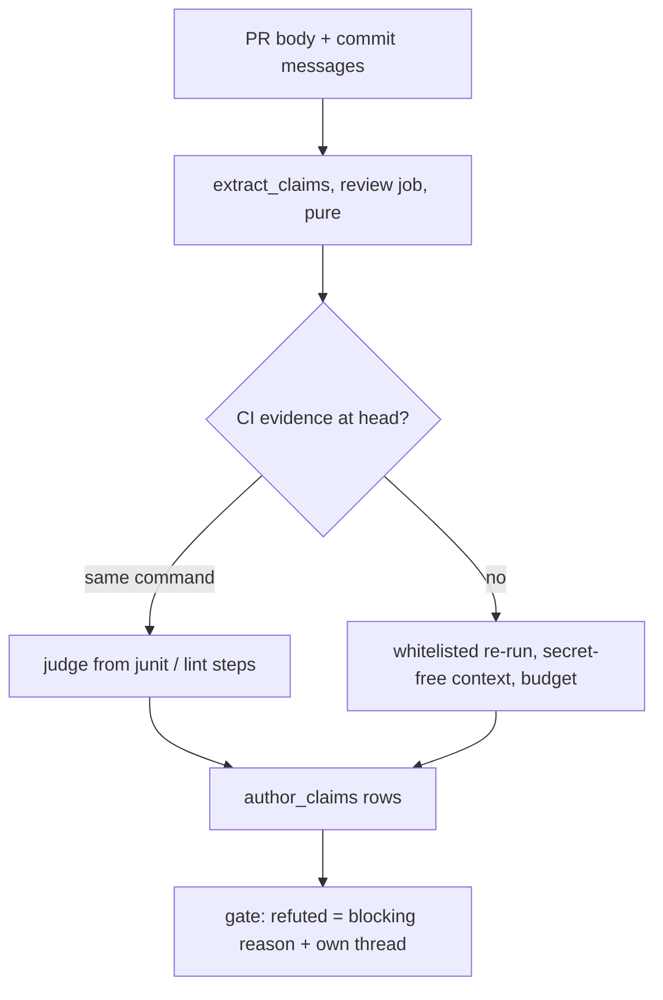

# A PR states what was run, and the gate re-runs it at the head

## Intent

Owner rule, 2026-10-26: « ne fais pas d'hypothèse, vérifie ce que tu
avances ». It applies to agents as much as to people, and to the author
of a PR as much as to its reviewers. Today a PR body says
"3403 passed, 50 skipped" or "arch check green" and nothing in repoach
re-measures it. This spec reads the factual claims of a PR body and its
commit messages, re-runs the measurable ones at the head under a
whitelist and a budget, and turns a refuted claim into a blocking
finding. A claim nobody can measure is named as such, never counted as
green.

## Context

Facts measured on `origin/develop` `51a4065`, 2026-10-26 (read-only).

| # | Fact | Source |
|---|------|--------|
| F1 | `pr.body` is read in exactly three places, and each one only passes it to `resolve_spec` to extract a spec id: `src/repoach/review/orchestrator.py:590`, `src/repoach/review/coder_findings.py:576`, `src/repoach/cli/review_cmds.py:785`. No other read of a PR body exists under `src/repoach`. | `grep -rn "pr.body"` |
| F2 | The reviewers never see the body. The orchestrator keeps `pr.title` (line 585) for the lessons query (line 668), and nothing else from the PR description. | `orchestrator.py:579-668` |
| F3 | Every verifier judges reviewer output or spec selectors, never the author: `hallucination_guard.py` (reviewer hallucination modes), `finding_verifiers.py` (moves reviewer findings `proposed` → `verified`/`refuted`), `refuter.py` (judged reviewer findings), `head_reverify.py` (older-head findings), `spec_gate.py` (presence of the spec's selectors). `ClaimType` has seven members, all reviewer claims. | module docstrings; `findings.py:48-57` |
| F4 | The last five merged PRs carry factual claims (table below, heads pinned). None of them was re-measured by a stored component (F1-F3). | `gh pr view <n> --json body,headRefOid` |
| F5 | Neither `docs/PR_TEMPLATE.md` nor `.github/pull_request_template.md` exists. This spec creates both. | `ls` at `51a4065` |
| F6 | `ci.yml` runs `pytest -q tests/unit -n auto --dist worksteal` (line 91) and `pytest -q tests/integration ...` (line 94) without `--junitxml`. There is no junit report to reuse today. | `.github/workflows/ci.yml` |
| F7 | The review job must never execute PR-authored code: no `pip install`, no `pytest`, no import from the head. Running the acceptance tests belongs to a trusted, secret-free context. | SP-CI-SECRETS-ISOLATION "What" 2; `spec_gate.py` docstring |
| F8 | `scripts/ci_local.sh --fast` is the lint-only mode (`ci_local.sh:8,36`). The CI job `Test suite (Python X)` runs the same lint steps (ruff check, ruff format, inline comments, silent except, CONTRIBUTING, AI attribution, edge honesty; `ci.yml:59-84`). | files cited |
| F9 | repoach's own `develop` opens its PR with a body that holds no measurement: "Autonomous NIM Developer implementation of …", `Spec:`, `Summary:` (`dev_runner.py:2091-2098`). | file cited |
| F10 | The gate's refusal reasons are a flat list of strings appended in `merge_gate.py:180-201`. | file cited |
| F11 | SP-CI-RED-IS-EVIDENCE is a draft (PR #249); SP-AGENT-CONTEXT-LOOP is a draft on `docs/sp-agent-context-loop`; SP-PR-THREADS-REMEMBER-AND-CLOSE is being written in parallel. They are cited by id; this spec does not restate them. | branches, F8 of SP-RED-STOPS-THE-LINE |
| F12 | Re-measured for this spec: `pytest -q -n 8 tests/unit` at #254's head `f3050df`, claimed "3425 passed". Measured: `11 failed, 3436 passed, 50 skipped in 813.88s`, on a local venv (Python of `repoach/.venv`, detached worktree, load ~7). The 11 failures are in `test_review_plan_executor.py` (for example, `self_verified is False`, reason `pytest_red`), and they look environmental. So one honest re-run, outside the CI's environment, already disagrees with the claim on both `passed` and `failed`. A re-run is only evidence when its environment is named. The run also took 13.5 minutes (cost, Q3). | run 2026-10-26, `PYTHONPATH=<head>/src`, `-n 8` |

The five bodies (F4):

| PR | Head | Claims stated in the body |
|----|------|---------------------------|
| #258 | `574612f` | "repoach, 7 PRs: `#255, …, #257`, no cycle"; "Yoob, 11 MRs"; "6 MRs armed at once" (hand-computed) |
| #257 | `5be3b2f` | "5/5 passed" under `-n 8`; "Hog suite: 3403 passed, 50 skipped"; "`pytest -q tests/integration`: 74 passed, 2 skipped"; "`repoach arch check --base origin/develop` and `--base develop`: ok"; "`scripts/ci_local.sh --fast`: all gates passed" |
| #254 | `f3050df` | "`pytest -q -n 8 tests/unit`: 3425 passed"; "`pytest tests/integration`: 74 passed"; arch check on two bases ok; `ci_local --fast` green; "`judged 8, refuted 2, deferred 1`" |
| #253 | `56aa61c` | "`review gate 246` -> `merge: true`, 20 planned, 0 missing"; "`review pr 246 --dry-run` -> … (planned 20, missing 0), 0 model calls" |
| #252 | `4156810` | "arch check and ci_local --fast green" |

## Decisions (orchestrator 2026-10-26)

- D1. **The extractor is mechanical.** No model reads the body to find
  claims. A model would be one more unverified author. Rules R1-R8
  below are regular expressions over Markdown statements.
- D2. **Two tiers of input.** A `## Measured` section written to the
  template grammar is parsed exactly. Prose elsewhere is read
  best-effort by R1-R8. An indicative success sentence with no command
  is reported, not guessed at.
- D3. **Execution never happens in the review job** (F7). Extraction is
  pure text and runs in the review job. Re-running runs in the
  secret-free verification context: repoach installed from the base
  ref, the head checked out in a separate directory, environment
  scrubbed of every provider key and write token. Locally, it runs in
  the head worktree pinned by SP-REVIEW-PINS-HEAD.
- D4. **The whitelist is argv, not shell.** Each runnable kind maps to a
  fixed argv built by repoach. Nothing from the body reaches a shell.
  Only the parts named in the table below are copied from the claim,
  each validated.
- D5. **CI evidence first** (G5). When the CI already ran the same
  canonical command at the same head, the claim is checked against the
  CI's result, and nothing is re-run.
- D6. **A refuted claim blocks like a verified finding.** It is a
  finding of claim type `author_claim_refuted` with status `verified`.
  It reaches the gate's open-blocking count with no other gate change.
- D7. This spec does not re-verify reviewers (G6).

## Goals

- G1. **Extractor.** `extract_claims(body, commit_messages)` returns typed
  claims. Types:
  - `test_run`: a pytest command plus expected counts (`passed`,
    `skipped`, `failed`, `xfailed`, `errors`; only the counts stated);
  - `command_green`: a whitelisted command plus a success word (`ok`,
    `green`, `passed`, `clean`, `all gates passed`). Known aliases are
    accepted without backticks: `arch check` → `repoach arch check`,
    `ci_local --fast` / `ci_local.sh --fast` → `scripts/ci_local.sh --fast`,
    `ruff` → `ruff check`;
  - `count`: an integer plus a noun from {files, specs, PRs, MRs, tests,
    commits, findings} plus a stated method (a backticked command in the
    same statement);
  - `exists`: a backticked repository path containing `/`, optionally
    `::symbol`;
  - `measured`: one or more numbers plus a backticked command in the same
    statement;
  - `unmeasurable`: a statement in scope that holds a success word
    (`pass`, `passes`, `passed`, `green`, `ok`, `works`, `clean`), a count
    pattern (R1's, or `\d+ <noun>` with the `count` nouns) or a ratio
    (R3), but no command the other types accept. In scope means under a
    heading matching `/measur|verif|check|test|result/i`, or anywhere in a
    body that has no heading.
  Each claim records `text` (the statement verbatim), `type`, `command`
  (canonical argv or null), `expected` (dict), `source`
  (`body` or `commit:<sha7>`), `indicative` (bool).
- G2. **Verifier.** `verify_claims(claims, head_tree, budget)` re-runs
  each measurable claim at the head, bounded by
  `claim_timeout_s`, `claims_total_budget_s` and `pytest_workers_max`.
  Each claim ends in exactly one status:
  - `CONFIRMED`, with the measured value;
  - `REFUTED`, with the measured value and the head SHA;
  - `NOT_MEASURABLE`, with a reason;
  - `SKIPPED`, with the cost reason (`timeout`, `budget`, `cap`).

  Whitelist (the only runnable kinds):

  | Kind | Canonical argv | Copied from the claim | Parser |
  |------|----------------|-----------------------|--------|
  | pytest | `<python> -m pytest -q -p no:cacheprovider [-n K] [-k E] [-m M] <selectors>` | selectors (paths or node ids under the configured test roots, each must exist at the head), `-n` (capped), `-k`, `-m` | last pytest summary line → counts |
  | arch | `repoach arch check --base <ref>` | `<ref>`, must resolve in the checkout | exit code 0 |
  | ruff | `ruff check [paths]`, `ruff format --check [paths]` | paths that exist at the head | exit code 0 |
  | exists | `git ls-files -- <path>` + an AST lookup for `::symbol` | path, symbol | non-empty / symbol defined |
  | count | `git ls-files -- <pathspec>` → line count; forge `open_pull_requests(base)` → count | pathspec; base | integer |

  `scripts/ci_local.sh --fast` is **not** runnable: it is a shell script
  from the head. It is checked through CI evidence (G5, F8), or it ends
  `NOT_MEASURABLE`. `gh pr list` is never shelled: a PR count goes
  through the forge protocol, so GitLab MRs are counted the same way
  (SP-UNIVERSAL-FORGE).
- G3. **Findings and the gate.**
  - A `REFUTED` claim is a finding with
    `claim_type = author_claim_refuted`, status `verified`, severity
    `blocker`. Its text quotes the claim and states
    `measured <value> at <sha7>`. It is posted as its own thread
    (SP-PR-THREADS-REMEMBER-AND-CLOSE) with the hidden marker of
    SP-POSTING-REPLAY-DEDUPES. It closes in two ways: the body or commit
    is corrected (the claim disappears or now matches), or a later head
    makes it true (re-checked by SP-GATE-REVERIFIES-AT-HEAD).
  - The gate adds one reason per refuted claim:
    `author claim refuted: "<text>" measured <value>`.
  - An `unmeasurable` claim with `indicative = true` ("tests pass") is a
    non-blocking finding `author_claim_unmeasured` (severity `minor`). It
    asks for the command and the counts in the `## Measured` shape.
  - `docs/PR_TEMPLATE.md` gains a `## Measured` section with that shape,
    and `.github/pull_request_template.md` carries the same text.
- G4. **The agent's hand-back is the PR body.**
  - repoach's own developer writes its PR body with a `## Measured`
    section, one line per gate it ran at its last commit (test command
    and counts, lint, arch), so the extractor sees it (F9).
  - The `repoach review` report JSON gains
    `author_claims: [{text, type, status, measured, reason, source}]`.
- G5. **Cost.** Before re-running a claim, the verifier looks in the CI
  evidence ledger of SP-CI-RED-IS-EVIDENCE for a check at the same head
  that ran the same canonical command:
  - a pytest claim is matched to the CI's junit report for the same
    selector (the counts do not depend on `-n`);
  - `ci_local --fast` is matched to the lint steps of `Test suite`.
  On a match the claim is judged from the evidence and records
  `measured_from: ci:<check>@<attempt>`. The CI must emit junit
  (`--junitxml`) for this to work (F6). That workflow edit is
  hand-implemented, per the SP-CI-SECRETS-ISOLATION executor rule.
- G6. Reviewers' own claims are re-checked by SP-REFUTER-JUDGES-WHAT-IT-CAN
  and SP-GATE-REVERIFIES-AT-HEAD. This spec only covers the author.

### Extraction rules (G1, prose tier)

- R0. **Statements.** The text is split into statements: one per bullet
  item, one per sentence of a paragraph. Excluded: fenced code blocks,
  `>` quotes, HTML comments, and trailer lines matching
  `^(Spec|Merge-After|Implements|Depends-On|Co-Authored-By):`.
- R1. **Test runs.** A statement holding a backticked `pytest …` or
  `python -m pytest …` and the count pattern
  `(\d[\d  ,]*) (passed|skipped|failed|xfailed|errors?)` is a `test_run`.
  Thin spaces and spaces inside a number are removed.
- R1b. **Commands.** A backticked token is a command when its first word
  matches `^[a-z][\w./-]*$` and the token is followed in the statement by
  `->`, `→` or `:`, or when it is inside a `## Measured` line. `arch check`
  with no `--base` canonicalises to `--base origin/<integration_branch>`.
- R2. **Command continuation.** A backticked fragment that starts with
  `--` and follows a whitelisted command in the same statement inherits
  that command. "`repoach arch check --base origin/develop` and
  `--base develop`: ok" yields two claims.
- R3. **Repetitions.** A ratio `N/M passed` is `unmeasurable` with
  reason `repetition under load is not re-run`. Ratios are matched and
  removed before R1, so `5/5 passed` never reads as `5 passed`.
- R4. **Measurements.** A backticked command that is not whitelisted,
  next to numbers, is `measured`. Its command is stored verbatim, and it
  is verified `NOT_MEASURABLE` with
  `not whitelisted: <cmd>; whitelist: pytest, repoach arch check, ruff, git ls-files, forge PR count`.
- R5. **Other PRs.** A claim whose command names another PR or MR
  number (`review gate 246`) is verified `NOT_MEASURABLE` with
  `claim measures #246, not this PR's head` (see Q2).
- R6. **Paths.** An `exists` claim is a standalone backticked token
  (not inside a command) with a `/` and either a file extension or a
  `::symbol`. Bare file names, bare symbols and refs such as
  `origin/develop` are not claims.
- R7. **Duplicates.** Claims equal in (type, canonical command, expected)
  are merged; the first statement's text is kept.
- R8. **Tense.** Future or conditional statements ("this spec adds",
  "would merge", "will") are not claims.

### The `## Measured` section (G3, strict tier, `format:pr-measured-section`)

```markdown
## Measured

Head: <sha7>
- `pytest -q -n 8 tests/unit` → 3425 passed, 50 skipped
- `pytest -q tests/integration` → 74 passed, 2 skipped
- `repoach arch check --base origin/develop` → ok
- `scripts/ci_local.sh --fast` → ok
- `git ls-files -- docs/specs | wc -l` → 212
```

Each line is `- \`<command>\` → <expected>`. A line that does not parse
is reported as `unmeasurable`, reason `malformed Measured line`. The
`Head:` line is optional. When it is present and differs from the
verified head, every status records both SHAs.

## Non-Goals

- NG1. **Not a defence against a malicious author.** The re-run executes
  head code: a hostile PR can make its own tests print anything. The
  target is the stale or mistaken claim, which is the failure mode
  observed (F4). Hostile code is handled by SP-CI-SECRETS-ISOLATION.
- NG2. No arbitrary shell, ever: no `bash -c`, no pipes, no script from
  the head. `| wc -l` in the template is parsed as the `count` kind, not
  executed.
- NG3. No model judges an author claim, and none extracts one (D1).
- NG4. Reviewer claims are out of scope (G6).
- NG5. Mutation checks, timings, load figures and token counts stay
  `unmeasurable`. Re-running them is neither cheap nor deterministic.

## Assumptions

- A1. The per-PR ledger persists between the review job and the gate
  (SP-CI-LEDGER-PERSISTS).
- A2. The verification context can build the head's virtualenv the way
  CI does (`pip install -e .[dev]` into a scratch venv), with no secrets
  in its environment (F7).
- A3. Every forge exposes the PR body and the commit messages of the
  head (SP-UNIVERSAL-FORGE). GitLab MR descriptions behave like GitHub
  PR bodies.

## Interface

```python
# src/repoach/review/author_claims.py
class AuthorClaimType(StrEnum):
    TEST_RUN = "test_run"; COMMAND_GREEN = "command_green"; COUNT = "count"
    EXISTS = "exists"; MEASURED = "measured"; UNMEASURABLE = "unmeasurable"

@dataclass(frozen=True)
class AuthorClaim:
    claim_id: str            # sha256(type|canonical command|expected)[:16], stable across replays
    text: str
    type: AuthorClaimType
    command: tuple[str, ...] | None
    expected: Mapping[str, int | bool | str]
    source: str              # "body" | "commit:<sha7>" | "measured-section"
    indicative: bool

def extract_claims(body: str, commit_messages: Sequence[tuple[str, str]]) -> list[AuthorClaim]: ...

# src/repoach/review/claim_verifier.py
class ClaimStatus(StrEnum):
    CONFIRMED = "CONFIRMED"; REFUTED = "REFUTED"
    NOT_MEASURABLE = "NOT_MEASURABLE"; SKIPPED = "SKIPPED"

@dataclass(frozen=True)
class ClaimVerdict:
    claim: AuthorClaim
    status: ClaimStatus
    measured: Mapping[str, int | bool | str] | None
    head_sha: str
    reason: str               # empty only on CONFIRMED
    measured_from: str        # "rerun" | "ci:<check>@<attempt>" | ""
    env: Mapping[str, str]    # python, platform, deps_hash; empty when nothing ran
    elapsed_s: float

def verify_claims(claims, *, head_tree: Path, head_sha: str, gates: GatesConfig,
                  ci_evidence: CiEvidence | None, budget: ClaimBudget,
                  forge: Forge | None = None) -> list[ClaimVerdict]: ...
```

`ClaimType` (`findings.py`) gains `AUTHOR_CLAIM_REFUTED = "author_claim_refuted"`
(blocking, in `MECHANICAL_CLAIM_TYPES`) and
`AUTHOR_CLAIM_UNMEASURED = "author_claim_unmeasured"` (never blocking).

Table `author_claims(pr_number, head_sha, claim_id, text, type, status, measured_json, reason, measured_from, recorded_at)`,
primary key `(pr_number, head_sha, claim_id)`. It is written by the
verification context and read by the gate and the report.

CLI: `repoach claims extract <pr>` (pure, prints the claims table as
JSON) and `repoach claims verify <pr> [--head SHA] [--budget-s N]`. Both
emit one JSON document on stdout (SP-CLI-STDOUT-ONE-JSON).

Report JSON (`repoach review pr`): `author_claims: [{text, type, status, measured, reason, source}]`.
`status` is null when the claims were extracted but not yet verified.

## Behavior

### Nominal

1. The review job runs `extract_claims` on the body plus the commit
   messages of the PR range. It stores the claims (no status) and adds
   them to the report.
2. The verification context runs `verify_claims` at the head. Claims
   are processed cheapest first: `exists`, `count`, ruff, arch, then
   pytest. For each claim it looks up CI evidence first (G5), then
   re-runs it under the whitelist with `claim_timeout_s`, decrementing
   the total budget.
3. A `REFUTED` verdict upserts a finding keyed on
   `(pr, claim_id)`. It is posted once, as its own thread, with the
   replay marker. An `indicative` `unmeasurable` claim upserts the
   non-blocking finding.
4. The gate reads `author_claims` at its head. Each `REFUTED` row adds
   `author claim refuted: "<text>" measured <value>`. A missing
   verification at the head is reported as `author claims not verified
   at <sha7>`, never as green.

### Edge cases

- **The number moved because develop advanced.** For example, 3425
  claimed and 3431 measured after a merge of develop: `REFUTED`, with
  `claimed 3425, measured 3431 at <sha7>`. The author updates the body,
  and the next verification at that head confirms it. The reason never
  says "lie": it states both numbers and the head.
- **A typo in the selector** (`tests/unti`): the path does not exist at
  the head, so the claim is `REFUTED` with
  `selector not found: tests/unti`. The author named something
  that is not there. An existing selector that collects 0 tests is
  `REFUTED` with `measured 0 collected`.
- **`Spec:` / `Merge-After:` lines** are trailers (R0), not claims.
- **A command that is not whitelisted** (`repoach queue`,
  `review gate 246`): `NOT_MEASURABLE`, and the reason names the
  whitelist (R4).
- **Budget exceeded:** every claim not started is `SKIPPED`, reason
  `budget: <spent>s of <budget>s`. The gate prints
  `author claims skipped: <n> (budget)`. A `SKIPPED` claim is never
  counted as `CONFIRMED`.
- **A claim timeout:** `SKIPPED`, reason `timeout after <n>s`.
- **More than `claims_per_pr_max` claims:** the claims beyond the cap
  are `SKIPPED`, reason `cap: <n> claims`.
- **A count with no stated command** ("7 PRs", #258): `unmeasurable`,
  not indicative, so no finding.
- **Claims in a commit message superseded by the body.** When the same
  claim id appears in both, the body wins, and the commit claim is
  merged into it (R7).
- **The body is edited after verification.** A new body changes the
  claim ids. Claims that disappeared close their threads (SP-PR-THREADS-…),
  and new claims are verified at the same head.
- **The re-run environment differs from the author's** (F12): every
  verdict records `env` (Python version, platform, `pip freeze` hash).
  A `REFUTED` test_run whose only discrepancy is `failed > 0` in an env
  that differs from the CI's is `NOT_MEASURABLE`, reason
  `env differs from CI: <diff>`, never `REFUTED`. CI evidence (G5) is
  preferred for that reason.
- **The pytest summary is missing** (crash, interrupted):
  `NOT_MEASURABLE`, reason `no pytest summary line; exit <code>`.

### Failure scenarios

- **The verification context cannot build the head env:** every
  runnable claim is `NOT_MEASURABLE`, reason `env build failed: <tail>`.
  Nothing is `CONFIRMED`.
- **The forge is unreachable for a PR count:** `NOT_MEASURABLE`, reason
  `forge unreachable`.
- **The ledger write fails:** the gate sees no row at the head and
  reports `author claims not verified at <sha7>`.

## Architecture Impact

- Adds dependency: SP-AUTHOR-CLAIMS-ARE-MEASURED -> SP-REFUTER-JUDGES-WHAT-IT-CAN (G6 division of labour: reviewers' claims there, the author's here).
- Adds dependency: -> SP-GATE-REVERIFIES-AT-HEAD (a refuted claim of an older head is re-checked at the gate's head).
- Adds dependency: -> SP-POSTING-REPLAY-DEDUPES (the hidden marker that keeps a replay from reposting the claim thread).
- Adds dependency: -> SP-AGENT-CONTEXT-LOOP (the coder's hand-back is produced by the agent loop; its report becomes the `## Measured` section).
- Adds dependency: -> SP-PR-THREADS-REMEMBER-AND-CLOSE (one thread per refuted claim, closed when corrected).
- Adds dependency: -> SP-CI-RED-IS-EVIDENCE (the CI evidence ledger G5 reads).
- Adds dependency: -> SP-CI-LEDGER-PERSISTS (the `author_claims` table crosses from verification to gate).
- Adds dependency: -> SP-CI-SECRETS-ISOLATION (where re-runs may execute).
- Adds dependency: -> SP-FINDINGS-INIT-RACE (owner of `findings.py`, which gains two claim types).
- Adds dependency: -> SP-ORCH-DOCSTRING (owner of `orchestrator.py`, which calls the extractor).
- Adds dependency: -> SP-UNIVERSAL-FORGE (body, commits, PR counts through the protocol).
- Adds dependency: -> SP-UNIVERSAL-GATES (test roots and Python resolution for the pytest kind).
- Adds dependency: -> SP-REVIEW-PINS-HEAD (the local re-run happens in the pinned head worktree).
- New shared state: `db:table:author_claims`. New contracts: `format:author-claims-json`, `format:pr-measured-section`.
- Unowned files edited: `merge_gate.py` (one reason), `cli/review_cmds.py` (report field), `dev_runner.py` (PR body), `.github/workflows/ci.yml` (`--junitxml`, hand-implemented).

## Diagram



## Acceptance Criteria

- [ ] AC1: `pytest -q tests/unit/test_author_claims_extract.py::test_five_real_bodies` → green. `tests/fixtures/author_claims/<n>.json` holds the body of each of #258 (`574612f`), #257 (`5be3b2f`), #254 (`f3050df`), #253 (`56aa61c`) and #252 (`4156810`), copied verbatim with its head SHA. The extracted table equals `<n>.expected.json`, which holds exactly these measurable claims:
  - #258: `exists` `docs/specs/2026-10-26_SP-MERGE-QUEUE-BY-SPEC-DEPENDENCIES_sequential-merges-follow-the-spec-graph.md`. The three counts ("7 PRs", "11 MRs", "6 MRs") are `unmeasurable`, not indicative.
  - #257: `test_run` `pytest -n 8 tests/unit` {passed 3403, skipped 50}; `test_run` `pytest -q tests/integration` {passed 74, skipped 2}; `command_green` `repoach arch check --base origin/develop`; `command_green` `repoach arch check --base develop`; `command_green` `scripts/ci_local.sh --fast`. `exists`: `tests/integration/test_fresh_head_concurrent.py::test_concurrent_head_guard_integration`, `tests/unit/test_review_head_guard.py::test_orchestrator_head_guard_overlaps_reviewer_fanout` and `tests/overlap_fakes.py`. One `unmeasurable`: the Verification bullet's "5/5 passed" (R3). The Update's "5/5 passed" sits under a heading that is out of scope. Its `arch check` and `ci_local.sh --fast` merge into the claims above (R1b, R7).
  - #254: `test_run` `pytest -q -n 8 tests/unit` {passed 3425}; `test_run` `pytest tests/integration` {passed 74}; `command_green` arch check with `--base origin/develop` and with `--base origin/main`; `command_green` `scripts/ci_local.sh --fast`. Nothing else: `judged 8, refuted 2, deferred 1` is not a command (R1b), and "13 of 13 findings" sits under `## Why`, which is out of scope.
  - #253: two `measured` claims, `review gate 246` {merge true, planned 20, missing 0} and `review pr 246 --dry-run` {planned 20, missing 0, model calls 0}. The `Spec:` line yields nothing.
  - #252: `command_green` `repoach arch check --base origin/develop` (canonical default base, R1b) and `command_green` `scripts/ci_local.sh --fast`, both through the alias rule.
- [ ] AC2: `pytest -q tests/unit/test_claim_verifier.py::test_true_pytest_count_is_confirmed` → green. A fixture repository has 3 passing tests. The claim "`pytest -q tests/unit`: 3 passed" is `CONFIRMED`, with `measured {passed: 3}` and `measured_from: rerun`.
- [ ] AC3: `pytest -q tests/unit/test_claim_verifier.py::test_false_pytest_count_is_refuted_with_value` → green. The same fixture with the claim "5 passed" is `REFUTED`, with `measured {passed: 3}`, the head SHA, and reason `claimed 5 passed, measured 3 passed at <sha7>`.
- [ ] AC4: `pytest -q tests/unit/test_claim_verifier.py::test_prose_is_not_measurable` → green. For the body `## Checks\n- tests pass\n- works fine`, both statements are `unmeasurable` and verified `NOT_MEASURABLE` with reason `no command stated`. Each raises one `author_claim_unmeasured` finding. The gate's decision is unchanged by them. "works fine" under `## Why` yields no claim.
- [ ] AC5: `pytest -q tests/unit/test_claim_verifier.py::test_unwhitelisted_command_names_the_whitelist` → green. "`make check`: ok" is `NOT_MEASURABLE`, and the reason contains `whitelist: pytest, repoach arch check, ruff, git ls-files, forge PR count`. No subprocess with argv[0] `make` is spawned (asserted on the injected runner).
- [ ] AC6: `pytest -q tests/unit/test_claim_verifier.py::test_selector_typo_is_refuted` → green. "`pytest tests/unti`: 3 passed" is `REFUTED`, reason `selector not found: tests/unti`, and pytest is not run.
- [ ] AC7: `pytest -q tests/unit/test_claim_verifier.py::test_budget_exceeded_is_skipped_named` → green. With `claims_total_budget_s=1` and a runner that takes 2 s, the first claim is `SKIPPED` (`timeout`) and the rest are `SKIPPED` (`budget: …`). The gate prints `author claims skipped: <n> (budget)`, and no claim is `CONFIRMED`.
- [ ] AC8: `pytest -q tests/unit/test_claim_verifier.py::test_ci_junit_is_reused` → green. Given a CI evidence row with a junit report for `tests/unit` at the head, the claim "`pytest -q -n 8 tests/unit`: 3425 passed" is judged from it: `measured_from: ci:Test suite (Python 3.13)@1`, and the runner is called zero times.
- [ ] AC9: `pytest -q tests/unit/test_claim_verifier.py::test_moved_number_names_both_values` → green. Claimed 3425, measured 3431: `REFUTED`, reason `claimed 3425 passed, measured 3431 passed at <sha7>`.
- [ ] AC10: `pytest -q tests/unit/test_author_claims_gate.py::test_refuted_claim_blocks_with_text` → green. One `REFUTED` row at the head makes the gate return `merge: false`, with reason `author claim refuted: "`pytest -q tests/unit`: 5 passed" measured 3`. With the row `CONFIRMED`, that reason is absent.
- [ ] AC11: `pytest -q tests/unit/test_author_claims_gate.py::test_refuted_claim_posted_once` → green. Posting at the head twice (fresh, then replay) leaves exactly one thread for the claim on the fake forge. The thread carries the replay marker.
- [ ] AC12: `pytest -q tests/unit/test_author_claims_gate.py::test_corrected_body_closes_thread` → green. The body is edited to the measured value at the same head: the claim is `CONFIRMED`, the finding settles, the thread closes, and the gate reason disappears.
- [ ] AC13: `pytest -q tests/unit/test_author_claims_extract.py::test_trailers_are_not_claims` → green. `Spec: SP-X`, `Merge-After: #12` and `Implements: SP-Y` yield no claims.
- [ ] AC14: `pytest -q tests/unit/test_pr_template_measured.py` → green. `docs/PR_TEMPLATE.md` contains a `## Measured` section whose example lines all parse under `format:pr-measured-section`. `.github/pull_request_template.md` is byte-equal to it.
- [ ] AC15: `pytest -q tests/unit/test_author_claims_extract.py::test_developer_pr_body_has_measured_section` → green. The PR body built by `dev_runner` for a run whose gates were green contains a `## Measured` section. Its claims (test command plus counts, lint, arch) are extracted as `test_run` / `command_green`.
- [ ] AC16: `pytest -q tests/integration/test_author_claims_cycle.py` → green. On a fixture PR, `repoach review pr <n> --dry-run` prints `author_claims` with one entry per extracted claim, and `status` is null. `repoach claims verify <n>` then fills the statuses, and `repoach review gate <n>` refuses on the refuted one. The review step spawns no pytest subprocess (asserted).

## Open Questions

- Q1. Does an indicative unmeasurable claim ("tests pass", no command)
  become blocking after a grace period (for example, from the second
  head of a PR on), or stay a non-blocking ask forever?
- Q2. Is a claim measured on another PR (#253's `review gate 246`)
  verified by fetching that PR's current head, or is it always
  `NOT_MEASURABLE`, as R5 does in v0.1?
- Q3. When CI evidence is missing, is a full-suite re-run (minutes,
  F12) acceptable within the budget, or should a full-suite claim be
  `SKIPPED (cost)` and only targeted selectors be re-run?
- Q4. Does the same rule apply to Yoob merge requests from day one
  (bodies such as "88/88 cœurs"), or after repoach's own PRs have
  carried a `## Measured` section for some time?
