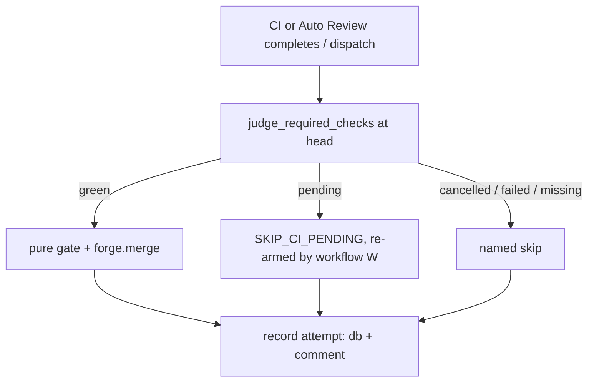

# Auto-merge waits for the named required checks, never for itself, and a green PR is merged once

## Intent

On 2026-10-26 four PRs into `develop` were green, approved and accepted
by the pure gate, and the bot merged none of them. The merge step judged
"is CI done?" from GitHub's rollup `mergeStateStatus`, which counts every
check on the head: the merge job's own run and the review bot's queued
jobs included. It saw `UNSTABLE`, skipped, and nothing fired again.
After this spec the merge decision waits only on a committed list of
required checks, named one by one. A pending required check re-arms the
merge instead of dropping it. A cancelled placeholder is not a red. A
burst of owner events no longer cancels every run. Every attempt is
recorded with its reason.

This spec is the **bridge** until `repoach queue run`
(SP-MERGE-QUEUE-BY-SPEC-DEPENDENCIES, PR #258) replaces the two bot merge
paths. `queue run` must honour G1–G3 too: it reads required checks
through `merge_wait.judge_required_checks`, never through
`mergeStateStatus`.

## Context

Measured on `repoachhq/repoach`, `origin/develop` at `51a4065`, `main` at
`e597bc6` (released 2026-10-22), on 2026-10-26, with `gh run view`,
`gh api …/actions/jobs/<id>/logs` and
`gh api …/commits/<sha>/check-runs`.

| # | Fact | Where |
|---|------|-------|
| F1 | **The refusal is not in the CI gate. It is in the forge merge.** `run_auto_merge` first calls `evaluate_ci_gate` on the **named** required checks (`Test suite (Python 3.11)`, `Test suite (Python 3.13)`), then `decide_at_head`, then `merge_change` → `GitHubForge.merge`. `merge` reads `gh pr view --json mergeStateStatus,statusCheckRollup,…` and `_merge_refusal` returns `pending` when the state is `BLOCKED`/`BEHIND`/`UNSTABLE` **and any rollup entry** is queued or running (`_rollup_pending` reads every entry, required or not). `_REFUSAL_OUTCOMES["pending"]` = `SKIP_CI_PENDING`, exit `5`. | `src/repoach/review/auto_merge.py:1037`, `:1090`, `:1140-1153`, `:146-147`; `src/repoach/forge/github.py:100-122`, `:125-136`, `:1574-1601`, `:1628` |
| F2 | **Every UNSTABLE refusal passed both real gates first.** Runs 40288565429 (merge-on-ci, PR #259), 40285144378 (auto-review, #259) and 40282435740 (auto-review, #256) each log `ci_gate_poll … n_pending=0 n_failed=0`, then `pure_gate merge=True reasons=[]`, then `merge refused (pending): mergeStateStatus=UNSTABLE with checks still running`, `SKIP_CI_PENDING`. | run logs, lines ~371 (40288565429), ~1048 (40285144378), ~343 (40282435740) |
| F3 | **The in-run merge job waits on itself.** At 07:58:57Z the only running check on #259's head `ba9585eb` was `Auto-merge to develop` (started 07:58:02Z, completed 07:59:01Z): the job that was deciding. At 07:38:22Z the same holds for #256's head `c19344e4` (`Auto-merge to develop` 07:37:24Z → 07:38:26Z). The auto-review run is a `pull_request` run, so its jobs are check runs **on the PR head**. | check-runs of `ba9585eb…`, `c19344e4…` |
| F4 | **The event-driven merge waits on a job queued behind it.** merge-on-ci 40288565429 decided at 07:55:27Z. Its own check run sits on `main`'s SHA (`workflow_run`), so it is not on the head; the pending entry was the auto-review run's `Coder auto-fix loop`, which started at 07:56:33Z, after merge-on-ci released the single self-hosted runner. | check-runs of `ba9585eb…`; run 40288565429 |
| F5 | **The in-run path has never merged since the forge refactor.** All 23 `Auto-merge to develop` jobs that ran in `pull_request` auto-review runs from 2026-10-24 on: 0 `APPROVE`, 11 `SKIP_CI_PENDING` (all `UNSTABLE with checks still running`), 5 `SKIP_CI_TIMEOUT`, 2 `SKIP_CI_FAILED`, 5 `SKIP_GATE`. `_WAITS_ON_CHECKS` arrived with #208 (`1ce2cb6`, 2026-10-20) and is on `main`. | job logs; `git log -S_WAITS_ON_CHECKS` |
| F6 | **The event-driven path loses the same race in 5 of 19 decisions.** merge-on-ci `success` runs created since 2026-10-25 12:00Z: 21 runs. 2 of them are no-ops (`no open … PR at <sha> — nothing to merge`: 40201063218, 40292883221) and are excluded. The 19 decisive runs split into 7 `APPROVE` (#248, #251, #252, #253, #254, #257, #258), 5 `SKIP_CI_PENDING`, all `UNSTABLE` (40216601856 #250, 40221519387 #250, 40254394200 #254, 40284297500 #256, 40288565429 #259) and 7 `SKIP_GATE` (#256 ×2, #250, #249 ×2, #247, #246). **Counting method:** `gh api --paginate "repos/{owner}/{repo}/actions/workflows/merge-on-ci.yml/runs?per_page=100&created=>=2026-10-24"`, filtered on `conclusion == success` and `created_at >= 2026-10-25T12:00:00Z`. Each run's job is read through `actions/runs/<id>/jobs`, its log through `actions/jobs/<id>/logs` (`gh run view --log` returns empty on the older runs), and the first `"outcome"` and `resolved PR #` lines are kept. | job logs |
| F7 | **Nothing re-fires.** merge-on-ci listens to `workflow_run` of `["CI"]` only, with `conclusion == 'success'` and `event == 'pull_request'`. When CI completes before the review's merge job, and that job then skips, no later event exists for the head. | `.github/workflows/merge-on-ci.yml:17-20`, `:39-44` |
| F8 | **#247 and #249 are stranded by a different skip.** Their last attempts (in-run 40215051222 for #249 at 17:46Z, merge-on-ci 40217966040 at 17:45Z and 40206708603 for #247 at 15:25Z on 2026-10-25) were `SKIP_GATE: spec acceptance selectors not all present`. That is the rule SP-APPROVED-SPEC-WITHOUT-PLAN (#259) amends. #247's in-run job before that was `SKIP_CI_TIMEOUT` on `Test suite (Python 3.11)` (wait 0). A gate-rule change is not an event either, so they stay put (F7). | job logs |
| F9 | **#246: a burst of owner events cancels every run.** Between 15:53:57Z and 19:21:05Z on 2026-10-25, 16 `pull_request_review` runs on `docs/sp-agent-context-loop` all ended `cancelled`. They came in four bursts (15:53, 16:04, 19:03, 19:21). Each burst was **four reviews** posted under the owner's account (`jwfaye`, bodies signed `— Repoach review bot`, from a local `repoach review pr`) **plus one `issue_comment` (`edited`)**: the archive comment, whose **author** is `github-actions[bot]` (`comment.user.type == Bot`), edited with the owner's token, so the run's **actor** is `jwfaye` (run 40225618211). Every run's actor is `jwfaye`, so `cancel-in-progress: ${{ github.actor != 'github-actions[bot]' }}` evaluates to `true`. The comment run comes last, its `review` job is skipped by the `Bot` filter, but **the run still enters the workflow-level group** and cancels the in-flight review run. Net: zero review runs and zero merge attempts per burst. | `gh run list --branch docs/sp-agent-context-loop`; `gh api …/actions/runs/<id>` (actor); `.github/workflows/auto-review.yml:28-47`, `:64-72` |
| F10 | `gh pr checks 246` prints the cancelled placeholders as `fail` in its table. Its JSON says `state CANCELLED`, `bucket cancel`. `statusCheckRollup` holds 9 `CANCELLED` entries per review-bot job name, newer than the one `SUCCESS`. `classify_required_checks` keeps the latest `startedAt` per name and counts `CANCELLED` as failed. So a required check whose latest run was cancelled reads as red, even when an older run at the same head succeeded. | `gh pr checks 246 [--json]`; `src/repoach/forge/github.py:80-82`, `:218-262` |
| F11 | **No required checks are enforced by GitHub.** `branches/develop/protection` → 404; ruleset 25641051 (`develop`) has `deletion`, `non_fast_forward`, `pull_request` (0 approvals) and no `required_status_checks`. So `_required_check_names()` falls back to `DEFAULT_REQUIRED_CHECK_NAMES` (2 names), while `ci.yml` produces 5 jobs: `Test suite (Python 3.11/3.13)`, `wheel-build`, `wheel-smoke (3.11/3.13)`. | `gh api`; `src/repoach/forge/github.py:70-73`, `:1441-1446`; `.github/workflows/ci.yml:27-28`, `:128-129`, `:161-162` |
| F12 | **Attempts are written, then thrown away.** `run_auto_merge._persist` writes one `pr_merges` row per attempt (`outcome`, `notes`, no head SHA, no check names) into the job's copy of the db. Neither merge job uploads the db afterwards, so every row is lost when the job ends. An upload named `findings-ledger-<pr>` from merge-on-ci would **shadow** the real ledger: merge-on-ci picks the newest artifact of that name, then refuses it if `auto-review.yml` did not produce it. | `src/repoach/review/auto_merge.py:961-990`; `src/repoach/review/persistence.py:112-123`, `:286-321`; `.github/workflows/merge-on-ci.yml:126-163` (no upload step), `auto-review.yml:623-716` (no upload step) |
| F13 | merge-on-ci checks out and installs **`main`**, so a fix to its code or triggers reaches it only after a `develop → main` release. `workflow_run` itself fires only for the file on the default branch. The in-run `auto_merge` job uses `actions/checkout` with no `ref`, which on a `pull_request` event is the PR's merge ref, so it runs develop+PR code. | `.github/workflows/merge-on-ci.yml:11-15`, `:60-63`; `auto-review.yml:653-654` |
| F14 | The repository is **public**: GitHub-hosted runners cost no minutes. Every repoach job runs on the single self-hosted runner (`vars.REPOACH_RUNNER`). | `gh repo view --json visibility`; workflows `runs-on` |

## Goals

- **G1 The merge waits on named required checks, never on the rollup.**
  - `[auto_merge].required_checks` in `repoach.toml` is the committed
    list. Default (D4): the job names of the `CI` workflow, with the matrix
    expanded. Today that is the five names of F11.
    `DEFAULT_REQUIRED_CHECK_NAMES` becomes that default, and
    SP-CI-CHECKNAME-SYNC's derivation test covers all five.
  - `merge_wait.judge_required_checks(check_runs, required, head_sha)`
    is the only judgment: per name, the latest entry **at the head**
    that is not `CANCELLED` (G3) decides. It returns `green`,
    `pending(names)`, `failed(name=CONCLUSION…)`, `missing(names)` or
    `cancelled(names)`, using SP-CI-RED-IS-EVIDENCE's vocabulary.
  - `GitHubForge.merge` no longer reads `mergeStateStatus` to decide
    whether checks are pending. `_merge_refusal` keeps state, head moved,
    draft, conflict and `BEHIND`, and drops the
    `_WAITS_ON_CHECKS`/`_rollup_pending` branch. `UNSTABLE` and
    `BLOCKED` alone are no longer a refusal, because no check is required
    by the forge (F11). If GitHub still refuses, its error is the named
    `refused` outcome. A check that is not in the list (the merge job's
    own run, a review-bot job, ShellCheck) can never make the decision
    wait.
  - When the forge does enforce required checks (protection or ruleset
    readable and non-empty), the committed list must contain them.
    Otherwise `repoach doctor` names the difference, and the merge job
    logs `forge requires <names> not in [auto_merge].required_checks`.

- **G2 A pending required check re-arms the merge, through events.**
  - merge-on-ci's trigger becomes `workflow_run` on
    `workflows: ["CI", "Auto Review (review bots)"]`, plus
    `workflow_dispatch` with input `pr` for the operator and sweeps. The
    payload filter admits `event ∈ {pull_request, pull_request_review}`.
    `issue_comment` runs carry the default branch's SHA, so they are
    excluded. The success, same-repo and actor filters stay. The
    concurrency group stays per head branch, `cancel-in-progress: false`.
  - A skip on a pending required check is outcome `SKIP_CI_PENDING` with
    notes `pending: <name>[, <name>]; re-armed by workflow <W>`. `<W>`
    is the workflow that produces the check, read from the check run.
    The merge exits `5` (SP-MERGE-EXIT-CONTRACT), so the job releases
    the runner.
  - Every name in `required_checks` must be produced by a workflow in
    `rearm_workflows`. A name that is not is a configuration error,
    caught by the workflow test and `repoach doctor`: a check no event
    re-arms would strand every PR again.
  - **Mechanism chosen: events, not polling.** A poll bounded by
    `wait_s` holds the single self-hosted runner. The check it waits for
    then queues behind it: that is the PR #79 self-deadlock that
    SP-AUTOMERGE-EVENT-DRIVEN removed, and F4 shows it on 2026-10-26
    (`Coder auto-fix loop` started 66 s after the merge job released
    the runner). A second `workflow_run` source costs one merge-on-ci
    job per completed auto-review run, about 50 s of runner (07:54:43Z
    → 07:55:30Z in 40288565429). Whichever of CI and auto-review
    finishes last triggers the merge that succeeds.
  - Shipping order follows F13. G1 reaches the in-run job as soon as it
    is on `develop`; G2 and merge-on-ci's G1 only after the next
    `develop → main` release. Until then the four stranded PRs are
    recovered with `scripts/safe_merge.sh <n>`, one at a time.

- **G3 A cancelled placeholder is never a red, and a stranded PR is visible.**
  - In `judge_required_checks`, a `CANCELLED` entry is ignored when
    another entry of the same name exists at the same head. It does not
    matter whether that entry is older or newer. A name whose only
    entries at the head are `CANCELLED` is `cancelled`: outcome
    `SKIP_CI_CANCELLED`, non-fatal, notes
    `cancelled with no other run: <name>`. It is not merged and not
    counted as red.
  - `merge_wait.stranded(prs, attempts, now)` lists every open,
    non-draft PR whose required checks are `green` at its head since
    `t`, the latest required completion, and that has no attempt at that
    head after `t + stranded_grace_s`. The reason is
    `stranded: green since <t>, no merge attempt`, or
    `stranded: green since <t>, last attempt <OUTCOME> (<reason>) at <t0>`
    when the last attempt predates `t` or was a skip.
  - `repoach queue` (G4 of SP-MERGE-QUEUE-BY-SPEC-DEPENDENCIES) shows
    such a row with gate `stranded` and that reason. Until `queue` lands,
    `repoach review stranded [--base develop]` prints the same rows
    (table on stdout, `--json` one object). Both are read-only and make
    zero forge writes.
  - **Release sweep (D3).** `repoach review stranded --dispatch` runs
    `gh workflow run merge-on-ci.yml -f pr=<n>` once for each stranded
    PR, through the write barrier. It prints one
    `dispatched #<n> (<reason>)` line per PR on stderr, and the JSON
    lists the dispatched numbers. The `develop → main` release job runs
    it after the release lands, so a PR left behind by a gate-rule
    change (F8) is re-judged under the new rule. The sweep is retired
    when `queue run` lands.

- **G4 Owner-event bursts coalesce, and the merge job is never cancelled.**
  - `auto-review.yml` loses its workflow-level `concurrency`. A job
    skipped by its `if` then takes no concurrency slot, so the bot's
    archive-comment run can no longer cancel anything (F9).
  - A new first job, `coalesce`, runs only for `pull_request_review` and
    `issue_comment` events that pass the existing author filters (no
    `Bot`, allow-listed actor). It runs on `ubuntu-latest` (D1, F14: free,
    and it leaves the self-hosted runner alone), sleeps
    `coalesce_window_s` (60), and has job concurrency
    `coalesce-<pr>` with `cancel-in-progress: true`. Only the last event
    of a burst gets through.
  - `review` `needs: coalesce` and runs when that job succeeded or was
    skipped (a `pull_request` event is not delayed). Its job concurrency
    is `review-<pr>` with `cancel-in-progress: true` for owner events,
    as today.
  - `auto_fix` and `auto_merge` take job concurrency
    `merge-<head branch>` with `cancel-in-progress: false`. This is the
    same group merge-on-ci uses, so the two merge paths serialize per
    PR and a running merge job is never cancelled. GitHub keeps at most
    one *pending* job per group, so a newer pending merge job may replace
    an older pending one for the same PR. That is the only replacement,
    and it is documented, not avoidable.

- **G5 Every merge attempt is recorded with its reason, and survives the job.**
  - `pr_merges` gains `head_sha`, `pending_checks` (a JSON list of
    names), `trigger` (`auto-review:<run_id>`, `merge-on-ci:<run_id>`,
    `dispatch:<run_id>` or `cli`) and `rule_version` (the gate rule in
    force). `record_merge` writes them on every outcome.
  - Transport: the merge job upserts **one** PR comment with marker
    `<!-- repoach-merge-attempts:v1 -->`, holding the last
    `merge_attempts_kept_in_comment` (20) attempts as a fenced JSON
    block (`format:merge-attempts-comment`). It goes through the write
    barrier (SP-DRY-RUN-NEVER-POSTS). It never writes an artifact named
    `findings-ledger-*` (F12). Under G4 the comment edit's run takes no
    slot, so it cannot cancel anything.
  - `repoach review merge-attempts <pr>` prints one
    `format:merge-attempts-json` object on stdout
    (SP-CLI-STDOUT-ONE-JSON), read from the comment, else from the local
    db. On stderr it prints
    `merge attempts: <n>, last: <OUTCOME> on <check|reason> at <t> (<trigger>)`,
    for example `merge attempts: 2, last: SKIP_CI_PENDING on Test suite (Python 3.11)`.
    `repoach review line history <pr>` (SP-RED-STOPS-THE-LINE) shows
    the same line when it lands.

## Decisions (coordinator 2026-10-26, on open questions Q1–Q5 of v0.1)

- **D1 (Q1) `coalesce` runs on a GitHub-hosted runner** (`ubuntu-latest`).
  The repository is public, so it costs nothing (F14). It must never
  queue behind the self-hosted runner it protects.
- **D2 (Q2) The trusted-code fix is its own spec.** The in-run
  `auto_merge` job holds `contents: write` and installs the PR's merge-ref
  code, which violates SP-CI-SECRETS-ISOLATION (F13). It is tracked as
  `docs/tech_debt.md` row 101 and becomes SP-MERGE-JOB-RUNS-TRUSTED-CODE-ONLY.
  This spec does not touch it (NG5).
- **D3 (Q3) A release sweep re-arms stranded PRs.** `repoach review
  stranded --dispatch` dispatches merge-on-ci for every stranded PR. The
  release job runs it until `queue run` lands (G3).
- **D4 (Q4) `required_checks` defaults to all five CI jobs**: both
  `Test suite` jobs, `wheel-build` and both `wheel-smoke` jobs (G1). A
  wheel that does not install is a red the merge must see.
- **D5 (Q5) Coalesce only, never filter.** Review events that carry the
  bot signature are coalesced like any owner event (G4), never dropped.
  The re-fire exists so that a local `repoach review pr` re-runs CI's
  review.

## Non-Goals

- NG1: Replacing the bot merge paths with the queue. That is #258 /
  SP-MERGE-QUEUE-BY-SPEC-DEPENDENCIES; this spec is the bridge until
  `queue run` lands, and `queue run` adopts G1–G3.
- NG2: No change to the pure merge decision (`decide_at_head`,
  `compute_merge_decision`), to the findings-ledger transport, or to the
  rule that #259 amends (F8).
- NG3: No polling loop in any merge job (G2).
- NG4: No GitLab change. GitLab's adapter judges `head_pipeline.status`.
  Yoob's MRs arm `merge_when_pipeline_succeeds` themselves, and GitLab
  waits on the pipeline without an `UNSTABLE` analogue.
- NG5: Not fixing F13's second half: the in-run job holds
  `contents: write` and installs the PR merge ref's code. It is left to
  SP-MERGE-JOB-RUNS-TRUSTED-CODE-ONLY, tracked as `docs/tech_debt.md`
  row 101 (D2).

## Assumptions

- A1: GitHub's documented concurrency semantics. A group has at most
  one running and one pending item. A new pending item replaces the
  pending one. `cancel-in-progress` cancels the running one. A job
  skipped by `if` before it is queued takes no slot.
- A2: Check runs of a `pull_request` workflow are attached to the PR
  head SHA. Those of a `workflow_run` workflow are attached to the
  default branch SHA (F3, F4).
- A3: `workflow_run` for a `pull_request_review`-triggered run carries
  the PR head SHA. For an `issue_comment`-triggered run it carries the
  default branch SHA.

## Interface

```python
CheckJudgement = Literal["green", "pending", "failed", "missing", "cancelled"]

class RequiredChecksVerdict(BaseModel):
    state: CheckJudgement
    pending: list[str]
    failed: list[str]           # "name=CONCLUSION"
    missing: list[str]
    cancelled: list[str]
    green_since: datetime | None  # latest completed_at among required, when green
    rearmed_by: dict[str, str]  # pending name -> workflow name

def judge_required_checks(
    check_runs: Sequence[CheckRun], required: Sequence[str], head_sha: str
) -> RequiredChecksVerdict: ...

def required_checks(root: Path) -> list[str]:
    """[auto_merge].required_checks, else the CI workflow's job names (matrix expanded)."""

class MergeAttempt(BaseModel):
    pr_number: int
    head_sha: str
    outcome: str
    reason: str
    pending_checks: list[str]
    trigger: str
    rule_version: str
    recorded_at: datetime

class StrandedPR(BaseModel):
    pr_number: int
    head_sha: str
    green_since: datetime
    last_attempt: MergeAttempt | None
    reason: str

def stranded(
    prs: Sequence[PullRequest], verdicts: Mapping[int, RequiredChecksVerdict],
    attempts: Mapping[int, Sequence[MergeAttempt]], now: datetime, grace_s: int = 300,
) -> list[StrandedPR]: ...
```

New outcome: `OUTCOME_SKIP_CI_CANCELLED = "SKIP_CI_CANCELLED"`, in
`NON_FATAL_SKIP_OUTCOMES` (exit `5`).

`repoach.toml`:

```toml
[auto_merge]
# Check names the merge waits on. Default: the CI workflow's job names.
# required_checks = ["Test suite (Python 3.11)", "Test suite (Python 3.13)", "wheel-build", "wheel-smoke (3.11)", "wheel-smoke (3.13)"]
# Workflows whose completion re-arms the merge (G2).
# rearm_workflows = ["CI", "Auto Review (review bots)"]
# coalesce_s = 60
```

`format:merge-attempts-json`: `{"pr": int, "attempts": [MergeAttempt…], "count": int, "last": MergeAttempt | null}`.

CLI: `repoach review merge-attempts <pr>`,
`repoach review stranded [--base B] [--json] [--dispatch] [--dry-run]`.

## Behavior

### Nominal

1. `run_auto_merge` resolves the verified head
   (SP-AUTOMERGE-FRESH-HEAD), reads the head's check runs, and calls
   `judge_required_checks` with `required_checks(root)`.
2. `green`: the pure gate runs, then `forge.merge`, which no longer
   consults `mergeStateStatus` for checks. Outcome `APPROVE`, an attempt
   is recorded, the comment is upserted.
3. `pending`: outcome `SKIP_CI_PENDING`, notes name the checks and the
   re-arming workflow, an attempt is recorded, exit `5`. When that
   workflow completes, merge-on-ci runs step 1 again.

### Edge cases

- Only the merge job's own run, or a review-bot job, is running → not
  in the list → `green` → merge.
- Required check `CANCELLED` at 19:21 and `SUCCESS` at 14:06 on the same
  head → `green`.
- Required check only `CANCELLED` → `SKIP_CI_CANCELLED`. `stranded`
  does not list the PR, because it is not green. `queue` shows it as
  `cancelled`.
- A required name absent at the head and nothing pending → `missing`,
  `SKIP_CI_MISSING`. G2 has nothing to wait for, so it is visible
  through `review stranded --json` as `missing`.
- CI and auto-review complete within seconds: both merge-on-ci runs
  queue in `merge-<branch>`. The second finds `ALREADY_MERGED`
  (idempotent).

### Failure scenarios

- Comment upsert fails → the attempt stays in the local db, the job logs
  `merge_attempts.comment_failed`, and the outcome is unchanged.
- `required_checks` names a check that no `rearm_workflows` member
  produces → `repoach doctor` fails with the name. The merge job logs
  the same and still decides on the list.
- GitHub refuses the merge anyway (a rule the list does not know) →
  outcome `FAILED` with GitHub's message. Never a silent skip.

## Architecture Impact

- Adds dependency: SP-AUTO-MERGE-WAITS-FOR-CHECKS-NOT-ITSELF → SP-MERGE-QUEUE-BY-SPEC-DEPENDENCIES (the queue renders `stranded` and must reuse G1–G3).
- Adds dependency: → SP-RED-STOPS-THE-LINE (`line history` shows the attempts line).
- Adds dependency: → SP-CI-RED-IS-EVIDENCE (shared `pending/missing/cancelled` vocabulary).
- Adds dependency: → SP-AUTOMERGE-EVENT-DRIVEN, SP-MERGE-EXIT-CONTRACT, SP-AUTOMERGE-FRESH-HEAD (the paths and exit codes amended here).
- Adds dependency: → SP-CI-STATUS-CLIENT-CLASSIFY, SP-CI-CHECKNAME-SYNC (classification and the derived name list).
- Adds dependency: → SP-UNIVERSAL-FORGE (`GitHubForge.merge`), SP-UNIVERSAL-PROJECT-CONFIG (`[auto_merge]` section), SP-DRY-RUN-NEVER-POSTS (comment write), SP-CLI-STDOUT-ONE-JSON (CLI output).
- Adds dependency (v0.3, tests only): → SP-FINDINGS-INIT-RACE (`record_review_integrity` seeds the fixture ledger), SP-DEDUP-CLASSIFICATION-CONSTANTS (`MergeDecision` replays a logged gate decision).
- Changed coupling: `pr_merges` (frontier table) gains four columns. Two workflows change triggers and concurrency. No cycle.
- Changed coupling (v0.3): the `Forge` protocol gains `dispatch_workflow(workflow, inputs)` (a barrier write; GitLab refuses it with a `ForgeError`), and `CheckRun` gains `completed_at` and `head_sha`, read from the commit's check-runs, so `judge_required_checks` can cut at the head and `stranded` can date `green since`. `release-verify.yml` gains the `stranded_sweep` job (D3).

## Diagram



## Acceptance Criteria

The fixture forge `MergeWaitFixtureForge` (`tests/merge_wait_fakes.py`)
serves PR #259, head `ba9585eb…`, base `develop`. Its check runs are
copied from the 2026-10-26 measurement (F3), its clock is injectable,
and it logs merge calls and comment writes.

- [ ] AC1: `pytest -q tests/unit/test_merge_wait_required_checks.py::test_own_run_pending_merges` → green. Five CI checks `SUCCESS`, `Auto-merge to develop` `in_progress`, `Coder auto-fix loop` `queued`: `judge_required_checks(...).state == "green"`; `run_auto_merge(259)` → `APPROVE`; merge log `[259]`; `gh pr view` is never asked for `mergeStateStatus` to decide on checks (recorded argv).
- [ ] AC2: `pytest -q tests/unit/test_merge_wait_rearm.py::test_pending_required_check_rearms_then_merges` → green. At t0 `Test suite (Python 3.11)` `in_progress`: outcome `SKIP_CI_PENDING`, notes `pending: Test suite (Python 3.11); re-armed by workflow CI`, exit `5`, merge log empty. Clock +600 s, the check completes `SUCCESS`, and the fixture emits the `workflow_run` CI-completed event: the second invocation → `APPROVE`. Merge log `[259]` exactly once over both invocations.
- [ ] AC3: `pytest -q tests/unit/test_merge_wait_required_checks.py::test_cancelled_placeholder_ignored` → green. `Test suite (Python 3.13)` has `SUCCESS` (14:06) and three `CANCELLED` (15:54, 16:04, 19:21) at the head → `green`, merged. With only `CANCELLED` entries → `SKIP_CI_CANCELLED`, notes `cancelled with no other run: Test suite (Python 3.13)`, exit `5`, not in `failed`.
- [ ] AC4: `pytest -q tests/unit/test_merge_wait_required_checks.py::test_real_red_not_merged` → green. `Test suite (Python 3.13)` latest non-cancelled `FAILURE` → `SKIP_CI_FAILED`, notes contain `Test suite (Python 3.13)=FAILURE`, merge log empty.
- [ ] AC5: `pytest -q tests/unit/test_merge_wait_workflows.py::test_fourteen_review_events_coalesce` → green. `tests/github_concurrency_sim.py` implements A1 over the parsed `auto-review.yml`. It is fed 14 `pull_request_review` events within 120 s, each with `github.actor == "jwfaye"` and `review.user.type == "User"`. Then comes one `issue_comment` (`action: edited`, the archive-comment edit of F9) whose **comment author** is the bot (`comment.user.login == "github-actions[bot]"`, `comment.user.type == "Bot"`) while its **actor** is the owner (`github.actor == "jwfaye"`, the owner's token editing the bot's comment). The simulator evaluates each expression on the field it names: the job `if` on `comment.user.type`, and `cancel-in-progress: ${{ github.actor != 'github-actions[bot]' }}` on `github.actor`. Against the new `auto-review.yml`: exactly **1** `review` job runs to completion, the bot-authored comment event takes no slot, and no `auto_fix`/`auto_merge` job is cancelled while running. Against today's `auto-review.yml` (fixture copy): **0** `review` jobs complete, because the comment event's run enters the workflow-level group with `cancel-in-progress` true (actor is the owner) and cancels the last review run, while its own `review` job is skipped (author is `Bot`). This reproduces F9.
- [ ] AC6: `pytest -q tests/unit/test_merge_wait_workflows.py::test_workflow_shape` → green. Parsing the workflows: `auto-review.yml` has no top-level `concurrency`. `coalesce` runs on `ubuntu-latest`, with group `coalesce-…` and `cancel-in-progress: true`, and its `if` excludes `Bot` authors. `review` needs `coalesce`. `auto_fix` and `auto_merge` use group `merge-<head branch>` with `cancel-in-progress: false`. `merge-on-ci.yml` has `workflow_run.workflows == ["CI", "Auto Review (review bots)"]`, a `workflow_dispatch` input `pr`, an `if` admitting `pull_request` and `pull_request_review`, and the same group expression family.
- [ ] AC7: `pytest -q tests/unit/test_merge_wait_workflows.py::test_every_required_check_is_rearmed` → green. Every name in `required_checks(repo_root)` is a job name, matrix expanded, of a workflow in `rearm_workflows`. The default equals the five `ci.yml` names. A fixture `repoach.toml` naming `ShellCheck (warning-level)` fails with `not re-armed by any of ['CI', 'Auto Review (review bots)']`.
- [ ] AC8: `pytest -q tests/unit/test_merge_attempts_ledger.py::test_row_shape` → green. After AC2's two invocations, `pr_merges` holds two rows for #259 with `head_sha` = 40 hex, `pending_checks` `["Test suite (Python 3.11)"]` then `[]`, `trigger` `merge-on-ci:<run_id>` and a non-empty `rule_version`. One comment carries `<!-- repoach-merge-attempts:v1 -->`, written twice (one upsert per attempt), and its JSON validates against `format:merge-attempts-comment`. Under `--dry-run` the barrier records zero writes. No artifact named `findings-ledger-*` is produced.
- [ ] AC9: `pytest -q tests/unit/test_merge_attempts_ledger.py::test_cli_attempts_line` → green. `repoach review merge-attempts 259` prints exactly one JSON object on stdout with `count == 2`, and on stderr prints `merge attempts: 2, last: APPROVE`. After the first invocation only, it prints `merge attempts: 1, last: SKIP_CI_PENDING on Test suite (Python 3.11)`.
- [ ] AC10: `pytest -q tests/unit/test_merge_wait_stranded.py::test_stranded_listed` → green. #256 green since t, no attempt at its head after t: `stranded(...)` gives `stranded: green since <t>, no merge attempt`. #247 green, last attempt `SKIP_GATE (spec acceptance selectors not all present)` before t: the reason names it. #259 with an `APPROVE` attempt is not listed. `repoach review stranded --json` prints one object with those two rows, and the forge records zero writes.
- [ ] AC11: (applied and graded by the queue implementation, SP-MERGE-QUEUE-BY-SPEC-DEPENDENCIES; not a selector of this spec's delivery) `tests/unit/test_queue_cli.py::test_stranded_row` green. On the AC10 fixture, `repoach queue --json` rows for #256 and #247 have `gate == "stranded"` and the AC10 reasons. `queue run` judges CI through `judge_required_checks`.
- [ ] AC13: `pytest -q tests/unit/test_merge_wait_stranded.py::test_dispatch_sweep` → green. On the AC10 fixture, `repoach review stranded --dispatch` records exactly two forge writes, `workflow_run merge-on-ci.yml pr=256` and `pr=247`, and prints `dispatched #256 (stranded: green since <t>, no merge attempt)` on stderr. With `--dry-run` the barrier records zero writes. A PR with an `APPROVE` attempt or a pending required check is never dispatched.
- [ ] AC12 (measurement): the delivery PR quotes the replay below, run on the code of the PR.

## Measurement plan

Replay the measured runs through `judge_required_checks` and
`run_auto_merge`. The fixture forge is built from each head's check runs,
cut at the decision timestamp of the log (`ci_gate_poll` line). Expected
on the new code:

| Run | PR | Decided at | Old outcome | Expected |
|-----|----|------------|-------------|----------|
| 40288565429 (merge-on-ci) | #259 | 07:55:27Z | SKIP_CI_PENDING (UNSTABLE) | APPROVE (only `Coder auto-fix loop` queued) |
| 40285144378 (in-run) | #259 | 07:58:57Z | SKIP_CI_PENDING (UNSTABLE) | APPROVE (only its own job running) |
| 40282435740 (in-run) | #256 | 07:38:22Z | SKIP_CI_PENDING (UNSTABLE) | APPROVE (only its own job running) |
| 40284297500 (merge-on-ci) | #256 | 07:14:20Z | SKIP_CI_PENDING (UNSTABLE) | APPROVE (all five CI checks completed by 07:11:43Z; only `Coder auto-fix loop` running, 07:13:55Z → 07:15:30Z) |
| 40201873213 (in-run) | #247 | 15:02:08Z | SKIP_CI_TIMEOUT | SKIP_CI_PENDING `Test suite (Python 3.11)`, re-armed by CI; the CI completion at 15:23:29Z then re-arms → SKIP_GATE under the 10-25 rule (F8), APPROVE under #259's rule |
| 40215051222 / 40217966040 | #249 | 17:46Z / 17:45Z | SKIP_GATE | unchanged, SKIP_GATE; `review stranded` lists #249 with that reason |

For #246, feed the four measured bursts (timestamps of F9) to the
concurrency simulator. Expected: 4 review runs complete, one per burst,
because the bursts are more than 60 s apart, and 0 merge jobs are
cancelled. Today the result is 0 and 0 (no merge job ever starts).

Count after release: from the first `develop → main` release that
carries G1 and G2, the number of `SKIP_CI_PENDING` outcomes whose notes
name no required check must be 0. That is read from the
merge-attempts comments of every PR merged in the following 7 days.

## Amendments (v0.3, from the implementation)

- AC11 names its node id without `pytest`: it is graded on the queue
  PR, which owns `tests/unit/test_queue_cli.py`; graded here it could
  only be missing.
- merge-on-ci's concurrency group is
  `merge-${{ github.event.workflow_run.head_branch || inputs.pr }}`: a
  dispatch carries no branch until the job resolves its PR, so a
  dispatched run serializes per PR number, not with `merge-<branch>`.
- With `wait_seconds = 0` (both merge jobs) a pending required check is
  `SKIP_CI_PENDING`; an explicit wait that runs out (`review gate` with a
  budget) stays `SKIP_CI_TIMEOUT`.
- `[auto_merge].required_checks = []` is refused by the configuration
  loader: an empty list would merge on no check at all.
- The pre-merge attempt: a merged PR refuses writes (G7 of
  SP-UNIVERSAL-FORGE), so a green attempt is upserted into the comment
  just before `forge.merge`, and replaced by the refusal if the forge then
  refuses. The `pr_merges` row is written after the merge either way.
- Status `approved` with the implementation: a `draft` spec whose PR touches
  code outside `docs/` is refused by the draft scope whatever its selectors
  (`covered` requires no draft refusal), and the delivery PR is exactly that.
  Under develop's rule an `approved` spec is graded on its plan, so
  `docs/plans/SP-AUTO-MERGE-WAITS-FOR-CHECKS-NOT-ITSELF.md` records the
  delivered steps; it promises the eleven AC selectors of this spec plus
  `tests/integration/test_automerge_fail_fast_gate.py`, AC11 excepted.
- `repoach.toml` carries `[auto_merge]` commented out: a repoach older than
  the section refuses it as an unknown key, and develop's gate reads the
  head tree's file.

## Open Questions

None. Q1–Q5 of v0.1 are closed by D1–D5.
