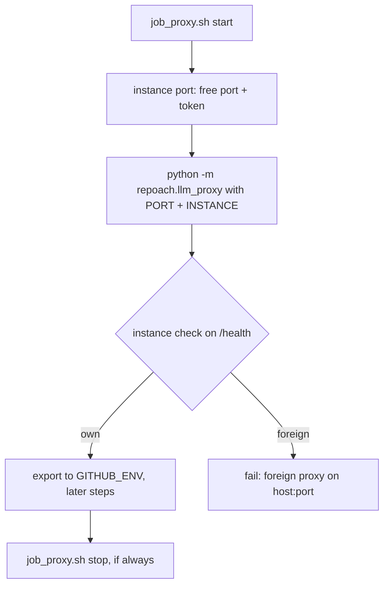

# Each CI job's LLM proxy runs on its own port and proves it is that job's process

## Intent

A red that stops the line, with its corrective spec and its fix in the same
PR, because the defect is small and measured. Two review jobs that overlap on
this host used to share one hardcoded proxy port: the second job then talked
to the first job's proxy, got `401 Invalid API key`, then `Connection
refused`, and ended in `verdict=ERROR`. After this spec, each job's proxy
binds a port picked when the job starts, and the job checks that the proxy
answering `/health` is its own before it runs anything.

## Context

Measured 2026-10-26 from `gh api repos/repoachhq/repoach/actions/jobs/<id>/logs`
and `.github/workflows/auto-review.yml` at `origin/develop` `f4d2b41`.

- F1, the host. `repoach-runner` (`/home/jofaye/actions-runner-ferova`) and
  `repoach-runner-2` (`actions-runner-2`) are two self-hosted runners on one
  machine. They share one loopback interface.
- F2, the wiring. Both proxy-starting jobs of `auto-review.yml` (`review`,
  `auto_fix`) set `REPOACH_PROXY_PORT: "8083"`, poll
  `curl --silent --fail http://127.0.0.1:8083/health` 40 × 0.5 s, and give
  the CLI `REPOACH_LLM_PROXY_BASE_URL: "http://127.0.0.1:8083"`. The poll
  checks that *something* answers, not *what* answers. `ci.yml`'s
  `Smoke — llm_proxy boots` binds the same `8083` on the same runners.
- F3, job B. Run 40301029793 (PR #256), job 121498672766 on
  `repoach-runner-2`. It starts its proxy at 09:45:38Z. The proxy is healthy
  and serves the four roles. The job ends at 09:48:27Z, when the runner logs
  `Cleaning up orphan processes` / `Terminate orphan process: pid (240594)
  (python)`.
- F4, job A. Run 40301669894 attempt 1 (PR #255), job 121500793882 on
  `repoach-runner`. It starts its proxy at 09:48:17.16Z, while job B's proxy
  still holds 8083. Its own proxy logs `ERROR: [Errno 98] error while
  attempting to bind on address ('127.0.0.1', 8083): address already in
  use`, and uvicorn exits. The next step starts at 09:48:17.20Z, 40 ms later:
  the health poll passed on its first try because job B's proxy answered it.
- F5, the 401s. At 09:48:23Z all four roles (architect, sentinel, scribe,
  tester) get `POST http://127.0.0.1:8083/v1/agent "HTTP/1.1 401
  Unauthorized"`, body `{"detail":"Invalid API key"}`. Each job's inbound
  token is its own `secrets.GITHUB_TOKEN`, and job B's process compares
  against job B's token (`src/repoach/llm_proxy/api/dependencies.py:95-121`,
  `require_api_key`).
- F6, the refusals. Job B's proxy is killed at 09:48:27Z (F3). From
  09:48:53Z, attempts 2 and 3 of every role fail with `[Errno 111]
  Connection refused`. The step ends `Process completed with exit code 3`
  at 09:50:25Z, `verdict=ERROR`, and auto_fix/auto_merge are skipped.
- F7, the cleanup. No step of the workflow stops the proxy. It dies only
  through the runner's orphan cleanup when the job ends (F3). That cleanup
  is runner behaviour, and the workflow never asks for it.

## Goals

- G1: A proxy-starting job binds a port that is free when the job starts.
  `python -m repoach.llm_proxy.instance port` binds port 0 and reads the
  port back. The job exports `REPOACH_PROXY_PORT`,
  `REPOACH_PROXY_INSTANCE` and `REPOACH_LLM_PROXY_BASE_URL` to every later
  step through `$GITHUB_ENV`. No step of a proxy job names a port, and no
  step sets these keys in its own `env:`, which would shadow `$GITHUB_ENV`.
- G2: The health poll proves the proxy is the job's own. The job generates
  an instance token (`<run_id>-<attempt>-<job>-<pid>-<16 hex>`) and passes it
  as `REPOACH_PROXY_INSTANCE`. `/health` echoes it as `instance`. The poll
  compares the two. A healthy answer with another token, or with none, fails
  the job at once with `foreign proxy on <host:port> (instance=<seen>)`,
  exit 3. A proxy that exits before it answers (a bind failure, say) fails
  the job at once, with the log tail.
- G3: Every place in the repository that starts a proxy and then talks to
  it uses the same guard. That covers `ci.yml`'s smoke step and
  `scripts/ci_local.sh`'s `proxy_smoke`. The latter used to skip whenever
  8082 was bound; it now always runs, on its own port, and can neither be
  answered by the operator's live proxy nor kill it.
  `scripts/safe_merge.sh` starts no proxy (verified: no `llm_proxy`, no port
  in it), so it needs nothing.
- G4: The job stops its own proxy. The last step of `review` and of
  `auto_fix` is `bash scripts/job_proxy.sh stop` under `if: always()`. It
  sends SIGTERM, waits up to 5 s, then sends SIGKILL. The runner's orphan
  cleanup (F7) is no longer the only thing that frees the port.

## Non-Goals

- NG1: The `auto_merge` job's `REPOACH_LLM_PROXY_BASE_URL:
  "http://127.0.0.1:8083"` stays. That job starts no proxy and never dials
  the URL; the value only satisfies Settings validation on an older PR head
  (comment in the workflow). `merge-on-ci.yml:174` is the same case.
- NG2: The instance token is not a credential. Authentication stays the
  bearer token of SP-PROXY-EDGE-HARDEN. The instance token is a per-job
  nonce, shown to anonymous `/health` callers on purpose, so that the
  unauthenticated poll can read it. It reveals nothing about routing or
  failure state.
- NG3: No change to the operator's systemd proxy or to the 8082 default.
  A process started without `REPOACH_PROXY_INSTANCE` answers `/health`
  exactly as before.

## Assumptions

- A1: The window between `port` closing its probe socket and uvicorn binding
  is short (milliseconds). If another process takes the port in that window,
  G2 catches it, either as a foreign proxy or as our own proxy exiting with
  `Errno 98`. Nothing in this design depends on the window being empty.
- A2: Each runner has its own workspace (`_work`), so `logs/llm_proxy.pid`
  of one job is never read by another job.

## Interface

`python -m repoach.llm_proxy.instance port [--host H]` prints a free TCP
port on `H` (default `127.0.0.1`).

`python -m repoach.llm_proxy.instance check --url URL --expect TOKEN` probes
`URL` once. It prints one line and exits with:

| exit | meaning | line |
|---|---|---|
| 0 | `/health` is healthy and echoes `TOKEN` | `own proxy on <host:port>` |
| 1 | nothing healthy answered | `no healthy proxy on <host:port>` |
| 2 | `--expect` is empty | (stderr) |
| 3 | healthy, and echoes another token or none | `foreign proxy on <host:port> (instance=<seen or none>)` |

`scripts/job_proxy.sh start|stop`. It reads `JOB_PROXY_HOST` (127.0.0.1),
`JOB_PROXY_DIR` (logs), `JOB_PROXY_TIMEOUT_S` (20) and `PYTHON` (python).
`start` writes `<dir>/llm_proxy.log` and `<dir>/llm_proxy.pid`. It appends
`REPOACH_PROXY_PORT=`, `REPOACH_PROXY_INSTANCE=` and
`REPOACH_LLM_PROXY_BASE_URL=` to `$GITHUB_ENV` when that is set, prints the
same three lines on stdout, and exits 0, 1 or 3 as in G2.

`format:proxy-health-instance`: `GET /health` returns `{"status":
"healthy", "instance": "<token>"}` to an anonymous caller when the process
has `REPOACH_PROXY_INSTANCE`. An authenticated caller gets `instance` as
well, next to `breaker` and `credits`. Without the variable, the body is
unchanged.

## Behavior

### Nominal

1. `start` picks a port and a token, then starts the proxy with
   `REPOACH_PROXY_HOST`, `REPOACH_PROXY_PORT` and `REPOACH_PROXY_INSTANCE`.
2. Every 0.5 s until the timeout, `start` runs `check`. On 0 it exports the
   three keys and returns.
3. The later steps read `REPOACH_LLM_PROXY_BASE_URL` from the environment.
4. The last step runs `stop`.

### Edge cases

- Two jobs overlap on one host → they get two ports. Each proves its own
  token, and each token is foreign on the other job's port (AC5).
- The port is taken between the pick and the bind:
  - by another proxy → the check answers 3, and the job stops at once;
  - by something else → our proxy exits with `Errno 98`, and `start`
    sees the pid is gone and exits 1 with the log tail.
- `stop` without a pid file → a no-op with a message, exit 0. `stop`
  when the pid is already gone → removes the pid file, exit 0.

### Failure scenarios

- The proxy never becomes healthy within `JOB_PROXY_TIMEOUT_S` → exit 1, the
  log tail is printed, and the proxy is killed.
- The bootstrap PR. The `review` job installs the BASE ref and runs
  `scripts/job_proxy.sh` from the base checkout (SP-CI-SECRETS-ISOLATION
  layer 2), but the workflow file comes from the PR. On the PR that
  introduces this spec, the base has neither the helper nor the
  `instance` echo, so that PR's own `review` job cannot start its proxy.
  It is checked locally (AC1–AC7) and merged by the owner. Every later PR
  runs on a base that has both.

## Architecture Impact

- Adds dependency: SP-JOB-PROXY-IS-PRIVATE-TO-ITS-JOB -> SP-CI-SECRETS-ISOLATION (the helper runs from the base checkout of the secret-holding review job, never from PR code)
- Adds dependency: SP-JOB-PROXY-IS-PRIVATE-TO-ITS-JOB -> SP-PROXY-EDGE-HARDEN (the anonymous `/health` body gains exactly one field, `instance`; breaker/credits stay authenticated-only)
- Adds dependency: SP-JOB-PROXY-IS-PRIVATE-TO-ITS-JOB -> SP-PROXY-SECURE-DEFAULTS (the bind stays on loopback, and every job still passes a token)
- Adds dependency: SP-JOB-PROXY-IS-PRIVATE-TO-ITS-JOB -> SP-CI-SMOKE-REPAIR (the smoke stays a real gate, now on its own port)
- Adds dependency: SP-JOB-PROXY-IS-PRIVATE-TO-ITS-JOB -> SP-CHAIN-STATUS-PROXY-DEFAULT (exporting `REPOACH_PROXY_PORT` keeps its settings-port default pointing at the job's proxy)
- Adds dependency: SP-JOB-PROXY-IS-PRIVATE-TO-ITS-JOB -> SP-RED-STOPS-THE-LINE (this is a corrective spec for a measured red)
- New / changed coupling: `src/repoach/llm_proxy/api/routes.py` (frontier) imports `current_instance` from this spec's module.

## Diagram

## Acceptance Criteria

- [x] AC1: the token check classifies own / foreign / unreachable, the CLI returns 0 / 3 / 1, and the foreign message names `host:port` — `tests/unit/test_job_proxy_instance.py`.
- [x] AC2: `/health` echoes `instance` to anonymous and authenticated callers, and is unchanged without the variable — `tests/unit/test_job_proxy_instance.py::test_health_echoes_instance_to_anonymous_and_authenticated`, `tests/unit/test_job_proxy_instance.py::test_health_without_instance_keeps_the_liveness_only_body`.
- [x] AC3: no step of `review` or `auto_fix` names a port or sets the proxy keys in `env:`; each job starts through the helper, and the helper writes the three keys to `$GITHUB_ENV` — `tests/unit/test_job_proxy_workflow_wiring.py`.
- [x] AC4: the last step of `review` and of `auto_fix` is `job_proxy.sh stop` under `if: always()`; the ci.yml smoke uses the helper with no fixed port — `tests/unit/test_job_proxy_workflow_wiring.py::test_proxy_jobs_stop_their_proxy_last_and_always`, `tests/unit/test_job_proxy_workflow_wiring.py::test_ci_smoke_uses_the_helper_and_no_fixed_port`.
- [x] AC5: simulated collision with two real proxies: two concurrent `start` calls get two ports, each `/health` matches its own token and is foreign for the other job's token, and `stop` leaves no pid alive — `tests/integration/test_job_proxy_collision.py::test_two_overlapping_jobs_get_two_ports_and_prove_their_own_proxy`.
- [x] AC6: the measurement, replaying runs 40301029793 / 40301669894 locally on one fixed port. The second proxy logs `[Errno 98]`, the old `GET /health` poll still gets 200, and the new check exits 3 with `foreign proxy on 127.0.0.1:<port> (instance=first-job)` — `tests/integration/test_job_proxy_collision.py::test_old_fixed_port_wiring_is_caught_as_foreign`.
- [x] AC7: the helper refuses unknown commands with exit 2 — `tests/integration/test_job_proxy_collision.py::test_helper_rejects_unknown_commands`.

## Open Questions

