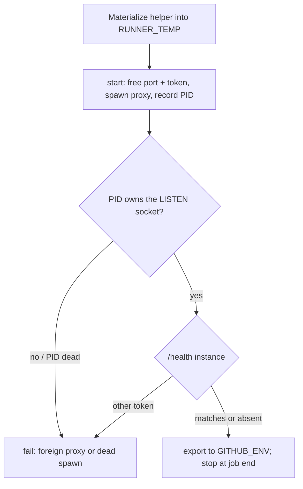

# Each CI job's LLM proxy runs on its own port and proves it is that job's process

## Intent

A red that stops the line, with its corrective spec and its fix in the same
PR, because the defect is small and measured. Two review jobs that overlap on
this host used to share one hardcoded proxy port: the second job then talked
to the first job's proxy, got `401 Invalid API key`, then `Connection
refused`, and ended in `verdict=ERROR`. After this spec, each job's proxy
binds a port picked when the job starts, and the job checks that the proxy
answering `/health` is its own before it runs anything.

## Context

Measured 2026-10-26 from `gh api repos/repoachhq/repoach/actions/jobs/<id>/logs`
and `.github/workflows/auto-review.yml` at `origin/develop` `f4d2b41`.

- F1, the host. `repoach-runner` (`/home/jofaye/actions-runner-ferova`) and
  `repoach-runner-2` (`actions-runner-2`) are two self-hosted runners on one
  machine. They share one loopback interface.
- F2, the wiring. Both proxy-starting jobs of `auto-review.yml` (`review`,
  `auto_fix`) set `REPOACH_PROXY_PORT: "8083"`, poll
  `curl --silent --fail http://127.0.0.1:8083/health` 40 × 0.5 s, and give
  the CLI `REPOACH_LLM_PROXY_BASE_URL: "http://127.0.0.1:8083"`. The poll
  checks that *something* answers, not *what* answers. `ci.yml`'s
  `Smoke — llm_proxy boots` binds the same `8083` on the same runners.
- F3, job B. Run 40301029793 (PR #256), job 121498672766 on
  `repoach-runner-2`. It starts its proxy at 09:45:38Z. The proxy is healthy
  and serves the four roles. The job ends at 09:48:27Z, when the runner logs
  `Cleaning up orphan processes` / `Terminate orphan process: pid (240594)
  (python)`.
- F4, job A. Run 40301669894 attempt 1 (PR #255), job 121500793882 on
  `repoach-runner`. It starts its proxy at 09:48:17.16Z, while job B's proxy
  still holds 8083. Its own proxy logs `ERROR: [Errno 98] error while
  attempting to bind on address ('127.0.0.1', 8083): address already in
  use`, and uvicorn exits. The next step starts at 09:48:17.20Z, 40 ms later:
  the health poll passed on its first try because job B's proxy answered it.
- F5, the 401s. At 09:48:23Z all four roles (architect, sentinel, scribe,
  tester) get `POST http://127.0.0.1:8083/v1/agent "HTTP/1.1 401
  Unauthorized"`, body `{"detail":"Invalid API key"}`. Each job's inbound
  token is its own `secrets.GITHUB_TOKEN`, and job B's process compares
  against job B's token (`src/repoach/llm_proxy/api/dependencies.py:95-121`,
  `require_api_key`).
- F6, the refusals. Job B's proxy is killed at 09:48:27Z (F3). From
  09:48:53Z, attempts 2 and 3 of every role fail with `[Errno 111]
  Connection refused`. The step ends `Process completed with exit code 3`
  at 09:50:25Z, `verdict=ERROR`, and auto_fix/auto_merge are skipped.
- F7, the cleanup. No step of the workflow stops the proxy. It dies only
  through the runner's orphan cleanup when the job ends (F3). That cleanup
  is runner behaviour, and the workflow never asks for it.

## Goals

- G1: A proxy-starting job binds a port that is free when the job starts.
  The helper asks the kernel for one: it binds port 0 with the Python
  standard library and reads the port back. The job exports
  `REPOACH_PROXY_PORT`, `REPOACH_PROXY_INSTANCE` and
  `REPOACH_LLM_PROXY_BASE_URL` to every later step through `$GITHUB_ENV`.
  No step of a proxy job names a port, and no step sets these keys in its
  own `env:`, which would shadow `$GITHUB_ENV`.
- G2: The job proves the listening proxy is the process it spawned, with
  two proofs. Neither depends on the proxy's code, so the proof also holds
  when the proxy comes from an older base ref.
  - PID proof, which decides. `start` records the PID it spawned. The LISTEN
    socket on the chosen port is read from `/proc/net/tcp` and
    `/proc/net/tcp6` (state `0A`, local port in hex), and its inode must
    appear among the `socket:[<inode>]` links in `/proc/<pid>/fd`.
    - Why this source: for a process of the same user, both files are
      readable without root, and nothing outside coreutils and awk is
      needed. `ss -ltnp` also names the owner without root, but its output
      would need parsing.
    - A listener owned by another PID fails at once with `foreign proxy on
      <host:port> (listener not owned by pid <pid>)`, exit 3.
    - A spawned PID that is dead (its bind failed, say) fails at once with
      `spawned proxy (pid <pid>) is dead`.
  - Token proof, second. The job generates an instance token
    (`<run_id>-<attempt>-<job>-<shell pid>-<16 hex>`) and passes it as
    `REPOACH_PROXY_INSTANCE`; `/health` echoes it as `instance`.
    - Another token fails with `foreign proxy on <host:port>
      (instance=<seen>)`, exit 3.
    - No echo means the proxy predates this spec. The PID proof then decides
      alone, and the helper says `instance echo absent (proxy predates
      SP-JOB-PROXY-IS-PRIVATE-TO-ITS-JOB)`.
- G2b: A job's checkout may predate the helper: the `review` job runs the
  base ref, and `auto_fix` may run an un-rebased PR head. The helper
  therefore imports nothing from `repoach`, and the workflow carries its
  own copy.
  - In `review` and `auto_fix`, a `Materialize job proxy helper` step writes
    `$RUNNER_TEMP/job_proxy.sh` from a heredoc. The workflow file comes from
    the PR, so this copy is current even when the checkout is not.
  - A test pins the heredoc byte for byte to `scripts/job_proxy.sh`.
  - Every PR, including the one that introduces this spec, passes its own
    `review` job.
- G3: Every place in the repository that starts a proxy and then talks to
  it uses the same helper: `ci.yml`'s smoke step and `scripts/ci_local.sh`'s
  `proxy_smoke`.
  - The local smoke used to skip whenever 8082 was bound. It now always
    runs, on its own port, and can neither be answered by the operator's
    live proxy nor kill it.
  - `scripts/safe_merge.sh` starts no proxy (verified: no `llm_proxy` and no
    port in it), so it needs nothing.
- G4: The job stops its own proxy. The last step of `review` and of
  `auto_fix` is `bash "$RUNNER_TEMP/job_proxy.sh" stop` under
  `if: always()`. It sends SIGTERM, waits up to 5 s, then sends SIGKILL.
  The runner's orphan cleanup (F7) is no longer the only thing that frees
  the port.

## Non-Goals

- NG1: The `auto_merge` job's `REPOACH_LLM_PROXY_BASE_URL:
  "http://127.0.0.1:8083"` stays. That job starts no proxy and never dials
  the URL; the value only satisfies Settings validation on an older PR head
  (comment in the workflow). `merge-on-ci.yml:174` is the same case.
- NG2: The instance token is not a credential. Authentication stays the
  bearer token of SP-PROXY-EDGE-HARDEN. The token is a per-job nonce, shown
  to anonymous `/health` callers on purpose. It reveals nothing about
  routing or failure state.
- NG3: No change to the operator's systemd proxy or to the 8082 default.
  A process started without `REPOACH_PROXY_INSTANCE` answers `/health`
  exactly as before.
- NG4: Runners in different network namespaces (containers) would each see
  only their own `/proc/net/tcp`. That is fine, because they cannot collide
  on loopback either. Only the shared-host case of F1 is in scope.

## Assumptions

- A1: The window between the port pick and uvicorn's bind is short
  (milliseconds). If another process takes the port in that window, the
  PID proof catches it: our process is either dead (`Errno 98`) or does not
  own the listener. Nothing in this design depends on the window being
  empty.
- A2: Each runner has its own workspace and `$RUNNER_TEMP`, so one job
  never reads another job's pid file.
- A3: `python -m repoach.llm_proxy` runs uvicorn in the spawned process
  itself: `nohup` execs, with no worker fork. The listening socket's inode
  is therefore among the spawned PID's fds. Measured: AC5 and AC7 pass on
  the real proxy.

## Interface

`scripts/job_proxy.sh start|stop|prove PID PORT INSTANCE`. It reads
`JOB_PROXY_HOST` (127.0.0.1), `JOB_PROXY_DIR` (logs), `JOB_PROXY_TIMEOUT_S`
(20) and `PYTHON` (python). Its dependencies are bash, coreutils, awk, curl
and the Python standard library.

`prove` makes one probe and prints one line:

| exit | meaning | line |
|---|---|---|
| 0 | the PID owns the listener, and `/health` echoes INSTANCE or nothing | `own proxy on <h:p> (pid <pid>, instance <token>)` or `... ; instance echo absent (proxy predates SP-JOB-PROXY-IS-PRIVATE-TO-ITS-JOB)` |
| 1 | not ready: no listener yet, or `/health` not healthy yet | `no listener on <h:p> yet` / `own listener ..., /health not healthy yet` |
| 2 | usage | (stderr) |
| 3 | foreign: the listener is not the PID's, or another token | `foreign proxy on <h:p> (listener not owned by pid <pid>)` / `foreign proxy on <h:p> (instance=<seen>)` |
| 4 | the spawned PID is dead | `spawned proxy (pid <pid>) is dead — ...` |

`start`:
- writes `<dir>/llm_proxy.log` and `<dir>/llm_proxy.pid`;
- runs `prove` every 0.5 s until it gets 0, 3 or 4;
- on 0, appends `REPOACH_PROXY_PORT=`, `REPOACH_PROXY_INSTANCE=` and `REPOACH_LLM_PROXY_BASE_URL=` to `$GITHUB_ENV` when that is set, and prints the same lines on stdout;
- exits 0 (own), 3 (foreign) or 1 (dead or timeout).

`format:proxy-health-instance`: `GET /health` returns `{"status":
"healthy", "instance": "<token>"}` to an anonymous caller when the process
has `REPOACH_PROXY_INSTANCE`. An authenticated caller gets `instance` as
well, next to `breaker` and `credits`. Without the variable, the body is
unchanged. `repoach.llm_proxy.instance.current_instance()` reads the
variable.

## Behavior

### Nominal

1. `Materialize job proxy helper` writes `$RUNNER_TEMP/job_proxy.sh`. This
   step exists in the two `auto-review.yml` jobs only; `ci.yml` and
   `ci_local.sh` run `scripts/job_proxy.sh` from their own checkout.
2. `start` picks a port and a token, then spawns the proxy with
   `REPOACH_PROXY_HOST`, `REPOACH_PROXY_PORT` and `REPOACH_PROXY_INSTANCE`.
3. `start` loops on `prove` until own, foreign, dead or timeout. On own it
   exports the three keys.
4. The later steps read `REPOACH_LLM_PROXY_BASE_URL` from the environment.
5. The last step runs `stop`.

### Edge cases

- Two jobs overlap on one host → they get two ports. Each passes both
  proofs for itself and fails both for the other job (AC5).
- The 2026-10-26 scenario on one fixed port → the second job's spawned PID
  is dead, so the result is exit 4 → exit 1. A prober whose PID is alive
  but does not own the listener gets exit 3. The old poll, by contrast,
  passed (AC6).
- The proxy comes from a base ref without the echo → the PID proof decides,
  and the helper logs `instance echo absent` (AC7, and measured against
  `origin/develop` `f4d2b41`).
- `stop` without a pid file → a no-op with a message, exit 0. `stop`
  when the pid is already gone → removes the pid file, exit 0.

### Failure scenarios

- The proxy never becomes healthy within `JOB_PROXY_TIMEOUT_S` → exit 1, the
  log tail is printed, and the proxy is killed.
- The embedded copy drifts from `scripts/job_proxy.sh` → the parity test
  fails (AC3).

## Architecture Impact

- Adds dependency: SP-JOB-PROXY-IS-PRIVATE-TO-ITS-JOB -> SP-CI-SECRETS-ISOLATION (the review job still executes only the base-ref install; the helper comes from the workflow file, not from the PR checkout)
- Adds dependency: SP-JOB-PROXY-IS-PRIVATE-TO-ITS-JOB -> SP-PROXY-EDGE-HARDEN (the anonymous `/health` body gains exactly one field, `instance`; breaker/credits stay authenticated-only)
- Adds dependency: SP-JOB-PROXY-IS-PRIVATE-TO-ITS-JOB -> SP-PROXY-FIRST-BYTE-DEADLINE (the tests build the proxy `Settings` it owns to drive `/health` hermetically)
- Adds dependency: SP-JOB-PROXY-IS-PRIVATE-TO-ITS-JOB -> SP-PROXY-SECURE-DEFAULTS (the bind stays on loopback, and every job still passes a token)
- Adds dependency: SP-JOB-PROXY-IS-PRIVATE-TO-ITS-JOB -> SP-CI-SMOKE-REPAIR (the smoke stays a real gate, now on its own port)
- Adds dependency: SP-JOB-PROXY-IS-PRIVATE-TO-ITS-JOB -> SP-CHAIN-STATUS-PROXY-DEFAULT (exporting `REPOACH_PROXY_PORT` keeps its settings-port default pointing at the job's proxy)
- Adds dependency: SP-JOB-PROXY-IS-PRIVATE-TO-ITS-JOB -> SP-RED-STOPS-THE-LINE (this is a corrective spec for a measured red)
- New / changed coupling: `src/repoach/llm_proxy/api/routes.py` (frontier) imports `current_instance` from this spec's module.

## Diagram

## Acceptance Criteria

- [x] AC1: `prove`, PID proof then token. The cases are: own PID with a matching token → 0; own PID without an echo → 0 with `instance echo absent (proxy predates SP-JOB-PROXY-IS-PRIVATE-TO-ITS-JOB)`; own PID with another token → 3 `(instance=…)`; a listener owned by another PID → 3 `(listener not owned by pid …)`; a dead spawned PID → 4; no listener → 1; unhealthy `/health` → 1; usage → 2 — `pytest -q tests/unit/test_job_proxy_prove.py`.
- [x] AC2: `/health` echoes `instance` to anonymous and authenticated callers, and is unchanged without the variable — `pytest -q tests/unit/test_job_proxy_instance.py`.
- [x] AC3: both proxy jobs materialize a helper byte-identical to `scripts/job_proxy.sh`, start through it, name no port, and set no proxy key in `env:`; the helper exports the three keys to `$GITHUB_ENV` and imports no `repoach` module beyond the spawned `repoach.llm_proxy` — `pytest -q tests/unit/test_job_proxy_workflow_wiring.py`.
- [x] AC4: the last step of `review` and of `auto_fix` is the helper's `stop` under `if: always()`; the ci.yml smoke uses the helper with no fixed port — `pytest -q tests/unit/test_job_proxy_workflow_wiring.py::test_proxy_jobs_stop_their_proxy_last_and_always`, `pytest -q tests/unit/test_job_proxy_workflow_wiring.py::test_ci_smoke_uses_the_helper_and_no_fixed_port`.
- [x] AC5: simulated collision with two real proxies. Two concurrent `start` calls get two ports. For each job's port, the job's own PID and token → 0, the other job's PID → 3 (`listener not owned by pid`), and the other job's token → 3 (`instance=`). No pid survives `stop` — `pytest -q tests/integration/test_job_proxy_collision.py::test_two_overlapping_jobs_get_two_ports_and_prove_their_own_proxy`.
- [x] AC6: the measurement, replaying runs 40301029793 / 40301669894 locally on one fixed port. The second proxy logs `[Errno 98]`, and the old `GET /health` poll still gets 200. `prove` with the second job's (dead) PID → 4. `prove` with a live PID that does not own the listener → 3 — `pytest -q tests/integration/test_job_proxy_collision.py::test_old_fixed_port_wiring_is_refused_by_the_pid_proof`.
- [x] AC7: this PR's own review job, simulated. A `python -m repoach.llm_proxy` that predates the echo (a shadow package answering `{"status": "healthy"}` only) is started by `start` and accepted on the PID proof alone. The three keys are exported, and `stop` leaves no process — `pytest -q tests/integration/test_job_proxy_collision.py::test_base_proxy_without_instance_echo_starts_on_the_pid_proof`. Measured as well against the real `origin/develop` `f4d2b41` source: two concurrent jobs got ports 33177 and 53981, both `instance echo absent`, and the cross-PID probe → 3. The CI confirmation is the `Architect / Sentinel / Tester / Scribe` check on PR #264, which runs the base-ref proxy.

## Open Questions

