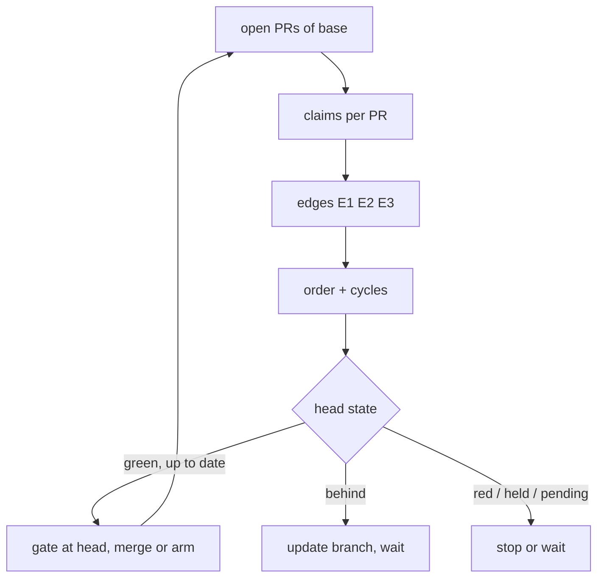

# A merge queue that follows the spec graph, one merge at a time

## Intent

Owner, 2026-10-26: « un des avantages de repoach c'est de pouvoir merger
séquentiellement le travail en ayant une vision sur les dépendances entre
specs ». Today nothing orders merges: the first green PR wins. This spec
adds a queue. `repoach queue` lists the open PRs of the integration
branch in an order derived from the spec graph, with the reason for each
position. `repoach queue run` merges the head of that queue, one PR at a
time, each one gated again on the integration head it will land on.

## Context

Measured on `repoachhq/repoach` `origin/develop` at `9223169`
(2026-10-26), and on Yoob `origin/develop` (`josephwfaye/yoob_2`) the
same day.

| # | Fact | Where |
|---|------|-------|
| F1 | **GitHub merges in arrival order.** `merge-on-ci.yml` fires on every CI `workflow_run` completion, resolves *the* open PR whose `headRefOid` is the run's head (`[...][0].number`), and runs `review merge <that PR>`. Its concurrency group is per head branch, so two PRs whose CI ends together are judged and merged in parallel. Nothing looks at another PR. | `.github/workflows/merge-on-ci.yml:25`, `:89-91`, `:183` |
| F2 | **A second merge path exists.** `auto-review.yml` has its own `auto_merge` job that runs `review merge <pr>` after the review. | `.github/workflows/auto-review.yml:623`, `:706` |
| F3 | `merge-on-ci.yml` runs **main's** code (trusted checkout of `main`), so a change to the merge path reaches it only after the next `develop → main` release. | `.github/workflows/merge-on-ci.yml:10-14`, `:58-60` |
| F4 | `scripts/safe_merge.sh` is the client-side path: 1 base is `develop`, 2 check out the head and merge `origin/develop` into it, 3 `ci_local.sh`, 4 `review pr`, 5 `review gate` with retries, 6 fresh-head guard (`headRefOid` = `ls-remote`), 7 squash merge. It takes one PR number from the operator. | `scripts/safe_merge.sh:6-35` |
| F5 | `decide_at_head` is the single source of the merge decision for both `run_auto_merge` and `review gate`; it re-verifies the older heads' findings on the head tree (SP-GATE-REVERIFIES-AT-HEAD). `run_auto_merge` already has `SKIP_BEHIND` and `SKIP_STALE_HEAD` outcomes. | `src/repoach/review/auto_merge.py:574`, `:891`, `:118-120` |
| F6 | **`open_pull_requests(base)` has no caller in `src/`.** GitHub lists ≤ 100 with `number, headRefName, baseRefName, headRefOid, isDraft`; GitLab lists `state=opened&target_branch=`. `PullRequest` carries no mergeability field and no creation time; `number` is monotonic per repository on both forges. | `src/repoach/forge/protocol.py:370-397`, `:688`; `github.py:1671`; `gitlab.py:920` |
| F7 | The spec graph exists. `load_registry` parses `depends_on`; `Graph.cycles()` returns every cycle, normalised, over string node ids. `branch_spec_id_at_ref(branch, ref)` resolves the spec a branch names against the specs committed at a ref (#250). A spec file is identified by `_(SP-[A-Z0-9-]+)_` in its name. | `src/repoach/arch/registry.py:213`, `:335`; `src/repoach/arch/graph.py:21`; `src/repoach/review/governed_spec.py:144`; `src/repoach/review/spec.py:265` |
| F8 | **GitLab never arms from repoach.** `GitLabForge.merge` runs `glab mr merge --auto-merge=false --sha <head>`. Yoob arms `merge_when_pipeline_succeeds` itself in `scripts/mr-create.sh`, on every MR, at creation. | `src/repoach/forge/gitlab.py:863`; Yoob `scripts/mr-create.sh:228-229` |
| F9 | Yoob's `review:gate` job runs `repoach review pr` (not `review gate`) and turns any exit it does not know into `EXIT_UNKNOWN`, i.e. red. | Yoob `ci/review-gate.sh:202`, `:237` |
| F10 | SP-RED-STOPS-THE-LINE (draft, #251, not implemented: no `line_stop.py`) holds every other PR while one is red, through a `<!-- repoach-line-state:v1 -->` marker. D1 makes `review pr` exit `10` on a held sibling, so Yoob's `review:gate` goes red there. A findings or coverage refusal is not a stop trigger. | that spec, D1, G1 |
| F11 | **Yoob specs are invisible to the spec graph.** Their files are `docs/specs/<date>_<slug>.md` (no `SP-` id in the name), their frontmatter has `id`, `title`, `status`, `branch`, `created`, `updated` and no `depends_on`. | Yoob `docs/specs/2026-10-25_no-generic-board.md:1-8` |
| F12 | **Measured today.** repoach: 7 open PRs into `develop` (#246, #247, #249, #254–#257), every one touching a governed spec; no `Merge-After:` line in any body. Yoob: 11 open MRs into `develop` (!319–!325, !327–!330); 6 have `merge_when_pipeline_succeeds` armed at once (!319, !320, !321, !322, !323, !328) and 6 report `conflict` (!319, !320, !322, !323, !325, !327). | `gh pr list`, GitLab API `merge_requests?state=opened`, 2026-10-26 |

## Goals

- **G1 `repoach queue` (read-only).** Lists the open PRs into the
  integration branch (`[project].integration_branch`, SP-BRANCH-CONFIG),
  at most `open_prs_scanned_max`, oldest number first, then orders them.
  It never writes: no comment, no ledger row, no forge write (the forge
  barrier is closed for the whole command, SP-DRY-RUN-NEVER-POSTS).
  - **Spec ids of a PR.** `claims(P) = touched(P) ∪ named(P)`.
    - `touched(P)`: the governed specs whose file P's diff adds or
      modifies (id from the frontmatter at P's head; a deleted spec file
      is read at the base). P *introduces* a spec absent from the base,
      and *amends* one present there.
    - `named(P)`: the spec P implements, resolved as `review pr` does
      (`Spec:` line in the body, else the branch name). The branch is
      matched by `branch_spec_id_at_ref` against the ids committed at
      P's head, then against the ids of the base and of every other
      open PR's head (an implementation PR whose spec lives only in
      another open PR).
    - A spec file without governed frontmatter (F11) contributes its
      path to `touched(P)` and no id (SP-ARCH-FOREIGN-FRONTMATTER).
  - **Edges.** `Q after P` (P ≠ Q, both open) when any of:
    - **E1 depends_on**: a spec in `claims(Q)` has, at Q's head (else at
      the head of the PR that touches it), a `depends_on` entry in
      `claims(P)`;
    - **E2 implements**: a spec in `named(Q) ∖ touched(Q)` is in
      `touched(P)` (the spec PR merges before the code that implements
      it — G5);
    - **E3 Merge-After**: Q's body has a line `Merge-After: #N` or
      `Merge-After: !N` (case-insensitive, one number per line) with
      N = P.
    Two PRs that touch the same spec without an E1–E3 edge get **no**
    edge; each lists `also amends <id|path>: #N`.
  - **Order.** Kahn's algorithm over E1–E3. Among the PRs whose
    predecessors are all placed, the next one is the lowest of the key
    `(claims empty, number)`: a PR with a spec before a PR without one,
    then arrival order (G5).
  - **Cycles.** `Graph.cycles()` over the PR graph (node `#N`). Every PR
    on a cycle is `blocked` with `cycle #A → #B → #A (<edge kinds and
    spec ids>)`; every PR with a path to a blocked PR is `blocked` with
    `waits for #A (blocked: cycle)`. Blocked PRs get no position; the
    others are ordered as if the blocked ones were absent.
  - **Gate state** per PR, from the cheapest facts only (no review, no
    refuter call, no head tree):
    - `held`: a line-state stop holds it (SP-RED-STOPS-THE-LINE
      `read_line_state`; D2);
    - `red`: a required check failed or timed out at its head;
    - `pending`: a required check is pending or missing at its head;
    - `green`: every required check is green at its head;
    - plus the forge facts shown beside it: `draft`, `conflict`,
      `behind` (base head not an ancestor of the PR head), `armed`
      (GitLab, `merge_when_pipeline_succeeds`).
  - **Per PR row**: position (or `—`), number, claims, gate state, the
    open PRs it waits for with the edge kind, and one reason line —
    `independent`, `introduces <id> (<status>)`, `implements <id>
    introduced by #N`, `<id> depends_on <id'>: #N, #M`, `Merge-After #N`,
    `no spec: arrival order, after the PRs with a spec`, `blocked: …`.
- **G2 `repoach queue run`** merges at most one PR per evaluation, in the
  G1 order, and re-evaluates after each merge:
  1. Evaluate G1 (now with writes allowed). Walk the order. Skip, with
     the reason recorded: a forge draft; a PR whose dependency is not
     merged; a `conflict` the update of step 3 could not resolve; a PR
     whose gate is refused on findings or spec coverage (D3). Its
     dependents are skipped as `waits for #N (<why>)`.
  2. The first PR not skipped is the **head**. `red` → the run stops
     with `QUEUE_STOPPED_RED` and `#N#<head7>: <check>` (and
     SP-RED-STOPS-THE-LINE opens its stop). `held` → stops with
     `QUEUE_HELD` and the holder lines. `pending` → stops with
     `QUEUE_WAITING` and `#N pending: <check>`, unless a PR behind it
     qualifies for the disjoint bypass (D6), which then becomes the head
     for this evaluation with the reason `bypass: independent and
     disjoint`.
  3. **Up-to-date check (D4, D7).** If the base head is not an ancestor
     of the head PR's head and the head's diff paths are disjoint from
     every path merged since its last green CI, the re-run is skipped,
     recorded as `rerun skipped: disjoint from <n> merged paths`, and the
     run goes to step 4 (a forge that requires an up-to-date branch then
     answers `SKIP_BEHIND`, handled below). Otherwise the run updates the branch once per head
     (`branch_updates_per_head_max`) by merging the base into it —
     GitHub `update-branch` with `expected_head_sha`, GitLab a merge
     commit pushed by repoach (never a rebase). It records `updated`,
     posts the new head and stops with `QUEUE_WAITING` (`#N updated to
     <new7>, CI pending`). A merge conflict pushes nothing, marks the PR
     `conflict` (`conflicts with <base>@<sha7>: the author merges
     <base>`), posts that on the PR, and the walk continues at step 1.
  4. **Gate at head.** For an up-to-date green head: `run_auto_merge(N,
     pin_tree=True)`, i.e. `decide_at_head` on the head tree, the fresh-
     head guard and the merge. `SKIP_GATE` → step 1 (D3). `SKIP_STALE_HEAD`
     → stops with `QUEUE_WAITING`. `SKIP_BEHIND` → the update of step 3
     is made, as for a non-disjoint head. On GitLab with the
     pipeline still running, the run **arms** instead of merging (G3).
  5. **After a merge**, re-evaluate from step 1: positions may change.
     The next head is behind the new base by construction, so the run
     normally ends at step 3.
  - Never two merges at once: `merges_in_flight_max` = 1, one run per
    base (GitHub concurrency group `repoach-queue-<base>`, GitLab
    `resource_group: repoach-queue-<base>`), and the db lock of the
    `queue_decisions` writer.
  - Exit codes (SP-MERGE-EXIT-CONTRACT): `0` merged, armed, or nothing to
    do; `5` `QUEUE_WAITING`, `QUEUE_STOPPED_RED`, `QUEUE_HELD` (non-fatal:
    the next event re-enters); `1` a forge or merge failure.
- **G3 the bot calls the queue.**
  - **GitHub.** `merge-on-ci.yml` stops resolving "the PR at this head".
    It runs `repoach queue head --json` (read-only: the head PR and why),
    materialises that PR's head and downloads that PR's ledger with the
    existing provenance checks, then runs `repoach queue run --expect-head
    <N>`; a different head at run time ends with `QUEUE_WAITING` (`head
    moved: #M`). Its concurrency group becomes `repoach-queue-develop`,
    `cancel-in-progress: false`. The `auto_merge` job of
    `auto-review.yml` no longer calls `review merge`; it calls the same
    sequence. `scripts/safe_merge.sh <N>` refuses a PR that is not the
    queue head (`not the queue head: #M is (<reason>)`), unless
    `--out-of-queue "<reason ≥ 20 chars>"`, recorded as `out_of_queue`.
  - **GitLab.** The queue is the only thing that arms
    `merge_when_pipeline_succeeds` (`armed_mrs_max` = 1). `queue run`
    arms the head when it is up to date and its pipeline is running, and
    **disarms every other armed MR**, recording `disarmed_out_of_order`
    and posting why on it. Yoob's `review:gate` on a non-head MR exits
    as its review dictates and prints `queued behind !H (position k of
    m): <reason>` on stderr, with `queue` in its JSON (D1). On an MR
    that is armed while not the head it exits `11`, the new
    `EXIT_QUEUE_ORDER`, with `armed out of queue order: head is !H`.
    `review pr` precedence becomes 8 > 3 > 10 > 11 > 2 > 0.
- **G4 the queue is visible.**
  - `repoach queue` prints a table on stdout (columns `pos`, `pr`,
    `spec`, `gate`, `waits for`, `reason`); `--json` prints instead one
    `queue-json` object (SP-CLI-STDOUT-ONE-JSON, Interface).
  - `review gate` and `review pr` JSON carry `queue`: `{position, of,
    head, waits_for, reason}` (`position` null when blocked or
    unqueued).
  - `queue run` upserts on each open PR one comment with the marker
    `<!-- repoach-queue:v1 -->` stating its position, what it waits for
    and the head, rewritten only when one of those changed. `queue`
    alone never posts.
- **G5 spec PRs first, spec-less PRs last.** E2 orders a PR that
  introduces or amends a spec before the PRs that implement it. A PR
  with no claim is placed after every PR with a claim that is ready at
  the same step, in arrival order, and its reason says so.
- **G6 the ledger records each decision.** Table `queue_decisions`: one
  row per PR per evaluation in which its position, gate or action
  changed (`listed`, `merged`, `armed`, `disarmed_out_of_order`,
  `updated`, `waiting`, `stopped`, `blocked`, `skipped`, `out_of_queue`,
  `merged_out_of_band`), with `base_ref`, `base_sha`, `pr_number`,
  `head_sha`, `position`, `gate`, `reason`, `merged_sha`, `run_id`,
  `recorded_at`. `repoach queue history [--since <date>]` prints one JSON
  object: per merged PR, its first position, every reorder, `merged_at`
  and `queued_to_merged_s`. A PR merged by anything other than `queue
  run` is recorded `merged_out_of_band` on the next evaluation. In CI
  the queue db travels as the artifact `queue-ledger-<base>` (GitHub)
  or the cache `repoach-queue-<base>` (GitLab), with the provenance
  rules of the findings ledger; a missing db starts empty and `history`
  says `history starts at <ts>`.

## Decisions (author, within the owner's brief)

- **D1 (G3) a queued MR is not red.** Waiting for one's turn is not a
  defect. A red `review:gate` on every non-head MR would make the
  pipeline red all day, on MRs nobody has to fix, and SP-RED-STOPS-THE-LINE
  would have to exempt it as a trigger exactly as it exempts its own
  hold. The queue does not need a red to keep an MR from merging on
  GitLab: it does not arm it. So a queued MR's `review:gate` reports its
  position and keeps its own verdict. The one case where a non-head MR
  *would* merge out of order — it is armed — is a fault, and it is red
  (`EXIT_QUEUE_ORDER`). D1 of SP-RED-STOPS-THE-LINE is unchanged: a held
  MR is still red with exit `10`, because a hold means a red exists.
- **D2 `held` reads the line state.** The column comes from
  SP-RED-STOPS-THE-LINE `read_line_state` once it exists; until then see
  D8.
- **D3 a findings refusal skips, a CI red stops.** As in
  SP-RED-STOPS-THE-LINE G1, a refusal for findings or spec coverage
  holds that PR and its dependents only; the queue moves to the next
  independent PR. A red CI stops the whole queue.
- **D4 update by merge, by the bot.** GitHub's `update-branch` is a
  merge. GitLab Free has no merge-based update (only `/rebase`), and
  Yoob merges `develop` into branches, never rebases; repoach therefore
  merges the base into the head in a worktree and pushes it as an
  ordinary fast-forward of the source branch. A failed push (the head
  moved) is `QUEUE_WAITING`, retried on the next event.

## Decisions (coordinator 2026-10-26, on open questions Q1–Q4 of v0.1)

- **D5 (Q1) `Merge-After` only adds edges.** It never removes or
  reverses a spec-graph edge. A `Merge-After` that contradicts the spec
  graph is a cycle, named with both edge kinds, and blocks both PRs.
- **D6 (Q2) strict head-of-line, with one measured exception.** By
  default a `pending` head stops the run. A PR Q behind it may become the
  head for this evaluation only if all of these hold, each checked, never
  guessed:
  - Q has no E1–E3 edge, direct or transitive, to any PR ahead of it;
  - Q's diff path set is disjoint from the diff path set of every PR
    ahead of it;
  - Q's diff path set is disjoint from every path merged into the base
    since Q's last green CI;
  - `[queue].allow_disjoint_bypass` is true (default `true`).
  The reason is `bypass: independent and disjoint`, and the ledger row
  names the PRs it passed. The first PR that qualifies is taken; at most
  one merge per evaluation still holds.
- **D7 (Q3) the post-merge re-run is skipped only under the same
  disjoint-paths rule.** A head whose diff paths are disjoint from every
  path merged since its last green CI merges on that CI (docs-only spec
  PRs qualify when no merged PR touched their files). The skip is named
  in the ledger: `rerun skipped: disjoint from <n> merged paths`. Any
  overlap, or a path set that cannot be read, means the update and the
  re-run of G2 step 3.
- **D8 (Q4) ship before SP-RED-STOPS-THE-LINE.** The queue ships with
  the `held` column printing `held: cannot say (line state not
  implemented)` and its own stop on a red head (G2 step 2). Wiring
  `read_line_state` is a follow-up slice when SP-RED-STOPS-THE-LINE
  lands; the dependency stays declared.

## Non-Goals

- NG1: No merge trains, no speculative batch of several PRs tested
  together. One PR, one CI on its up-to-date head (or, under D7, on a
  head proven disjoint from what merged since), one merge.
- NG2: No prevention of a human merge outside the queue (the forge UI,
  `gh pr merge`, arming an MR whose pipeline is already green). It is
  recorded `merged_out_of_band` (G6), not refused.
- NG3: No queue across base branches or repositories; the release MR
  `develop → main` is not queued.
- NG4: No change to the merge decision itself: `decide_at_head` stays
  the only judge (F5).
- NG5: No rebase of a contributor branch, ever (D4).
- NG6: No edit of Yoob files by this spec. Yoob's part (stop arming in
  `scripts/mr-create.sh`, a `queue:advance` job on `develop` pipelines,
  a scheduled pipeline as catch-all, the `queue` line in
  `ci/review-gate.sh`) is a Yoob backlog row filed with the delivery.

## Assumptions

- A1: PR numbers are monotonic per repository (GitHub number, GitLab
  `iid`), so `number` is arrival order.
- A2: The bot token may update branches on both forges and arm or
  disarm `merge_when_pipeline_succeeds` on GitLab.
- A3: `[review].bot_username` (or the token identity, SP-RED-STOPS-THE-LINE
  D5) authors the `repoach-queue:v1` comment; a marker from another
  author is ignored.

## Interface

```python
# src/repoach/review/merge_queue.py
GateState = Literal["green", "red", "pending", "held"]
EdgeKind = Literal["depends_on", "implements", "merge_after"]

@dataclass(frozen=True)
class QueueEdge:
    before: int            # P
    after: int             # Q
    kind: EdgeKind
    spec: str | None       # the spec id carrying the edge; None for merge_after

@dataclass(frozen=True)
class QueueEntry:
    number: int
    head_sha: str
    claims: tuple[str, ...]
    touched: tuple[str, ...]
    named: tuple[str, ...]
    gate: GateState
    flags: tuple[str, ...]         # draft, conflict, behind, armed
    position: int | None
    waits_for: tuple[int, ...]
    reason: str

@dataclass(frozen=True)
class Queue:
    base: str
    base_sha: str
    entries: tuple[QueueEntry, ...]
    edges: tuple[QueueEdge, ...]
    cycles: tuple[tuple[int, ...], ...]
    head: int | None

def build_queue(forge: Forge, *, base: str, root: Path) -> Queue: ...
def order(entries: Sequence[QueueEntry], edges: Sequence[QueueEdge]) -> list[QueueEntry]: ...
def run_queue(forge: Forge, *, base: str, root: Path, db: Path,
              expect_head: int | None = None) -> QueueRunResult: ...
```

Forge protocol additions (an amendment to SP-UNIVERSAL-FORGE written in
the implementation PR, conformance-tested on both forges):
`update_branch(number, *, expected_head_sha) -> str` (new head SHA; raises
`ForgeMergeRefusedError(reason="conflict")`), `auto_merge_armed(number) ->
bool`, `arm_auto_merge(number, *, head_sha)`, `disarm_auto_merge(number)`.
`PullRequest` gains `body` for the list call (GitHub `--json body`).

Configuration (`repoach.toml`): `[queue] allow_disjoint_bypass = true`
(D6, D7 — `false` makes the queue strict and always re-runs).

CLI: `repoach queue [--json] [--forge F]`, `repoach queue head [--json]`,
`repoach queue run [--expect-head N] [--forge F]`, `repoach queue history
[--since D]`.

`queue-json`:

```json
{"base": "develop", "base_sha": "9223169…", "head": 11,
 "entries": [{"number": 11, "position": 1, "claims": ["SP-GAMMA"],
              "gate": "green", "flags": [], "waits_for": [],
              "edges": [], "reason": "independent"}],
 "cycles": [[20, 21]], "line_state": "cannot say"}
```

`queue_decisions` (Alembic-free SQLAlchemy `Table`, `init_schema`):
`id, base_ref, base_sha, pr_number, head_sha, position, gate, action,
reason, merged_sha, run_id, recorded_at`.

## Behavior

### Nominal

1. A CI run completes on PR #13. The bot runs `queue head --json`: the
   head is #11. It fetches #11's ledger and head tree, runs `queue run
   --expect-head 11`: #11 is up to date and green, `decide_at_head`
   accepts, #11 is merged, `merged` recorded.
2. Re-evaluation: #13 is now the head, behind the new base. The run
   updates #13, records `updated`, rewrites the `repoach-queue:v1`
   comments, exits `5` `QUEUE_WAITING`.
3. CI completes on #13's new head; the cycle repeats.

### Edge cases

- Head moves between `queue head` and `queue run` → `QUEUE_WAITING`
  (`head moved: #M`); nothing merged.
- `Merge-After: #N` with N merged → satisfied, shown as `Merge-After #N
  (merged)`. N closed unmerged or unknown → Q `blocked: Merge-After #N is
  closed` until the line is removed.
- `Merge-After` and the spec graph disagree (Merge-After #N while N's
  spec depends on Q's spec) → a cycle, named with both edge kinds (D5).
- A spec PR P introduces SP-X and an implementation Q names SP-X but its
  head does not contain the file → `named(Q)` still resolves through P's
  head ids (G1), E2 holds.
- Two PRs amend the same spec, no edge → both listed with `also amends`;
  the later one will usually conflict after the first merges, which step
  3 reports.
- A forge draft is ordered like any PR, never merged; its dependents
  wait with `waits for #N (draft)`.
- An open PR count above `open_prs_scanned_max` → the queue says
  `truncated at 100 open PRs` and orders those only.
- No ledger for the head PR on GitHub → `QUEUE_WAITING` (`#N has no
  ledger yet`), never a gate against an empty db (F1's rule kept).

### Failure scenarios

- Forge listing fails → exit `1`, no ledger row, no write.
- `update_branch` refused for a reason other than conflict → recorded
  `stopped`, exit `1` with the forge message.
- Barrier closed (dry-run) → `queue run` computes and prints what it
  would do, writes nothing, says `dry-run: no merge, no arm, no comment`.

## Architecture Impact

- Adds dependency: SP-MERGE-QUEUE-BY-SPEC-DEPENDENCIES -> SP-ARCH-GRAPH (`Graph.cycles` over PR nodes)
- Adds dependency: … -> SP-ARCH-REVIEW-WIRE (`branch_spec_id_at_ref`, governed frontmatter at a ref)
- Adds dependency: … -> SP-UNIVERSAL-FORGE (`open_pull_requests`, marked comments, the four new forge calls)
- Adds dependency: … -> SP-RED-STOPS-THE-LINE (`read_line_state`, stop on red; D2)
- Adds dependency: … -> SP-GATE-REVERIFIES-AT-HEAD, SP-AUTOMERGE-FRESH-HEAD (`run_auto_merge(pin_tree=True)` is the per-PR gate)
- Adds dependency: … -> SP-AUTOMERGE-EVENT-DRIVEN, SP-MERGE-EXIT-CONTRACT (the bot lane and exit `5`)
- Adds dependency: … -> SP-BRANCH-CONFIG (`integration_branch`)
- Adds dependency: … -> SP-DRY-RUN-NEVER-POSTS (read-only `queue`, dry-run `queue run`)
- Adds dependency: … -> SP-CLI-STDOUT-ONE-JSON (`--json`)
- Adds dependency: … -> SP-REVIEW-PERSIST-RECORDED-AT (persistence engine, `pr_merges` kept)
- Adds dependency: … -> SP-DEDUP-CLASSIFICATION-CONSTANTS (`merge_gate` outcomes)
- New coupling: the GitHub merge lane and `safe_merge.sh` go through the queue; F3 means the bot uses it only after a release to `main`.

## Diagram



## Acceptance Criteria

The fixture forge `QueueFixtureForge` (`tests/queue_fakes.py`) serves
base `develop` and five open PRs:
`#10` D (`feat/sp-delta`, adds `SP-DELTA` with `depends_on: [SP-ALPHA]`),
`#11` C (`fix/sp-gamma-x`, names `SP-GAMMA`, present on the base,
`depends_on: []`), `#12` B (`feat/sp-alpha`, code only, names
`SP-ALPHA`), `#13` A (`docs/sp-alpha`, adds `SP-ALPHA`, `status: draft`,
`depends_on: []`), `#14` E (`chore/bump-deps`, no spec).

- [ ] AC1: `pytest -q tests/unit/test_merge_queue_order.py::test_order_follows_the_spec_graph` → green. Order `[11, 13, 12, 10, 14]`; edges exactly `{(13→12, implements, SP-ALPHA), (13→10, depends_on, SP-ALPHA), (12→10, depends_on, SP-ALPHA)}`; reasons: #11 `independent`, #13 `introduces SP-ALPHA (draft)`, #12 `implements SP-ALPHA introduced by #13`, #10 `SP-DELTA depends_on SP-ALPHA: #13, #12`, #14 `no spec: arrival order, after the PRs with a spec`.
- [ ] AC2: `pytest -q tests/unit/test_merge_queue_order.py::test_cycles_block_their_members_and_dependents` → green. PRs `#20` (SP-X depends_on SP-Y), `#21` (SP-Y depends_on SP-X), `#22` (depends_on SP-X), `#23` (independent): `cycles == [[20, 21]]`, #20 and #21 `blocked: cycle #20 → #21 → #20 (depends_on SP-Y, depends_on SP-X)`, #22 `blocked: waits for #20 (blocked: cycle)`, #23 position 1. `queue run` merges #23 only.
- [ ] AC3: `pytest -q tests/unit/test_merge_queue_order.py::test_merge_after_edges` → green. `Merge-After: #13` on #11 moves #11 after #13; `Merge-After: !31` on #30 with `Merge-After: #30` on #31 is the cycle `[[30, 31]]` named `merge_after`; `Merge-After: #99` (closed unmerged) blocks with `Merge-After #99 is closed`.
- [ ] AC4: `pytest -q tests/unit/test_merge_queue_order.py::test_implementation_resolves_spec_from_another_open_pr` → green. #12's head has no `SP-ALPHA` file; `named(#12) == ("SP-ALPHA",)` through #13's head, not the short-regex `SP`.
- [ ] AC5: `pytest -q tests/unit/test_merge_queue_run.py::test_one_merge_then_reevaluate` → green. All five green, #11 up to date: the forge's merge log is `[11]`; `update_branch` called once, on #13 with `expected_head_sha` = #13's head; outcome `QUEUE_WAITING` with `#13 updated to <new7>, CI pending`; exit `5`.
- [ ] AC6: `pytest -q tests/unit/test_merge_queue_run.py::test_red_head_stops_the_queue` → green. #11 red on `tests`: merge log empty, no `update_branch`, outcome `QUEUE_STOPPED_RED` naming `#11#<head7>: tests`, even though #13 is green.
- [ ] AC7: `pytest -q tests/unit/test_merge_queue_run.py::test_pending_head_waits` → green. #11 pending: merge log empty, `QUEUE_WAITING` `#11 pending: tests`.
- [ ] AC8: `pytest -q tests/unit/test_merge_queue_run.py::test_findings_refusal_skips_to_next_independent` → green. #11's gate refused on a finding: #11 and nothing depending on it is skipped with its reasons, #13 becomes the head (D3).
- [ ] AC9: `pytest -q tests/unit/test_merge_queue_run.py::test_conflict_is_reported_and_skipped` → green. `update_branch` on #13 raises `conflict`: nothing pushed, #13 `conflict`, its `repoach-queue:v1` comment says `conflicts with develop@<sha7>`, #12 and #10 `waits for #13 (conflict)`, #14 is the next head.
- [ ] AC10: `pytest -q tests/unit/test_merge_queue_run.py::test_never_two_merges_at_once` → green. Two `run_queue` calls started together on one db: exactly one acquires the queue lock, the other returns `QUEUE_WAITING` `another queue run holds develop`; merge log has one entry.
- [ ] AC11: `pytest -q tests/unit/test_queue_gitlab_arming.py::test_exactly_one_mr_armed` → green. GitLab fixture with !11, !13, !14 armed and !11 the up-to-date head with a running pipeline: after `queue run`, the armed set is `{11}`; !13 and !14 got one disarm each, a `disarmed_out_of_order` row and a comment; a second run makes zero arm/disarm calls.
- [ ] AC12: `pytest -q tests/unit/test_queue_review_pr.py` → green. On !13 (not the head, not armed) `review pr` exits with its review's own code and prints `queued behind !11 (position 2 of 5): introduces SP-ALPHA (draft)`, JSON `queue.position == 2`; on !13 armed it exits `11` with `armed out of queue order: head is !11`; on a held MR it still exits `10`.
- [ ] AC13: `pytest -q tests/unit/test_queue_bot_wiring.py` → green. Parsing `.github/workflows/merge-on-ci.yml` and `auto-review.yml`: no step runs `review merge`; a step runs `queue head --json` before the ledger download and `queue run --expect-head` after it; the merge-on-ci concurrency group is `repoach-queue-develop` with `cancel-in-progress: false` and no `head_branch` in it. `scripts/safe_merge.sh 13` against the fixture exits `1` with `not the queue head: #11 is (independent)`.
- [ ] AC14: `pytest -q tests/unit/test_queue_cli.py::test_table_shape` → green. `repoach queue` on the AC1 fixture prints a header `pos  pr  spec  gate  waits for  reason` and five rows in AC1 order; `--json` prints exactly one JSON object on stdout validating against `queue-json`; the forge records zero writes.
- [ ] AC15: `pytest -q tests/unit/test_queue_cli.py::test_history` → green. Injected clock: #11 listed at t=0 position 1, merged at t=120; #13 listed at position 2, reordered to 1 at t=120, merged at t=900. `queue history` gives `queued_to_merged_s == {"11": 120, "13": 900}` and #13's reorders `[[0, 2], [120, 1]]`; a PR merged by the fixture outside the queue is `merged_out_of_band`.
- [ ] AC16: `pytest -q tests/integration/test_merge_queue_cycle.py` → green. The AC1 fixture, every CI turning green one event after an update: five `queue run` events merge `11, 13, 12, 10, 14` in that order, one per event, each on a head whose base is the previous merge.
- [ ] AC18: `pytest -q tests/unit/test_merge_queue_run.py::test_disjoint_bypass_past_pending_head` → green. #11 pending on `tests`, touching `src/a.py`; #13, #12 and #10 pending too; #14 green, no edge, touching `docs/b.md`, nothing merged since its CI: the merge log is `[14]` with reason `bypass: independent and disjoint` naming #11, #13, #12, #10 as passed. Same fixture with #14 also touching `src/a.py`, or with `[queue].allow_disjoint_bypass = false`: merge log empty, `QUEUE_WAITING` `#11 pending: tests`.
- [ ] AC19: `pytest -q tests/unit/test_merge_queue_run.py::test_rerun_skipped_when_disjoint` → green. After #11 merges `src/a.py`, #13 (touching only its spec file, green at its head) merges without `update_branch`, with a ledger row `rerun skipped: disjoint from 1 merged paths`. With #11 having touched #13's spec file, `update_branch` is called on #13 and nothing merges.
- [ ] AC17 (measurement): the delivery PR quotes `repoach queue` (table and `--json`) run read-only on repoach's open PRs into `develop` and on Yoob's open MRs into `develop`, the same day, with the open count, the order, the edges, the cycles and the armed count, and states the zero writes (barrier log).

## Measurement plan

Run AC17 on both repositories before merging the implementation. The
hand-computed baseline of 2026-10-26 (rules G1, data of F12) is:

- **repoach** (7 PRs): order `#255, #254, #256, #246, #247, #249, #257`.
  Edges: #255 → #254, #256, #257, #246, #249 (SP-ORCH-DOCSTRING,
  SP-REFUTER-JUDGES-WHAT-IT-CAN); #254 → #256, #246, #249
  (SP-REFUTER-JUDGES-WHAT-IT-CAN); #256 → #246, #249
  (SP-GATE-REVERIFIES-AT-HEAD); #246 → #247, #249 (SP-AGENT-CONTEXT-LOOP).
  #254 and #255 both amend SP-REFUTER-JUDGES-WHAT-IT-CAN; their only edge
  is E1 through SP-ORCH-DOCSTRING. No cycle. Gate: #255 red (one check `FAILURE`) → `queue
  run` would stop at the head and merge nothing.
- **Yoob** (11 MRs): no claim anywhere (F11), so arrival order `!319 …
  !330`, every reason `no spec`. Same-file overlaps without edges:
  `no-generic-board.md` in !321, !324, !327, !329; `multi-hart-firmware-
  isa.md` in !327, !329. Six MRs armed at once against `armed_mrs_max` 1.

## Open Questions

- Q5 (owner): Yoob's specs carry no SP-id in their filename and no
  `depends_on` (F11), so on Yoob the queue is arrival order only. Should
  Yoob adopt the governed frontmatter for new specs, or should repoach
  read Yoob's `branch:` frontmatter field as `named(P)` and accept a
  spec without `depends_on` as having none?
  **Recommendation:** Yoob adopts the governed frontmatter (`id`,
  `depends_on`) for new specs, so the queue can order them. Yoob's
  `docs/specs/_TEMPLATE.md` forbids it today ("No `owns` / `depends_on`
  graph"), and on 2026-10-26 six Yoob MRs were armed at once and six were
  in conflict (F12) — what the queue is built to prevent.
