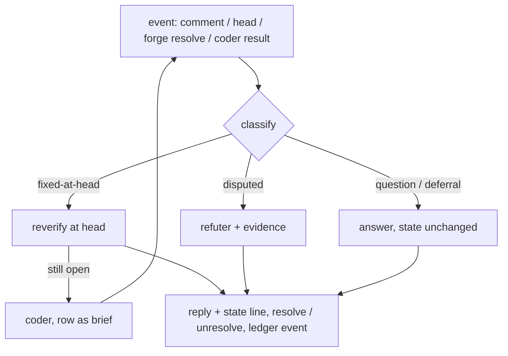

# One finding, one forge thread that remembers its exchanges and is closed only by its role or the owner

## Intent

Owner, 2026-10-26: "il manque la gestion des échanges dans la PR : des
agents qui se souviennent du contexte de la PR, capables d'échanger et
de clore le point ; tout doit être clos pour que le merge passe."

Every finding repoach posts becomes one review thread on the forge.
The ledger row behind it is that thread's memory. The role that opened
the thread answers the author from that memory, sends confirmed
findings to a coder, and closes the thread when the head settles it.
The merge is refused while any thread is open, and the forge refuses
it too.

## Context

Measured on `origin/develop` `51a4065` (2026-10-26), read-only.

### What exists

| # | Fact | Where |
|---|---|---|
| F1 | The protocol has thread *reads and replies* only: `comments(n)` (inline roots and replies), `conversation_comments(n)`, `reviews(n)`, `post_review`, `post_comment`, `reply(n, comment_id, body)`, `find_marked_comment`, `upsert_marked_comment` | `src/repoach/forge/protocol.py:599-712` |
| F2 | `Comment` carries `id, author, body, path, line, created_at, in_reply_to, thread_id`; `thread_id` is documented as "GitLab discussion id" | `src/repoach/forge/protocol.py:412-433` |
| F3 | GitLab: `comments()` flattens `GET .../merge_requests/<n>/discussions` into `DiffNote` comments carrying the discussion id; `reply()` finds the discussion holding a note and `POST`s to `.../discussions/<id>/notes` | `src/repoach/forge/gitlab.py:242-262`, `:498-506`, `:680-706` |
| F4 | GitHub: `comments()` reads REST `pulls/<n>/comments`; `comment_from_github` fills `in_reply_to` from `in_reply_to_id` and leaves `thread_id` unset; `reply()` replies on a root comment id through REST | `src/repoach/forge/github.py:311-321`, `:1249-1252`, `:1346-1356` |
| F5 | Posting today: one `post_review` per reviewer role, every inline comment rendered `**[<role>/<severity>]** <body>` plus a footer, then one sticky archive comment (`ARCHIVE_MARKER`) upserted with the full `TeamOutcome` JSON | `src/repoach/review/orchestrator.py:157-185`, `:1518-1600`, `:1933-1960`; `src/repoach/forge/protocol.py:44` |
| F6 | `finding_fingerprint` hashes claim type, file, the 5-line bucket of `line_start` and the normalised claim. It ignores the role: two roles raising the same claim on the same lines share one fingerprint | `src/repoach/review/findings_bridge.py:44`, `:142-162` |
| F7 | `pr_findings` columns: `id, pr_number, head_sha, round, finder, claim_type, severity, file, line_start, line_end, claim, evidence_pointer, status, verification_method, verification_result, checked_at_sha, verify_attempts, last_seen_at, last_run_id`. There is no forge column. `pr_review_runs`: `id, run_id, pr_number, head_sha, completed_at, final_verdict, payload_json` | `src/repoach/review/findings.py:202-252` |
| F8 | Finding statuses: `proposed, verified, refuted, open, resolved, stuck, not_applicable, resolved_at_head`, and the transition table | `src/repoach/review/findings.py:86-147` |
| F9 | `reverify_older_findings` re-checks every unsettled blocking finding of an older head against the pinned head tree and ends it `resolved` (`resolved_at_head`), `still_open` or `needs_judgement`. A cited file absent at head counts as resolved | `src/repoach/review/head_reverify.py:1-23`, `:198-204`, `:455` |
| F10 | `build_evidence` fills a token budget: the whole cited file, grep hits for the claim's identifiers, the diff hunks of the cited file and the cited spec section. `PARTIAL EVIDENCE` names whatever the budget left out. The refuter's floor is `REFUTER_CONTEXT_TOKENS_FLOOR = 40_000` | `src/repoach/review/refuter_evidence.py:1-44`, `:765-779`; `src/repoach/project/config.py:64` |
| F11 | The pure gate decides from `MergeFacts`: head, review integrity, CI, `open_blocking_findings`, spec coverage, unverified blockers and re-verification reasons. It has no thread fact | `src/repoach/review/merge_gate.py:84-207` |
| F12 | `thread_context.py` finds threads by the `[role/severity]` tag and `(file, line)` (`_match_finding_thread`). It posts a refutation sentinel reply. Its docstring names a writer, `coder_loop._format_evidence_reply`, that no longer exists; the only sentinel writer left is `_format_finding_evidence_reply` | `src/repoach/review/thread_context.py:36-41`, `:446`, `:475-505` |
| F13 | The coder path takes the PR's open blocking findings as its queue, commits, pushes to the PR head branch (`git_commit_and_push`) and re-verifies. A cross-run cap applies: `MAX_CODER_ROUNDS = 3` plus the stall detector | `src/repoach/review/coder_findings.py:1-19`, `:429-470`, `:712`; `src/repoach/review/coder_loop.py:769`; `src/repoach/review/stuck.py:48` |
| F14 | The protocol already names the forge's refusal `discussions_not_resolved` | `src/repoach/forge/protocol.py:48-56`; `src/repoach/forge/gitlab.py:121` |
| F15 | The GitHub workflow re-fires on `issue_comment` and `pull_request_review`. It does not re-fire on `pull_request_review_comment` (a reply inside an inline thread) | `.github/workflows/auto-review.yml:17-20` |

### What is missing

| # | Gap | Where it would go |
|---|---|---|
| M1 | No protocol method resolves or unresolves a thread. GitHub needs the GraphQL mutations `resolveReviewThread` / `unresolveReviewThread` on a thread node id (`PRRT_…`). GitLab needs `PUT .../merge_requests/<n>/discussions/<id>` with `resolved=true|false` | `forge/protocol.py`, `github.py`, `gitlab.py` |
| M2 | Nothing reads a thread's resolved state, who resolved it, or whether it is outdated. GitHub's REST comments do not carry the thread node id; only GraphQL `pullRequest.reviewThreads { id isResolved isOutdated resolvedBy path line comments }` does. GitLab drops `resolvable` / `resolved` / `resolved_by` in `note_to_comment` | `forge/github.py:311-321`; `forge/gitlab.py:216-239` |
| M3 | Nothing persists a finding → thread link. `SP-FINDING-THREAD-IDS` (draft, 2026-10-19) designs `finding_posts`, but `src/repoach/review/finding_posts.py` does not exist. Its GitHub `thread_id` is the root comment id, which cannot be passed to `resolveReviewThread` | `docs/specs/2026-10-19_SP-FINDING-THREAD-IDS_…md:52-55`, `:103` |
| M4 | Nothing remembers exchanges per finding. `pr_review_dialogue` holds `(pr_number, round, speaker, payload_json)` per review round, not per thread | `src/repoach/review/persistence.py:100-110` |
| M5 | The gate does not refuse on unresolved threads, and neither forge requires resolved threads before a merge (F17, F18) | `merge_gate.py:166-207` |
| M6 | Posting does not dedupe yet: `SP-POSTING-REPLAY-DEDUPES` (draft) is not implemented (`grep -rn "repoach-finding" src` returns nothing). Its NG1 re-posts a still-open finding at every new head, which contradicts D1 | `docs/specs/2026-10-25_SP-POSTING-REPLAY-DEDUPES_…md`, NG1 |
| M7 | The three-voice context with a fixed size and a summarizer (`SP-AGENT-CONTEXT-LOOP`, PR #246) is **not merged** (state OPEN, 2026-10-26). `agent_context.py` and `context_summarizer.py` do not exist on `develop` | `gh pr view 246` |

### The forges and Yoob today

| # | Fact | Where |
|---|---|---|
| F16 | Yoob `ci/review-gate.sh` exits `0` on APPROVE/COMMENT, `1` unknown, `2` input missing, `4` REQUEST_CHANGES, `5` no review, `8` write refused. Only `4` carries a review outcome | Yoob `ci/review-gate.sh:55-66`, `:212-240` |
| F17 | GitLab `josephwfaye/yoob_2` (project 67827362): `only_allow_merge_if_all_discussions_are_resolved: false` | `glab api projects/67827362`, 2026-10-26 |
| F18 | GitHub `repoachhq/repoach` rulesets `develop: pull requests only, never rewritten` (25641051) and `main: releases land as merge commits` (25641050): `required_review_thread_resolution: false` on both | `gh api repos/repoachhq/repoach/rulesets/<id>`, 2026-10-26 |
| F19 | Yoob backlog B-174 asks whether an unresolved review thread should block the merge. It proposes turning the GitLab setting on and is "decision needed". This spec decides it (D3) | Yoob `docs/BACKLOG.md:193` |
| F20 | `docs/tech_debt.md` rows are hand-numbered integers (`| # |`). `SP-ORDER-INDEPENDENT-DEBT-IDS` (draft) would replace them with `TD-xxxxxx`. Under D7 no debt row ever closes a thread, so this spec does not depend on either form | `docs/tech_debt.md:7-9` |

## Decisions (coordinator and owner, 2026-10-26; not re-opened here)

- **D1 One finding, one thread.** A finding is posted once, as one
  forge review thread keyed by its fingerprint. The ledger row is the
  thread's memory: finding, evidence, verdicts, and every exchange
  with its author, role, head SHA and timestamp. The agent that
  replies gets as context its ledger row, the thread history and the
  head diff of the cited files under a token budget, assembled by the
  same `refuter_evidence.build_evidence`. It never gets the whole PR.
- **D2 The opening role classifies each author reply.** A reply is
  one of:
  - `fixed-at-head`: the mechanical head re-verification decides.
  - `disputed`: the refuter judges with evidence. After one disputed
    round the thread is escalated.
  - `question`: the role answers.
  - `deferral` (D7): never changes the state.

  Every agent reply ends with exactly one state line: `state: open`,
  `state: resolved (<reason>)` or `state: escalated to owner`. D7
  removes the `accepted-as-debt` class.
- **D3 Who closes.** Only the opening role or the owner closes a
  thread, which means resolving it on the forge. The author never
  does. The pure gate requires zero open threads, and no finding in
  `proposed` or `verified` may lack a resolved thread. The forge
  settings mirror the gate: GitLab
  `only_allow_merge_if_all_discussions_are_resolved` and GitHub's
  ruleset `required_review_thread_resolution`.
- **D4 Bounded.** A thread gets at most 2 agent rounds, then
  `escalated to owner`. Agents reply only on an event: a new comment
  on the thread or a new head. Replaying an event never duplicates a
  reply (the `SP-POSTING-REPLAY-DEDUPES` marker discipline).
- **D5 Owner commands** in a thread are authoritative: `/resolve
  <reason>`, `/wontfix <reason>` and `/reopen`. There is no debt
  command (D7).
- **D6 Context in three voices** (`SP-AGENT-CONTEXT-LOOP`):
  - `system` = the role's prompt plus the closure protocol (D2 states,
    D3 who may close, D4 and D7 bounds).
  - The thread history is replayed from the ledger as alternating
    turns, in order, each prefixed `[head <sha7> · <ISO timestamp>]`.
    Every past reply of the role is an `assistant` turn; every author
    or owner comment is a `user` turn.
  - The current `user` turn = the new event plus the head diff of the
    cited files under the evidence budget (`refuter_evidence`).

  Each role has a fixed context size. When the replay exceeds it,
  #246's summarizer (the same summarizer, same persona and tier) folds
  the oldest turns into one `assistant` turn headed `thread summary
  (<n> turns, heads <a7>..<b7>)`, as #246 G4 places it. The summary is
  stored in the ledger so the next reply reuses it.
- **D7 No debt; a fix is the only closure of a confirmed finding**
  (owner: "On n'accepte jamais de dette : on demande à un codeur
  d'implémenter la solution, dans un autre commit ou une branche qui
  est mergée à la branche de la pull request.").
  - A thread is confirmed when its finding is neither fixed at head
    nor refuted. repoach then dispatches the coder (the
    `coder_findings.py` path) with the thread's row as its brief:
    finding, evidence, head and thread history.
  - The coder commits on the PR branch, or on `fix/<pr>-<fp8>`, which
    is then merged into the PR branch with a merge commit. Its work is
    never squashed and never force-pushed.
  - The thread is then re-verified at the new head (D2
    `fixed-at-head`) and closed by the role.
  - A coder may write a `docs/tech_debt.md` row for a *separate*
    improvement it noticed. That row never closes a thread.
  - An author reply such as "will do later" never changes the state.

- **D8 Human threads block too** (was Q1). Every unresolved thread
  blocks the merge: finding threads through the ledger gate, human
  threads (no finding) through the forge setting. A human thread is
  closed by its author or an owner, never by an agent. `repoach
  threads` lists it with role `human`, and the gate names it `open
  human threads: <ids>`.
- **D9 Owners** (was Q2). Owners are the explicit `[threads].owners`
  list in `repoach.toml`, compared to the forge login. An empty list
  means the repository's admins (GitHub `admin` permission, GitLab
  Maintainer and above), read from the forge once per run. If that
  read fails, no one is an owner for the run (fail closed) and owner
  commands get a reply naming the failed read.
- **D10 Events reach the handler** (was Q3).
  - GitHub: `.github/workflows/auto-review.yml` gains the
    `pull_request_review_comment` trigger next to
    `pull_request_review`, and runs `threads reply <pr>` on both.
  - GitLab: a webhook receiver, `repoach threads serve`, accepts note
    events (and MR events) only and compares `X-Gitlab-Token` with the
    configured secret in constant time (`hmac.compare_digest`; GitLab
    sends the secret verbatim, it does not sign the body). For an
    accepted note on an MR it starts exactly one `threads reply` run
    for that MR (D14 says where that run executes). A 15-minute
    scheduled pipeline starts the same run for every open MR as the
    fallback, so a lost webhook delays a reply but never drops it.
- **D11 Where the coder commits** (was Q4). By default the coder
  commits straight on the PR branch. Only when its fix spans several
  commits does it use `fix/<pr>-<fp8>`, which repoach merges into the
  PR branch with `--no-ff`. It never squashes and never force-pushes.
- **D12 No severity is exempt** (was Q5). Every severity, nit
  included, follows the same path: the coder fixes it, or an owner
  writes `/wontfix <reason>`.
- **D13 A coder that cannot push escalates at once** (was Q6). On a PR
  from a fork the coder cannot push to, the thread is escalated
  immediately with `coder cannot push to <fork>`. No coder round is
  spent.

- **D14 The GitLab receiver runs on hel1** (owner, 2026-10-26; was
  the last open question). It runs beside the review runner and
  `yoob.dev`, as the systemd unit `repoach-threads-serve.service`,
  reached through the existing nginx at `https://yoob.dev/hooks/repoach`,
  with the 15-minute scheduled pipeline as fallback. The Deployment
  section gives the measured facts and the exact steps.
- **D15 GitHub has no receiver.** GitHub Actions already re-runs on
  `issue_comment` and `pull_request_review`. `auto-review.yml` gains
  `pull_request_review_comment` (types `created`, `edited`) so a reply
  inside an inline thread re-runs `threads reply`. The repoach runners
  stay where they are.

## Goals

- G1: The forge protocol gains thread reads and writes on both forges
  (M1, M2), behind the write barrier for every write.
- G2: Posting a finding opens exactly one thread and one
  `finding_threads` row. A finding whose fingerprint already has a
  thread on the PR is never posted again, at any head (D1; this
  supersedes `SP-POSTING-REPLAY-DEDUPES` NG1 for findings that have a
  thread).
- G3: `repoach threads reply <pr>` handles each new event exactly once:
  an author comment, an owner command, a new head, a forge-side
  resolve or a coder result. It classifies the event (D2), acts
  (reverify, refuter, coder, answer), replies with one state line,
  then resolves, unresolves or leaves the thread to match.
- G4: The reply context is built as D6 says, within the role's fixed
  size, and reuses the stored summary.
- G5: The gate and `review pr`'s verdict refuse while any thread is
  `open` or `escalated`, or while any blocking finding in
  `proposed`/`verified`/`open`/`stuck` has no `resolved` thread. Each
  refusal names the thread ids.
- G6: Confirmed threads go to the coder (D7), once per thread and
  head, at most `coder_rounds_max_per_thread` times, then escalate.
- G7: Both forges require resolved threads before a merge, and the
  gate prints what it measured of that setting.
- G8: `repoach threads <pr>` prints the PR's threads as a table, or as
  one JSON document with `--json`.

## Non-Goals

- NG1: No free chat. A comment with no thread under a finding gets no
  agent reply, and an agent never opens a thread without a finding.
- NG2: No thread is created for a finding that was never posted (dry
  run, posting off).
- NG3: No debt path. No reply, command or ledger row turns a confirmed
  finding into accepted debt (D7).
- NG4: The forge is not the store of record. Its threads are read and
  reconciled; the ledger decides.
- NG5: No change to how findings are raised or verified. Reviewer,
  refuter and verifiers are unchanged except for being called from
  here.
- NG6: No agent replies in, classifies or closes a human thread
  (D8); repoach only lists it and the gate names it.

## Assumptions

- A1: `SP-FINDING-THREAD-IDS` lands first or together. Its
  `finding_posts` table gives per-head comment ids, and this spec
  adds the cross-head thread row. Its GitHub `thread_id` (a root
  comment id) cannot be resolved through the API, so
  `finding_threads.thread_id` holds the GraphQL node id and
  `root_comment_id` the REST id.
- A2: `SP-AGENT-CONTEXT-LOOP` (#246) lands before G4 is implemented.
  Until then `thread_reply` sends one user message, as every agent
  does today, and AC17 stays planned.
- A3: Every role posts through one bot identity (`bot_username`). The
  opening role is therefore read from the ledger row (`finder`) and
  the `[role/severity]` tag, never from the forge author.
- A4: The token that posts can resolve and unresolve threads: `pull
  requests: write` on GitHub, Developer on GitLab. A recorded
  conformance fixture per forge confirms it before AC1 is ticked.
- A5: `review/orchestrator.py` (SP-ORCH-DOCSTRING),
  `findings_bridge.py` (SP-FINDINGS-BRIDGE-DOCFIX), `findings.py`
  (SP-FINDINGS-INIT-RACE), `forge/` (SP-UNIVERSAL-FORGE) and
  `head_reverify.py` (SP-GATE-REVERIFIES-AT-HEAD) keep their owners.
  This spec edits them under its `depends_on` edges. `merge_gate.py`,
  `coder_findings.py` and `review_cmds.py` are frontier (no owning
  spec declares them).

## Interface

### Forge protocol additions (both forges)

```python
class ReviewThread(_Model):
    id: str                      # GitHub PRRT_ node id; GitLab discussion id
    resolved: bool
    resolved_by: str = ""        # login / username, "" when unresolved or unknown
    outdated: bool = False       # GitHub isOutdated; GitLab: position no longer on the diff
    path: str | None = None
    line: int | None = None
    root_comment_id: int = 0     # REST comment id / note id of the first comment
    comments: list[Comment] = []

def review_threads(self, number: int) -> list[ReviewThread]: ...     # read
@write_barrier
def resolve_thread(self, number: int, thread_id: str) -> None: ...   # GraphQL resolveReviewThread / PUT resolved=true
@write_barrier
def unresolve_thread(self, number: int, thread_id: str) -> None: ... # unresolveReviewThread / PUT resolved=false
```

`BranchProtection` gains `threads_must_be_resolved: bool | None`. On
GitLab it is read from the project's
`only_allow_merge_if_all_discussions_are_resolved`; on GitHub from the
rulesets that target the base branch (`required_review_thread_resolution`).
It is `None` when the setting cannot be read.

### Ledger (created by `init_findings_schema`, race-proof idiom)

`finding_threads`: one row per thread, living across heads.

| Column | Type | Notes |
|---|---|---|
| `id` | INTEGER PK | thread row id, the `<id>` the gate names (`T<id>`) |
| `pr_number` | INTEGER | |
| `forge` | TEXT | `github` / `gitlab` |
| `thread_id` | TEXT | forge thread id (A1) |
| `root_comment_id` | INTEGER | REST id / note id of the first comment |
| `finding_fingerprint` | TEXT | fingerprint of the opening finding; UNIQUE with `pr_number` |
| `match_key` | TEXT | sha256 of `claim_type|file|normalised_claim`, without the line bucket; used for re-anchoring |
| `finding_id` | INTEGER | the opening `pr_findings.id` |
| `opening_role` | TEXT | `finder` of the opening finding |
| `co_roles` | TEXT (JSON list) | other roles whose finding hit the same fingerprint |
| `state` | TEXT | `open` / `resolved` / `escalated` |
| `resolution` | TEXT | `fixed` / `refuted` / `file_removed` / `owner_resolve` / `wontfix` / `""` |
| `resolution_detail` | TEXT | reason text as written on the state line |
| `rounds` | INTEGER | agent rounds spent (D4) |
| `disputed_rounds` | INTEGER | D2 |
| `coder_rounds` | INTEGER | D7 |
| `opened_head` / `last_head` | TEXT | full SHAs |
| `anchor_file` / `anchor_line` | TEXT / INTEGER | where the finding sits at `last_head` |
| `summary` | TEXT | stored D6 summary, `""` when none |
| `summary_upto_event` | INTEGER | last `finding_thread_events.id` folded into `summary` |
| `opened_at` / `updated_at` | TEXT | ISO-8601 UTC |

`finding_thread_events`: one row per exchange, append-only.

| Column | Type | Notes |
|---|---|---|
| `id` | INTEGER PK | |
| `thread_row_id` | INTEGER | → `finding_threads.id` |
| `event_key` | TEXT | `comment:<forge id>`, `head:<sha12>`, `forge-resolved:<sha12>:<by>`, `coder:<sha12>:<n>`; UNIQUE with `thread_row_id` (replay-safe) |
| `kind` | TEXT | `opened` / `author_comment` / `owner_command` / `agent_reply` / `new_head` / `forge_resolved` / `coder_result` |
| `author` | TEXT | forge login, or `repoach:<role>` |
| `voice` | TEXT | `role` / `author` / `owner` / `coder` (D6 maps `role` → assistant, the rest → user) |
| `classification` | TEXT | `fixed-at-head` / `disputed` / `question` / `deferral` / `command:<name>` / `""` |
| `head_sha` | TEXT | head at the event |
| `body` | TEXT | verbatim comment, or the reply posted |
| `forge_comment_id` | INTEGER | id of the posted reply, when any |
| `state_after` | TEXT | thread state after the event was handled |
| `created_at` | TEXT | ISO-8601 UTC |

`FindingStatus` gains `waived`: terminal and non-blocking, reached
only from an owner `/wontfix`. An owner `/resolve` on a finding the
head still supports also ends the finding `waived`, with the reason
kept. `resolved_at_head` stays the only status a fix reaches.

### Formats

- State line (`format:thread-state-line`): the last visible line of
  every agent reply, matching
  `^state: (open|resolved \((?P<reason>[^)]+)\)|escalated to owner)$`.
- Reply marker (`format:thread-reply-marker`): the hidden last line of
  every agent reply,
  `<!-- repoach-thread:<fingerprint> event:<event_key> round:<n> -->`.
  Before writing, `threads reply` reads the thread and skips any
  event whose marker is already there.
- Owner command (`format:thread-owner-command`): a comment whose first
  line is `/resolve <reason>`, `/wontfix <reason>` or `/reopen`,
  written by a configured owner. `<reason>` is required for the first
  two.

### Configuration (`repoach.toml`)

```toml
[threads]
owners = ["<forge login>", ...]   # empty: the repository's admins, read once per run (D9)
webhook_secret_env = "REPOACH_GITLAB_WEBHOOK_SECRET"  # D10, GitLab receiver only
```

The context size per role is `[agents.<role>].context_tokens`
(SP-AGENT-CONTEXT-LOOP); the evidence share is that budget minus
system, history and summary.

### CLI (stdout is one JSON document with `--json`, SP-CLI-STDOUT-ONE-JSON)

- `repoach threads <pr> [--forge F] [--json]`: one row per thread
  with `T<id>`, forge thread id, role, `file:line`, state, resolution,
  rounds, disputed rounds, coder rounds, last head (sha7) and last
  event. Exit `0`; `2` when the forge or the ledger is unavailable.
- `repoach threads reply <pr> [--forge F] [--dry-run] [--json]`: the
  event handler. It reads the forge threads, reconciles them with the
  ledger, handles every unhandled event in `event_key` order, and
  prints
  `{"handled": n, "replies": n, "resolved": [ids], "reopened": [ids],
  "escalated": [ids], "coder_dispatched": [ids], "skipped_duplicates":
  n, "refused_writes": [...]}`. Exit `0`; `2` forge unavailable; `8`
  a write was refused (the same meaning as `review pr`).
- `repoach threads serve [--host H] [--port P]` (D10, GitLab): an HTTP
  receiver for note events. It answers `401` without running anything
  when `X-Gitlab-Token` does not match the secret, `202` and ignores
  every non-note event, and `202` plus one `threads reply <iid>`
  (serialised per MR) for a note on an MR. It logs one line per
  request: event, MR, outcome.
- When the first argument is a number it is a PR; `reply` and `serve`
  name the subcommands.
- Human threads (D8) appear in the table with role `human`, the state
  read from the forge, and no rounds.

### Gate

`MergeFacts` gains `open_threads: list[str]`, `escalated_threads:
list[str]`, `unthreaded_findings: list[int]`, `threads_judged: bool`
`open_human_threads: list[str]` and `threads_setting: bool | None`. `compute_merge_decision` adds:

- `open threads: T3, T7`
- `open human threads: H<forge thread id>, …`
- `escalated threads: T5 (owner)`
- `blocking findings without a resolved thread: #12, #19`

`verdict_from_facts` returns `REQUEST_CHANGES` when any of these is
non-empty, so the Yoob driver's exit `4` covers it without a change.
When the PR has no posting run in the ledger, `threads_judged` is
false and the gate prints `threads: not posted, not judged`; it does
not refuse on threads.

## Behavior

### Nominal

1. **Open.** The posting run (after the `SP-POSTING-REPLAY-DEDUPES`
   read) posts a finding whose fingerprint has no row. It then writes
   `finding_threads` (state `open`, `opened_head` = `last_head` =
   head) and one `opened` event, using the ids read back from
   `review_threads`. A fingerprint that already has a row is never
   posted again (G2); its row's `last_head` moves to the head instead.
2. **New head.** For each `open` thread, its finding is re-verified at
   the head by `reverify_older_findings`.
   - `resolved`: the role replies `… state: resolved (fixed at
     <sha7>)` and resolves the thread.
   - `still_open`: the thread is confirmed (step 5).
   - `needs_judgement`: the thread stays open; the reply names the
     re-verification's reason.
3. **Author comment.** The opening role classifies it with
   `thread_reply` in the D6 context and contract
   `{"class": "fixed-at-head|disputed|question|deferral", "answer": "..."}`.
   - `fixed-at-head`: as step 2, at the current head.
   - `disputed`, with `disputed_rounds = 0`: the refuter judges with
     `build_evidence`. Refuted means `state: resolved (refuted: <why>)`
     and the finding becomes `refuted`. Upheld means the reply quotes
     the evidence lines and ends `state: open`, and `disputed_rounds`
     becomes 1.
   - `disputed`, with `disputed_rounds = 1`: no refuter call; the reply
     ends `state: escalated to owner`.
   - `question`: the reply is the answer and ends `state: open`.
   - `deferral`: at most one reply per thread and head, saying only a
     fix closes the thread. The state, `rounds` and the coder are
     untouched.
4. **Owner command.** It is applied without a model call:
   - `/resolve <r>` → `resolved (owner: <r>)`.
   - `/wontfix <r>` → `resolved (wontfix: <r>)`, finding `waived`.
   - `/reopen` → `open`, `rounds` and `disputed_rounds` reset to 0;
     `coder_rounds` is kept.

   The bot confirms each command with one line that carries the state
   line, then resolves or unresolves the thread.
5. **Confirmed → coder (D7).** A thread whose finding is `verified`,
   `open` or `stuck` at head, and that was not settled in this pass,
   dispatches `run_coder_fix_from_findings` once per `(thread, head)`.
   It is restricted to that finding, with a brief built from the row:
   claim, evidence pointer, head, the verification result and the
   stored summary plus the last turns. The coder commits on the PR head
   branch; a fix of several commits goes on `fix/<pr>-<fp8>`, merged
   into the PR branch with `--no-ff` (D11). It pushes without force. The push
   is a new head, so step 2 decides. If the coder ends without a push,
   or its head does not settle the finding, the reply ends `coder
   round <n> did not settle: <reason>` and `state: open`. At
   `coder_rounds = 2` it ends `state: escalated to owner`.
6. **Forge-side resolve by anyone else.** A thread resolved on the
   forge whose `resolved_by` is neither the bot nor an owner is
   unresolved at once. The bot posts one line, `reopened: only <role>
   or an owner closes this thread (resolved by @<login>)`, followed
   by `state: open`.
7. **Bounds.** Every agent reply in steps 2–3 counts one round. At
   `rounds = 2` the next qualifying event yields `state: escalated to
   owner`. The bot resolves no escalated thread, and escalated threads
   get no agent reply; only owner commands are acted on.
8. **Refuted at review time.** A finding the refuter refutes before
   any author exchange is resolved in its opening role's name:
   `state: resolved (refuted: <why>)`. This replaces the
   `post_refuted_finding_sentinels` sentinel reply.

### Edge cases

- **A force-push rewrites the cited lines.** The fingerprint's line
  bucket changes, so the new head's finding gets a new fingerprint.
  Before posting, a new finding whose `match_key` and role equal an
  `open`/`escalated` row's is joined to that thread instead of posted.
  The row's `anchor_file:anchor_line` and `last_head` are updated, and
  one reply `re-anchored at <file>:<line> (head <sha7>)` is posted
  (event key `head:<sha12>`). The forge thread stays where it was,
  outdated on GitHub; it is not re-created.
- **The author deletes the cited file.** Re-verification resolves it
  (`_cited_file_absent`). The reply ends `state: resolved (file
  removed at <sha7>)`, resolution `file_removed`.
- **The owner overrides a role.** An owner's `/reopen` on a
  role-resolved thread wins. The role does not resolve it again at the
  same head without a new event, and the next head's re-verification
  applies as usual. An owner `/resolve` on a role-open thread wins too,
  and the role never reopens a thread an owner resolved.
- **Two roles on one line.** Different claims mean different
  fingerprints and two threads. The same claim gives the same
  fingerprint (F6) and one thread: the first role to post opens it,
  and the second is added to `co_roles`, may reply, and cannot close.
- **A slash command from a non-owner** is classified as an ordinary
  author comment, and the reply names the configured owners. With
  `owners = []` the owners are the admins read from the forge (D9);
  when that read failed, the reply names the failed read.
- **A coder push races the author's push.** The push is rejected
  (non-fast-forward) and never forced. That is not a coder round; the
  dispatch is retried once at the new head after step 2.
- **The PR comes from a fork the coder cannot push to** (D13): the
  thread is escalated at once with `coder cannot push to <fork>` and
  `state: escalated to owner`; `coder_rounds` stays 0.
- **The PR branch is protected against the bot's push**: the push is
  refused, the reply ends `coder round <n> did not settle: push refused
  (<forge message>)`, and the second such failure escalates.
- **A human thread** (D8) is never replied to. If its author or an
  owner resolves it, it no longer blocks; if anyone else resolves it,
  nothing is done, because the forge setting governs it.
- **The thread was deleted on the forge.** The row stays, and the gate
  names it `open threads: T<id> (thread missing on forge)`. Only an
  owner `/resolve`, typed in any of the bot's threads with
  `T<id>`, or a re-post at the next head (a new row, the old one
  `resolved (thread missing, re-posted as T<new>)`) settles it.

### Failure scenarios

- **The forge read fails.** Nothing is written, the output JSON names
  the error, and the command exits `2`. The gate counts threads as
  unknown and refuses with `threads unreadable at <sha7>`.
- **The model call fails** (classification or reply). No reply, no
  state change, and the event stays unhandled for the next run;
  `SP-JUDGE-FAILURE-IS-RETRIED` semantics apply.
- **Dry run.** The barrier refuses every write. No `agent_reply` event
  is stored and the JSON lists the refused writes.
- **The forge settings are off.** The gate still refuses on the ledger
  and prints `forge does not require resolved threads
  (<setting>=false)`; this is a named line, not a refusal.

## Deployment (D14, D15)

Measured on hel1 (`ssh hel1`, 2026-10-26) and on Yoob `origin/develop`.

| # | Fact | Consequence for the receiver |
|---|---|---|
| H1 | nginx runs as the container `yoob_nginx` (`nginx:1.25-alpine`) on the bridge network `yoob_2_yoob_network`, subnet `172.18.0.0/16`, gateway `172.18.0.1`, publishing 80 and 443. Its vhosts are bind-mounted from `~/yoob_2/nginx/conf.d` (compose files `docker-compose.prod.yml`, `docker-compose.hetzner.yml`, `docker-compose.prod-toolchain.yml`). There is no host nginx (`/etc/nginx` is absent) | A unit bound to `127.0.0.1` is **unreachable from that container**: inside it, `127.0.0.1` is the container itself. The receiver binds the bridge gateway `172.18.0.1:8787`. `docker-compose.prod.yml` pins that subnet so the address cannot move when the network is recreated |
| H2 | `ufw` is active and allows only `22/tcp`; docker publishes 80 and 443 itself. `ss -ltn` shows nothing else listening on a public address | Port 8787 is never published. One `ufw` rule admits only the nginx bridge: `ufw allow in on br-<id of yoob_2_yoob_network> to 172.18.0.1 port 8787 proto tcp` |
| H3 | DNS: `yoob.dev`, `www.yoob.dev` and `studio.yoob.dev` resolve straight to `65.108.199.28` (no Cloudflare proxy in front, the response `server` is `nginx/1.25.5`). `hooks.yoob.dev` does not resolve. The Let's Encrypt certificate's SANs are exactly `yoob.dev`, `www.yoob.dev` and `studio.yoob.dev` | **The path, not a subdomain.** A `location = /hooks/repoach` inside the existing `listen 443 ssl` server block for `yoob.dev` (`nginx/conf.d/yoob.conf:76-77`) needs no DNS record and no certificate change. A subdomain would need both, plus a certbot re-issue under HSTS (`max-age=63072000`) |
| H4 | `nginx/nginx.conf:45-46` defines only `api_limit` (10 r/s) and `upload_limit` (1 r/s) | A new zone `hooks_limit` (`5r/s`, `burst=10`), with `client_max_body_size 1m` on the location |
| H5 | Runners on hel1 run as systemd units `gitlab-runner-{light,heavy,deploy}.service`. No repoach is installed system-wide (`which repoach` is empty, `/etc/repoach*` absent) | The unit runs repoach from its own virtualenv, `/opt/repoach-threads/venv`, under a dedicated system user `repoach-threads` |
| H6 | The findings ledger of an MR lives in that MR's CI cache (`SP-CI-LEDGER-PERSISTS`; Yoob `ci/review-gate.sh:12-15`), not on hel1's disk | **The receiver does not run `threads reply` in-process.** It starts a pipeline on the MR's source branch with `REPOACH_THREADS_REPLY_MR=<iid>`, through a pipeline trigger token. The `threads:reply` job restores that MR's ledger cache, runs `repoach threads reply <iid>` and saves the cache. Triggers for one MR are coalesced: at most one pending per MR, 60 s window |
| H7 | Yoob's `workflow:rules` let a pipeline through on `schedule`, `merge_request_event`, `main`/`develop`, `tp/*` and tags, and refuse a branch pipeline while an MR is open (`$CI_COMMIT_BRANCH && $CI_OPEN_MERGE_REQUESTS → never`) | A rule `$CI_PIPELINE_SOURCE == "trigger" && $REPOACH_THREADS_REPLY_MR` must come **before** the `never` rule, as the schedule rule already does. Every other job excludes trigger pipelines, so the run carries only `threads:reply` |

Not measured: the project's existing webhooks and trigger tokens. Their
API read returns credentials, so the owner reads them.

### Steps (Yoob-side files are changed by a Yoob MR, not by this spec)

1. **The unit** `/etc/systemd/system/repoach-threads-serve.service`:

   ```ini
   [Unit]
   Description=repoach GitLab note-event receiver (SP-PR-THREADS-REMEMBER-AND-CLOSE D14)
   After=network-online.target docker.service
   Wants=network-online.target

   [Service]
   User=repoach-threads
   EnvironmentFile=/etc/repoach/threads-serve.env
   ExecStart=/opt/repoach-threads/venv/bin/repoach threads serve --host 172.18.0.1 --port 8787
   Restart=on-failure
   NoNewPrivileges=yes
   ProtectSystem=strict
   ProtectHome=yes
   PrivateTmp=yes

   [Install]
   WantedBy=multi-user.target
   ```

   `/etc/repoach/threads-serve.env` is `root:root 0600`. It holds
   `REPOACH_GITLAB_WEBHOOK_SECRET` (the webhook's secret token) and
   `REPOACH_GITLAB_TRIGGER_TOKEN` (the pipeline trigger token).
   systemd reads it as root before dropping to `repoach-threads`.
   **No secret is ever in argv**: `threads serve` takes none on its
   command line and refuses to start (exit 2, the variable named)
   when either is unset.
2. **nginx** (Yoob `nginx/conf.d/yoob.conf`, in the `yoob.dev` 443
   server block; `nginx/nginx.conf` gets the zone):

   ```nginx
   location = /hooks/repoach {
       limit_req zone=hooks_limit burst=10 nodelay;
       client_max_body_size 1m;
       limit_except POST { deny all; }
       proxy_pass http://172.18.0.1:8787/hooks/gitlab;
       proxy_set_header X-Gitlab-Token $http_x_gitlab_token;
       proxy_set_header X-Gitlab-Event $http_x_gitlab_event;
   }
   ```

   `docker-compose.prod.yml` pins `yoob_network`'s subnet to
   `172.18.0.0/16` (H1), and the `ufw` rule of H2 is added on the host.
3. **CI** (Yoob `.gitlab-ci.yml`): the trigger rule of H7, the
   `threads:reply` job (ledger cache keyed by MR iid, the same key as
   `review:gate`), and a pipeline schedule every 15 minutes
   (`*/15 * * * *`) whose job lists open MRs and starts one triggered
   run per MR.
4. **The project webhook**, created by the owner, who pastes the
   secret into the prompt instead of into argv:

   ```bash
   read -rs REPOACH_GITLAB_WEBHOOK_SECRET
   printf '{"url":"https://yoob.dev/hooks/repoach","note_events":true,"merge_requests_events":true,"push_events":false,"enable_ssl_verification":true,"token":"%s"}' \
       "$REPOACH_GITLAB_WEBHOOK_SECRET" \
     | glab api --method POST projects/67827362/hooks \
         -H 'Content-Type: application/json' --input -
   unset REPOACH_GITLAB_WEBHOOK_SECRET
   ```

   The trigger token is created once with `glab api --method POST
   projects/67827362/triggers -f description=repoach-threads-serve`
   and copied into the env file. It is never committed or logged.
5. **GitHub (D15)**: `.github/workflows/auto-review.yml` adds

   ```yaml
   pull_request_review_comment:
     types: [created, edited]
   ```

   and resolves the PR number from
   `github.event.pull_request.number` for that event, as it already
   does for `pull_request_review`.

## Architecture Impact

- Adds dependency → SP-UNIVERSAL-FORGE: new protocol methods and
  `ReviewThread` in `forge/`.
- Adds dependency → SP-FINDING-THREAD-IDS: the per-head comment ids
  `finding_threads` joins to.
- Adds dependency → SP-POSTING-REPLAY-DEDUPES: same marker discipline.
  This spec supersedes its NG1 for any finding with a thread.
- Adds dependency → SP-GATE-REVERIFIES-AT-HEAD: `reverify_older_findings`
  decides `fixed-at-head`.
- Adds dependency → SP-REFUTER-JUDGES-WHAT-IT-CAN: the refuter and
  `build_evidence` judge `disputed` and fill the evidence share of D6.
- Adds dependency → SP-AGENT-CONTEXT-LOOP: the three-voice context
  and the summarizer (D6).
- Adds dependency → SP-RED-STOPS-THE-LINE: a gate refusal for open
  threads is one more named refusal its line-stop analysis
  classifies. Coder dispatch under D7 is per thread and never opens a
  line stop by itself.
- Adds dependency → SP-DRY-RUN-NEVER-POSTS: every thread write goes
  through the barrier.
- Adds dependency → SP-FINDINGS-INIT-RACE: schema init and the new
  `waived` status in `findings.py`.
- Adds dependency → SP-FINDINGS-BRIDGE-DOCFIX: `finding_fingerprint`,
  `normalised_claim` (`match_key`).
- Adds dependency → SP-ORCH-DOCSTRING: the posting path opens threads.
- Adds dependency → SP-UNIVERSAL-PROJECT-CONFIG: `[threads]` section.
- Adds dependency → SP-CLI-STDOUT-ONE-JSON: `threads --json` output.
- Adds dependency → SP-JUDGE-FAILURE-IS-RETRIED: a failed classification or reply call is retried, never read as a judgement.
- New shared state: `db:table:finding_threads` and
  `db:table:finding_thread_events`, owned here.
- `thread_context.py` keeps its role-tag reading for threads that
  predate this spec. Its sentinel reply path is retired by Behavior
  step 8.

## Diagram



## Acceptance Criteria

All on the fixture forge `tests/thread_fakes.py` (an in-memory forge
implementing the protocol's thread methods and recording every write)
unless an AC names a recorded fixture or a live measurement.

- [ ] AC1: `review_threads`, `resolve_thread` and `unresolve_thread` run
  against recorded conformance fixtures
  (`tests/fixtures/forge/{github,gitlab}/review_threads*.json`). GitHub
  makes a GraphQL `reviewThreads` read and the
  `resolveReviewThread`/`unresolveReviewThread` mutations on a `PRRT_`
  id. GitLab reads `discussions` (mapping `resolved`/`resolved_by`) and
  sends `PUT …/discussions/<id>` with `resolved=true|false`. In dry run
  both writes raise `ForgeWriteRefusedError`.
- [ ] AC2: A posting run with 3 findings (one shared by two roles)
  opens exactly 2 threads and writes 2 `finding_threads` rows (state
  `open`, `rounds = 0`, `last_head` = head, forge thread id set), with
  the second role in `co_roles`.
- [ ] AC3 (open → fixed-at-head → resolved): F is posted at head A as
  T1. Head B is pushed where re-verification says `resolved`. Then
  `threads reply` posts one reply ending `state: resolved (fixed at
  <B7>)`, calls `resolve_thread(T1)` once, the row is `resolved` /
  `fixed`, and F is `resolved_at_head`.
- [ ] AC4 (D7, coder): T1 is confirmed at head A. `threads reply`
  dispatches the fake coder exactly once, with a brief containing F's
  id, claim, evidence pointer, A and the thread history. A second
  `threads reply` at A dispatches 0. The coder's commit lands on the
  PR branch as head B (fast-forward, no force). The next `threads
  reply` resolves T1 with `state: resolved (fixed at <B7>)`.
- [ ] AC5 (D7, coder fails): the fake coder ends without settling F,
  and the reply ends `coder round 1 did not settle: <reason>` and
  `state: open`. A second failure gives `state: escalated to owner`,
  the row is `escalated`, and there is no third dispatch.
- [ ] AC6 (disputed twice → escalated): the author disputes; the fake
  refuter upholds. The reply quotes evidence lines and ends `state:
  open`, and `disputed_rounds = 1`. The author disputes again: no
  refuter call, the reply ends `state: escalated to owner`, and the
  row is `escalated`.
- [ ] AC7 (disputed, refuted): the author disputes; the refuter
  refutes. The reply ends `state: resolved (refuted: <why>)`, T is
  resolved on the forge, and F is `refuted`.
- [ ] AC8 (deferral): the author writes "will do later". State,
  `rounds` and `coder_rounds` are unchanged, at most one reply is
  posted at that head, and a second deferral at the same head posts
  nothing.
- [ ] AC9 (author resolves): the author resolves T1 on the fixture
  forge. The next `threads reply` calls `unresolve_thread(T1)` once
  and posts exactly `reopened: only <role> or an owner closes this
  thread (resolved by @<author>)` followed by `state: open`. The row
  stays `open` and one `forge_resolved` event is stored.
- [ ] AC10 (gate): with T3 and T7 open, `review gate` refuses and its
  reasons contain `open threads: T3, T7`. With an escalated T5 they
  contain `escalated threads: T5 (owner)`. A blocking verified
  finding without a thread gives `blocking findings without a
  resolved thread: #<id>`. `review pr` reports `REQUEST_CHANGES` in
  each case. With every thread resolved and nothing else failing,
  the gate merges.
- [ ] AC11 (owner `/wontfix`): a configured owner writes `/wontfix
  covered by the integration test`. The bot posts one line ending
  `state: resolved (wontfix: covered by the integration test)`,
  resolves the thread, and F is `waived`. The same comment from a
  non-owner changes nothing and gets one reply naming the owners.
  `/wontfix` without a reason is refused with a line. `/resolve <r>`
  and `/reopen` behave as Behavior step 4 says.
- [ ] AC12 (replay): running `threads reply` twice on the same forge
  state posts 0 comments and makes 0 resolve/unresolve calls the
  second time; its JSON reports `skipped_duplicates` ≥ 1. Every agent
  reply carries the `repoach-thread` marker.
- [ ] AC13 (bounds): across a scripted 5-event exchange, no thread
  receives more than 2 agent rounds. The next qualifying event yields
  `state: escalated to owner`, and the escalated thread gets no
  further agent reply; only owner commands are acted on.
- [ ] AC14 (force-push): head C moves F's lines by 30, and the new
  review raises the same claim. No new thread is posted, the thread
  count is unchanged, `anchor_line` and `last_head` are updated, and
  exactly one `re-anchored at <file>:<line> (head <C7>)` reply is
  posted.
- [ ] AC15 (file deleted): head D removes F's file, and the reply ends
  `state: resolved (file removed at <D7>)`.
- [ ] AC16 (owner override): T1 was resolved by its role and the owner
  writes `/reopen`. The thread is `open`, the forge thread is
  unresolved, and no role reply resolves it again at the same head.
- [ ] AC17 (D6 context): a 12-turn fixture thread (6 author, 6 role,
  over 3 heads) with a role context size that fits system, the current
  event and 3 turns yields a context of exactly `system` + one `assistant`
  turn `thread summary (9 turns, heads <a7>..<c7>)` + the last 3 turns
  in alternating voices with `[head · timestamp]` prefixes + the
  current `user` event. The summary is stored on the row and reused
  (no summarizer call) by a reply on the next event. The reply cites
  F's `evidence_pointer` and claim taken from the row, which the test
  proves by making them absent from the replayed turns.
- [ ] AC18 (CLI): `repoach threads <pr> --json` prints one JSON
  document listing every row with the columns of Interface/CLI, and
  without `--json` a table with one line per thread. On a PR with no
  rows it prints an empty list and exits 0.
- [ ] AC19 (forge settings, measured live after rollout):
  `glab api projects/67827362` returns
  `"only_allow_merge_if_all_discussions_are_resolved":true`, and `gh
  api repos/repoachhq/repoach/rulesets/25641051` and `…/25641050`
  each return `"required_review_thread_resolution":true`. `review
  gate` prints the measured value as `threads_setting=true`, and
  prints the named line when false.
- [ ] AC20 (dry run): `threads reply --dry-run` on AC3's state makes
  no forge write, stores no `agent_reply` event, and lists the
  refused writes in its JSON.

- [ ] AC21 (human thread, D8): a human reviewer's unresolved thread
  with no finding is listed by `repoach threads <pr>` with role
  `human`, and `review gate` refuses naming `open human threads:
  H<id>`. No agent reply is posted in it. After its author resolves
  it, the gate no longer names it.
- [ ] AC22 (owners, D9): with `owners = ["alice"]`, `/wontfix <r>`
  from `alice` applies and from `bob` does not. With `owners = []`
  and a fixture admin list `["carol"]`, `carol`'s command applies,
  and the admin list is read exactly once per run. When that read
  fails, no command applies and the reply names the failed read.
- [ ] AC23 (receiver, signed, D10/D14): `threads serve` receives a
  note event for MR !12 with the right `X-Gitlab-Token`. It answers
  `202` and makes exactly one trigger call: a pipeline on !12's source
  branch with `REPOACH_THREADS_REPLY_MR=12`. A second identical
  delivery inside the 60 s window makes no second call, and the
  triggered `threads reply 12` posts nothing new on replay (AC12).
- [ ] AC24 (receiver, bad token, D10): the same event with a wrong or
  missing `X-Gitlab-Token` gets `401`, no trigger call is made, and one
  log line names the rejection without echoing the token. A non-note,
  non-MR event with the right token gets `202` and makes no call.
  `threads serve` with either secret unset exits 2 naming the
  variable.
- [ ] AC25 (fallback and GitHub triggers, D10): the GitLab CI
  configuration generated by `repoach ci` holds a scheduled job that
  runs `threads reply` on every open MR, and the schedule interval
  documented is 15 minutes. `.github/workflows/auto-review.yml` lists
  `pull_request_review_comment` (types `created`, `edited`) and
  `pull_request_review` among its triggers, and both lead to
  `threads reply` (D15).
- [ ] AC26 (fix branch, D11): a fake coder producing one commit pushes
  it straight on the PR branch. A fake coder producing three commits
  pushes them on `fix/<pr>-<fp8>`, which is merged into the PR branch
  with one merge commit whose parents are the old PR head and the fix
  branch tip. No push is forced and no commit is squashed.
- [ ] AC27 (no severity exempt, D12): a `nit` finding's thread goes
  through the same coder dispatch as AC4, and a `nit` thread with no
  fix and no owner `/wontfix` makes the gate refuse.
- [ ] AC28 (fork, D13): on a fork PR the coder cannot push to, the
  confirmed thread's reply ends `coder cannot push to <fork>` and
  `state: escalated to owner`; the coder is never invoked and
  `coder_rounds = 0`.

- [ ] AC29 (deployment on hel1, measured, D14):
  - `systemctl is-active repoach-threads-serve` prints `active`.
  - `ss -ltn` shows `172.18.0.1:8787` and no `0.0.0.0:8787`.
  - `stat -c '%U:%G %a' /etc/repoach/threads-serve.env` prints
    `root:root 600`.
  - `ps -o args= -C repoach` shows no secret.
  - From outside hel1, `curl -s -o /dev/null -w '%{http_code}' -X POST
    https://yoob.dev/hooks/repoach -H 'X-Gitlab-Token: wrong'` prints
    `401`, a direct connection to `65.108.199.28:8787` fails, and a
    `GET` on the path is refused by nginx (`403`).
- [ ] AC30 (webhook, measured by the owner): the project's hook list
  shows one hook with URL `https://yoob.dev/hooks/repoach`,
  `note_events: true`, `merge_requests_events: true`,
  `push_events: false` and `enable_ssl_verification: true`. Its
  "Test → Note events" delivery returns `202` and starts one
  `threads:reply` pipeline.

## Rollout

- R1: protocol (AC1).
- R2: rows, posting and replay (AC2, AC12, AC14).
- R3: handler, coder, owners and gate (AC3–AC11, AC13, AC15, AC16,
  AC18, AC20–AC22, AC26–AC28).
- R4: D6 context once #246 is merged (AC17).
- R5: the GitLab receiver, its deployment on hel1, the webhook, the
  scheduled fallback and the GitHub trigger (AC23–AC25, AC29, AC30).
- R6: the forge settings go on only after R3 is merged (AC19).
  Turned on earlier, every repoach thread would be resolvable only by
  the author, which D3 forbids. Yoob's backlog row B-174 points at
  this spec.

## Open Questions

None. The last one (where the GitLab receiver runs) is decided by D14.
