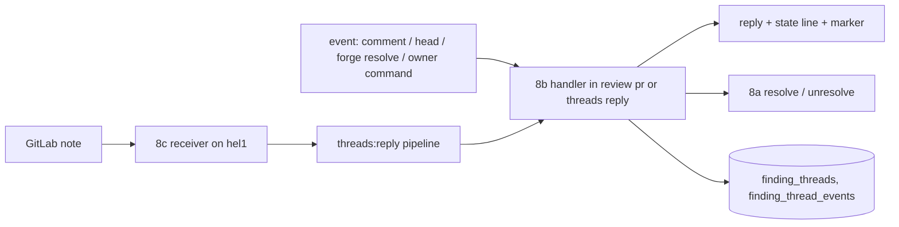

# Composite — one finding, one thread, closed by its role or a maintainer

## Amendment (0.7, 2026-11-17): scheduled, split in three, reconciled with what is in force

The owner scheduled the remainder of this draft on 2026-11-17, right
after SP-REVIEW-DELTA-FIRST and before SP-REVIEW-FABLE-TIER
(SP-REVIEW-CONVERGES 0.6, row 8), and decided how its conflicts with
approved specs end: **the draft gives way**. Where 0.6 disagreed with
SP-OWNER-SETTLES-A-FINDING, SP-REVIEW-NITS-ONE-COMMENT or the code on
`origin/develop` `92cd241`, this version follows the approved rule and
records each change in "Reconciliation" below. No approved spec is
amended to fit this one.

The remainder holds three independent capabilities, so this spec is now
a composite that owns no code; each capability is a child with its own
pull request, and the children declare this spec in `depends_on` (the
direction two approved specs, SP-OWNER-SETTLES-A-FINDING and
SP-REVIEW-NITS-ONE-COMMENT, already use for it; the reverse would add
cycles to the 27 of `repoach arch graph --check`):

| Order | Child | Capability |
|---|---|---|
| 8a | SP-FORGE-RESOLVES-THREADS | `Forge.resolve_thread` / `unresolve_thread` on both forges, behind the write barrier |
| 8b | SP-THREAD-REPLY-AGENT | the opening role answers in its thread from the ledger, dispatches a coder per thread, mirrors owner settlements, closes; `finding_threads`, `finding_thread_events`; `repoach threads` |
| 8c | SP-GITLAB-NOTE-RECEIVER | a GitLab note starts one thread-reply pipeline through an authenticated webhook on hel1, with a scheduled fallback |

### Reconciliation (owner decision 2026-11-17: the draft follows the approved rule)

| 0.6 said | Rule now followed | Source |
|---|---|---|
| D5: owner commands are `/resolve <reason>`, `/wontfix <reason>`, `/reopen`; Behavior 4: `/wontfix` ends the finding `waived`; Interface: `FindingStatus` gains `waived` | `/resolve <reason>` (20 to 1000 characters) and `/reopen` only, on `#<id>` or, since SETTLED 0.5, `#F-<7 hex>`; the finding becomes `owner_resolved`, reversible by `/reopen`; no `/wontfix`, no `waived`, no debt command | SP-OWNER-SETTLES-A-FINDING D1, D4, G1, G3, NG1; `src/repoach/review/findings.py:152` (`OWNER_RESOLVED`); `owner_commands.py:203` (`parse_command`); SP-REVIEW-SETTLED-STAYS-SETTLED D12 |
| D9: owners are `[threads].owners` in `repoach.toml`, empty meaning the forge's admins read once per run; Configuration: `[threads] owners = [...]`; AC22 | owners are measured from the forge for every command and never configured in the repository: GitHub `admin` or `maintain`, GitLab `access_level >= 40`, active and not expired; the bot is never an owner; an unreadable permission applies nothing and the command is retried | SP-OWNER-SETTLES-A-FINDING D2, G2, NG4; `src/repoach/forge/protocol.py:856` (`is_maintainer`); `gitlab.py:490`; `github.py:632` |
| D12: no severity is exempt, a nit's thread goes through the coder or an owner `/wontfix`; AC27 | a `nit` is `Severity.NOTE`, status `noted`, listed in one non-blocking digest comment, never posted as its own comment and never a thread; `minor` and worse open a thread that blocks until resolved | SP-REVIEW-NITS-ONE-COMMENT D1–D3 (owner decision (d), 2026-11-15); `src/repoach/review/findings_bridge.py:64` (`"nit": Severity.NOTE`), `:87` (`opens_thread`); `findings.py:102`, `:153` |
| D3, D8, G5, Gate: `MergeFacts` gains `open_threads`, `escalated_threads`, `unthreaded_findings`, `threads_judged`, `open_human_threads`, `threads_setting`; AC10, AC21 | the gate counts the forge's own unresolved threads, human ones included, fails closed on an unreadable listing, on every merge path; the forge settings are the second line of defence and are switched by the owner outside the code | SP-OPEN-THREADS-BLOCK-THE-MERGE D1–D5, G1–G3; `src/repoach/review/open_threads.py:51-61`; `protocol.py:749` (`unresolved_threads`) |
| G7, AC19, R6: both forges' settings are off (F17, F18) and go on only after R3 | measured on 2026-11-17: GitLab project 67827362 `only_allow_merge_if_all_discussions_are_resolved: true`; GitHub rulesets 25641051 and 25641050 `required_review_thread_resolution: true`. Nothing to switch; the bot's token must therefore be able to resolve (8a A1) | `glab api projects/67827362`; `gh api repos/repoachhq/repoach/rulesets/<id>`, 2026-11-17 |
| M3, A1, Interface: `finding_threads.thread_id` holds the GraphQL node id and `root_comment_id` the REST id; `finding_posts` does not exist | `finding_posts` exists with `thread_id` (GitHub root comment id, GitLab discussion id), `thread_closed_at_head`, `thread_closed_by`; `ReviewThread` carries `root_id`, `thread_id`, `resolved`, `resolved_by`; GitHub's GraphQL `reviewThreads` read fills `resolved_by` from `resolvedBy` | SP-FINDING-THREAD-IDS 0.7; `finding_posts.py:74-91`, `:372`; `protocol.py:567`; `github.py:389-395` |
| D1, G2: a fingerprint that already has a thread is never posted again, "superseding SP-POSTING-REPLAY-DEDUPES NG1"; Edge: re-anchoring by `match_key` | a settled finding is not re-raised on an unchanged region (`reraise_suppressed`), a changed region gives a new finding that `supersedes` the settled one, both as `finding_events` rows; the cross-head name of a finding is `finding_key = F-<7 hex>` of claim type, file and normalised claim — exactly what 0.6 called `match_key`. 8b keys its row by it and joins an *unsettled* finding raised again to its open thread | SP-REVIEW-SETTLED-STAYS-SETTLED D4, D5, D11, D13–D14; `findings_bridge.py:170` (`normalised_claim`) |
| D6: the three-voice context and the summarizer come from SP-AGENT-CONTEXT-LOOP (#246); A2, R4: AC17 waits for it | `src/repoach/review/agent_context.py` is absent on `92cd241` and the spec is a draft; 8b specifies its own bounded window: a fixed cap, `thread_history_tokens_max` (12 000, the figure the owner took for the history block, SP-REVIEW-CONVERGES O9), and a fold the reply role itself writes and the row stores. No dependency on a draft, no planned criterion | SP-REVIEW-CONVERGES O9; `git cat-file -e origin/develop:src/repoach/review/agent_context.py` → absent |
| D15, AC25: `auto-review.yml` gains `pull_request_review_comment` (`created`, `edited`) and runs `threads reply` | the trigger exists with type `created`, and that run executes `review pr`, which 8b makes the handler; `edited` is not added: an edited command is refused by SP-OWNER-SETTLES-A-FINDING G2 and an edited author reply is handled once, at its creation | `.github/workflows/auto-review.yml:29-30`, `:75`, `:566` |
| F19: Yoob B-174 at `docs/BACKLOG.md:193`, "decision needed" | the row sits at `docs/BACKLOG.md:205` and already names this spec as the decision; the setting it proposed is on | Yoob `docs/BACKLOG.md:205` |
| Interface: `finding_thread_events` holds every event, re-raises included (0.4 of SETTLED wrote `reraise_suppressed` there) | `reraise_suppressed` and `supersedes` live in `finding_events` (SETTLED D14); `finding_thread_events` is the exchange log of a thread, one table per responsibility, and copies nothing from `finding_events`: the replay reads both | SP-REVIEW-SETTLED-STAYS-SETTLED D14 ("builds on this table or declares its own beside it") |
| Deployment H1–H7 measured 2026-10-26; secrets in `/etc/repoach/threads-serve.env` | re-measured 2026-11-17 (8c Context): unchanged except systemd 255.4 with `systemd-creds`, and a tailscale interface; the secrets are systemd encrypted credentials, never a plain file, never argv, never the environment (owner rule "never in files") | `ssh hel1`, 2026-11-17 |

Facts of 0.6 that still hold on `92cd241` and are the children's ground: no
`resolve_thread` / `unresolve_thread` on any forge (`git grep -n
"def resolve_thread\|def unresolve_thread" origin/develop -- src` → 0);
`grep -rn "finding_threads\|finding_thread_events" src` → 0; the
`thread_context.py` docstring still names `coder_loop._format_evidence_reply`,
a writer that no longer exists (`thread_context.py:37`; the only sentinel
writer is `_format_finding_evidence_reply`, `:457`); the coder path
takes the whole PR's open blocking findings as its queue
(`coder_findings.py:78`, `:430`) under `MAX_CODER_ROUNDS = 3`
(`stuck.py:48`); `pr_review_dialogue` is per round, not per thread
(`persistence.py:100`).

## Intent

Owner, 2026-10-26: "il manque la gestion des échanges dans la PR : des
agents qui se souviennent du contexte de la PR, capables d'échanger et
de clore le point ; tout doit être clos pour que le merge passe."

Every finding of severity `minor` or worse that repoach posts is one
review thread on the forge. The ledger row behind it is that thread's
memory. The role that opened the thread answers the author from that
memory, sends a confirmed finding to a coder, mirrors a maintainer's
settlement, and closes the thread when the head settles it. The merge
is refused while any thread is open (SP-OPEN-THREADS-BLOCK-THE-MERGE),
and a thread closed by someone who may not close it counts as open.

## Context

Measured on `origin/develop` `92cd241` (2026-11-17), read-only; the
children re-cite the lines they act on.

| # | Fact | Where |
|---|---|---|
| F1 | The protocol reads threads and replies in them: `comments`, `conversation_comments`, `review_threads`, `unresolved_threads`, `post_comment`, `reply`, `is_maintainer`. It has no thread write | `src/repoach/forge/protocol.py:724-856` |
| F2 | `ReviewThread`: `root_id`, `thread_id`, `resolved`, `resolved_by`, `path`, `line`. GitLab fills `resolved` from the first note; GitHub from `isResolved` and `resolvedBy` | `protocol.py:567`; `gitlab.py:315-346`; `github.py:356-395` |
| F3 | A posted finding is linked to its thread by `finding_posts` (`thread_id`, `thread_closed_at_head`, `thread_closed_by`); `detect_closed_threads` records a closure by the bot or a maintainer and only reports one by anyone else; nothing unresolves it | `finding_posts.py:74-91`, `:372`; `finding_post_threads.py:262-300` |
| F4 | Owner commands are applied by `review pr` from forge comments, recorded in `owner_commands`, answered in the thread; the forge thread is not resolved or unresolved by them | `owner_commands.py:203`, `:524`; `owner_store.py:48-68`; `orchestrator.py:150`; SP-OWNER-SETTLES-A-FINDING NG2 |
| F5 | The gate refuses on the forge's unresolved threads and fails closed; it does not ask who resolved a thread | `open_threads.py:51-61`; SP-OPEN-THREADS-BLOCK-THE-MERGE D2 |
| F6 | `nit` → `NOTE` → `noted`, never a thread (`opens_thread`); `minor` → `ADVISORY`, a thread | `findings_bridge.py:60-64`, `:87`; `findings.py:100-102`, `:153` |
| F7 | `reverify_older_findings` ends an older unsettled finding `resolved` / `still_open` / `needs_judgement` at the head; `_UNSETTLED` is `proposed`, `verified`, `open`, `stuck` | `head_reverify.py:66`, `:135` |
| F8 | `build_evidence` fills a token budget from the cited file, grep hits, diff hunks and the spec section, naming what it left out (`PARTIAL EVIDENCE`); floor `REFUTER_CONTEXT_TOKENS_FLOOR = 40_000` | `refuter_evidence.py:1025`, `:1100`; `project/config.py:78` |
| F9 | The coder is dispatched for the PR's open blocking findings, commits and pushes to the PR head branch (`git_commit_and_push`), capped at `MAX_CODER_ROUNDS = 3` with the stall detector | `coder_findings.py:78`, `:430`, `:723`; `stuck.py:48`, `:183` |
| F10 | `review pr` runs on GitHub on `pull_request`, `issue_comment`, `pull_request_review` and `pull_request_review_comment` (`created`); on Yoob it runs in the MR pipeline, which a note does not start | `.github/workflows/auto-review.yml:17-30`, `:566`; Yoob `.gitlab-ci.yml:12-16` |
| F11 | Both forges require resolved threads before a merge (2026-11-17): GitLab `only_allow_merge_if_all_discussions_are_resolved: true`; GitHub rulesets 25641051, 25641050 `required_review_thread_resolution: true` | `glab api projects/67827362`; `gh api repos/repoachhq/repoach/rulesets/<id>` |
| F12 | The ledger format is 1 on `fix/ledger-format-is-versioned` (`LEDGER_FORMAT = 1`, `GATE_TABLES` five tables, `tests/fixtures/ledger_format/1.json` only); 2 is SP-FINDING-CITES-ITS-CODE, 3 SP-REVIEW-DELTA-FIRST | `src/repoach/review/ledger_format.py:71`, `:84`, `:246` on that branch; SP-REVIEW-CONVERGES G1 |
| F13 | `finding_events` (SETTLED D14, to be built by order row 6) holds `reraise_suppressed` and `supersedes` per finding, unique on `(finding_id, kind, related_finding_id, head_sha)`; it is read by no gate | SP-REVIEW-SETTLED-STAYS-SETTLED D13–D14 |

## Decisions (coordinator and owner, 2026-10-26; reconciled 2026-11-17, see Amendment)

- **D1 One finding, one thread.** A finding of severity `minor` or
  worse is posted once, as one forge review thread, named across heads
  by its `finding_key`. The ledger row is the thread's memory: finding,
  evidence, verdicts, every exchange with its author, role, head and
  timestamp. The role that replies gets its row, the thread history
  and the head diff of the cited files under a budget built by
  `build_evidence` (F8); never the whole PR.
- **D2 The opening role classifies each author reply** as
  `fixed-at-head` (the head re-verification decides), `disputed` (the
  refuter judges with evidence; after one disputed round the thread is
  escalated), `question` (the role answers) or `deferral` (never
  changes the state). Every agent reply ends with exactly one state
  line (8b `format:thread-state-line`).
- **D3 Who closes.** Only the opening role or a maintainer closes a
  thread, which means resolving it on the forge. The author never
  does. The gate counts every unresolved thread (F5) and, with 8b, a
  bot-opened thread resolved by a login that is neither the bot nor a
  maintainer. The forge settings are on (F11) and are the second line
  of defence.
- **D4 Bounded.** At most `agent_rounds_max_per_thread` agent rounds,
  then `escalated to owner`. Agents reply only on an event; replaying
  an event never duplicates a reply.
- **D5 Owner commands** are those of SP-OWNER-SETTLES-A-FINDING:
  `/resolve <reason>` and `/reopen`, by a maintainer the forge
  reports, applied by `review pr`. 8b mirrors them on the forge thread
  and in the thread memory; it applies none itself.
- **D6 Context in three voices.** `system` = the role's prompt plus
  the closure protocol; the thread history replayed from
  `finding_thread_events` as alternating turns, each prefixed `[head
  <sha7> · <ISO timestamp>]`, the role's past replies as `assistant`
  turns, author and owner comments as `user` turns, the ledger's
  `finding_events` of the finding as `user` notes; the current `user`
  turn = the event plus the evidence. Bounded by
  `thread_history_tokens_max`; the oldest turns fold into one stored
  summary turn (8b D6).
- **D7 No debt; a fix is the only closure of a confirmed finding**
  (owner: "On n'accepte jamais de dette : on demande à un codeur
  d'implémenter la solution, dans un autre commit ou une branche qui
  est mergée à la branche de la pull request."). A confirmed thread
  dispatches the coder with the row as its brief; a `docs/tech_debt.md`
  row never closes a thread; "will do later" changes nothing.
- **D8 Human threads block too**, through the forge count (F5). No
  agent replies in, classifies or closes one; `repoach threads` lists
  it with role `human`.
- **D9 Owners** are the maintainers the forge reports (Reconciliation).
- **D10 Events reach the handler.** GitHub: `review pr`, already run
  on every comment event (F10), handles the thread events. GitLab: the
  receiver of 8c starts one `threads reply` pipeline per note, with a
  `scheduled_fallback_minutes` schedule as the fallback.
- **D11 Where the coder commits.** On the PR branch; a fix of several
  commits on `fix/<pr>-<key7>` merged into the PR branch with
  `--no-ff`. Never squashed, never force-pushed.
- **D12 Severity.** `minor` and worse follow this spec; a `nit` never
  reaches it (Reconciliation).
- **D13 A coder that cannot push escalates at once** with `coder
  cannot push to <fork>`; no coder round is spent.
- **D14 The GitLab receiver runs on hel1** beside the runners, as a
  systemd unit reached through the existing nginx at
  `https://yoob.dev/hooks/repoach` (8c).
- **D15 GitHub has no receiver** (F10; Reconciliation).

## End state

A Yoob merge request carries one thread per finding of `minor` or
worse. The author answers in it; the role that opened it replies from
its ledger row within two rounds, re-verifies at the next head,
dispatches a coder when the finding stands, resolves the thread with
`state: resolved (fixed at <sha7>)` when the head settles it, and
escalates to the owner when it cannot. A maintainer's `/resolve`
closes the thread on the forge; the author's click reopens it with one
line. `repoach threads <mr>` prints every thread with its state,
rounds and last head. The gate merges when no thread is open and no
bot thread was closed by someone who may not. Nothing of this reads a
new gate table: `LEDGER_FORMAT` is untouched.

## Easy solution rejected

Let `review pr` re-review the whole MR at every comment and let the
reviewers "see" the threads through `{REVIEW_HISTORY}`
(SP-REVIEW-REMEMBERS-EVERY-ROUND). Rejected: a review round is not a
reply. The lens re-reads the diff and may raise anything; the author
asked one question in one thread and needs one answer there, from the
role that raised the point, bounded, and ending in a state the gate
can read. The history block informs the next round; it closes
nothing.

## Hard part

Three things must stay consistent without a shared lock: the forge
thread (resolved or not, by whom), the finding's status in
`pr_findings` (moved by re-verification, the refuter, the coder and
the owner), and the thread row (state, rounds). The rule that keeps
them consistent is one-directional: the ledger decides, the forge is
reconciled to it (NG4), and every reconciliation is an event with a
replay-safe key, so two runs at the same head, or a webhook delivered
twice, converge on the same forge state and post nothing twice.

## Goals

- G1 (order): the three children land as three pull requests, 8a, 8b, 8c, each green on its tests and on `repoach arch check --base origin/develop` before the next, after SP-REVIEW-DELTA-FIRST and before SP-REVIEW-FABLE-TIER (SP-REVIEW-CONVERGES G1).
- G2 (thread writes): `Forge.resolve_thread` / `unresolve_thread` on both forges, behind the write barrier (8a).
- G3 (the agent): every event in a finding's thread is handled exactly once, classified, acted on, answered with one state line, and mirrored on the forge; a confirmed thread goes to the coder once per head; two tables remember it; `repoach threads` shows it (8b).
- G4 (GitLab events): a note on a Yoob MR starts one `threads reply` pipeline within seconds through an authenticated webhook, or within `scheduled_fallback_minutes` through the schedule (8c).
- G5 (format): no child adds a gate table, a gate column or an enum value: `LEDGER_FORMAT` stays what SP-REVIEW-DELTA-FIRST leaves it (3), and `python -m repoach.review.ledger_format snapshot | jq -r '.tables|keys[]'` names neither `finding_threads` nor `finding_thread_events` after 8b.

## Non-Goals

- NG1: No free chat. A comment outside a finding's thread gets no agent reply; an agent never opens a thread without a finding.
- NG2: No thread for a finding that was never posted (dry run, posting off), none for a `nit`.
- NG3: No debt path (D7). No `/wontfix`, no `waived` (SP-OWNER-SETTLES-A-FINDING NG1).
- NG4: The forge is not the store of record; the ledger decides and the forge is reconciled.
- NG5: No change to how findings are raised, judged, suppressed or re-verified.
- NG6: No agent action in a human thread (D8).
- NG7: No gate table, column or enum value (G5).

## Assumptions

- A1: SP-REVIEW-SETTLED-STAYS-SETTLED (order row 6) lands before 8b: `settled.finding_key` and `finding_events` exist. 8b's tests pin it (`settled.py` present).
- A2: Every role posts through one bot identity (`bot_username`); the opening role is read from the ledger (`finder`), never from the forge author.
- A3: The posting token can resolve and unresolve threads: GitHub `pull requests: write`, GitLab Developer. 8a's recorded conformance fixtures prove it before 8a is ticked.
- A4: The owner keeps both forge settings on (F11).

## Interface

Shared vocabulary of the three children, defined once:

| Term | Meaning | Defined in |
|---|---|---|
| thread row, `T<id>` | one `finding_threads` row per `(pr_number, finding_key)`, living across heads | 8b Interface |
| `state` | `open` / `resolved` / `escalated` | 8b D1 |
| `resolution` | `fixed` / `refuted` / `file_removed` / `owner_resolve` / `""` | 8b D1 |
| state line | the last visible line of every agent reply, `^state: (open\|resolved \((?P<reason>[^)]+)\)\|escalated to owner)$` | 8b `format:thread-state-line` |
| reply marker | `<!-- repoach-thread:<finding_key> event:<event_key> round:<n> -->`, the hidden last line of every agent reply | 8b `format:thread-reply-marker` |
| `event_key` | `comment:<forge id>`, `head:<sha12>`, `forge-resolved:<sha12>:<login>`, `coder:<sha12>:<n>`, `owner:<comment id>` | 8b Interface |
| closer rule | a bot-opened thread may be resolved by the bot or a maintainer (`is_maintainer`); any other resolver is undone and named | D3; 8b G5 |
| note hook | a GitLab `Note Hook` or `Merge Request Hook` delivery, authenticated by `X-Gitlab-Token` | 8c `format:gitlab-note-webhook` |

## Behavior

### Nominal

1. `review pr` posts a `minor`-or-worse finding as a thread
   (`finding_posts` row) and, with 8b, writes its thread row and an
   `opened` event.
2. The author replies. GitHub: `review pr` runs on the comment event
   and 8b's handler runs inside it. GitLab: 8c's receiver starts a
   `threads reply` pipeline.
3. The handler classifies (D2), acts (re-verify, refuter, coder,
   answer), posts one reply with the state line and the marker,
   resolves or unresolves the thread to match (8a), records the event.
4. A maintainer's `/resolve` is applied by `review pr`
   (SP-OWNER-SETTLES-A-FINDING); 8b then resolves the forge thread in
   the role's name with `state: resolved (owner: <reason>)`.
5. The gate refuses while any thread is unresolved (F5) or a bot
   thread was resolved by a non-maintainer (8b G5); it merges when
   every thread is resolved by its role or a maintainer.

### Edge cases

- A head arrives between two events → re-verification first; a thread the head settles gets `state: resolved (fixed at <sha7>)` before any reply is classified.
- An unsettled finding is raised again at a new head → joined to its open thread by `finding_key`; a settled one follows SP-REVIEW-SETTLED-STAYS-SETTLED (suppressed or superseded), and a superseding finding opens its own thread.

### Failure scenarios

- The forge read fails → nothing is written; `threads reply` exits 2; the gate already refuses (`review threads unreadable`).
- The model call fails → no reply, no state change, the event stays unhandled for the next run.
- A webhook is lost → the scheduled fallback starts the run within `scheduled_fallback_minutes`.

## Tables and the ledger format

`finding_threads` and `finding_thread_events` are built by 8b and
owned there. Neither is read by `review gate`, `review merge`, the
auto-merge or the release gate: the closer rule reads the forge
(`review_threads`, `is_maintainer`), and the thread state the gate
needs is the forge's own. They are therefore not gate tables, join
neither `GATE_TABLES` nor the snapshot, and this composite bumps
`LEDGER_FORMAT` by **none** (`ledger_format_after: none`). Oracle, run
on 8b's branch: `python -m repoach.review.ledger_format snapshot | jq
-r '.tables|keys[]'` prints the five gate tables and `ledger_meta` as
`origin/develop` prints them, and `ls tests/fixtures/ledger_format/`
gains no file. `finding_events` (SETTLED D14) is read, never written,
by 8b.

## Architecture Impact

- This spec owns no code and declares no edge: it is implemented by its
  three children, which declare it in `depends_on` as
  SP-OWNER-SETTLES-A-FINDING and SP-REVIEW-NITS-ONE-COMMENT already do;
  SP-REVIEW-CONVERGES orders it (row 8) and declares the four ids.
- Removed edges (0.7): the fourteen `depends_on` of 0.6 move to the
  child that imports the module; `SP-AGENT-CONTEXT-LOOP`,
  `SP-POSTING-REPLAY-DEDUPES` (drafts), `SP-RED-STOPS-THE-LINE` and
  `SP-UNIVERSAL-PROJECT-CONFIG` (no coupling left) are declared by no
  child.
- Removed ownership (0.7): every file and resource of 0.6's `owns` is
  owned by a child or dropped (`format:thread-owner-command` is
  SP-OWNER-SETTLES-A-FINDING's `format:owner-settle-command`).
- Cycles: `repoach arch graph --check` reports 27 before and after this
  spec and its children.

## Diagram

## Acceptance Criteria

- [ ] AC1 (composite): the three child specs exist under `docs/specs/2026-11-17_SP-{FORGE-RESOLVES-THREADS,THREAD-REPLY-AGENT,GITLAB-NOTE-RECEIVER}_*.md`, each `approved` with its own End state, Easy solution rejected, Hard part, Tests with their red mutation, Success conditions with an external oracle; `repoach arch check --base origin/develop` → `edge-honesty: ok`; `repoach arch graph --check 2>&1 | grep -c 'dependency cycle'` → `27`; `pytest -q tests/unit/test_spec_presence.py tests/unit/test_arch_graph.py tests/unit/test_governed_spec.py tests/unit/test_spec_template.py` → green.
- [ ] AC2 (order): SP-REVIEW-CONVERGES G1 lists this spec as row 8 between SP-REVIEW-DELTA-FIRST and SP-REVIEW-FABLE-TIER, and its "Tables" paragraph names `finding_threads` and `finding_thread_events` as built by 8b and read by no gate.
- [ ] AC3 (format, after 8b): `python -m repoach.review.ledger_format snapshot | jq -r '.tables|keys[]'` → the same lines as on `origin/develop`; `ls tests/fixtures/ledger_format/` gains no file.
- [ ] AC4 (forge settings, live): `glab api projects/67827362 | jq .only_allow_merge_if_all_discussions_are_resolved` → `true`; `gh api repos/repoachhq/repoach/rulesets/25641051 --jq '.rules[]|select(.type=="pull_request")|.parameters.required_review_thread_resolution'` → `true`, and the same for `25641050`. Measured so on 2026-11-17.
- [ ] AC5 (end state, live, after 8c): on the first Yoob MR reviewed after 8c, one author reply in a finding's thread is answered by the opening role within `scheduled_fallback_minutes` with a reply ending in a state line, and `repoach threads <mr> --json` lists that thread with `rounds: 1`.

## Open Questions

None. The owner decided on 2026-11-17 to schedule the remainder as
row 8 of SP-REVIEW-CONVERGES and that the draft follows the approved
specs wherever they disagreed (Reconciliation); the last question of
0.5, where the GitLab receiver runs, was decided by D14.
