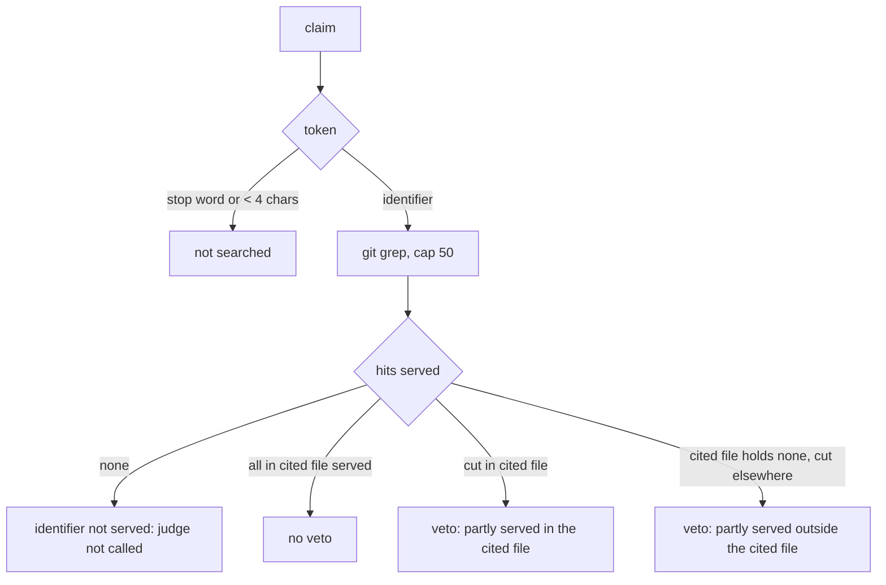

# Common words and fully served identifiers never defer a refuter verdict

## Amendment (0.2, 2026-10-26): the context adapts to the evidence, within a ceiling (Q1 decided)

### Facts

| # | Fact | Where |
|---|---|---|
| F9 | Owner rule (2026-10-25), restated by the coordinator: the refuter's context must be large enough for it to do its job, and it is measured in tokens. Decision D5: `refuter_context_tokens` is a floor, the budget adapts to the evidence, and it stops at a ceiling | coordinator message, 2026-10-26 |
| F10 | On the `5ed6ba2` tree at the 40 000 floor, with 0.1's stop-list, finding 41 leaves `_readable_base`, `specs_owning` and `spec_coverage_known` unserved. They are defined in `spec_gate.py`, and the 2 576-line `orchestrator.py` takes the budget (0.1 Q1) | probe over `build_evidence` at 40 000 |
| F11 | With this amendment, at the default settings (floor 40 000, ceiling 200 000) on the `5ed6ba2` tree, with the refuting reasoning: finding 41 is `refuted` with `budget_used` 65 829, and finding 66 is `refuted` with `budget_used` 46 899 | probe over `judge_finding` with defaults |

### Goals

- G5 (D5): the budget of one finding is `max(floor, needed)`, where `needed` = tokens of the whole cited file + the hits of the claim's identifiers (cited file and elsewhere, within the 50-hit cap, ±10 lines each) + the diff hunks on the cited file + the prompt and the reply reserves. It is capped by `[gates].refuter_context_ceiling` (default 200 000, `REPOACH_REFUTER_CONTEXT_CEILING` outranks it, never below the floor; a ceiling below `refuter_context_tokens` is refused). The cited spec section fills what is left of that budget. When even the ceiling cannot hold the cited file, the identifiers' hits and the hunks, the judge is not called and the finding defers with `evidence exceeds the ceiling (<n> tokens needed, ceiling <c>)`. The gate prints that reason as `needs judgement (...)`. Nothing is judged on a silent partial. Tokens use the existing estimator, `ceil(utf8_bytes / 3)`; no money figure enters.
- G6: the context used is recorded as `budget_used` on the refutation payload (`review pr` JSON, the review cache) and on the ledger row (`pr_findings.budget_used`, added by migration, `INTEGER NOT NULL DEFAULT 0`). Both a refuter verdict and a re-check at the head (resolved, still present, needs judgement) write it.
- G7: the `needs judgement` stamp key of G3 also names the ceiling: `refuter rule <V>, context <N>, ceiling <C>`.

### Acceptance criteria (0.2)

- [x] AC9 (G5): a cited file past the floor is served whole and judged, and `budget_used` is above the floor. Small evidence keeps the floor. A cited file over the ceiling defers with `evidence exceeds the ceiling (<n> tokens needed, ceiling <c>)`, without a judge call, and the gate names it — `pytest -q tests/unit/test_refuter_context_adapts_to_evidence.py -k "grows_past_the_floor or keeps_the_floor or over_the_ceiling or named_by_the_gate"`.
- [x] AC10 (G5, G6): finding 41's shape, a 2 576-line cited file with the claim's identifiers defined in `spec_gate.py`, resolves at the default settings, and the ledger row records `budget_used` above the floor — `pytest -q tests/integration/test_refuter_veto_replays_pr260.py -k 2576-lines`.
- [x] AC11 (G6): a verdict writes `budget_used` on the outcome, its JSON and the ledger row — `pytest -q tests/unit/test_refuter_context_adapts_to_evidence.py::test_verdict_records_budget_used_on_the_ledger_row`.
- [x] AC12 (G5): the ceiling resolves env > `repoach.toml` > 200 000, and a ceiling below `refuter_context_tokens` is refused — `pytest -q tests/unit/test_refuter_context_adapts_to_evidence.py::test_ceiling_setting_resolves_and_refuses_a_ceiling_below_the_floor`.
- [x] AC13 (G7): a ceiling change re-judges a `needs judgement` stamp at the same head — `pytest -q tests/unit/test_refuter_veto_names_real_identifiers.py::test_needs_judgement_is_re_judged_when_the_ceiling_changes`.
- [x] AC14: the existing budget tests now pin the ceiling. `test_judge_receives_a_budget_of_its_own_context` and `test_hits_cut_by_the_budget_defer_without_calling_the_judge` pass a ceiling. The unserved end-to-end test sets `REPOACH_REFUTER_CONTEXT_CEILING=40000` and expects `evidence exceeds the ceiling` — `pytest -q tests/integration/test_refuter_defers_unserved_end_to_end.py tests/unit/test_refuter_defers_unseen.py`.

### Ordering

This branch carries #260's `5ed6ba2` (`fix(reverify): judge older findings with the configured refuter context`) as a cherry-pick. `reverify_older_findings` takes the `context_tokens` parameter exactly as #260 defines it. #268 merges after #260.

## 0.1

## Intent

A red that stops the line, with its corrective spec and its fix in the
same PR. On PR #260 the refuter correctly refuted two findings that the
head had fixed. The partial-hit veto of SP-REFUTER-JUDGES-WHAT-IT-CAN
G11 then turned each refutation into `needs judgement`, because the
judge's reasoning named words such as `except`, `None`, `message` or
`token`. Each of those words has more hits in the tree than the 50-hit
cap, so each was "partly served". Any fix of such a claim has to contain
those words, so the finding stayed `needs judgement` at every head and
kept the PR blocked. This slice makes the veto hold only on real
identifiers and on cuts that matter to the cited file. It also re-opens
a `needs judgement` stamp when the rules or the budget it was judged
under change.

## Context

### Facts

| # | Fact | Where |
|---|---|---|
| F1 | PR #260 review archive at head `5ed6ba2`: `finding 41: security src/repoach/review/orchestrator.py:1250 raised at 745e208, unresolved: needs judgement (evidence outside window)` and `finding 66: security src/repoach/review/orchestrator.py:1255 raised at f0f45a0, unresolved: needs judgement (evidence outside window)`; `reverified` = `{"resolved": 0, "still_open": 0, "needs_judgement": 2}` | issue comment 6415071601 on PR #260 (`<!-- repoach-review-archive -->`), `reverify_reasons` |
| F2 | At `5ed6ba2` both claims are fixed. Lines 1250-1260 of `orchestrator.py` catch `Exception`, log `message=_redacted(str(exc))[:200]`, and `return self._record_grading_failure(...)`, which records a not-covered row (fail closed) | `git show 5ed6ba2:src/repoach/review/orchestrator.py` lines 1250-1260 |
| F3 | Replayed with develop `1c4a0bf`'s `claim_identifiers` and `build_evidence` on the `5ed6ba2` tree, at a context of 80 000 tokens or more. Finding 41's identifiers are `except, Exception, spec_coverage_skipped, return, None, coverage_rows_at_head`, and `partial` = `except, Exception, return, None, coverage_rows_at_head`. Finding 66's are `message, _record_grading_failure, _redacted, https, access, token`, and `partial` = `message, https, access, token`. Hit counts: `return` 5107, `None` 8673, `except` 746, `message` 648, `token` 585, `https` 429, `access` 60 | probe over `refuter_evidence.build_evidence`, reads `grep <id>: N hits (k served)` |
| F4 | The veto: `if answer == "refuted" and _cites_any(reasoning, bundle.partial): answer = "cannot_judge"`, and then `cannot_judge` → `EVIDENCE_OUTSIDE_WINDOW`. `partial` holds every identifier with `0 < served < len(others)`, wherever the cut hits lie | `src/repoach/review/refuter.py:610-613`, `src/repoach/review/refuter_evidence.py:661-664` (develop `1c4a0bf`) |
| F5 | `claim_identifiers` splits each backticked span on non-identifier characters and keeps every part of 4 characters or more. `` `except Exception` `` yields `except` and `Exception`, and `` `https://x-access-token:…` `` yields `https`, `access` and `token`. No word list is applied | `src/repoach/review/refuter_evidence.py:308-331` |
| F6 | A `needs judgement` outcome is stamped `needs judgement at <sha7>: <reason>`. `_cached` reuses it whenever `checked_at_sha` equals the head, so the finding is never re-judged at the head that stamped it, whatever changed in the refuter's rules or budget | `src/repoach/review/head_reverify.py` `_persist`, `_cached` |
| F7 | The re-check of older-head findings called the refuter at the 40 000-token floor and ignored `[gates].refuter_context_tokens`. That is fixed on PR #260 by `5ed6ba2` (`fix(reverify): judge older findings with the configured refuter context`) and stays there | `git show 5ed6ba2 --stat` |
| F8 | "Ten words" in the measurement are nine distinct words. Eight are common words (`except`, `Exception`, `return`, `None`, `message`, `https`, `access`, `token`). One, `coverage_rows_at_head`, is a real identifier: 12 hits on the `5ed6ba2` tree, among them hits in the cited file | F3 probe |

## Goals

- G1 (D1): `claim_identifiers` drops every token that is a Python keyword or soft keyword, a Python builtin, a common language or log token (`self`, `null`, `https`, `github`, `error`...), or a generic English word (`message`, `access`, `token`, `show`...). It also drops every token shorter than 4 characters. The stop-list is committed in the refuter's evidence module (`STOP_WORDS`, `is_stop_word`). Python names match exactly. Common tokens and English words match case-insensitively. The eight measured common words of F8 are in it.
- G2 (D2): the claim is about the cited file. An identifier whose every hit inside the cited file was served never vetoes, even when hits elsewhere were cut. Such an identifier is recorded as `partial_elsewhere` and is still named in `evidence_truncated`. An identifier that the cited file does not hold, with some hits elsewhere cut, still vetoes, so the !324/!327 protection stays. So does an identifier with a hit inside the cited file left unserved. An identifier with no hit served anywhere is `unserved` (the judge is not called), as before. An identifier whose cited-file hits were all served is never `unserved`.
- G3 (D3): a `needs_judgement` finding is re-judged at every new head. At the same head, it is re-judged whenever the refuter context or the rule version differs from the one it was stamped under. The stamp reads `needs judgement at <sha7> (refuter rule <V>, context <N>): <reason>`. A stamp without that key (written before this slice) is re-judged once. `REFUTER_RULE_VERSION` (2) is bumped whenever `STOP_WORDS` or the veto changes.
- G4 (D4): the deferral reason names the rule that held:
  - `evidence outside window (identifier not served: <ids>)`: no hit served, the judge is not called;
  - `evidence outside window (identifier partly served in the cited file: <ids>)`: the refutation names an identifier with a cut hit inside the cited file;
  - `evidence outside window (identifier partly served outside the cited file: <ids>)`: the refutation names an identifier that the cited file does not hold and whose hits elsewhere were cut.

  When the reasoning names identifiers of both kinds, the in-cited reason wins. A plain `cannot_judge` answer and an "I cannot see it" refutation keep `evidence outside window`.

## Non-Goals

- No change to the 50-hit cap, the ranking or the persona. (0.1 left the budget alone; 0.2 G5 makes it adapt.)
- No change to the context passed to the re-check of older findings. That is F7, on PR #260.
- The `reverify_older_findings` `context_tokens` parameter added here only keys the stamp. #260 adds the same parameter and threads it into the refuter.

## Assumptions

- A1: the stop-list costs nothing worth keeping. A claim that rests on a builtin (`ValueError`) is still served the cited file whole and the claim's real identifiers.
- A2: D4 says `identifier partly served outside the cited file` and D2 says a cut outside the cited file does not veto. Read together, the outside reason holds only when the cited file has no hit of the identifier. Otherwise the cut is outside a file the claim is not about. G2 and G4 encode that reading.

## Interface

- `repoach.review.refuter_evidence`: `REFUTER_RULE_VERSION: int`, `STOP_WORDS: frozenset[str]`, `is_stop_word(token) -> bool`, and `EvidenceBundle.partial_in_cited` / `partial_elsewhere: tuple[str, ...]`.
- `repoach.review.refuter`: `EVIDENCE_PARTLY_SERVED_IN_CITED`, `EVIDENCE_PARTLY_SERVED_OUTSIDE` (in `DEFERRAL_REASONS`); `EVIDENCE_NOT_SERVED` becomes `evidence outside window (identifier not served: {identifiers})`.
- `repoach.review.head_reverify`: `judgement_key(context_tokens) -> str`; `reverify_older_findings(..., context_tokens: int = REFUTER_CONTEXT_TOKENS_FLOOR)`.
- Resource `format:refuter-needs-judgement-stamp`: the `verification_result` text of a `head_reverify_needs_judgement` row.

## Behavior

### Nominal
Finding 41 was raised at A. Head B fixes it. The gate at B serves the
cited file whole, plus `coverage_rows_at_head` and the other real
identifiers. The judge refutes and names `except`, `None` and
`coverage_rows_at_head`. None of them vetoes: the first two are never
identifiers, and the third had every hit inside the cited file served.
The finding becomes `resolved_at_head`.

### Edge cases
- The reasoning names an identifier that the cited file does not hold and that has 210 hits elsewhere (`COMMON_TABLE`): `deferred`, with `identifier partly served outside the cited file: COMMON_TABLE`.
- Hits inside the cited file were cut: `identifier partly served in the cited file: <id>`.
- The same head with a raised `refuter_context_tokens`, or a bumped `REFUTER_RULE_VERSION`: the finding is re-judged, one model call.
- The same head under the same key: no model call.

### Failure scenarios
- The judge raises: `needs judgement (judge call failed: <type>)`, stamped under the key and reused at the same head, as before.

## Architecture Impact
- Adds dependency: SP-REFUTER-VETO-NAMES-REAL-IDENTIFIERS -> SP-REFUTER-JUDGES-WHAT-IT-CAN (owner of `refuter.py` / `refuter_evidence.py`: stop-list, classification, reasons)
- Adds dependency: SP-REFUTER-VETO-NAMES-REAL-IDENTIFIERS -> SP-GATE-REVERIFIES-AT-HEAD (owner of `head_reverify.py`: the stamp key)
- Adds dependency: SP-REFUTER-VETO-NAMES-REAL-IDENTIFIERS -> SP-FINDINGS-INIT-RACE (the tests record and read ledger rows)
- Adds dependency: SP-REFUTER-VETO-NAMES-REAL-IDENTIFIERS -> SP-UNIVERSAL-GATES (the tests build a `GatesConfig`)
- `head_reverify` imports `REFUTER_RULE_VERSION` from `refuter_evidence`. No new cycle.

## Diagram

## Acceptance Criteria

- [x] AC1 (G1): the stop-list holds Python keywords, builtins, common tokens and English words. Tokens shorter than 4 characters are dropped — `pytest -q tests/unit/test_refuter_veto_names_real_identifiers.py::test_stop_list_holds_python_names_common_tokens_and_english_words tests/unit/test_refuter_veto_names_real_identifiers.py::test_identifiers_shorter_than_four_characters_are_dropped`.
- [x] AC2 (G1): the eight measured common words are never identifiers, and the measured claims keep their real identifiers — `pytest -q tests/unit/test_refuter_veto_names_real_identifiers.py -k "measured_common_words or keep_their_real_identifiers"`.
- [x] AC3 (G1): a refutation naming the measured words over a tree where each has hundreds of hits stays `refuted` — `pytest -q tests/unit/test_refuter_veto_names_real_identifiers.py::test_measured_words_never_veto_a_refutation`.
- [x] AC4 (G2): the cited file holds the identifier and is fully served, and 110 foreign hits are cut by the cap. The result is `partial == ()` and `partial_elsewhere == ("coverage_rows_at_head",)`, and the refutation stays `refuted`. An identifier absent from the cited file and cut elsewhere still vetoes. The classification covers in-cited, elsewhere and unserved — `pytest -q tests/unit/test_refuter_veto_names_real_identifiers.py -k "fully_served_in_the_cited_file or absent_from_the_cited_file or classified_in_cited"`.
- [x] AC5 (G3): `needs judgement` is reused under the same key, and re-judged at a new head, on a context change, on a rule-version bump and from a pre-key stamp — `pytest -q tests/unit/test_refuter_veto_names_real_identifiers.py -k needs_judgement tests/unit/test_refuter_veto_names_real_identifiers.py::test_stamp_written_before_the_rule_version_is_re_judged`.
- [x] AC6 (G4): the three reason shapes, and both new templates are in `DEFERRAL_REASONS` — `pytest -q tests/unit/test_refuter_veto_names_real_identifiers.py::test_deferral_reason_names_the_rule_that_held`, plus the updated `tests/unit/test_refuter_defers_unseen.py -k "partly_served or cut_by_the_budget or closed_set_template"`.
- [x] AC7 (G1, G2): integration test. Findings 41 and 66 are replayed in a real git tree where every measured word has more than 50 hits. They are re-checked at the next head through the real `reverify_older_findings`, ledger and `git grep` at the 40 000-token floor, with the measured refuting reasoning. Each ends `resolved` (`resolved_at_head`), not `needs judgement`. The same test on develop `1c4a0bf`'s source fails with `needs_judgement: 1` — `pytest -q tests/integration/test_refuter_veto_replays_pr260.py`.
- [x] AC8: suites — `pytest -q -n 8 tests/unit`, `pytest -q tests/integration`, `repoach arch check --base origin/develop`, `scripts/ci_local.sh --fast`.

## Open Questions

- Q1 (decided in 0.2, G5): with F7 merged and the floor context, finding 41's own identifiers `_readable_base`, `specs_owning` and `spec_coverage_known` live in `spec_gate.py` and are not served at 40 000 tokens, because the cited 2 576-line file takes the budget. The finding then defers as `identifier not served: …`, which names what is missing. Decided: the budget adapts to the evidence up to a ceiling.
