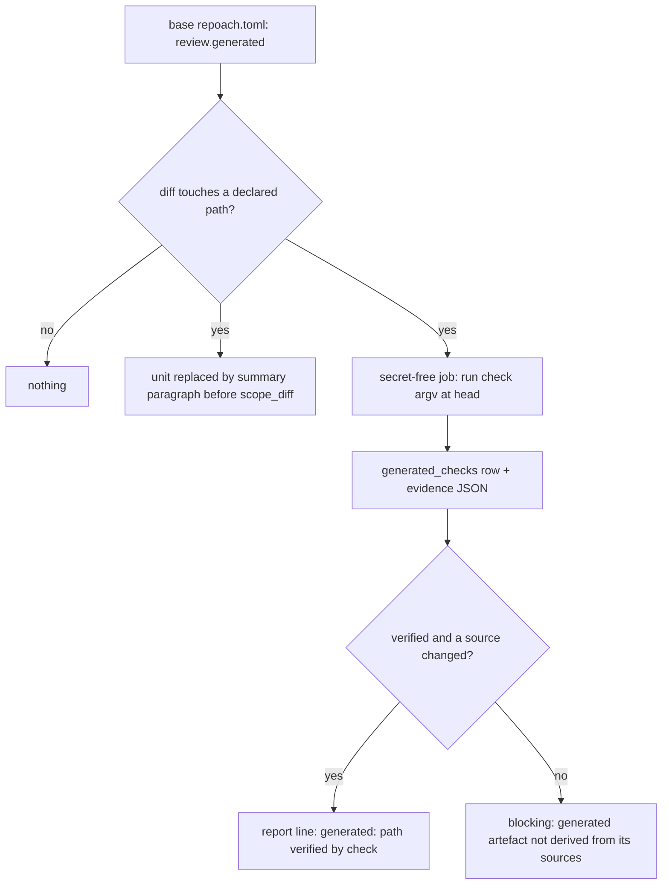

# A declared generated artefact is proved by its check command, not read by the reviewers

## Intent

A file that a committed script derives from other committed files cannot
be reviewed by reading it: its content is a function of its sources. The
repository declares such files with the command that proves the
derivation, and the gate runs that command instead of feeding the
reviewers a diff no one can judge. Before this, one oversized derived
file held a pull request at `REQUEST_CHANGES` forever, whatever the
author pushed.

## Context

Red-stops-the-line corrective spec (SP-RED-STOPS-THE-LINE). Measured on
Yoob MR !322, and the same on !324 and !329, on 2026-10-27.

| # | Fact | Where |
|---|---|---|
| F1 | The reviewers' per-file diff cap is `_DIFF_HARD_CAP_CHARS = 140_000` | `src/repoach/review/reviewer.py:54` |
| F2 | `scope_diff` puts any file whose single diff unit exceeds the cap into `oversized` (and `omitted`); no reviewer lens sees it | `src/repoach/review/diff_scoper.py:75`, `:101-103` |
| F3 | Each oversized path becomes one finding: claim type `spec_gap`, severity `blocking`, status `verified`, `verification_result="file size exceeds cap_chars at this head"`, recorded at every reviewed head | `src/repoach/review/findings_bridge.py:302-354` (`oversized_finding`), `:357` (`record_oversized_findings`), called from `src/repoach/review/orchestrator.py:270-277` |
| F4 | `spec_gap` is a judged claim type, not a mechanical one; the mechanical verifiers cover only `missing_test`, `missing_docstring`, `lint_convention` | `src/repoach/review/findings.py:60`, `:70`; `src/repoach/review/finding_verifiers.py:404-408` (`_MECHANICAL`) |
| F5 | At a newer head, an older-head `spec_gap` is not settled on disk (`_settled_on_disk` returns `None` unless the cited file is absent) and goes to the refuter; the refuter cannot be served a 1.5 MB one-line value and defers it `needs judgement (evidence outside window)`; the row keeps blocking | `src/repoach/review/head_reverify.py:384-421`; `src/repoach/review/refuter.py:132` |
| F6 | No "generated", "binary" or path-ignore handling exists in the review path: grep of `src/repoach/review/` and `src/repoach/project/config.py` for `generated`, `binary`, `linguist`, `gitattributes` finds none that touches diff scoping or findings | grep at `dff2d13` |
| F7 | `[review]` accepts only `bot_username` and `spec_sources`, and every section refuses unknown keys (`extra="forbid"`): a `[[review.generated]]` table is a `ConfigError` today | `src/repoach/project/config.py:159-162`, `:294-298` |
| F8 | The single subprocess secret scrubber is `scrubbed_env()`; the secret-free verification context of SP-AUTHOR-CLAIMS-ARE-MEASURED D3 is specified but not implemented (`author_claims.py`, `claim_verifier.py` absent) | `src/repoach/review/secret_env.py:43`; `docs/specs/2026-10-26_SP-AUTHOR-CLAIMS-ARE-MEASURED_*.md` D3, D4 |
| F9 | Yoob `api/data/knowledge_embeddings.json` is 1 569 032 bytes on develop; its `vectors` field is one base64 line of 1 556 480 characters. A regeneration's diff carries that line twice (`-` and `+`), about 3.1 MB, 22 times the cap | `wc -c`, `wc -L` on Yoob develop |
| F10 | Yoob proves the file mechanically: `python3 scripts/index_knowledge_corpus.py --repo-root . --check` re-derives `api/data/knowledge_corpus.json` from `docs/user_guide/` and checks that the embeddings' key names that corpus's sha256, the model and every chunk id, with one 768-d vector per chunk. Exit 0 in 0.24 s on develop. `api/tests/test_copilot_rag_corpus.py::test_committed_embeddings_are_keyed_to_the_committed_corpus` asserts the same | Yoob `scripts/index_knowledge_corpus.py:16-18`, `:439`, `:554-565`; `api/tests/test_copilot_rag_corpus.py:422` |
| F11 | !322 changes `api/data/knowledge_embeddings.json` (GitLab `too_large`), `api/data/knowledge_corpus.json` (3 055 chars) and `docs/user_guide/ACCES_WEB_DISTANT_STAGIAIRE.md`, a corpus source. Its review notes read `BLOCKED at 619a41363d12 — ... finding 3: spec_gap api/data/knowledge_embeddings.json:0 raised at 0cc9008, unresolved: needs judgement (evidence outside window); finding 6: spec_gap api/data/knowledge_embeddings.json ...`: one new oversized finding per head, every older one deferred | GitLab API `merge_requests/322/changes` and `/notes`, read 2026-10-27 |
| F12 | Yoob's `review:gate` job holds the gateway secret and the forge write token, has `needs: []`, and caches the ledger per MR under `.repoach/` | Yoob `.gitlab-ci.yml:1512-1537`; `ci/review-gate.sh` |
| F13 | Yoob's `repoach.toml` declares no generated artefact (it cannot: F7) | Yoob `repoach.toml` |

The defect: the only remedy F3's finding admits is "split or shrink the
file below the cap". A derived file cannot be split by its author without
changing its producer and its consumer, so no edit of the branch clears
the finding, even though F10 proves the content.

## Goals

- **G1. Declaration.** `repoach.toml` accepts `[[review.generated]]`
  entries, at most `generated_entries_max`:
  ```toml
  [[review.generated]]
  path = "api/data/knowledge_embeddings.json"
  check = ["scripts/index_knowledge_corpus.py", "--repo-root", ".", "--check"]
  sources = ["api/data/knowledge_corpus.json", "docs/user_guide/**"]
  ```
  - `path`: a glob, repository-relative, no `..`, no leading `/`. It must
    not match a file whose extension belongs to a language declared in
    `[project].languages` (a `.py`, `.ts`, `.v` is code and is read, never
    declared away).
  - `check`: an argv list, never a string and never shell. `check[0]` is a
    tracked file at the base ref. The interpreter is chosen by its
    extension: `.py` runs under the verification context's `python3`,
    `.sh` under `bash`, anything else must carry the executable bit. Each
    later element matches `^[A-Za-z0-9._/=:@,+-]+$`. `{head}` and `{base}`
    are the only placeholders, replaced by the SHAs.
  - `sources`: a non-empty list of globs, the paths the artefact derives
    from.
  - The declarations are read from the **base ref**, never the head. A PR
    that adds or changes an entry is reviewed like any `repoach.toml`
    change; the entry applies from the next PR on.
  - A malformed entry is a `ConfigError` naming the key and the line
    (SP-UNIVERSAL-PROJECT-CONFIG).
- **G2. Summary, not content; check, not judgement.** When the diff
  touches a file a declared `path` matches:
  - `scope_diff` receives the diff with that file's unit replaced by one
    paragraph: `generated artefact <path>: <size_before> -> <size_after>
    bytes, sha256 <before7> -> <after7>; sources changed in this diff:
    <list or none>; proved by: <check argv>`. The paragraph is what every
    reviewer lens sees; the file is never in `oversized`, so F3's finding
    is not recorded for it.
  - The check runs in the secret-free verification context
    (SP-CI-SECRETS-ISOLATION; SP-AUTHOR-CLAIMS-ARE-MEASURED D3): repoach
    installed from its pinned ref, the head checked out in its own
    directory, environment from `scrubbed_env()`, with `check_timeout_s`
    per check and `checks_total_budget_s` per PR. **Never in the review
    job**, which holds the gateway secret and the forge token.
  - The result is a row of `generated_checks` (PR, head SHA, path, argv,
    exit code, duration in ms, last `output_tail_lines` lines of output,
    state) and an entry of the `format:review-generated-json` evidence
    file, bound to the head SHA and the artefact's head sha256. State:
    `generated_artefact_verified` on exit 0, `generated_artefact_stale`
    on any other exit.
- **G3. A blocking finding when the derivation is not shown.** One
  finding per path, claim type `generated_artefact` (new, in
  `MECHANICAL_CLAIM_TYPES`), severity `blocking`, status `verified`,
  claim `generated artefact not derived from its sources: <path>`,
  `verification_result` naming the cause, when:
  - the artefact changed and no file matching its `sources` changed in
    the same diff (`no source changed`); or
  - the check's state is `generated_artefact_stale` (`check exited <n>:
    <last line>`).
  At a later head, `head_reverify` settles such a finding from the
  `generated_checks` row at that head, never through the refuter:
  `resolved_at_head` when the row is `generated_artefact_verified` and a
  source changed, `still_open` otherwise.
- **G4. Undeclared oversized files keep today's rule, with the remedy
  named.** F3's finding is unchanged in claim type, severity and status;
  its claim gains the sentence `declare it under [[review.generated]]
  with its check, or split it`.
- **G5. The line that says what proved it.** The `review pr` JSON gains
  `generated: [{path, check, state, ms, sources_changed}]`, the Markdown
  report a `## Generated artefacts` section, and each verified entry
  prints `generated: <path> verified by <check argv joined by spaces>
  (<ms> ms)`. Yoob's `ci/lib/review_gate_report.py` prints the same line
  in the gate job log.
- **G6. Older oversized findings of a newly declared path settle.** At a
  head where the path is declared (base ref) and its check row is
  `generated_artefact_verified` with a source changed, an older-head F3
  finding on that path ends `resolved_at_head` with `declared generated
  at <sha7>, verified by <check>`, without a refuter call. This is what
  releases !322, whose ledger already holds findings 3 and 6.

## Non-Goals

- NG1. No diffing, decoding or rendering of the artefact's content: no
  binary diff, no vector comparison.
- NG2. No LLM summary of the artefact. The paragraph of G2 is built from
  sizes, hashes and paths only.
- NG3. No arbitrary shell: no `bash -c`, no pipes, no `&&`, no command
  string. A project that needs a pipeline commits a script and declares
  that script.
- NG4. No change to `_DIFF_HARD_CAP_CHARS` and no per-file cap override.
  A declared file is not "allowed bigger"; it is not read at all.
- NG5. The check proves what the project's command proves, nothing more.
  Yoob's `--check` proves the embeddings' key, chunk ids and shape name
  the committed corpus; it cannot prove the vector values without an
  Ollama. That limit is the project's, stated in the report by the
  command name, not hidden by repoach.

## Assumptions

- A1. The ledger persists from the verification job to the review job of
  the same pipeline (SP-CI-LEDGER-PERSISTS), or the evidence file is
  passed as a job artefact.
- A2. The verification context can run the project's check with the
  project's own toolchain image; repoach does not install the project's
  dependencies.
- A3. The base ref's `repoach.toml` is readable from the gate
  (SP-REVIEW-PINS-HEAD already resolves both SHAs).

## Interface

```python
# src/repoach/review/generated_artefacts.py
@dataclass(frozen=True)
class GeneratedEntry:
    path: str                 # glob
    check: tuple[str, ...]    # argv, validated (G1)
    sources: tuple[str, ...]  # globs, non-empty

class GeneratedState(StrEnum):
    VERIFIED = "generated_artefact_verified"
    STALE = "generated_artefact_stale"
    NO_SOURCE_CHANGED = "generated_artefact_no_source_changed"
    CHECK_ABSENT = "generated_check_absent"
    SKIPPED_COST = "skipped (cost)"
    NOT_RUN = "generated_check_not_run"

@dataclass(frozen=True)
class GeneratedCheck:
    path: str
    argv: tuple[str, ...]
    head_sha: str
    artefact_sha256: str
    sources_changed: tuple[str, ...]
    state: GeneratedState
    exit_code: int | None
    duration_ms: int
    output_tail: str

def load_generated_entries(base_toml_text: str, path: Path, languages: Sequence[str]) -> tuple[GeneratedEntry, ...]: ...
def touched_artefacts(entries: Sequence[GeneratedEntry], diff_files: Sequence[str]) -> dict[str, GeneratedEntry]: ...
def summarise(diff: str, touched: Mapping[str, GeneratedEntry], *, base_blob: Callable[[str], bytes | None], head_blob: Callable[[str], bytes | None]) -> str: ...
def run_checks(touched: Mapping[str, GeneratedEntry], *, head_dir: Path, head_sha: str, runner: Runner, budget_s: int, timeout_s: int) -> list[GeneratedCheck]: ...
def generated_findings(checks: Sequence[GeneratedCheck], *, pr_number: int, round_n: int) -> list[Finding]: ...
```

CLI: `repoach review generated --pr N --head SHA --out review-generated.json`
runs `run_checks` in the verification job. `repoach review pr` takes
`--generated-evidence review-generated.json` and refuses an evidence file
whose head SHA or artefact sha256 differs from the reviewed head.

`Runner` is the injected subprocess seam (argv, cwd, env, timeout) the
tests replace; the production runner passes `env=scrubbed_env()` and
`shell=False`.

Errors: `ConfigError` (G1 shape), `GeneratedEvidenceMismatch` (evidence
of another head or another artefact blob).

## Behavior

### Nominal

1. The review job reads `[[review.generated]]` from the base ref.
2. For each touched declared path, the diff unit is replaced by the G2
   paragraph before `scope_diff`; the reviewers see the paragraph.
3. The verification job (secret-free) ran `repoach review generated`,
   which ran each touched check once at the head and wrote the evidence.
4. The review job loads the evidence, records `generated_checks`, and
   `generated_findings` records a G3 finding for every state other than
   `generated_artefact_verified`.
5. The gate counts those findings like any blocking finding; the report
   prints G5's lines.

### Edge cases

- **Declared artefact untouched by the diff** → nothing runs, nothing is
  recorded, no line printed.
- **Two declared artefacts touched** → two checks, two rows, two lines,
  in declaration order; each counts against `checks_total_budget_s`. Two
  entries whose globs match the same path are a `ConfigError`.
- **`check[0]` absent at the head** (script deleted or renamed in the
  diff) → state `generated_check_absent`, G3 finding with
  `check script <path> absent at <sha7>`. Never green.
- **Check slower than `check_timeout_s`, or the PR budget already
  spent** → the process is killed, state `skipped (cost)`, G3 finding
  `check not run within <n> s: <path>`. Named, never green.
- **No evidence file for this head** (verification job absent, failed or
  of another head) → state `generated_check_not_run`, G3 finding
  `no check evidence for <path> at <sha7>`. Never green.
- **Artefact deleted by the diff** → no check; the deletion is shown in
  the paragraph (`<size_before> -> deleted`) and reviewed as a deletion.
- **`check[0]` itself changed in the diff** → the script's diff is read
  by the reviewers like any code (it is small); the check runs the head
  version, and the report line adds `(check script changed in this
  diff)`.
- **A declared glob matching a code file** (G1 language rule) →
  `ConfigError` at load, before any review.

### Failure scenarios

- Evidence of another head → `GeneratedEvidenceMismatch`, treated as
  `generated_check_not_run`.
- The runner raises (exec format error, permission) → state
  `generated_artefact_stale` with the exception name as output tail.

## Architecture Impact

- Adds dependency: SP-GENERATED-FILES-ARE-VERIFIED-NOT-READ ->
  SP-DIFF-SCOPER-OVERSIZE-BLOCK (declared paths are summarised before
  `scope_diff`; the oversized finding's claim gains the remedy).
- Adds dependency: -> SP-REFUTER-JUDGES-WHAT-IT-CAN (a `generated_artefact`
  finding never reaches the refuter; F3 findings on a declared path are
  settled before it).
- Adds dependency: -> SP-UNIVERSAL-PROJECT-CONFIG (`ReviewSection` gains
  `generated: list[GeneratedEntry]`).
- Adds dependency: -> SP-CI-SECRETS-ISOLATION (the check is PR code and
  runs only in a secret-free job).
- Adds dependency: -> SP-GATE-REVERIFIES-AT-HEAD (G3/G6 settlement at a
  later head, from the `generated_checks` row).
- Adds dependency: -> SP-CI-LEDGER-PERSISTS (evidence crosses from the
  verification job to the review job).
- Adds dependency: -> SP-REVIEW-PINS-HEAD (base and head SHAs, head
  directory).
- New shared state: `db:table:generated_checks`; new contract
  `format:review-generated-json`. `ClaimType` gains `generated_artefact`.

## Diagram



## Acceptance Criteria

- [ ] AC1 (G1): a `repoach.toml` with one `[[review.generated]]` entry
  loads into `GeneratedEntry`; a string `check`, a `check` element with
  `;`, `|`, `&` or a space, an empty `sources`, a `path` with `..`, and a
  `path` glob matching `*.py` when `python` is declared are each a
  `ConfigError` naming the key —
  `pytest -q tests/unit/test_generated_artefacts_config.py`.
- [ ] AC2 (G1): entries are read from the base ref: a fixture whose head
  adds an entry for `data/vectors.json` still records F3's oversized
  finding on it, and the entry applies on the next PR —
  `pytest -q tests/unit/test_generated_artefacts_gate.py::test_declaration_read_from_base_ref`.
- [ ] AC3 (G2, merge): fixture with `data/vectors.json` (200 000-char
  one-line diff) declared, a source `data/corpus.json` changed in the
  same diff, and a check that exits 0 → no reviewer prompt contains the
  vectors line, every prompt contains the summary paragraph, the
  `generated_checks` row is `generated_artefact_verified`, no finding is
  recorded for the path, and the gate decides APPROVE —
  `pytest -q tests/unit/test_generated_artefacts_gate.py::test_declared_check_passes_merges`.
- [ ] AC4 (G2/G3, refused on failure): same fixture, the check exits 1
  with `Embeddings are stale: key names a previous corpus` → one blocking
  finding `generated artefact not derived from its sources:
  data/vectors.json`, its result containing `check exited 1: Embeddings
  are stale`, verdict REQUEST_CHANGES —
  `pytest -q tests/unit/test_generated_artefacts_gate.py::test_declared_check_fails_is_refused_with_reason`.
- [ ] AC5 (G3, sources untouched): declared artefact changed, no file
  matching `sources` changed, check exits 0 → refused, result `no source
  changed` —
  `pytest -q tests/unit/test_generated_artefacts_gate.py::test_declared_sources_untouched_is_refused`.
- [ ] AC6 (G4): an undeclared 200 000-char file still gets F3's finding,
  `spec_gap`/`blocking`/`verified`, and its claim contains `declare it
  under [[review.generated]] with its check, or split it` —
  `pytest -q tests/unit/test_generated_artefacts_gate.py::test_undeclared_oversized_names_the_remedy`.
- [ ] AC7 (G2, isolation): `repoach review pr` with a declared touched
  artefact spawns no subprocess whose argv contains the check (asserted
  on the injected runner, which records zero calls), and `repoach review
  generated` calls the runner with `shell=False` and an `env` holding no
  key that `scrubbed_env()` removes, with `REPOACH_GITLAB_TOKEN` and
  `REPOACH_ANTHROPIC_AUTH_TOKEN` set in the parent —
  `pytest -q tests/unit/test_generated_artefacts_gate.py::test_check_never_runs_in_review_job`.
- [ ] AC8 (edge cases): check script absent at head →
  `generated_check_absent`; check exceeding `check_timeout_s` (fake
  clock) → `skipped (cost)`; evidence of another head →
  `generated_check_not_run`; declared but untouched → zero runner calls
  and no row; two touched artefacts → two rows in declaration order. None
  of the four non-verified states lets the gate approve —
  `pytest -q tests/unit/test_generated_artefacts_gate.py -k "absent or cost or not_run or untouched or two_artefacts"`.
- [ ] AC9 (G5): the JSON carries `generated[0] = {path, check, state:
  "generated_artefact_verified", ms, sources_changed}` and the report
  contains `generated: data/vectors.json verified by
  scripts/check_vectors.py --check (` followed by digits and ` ms)` —
  `pytest -q tests/unit/test_generated_artefacts_gate.py::test_report_names_the_proving_command`.
- [ ] AC10 (G6): a ledger holding two older-head F3 findings on a path
  that the base now declares, with a verified row at the new head →
  both end `resolved_at_head` with `declared generated at <sha7>,
  verified by`, and the refuter judge is called zero times —
  `pytest -q tests/unit/test_generated_artefacts_gate.py::test_older_oversized_findings_settle_without_refuter`.
- [ ] AC11 (Yoob measurement): !322's diff and ledger replayed from
  `tests/fixtures/generated_artefacts/yoob_322/` (diff with the
  embeddings unit, the corpus and the user-guide change; findings 3 and
  6; recorded `--check` exit 0), with the base `repoach.toml` declaring
  `api/data/knowledge_embeddings.json`, `check = ["scripts/index_knowledge_corpus.py",
  "--repo-root", ".", "--check"]`, `sources = ["api/data/knowledge_corpus.json",
  "docs/user_guide/**"]` → verdict APPROVE, findings 3 and 6
  `resolved_at_head` —
  `pytest -q tests/integration/test_generated_artefacts_replay_yoob_322.py`.
- [ ] AC12 (Yoob, live): after the declaration lands on Yoob develop and
  a secret-free `review:generated` job feeds `review:gate`, the next
  review of !322 (or of the MR that supersedes it) prints `generated:
  api/data/knowledge_embeddings.json verified by
  scripts/index_knowledge_corpus.py --repo-root . --check (<ms> ms)` and
  ends APPROVE unless another finding blocks. Measured on the pipeline,
  recorded in the PR.

## Open Questions

- Q1. **Regeneration without a source change.** Yoob's embeddings key
  also names the Ollama version, digest and host: a re-embed after an
  Ollama upgrade changes the artefact and no source, and G3 refuses it.
  Options: (a) keep the refusal; the author changes nothing else and the
  owner overrides; (b) an entry field `producer_inputs` (paths such as a
  lockfile or a model pin) counted as sources; (c) accept a verified
  check alone when the diff touches only declared artefacts. Proposed
  (b).
- Q2. **Who runs the check in Yoob.** A new job `review:generated`
  (secret-free, runner `yoob-light`, image with the API's Python deps),
  with `review:gate` gaining `needs: [review:generated]` and reading its
  artefact. That changes the gate's `needs: []` (F12) and delays the
  first verdict by that job's duration. Alternative: CI evidence first
  (SP-AUTHOR-CLAIMS-ARE-MEASURED D5): Yoob's `test:api:unit` already runs
  `test_committed_embeddings_are_keyed_to_the_committed_corpus` without
  secrets, and the declaration could name that test node as its proof.
  Proposed: argv check now, CI-evidence form when SP-CI-RED-IS-EVIDENCE
  lands.
- Q3. **A check script changed in the same diff** runs the head
  version, which the PR author controls. The script's diff is reviewed,
  but a PR could weaken the check and regenerate in one push. Should a
  changed `check[0]` force the base version of the script to run as
  well, and require both to pass?
- Q4. **Shared verification context with SP-AUTHOR-CLAIMS-ARE-MEASURED.**
  Both specs need the same secret-free job; whichever lands first owns
  it, and the other reuses it. Owner to order the two.
