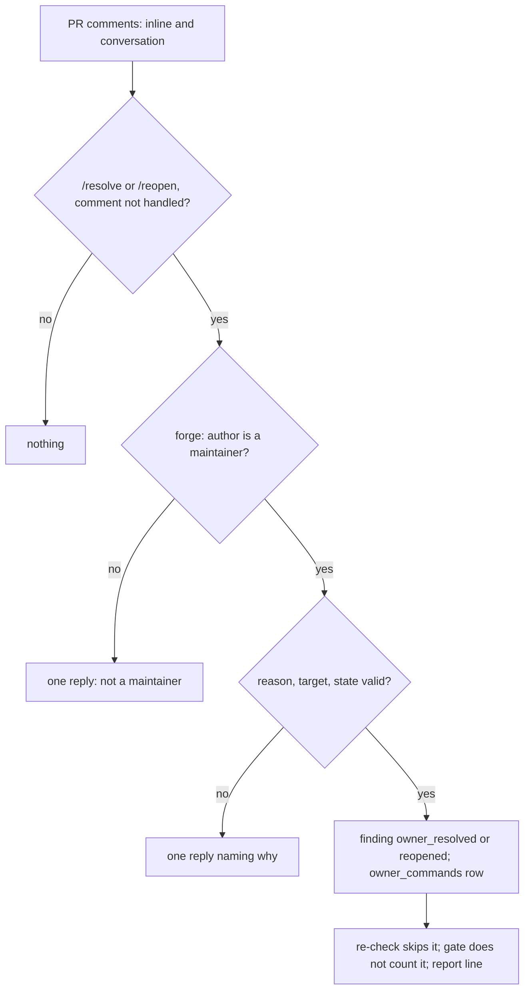

# A maintainer settles, with a recorded reason, a finding the refuter cannot judge

## Intent

Some blocking findings state facts that live outside the repository: a
forge setting, a runner's kernel parameter, how a protected environment
is configured. The refuter judges from the cited file's window and can
never see them, so such a finding is deferred `needs judgement` at every
head and holds the pull request forever. A maintainer of the repository,
and only a maintainer as the forge itself reports it, settles such a
finding with a comment that carries the reason; the reason, the login,
the comment and the head are recorded in the ledger, the gate stops
counting the finding, and `/reopen` counts it again.

## Context

Measured on 2026-11-01 at `origin/develop` `4b8be66f` and `origin/main`
`f0303c0e` (release 6).

| # | Fact | Where |
|---|---|---|
| F1 | Yoob !339 is open at head `9228756b`; its review note reads `BLOCKED at 9228756b785b — 7 open blocking finding(s) at head`, six of them `unresolved: needs judgement (evidence outside window)` and one `still present` (findings 4, 5, 12, 20, 28, 33, 34, all `security`, raised at older heads), with `Review complete: True` and `CI green: True` | GitLab API `merge_requests/339` and `/notes`, read 2026-11-01 |
| F2 | The facts those findings ask about are forge and host settings: the `review-gate` GitLab environment is protected (deploy access Maintainers, read back from the API), `kernel.yama.ptrace_scope` is 1 on the runner host, the evidence file is refused when tracked or symlinked | coordinator's brief, 2026-11-01 |
| F3 | No human path settles a finding: `git grep owner_resolve origin/main -- src/repoach` and the same on `origin/develop` find nothing | `git grep` |
| F4 | The re-check at head acts only on `proposed`, `verified`, `open` and `stuck` rows; a judged claim goes to the refuter, which defers when its reasoning says the evidence is not visible | `src/repoach/review/head_reverify.py:135` (`_UNSETTLED`); `src/repoach/review/refuter.py:111` (`_UNSEEN_REASONING`) |
| F5 | The merge gate and the review-time facts skip the statuses of `_SETTLED` (`resolved`, `refuted`, `not_applicable`, `resolved_at_head`) | `src/repoach/review/merge_gate.py:65` |
| F6 | `review pr` re-checks older heads at `orchestrator.py:974` (fresh run) and `:1203` (replay of a completed run at the same head) | `src/repoach/review/orchestrator.py` |
| F7 | The forge protocol reads inline comments (`comments`) and pull-request comments (`conversation_comments`) and writes a thread reply (`reply`) and a comment (`post_comment`); it reads no permission | `src/repoach/forge/protocol.py:620-650` |
| F8 | Findings carry no forge thread id: `pr_findings` has no forge column and SP-FINDING-THREAD-IDS (`finding_posts.py`) is a draft with no code; a thread is joinable to a finding only by its anchor (file and line) | `src/repoach/review/findings.py:215`; `docs/specs/2026-10-19_SP-FINDING-THREAD-IDS_*.md` |
| F9 | The approved design of owner commands is D5 of the draft SP-PR-THREADS-REMEMBER-AND-CLOSE (0.5): "Owner commands in a thread are authoritative: `/resolve <reason>`, `/wontfix <reason>` and `/reopen`. There is no debt command (D7)." | `docs/specs/2026-10-26_SP-PR-THREADS-REMEMBER-AND-CLOSE_*.md` |

The defect: F1's findings are judged where the evidence cannot be, and
no one may settle them, so the gate refuses at every head whatever the
pull request does.

## Decisions (coordinator, 2026-11-01)

- D1. This spec implements the owner commands of
  SP-PR-THREADS-REMEMBER-AND-CLOSE D5 alone, ahead of the rest of that
  spec, because Yoob !339 is held by F1. `/wontfix` is left out: the
  brief asks for `/resolve` and `/reopen` only, and D7 forbids any debt
  command. The threads spec stays the design source and is declared in
  `depends_on`.
- D2. Owners are measured from the forge for every command, never read
  from the comment and never configured in the repository: GitHub
  collaborator role `admin` or `maintain`, GitLab project member
  (inherited included) with `access_level >= 40`. The bot's login is
  never an owner.
- D3. A thread is joined to its finding by the thread root's anchor (the
  finding's file, its cited line range holding the root's line), because
  findings carry no thread id (F8). A thread anchoring several open
  findings settles none and asks for `#<finding-id>`.
- D4. `owner_resolved` is a new status rather than a reuse of
  `resolved`: `resolved` is terminal and means the Coder fixed it, while
  an owner settlement is reversible by `/reopen` and fixes nothing.

## Goals

- **G1. Commands.** A comment whose body, stripped, starts with
  `/resolve` or `/reopen` followed by whitespace or its end is a command
  (`format:owner-settle-command`): `/resolve <reason>` and `/reopen` as a
  reply in a finding's inline thread; `/resolve #<finding-id> <reason>`
  and `/reopen #<finding-id>` in any comment, the pull-request
  conversation included, for findings that were never posted. The
  reason is the rest of the body, whitespace collapsed, cut at
  `reason_max_chars`.
- **G2. Owners only.** `Forge.is_maintainer(login)` answers from the
  forge (D2). The bot's own command is recorded and never applied, with
  no reply. A command from anyone else is ignored and answered once:
  `not a maintainer of this repository`. A permission the forge cannot
  read applies nothing, records nothing, and the command is retried by
  the next run.
- **G3. The reason is mandatory.** A `/resolve` whose reason is shorter
  than `reason_min_chars` is ignored and answered once with the rule.
- **G4. The ledger effect.** An applied `/resolve` moves the finding to
  `owner_resolved` with `verification_method = owner_resolve`,
  `verification_result = owner-resolved by <login>: <reason>` and
  `checked_at_sha` the reviewed head, and records an `owner_commands`
  row: comment id, command, login, finding id, reason, head, `resolution
  = owner_resolve`, and the status, method, result and checked sha the
  finding held before. The merge gate and the review-time facts do not
  count `owner_resolved` (`_SETTLED`); the re-check at head never
  re-checks it. An applied `/reopen` restores the four fields recorded
  by the last applied `/resolve` of that finding, and the gate counts it
  again.
- **G5. Applied once.** A command is keyed by `(pr_number,
  comment_id)`: a re-run at the same head, or at a later head, neither
  re-applies nor re-answers it. Commands are applied in creation order,
  so a `/resolve` followed by a `/reopen` ends reopened.
- **G6. No-ops are named.** `/resolve` on an advisory or already
  settled finding, `/reopen` on a finding that is not owner-resolved, an
  unknown `#<id>`, a conversation comment naming no finding, a thread
  anchoring none, and a thread anchoring several each change nothing and
  get one reply saying why.
- **G7. When.** `review pr` applies the commands at the reviewed head
  before the re-check of older heads and before the ledger facts are
  summarised, on a fresh run and on a replay of a completed run alike
  (F6). Replies are posted only by a posting run: on a dry run each is
  printed as `owner reply not posted: <reply>` and left pending, and the
  next posting run posts it once.
- **G8. The report says who and why.** The `review pr` JSON carries
  `owner_resolved: [{finding_id, login, reason, comment_id, head_sha}]`
  and `owner_commands: [{comment_id, command, author, finding_id,
  outcome}]` (the commands this run handled first); stderr prints one
  `owner-resolved #<id> by <login>: <reason>` line per owner-resolved
  finding and `owner commands: <n> applied, <m> ignored` when this run
  handled any; the Markdown report has an `## Owner-resolved findings`
  section, fenced because the reason is a person's text.

## Non-Goals

- NG1. No `/wontfix`, no debt command, no expiry of a settlement (D1).
- NG2. No three-voice thread context, agent rounds, escalation or thread
  resolution on the forge: the rest of SP-PR-THREADS-REMEMBER-AND-CLOSE.
- NG3. No change to the refuter or to how it defers.
- NG4. No owner list in `repoach.toml`: owners are read from the forge
  (D2).
- NG5. `review gate` applies no command; it reads the ledger the last
  `review pr` wrote, which is where the commands are applied.

## Assumptions

- A1. The forge token of the run may read the repository's permissions
  (GitHub `collaborators/<login>/permission`; GitLab `members/all`).
  When it may not, the read fails, nothing is applied (G2).
- A2. A finding settled at one head is the finding of that head; a new
  head whose reviewers raise the same claim records a new row, which a
  maintainer settles again.

## Interface

```python
# src/repoach/forge/protocol.py
class Forge(Protocol):
    def is_maintainer(self, login: str) -> bool: ...

def maintainer_candidate(bot_username: str, login: str) -> bool: ...

# src/repoach/review/findings.py
class FindingStatus(StrEnum):
    OWNER_RESOLVED = "owner_resolved"
OWNER_SETTLEABLE_STATUSES: frozenset[FindingStatus]  # proposed, verified, open, stuck

# src/repoach/review/owner_store.py
owner_commands: Table  # db:table:owner_commands, unique (pr_number, comment_id)
class OwnerCommandRow(BaseModel): ...
def fetch_owner_commands(db_path: Path, pr_number: int) -> list[OwnerCommandRow]: ...
def record_owner_command(db_path: Path, row: OwnerCommandRow) -> bool: ...
def mark_reply_posted(db_path: Path, *, pr_number: int, comment_id: int) -> None: ...

# src/repoach/review/owner_commands.py
def parse_command(body: str) -> OwnerCommand | None: ...
def apply_owner_commands(
    forge: Forge, db_path: Path, *, pr_number: int, head_sha: str, post: bool
) -> OwnerCommandsRun: ...
def owner_settlements(db_path: Path, pr_number: int) -> list[OwnerSettlement]: ...
```

Errors: none raised to `review pr`. A forge read failure is logged and
applies nothing (`owner commands: not read: <reason>`); an unexpected
failure is logged by the orchestrator and the findings keep blocking.

## Behavior

### Nominal

1. `review pr <n>` resolves the head, runs (or replays) the reviewers
   and the refuter.
2. `apply_owner_commands` reads the inline comments and the
   conversation comments, ordered by creation time then id; each body
   that parses as a command and whose comment id has no row is handled.
3. The author's permission is read once per login per run; a maintainer's
   command is decided (G3, G6), applied (G4) and recorded (G5).
4. A posting run posts each pending answer, in the thread for a thread
   command, on the pull request otherwise, and marks it posted.
5. The re-check of older heads runs; `owner_resolved` rows are not
   among its candidates. The ledger facts and the verdict follow.

### Edge cases

- A command in a new inline thread (not a reply) → its own anchor is the
  thread's anchor.
- `/resolve #<id>` inside a thread → the id wins over the anchor.
- Two `/resolve` comments on the same finding → the first applies, the
  second is a no-op answered once.
- `/resolve`, `/reopen`, `/resolve` → resolved again; `/reopen` restores
  what the last applied `/resolve` recorded.
- A reply that fails to post → logged, kept pending, retried by the next
  posting run.

### Failure scenarios

- Comments unreadable → nothing applied, the existing settlements still
  reported, one `owner commands: not read:` line.
- Permission unreadable → that login's commands left unhandled, one
  `owner commands: permission of <login> unreadable` line; retried.
- The ledger refuses the transition (the status changed during the run)
  → the row is recorded as a no-op and answered so.

## Architecture Impact

- Adds dependency: SP-OWNER-SETTLES-A-FINDING -> SP-PR-THREADS-REMEMBER-AND-CLOSE
  (D5 is the design source; this spec implements its owner commands
  first, D1).
- Adds dependency: -> SP-UNIVERSAL-FORGE (`Forge.is_maintainer`, comments,
  replies; conformance fixtures for both forges).
- Adds dependency: -> SP-FINDINGS-INIT-RACE (`FindingStatus.OWNER_RESOLVED`
  and its transitions in `findings.py`).
- Adds dependency: -> SP-GATE-REVERIFIES-AT-HEAD (an `owner_resolved` row
  is not re-checked; the commands are applied before the re-check).
- Adds dependency: -> SP-ORCH-DOCSTRING (the orchestrator calls
  `apply_owner_commands` on both its paths and carries the result).
- Adds dependency: -> SP-DRY-RUN-NEVER-POSTS (a dry run posts no answer).
- Adds dependency: -> SP-GENERATED-FILES-ARE-VERIFIED-NOT-READ (the end-to-end
  test drives `review pr` through its harness: a bare origin, a GitHub
  forge with a stubbed `gh`, approving reviewers).
- Adds dependency: -> SP-SCHEMA-INIT-RACE-GENERALIZE (`owner_commands` is
  created through `ensure_schema_created`).
- Adds dependency: -> SP-UNIVERSAL-GATES, SP-DEDUP-CLASSIFICATION-CONSTANTS,
  SP-RETRY-BACKOFF-DEDUP (the unit tests read the gate configuration, the
  merge-gate facts and the review verdict they own).
- New shared state: `db:table:owner_commands`; new contract
  `format:owner-settle-command`. `merge_gate._SETTLED` gains
  `owner_resolved`.

## Diagram



## Acceptance Criteria

- [ ] AC1 (G2, owner detection on both forges): a GitHub `maintain` role
  and a GitLab member at `access_level` 40 are maintainers; a GitHub
  `write` role, a GitLab member at 30 and a GitLab member whose username
  only starts with the login are not; the bot, an empty login and a
  non-username are refused without a forge call —
  `pytest -q tests/unit/test_forge_conformance.py -k is_maintainer`.
- [ ] AC2 (G2): the bot's own command is recorded and never applied, and
  no permission is read for it —
  `pytest -q tests/unit/test_owner_commands.py::test_github_and_gitlab_maintainers_are_owners_and_the_bot_never_is`.
- [ ] AC3 (G1, G4, thread reply): `/resolve <reason>` in the finding's
  thread moves it to `owner_resolved` with the recorded login, reason,
  comment id and head, and answers in that thread —
  `pytest -q tests/unit/test_owner_commands.py::test_thread_reply_resolves_the_finding_it_anchors`.
- [ ] AC4 (G1, PR level): `/resolve #<id> <reason>` on the pull request
  settles a finding that was never posted —
  `pytest -q tests/unit/test_owner_commands.py::test_pr_level_command_names_the_finding`.
- [ ] AC5 (G3): a reason under 20 characters is refused with one reply
  naming the rule —
  `pytest -q tests/unit/test_owner_commands.py::test_resolve_without_reason_is_answered_and_ignored`.
- [ ] AC6 (G6): an unknown id and a conversation comment naming no
  finding are refused with one reply each —
  `pytest -q tests/unit/test_owner_commands.py::test_unknown_finding_is_answered_and_ignored`.
- [ ] AC7 (G2): a non-maintainer's command is ignored and answered once
  over two runs —
  `pytest -q tests/unit/test_owner_commands.py::test_non_owner_is_answered_once_and_ignored`.
- [ ] AC8 (G4, gate): the ledger facts stop counting the finding and the
  verdict flips from REQUEST_CHANGES to APPROVE —
  `pytest -q tests/unit/test_owner_commands.py::test_owner_resolved_is_settled_and_not_counted`.
- [ ] AC9 (G4, re-check): the re-check at head builds no judge for an
  owner-resolved finding —
  `pytest -q tests/unit/test_owner_commands.py::test_reverify_skips_an_owner_resolved_finding`.
- [ ] AC10 (G4, G5, reopen): `/reopen` restores the status, result and
  checked sha the finding held, and the gate counts it again —
  `pytest -q tests/unit/test_owner_commands.py::test_reopen_counts_the_finding_again`.
- [ ] AC11 (G5): a re-run at the same head and at a later head neither
  re-applies nor re-answers —
  `pytest -q tests/unit/test_owner_commands.py::test_a_command_is_applied_once_across_runs`.
- [ ] AC12 (G7): a dry run applies the command, posts nothing and prints
  the answer; the next posting run posts it once —
  `pytest -q tests/unit/test_owner_commands.py::test_dry_run_prints_replies_and_a_posting_run_posts_them_once`.
- [ ] AC13 (G8): the report line, the JSON entries and the Markdown
  section name the owner and the reason —
  `pytest -q tests/unit/test_owner_commands.py::test_report_line_and_json_name_the_owner`.
- [ ] AC14 (G6, D3): an advisory or settled finding is a no-op answered
  once, and a thread anchoring two open findings settles neither —
  `pytest -q tests/unit/test_owner_commands.py -k "noop or ambiguous"`.
- [ ] AC15 (G2, failures): unreadable comments or permissions apply
  nothing and the command is retried —
  `pytest -q tests/unit/test_owner_commands.py -k unreadable`.
- [ ] AC16 (end to end): `review pr --dry-run` through the GitHub forge
  with a stubbed `gh` ends REQUEST_CHANGES on a deferred blocking
  finding of an older head; after a maintainer's `/resolve #<id>
  <reason>`, the next `review pr` at the same head ends APPROVE, prints
  the owner line and carries it in the JSON —
  `pytest -q tests/integration/test_owner_resolves_a_finding_end_to_end.py`.
- [ ] AC17 (schema): the `review pr` JSON keeps every documented key and
  adds `owner_resolved` and `owner_commands` —
  `pytest -q tests/unit/test_review_ci_mode.py::test_review_pr_json_payload_matches_documented_schema`.
- [ ] AC18 (lifecycle law): `owner_resolved` is reachable from the four
  unsettled states and leads back to them only —
  `pytest -q tests/unit/test_review_findings.py::test_allowed_transitions_law`.

## Open Questions

None. Q1 (status name) and Q2 (thread join without thread ids) were
decided as D4 and D3.
