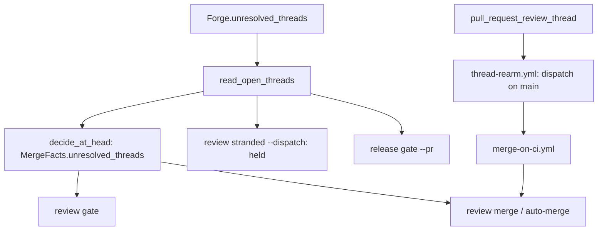

# An open review thread blocks the merge on every merge path

## Intent

Owner rule, Yoob and repoach: "si les commentaires ne sont pas clos, pas
de merge". On 2026-11-02 the bot merged #280, #281 and #283 while late
review threads were still open (4, 7 and 10 threads), and each needed a
follow-up PR (#281, #282, #284). After this spec no merge path of
repoach merges a pull request while one of its review threads is open,
or while the forge cannot say how many are open.

## Context

Measured on `develop` `6fd4662` (2026-11-02).

| # | Fact | Where |
|---|---|---|
| F1 | `MergeFacts` (`extra="forbid"`) counts ledger findings, CI, review integrity and spec coverage; no field reads the forge's threads | `src/repoach/review/merge_gate.py` |
| F2 | Every merge decision goes through `decide_at_head`: `review gate` (`evaluate_merge_gate`), `review merge` and the `auto_merge` job of `auto-review.yml` and `merge-on-ci.yml` (`run_auto_merge`) | `src/repoach/review/auto_merge.py` |
| F3 | `review stranded --dispatch` dispatches `merge-on-ci.yml` for every green PR whose last attempt is a skip, so a PR refused for any reason is dispatched again | `src/repoach/review/merge_wait.py` (`stranded`) |
| F4 | `release gate` reads provenance, freshness and CI; not the release PR's threads | `src/repoach/review/release_gate.py` |
| F5 | `Forge.review_threads` (SP-FINDING-THREAD-IDS) lists GitHub threads with `isResolved` and GitLab `DiffNote` discussions only; a resolvable discussion outside the diff is not listed | `src/repoach/forge/github.py`, `src/repoach/forge/gitlab.py` |
| F6 | GitLab's discussions read uses `glab api --paginate`; an unpaginated discussions read hid open threads three times on Yoob | `src/repoach/forge/gitlab.py` (`_discussions`) |
| F7 | `merge-on-ci.yml` runs on `workflow_run` of `CI` and `Auto Review (review bots)` and on `workflow_dispatch`; `auto-review.yml` on `pull_request`, `issue_comment`, `pull_request_review`. Of the last 300 runs of the repository (`gh run list --limit 300`), 145 merge-on-ci runs were `workflow_run`, none of any workflow was `pull_request_review_thread`: resolving a thread starts nothing | `.github/workflows/` |
| F8 | The rulesets `develop` and `main` have `required_review_thread_resolution=false`; the owner switches them, outside repoach's code | GitHub settings |

## Decisions (2026-11-02)

- D1. Fail closed: a thread listing that fails, or stops on a page
  announcing another, refuses with `review threads unreadable: <why>`;
  it is never read as zero. `MergeFacts.threads_read` defaults to
  `False`, so facts built without a read refuse.
- D2. The count is what the forge's own "all threads resolved" setting
  counts: on GitHub every `reviewThreads` node with `isResolved` false;
  on GitLab every discussion whose first note is `resolvable` and not
  `resolved`, inside the diff or not.
- D3. GitLab is paged explicitly (`per_page=100&page=<n>`) until an empty
  page, capped at 50 pages, past which the read is refused (F6).
- D4. `Forge.unresolved_threads(number)` returns the open threads, not a
  bare count: `review gate` names each one (root id, discussion id,
  file and line) and the facts carry `len()`.
- D5. The forge settings (GitHub ruleset
  `required_review_thread_resolution`, GitLab
  `only_allow_merge_if_all_discussions_are_resolved`) are the second line
  of defence; repoach's own gate is the first, so a forge without the
  setting, or a self-hosted runner merging with an owner token, is held
  all the same.
- D6. A thread event re-arms the merge (F7) without running a
  merge-capable workflow from a PR ref: `pull_request_review_thread`
  runs the workflow file of the PR's merge ref, so the event goes to a
  new `thread-rearm.yml` whose only permission is `actions: write` and
  whose one step dispatches `merge-on-ci.yml` on `main` for that PR.
  `merge-on-ci.yml` keeps its triggers; a dispatch made with the job
  token starts a run whose actor (`github-actions[bot]`) it admits.
  `thread-rearm.yml` admits an allowlisted actor on a same-repo,
  non-draft PR into `develop` and runs GitHub-hosted.

## Goals

- G1: `MergeFacts` gains `unresolved_threads: int`, `threads_read: bool` and `threads_error: str`; `compute_merge_decision` adds `<n> unresolved review thread(s)` while n > 0 and `review threads unreadable: <why>` when not read.
- G2: `Forge.unresolved_threads(number)` on GitHub (GraphQL `reviewThreads`, 100 per page, `--paginate --slurp`, the last page must say `hasNextPage: false`) and GitLab (discussions, 100 per page until an empty page); the bench `LocalDiffForge` has none.
- G3: every merge path honours it: `decide_at_head` reads the threads, so `review gate`, `review merge` and the auto-merge refuse, the latter recording `pure gate refused: … unresolved review thread(s)` in its attempts comment; `review stranded --dispatch` holds a stranded PR whose threads are open or unreadable instead of dispatching it; `release gate --pr N` refuses on the release PR's open threads (`ReleaseFacts.open_threads`, refused through `OpenThreads.refusal()`).
- G4: `review pr` prints `review threads: <n> unresolved` on stderr and carries `review_threads` in its JSON and archive; the archive's facts table gains `Unresolved review threads`; `review gate` prints the same line plus `open thread <id> at <file>:<line>` per thread and carries `review_threads` in its JSON.
- G5: `thread-rearm.yml` dispatches `merge-on-ci.yml` on `main` when a thread is resolved or unresolved, so a green PR whose last thread is resolved merges without a push.
- G6: `docs/merge_gate.md` states the rule and names the two forge settings as the second line of defence.

## Non-Goals

- NG1: no agent reply in a thread, no thread context, no closing by role: `SP-PR-THREADS-REMEMBER-AND-CLOSE`.
- NG2: no forge setting, ruleset, CI variable or runner change.
- NG3: no change to the review verdict (`verdict_from_facts`): threads gate the merge, not the verdict.
- NG4: no change to the calls `Forge.review_threads` makes; its two recorded fixtures keep their exchanges, and their expected results gain the two new `ReviewThread` keys at their defaults (`"path": ""`, `"line": null`).

## Assumptions

- A1: `gh api graphql --paginate` follows `pageInfo.endCursor` while `hasNextPage` is true and `--slurp` prints every page as one array.
- A2: GitLab answers `[]` for a discussions page past the last.
- A3: a `pull_request_review_thread` run uses the workflow file of the PR's merge ref, which is why `thread-rearm.yml` holds no merge-capable token; a workflow dispatched with the job token starts a run (the documented exception to the GITHUB_TOKEN no-trigger rule), from `main`'s `merge-on-ci.yml`, which executes `main`'s code, so the gate takes effect on that lane after the next release, like every merge-gate change (F7 of SP-AUTOMERGE-EVENT-DRIVEN).

## Interface

```python
# repoach.forge.protocol
class ReviewThread(_Model):
    root_id: int
    thread_id: str | None = None
    resolved: bool = False
    resolved_by: str = ""
    path: str = ""
    line: int | None = None

class Forge(Protocol):
    def unresolved_threads(self, number: int) -> list[ReviewThread]: ...

# repoach.review.open_threads
def unresolved_reason(count: int) -> str: ...
def unreadable_reason(why: str) -> str: ...
class OpenThreads(BaseModel):
    read: bool
    threads: list[ReviewThread] = []
    error: str = ""
    def refusal(self) -> str | None: ...
    def summary_line(self) -> str: ...
    def thread_lines(self) -> list[str]: ...
    def as_json(self) -> dict[str, object]: ...
def read_open_threads(forge: Forge, pr_number: int) -> OpenThreads: ...
class PullRequestRow(Protocol):  # pr_number: int, head_sha: str
    ...
def hold_open_threads(rows: Sequence[RowT], read) -> tuple[list[RowT], list[HeldPR]]: ...

# repoach.review.merge_gate.MergeFacts (added)
def with_threads(self, threads: OpenThreads) -> MergeFacts: ...
unresolved_threads: int = 0
threads_read: bool = False
threads_error: str = ""

# repoach.review.release_gate.ReleaseFacts (added)
open_threads: OpenThreads | None = None
```

## Behavior

### Nominal

- A green, approved PR with one open thread: `review gate` exits 5 with `reasons == ["1 unresolved review thread(s)"]`; the auto-merge records `SKIP_GATE` with `pure gate refused: 1 unresolved review thread(s)` and merges nothing. The thread is resolved: `thread-rearm.yml` dispatches merge-on-ci on main, whose decision merges.
- `review stranded --dispatch` dispatches the stranded PRs without open threads and prints `held #<n> (<reason>)` for the others; the JSON lists them under `held`.

### Edge cases

- The only open thread sits on page 3 of either forge: it is counted.
- An open GitHub thread whose first comment has no `databaseId` counts, with root id `0`; an outdated thread reports its `originalLine`.
- A GitLab resolvable discussion outside the diff counts, named `(no file)`.

### Failure scenarios

- The forge read fails, decodes to nothing, or ends on a page announcing another: `review threads unreadable: <why>` (redacted), the merge refused.
- More than 50 GitLab pages: refused as unreadable.

## Architecture Impact
- Adds dependency: SP-OPEN-THREADS-BLOCK-THE-MERGE -> SP-UNIVERSAL-FORGE (`Forge.unresolved_threads`, `ReviewThread`)
- Adds dependency: SP-OPEN-THREADS-BLOCK-THE-MERGE -> SP-AUTO-MERGE-WAITS-FOR-CHECKS-NOT-ITSELF (the stranded sweep holds its rows, the fixture forge serves threads); `open_threads.py` imports nothing of `merge_wait.py`: `hold_open_threads` takes any row with `pr_number` and `head_sha`
- Adds dependency: SP-OPEN-THREADS-BLOCK-THE-MERGE -> SP-FINDING-THREAD-IDS (`ReviewThread` comes from it)
- Adds dependency: SP-OPEN-THREADS-BLOCK-THE-MERGE -> SP-PURE-MERGE-GATE, SP-DEDUP-CLASSIFICATION-CONSTANTS, SP-RELEASE-GATE (the tests decide through `merge_gate.py`, `auto_merge.py` and `release_gate.py`)
- Adds dependency: SP-OPEN-THREADS-BLOCK-THE-MERGE -> SP-FINDINGS-INIT-RACE, SP-ORCH-DOCSTRING, SP-CLI-STDOUT-ONE-JSON (the tests create the ledger, run `review pr` through the orchestrator and read its one JSON object)
- `merge_gate.py`, `auto_merge.py`, `release_gate.py`, `orchestrator.py`, `review_cmds.py` and `release_cmds.py` import `open_threads.py`; it imports none of them.
- New workflow `.github/workflows/thread-rearm.yml` (GitHub-hosted, `actions: write` only); `tests/unit/test_ci_portability.py` lists its job among the GitHub-hosted ones on purpose.

## Diagram


## Acceptance Criteria
- [ ] AC1: `pytest -q tests/unit/test_forge_unresolved_threads.py` → green: both forges read the only open thread on page 3, GitLab asks pages 1 to 4 with `per_page=100` and stops on the empty one, and a truncated, errored or empty listing raises. Today (`6fd4662`): `ERROR: file or directory not found`.
- [ ] AC2: `pytest -q tests/unit/test_open_threads_block_the_merge.py` → green: the reasons, fail closed on unread facts, the auto-merge of a green PR with an open thread skipped then merged once it is resolved, the stranded hold, the release gate, the report row, the thread-rearm dispatch and merge-on-ci admitting it. Today: the file does not exist.
- [ ] AC3: `pytest -q tests/integration/test_open_threads_block_the_merge_end_to_end.py` → green: `review pr` reports `review threads: 1 unresolved`, the decision at head refuses with exactly `["1 unresolved review thread(s)"]`, and merges after the thread is resolved. Today: the file does not exist.
- [ ] AC4: `repoach arch check --base develop` → ok.
- [ ] AC5: `docs/merge_gate.md` names the rule, `required_review_thread_resolution` and `only_allow_merge_if_all_discussions_are_resolved` as the second line of defence.

## Open Questions
- none.
