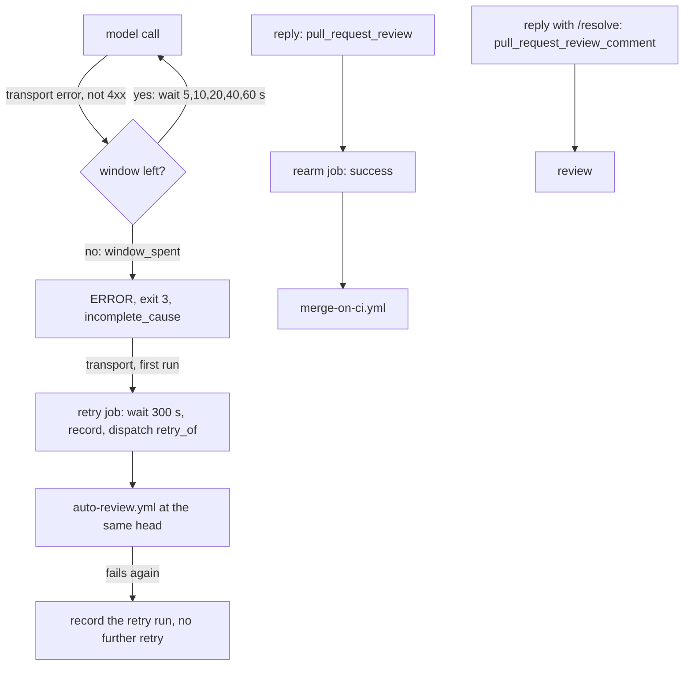

# A short transport outage costs the review time, and a request fault is never taken for one

## Intent

On 2026-11-04 the review of #288 ended incomplete (exit 3) twice and
waited for a person to re-run the job; meanwhile every reply the owner
posted in a thread started a new bot review that cancelled the one in
progress. The failure was reported as a transport error; measured, the
Sentinel's answer had outgrown its output cap, the proxy took that for a
dead candidate, and the breaker state every job shares left the judge
nothing to call. After this spec a reply past its cap is named as such
and never retried, the breaker of a CI job is the job's own, a transport
outage shorter than a per-call window costs time only, a longer one is
retried once at the same head, and a thread reply re-arms the merge
without reviewing anything.

## Context

Measured 2026-11-04, `origin/develop` `b8f7b3a`.

| # | Fact | Where |
|---|---|---|
| F1 | Bot run 41916625939 at `cc59550` (#288), attempt 1: `review.bot.attempt_failed` ×3 `GatewayTransportError: proxy returned 502: {"detail":"All 1 provider candidate(s) are currently breaker-tripped; the chain is exhausted before dispatch`, 21:36:14, 21:36:44, 21:40:58 UTC; `review_team.reviewer_errored roles=['sentinel']`; `review_team.findings_judged deferred=2 model_calls=2`, both `judge call failed: GatewayTransportError`; `Process completed with exit code 3`. Attempt 2 failed the same way; attempt 3, re-run by hand, succeeded | `gh api repos/repoachhq/repoach/actions/runs/41916625939/attempts/{1,2}`, job 126878784588 log |
| F2 | The self-hosted runner logged `Runner connect error: The HTTP request timed out after 00:01:40` at 21:38, 21:40 and 22:00 UTC; the `repoach-llm-proxy` journal had no error; upstream was reachable after | runner and proxy journals |
| F3 | The proxy's breaker trips a transient fault for `breaker_ttl_s` = 120 s, so a 100 s drop answers 502 for up to about 220 s | `src/repoach/llm_proxy/config/settings.py` (`breaker_ttl_s`) |
| F4 | Every model call of a review goes through `AgentLoop._provider_call` (reviewers, the refuter judge, `head_reverify`'s judge, the planner and developer); it makes one attempt. Around it, the reviewers retry three times over 0/30/90 s (`Reviewer._RETRY_BACKOFFS_S`, `retry_with_backoff`) and tool turns three times over 0/15/45 s (`_call_turn_with_retry`): at most 120 s, shorter than F3 | `src/repoach/agent_engine/agent_loop.py`, `src/repoach/review/reviewer.py`, `src/repoach/review/retry_backoff.py` |
| F5 | SP-JUDGE-FAILURE-IS-RETRIED NG1: "no retry inside one run: a failed call is not repeated in the same gate". SP-CHAIN-REQUEST-BUDGET bounds the time one request spends across the proxy's failover hops; neither outlasts an outage of the runner host itself. SP-PROXY-THINKING-BUDGET-RETRY retries a budget-starved candidate inside the proxy, not a transport error | `docs/specs/` |
| F6 | `GatewayTransportError` is raised for a timeout, a refused connection, a 5xx, a 408 and a 429, with no status attribute | `src/repoach/agent_engine/adapters.py`, `src/repoach/providers/direct.py` |
| F7 | `auto-review.yml` listens to `pull_request_review` (since #286, so a reply re-arms the merge); a reply is a submitted COMMENTED review. Of the last 100 Auto Review runs, 57 `pull_request_review` runs were cancelled, 22 concluded `skipped` (every job skipped) and 2 `success` | `gh api repos/repoachhq/repoach/actions/workflows/auto-review.yml/runs` |
| F8 | `merge-on-ci.yml` admits a `workflow_run` of Auto Review only with `conclusion == 'success'` and event `pull_request` or `pull_request_review`; a run whose every job is skipped concludes `skipped` (F7) | `.github/workflows/merge-on-ci.yml` |
| F9 | The owner commands `/resolve` and `/reopen` (SP-OWNER-SETTLES-A-FINDING) are applied by `review pr`; a reply in a finding's thread is also a `pull_request_review_comment` | `src/repoach/review/owner_commands.py` |
| F10 | The review job writes its ledger to a fresh `runner.temp` database and never downloads a previous one; a run with an errored reviewer is never stored as a completed run (`_store_completed_run`), so a second attempt at the same head reviews afresh: no `review_team.replayed` | `.github/workflows/auto-review.yml`, `src/repoach/review/orchestrator.py` |
| F11 | Events created with the workflow's `GITHUB_TOKEN` start no workflow, except `workflow_dispatch` and `repository_dispatch`; a run dispatched so has `github.actor == 'github-actions[bot]'`, which merge-on-ci.yml already admits for a dispatch | GitHub Actions docs; `.github/workflows/merge-on-ci.yml` |
| F12 | The job proxy log of a later #288 attempt (`server.log`, 23:21–23:29 local) and the CLI's transcript of session `6dc7133d…`: the Sentinel (`claude -p --model opus`, prompt 118 857 chars, `CLAUDE_CODE_MAX_OUTPUT_TOKENS=4096` from the reviewer's `max_tokens`) wrote four replies of 4 096 output tokens, each `stop_reason: max_tokens` and thinking only, then `"error":"max_output_tokens"` (`API Error: Claude's response exceeded the 4096 output token maximum`); 163 s, $2.16, no answer. The second try (+90 s) failed the same way ($0.52). Bounding the number of findings asked for would not have helped: no answer text was written | `~/actions-runner-ferova/_work/repoach/repoach/server.log`; `~/.claude/projects/-tmp-repoach-claude-code-k-2vt-s6/6dc7133d-4d47-468e-9709-921fa6dfa7e4.jsonl` |
| F13 | `claude` 2.1.317 on `claude-opus-5-5`: `MAX_THINKING_TOKENS` does not bound the thinking (3 960 thinking tokens with 512, 3 709 with 0, same prompt); `CLAUDE_CODE_MAX_OUTPUT_TOKENS=300` reproduces the fault: exit 1, stdout JSON ending `"is_error":true,"api_error":"max_output_tokens","result":"API Error: Claude's response exceeded the 300 output token maximum…"`, `num_turns: 4` | measured 2026-11-04, `tests/fixtures/claude_code/max_output_tokens.json` |
| F14 | On a non-zero exit the claude_code client raised `claude CLI exited 1: ` + `stdout.strip()[:200]`, which ends inside the usage counts, before `is_error` and `result`; the failover classified it `provider_error` and tripped `claude_code/opus` (TTL 120 s); the gateway dispatcher, which ignores the stream's terminal error, answered an empty `end_turn` (`AGENT_DISPATCH … tokens=0 n_text_blocks=0`), and the reviewer's semantic failover asked again with the alias skipped | `src/repoach/llm_proxy/providers/claude_code/client.py`, `api/services.py`, `api/agent_dispatcher.py` |
| F15 | `MODEL_OPUS=nvidia_nim/z-ai/glm-5.2,open_router/z-ai/glm-5.2,claude_code/opus`. In the CI jobs the first two were tripped before any call: `Breaker rehydrated from persisted state: 11 row(s) restored`. With `claude_code/opus` tripped too (F14), `Chain.without` falls back to the head, `nvidia_nim/z-ai/glm-5.2`, which is tripped, so every refuter judge call that followed was refused before dispatch: `CHAIN_RESOLVED … chain=[nvidia_nim/z-ai/glm-5.2]`, `proxy_chain_exhausted attempts=0`, 502 `All 1 provider candidate(s) are currently breaker-tripped` — the `GatewayTransportError` the reviewer and the judge reported. The judge is not routed to NIM by default: its first call resolved `[claude_code/opus]` | `server.log`; `src/repoach/llm_proxy/routing/chain.py` (`without`) |
| F16 | The job proxy is started without `REPOACH_DB_PATH` or `REPOACH_BREAKER_PROBE_SEED_DB`, so its breaker state is the runner host's shared ledger `~/.local/share/repoach/github.com/repoachhq/repoach/repoach.db`, table `breaker_trip_state`, read and written by every job: rows `nvidia_nim/z-ai/glm-5.2 provider_410` until 2026-11-09 (TTL 604 800 s), six `open_router/*` `provider_402_propagated` (21 600 s), `claude_code/opus provider_error` (120 s, written 22:45:29 UTC). Not the per-PR review ledger (`runner.temp`), which holds findings only | `sqlite3 … "select … from breaker_trip_state"`, 2026-11-04 |
| F17 | `RoutingTable.from_settings` builds `Tier.DEFAULT` from the single `MODEL` setting (`nvidia_nim/z-ai/glm-5.2` in CI) with no `claude_code` tail, and `chain_for` returns a one-entry chain for a literal `provider/model`; the tier chains of `chains.env` end with `claude_code/<tier>`. Every review role sends a tier (`AgentRequest.capability`; the judge is `CapabilityTier.OPUS`, alias `claude-opus-4-7`, classified `OPUS`), never a literal or an unclassified name. Appending the tail to the DEFAULT and literal chains breaks 25 tests of six specs that pin today's chain shapes | `src/repoach/llm_proxy/routing/table.py`; `tests/unit/test_proxy_output_cap_is_not_transport.py::test_the_judge_asks_the_opus_tier_and_288s_chain_was_its_tripped_tail` |
| F18 | `Breaker seeded from probe history: 0 tier head(s) tripped` while every tier head errs: the seed reads `nim_health_probe` from the breaker ledger the job proxy uses (F16), which holds 0 probe rows; the `monitor-chains` sweep writes its 31 353 rows (the newest at 23:27:53, all three heads `error http=410`) to the operator checkout's `data/repoach.db`. The seed's own rule (trip a tier head whose newest probe is degraded) is not what failed | `sqlite3` on both files, 2026-11-05 |
| F19 | `repoach chain-status` computes head-per-tier error rates from the probe table and OpenRouter credits (`remaining=-0.2076 floor=2.0 LOW` on 2026-11-05); nothing in `review pr` or `review gate` reads it, and the credits gate (`compute_credits_gate_skip_models`) covers `open_router` only. In the CI review job the probe table is empty (F18) and the CLI holds no provider key, so such a line would read `no probes` and `credits: skipped` there | `src/repoach/cli/chain_status.py`, `src/repoach/llm_proxy/api/model_router.py` |

## Decisions (2026-11-04)

- D1. One window per model call, at the one call site (F4):
  `AgentLoop._provider_call` retries a `GatewayTransportError` whose
  status is not a 4xx with waits of 5, 10, 20, 40, 60, 60… s, the last
  cut to the time left, for at most `[provider].transport_retry_window_s`
  (default 300 s, F3; `REPOACH_TRANSPORT_RETRY_WINDOW_S` outranks it;
  0 disables it; at most 1800). Every other error, a 408 and a 429 are
  raised at once, as today.
- D2. The window is counted once per call: the error that ends it is
  marked `window_spent`; `retry_with_backoff` and `_call_turn_with_retry`
  stop on it instead of opening a second window. Its type and message are
  unchanged, so the reviewer's `[parse_failed:TRANSPORT] all 3 attempts
  raised — last=GatewayTransportError`, the judge's `judge call failed:
  GatewayTransportError` and exit 3 are unchanged after the window. This
  supersedes NG1 of SP-JUDGE-FAILURE-IS-RETRIED for transport errors only.
- D3. One automatic second attempt per head, from the run itself: a
  `retry` job (GitHub-hosted, base ref, no provider key) runs when the
  review job failed with `incomplete_cause == "transport"`, waits 300 s,
  records the retry in the merge attempts comment and dispatches
  `auto-review.yml` with `retry_of`. The record is written before the
  dispatch and refuses a second retry at that head; the retry run never
  retries, and records its own id and result, so the comment names both
  runs. Considered and not taken: a scheduled `review stranded --dispatch`
  pass (it re-arms merges of green PRs, and a review that never finished
  is not green), and `gh run rerun` from the job (a run cannot rerun
  itself while it is in progress).
- D4. The retry run is admitted for `github-actions[bot]` only with
  `retry_of` set (F11), on the review and auto-merge jobs; `auto_fix`
  stays owner-only, so a retry run never pushes.
- D6. A reply past its output cap is the request's fault (F12–F14). The
  claude_code client raises `OutputCapExceededError` for the CLI's
  `api_error: max_output_tokens` and keeps the CLI's `result` text (up
  to 2 000 characters) in every CLI error, on a non-zero exit too; the
  failover classifies it `output_cap_exceeded` and trips nothing; the
  stream ends with an `output_cap_exceeded` error event, which the
  gateway returns as `stop_reason: error`, code `output_cap_exceeded`;
  the agent side raises `GatewayOutputCapError` (`retryable = False`,
  never a transport error), so no loop repeats the request and the
  review is not retried automatically. The CLI's cap becomes the
  caller's `max_tokens` plus 32 000 tokens of thinking headroom, since
  the CLI counts thinking in it and nothing bounds the thinking (F13).
  Considered and not taken: asking the reviewers for fewer findings
  (F12: no answer text was written).
- D7. A chain refused before dispatch names, as `Retry-After`, the
  seconds until its first candidate re-opens; the transport window waits
  exactly that when it ends inside the window and gives up at once when
  it does not, so a 410 tripped for 7 days costs no 300 s wait.
- D8. The CI job proxy's breaker is the job's own:
  `REPOACH_BREAKER_PROBE_SEED_DB=${{ runner.temp }}/job_proxy_breaker.db`
  on both proxy starts of `auto-review.yml` (F16). A dead model costs
  each job one failed call, then is tripped for the rest of the job.
- D9. A configured chain entry the breaker holds as gone (`provider_410`)
  is named at proxy start, one `proxy_configured_model_gone` error line
  per entry, naming its chain and the time left; the proxy still starts,
  the rest of the chain can serve. Considered and not taken: refusing to
  start (one retired entry would stop every review) and changing
  `Chain.without`'s fall-back to the head (F15: with D6 and D8 the
  claude_code tail is not tripped by a request fault).
- D10. `review pr` names which model served each role, from the run's
  usage rows: `providers: <role> <models>[, <n> failed (<errors>)]; …`,
  so a report says who answered and who did not without the proxy's
  log.
- D11. Not in this change, each a tech-debt row with its measurement:
  the `claude_code` tail on the DEFAULT and literal chains (F17: no
  review role routes there; the shapes are pinned by 25 tests of six
  specs), a probe seed the CI job proxy can read (F18), and a
  head-health and credits line in the report with a refusal to start
  when a tier head is dead and its tail unavailable (F19: the CI job
  has neither the probes nor the keys, and no check says whether the
  `claude` CLI can serve).
- D5. A submitted review never starts a bot review: it moves no head
  (F7). It runs the `rearm` job only (60 s coalesce, its own group), so
  the run concludes `success` and merge-on-ci re-judges the merge (F8).
  An owner command in a reply (`/resolve`, `/reopen`) is reviewed through
  `pull_request_review_comment` (F9); a push, `ready_for_review`,
  `reopened`, an owner comment and a dispatch review as today. No
  `/review` command exists, none is added.

## Goals

- G1: `AgentLoop._provider_call` retries a non-4xx `GatewayTransportError` inside the window of D1, sleeping on an injectable clock; each attempt is one usage row, a failed one with its error; `agent_loop.transport_retry` and `agent_loop.transport_window_spent` log the attempt, the wait, the elapsed time and the window.
- G2: after the window, the outcome is today's: the reviewer's summary, the judge's deferral reason, the team verdict `ERROR` and exit 3 are unchanged; no outer retry loop spends a second window (D2).
- G3: `review pr` prints `incomplete_cause` in its JSON: `null` for a complete review, `transport` when every errored reviewer errored on `GatewayTransportError` or `GatewayChainExhausted` and every deferred finding was deferred `judge call failed: <one of them>`, `other` otherwise.
- G4: `repoach review retry <N> --head <sha> --run <id>` records a `REVIEW_RETRY` attempt naming the failed run and dispatches `auto-review.yml -f pr_number=<N> -f retry_of=<id>`; refused with one line when the PR is not open, its head moved, the attempts comment is unreadable or unwritable, or the head was already retried. `--retry-of <id> --result <r>` records the retry run instead.
- G5: `auto-review.yml` gains the `retry` job (D3, D4) and the `rearm` job (D5); its `review` job never runs on a `pull_request_review` event; the per-PR `review-<pr>` group with cancel-in-progress for owner events is unchanged.
- G7: a claude_code reply past its cap: one CLI spawn, `OutputCapExceededError` carrying the CLI's `result` text, no breaker trip, `GatewayOutputCapError` (not retryable) at the caller, the reviewer's summary `[parse_failed:TRANSPORT] provider refused, not retried — GatewayOutputCapError: …`, `incomplete_cause: other`; the CLI's cap is `max_tokens + 32000`.
- G8: a preflight-refused chain answers 502 with `Retry-After`; `GatewayTransportError.retry_after_s` carries it; the window waits it out or gives up (D7).
- G9: both job proxies of `auto-review.yml` keep their breaker in `runner.temp` (D8); `report_configured_models_gone` names each configured `provider_410` entry at start (D9).
- G10: `review pr` prints `providers: …` on stderr after its usage line (D10).
- G6: `docs/merge_gate.md` states the window, the one automatic retry, what starts a review and what re-arms a merge; `docs/tech_debt.md` carries the #288 measurement as a row, closed by this PR.

## Non-Goals

- NG1: no move of the runner or the proxy, no change to `chains.env`, to the breaker's TTLs or to `Chain.without`.
- NG2: no change to the refuter's judgement, to the judge failure stamps of SP-JUDGE-FAILURE-IS-RETRIED, or to any exit code.
- NG3: no hydration of the previous run's ledger in the retry (F10): the retry reviews the head afresh.
- NG4: no change to `issue_comment` reviews: an owner comment still reviews.
- NG5: no ruleset, forge setting, CI variable or runner change.
- NG6: the items of D11 (tech-debt rows 108 to 110).

## Assumptions

- A1: a job's outputs set by its steps are readable by a dependent job whose `if` uses `always()`, also when the job failed.
- A2: `gh workflow run` without `--ref` dispatches the default branch's `auto-review.yml`; like merge-on-ci.yml (A3 of SP-OPEN-THREADS-BLOCK-THE-MERGE), the retry path is inert until this change reaches `main`.
- A3: GitHub's `startsWith` is case-insensitive; an over-match only costs a review, the command parser decides.

## Interface

```python
# repoach.agent_engine.transport_window
FIRST_BACKOFF_S = 5.0; BACKOFF_FACTOR = 2.0; BACKOFF_CAP_S = 60.0
def retryable_transport(exc: BaseException) -> bool: ...
def window_spent(exc: BaseException) -> bool: ...
def mark_window_spent(exc: BaseException) -> None: ...
def backoff_s(attempt: int) -> float: ...
class TransportWindow:
    def __init__(self, window_s: float, *, clock: Callable[[], float] = time.monotonic) -> None: ...
    def next_wait(self, exc: BaseException, attempt: int) -> float | None: ...

# repoach.providers.errors
class GatewayTransportError(GatewayError):
    def __init__(self, message: str = "", *, status: int | None = None) -> None: ...

# repoach.project.config.ProviderSection (added)
transport_retry_window_s: int = 300   # 0..1800, REPOACH_TRANSPORT_RETRY_WINDOW_S

# repoach.review.review_retry
TRANSPORT_ERROR_NAMES: frozenset[str]
REVIEW_RETRY_OUTCOME = "REVIEW_RETRY"
def incomplete_cause(final_verdict, reviews, refutations) -> Literal["transport", "other"] | None: ...
def dispatch_review_retry(forge, pr_number, *, head_sha, failed_run, now) -> RetryDecision: ...
def record_retry_ran(forge, pr_number, *, head_sha, run_id, retry_of, result, now) -> str: ...

# repoach.providers.errors (added)
class GatewayOutputCapError(GatewayError): retryable = False
# GatewayTransportError(message, *, status=None, retry_after_s=None)

# repoach.llm_proxy.providers.exceptions (added)
class OutputCapExceededError(ProviderError): ...   # status 422, error_type "output_cap_exceeded"

# repoach.llm_proxy.providers.claude_code.client (added)
CLI_THINKING_HEADROOM_TOKENS = 32_000
def cli_result_error(payload, request_id) -> ProviderError: ...
def cli_exit_error(returncode, stdout, stderr, request_id) -> ProviderError: ...

# repoach.llm_proxy.api (added)
services.OUTPUT_CAP_REASON = "output_cap_exceeded"; services.NO_TRIP_REASONS
agent_dispatcher.OUTPUT_CAP_ERROR_CODE = "output_cap_exceeded"   # AgentError.code gains it
runtime.report_configured_models_gone(settings) -> list[str]
```

CLI: `repoach review retry <N> [--head <sha>] --run <id> [--retry-of <id> --result <r>]`,
one stderr line `repoach: review retry: …`, exit 0, or 2 when the forge
cannot be selected or refuses the dispatch. `review pr` JSON gains
`incomplete_cause`.

## Behavior

### Nominal

- A judge call meets four 502s then an answer: waits 5, 10, 20, 40 s, five usage rows, the finding is judged.
- A 100 s drop plus the 120 s breaker: every call in flight is answered within its 300 s window; the review completes.

### Edge cases

- A 408 or 429, or a `GatewayError` (400): one attempt, raised as today.
- A window of 0: one attempt, today's behaviour.
- Eight replies in a minute: no review runs, one `rearm` succeeds, one merge-on-ci run.
- A reply carrying `/resolve <reason>`: reviewed once, through the coalesced command run.

### Failure scenarios

- The outage outlasts the window: `ERROR`, exit 3, `incomplete_cause: transport`; 300 s later one retry run at the same head. If it fails too, it records its result and nothing retries again at that head.
- A deferral for another reason, a refused credential, an unparseable reviewer: `incomplete_cause: other`, no retry.
- The head moved during the wait: no retry (the push reviews it).
- A reply past its output cap: one CLI spawn, no trip, `GatewayOutputCapError`, `incomplete_cause: other`, no retry.
- Every candidate of a chain tripped for longer than the window: the first call gives up at once (`Retry-After` past the window).

## Architecture Impact
- Adds dependency: SP-REVIEW-SURVIVES-TRANSPORT-FAILURES -> SP-UNIVERSAL-PROVIDERS (`AgentLoop._provider_call`, `GatewayTransportError.status`)
- Adds dependency: SP-REVIEW-SURVIVES-TRANSPORT-FAILURES -> SP-UNIVERSAL-PROJECT-CONFIG (`[provider].transport_retry_window_s`)
- Adds dependency: SP-REVIEW-SURVIVES-TRANSPORT-FAILURES -> SP-RETRY-BACKOFF-DEDUP (`retry_with_backoff` stops on a spent window)
- Adds dependency: SP-REVIEW-SURVIVES-TRANSPORT-FAILURES -> SP-AUTO-MERGE-WAITS-FOR-CHECKS-NOT-ITSELF (merge attempts comment, the concurrency simulator, the workflow tests)
- Adds dependency: SP-REVIEW-SURVIVES-TRANSPORT-FAILURES -> SP-REVIEW-TRANSPORT-ERROR-VERDICT, SP-JUDGE-FAILURE-IS-RETRIED, SP-REFUTER-JUDGES-WHAT-IT-CAN (the verdict and deferral reasons it keeps)
- Adds dependency: SP-REVIEW-SURVIVES-TRANSPORT-FAILURES -> SP-OPEN-THREADS-BLOCK-THE-MERGE, SP-OWNER-SETTLES-A-FINDING (the re-arm path, the owner commands)
- Adds dependency: SP-REVIEW-SURVIVES-TRANSPORT-FAILURES -> SP-USAGE-LEDGER, SP-CLI-STDOUT-ONE-JSON, SP-ORCH-DOCSTRING, SP-UNIVERSAL-FORGE (usage rows, the one JSON object, `TeamOutcome`, `Forge.dispatch_workflow`)
- Adds dependency: SP-REVIEW-SURVIVES-TRANSPORT-FAILURES -> SP-BUDGET-RETRY-FIXES, SP-STREAM-EXHAUST-ERROR, SP-BREAKER-LIVE-REASONS, SP-PROXY-STATE-PERSIST (the failover's classification, its terminal error event, the preflight refusal and the persisted breaker it scopes)
- Adds dependency: SP-REVIEW-SURVIVES-TRANSPORT-FAILURES -> SP-AGENT-THINKING-CONTROL, SP-PROVIDER-DIRECT-ANTHROPIC (the gateway dispatcher and the direct providers' error mapping)
- `agent_loop.py` and `retry_backoff.py` import `transport_window.py`; it imports only `providers.errors`. `review_cmds.py` imports `review_retry.py`, which imports `merge_wait.py`, `refuter.py` and `reviewer.py` and none of the CLI.

## Diagram


## Acceptance Criteria
- [ ] AC1: `pytest -q tests/unit/test_review_survives_transport_failures.py` → green: four failures then an answer retried with waits 5/10/20/40 and five usage rows; a failure longer than the window ends as `GatewayTransportError` marked spent inside 300 s; a 400, 408 or 429 makes one attempt; the reviewer's summary and the judge's `judge call failed: GatewayTransportError` are unchanged after the window; `review pr` still exits 3 with `incomplete_cause: transport`; one retry per head, the comment naming both runs, a moved head or a merged PR refused. Today (`b8f7b3a`): the file does not exist.
- [ ] AC2: `pytest -q tests/unit/test_auto_review_replies_do_not_review.py` → green: eight replies start no review and re-arm once, a reply never cancels a push's review, an owner command in a reply is reviewed, the reply's run concludes success and merge-on-ci admits it, the retry job runs once and never for a retry run, the retry run merges but never pushes, and no review event reaches the review job. Today: the file does not exist.
- [ ] AC3: `pytest -q tests/unit/test_merge_wait_workflows.py tests/unit/test_open_threads_block_the_merge.py tests/integration/test_open_threads_block_the_merge_end_to_end.py` → green.
- [ ] AC6: `pytest -q tests/unit/test_proxy_output_cap_is_not_transport.py tests/unit/test_claude_code_output_cap.py` → green: the recorded `max_output_tokens` JSON raises `OutputCapExceededError` whose message is the CLI's `result`, not its usage counts; through the proxy app it trips nothing and reaches the gateway client as `GatewayOutputCapError`; the Sentinel spawns the CLI once and its review is `incomplete_cause: other`; a chain tripped for 120 s answers `Retry-After: 120` and the window waits 120 s, one tripped for 7 days is given up at once; a configured 410 entry is named at start; both job proxies keep their breaker in `runner.temp`; the CLI's cap is `max_tokens + 32000`. Today (`b8f7b3a`): the first file does not exist; in the second, the cap equals `max_tokens`.
- [ ] AC7: `pytest -q tests/integration/test_review_survives_transport_failures_end_to_end.py` → green: #288's 220 s of 502s inside the window, four reviewers approve and `review pr` does not exit 3; past the window it exits 3 with `incomplete_cause: transport` and today's summary line. Today: the file does not exist.
- [ ] AC8: `pytest -q tests/unit/test_review_survives_transport_failures.py -k served` → green: a run whose Sentinel never answered and whose judge answered after one failure reports `providers: Sentinel none served, <n> failed (GatewayTransportError); Refuter fake/opus, 1 failed (GatewayTransportError)`. Today: no such line.
- [ ] AC4: `repoach arch check --base develop` → ok.
- [ ] AC5: `docs/merge_gate.md` names the transport window, the one automatic retry, what starts a review and what re-arms a merge.

## Open Questions
- none.
