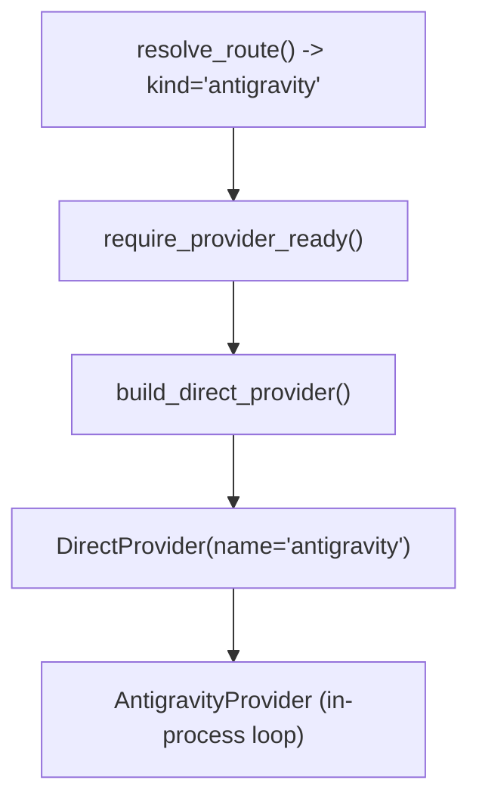

# Direct in-process antigravity provider route and doctor preflight

## Intent

A user with Google Antigravity CLI (`agy`) installed can run `repoach review pr N --provider antigravity` (or set `REPOACH_PROVIDER=antigravity` / `[provider] kind = "antigravity"` in `repoach.toml`) with no gateway process. This spec wires `antigravity` into `src/repoach/providers/select.py`, `src/repoach/providers/direct.py`, and `src/repoach/cli/doctor_cmds.py`, reusing `AntigravityProvider` (`SP-PROVIDER-ANTIGRAVITY-CLI`) in-process on the shared direct event loop, with built-in tier defaults and environment scrubbing so unrelated API keys never leak into the child process.

## Context

Measured 2026-11-09 on `develop` `8fabb19`:

| # | Fact | Where |
|---|---|---|
| F1 | `src/repoach/providers/select.py:71-78` defines `RouteKind = Literal["gateway", "claude_code", "anthropic", "openai_compatible", "gemini"]`, `DIRECT_KINDS`, `KINDS`, and `DEFAULT_MODELS` (only `claude_code` and `anthropic` have built-in tier defaults today) | `src/repoach/providers/select.py` |
| F2 | `claude_cli_env` (`select.py:273-288`) strips `*_API_KEY`, `*_AUTH_TOKEN`, `*_TOKEN` except `CLAUDE_CODE_OAUTH_TOKEN`. For `agy`, documented auth modes (`https://antigravity.google/docs/install.md`) are keyring sign-in, ADC (`AGY_ADC_AUTH=true`), or `GEMINI_API_KEY` when `modelProvider == "gemini"` in `~/.gemini/antigravity-cli/settings.json` | `src/repoach/providers/select.py`, `install.md` |
| F3 | `agy` has no `auth status` subcommand; `agy --version` verifies the binary runs, and `agy models` verifies that authentication / model catalog access works (or fails fast with `authentication required` in headless mode when unauthenticated) | Measured 2026-11-09: `agy --version` -> `1.5.3` |
| F4 | `DOCTOR_BINARIES` in `src/repoach/cli/doctor_cmds.py:82` is `("git", "gh", "glab", "claude")` | `src/repoach/cli/doctor_cmds.py` |
| F5 | `DirectProvider._cli_error` (`src/repoach/providers/direct.py:75-81,304-311`) matches `CLI_AUTH_MARKERS` (`"/login"`, `"invalid api key"`, `"not logged in"`, `"oauth token"`, `"authentication"`) to raise `ProviderAuthError` (`retryable = False`) | `src/repoach/providers/direct.py` |

## Goals

- G1: Add `"antigravity"` to `RouteKind`, `DIRECT_KINDS`, `KINDS`, and `PROVIDER_FLAG_HELP` in `src/repoach/providers/select.py`, with built-in tier defaults:
  - `CapabilityTier.OPUS`: `"gemini-4-argon-high"`
  - `CapabilityTier.SONNET`: `"gemini-4-argon-medium"`
  - `CapabilityTier.HAIKU`: `"gemini-3.8-flash-medium"`
  overridable via `[provider].opus/sonnet/haiku` or `REPOACH_MODEL_{OPUS,SONNET,HAIKU}`.
- G2: Resolve the `agy` executable via `antigravity_cli(route)` from `[provider].cli_path` / `REPOACH_ANTIGRAVITY_CLI_PATH` / `"agy"` on `PATH`; raise `ProviderConfigError` with installation hint when missing.
- G3: Provide `antigravity_cli_env(environ)` that strips unrelated `*_API_KEY`, `*_AUTH_TOKEN`, `*_TOKEN` secrets while keeping `GEMINI_API_KEY` (needed when `agy` is configured with `modelProvider: "gemini"`).
- G4: Build `DirectProvider(name="antigravity", ...)` in `build_direct_provider` wrapping `AntigravityProvider(..., own_process_group=True, child_env=antigravity_cli_env)` with `auth_hint="run 'agy' interactively to sign in (or set modelProvider='gemini' and GEMINI_API_KEY)"`.
- G5: Add `"agy"` to `DOCTOR_BINARIES` in `src/repoach/cli/doctor_cmds.py` and report `provider_option=antigravity (agy CLI at <path>|not on PATH; login or GEMINI_API_KEY)` and `provider_route=direct (antigravity)`.

## Non-Goals

- NG1: Never auto-select `antigravity` when no provider is configured; `NoProviderConfiguredError` remains mandatory when neither `--provider`, `REPOACH_PROVIDER`, `[provider].kind`, nor `REPOACH_LLM_PROXY_BASE_URL` is set (`SP-UNIVERSAL-PROVIDERS` G6).
- NG2: No network call inside `repoach doctor` (`doctor` checks binary presence on `PATH` and `agy --version`, never calling `agy models` or a model).

## Assumptions

- A1: `SP-PROVIDER-ANTIGRAVITY-CLI` provides `AntigravityProvider` in `src/repoach/llm_proxy/providers/antigravity`.
- A2: When `agy` is unauthenticated in a non-interactive environment, it exits non-zero with `"authentication required"` in `error` / `stderr`, which matches `"authentication"` in `CLI_AUTH_MARKERS` and maps to `ProviderAuthError` (`retryable = False`).

## Interface

Inputs:
- `--provider antigravity`, `REPOACH_PROVIDER=antigravity`, or `[provider] kind = "antigravity"` in `repoach.toml`.
- Optional `[provider].cli_path` / `REPOACH_ANTIGRAVITY_CLI_PATH`.
- Optional `[provider].{opus,sonnet,haiku}` / `REPOACH_MODEL_{OPUS,SONNET,HAIKU}`.

Outputs:
- `build_direct_provider(route, timeout_s=...)` -> `DirectProvider` with `name="antigravity"`.
- `repoach doctor` output lines:
  - `binary_agy=found: <path>` (or `missing: agy`)
  - `provider=antigravity (<source>)`
  - `provider_route=direct (antigravity)`
  - `provider_credential=agy CLI (<version>; <path>)`
  - `provider_option=antigravity (agy CLI at <path>; login or GEMINI_API_KEY)`

Errors:
- `ProviderConfigError`: when `agy` is not on `PATH` or `agy --version` fails to execute (rc 2 before any forge call).
- `ProviderAuthError`: when `agy` fails mid-run with an authentication error (`retryable = False`).

## Behavior

### Nominal
- `REPOACH_PROVIDER=antigravity repoach review pr N --dry-run` checks `require_provider_ready()`, resolves `agy` on `PATH` and its tier models (`gemini-4-argon-high`, `gemini-4-argon-medium`, `gemini-3.8-flash-medium`), runs the review team in-process via `DirectProvider` -> `AntigravityProvider`, and records token counts in `usage_ledger` with `provider="antigravity"` and `cost_usd=None` (subscription / CLI).

### Edge cases
- User overrides `REPOACH_MODEL_SONNET=claude-sonnet-5-5-medium` with `REPOACH_PROVIDER=antigravity` -> `tier_models(route)[CapabilityTier.SONNET]` returns `"claude-sonnet-5-5-medium"`, which `AntigravityProvider` passes to `agy --model claude-sonnet-5-5-medium`.
- Environment contains `OPENAI_API_KEY`, `ANTHROPIC_API_KEY`, and `GEMINI_API_KEY` -> `antigravity_cli_env` strips `OPENAI_API_KEY` and `ANTHROPIC_API_KEY` and keeps `GEMINI_API_KEY`.

### Failure scenarios
- `agy` binary missing -> `require_provider_ready()` and `repoach doctor` fail with `ProviderConfigError: provider antigravity: agy CLI not found ('agy'); install Antigravity CLI and sign in, or set REPOACH_ANTIGRAVITY_CLI_PATH / [provider].cli_path`.

## Architecture Impact
- Adds dependency: `SP-DIRECT-ANTIGRAVITY-ROUTE` -> `SP-PROVIDER-ANTIGRAVITY-CLI` (instantiates `AntigravityProvider` in `select.py`).
- Adds dependency: `SP-DIRECT-ANTIGRAVITY-ROUTE` -> `SP-UNIVERSAL-PROVIDERS` (extends `select.py`, `direct.py`, `errors.py`, and `doctor_cmds.py`).
- Adds dependency: `SP-DIRECT-ANTIGRAVITY-ROUTE` -> `SP-UNIVERSAL-PROJECT-CONFIG` (reads `[provider]` config section and `REPOACH_ANTIGRAVITY_CLI_PATH`).
- Adds dependency: `SP-DIRECT-ANTIGRAVITY-ROUTE` -> `SP-USAGE-LEDGER` (records `antigravity` calls in `usage_ledger`).
- New / changed coupling, cycles, or shared state: none.

## Diagram

## Acceptance Criteria

- [ ] AC1: `pytest -q tests/unit/test_provider_direct_antigravity.py::test_resolve_route_and_default_tier_models_for_antigravity` — `REPOACH_PROVIDER=antigravity` resolves `route.kind == "antigravity"` and `tier_models(route)` returns `gemini-4-argon-high`, `gemini-4-argon-medium`, `gemini-3.8-flash-medium` unless overridden.
- [ ] AC2: `pytest -q tests/unit/test_provider_direct_antigravity.py::test_antigravity_cli_env_strips_foreign_keys_and_keeps_gemini_api_key` — `antigravity_cli_env` drops `ANTHROPIC_API_KEY`, `OPENAI_API_KEY`, `REPOACH_ANTHROPIC_AUTH_TOKEN` and preserves `GEMINI_API_KEY` and `PATH`.
- [ ] AC3: `pytest -q tests/unit/test_provider_direct_antigravity.py::test_direct_antigravity_provider_end_to_end_with_fake_agy` — `DirectProvider.call` against a fake `agy` script returns an `AgentResponse` with `model_used == "antigravity/gemini-4-argon-medium"` and accurate token usage, and maps `"authentication required"` to `ProviderAuthError`.
- [ ] AC4: `pytest -q tests/unit/test_provider_direct_antigravity.py::test_doctor_reports_antigravity_route_and_binary` — `repoach doctor` with `REPOACH_PROVIDER=antigravity` prints `provider_route=direct (antigravity)`, `binary_agy=`, and `provider_option=antigravity (...)`.

## Open Questions

None.
