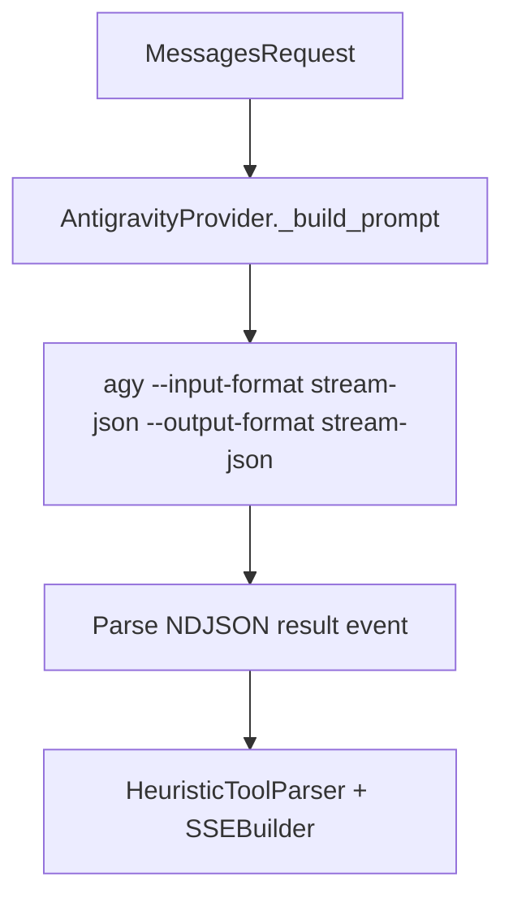

# Antigravity CLI (agy) subprocess transport for the LLM proxy

## Intent

When Claude Code's OAuth subscription is unavailable or rate-limited and
free API providers are exhausted, a machine with Google Antigravity CLI
(`agy`) installed and signed in (or configured with a Gemini API key /
ADC) can still serve Gemini (`gemini-4-argon-*`, `gemini-3.8-flash-*`),
Claude (`claude-opus-5-5-*`, `claude-sonnet-5-5-*`) and `gpt-oss-120b-medium`
completions. This spec defines `AntigravityProvider` in
`src/repoach/llm_proxy/providers/antigravity/`, a stateless subprocess
transport analogous to `ClaudeCodeProvider` (`claude_code`), and
registers `"antigravity"` in the gateway's `PROVIDER_DESCRIPTORS` and
`ProviderRegistry`.

## Context

Measured 2026-11-09 on this machine (`agy --version` = `1.5.3`,
`/home/jofaye/.local/bin/agy`):

| # | Fact | Measured output / behavior |
|---|---|---|
| F1 | `agy models` lists 13 model slugs across three families | `gemini-4-argon-{low,medium,high}`, `gemini-3.8-flash-{low,medium,high}`, `claude-opus-5-5-{low,medium,high}`, `claude-sonnet-5-5-{low,medium,high}`, `gpt-oss-120b-medium` |
| F2 | `agy --print` (`-p`) requires the prompt attached to `-p` (`--print=<prompt>`), whereas `--input-format stream-json --output-format stream-json` reads NDJSON user events (`{"event":"user","message":{"content":"..."}}`) from `stdin` without hitting `ARG_MAX` | Measured: `printf '{"event":"user","message":{"content":"Reply with the single word PONG"}}\n' \| agy --disable-slash-commands --input-format stream-json --output-format stream-json --model gemini-3.8-flash-low` -> rc 0 in 2.7 s |
| F3 | Terminal `result` event in `stream-json` (and the envelope in `--output-format json`) has shape `{"conversation_id": "...", "status": "SUCCESS"\|"ERROR"\|"CANCELED"\|"INTERRUPTED"\|"INVALID", "response": "...", "error": "...", "duration_seconds": ..., "num_turns": 1, "usage": {"input_tokens": ..., "output_tokens": ..., "thinking_tokens": ..., "cache_read_tokens": ..., "total_tokens": ...}}` | Measured live on `agy` 1.5.3 and documented in `https://antigravity.google/docs/cli/headless.md` |
| F4 | Unlike `claude -p`, `agy` has no `--system-prompt-file` flag and no `--tools ""` flag; in headless mode without `--dangerously-skip-permissions`, built-in write/shell tools are soft-denied if invoked, and running from an empty temporary directory (`tempfile.mkdtemp(prefix="repoach_antigravity_")`) prevents loading project `GEMINI.md` / `CLAUDE.md` / `.agents/` rules | Measured: `init.cwd == "/tmp"`, `init.permission_mode == "request-review"` |
| F5 | `ClaudeCodeProvider` (`src/repoach/llm_proxy/providers/claude_code/client.py`) already implements prompt flattening (`_build_prompt`), `<tool_use>` text-contract emulation (`_render_tools_appendix` + `HeuristicToolParser`), process-group cleanup (`_kill_subprocess_on_exit`), and `SSEBuilder` emission | `src/repoach/llm_proxy/providers/claude_code/client.py` |

## Goals

- G1: Implement `AntigravityProvider(BaseProvider)` in `src/repoach/llm_proxy/providers/antigravity/client.py` that spawns `agy --disable-slash-commands --input-format stream-json --output-format stream-json --model <cli_model>` inside an isolated `tempfile.mkdtemp(prefix="repoach_antigravity_")` working directory, sends a single `{"event": "user", "message": {"content": <flattened_prompt>}}` line on `stdin`, and closes `stdin`.
- G2: Map tier/model names to `agy` model slugs in `_cli_model_for(requested)`:
  - Exact `agy` slug (any string not in `{"opus", "sonnet", "haiku", ""}` after stripping `antigravity/`) is passed through verbatim (e.g. `antigravity/gemini-4-argon-high` -> `gemini-4-argon-high`, `antigravity/claude-sonnet-5-5-medium` -> `claude-sonnet-5-5-medium`).
  - Tier aliases map to configurable defaults: `opus` -> `gemini-4-argon-high`, `sonnet` -> `gemini-4-argon-medium`, `haiku` -> `gemini-3.8-flash-medium`.
- G3: Parse the NDJSON `stdout` stream to extract the terminal `{"event": "result", "result": {...}}` object:
  - When `status != "SUCCESS"` or `proc.returncode != 0`, raise `ProviderError` (or `OutputCapExceededError` if the error text reports an output token cap) carrying up to `CLI_ERROR_TEXT_MAX_CHARS = 2000` characters of `result["error"]` or `stderr`.
  - When `status == "SUCCESS"`, parse `result["response"]` through `HeuristicToolParser` to emit Anthropic SSE `text` and `tool_use` blocks, and copy `usage.input_tokens`, `usage.cache_read_tokens` and `usage.output_tokens` onto `SSEBuilder`.
- G4: Register `"antigravity"` in `PROVIDER_DESCRIPTORS` (`catalog.py`, `transport_type="anthropic_messages"`, `static_credential="antigravity-cli"`, `capabilities=("chat", "tools", "native_anthropic", "subscription")`), `_BESPOKE_FACTORIES` (`registry.py`), and `Settings` (`antigravity_cli_path = "agy"`, `antigravity_default_model = "gemini-3.8-flash-medium"`, `antigravity_subprocess_timeout = 600.0`).

## Non-Goals

- NG1: Direct in-process provider selection (`REPOACH_PROVIDER=antigravity` in `src/repoach/providers/select.py` and `repoach doctor`) is covered by `SP-DIRECT-ANTIGRAVITY-ROUTE`.
- NG2: Multi-turn MCP inner-loop execution inside `agy` is out of scope; this spec provides the stateless one-shot + `<tool_use>` emulation transport matching `ClaudeCodeProvider`.

## Assumptions

- A1: `agy` 1.5.3+ is installed on `PATH` (or at `REPOACH_ANTIGRAVITY_CLI_PATH`) and already authenticated via keyring login, ADC (`AGY_ADC_AUTH=true`), or `GEMINI_API_KEY` (`modelProvider: "gemini"`).
- A2: Because `agy` has no `--system-prompt-file` flag, the extracted system prompt (including the `<tool_use>` protocol appendix when `request.tools` is non-empty) is prepended to the flattened user prompt under an explicit `[system]` section.

## Interface

Inputs:
- `request`: `MessagesRequest` (Anthropic wire model: `model`, `system`, `messages`, `tools`, `max_tokens`, `thinking`).
- `Settings`:
  - `REPOACH_ANTIGRAVITY_CLI_PATH` / `ANTIGRAVITY_CLI_PATH` (default `"agy"`).
  - `REPOACH_ANTIGRAVITY_DEFAULT_MODEL` / `ANTIGRAVITY_DEFAULT_MODEL` (default `"gemini-3.8-flash-medium"`).
  - `REPOACH_ANTIGRAVITY_SUBPROCESS_TIMEOUT` / `ANTIGRAVITY_SUBPROCESS_TIMEOUT` (default `600.0`).

Outputs:
- `AsyncIterator[str]` yielding Anthropic SSE events (`message_start`, `content_block_start`, `content_block_delta`, `content_block_stop`, `message_delta`, `message_stop`).

Errors:
- `ProviderError`: when `agy` is missing, times out, exits non-zero, or returns `status != "SUCCESS"`.
- `OutputCapExceededError`: when `agy` reports an output-token cap failure.

## Behavior

### Nominal
1. Flatten `request.system`, `request.tools` appendix, and `request.messages` into a single text prompt.
2. Resolve `cli_model = _cli_model_for(request.model)`.
3. If `request.thinking` is disabled (`{"type": "disabled"}`), pass `--effort low`.
4. Spawn `agy --disable-slash-commands --input-format stream-json --output-format stream-json --model <cli_model> [--effort low]` with `cwd=self._workdir`.
5. Send `json.dumps({"event": "user", "message": {"content": full_prompt}}) + "\n"` to `stdin` and close `stdin`.
6. Parse the `result` event from `stdout`, run `HeuristicToolParser` on `result["response"]`, populate token counts from `result["usage"]`, and yield SSE events.

### Edge cases
- `usage.output_tokens == 0` on a non-empty text response -> fall back to `max(1, (text_chars + 3) // 4)` so `peek_for_content` never mistakes a valid completion for an empty stream.
- `usage.input_tokens` includes `cache_read_tokens` -> set `sse.cache_read_tokens = usage["cache_read_tokens"]` and `sse.input_tokens = max(0, usage["input_tokens"] - usage["cache_read_tokens"])`.

### Failure scenarios
- Subprocess exceeds `subprocess_timeout` -> `_kill_subprocess_on_exit` sends `SIGTERM` then `SIGKILL` to the process (or process group when `own_process_group=True`), emits an SSE error event, and raises `ProviderError`.
- Unknown model slug -> `agy` exits `1` with `status: "ERROR"` and `"error": "invalid model selection..."` -> `agy_exit_error` preserves the `error` field up to 2 000 chars and raises `ProviderError`.

## Architecture Impact
- Adds dependency: `SP-PROVIDER-ANTIGRAVITY-CLI` -> `SP-CHAINS-THINKING-CLASS` (registers `antigravity` in `catalog.py`).
- Adds dependency: `SP-PROVIDER-ANTIGRAVITY-CLI` -> `SP-PROXY-FIRST-BYTE-DEADLINE` (adds `antigravity_*` settings in `llm_proxy/config/settings.py`).
- Adds dependency: `SP-PROVIDER-ANTIGRAVITY-CLI` -> `SP-PROVIDER-INIT-DEDUP` (inherits `BaseProvider` / `ProviderConfig`).
- Adds dependency: `SP-PROVIDER-ANTIGRAVITY-CLI` -> `SP-REVIEW-SURVIVES-TRANSPORT-FAILURES` (uses `OutputCapExceededError` and 2 000-char CLI error truncation).
- New / changed coupling, cycles, or shared state: Scoped `GlobalRateLimiter` instance `"antigravity"`.

## Diagram

## Acceptance Criteria

- [ ] AC1: `pytest -q tests/unit/test_antigravity_cli_provider.py::test_antigravity_descriptor_and_registry_build` — `"antigravity"` is in `SUPPORTED_PROVIDER_IDS` and `create_provider("antigravity", settings)` returns an `AntigravityProvider`.
- [ ] AC2: `pytest -q tests/unit/test_antigravity_cli_provider.py::test_antigravity_stream_response_parses_stream_json_result_and_usage` — given a fake `agy` script emitting `init`, `step_update`, and `result` NDJSON lines, `stream_response` yields valid Anthropic SSE events with text and accurate `input_tokens` / `cache_read_tokens` / `output_tokens`.
- [ ] AC3: `pytest -q tests/unit/test_antigravity_cli_provider.py::test_antigravity_emulates_tool_use_blocks` — `<tool_use>{"name": "read_file", "args": {"path": "a.py"}}</tool_use>` in `result.response` is emitted as an Anthropic `tool_use` SSE content block with `stop_reason == "tool_use"`.
- [ ] AC4: `pytest -q tests/unit/test_antigravity_cli_provider.py::test_antigravity_error_status_and_nonzero_exit_surface_error_text` — a non-zero exit or `status: "ERROR"` raises `ProviderError` containing `result["error"]` (up to 2 000 chars).
- [ ] AC5: `pytest -q tests/unit/test_antigravity_cli_provider.py::test_antigravity_model_mapping_aliases_and_explicit_slugs` — `opus`, `sonnet`, `haiku` map to `gemini-4-argon-high`, `gemini-4-argon-medium`, `gemini-3.8-flash-medium`, while explicit slugs (`gemini-3.8-flash-low`, `claude-sonnet-5-5-high`) pass through unchanged.

## Open Questions

None.
