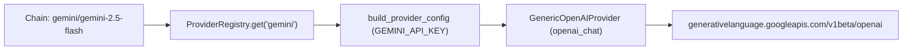

# Gemini API as a first-class provider in the chain-failover gateway

## Intent

`SP-UNIVERSAL-PROVIDERS` (slice 2) added `gemini` as a direct in-process
provider (`REPOACH_PROVIDER=gemini`), posting to Google's
OpenAI-compatible endpoint (`https://generativelanguage.googleapis.com/v1beta/openai`)
with `REPOACH_GEMINI_API_KEY` / `GEMINI_API_KEY` / `GOOGLE_API_KEY`.
Inside the chain-failover gateway (`src/repoach/llm_proxy/`), however,
`PROVIDER_DESCRIPTORS` (`catalog.py`) has no `gemini` entry, so a tier
chain (`MODEL_OPUS`, `MODEL_SONNET`, `MODEL_HAIKU` in `chains.env` or a
CI job proxy) cannot include `gemini/<model>` hops without hijacking the
single `openai_compatible` slot. This spec adds the `gemini` descriptor
and settings to the gateway so `gemini/<model>` is a first-class chain
candidate alongside `cerebras`, `groq`, `deepseek`, `kimi`, `openai` and
`anthropic`.

## Context

Measured 2026-11-09 on `develop` `8fabb19`:

| # | Fact | Where |
|---|---|---|
| F1 | `src/repoach/providers/select.py:89-97` already defines `GEMINI_CREDENTIAL_NAMES = ("REPOACH_GEMINI_API_KEY", "GEMINI_API_KEY", "GOOGLE_API_KEY")` and `GEMINI_DEFAULT_BASE = "https://generativelanguage.googleapis.com/v1beta/openai"` for the direct route | `src/repoach/providers/select.py` |
| F2 | `src/repoach/llm_proxy/providers/catalog.py:89-178` defines `PROVIDER_DESCRIPTORS` for `nvidia_nim`, `open_router`, `claude_code`, `kimi`, `groq`, `cerebras`, `deepseek`, `openai`, `anthropic` and `openai_compatible`; `gemini` is absent | `src/repoach/llm_proxy/providers/catalog.py` |
| F3 | `src/repoach/llm_proxy/providers/defaults.py` holds the default base URLs for every gateway provider; `GEMINI_DEFAULT_BASE` is defined in `src/repoach/providers/select.py` instead of `defaults.py` | `src/repoach/llm_proxy/providers/defaults.py`, `src/repoach/providers/select.py` |
| F4 | `src/repoach/llm_proxy/config/settings.py:256-273` has `openai_api_key`, `anthropic_api_key`, `kimi_api_key`, `groq_api_key`, `cerebras_api_key`, `deepseek_api_key`, `openai_compatible_api_key`, and no `gemini_api_key` | `src/repoach/llm_proxy/config/settings.py` |
| F5 | Every provider with `transport_type="openai_chat"` and no bespoke factory is built automatically by `_build_generic_openai` (`GenericOpenAIProvider`) in `src/repoach/llm_proxy/providers/registry.py:55-58,85-98` | `src/repoach/llm_proxy/providers/registry.py` |

## Goals

- G1: Define `GEMINI_DEFAULT_BASE = "https://generativelanguage.googleapis.com/v1beta/openai"` in `src/repoach/llm_proxy/providers/defaults.py` and import it from both `catalog.py` and `src/repoach/providers/select.py` (single source of truth).
- G2: Add `gemini_api_key: str` to `src/repoach/llm_proxy/config/settings.py` with `AliasChoices("REPOACH_GEMINI_API_KEY", "GEMINI_API_KEY", "GOOGLE_API_KEY")` (and register `"GEMINI_API_KEY": "REPOACH_GEMINI_API_KEY"` in `_LEGACY_TO_REPOACH_ALIAS`), plus optional `gemini_base_url: str` (`REPOACH_GEMINI_BASE_URL` / `GEMINI_BASE_URL`).
- G3: Add the `"gemini"` `ProviderDescriptor` to `PROVIDER_DESCRIPTORS` in `src/repoach/llm_proxy/providers/catalog.py` with `transport_type="openai_chat"`, `credential_env="GEMINI_API_KEY"`, `credential_url="https://aistudio.google.com/app/api-keys"`, `credential_attr="gemini_api_key"`, `default_base_url=GEMINI_DEFAULT_BASE`, `base_url_attr="gemini_base_url"`, `capabilities=("chat", "streaming", "tools")`.
- G4: Classify Gemini 2.5 / 3.x / 4.x model families in `THINKING_CLASSIFICATION` (`catalog.py`) as `"hybrid"` so the gateway's thinking policy treats them consistently.

## Non-Goals

- NG1: No Google-proprietary `generateContent` REST transport; the gateway uses Google's official OpenAI-compatible `/v1beta/openai/chat/completions` surface via `GenericOpenAIProvider`.
- NG2: No subprocess or CLI invocation (covered by `SP-PROVIDER-ANTIGRAVITY-CLI`).
- NG3: No change to `chains.env` defaults until live cell probes measure the Gemini models under ChainPilot.

## Assumptions

- A1: Google's `/v1beta/openai/chat/completions` endpoint accepts standard Bearer `Authorization: Bearer <GEMINI_API_KEY>` headers, streaming SSE (`data: {...}`), and OpenAI tool definitions, as already relied on by the direct `gemini` route in `SP-UNIVERSAL-PROVIDERS`.

## Interface

Inputs:
- `REPOACH_GEMINI_API_KEY` / `GEMINI_API_KEY` / `GOOGLE_API_KEY`: `str` — API key from Google AI Studio, first non-empty wins.
- `REPOACH_GEMINI_BASE_URL` / `GEMINI_BASE_URL`: `str` — optional base URL override (defaults to `https://generativelanguage.googleapis.com/v1beta/openai`).
- Chain model reference: `gemini/<model-slug>` (e.g. `gemini/gemini-2.5-pro`, `gemini/gemini-2.5-flash`).

Outputs:
- `create_provider("gemini", settings)` returns a `GenericOpenAIProvider` configured with `base_url=GEMINI_DEFAULT_BASE` and `api_key=<resolved_key>`.

Errors:
- `AuthenticationError`: raised by `build_provider_config` when a chain dispatches to `gemini/*` and none of `REPOACH_GEMINI_API_KEY`, `GEMINI_API_KEY`, `GOOGLE_API_KEY` is set (`"GEMINI_API_KEY is not set. Add it to your .env file. Get a key at https://aistudio.google.com/app/api-keys"`).

## Behavior

### Nominal
- A chain containing `gemini/gemini-2.5-flash` resolves `"gemini"` in `PROVIDER_DESCRIPTORS`, validates the key via `build_provider_config`, instantiates `GenericOpenAIProvider(config, provider_name="gemini")`, and streams `/chat/completions` from `https://generativelanguage.googleapis.com/v1beta/openai/chat/completions`.

### Edge cases
- Both `REPOACH_GEMINI_API_KEY` and `GEMINI_API_KEY` set -> `REPOACH_GEMINI_API_KEY` wins; `GOOGLE_API_KEY` is used as third fallback when the first two are unset.
- `REPOACH_GEMINI_BASE_URL` set -> overrides `GEMINI_DEFAULT_BASE`.

### Failure scenarios
- Missing key -> `AuthenticationError` at provider creation, caught by the router to skip/failover to the next chain candidate.
- HTTP 401/403/429/5xx from upstream -> mapped by `GenericOpenAIProvider` error handling (`AuthenticationError`, `RateLimitError`, `ProviderError`) like every other `openai_chat` provider.

## Architecture Impact
- Adds dependency: `SP-PROXY-GEMINI-PROVIDER` -> `SP-CHAINS-THINKING-CLASS` (adds `gemini` descriptor and thinking classification in `catalog.py`).
- Adds dependency: `SP-PROXY-GEMINI-PROVIDER` -> `SP-PROXY-FIRST-BYTE-DEADLINE` (adds `gemini_api_key` and `gemini_base_url` fields in `llm_proxy/config/settings.py`).
- Adds dependency: `SP-PROXY-GEMINI-PROVIDER` -> `SP-PROVIDER-INIT-DEDUP` (uses `ProviderConfig` / `BaseProvider`).
- Adds dependency: `SP-PROXY-GEMINI-PROVIDER` -> `SP-PROVIDER-TRANSPORT-SPI` (wires `create_provider("gemini", settings)`).
- Adds dependency: `SP-PROXY-GEMINI-PROVIDER` -> `SP-CHAINPILOT-REASONING-WIRE-GENERIC` (instantiates `GenericOpenAIProvider`).
- Adds dependency: `SP-PROXY-GEMINI-PROVIDER` -> `SP-UNIVERSAL-PROVIDERS` (shares `GEMINI_DEFAULT_BASE` with `src/repoach/providers/select.py`).
- New / changed coupling, cycles, or shared state: none.

## Diagram

## Acceptance Criteria

- [x] AC1: `pytest -q tests/unit/test_proxy_gemini_provider.py::test_gemini_descriptor_registered_and_buildable` — `"gemini"` is in `SUPPORTED_PROVIDER_IDS`, `create_provider("gemini", settings)` returns a `GenericOpenAIProvider` with `base_url == "https://generativelanguage.googleapis.com/v1beta/openai"`.
- [x] AC2: `pytest -q tests/unit/test_proxy_gemini_provider.py::test_gemini_api_key_precedence_repoach_then_gemini_then_google` — `Settings` resolves `REPOACH_GEMINI_API_KEY` > `GEMINI_API_KEY` > `GOOGLE_API_KEY`.
- [x] AC3: `pytest -q tests/unit/test_proxy_gemini_provider.py::test_gemini_missing_key_raises_authentication_error_with_aistudio_url` — `create_provider("gemini", Settings(gemini_api_key=""))` raises `AuthenticationError` naming `GEMINI_API_KEY` and `https://aistudio.google.com/app/api-keys`.
- [x] AC4: `pytest -q tests/unit/test_proxy_gemini_provider.py::test_gemini_chain_parses_and_classifies_thinking` — `Chain.parse("gemini/gemini-2.5-pro,gemini/gemini-3.8-flash")` succeeds and `classify_thinking` returns `"hybrid"`.

## Open Questions

None.
