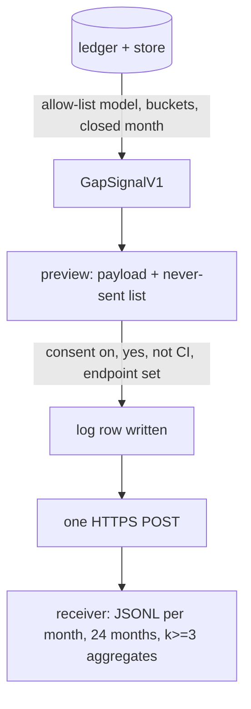

# An anonymised gap signal for repoach's own development

## Intent

Repoach improves by measuring the gap between what it proposed and what
the project needed: a finding refuted or confirmed, settled by a person
or re-opened, a lens that is right or wrong by claim type. That signal
lives in each project's ledger and local store and must stay there
(owner principle, 2026-11-12). This component lets a project send, when
it chooses, a payload of counts and categories that carries no code, no
path, no identifier, no secret and no project name, after seeing
exactly what would leave, with a local log of every send; and it
specifies where the payload goes and how long it is kept.

## Context

Measured 2026-11-12, `origin/develop` `8fabb19`.

| # | Fact | Where |
|---|---|---|
| F1 | The ledger holds, per finding, free text that identifies the project: `file`, `claim`, `evidence_pointer`, `verification_result`, `head_sha`, `checked_at_sha`, and the forge ids in `finding_posts`; the owner command rows hold `author` (a forge login) and `reason` (free text) | `src/repoach/review/findings.py:191-230`; `src/repoach/review/owner_store.py:79-94` |
| F2 | The statuses a finding can end in: `verified`, `refuted`, `open`, `resolved`, `stuck`, `not_applicable`, `resolved_at_head`, `owner_resolved`, or `proposed` when never judged; the claim types are eight; the lenses four | `src/repoach/review/findings.py:51-62`, `:97-137`; `src/repoach/review/reviewer.py` |
| F3 | `usage_ledger` holds per call provider, model id as sent, tokens and duration; `review pr` prints `incomplete_cause` (`transport`, `other`, null) and, after SP-MEMORY-FAIL-FAST, `memory.state` | `src/repoach/providers/usage.py:100-120`; `src/repoach/cli/review_cmds.py:483` |
| F4 | SP-UNIVERSAL-LEDGER (draft) G7 and its Privacy table specified `stats --share` with a rotatable `install_id`, `<5` buckets and a regex test; nothing of it is implemented, and its Q4 left the endpoint open: "until one exists `[telemetry].endpoint` stays empty and `--share` is a preview only" | `docs/specs/2026-10-19_SP-UNIVERSAL-LEDGER_*.md` G7, Privacy, Q4 |
| F5 | Owner principle (verbatim intent, French): repoach must not be intrusive; the project's memory is local and used locally; what repoach needs for its own development is the gap between what it proposes and what the projects need, anonymised somewhere | brief of this spec family |
| F6 | A hash of a low-entropy value is a dictionary lookup: there are fewer than 10⁹ public repository slugs, so a salted hash of a slug identifies the project to anyone holding the salt, and an unsalted one to everyone | arithmetic |
| F7 | `project_slug` and `origin_url` are the two values a payload builder is most likely to carry by accident (they are in every path and log line) | `src/repoach/core/paths.py:225-300` |
| F8 | SP-PRECISION-MEASUREMENT (delivered) publishes a weekly digest of repoach's own precision on a labelled corpus; it has no column from use in the field | `docs/specs/2026-10-20_SP-PRECISION-MEASUREMENT_*.md` |

## Decisions (2026-11-12)

- D1. The payload is a Pydantic model with `extra="forbid"` whose every
  string field is a `Literal` or `StrEnum` from a closed vocabulary and
  whose every count is a bucket label from a closed set. There is no
  `str` field. A free-text value cannot be serialised by construction;
  the regex test of F4 is kept as a second net, not as the guarantee.
- D2. No identifier at all: no install id, no hash of anything (F6), no
  salt. Dedup is local: the send log refuses a second send for the same
  period unless `--again`, and the receiver treats each payload as one
  sender for k-anonymity. Owner decision Q3 records the pseudonymous
  alternative.
- D3. Counts: `bucket(n)` → `"0"`, `"<5"` for 1–4, then the label of the
  band: `5-9`, `10-19`, `20-49`, `50-99`, `100-199`, `200-499`,
  `500-999`, `1000+`. Percentiles of tokens use their own bands
  (`<50k`, `50k-150k`, `150k-400k`, `400k+`). A cell is sent only when
  its denominator bucket is at least `5-9`; below that the cell is
  absent, not `"<5"`, so a lone finding never shows its category.
- D4. The period is the calendar month of the reviews counted; a
  payload covers one closed month (never the current one), so a send
  cannot be matched to a merge request by its time.
- D5. Consent: `[telemetry].gap_signal = false` by default;
  `repoach gap preview [--period YYYY-MM]` always works and prints the
  payload, the rule list and the vocabulary; `repoach gap send` needs
  `gap_signal = true` and either an interactive `yes` to the printed
  payload or `--yes`; it is refused in a CI job (`CI=true`,
  `GITLAB_CI`, `GITHUB_ACTIONS`) and when `[telemetry].endpoint` is
  empty. Every send appends to
  `user_data_dir()/<slug>/gap_sends.jsonl` the time, the period, the
  endpoint, the HTTP status and the payload verbatim; `repoach gap log`
  prints it. Nothing is ever sent from a review run.
- D6. Transport: one HTTPS `POST` of the JSON to `[telemetry].endpoint`
  with `Content-Type: application/json` and `User-Agent: repoach-gap/1`,
  no other header, no cookie, no redirect followed, 10 s timeout, no
  retry. The published default endpoint, once the receiver exists
  (Q1), is `https://gap.repoach.dev/v1/gap`; until then the key's
  default is empty and `send` says `not sent: no endpoint configured`.
- D7. Receiver (owner side, a separate deliverable this spec names,
  not ships): an append-only JSONL per period under
  `/var/lib/repoach-gap/<period>.jsonl` behind the owner's reverse
  proxy with a log format that omits the client address for that
  location; a schema check that rejects any payload outside
  `format:gap-signal-v1`; raw payloads kept `receiver_raw_retention_months`
  (24) then deleted; aggregates per `(period, forge, provider,
  language, claim_type, lens)` published only when at least
  `k_anonymity_senders` (3) payloads contributed; the weekly digest of
  F8 gains a `field` table from them.
- D8. Never sent, stated as a list the preview prints and the test
  plants: a path or file name, a claim or lesson text, an evidence
  pointer, a refuter's result text, an owner's reason, a login, an
  email, a URL or hostname, a repository slug, a branch name, a commit
  sha, a PR or MR number, a thread or comment id, a model id as
  configured, a token or key, a timestamp finer than the month, the
  install path, the content of `repoach.toml`, environment variables.

## Goals

- G1: `GapSignalV1` (schema `repoach-gap/1`) with these fields and only these: `schema`, `repoach` (major.minor), `period`, `forge`, `provider`, `languages` (≤ 5 from the census vocabulary, sorted), `repo_size`, `reviews`, `merge_requests`, `findings_by_claim_type` (claim type → outcome → bucket), `findings_by_lens` (lens → outcome → bucket), `owner_commands` (command → outcome → bucket), `threads_closed`, `incomplete_cause` (cause → bucket), `memory_state` (state → bucket of runs), `lessons_recalled_p50`, `lessons_written`, `tokens_per_review` (`p50`, `p90` bands), `diff_size` (band → bucket).
- G2: `build_gap_signal(ledger, store, *, period, config) -> GapSignalV1 | None` reads `pr_findings`, `owner_commands`, `usage_ledger`, `pr_review_runs` and the store's `lens_record`; `None` with a named reason when the month has fewer than `5` reviews.
- G3: `repoach gap preview`, `send`, `log` as D5; `send` exits 0 on `2xx`, 2 on refusal (reason named), 3 on a transport error; the log line is written before the request and completed after it.
- G4: `tests/unit/test_gap_signal_payload.py` seeds a ledger and a store with planted markers in every free-text column (F1) and in the repository's remote and slug, builds the payload for a month with 12 reviews, serialises it, and asserts: every string leaf is in `VOCABULARY`; no leaf matches `/`, `\.(py|ts|js|md)`, `[0-9a-f]{7,}`, `[#!][0-9]`, `@`, `https?:`, `ghp_`, `glpat-`, `AKIA`; none of the planted markers appears as a substring; every count leaf is a bucket label; cells with a denominator under 5 are absent.
- G5: `tests/unit/test_gap_signal_consent.py`: `send` refused without `gap_signal = true`, without an endpoint, in CI, for the current month, and for an already-sent period without `--again`; `preview` never writes the log; `send --yes` writes the log before the request.
- G6: `tests/unit/test_gap_signal_transport.py`: exactly one request, method, headers (two, no more), body equal to the previewed payload, no redirect followed, 10 s timeout, no retry on a 5xx.
- G7: `docs/privacy.md` (new, linked from README) states D1–D8 in prose with the vocabulary table, and `repoach init` writes the `[telemetry]` keys commented with Q2's wording.

## Non-Goals

- NG1: no receiver code in this repository; D7 names what the owner stands up (a separate deliverable under `deploy/`).
- NG2: no per-MR or per-finding record ever leaves; no "fix kept versus reverted" cell until SP-UNIVERSAL-LEDGER's fate collector exists (then it joins the vocabulary with a schema bump).
- NG3: no automatic send on a schedule, from a review, from CI or on `repoach init`; a person types `send`.
- NG4: no identifier, no cookie, no account (D2).
- NG5: no pricing or cost field; tokens are bands, cost is the provider's business.

## Assumptions

- A1: the census vocabulary of languages is the closed list of SP-UNIVERSAL-PROJECT-CONFIG's `[project].languages` detector; an unknown value maps to `other`.
- A2: `provider` is the `[provider].kind` enum value, never the model string; `forge` is `[repoach].forge`, `other` when neither.
- A3: `repo_size` is counted from `git ls-files | wc -l` at build time: `<1k`, `1k-10k`, `10k+`.

## Interface

```python
# src/repoach/gap/schema.py
class Bucket(StrEnum): ZERO="0"; LT5="<5"; B5="5-9"; B10="10-19"; B20="20-49"; B50="50-99"; B100="100-199"; B200="200-499"; B500="500-999"; B1000="1000+"
class TokenBand(StrEnum): LT50K="<50k"; K50="50k-150k"; K150="150k-400k"; K400="400k+"
class DiffBand(StrEnum): LE10="<=10 files"; F11="11-40 files"; GT40=">40 files"
class Outcome(StrEnum): VERIFIED="verified"; REFUTED="refuted"; OWNER_RESOLVED="owner_resolved"; RESOLVED_AT_HEAD="resolved_at_head"; NOT_APPLICABLE="not_applicable"; STUCK="stuck"; UNJUDGED="unjudged"
class Lens(StrEnum): ARCHITECT="architect"; SENTINEL="sentinel"; TESTER="tester"; SCRIBE="scribe"
class ForgeKind(StrEnum): GITHUB="github"; GITLAB="gitlab"; OTHER="other"
class ProviderKind(StrEnum): ANTHROPIC="anthropic"; CLAUDE_CODE="claude_code"; OPENAI="openai"; OPENAI_COMPATIBLE="openai_compatible"; GATEWAY="gateway"; OTHER="other"
class Language(StrEnum): ...   # the census list + OTHER
class RepoSize(StrEnum): LT1K="<1k"; K1="1k-10k"; K10="10k+"
class MemoryStateLabel(StrEnum): ON="on"; OFF="off"; UNREACHABLE="unreachable"
class IncompleteCause(StrEnum): NONE="none"; TRANSPORT="transport"; OTHER="other"
class OwnerCommandKind(StrEnum): RESOLVE="resolve"; REOPEN="reopen"
class OwnerOutcomeLabel(StrEnum): APPLIED="applied"; NO_REASON="no_reason"; UNKNOWN_FINDING="unknown_finding"; AMBIGUOUS="ambiguous"; NOT_OWNER="not_owner"; NOOP="noop"

class GapSignalV1(BaseModel, extra="forbid"):
    schema: Literal["repoach-gap/1"]
    repoach: str = Field(pattern=r"^\d+\.\d+$")
    period: str = Field(pattern=r"^\d{4}-(0[1-9]|1[0-2])$")
    forge: ForgeKind; provider: ProviderKind
    languages: list[Language] = Field(max_length=5)
    repo_size: RepoSize
    reviews: Bucket; merge_requests: Bucket
    findings_by_claim_type: dict[ClaimType, dict[Outcome, Bucket]]
    findings_by_lens: dict[Lens, dict[Outcome, Bucket]]
    owner_commands: dict[OwnerCommandKind, dict[OwnerOutcomeLabel, Bucket]]
    threads_closed: Bucket
    incomplete_cause: dict[IncompleteCause, Bucket]
    memory_state: dict[MemoryStateLabel, Bucket]
    lessons_recalled_p50: Bucket; lessons_written: Bucket
    tokens_per_review: dict[Literal["p50", "p90"], TokenBand]
    diff_size: dict[DiffBand, Bucket]

VOCABULARY: frozenset[str]   # every enum value and literal above
def bucket(n: int) -> Bucket: ...

# src/repoach/gap/build.py
def build_gap_signal(ledger: Path, store: Path | None, *, period: str, config: ProjectConfig, root: Path) -> GapSignalV1 | None: ...
def refusal_reason(...) -> str | None: ...

# src/repoach/gap/send.py
class SendLogRow(BaseModel): sent_at: datetime; period: str; endpoint: str; status: int | None; error: str | None; payload: GapSignalV1
def send_gap_signal(payload, *, endpoint: str, log_path: Path, transport=httpx.Client) -> SendLogRow: ...
def already_sent(log_path: Path, period: str) -> bool: ...
```

`repoach.toml`:

```toml
[telemetry]
# Anonymised gap signal for repoach's own development: counts and
# categories only, no code, path, name or identifier. Off by default.
# `repoach gap preview` shows exactly what one send would carry.
# gap_signal = false
# endpoint = ""
```

CLI: `repoach gap preview [--period YYYY-MM] [--json]`, `repoach gap send [--period YYYY-MM] [--yes] [--again]`, `repoach gap log [--json]`.

Errors: `GapRefusedError` (rc 2, reason: `consent off`, `no endpoint`, `CI job`, `current month`, `already sent <period>`, `fewer than 5 reviews in <period>`, `payload failed the vocabulary check: <key>`), `GapTransportError` (rc 3).

## Behavior

### Nominal
In December the maintainer runs `repoach gap preview --period 2026-11`,
reads the payload and the list of what is never sent, sets
`gap_signal = true`, runs `repoach gap send --period 2026-11`, answers
`yes`; one request goes out, the log gains one row with the payload
verbatim and the status 202. A second `send` for the same period says
`already sent 2026-11 on <date>`, rc 2.

### Edge cases
- a month with 12 reviews but 3 `security` findings → the `security` row is absent from `findings_by_claim_type` (D3).
- `languages` of a polyglot repository → the five most frequent of the census, sorted; the rest dropped, never `other` padded.
- `provider = gateway` → `gateway`, whatever the gateway's upstream.
- a ledger with no `usage_ledger` rows → `tokens_per_review` absent (the model allows the key's absence, never a null).
- the store is off → `lessons_recalled_p50` and `lessons_written` are `"0"`.

### Failure scenarios
- the endpoint answers 5xx → `not sent: 503`, rc 3, the log row carries `status: 503`, nothing retried, the period stays sendable.
- the vocabulary check fails at build time (a future field added wrongly) → rc 2 naming the key; nothing sent.
- the log file is unwritable → `send` refuses before any request: a send that cannot be logged does not happen.

## Tests

| Test | What it pins | Mutation that must turn it red |
|---|---|---|
| `tests/unit/test_gap_signal_payload.py::test_planted_markers_never_reach_the_payload` | `tests/fixtures/gap/planted_ledger.sql` plants an `AKIA`-prefixed key of 20 characters, a `ghp_`-prefixed token of 40 characters, a `glpat-`-prefixed token of 26 characters (each built by the test at run time, never written in the repository), `hunter2`, `src/secret/vault_keys.py`, `https://gitlab.example.com/acme/widget`, `alice@example.com`, a 40-hex sha, `!283`, `#288`, `feat/leaky-branch`, `claude-opus-5-20261101`, the slug `github.com/acme/widget`, the reason `because the vault path is fine` in every free-text column, the remote and the store; none appears as a substring of the serialised payload | add `"repo": project_slug(root)` to the model |
| `::test_every_string_leaf_is_in_the_vocabulary` | walk the JSON: each `str` ∈ `VOCABULARY` | emit a raw count as a string |
| `::test_every_count_is_a_bucket_and_small_cells_are_absent` | 3 security findings → no `security` key; 7 → `5-9` | render `"<5"` for the 3 |
| `::test_regex_net` | the G4 regexes find nothing | — |
| `::test_period_is_a_closed_month_and_nothing_finer` | no leaf matches `\d{4}-\d{2}-\d{2}` or `T\d{2}:` | add `generated_at` |
| `::test_model_forbids_extra_fields` | `GapSignalV1(**payload, note="x")` raises | drop `extra="forbid"` |
| `::test_no_identifier_and_no_hash` | the payload has no key named `*id*`, `*hash*`, `*digest*`; two repositories with the same counts produce byte-identical payloads | add an install id |
| `tests/unit/test_gap_signal_consent.py::test_send_refused_without_consent_endpoint_or_outside_ci` | the five refusals of G5 with their rc 2 reasons | send with consent off |
| `::test_preview_writes_nothing` | no log file after `preview` | — |
| `::test_log_written_before_request_and_completed_after` | a transport that raises: the row exists with `error`; a transport that answers 202: `status: 202` | log after the request only |
| `::test_already_sent_period_needs_again` | second send rc 2; `--again` sends | — |
| `tests/unit/test_gap_signal_transport.py::test_one_post_two_headers_no_redirect_no_retry` | fake transport records one request, `User-Agent` and `Content-Type` only, a 302 is not followed, a 503 is not retried | follow redirects |
| `::test_body_equals_preview` | `send` body == `preview --json` output for the same period | — |

## Success conditions

- C1: `repoach gap preview --period <closed month> --json | python -c "<walk: every str in VOCABULARY>"` prints `ok` on the repoach repository's own ledger and on Yoob's.
- C2: the planted-marker test fails when any one of the D8 categories is added to the model (verified once per category by mutation during review, recorded in the PR description).
- C3: a send never happens without a log row that precedes it; the transport test and the consent test together prove it.
- C4: no review, CI or init path imports `repoach.gap.send`; `grep -rn "gap.send\|send_gap_signal" src/repoach --include=*.py` lists `cli/gap_cmds.py` and the module itself only.
- C5: the receiver, when it exists, stores no client address and publishes no cell under 3 senders (owner's check of the proxy configuration and the aggregation query, recorded in `deploy/`).

## Architecture Impact
- Adds dependency: SP-ANONYMISED-GAP-SIGNAL -> SP-REVIEW-MEMORY-STORE (reads `lens_record` and the recall counts; never the lesson texts)
- Adds dependency: SP-ANONYMISED-GAP-SIGNAL -> SP-UNIVERSAL-PROJECT-CONFIG (`[telemetry]`, `[project].languages`, `[provider].kind`, `[repoach].forge`)
- Adds dependency: SP-ANONYMISED-GAP-SIGNAL -> SP-UNIVERSAL-INSTALL (`user_data_dir` for the send log; `project_slug` is read only to locate files, never serialised)
- Adds dependency: SP-ANONYMISED-GAP-SIGNAL -> SP-USAGE-LEDGER (token percentiles from `usage_ledger`)
- Adds dependency: SP-ANONYMISED-GAP-SIGNAL -> SP-OWNER-SETTLES-A-FINDING (`owner_commands` counts by command and outcome)
- Adds dependency: SP-ANONYMISED-GAP-SIGNAL -> SP-FINDINGS-INIT-RACE (`pr_findings` statuses, read only)
- Adds dependency: SP-ANONYMISED-GAP-SIGNAL -> SP-CLI-STDOUT-ONE-JSON (`preview --json` is one object on stdout)
- Adds dependency: SP-ANONYMISED-GAP-SIGNAL -> SP-UNIVERSAL-LEDGER (its G7 and Privacy table are superseded by this format; amended)
- Adds dependency: SP-ANONYMISED-GAP-SIGNAL -> SP-PRECISION-MEASUREMENT (the digest gains the field table from the receiver's aggregates)
- New shared contract: `format:gap-signal-v1`, owned here. `gap/` imports `findings.py`, `owner_store.py`, `providers/usage.py`, `memory_store.py`, `project/config.py`, `core/paths.py`; nothing in the review pipeline imports `gap/`. No table, no cycle.

## Diagram


## Acceptance Criteria
- [ ] AC1: `pytest -q tests/unit/test_gap_signal_payload.py` → green: the planted markers never reach the payload, every string leaf is in the vocabulary, counts are buckets, small cells absent, no identifier, no hash, extra fields forbidden. Today (`8fabb19`): nothing of it exists.
- [ ] AC2: `pytest -q tests/unit/test_gap_signal_consent.py` → green: the five refusals, preview writes nothing, the log precedes the request, `--again`.
- [ ] AC3: `pytest -q tests/unit/test_gap_signal_transport.py` → green: one request, two headers, no redirect, no retry, body equals the preview.
- [ ] AC4: `repoach gap send --yes` in a clone with no `[telemetry]` → `not sent: consent off ([telemetry].gap_signal = false)`, rc 2, no request, no log row; `CI=true repoach gap send --yes` with consent on → `not sent: CI job`, rc 2.
- [ ] AC5: `repoach arch check --base origin/develop` → `edge-honesty: ok`; `docs/privacy.md` exists and README links it; `docs/specs/2026-10-19_SP-UNIVERSAL-LEDGER_*.md` carries the amendment superseding its G7 and Privacy table.

## Open Questions
- Q1 (owner decision): where the signal is stored. Options: (a) an owner-run receiver on `hel1` behind the existing reverse proxy at `https://gap.repoach.dev/v1/gap`, JSONL per month, as D7; (b) a public GitHub repository where senders open a pull request adding their payload file (transparent, but the sender's login becomes an identifier); (c) no receiver yet, preview and local log only, as SP-UNIVERSAL-LEDGER Q4 left it. Recommendation: (a), with (c) as the shipped state until the receiver is up; (b) is refused because it attaches an identity to every payload.
- Q2 (owner decision): the opt-in wording written by `repoach init` and printed by `preview`. Proposed: "Anonymised gap signal: counts and categories only (findings by claim type and outcome, lens precision, owner decisions, token bands). Never a path, a name, a text, an identifier or a date finer than the month. Off by default; `repoach gap preview` shows exactly what one send carries; every send is logged in `gap_sends.jsonl`." Recommendation: this wording, in English only, since it is a configuration file comment.
- Q3 (owner decision): no identifier at all (D2) or a rotatable random install id as SP-UNIVERSAL-LEDGER drafted? Recommendation: none; the owner's principle says anonymised, and k-anonymity by payload count with one send per period per repository gives the receiver what trends need.
- Q4 (owner decision): retention. Proposed: raw payloads 24 months then deleted; aggregates kept; the retention and the k threshold stated in `docs/privacy.md` and on the receiver's root page. Recommendation: as proposed.
- Q5 (owner decision): the minimum reviews per month to build a payload (D3 and G2 use 5, the bucket floor) — raise it to 10 so a small project's month cannot be read as one or two merge requests? Recommendation: 10; a project under that sends nothing and `preview` says why.
