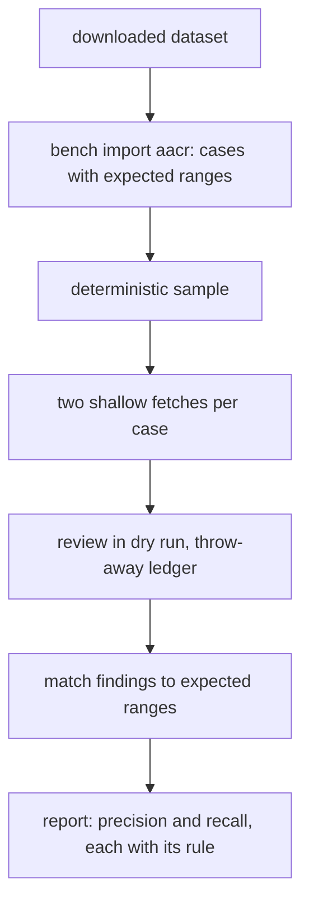

# Precision is measured on a public labelled corpus

## Intent

repoach's precision reads `cannot say`: ten planted cases, no human
label. open-code-review publishes 33.9 % precision and 20.0 % recall on
AACR-Bench, 200 pull requests of 50 public repositories with 1 505
labelled issues, Apache-2.0 on Hugging Face. After this spec a user who
downloaded that dataset imports it as a `bench` corpus, `bench run`
reviews a deterministic sample of its pull requests through the real
pipeline on the public repositories, and `bench report` prints
precision and recall against the dataset's labels beside the rule that
produced each number, so a repoach figure and a published figure can be
read side by side without being confused.

## Context

Measured on `origin/develop` `8fabb19` (2026-11-12).

| # | Fact | Where |
|---|---|---|
| F1 | `repoach bench run` reviews every case of a corpus through the real pipeline, dry run, throw-away ledger; a case's `source` is `local`, `forge` or `ledger`; `planted` ranges give the `located` count; human labels give precision; the README line is refused under 100 labelled findings | `bench/corpus/README.md`, `src/repoach/bench/runner.py`, `src/repoach/bench/score.py`, `README.md` Precision |
| F2 | The baseline: 10 planted cases, 45 findings, 0 labelled, `located 10/10`, `precision cannot say` | `README.md` bench block, 2026-10-21 |
| F3 | The market map names a published precision number as a table stake repoach is missing | SP-PRECISION-MEASUREMENT F5 |
| F4 | AACR-Bench: 50 repositories, 200 PRs, 10 languages, 1 505 ground-truth issues "cross-validated by 80+ senior engineers"; dataset `Alibaba-Aone/aacr-bench`, `license: apache-2.0` (Hugging Face API, 2026-11-12); open-code-review's numbers (precision 33.9 % = 301/889, recall 20.0 %, F1 25.1 % with Claude Opus; Claude Code 7.23 % / 28.9 %) are an image in its README, not reproducible from its repository | `R/README.md:53-69`, `R/imgs/benchmark-en.png` |
| F5 | The record schema of the dataset was not read in this analysis (no download was made); the importer reads it at import time and refuses a record it cannot map | not verified |
| F6 | `SP-UNIVERSAL-LEDGER` G8: a rate whose denominator is zero prints `cannot say`, never `0%` | `docs/specs/2026-10-19_SP-UNIVERSAL-LEDGER_*.md` |

## Decisions (author, within the owner's brief)

- D1. No network in repoach: the user downloads the dataset with the
  Hugging Face CLI; `repoach bench import aacr <dir> --out
  bench/corpus/aacr/` reads the records and writes one case file per
  pull request in the existing format with a new source kind:
  `source: {kind: public, repo: <https url>, base_sha, head_sha}` and
  `expected: [{file, lines: [a, b], kind, note}]` from the labelled
  issues. A record missing the repository, the two SHAs, or an issue's
  file and line range is refused by name and counted
  (`import: 200 records, 196 cases, 4 refused (no head_sha 3, no line 1)`).
  The case files are not committed (O1); `bench/corpus/aacr/README.md`
  holds the procedure and `NOTICE` the dataset's Apache-2.0 notice.
- D2. `bench run` on a `public` case fetches the two commits of the
  public repository into a temporary clone (`git fetch --depth 1
  <url> <sha>` twice, a repository that refuses either is a skipped
  case with the reason) and reviews them through `LocalDiffForge`
  (SP-REVIEW-LOCAL-DIFF's path), dry run, throw-away ledger, as the
  planted cases are. `--sample N` (default 20) picks the N cases whose
  `sha1(case id)` sorts first, so a sample is the same on every machine;
  `--sample all` runs them all.
- D3. Scoring adds `expected` to `planted`'s rule: a finding is
  `matched` when it is not refuted, is on the expected file and overlaps
  the expected range (SP-FINDING-CITES-ITS-CODE's derived line); an
  expected issue is `found` when at least one finding matches it.
  `bench report` prints two rows, each naming its rule: `precision
  (matched / findings)` and `recall (found / expected)`, plus the
  human-label precision of F1 when labels exist, and never one without
  the other's rule. A denominator of zero prints `cannot say` (F6). The
  README block gains the `aacr` corpus rows with the sample size and the
  date; `--readme-line` keeps its 100-label floor and does not read the
  `expected` rule.
- D4. The comparison page gets no OCR number from this spec: a cell
  there is read on a page and dated (SP-COMPARISON-PAGE); the README
  block is where repoach's own measurement appears, with the rule.

## Goals

- G1: `bench import aacr` writes cases of the format in D1 and refuses by name what it cannot map.
- G2: `bench run` reviews `public` cases from two shallow fetches, deterministic `--sample` (D2).
- G3: `bench report` prints precision and recall against `expected`, each with its rule, `cannot say` on zero (D3).
- G4: the README block shows the `aacr` rows generated, never typed (D3).

## Non-Goals

- NG1: no claim that repoach's matched-range precision equals a human-validated precision; the two rules are printed, not equated.
- NG2: no committed dataset content, no re-distribution.
- NG3: no change to the planted corpus or the labelling flow.

## Assumptions

- A1: the dataset records carry a repository URL, base and head SHAs or a PR number from which they can be read, and per-issue file and line ranges (F5; checked at import, refused by name otherwise).
- A2: the 50 repositories are public and still serve the commits; a missing one is a skipped case, counted.

## Interface

```python
# repoach.bench.public_corpus
class PublicSource(BaseModel):
    kind: Literal["public"]; repo: HttpUrl; base_sha: str; head_sha: str
class Expected(BaseModel):
    file: str; lines: tuple[int, int]; kind: str; note: str
def import_aacr(records_dir: Path, out_dir: Path) -> ImportReport: ...       # refused by reason
def fetch_pair(repo: str, base_sha: str, head_sha: str, into: Path) -> Path: ...
def sample_cases(case_ids: Sequence[str], n: int | None) -> list[str]: ...   # sha1 order
def match_expected(findings: Sequence[Finding], expected: Sequence[Expected]) -> MatchReport: ...
```

CLI: `repoach bench import aacr <dir> --out <dir>`; `bench run <corpus> --sample N|all`; `bench report` rows `precision (matched / findings)`, `recall (found / expected)`.

## Behavior

### Nominal
- `bench import aacr ~/aacr` → 196 cases; `bench run bench/corpus/aacr --sample 20 --provider claude_code` → 20 reviews; `bench report` → `precision (matched / findings) 31.2 % (24/77), recall (found / expected) 18.4 % (28/152), human-label precision cannot say (0 labelled)`.

### Edge cases
- A repository renamed: GitHub redirects the fetch; a repository gone: `skipped: fetch failed`, counted.
- A case whose expected issue is on a file the review excluded (SP-REVIEW-FILE-SELECTION): counted `not found`; the report prints how many expected issues fell on excluded files.

### Failure scenarios
- A record with a PR number and no SHAs: refused `no head_sha`, the importer does not query the forge.

## Architecture Impact
- Adds dependency: SP-BENCH-PUBLIC-CORPUS -> SP-PRECISION-MEASUREMENT (the corpus format, runner, scorer, README block)
- Adds dependency: SP-BENCH-PUBLIC-CORPUS -> SP-REVIEW-LOCAL-DIFF (reviewing two commit objects through `LocalDiffForge`), SP-FINDING-CITES-ITS-CODE (the derived line the match reads)
- Adds dependency: SP-BENCH-PUBLIC-CORPUS -> SP-UNIVERSAL-LEDGER (`cannot say`), SP-COMPARISON-PAGE, SP-README-PRODUCT-STATEMENT (where numbers may and may not appear), SP-CLI-STDOUT-ONE-JSON
- `src/repoach/bench/public_corpus.py`, `bench/corpus/aacr/README.md` and `bench/corpus/aacr/NOTICE` are created under `src/repoach/bench/` and `bench/`, which SP-PRECISION-MEASUREMENT owns whole; this spec owns its tests and fixture only, so ownership stays disjoint. `public_corpus.py` imports `bench.corpus`, `bench.runner`, `bench.score`, `review.git_run`; nothing imports it but the bench CLI.

## Diagram


## Acceptance Criteria

- [ ] AC1: `pytest -q tests/unit/test_bench_public_corpus.py` → green (on `tests/fixtures/aacr/sample-records.jsonl`, five hand-written records in the shape A1 describes, two of them unmappable).

| Test | Pins | Mutation that turns it red |
|---|---|---|
| `test_import_writes_cases_and_refuses_by_name` | 3 cases, 2 refused with reasons | an unmappable record becomes a case with empty `expected` |
| `test_sample_is_deterministic_by_sha1` | the same 2 of 3 on every call, independent of listing order | `random.sample` |
| `test_match_requires_file_and_overlap_and_not_refuted` | a refuted finding on the range does not match; an adjacent line does not | overlap is `>=` off by one, or refuted counted |
| `test_report_prints_both_rules_or_neither` | both rows present, each with its rule in the label | one row printed alone |
| `test_zero_denominator_is_cannot_say` | 0 findings → `precision cannot say` | `0%` |
| `test_fetch_failure_is_a_skipped_case_not_an_error` | `skipped: fetch failed`, run continues | the run aborts |
| `test_no_network_in_import` | socket fake raises; import succeeds | the importer resolves the repo URL |
| `test_readme_line_ignores_expected_rule` | `--readme-line` refused under 100 labels with `expected` present | the matched rule feeds the line |

- [ ] AC2: `pytest -q tests/unit/test_bench_report.py -k aacr` → green: `--update-readme` writes the `aacr` rows with the sample size and date inside the markers. Mutation: write them outside the markers.
- [ ] AC3: `repoach arch check --base develop` → ok.
- [ ] AC4: `bench/corpus/aacr/NOTICE` names the dataset, its URL, its licence and the read date; `scripts/check_links.py bench/corpus/aacr/README.md` → 0 dead.

## Success conditions
- C1: `bench import aacr` on the real download reports its counts; the refused records and reasons are in the owner's hands before any review is paid.
- C2: `bench run --sample 20` completes on the owner's provider with a per-case token count in the report (the cost of 200 is extrapolated from it before O2).
- C3: the README block prints the two rules with their numbers and `cannot say` where it must.

## Owner decisions needed
- O1: commit the imported case files (196 small YAML files, no code of the repositories) or keep them generated.
- O2: the sample size to pay for (20 proposed; 200 is about 50 M tokens at the measured 250 k per review).
- O3: whether a repoach number measured by the matched-range rule may be quoted in the comparison page or the README prose next to open-code-review's human-validated one (proposed: README block only, with the rule, never the page).

## Open Questions
- Q1: O1 to O3; A1 is settled by the first import.
