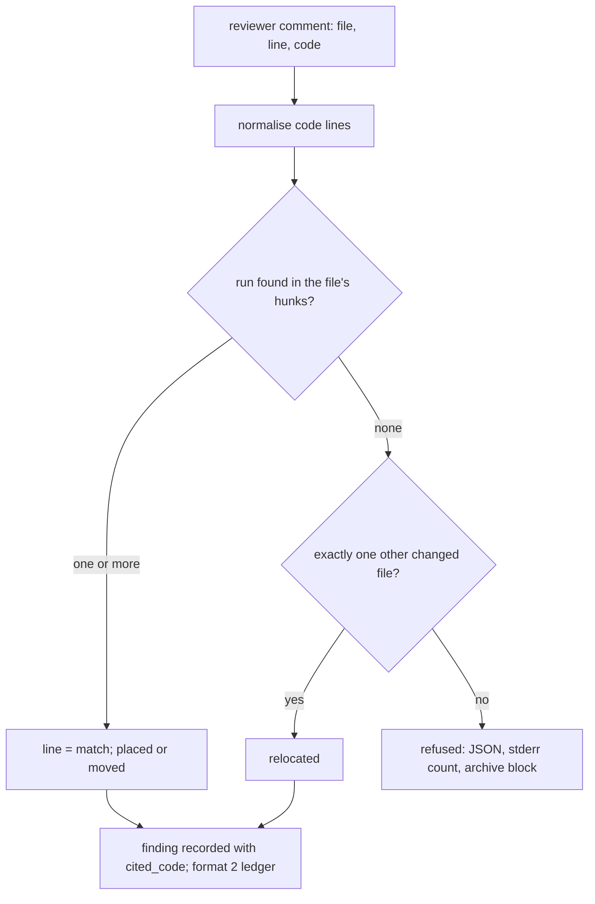

# A finding names the code it is about, and its line is derived from that code

## Amendment (0.4, 2026-11-18): the measurement trigger is any gateway's

Owner principle 2026-11-17, repoach is for everyone. NG5's recommended
trigger for making `code` mandatory read twenty reviews "on the owner's
gateway"; it reads twenty reviews on any gateway running this, the
owner's being the first sample. Nothing else changes.

## Amendment (0.3, 2026-11-17): approved; the column bumps the ledger format, the refusals reach the archive comment

Re-measured on `origin/develop` `92cd241`. D5 now states what the new
column costs under SP-LEDGER-FORMAT-IS-VERSIONED: `pr_findings` is a
gate table, so `cited_code` is a `LEDGER_FORMAT` bump with its snapshot
in the same pull request and a named refusal on `main` until the next
release (D7). O2 of 0.2 is decided by the family's own pattern: a
refused comment is listed in the archive comment, collapsed, as a
suppressed re-raise and an `out_of_delta` finding are (D8). O1 is not a
question this spec can answer before the count it asks for exists; it
is a dated follow-up in NG5. The finding identifier the owner asked for
is not here: it is derived from the claim, not from the code, in
SP-REVIEW-SETTLED-STAYS-SETTLED D11 (NG6).

## Intent

A reviewer's comment carries a line number the model typed. Nothing
checks that the line is in a hunk of the diff, or that it is the line
the prose is about; the only mechanical filter drops a comment whose
*file* is absent from the diff. After this spec every reviewer comment
also carries the code it is about, one to six consecutive lines copied
from the diff, and repoach derives the line from that code: a comment
whose code sits in a hunk is anchored there whatever line the model
wrote; a comment whose code is in no hunk of the diff is refused before
it becomes a finding, with the reason recorded, counted and shown. The
prompt rule "never comment on lines outside the diff" becomes a check.

## Context

Measured on `origin/develop` `92cd241` (2026-11-17). The design is
adapted from open-code-review (Apache-2.0, `6386895`), read, not copied.

| # | Fact | Where |
|---|---|---|
| F1 | A reviewer comment is `file, line, severity, body`; `line` is "1-based line number in the diff" and comes from the model's JSON | `src/repoach/review/reviewer.py:142-155`, class `ReviewComment` |
| F2 | `record_findings_for_outcomes` drops a comment whose `file` is not among the diff's files and logs `findings_bridge.off_diff_skipped`; the line is not compared with the hunks | `src/repoach/review/findings_bridge.py:550-660`, the drop at `:621-623` (`if diff_filter_enabled and comment.file not in files_in_diff`), the log at `:655` |
| F3 | Each persona carries the rule as text, "**Never** comment on lines outside the diff", and a self-check, "The `file` is touched by the diff (point to a `+` / `-` line)" | `prompts/review/sentinel_0.4.3.md:69-71`, `:91-94`; the four personas are `architect_0.5.1`, `sentinel_0.4.3`, `tester_0.4.1`, `scribe_0.5.1` (`src/repoach/review/reviewer.py:920`, `:939`, `:947`, `:955`) |
| F4 | `make_file_excerpts` reads a `window = 15` lines each side of `comment.line` for the round-2 dialogue; a wrong line yields a window about other code | `src/repoach/review/reviewer.py:362-412` |
| F5 | The refuter's evidence is "the whole cited file, numbered, the cited lines marked `N:>`"; a wrong line marks the wrong code and the judge answers on it | `src/repoach/review/refuter_evidence.py:18` |
| F6 | A posted finding is joined to its thread by `finding_posts`; the owner-command fallback for findings with no row is the file and the cited line range | `src/repoach/review/owner_commands.py:255-260`; `docs/owner_commands.md`, `docs/finding_threads.md` |
| F7 | `finding_fingerprint` is the first 16 hex of a SHA-256 over claim type, file, the 5-line bucket of `line_start` and `normalised_claim` | `src/repoach/review/findings_bridge.py:170-202` |
| F8 | `pr_findings` has 20 columns; four were added after creation by `_migrate_missing_findings_columns`, one `ALTER TABLE` per entry named with its spec, run on every open. On `origin/develop` `c869e73` the tuple is the module constant `_ADDED_FINDINGS_COLUMNS` and `pr_findings` is the first of the five gate tables of `tests/fixtures/ledger_format/1.json` | `src/repoach/review/findings.py:269-291`, `:447-493`; `origin/develop` `c869e73` `src/repoach/review/findings.py:447`; SP-LEDGER-FORMAT-IS-VERSIONED D1, D8, F4 |
| F9 | open-code-review's `code_comment` tool requires `existing_code`, "one or several consecutive lines of code most relevant to your comment", and resolves the line by matching it against the hunk lines with whitespace normalised, then the whole file, then another changed file, then an LLM relocation call | `R/internal/config/toolsconfig/tools.json:29-84`, `R/internal/diff/resolver.go:63,101,155,251`, `R/internal/diff/relocation.go` |
| F10 | open-code-review's filter removes a comment when "the code the comment describes is not in its subject file's diff" (its Ground A), by one LLM call | `R/internal/config/template/prompts/review_filter_task_system.md` |
| F11 | The archive comment already lists what the run did not post: SP-REVIEW-SETTLED-STAYS-SETTLED D4 lists suppressed re-raises, SP-REVIEW-DELTA-FIRST D4 lists `out_of_delta` findings | those specs |

## Decisions (author, within the owner's brief; 0.3 items 2026-11-17)

- D1. The reviewer JSON gains `code`: the lines the comment is about,
  copied verbatim from the diff, 1 to `cited_code_max_lines` consecutive
  lines, at least `cited_code_min_chars` characters after whitespace is
  collapsed, at most `cited_code_max_chars`. The persona files are
  re-versioned (architect 0.6.0, sentinel 0.5.0, tester 0.5.0, scribe
  0.6.0) with the field in the output contract; the dialogue and the
  Coder contracts are unchanged.
- D2. Anchoring is mechanical and happens once, in the bridge, before a
  comment becomes a finding (F2): the snippet is split into lines, a
  leading unified-diff marker (`+`, `-`, one space) that every line of
  the snippet carries is stripped, each line is trimmed and its inner
  whitespace collapsed, and the lines are matched as a consecutive run
  against the new-side lines (`+` and context) of the cited file's
  hunks. One match: the finding's line is the first line of the match;
  when the model's `line` lies inside the match it is kept. Several
  matches: the one containing the model's line, else the nearest to it.
  The event `finding_anchor.moved` names the file, the model's line and
  the derived line. The marker strip and the whitespace collapse are
  the only tolerances.
- D3. No match in the cited file's hunks, exactly one match in the
  hunks of another file of the diff: the finding is moved to that file
  (`finding_anchor.relocated`). A match in two or more other files, or
  none: the comment is refused with a reason from a closed set,
  `code_not_in_diff`, `code_ambiguous`, `code_too_short`,
  `code_too_long`, and is recorded in the run's `findings_refused[]`
  (file, line, severity, reason, the first 120 characters of the body).
  It is never posted as a thread and never enters `pr_findings`. No LLM
  relocation call (F9's last step) is made: a snippet found nowhere is a
  claim about code that is not in the change.
- D4. A comment without `code` (a persona older than D1, a model that
  dropped the field) is anchored as today, by its line, and marked
  `anchor = line_only`; the run's JSON counts them (NG5).
- D5. The snippet is kept on the finding, `pr_findings.cited_code TEXT
  NULL`, so the refuter's evidence marks the cited lines from the code,
  not from a number (F5), and the round-2 excerpt is read around the
  derived line (F4). The fingerprint (F7) is unchanged: an id must not
  move when the anchor is corrected. The column is one entry of
  `_ADDED_FINDINGS_COLUMNS` (F8), so an older ledger is healed on open,
  and one `Column("cited_code", String, nullable=True)` on the table.
- D6. The deletions of a hunk are matched too, as a second pass over
  the old side: a comment about removed code is anchored on the hunk's
  first new-side line and marked `anchor = removed_code`; the forge
  comment is posted on the new side, as today's comments are.
- D7 (0.3, SP-LEDGER-FORMAT-IS-VERSIONED). `pr_findings` is a gate
  table (F8), so D5's column changes the shape the gate reads:
  `LEDGER_FORMAT` is bumped by one in the same pull request, with
  `tests/fixtures/ledger_format/<new>.json` written by `python -m
  repoach.review.ledger_format snapshot` and committed (the format
  spec's T1 is red otherwise). This spec is written for 1 → 2
  (`ledger_format_after: 2`); when another bump lands first, the next
  free number is taken and this constraint is updated in the same
  commit. The column is `TEXT NULL`, no enum, not JSON: `ENUM_COLUMNS`
  and `JSON_COLUMNS` are untouched. Until the release that ships it,
  `main`'s gate refuses a ledger this code wrote with `SKIP_LEDGER_SKEW
  — ledger skew: format 2 is newer than this reader's 1 …`, exit 5: the
  named refusal that spec designed, not a defect; the release notes of
  that release name the bump and `scripts/skew_replay.sh origin/main
  origin/develop`, whose exit 5 before the release and 0 after it is
  the measurement.
- D8 (0.3, closes O2 of 0.2). A refused comment is shown where the
  family shows what it did not post (F11): the archive comment gains a
  collapsed `<details>` block, `n comments refused (code not in the
  diff)`, one line each, `<lens> <severity> <file>:<model line> —
  <reason> — <body[:120]>`. Nothing is posted inline for it. The JSON
  and the stderr count of G2 stay.

## End state

The Tester writes `line: 40, code: "assert total == 0"`; the snippet is
at line 44 of the hunk; the finding is recorded at 44, the thread opens
at 44, `finding_anchor.moved 40 -> 44` is logged. The Sentinel cites
code that is in no hunk; its comment is refused `code_not_in_diff`,
counted on stderr (`anchors: 11 placed, 2 moved, 1 relocated, 1
refused (code_not_in_diff)`), listed collapsed in the archive comment,
and no thread, no `pr_findings` row and no refuter call exist for it.
The refuter's `N:>` marks follow `cited_code`. `python -m
repoach.review.ledger_format snapshot` equals
`tests/fixtures/ledger_format/2.json`, and `main`'s gate says `format 2
is newer than this reader's 1` on this code's ledgers until the release.

## Easy solution rejected

Check that the model's `line` falls inside a hunk. Rejected: a wrong
line inside the hunk passes (the round-2 window and the refuter then
read the wrong code, F4–F5), and a right claim about a context line
passes while naming nothing the change did. Also rejected: F9's LLM
relocation call and any fuzzy or token-similarity match. A snippet the
model cannot copy verbatim from the diff it was given is a snippet
about code it did not read there; one call to "find where it meant"
would turn a measured refusal into a guess and cost a model call per
stray comment. Also rejected: making `code` mandatory now, which turns
every older persona and every model that drops a field into a parse
failure before D4's count says how often that happens.

## Hard part

The match is exact after two normalisations, and it must stay exact.
Models copy from a unified diff, so they carry the `+` marker, tabs the
diff rendered as spaces, and trailing blanks; D2 strips exactly those
and nothing else, and the test table pins both that tabs match and
that a paraphrase does not. The second hard part is the bump: a
nullable column is the smallest shape change there is, and it still
holds every pull request of this repository behind `SKIP_LEDGER_SKEW`
on `main` until the next release (D7). The pull request that lands
this spec is therefore the first one the ledger format spec's release
procedure is written for, and `scripts/skew_replay.sh` must print the
refusal before the release and `ledger: ok` after it; both outputs are
written beside C5 by the verifier.

## Goals

- G1: every reviewer comment is anchored by its `code` against the diff's hunks (D2) before it is recorded; the derived line replaces the model's when they differ, and the event names both.
- G2: a comment whose code is in no hunk of the diff is refused with a named reason (D3), listed under `findings_refused` in the `review pr` JSON, counted on stderr and shown collapsed in the archive comment (D8); it is never posted inline and never recorded.
- G3: a unique match in another changed file relocates the finding there (D3).
- G4: the cited code is stored with the finding and marks the evidence the refuter reads (D5).
- G5: a comment without `code` keeps today's path and is counted `line_only` (D4).
- G6: the personas' output contracts carry the field and an example (D1); the prompt rule of F3 stays as guidance.
- G7: `LEDGER_FORMAT` is bumped with its snapshot in the same pull request (D7).

## Non-Goals

- NG1: no change to `finding_fingerprint` (F7) and to the ledger row ids.
- NG2: no LLM relocation call; no fuzzy or token-similarity match. The marker strip and whitespace normalisation are the only tolerances.
- NG3: no anchoring of the Coder's fixes or the Developer's edits.
- NG4: no change to the owner-command fallback (F6): it still reads the finding's file and line range, which are now derived.
- NG5: `code` stays optional. Making it mandatory (a comment without it a parse failure, retried as today's malformed JSON) is a one-line amendment once `anchors.line_only` has been measured over a release; the recommended trigger is zero `line_only` over twenty consecutive reviews on any gateway running this, read from the review JSON artifacts (the owner's gateway is the first such sample, an instance).
- NG6: no finding identifier. SP-REVIEW-SETTLED-STAYS-SETTLED D11 derives `finding_key` from the claim type, the file and the normalised claim, not from the cited code: the code moves with the fix, and a key that moved with it would name a new finding at every head.

## Assumptions

- A1: the diff the reviewers receive is the diff the bridge anchors against, at the pinned head (SP-REVIEW-PINS-HEAD).
- A2: a 1–6 line verbatim snippet is something every supported model copies reliably; open-code-review's whole placement rests on it (F9). D4's count is what measures it.

## Interface

```python
# repoach.review.finding_anchor
CITED_CODE_MIN_CHARS = 8; CITED_CODE_MAX_LINES = 6; CITED_CODE_MAX_CHARS = 600
REFUSAL_REASONS = frozenset({"code_not_in_diff", "code_ambiguous", "code_too_short", "code_too_long"})
class Anchor(BaseModel):
    file: str; line: int; kind: Literal["placed", "moved", "relocated", "line_only", "removed_code"]
    model_line: int; cited_code: str | None
class Refusal(BaseModel):
    file: str; line: int; severity: str; reason: str; body_head: str; lens: str
def normalise_lines(code: str) -> tuple[str, ...]: ...                    # marker strip, trim, collapse
def anchor_comment(comment: ReviewComment, diffs: Sequence[FileDiff]) -> Anchor | Refusal: ...
def anchor_outcome(outcome: ReviewerOutcome, diffs: Sequence[FileDiff]) -> tuple[list[tuple[ReviewComment, Anchor]], list[Refusal]]: ...
def refusals_block(refusals: Sequence[Refusal]) -> str: ...               # the collapsed archive-comment block of D8

# src/repoach/review/findings.py (changed): Column("cited_code", String, nullable=True); one _ADDED_FINDINGS_COLUMNS entry
# src/repoach/review/ledger_format.py (changed): LEDGER_FORMAT = 2; tests/fixtures/ledger_format/2.json committed
```

`ReviewComment` gains `code: str | None = None`. The `review pr` JSON
gains `anchors: {placed, moved, relocated, line_only, removed_code}` and
`findings_refused: [Refusal]`. `pr_findings` gains `cited_code TEXT NULL`.

## Behavior

### Nominal

- The Tester writes `line: 40, code: "assert total == 0"`; the line is at 44 in the hunk: the finding is recorded at 44, `finding_anchor.moved 40 -> 44`.
- The Sentinel's snippet is at the model's line: `placed`, nothing logged beyond the count.

### Edge cases

- The snippet appears twice in the hunk, at 12 and 70, the model wrote 68: anchored at 70.
- The snippet spans a hunk boundary (half context, half outside): no match in the hunk; the other files are searched; else refused `code_not_in_diff`.
- Every line of the snippet starts with `+`: the marker is stripped, the match proceeds; one line of three starts with `+`: nothing is stripped (it is code).
- Tabs against spaces, trailing spaces, CRLF: matched after normalisation.
- `code` is one character: refused `code_too_short`, counted; the body is not lost from the refusal list.
- A ledger written before this spec (no `cited_code` column) is opened: the column is added, older rows read `NULL`, the refuter marks their lines by number as before.

### Failure scenarios

- A model returns `code` that is a paraphrase: refused `code_not_in_diff`; the count on stderr and the archive block make a persona or model regression visible on the first run.
- Every comment of a reviewer is refused: the reviewer's verdict is derived from zero findings as today; the refusals are in the JSON and the archive comment, so an empty review is distinguishable from a clean one.
- `main`'s gate reads a ledger of format 2 before the release: `SKIP_LEDGER_SKEW`, exit 5, the message naming format 2 and both versions; the pull request merges after the release by the next re-arm (SP-LEDGER-FORMAT-IS-VERSIONED End state).

## Architecture Impact
- Adds dependency: SP-FINDING-CITES-ITS-CODE -> SP-FINDINGS-OFFDIFF-FILTER, SP-FINDINGS-BRIDGE-DOCFIX, SP-FINDER-OUTPUT (the bridge is the one place a comment becomes a finding; the anchor runs there, before the off-diff filter it generalises)
- Adds dependency: SP-FINDING-CITES-ITS-CODE -> SP-FINDING-MODEL (the `Finding` model gains `cited_code`), SP-FINDINGS-INIT-RACE (0.3: `findings.py` and `db:table:pr_findings` are its; the column and its migration entry are edits to that file)
- Adds dependency: SP-FINDING-CITES-ITS-CODE -> SP-DIFF-SCOPER (hunks come from `FileDiff`), SP-REVIEW-PINS-HEAD (the diff is the pinned head's)
- Adds dependency: SP-FINDING-CITES-ITS-CODE -> SP-VERIFIER-LIB, SP-FINDING-THREAD-IDS, SP-OWNER-SETTLES-A-FINDING (the derived line is what the verifiers, the posted thread and the command fallback read)
- Adds dependency (0.3): SP-FINDING-CITES-ITS-CODE -> SP-REFUTER-JUDGES-WHAT-IT-CAN (`refuter_evidence.py` is its file; the `N:>` marks read `cited_code`, D5)
- Adds dependency: SP-FINDING-CITES-ITS-CODE -> SP-ORCH-DOCSTRING (the JSON fields on `TeamOutcome`, `orchestrator.py:383`)
- Adds dependency (0.3): SP-FINDING-CITES-ITS-CODE -> SP-LEDGER-FORMAT-IS-VERSIONED (`LEDGER_FORMAT` and `tests/fixtures/ledger_format/` are its; this spec bumps the one and adds to the other, D7)
- Adds dependency (0.2, the owner's unified order): SP-FINDING-CITES-ITS-CODE -> SP-REVIEW-RESUMES-FAILED-ROLES (its reuse key carries `persona_version`; this spec's bump to architect 0.6.0, sentinel 0.5.0, tester 0.5.0, scribe 0.6.0 is the first key change that resume sees, and SP-REVIEW-REMEMBERS-EVERY-ROUND bumps the same files once more after this spec, to 0.7.0 / 0.6.0 / 0.6.0 / 0.7.0; SP-REVIEW-SETTLED-STAYS-SETTLED maps the anchored ranges this spec derives and lands after it)
- `finding_anchor.py` imports `diff_scoper` and `reviewer` (frontier dataclasses) and nothing else of `review/`; `findings_bridge.py` imports it. Gate column added, format bumped (D7); no cycle.

## Diagram


## Acceptance Criteria

Each test names the mutation that must turn it red.

- [ ] AC1: `pytest -q tests/unit/test_finding_anchor.py` → green. Today (`92cd241`): no such file; the bridge compares no line with any hunk (F2).

| Test | Pins | Mutation that turns it red |
|---|---|---|
| `test_code_in_hunk_sets_the_line_from_the_code` | model line 40, snippet at 44 → line 44, kind `moved` | `anchor_comment` returns `comment.line` |
| `test_code_at_the_model_line_is_placed` | kind `placed`, no move event | the event is emitted for every comment |
| `test_code_in_no_hunk_is_refused_not_recorded` | reason `code_not_in_diff`; `record_findings_for_outcomes` inserts nothing | the refusal falls through to today's line path |
| `test_unique_match_in_another_file_relocates` | kind `relocated`, new file | the search stops at the cited file |
| `test_two_other_files_is_ambiguous` | reason `code_ambiguous` | the first other file wins |
| `test_whitespace_and_marker_differences_still_match` | tabs/spaces, trailing blanks, CRLF, a `+` on every line | `normalise_lines` returns the raw lines |
| `test_a_marker_on_some_lines_is_code` | one `+` of three lines kept → no match | strip markers per line |
| `test_paraphrase_does_not_match` | one word changed → refused | a similarity threshold |
| `test_several_matches_prefer_the_model_line` | 12 and 70, model 68 → 70 | the first match wins |
| `test_removed_code_anchors_on_the_hunk` | kind `removed_code`, the hunk's first new line | the old side is never searched |
| `test_missing_code_keeps_the_line_only` | kind `line_only`, counted | a missing `code` is refused |
| `test_too_short_and_too_long_are_named` | `code_too_short`, `code_too_long` | the length limits are not checked |
| `test_fingerprint_unchanged_by_a_moved_anchor` | same `finding_fingerprint` before and after | the fingerprint reads the line |
| `test_cited_code_reaches_the_refuter_evidence` | the `N:>` marks follow `cited_code` | the evidence marks `line` only |
| `test_refusals_block_is_collapsed_and_names_each` | D8's `<details>` with one line per refusal | post them inline |
| `test_personas_carry_the_code_field` | the four persona files at D1's versions contain `"code":` in the output contract and the example | ship the old persona version |
| `test_older_ledger_is_healed_on_open` | a ledger without the column opens, the column exists after, `cited_code is None` on old rows | drop the `_ADDED_FINDINGS_COLUMNS` entry |

- [ ] AC2: `pytest -q tests/integration/test_finding_anchor_end_to_end.py` → green: a recorded reviewer answer whose comment cites line 10 with a snippet at line 23 of the hunk ends, through `review pr --dry-run`, as one finding at line 23 and `anchors.moved == 1`; a second answer citing a snippet outside the diff ends with `findings_refused` of length 1, no `pr_findings` row, and the archive comment text holding the collapsed block. Mutation: skip `anchor_outcome` in the bridge.
- [ ] AC3: `pytest -q tests/unit/test_review_team.py tests/unit/test_findings_bridge.py` → green (today's behaviour for comments without `code`).
- [ ] AC4: `repoach arch check --base origin/develop` → `edge-honesty: ok`; `repoach arch graph --check` lists 27 cycles, as `92cd241` does.
- [ ] AC5: `pytest -q tests/unit/test_ledger_format_skew.py` → green with `LEDGER_FORMAT = 2` and `tests/fixtures/ledger_format/2.json`; `python -m repoach.review.ledger_format snapshot` equals that file; `1.json` is unchanged (snapshots are append-only). Mutation: add the column without the bump → `test_live_snapshot_matches_the_committed_format` red.

## Success conditions

- C1 (oracle: `repoach bench run --corpus bench/corpus/planted …` then `repoach bench report <result>`): on the planted corpus (10 cases) a dry run reports `anchors.line_only == 0` and `findings_refused` as a list in every case's JSON, and the report's `located` count is not lower than the 2026-10-21 baseline (10/10).
- C2 (oracle: AC2): a reviewer answer with a wrong line and a right snippet posts the comment on the snippet's line.
- C3 (oracle: AC1, AC2): a snippet absent from the diff never reaches the ledger or the forge; `sqlite3 <ledger> "SELECT count(*) FROM pr_findings WHERE pr_number=<n>"` after AC2's second answer is unchanged.
- C4 (oracle: AC1): no finding id changes for a corpus replay; `finding_fingerprint` is equal before and after the anchor moves.
- C5 (oracle: `scripts/skew_replay.sh`): on this branch, `scripts/skew_replay.sh origin/develop HEAD` → `ledger: format 2 is newer than this reader's 1 …`, exit 5 (develop's reader, this branch's writer); `scripts/skew_replay.sh HEAD HEAD` → `ledger: ok (format 2, …)`, exit 0. After the release that ships it, `scripts/skew_replay.sh origin/main origin/develop` → `ledger: ok`. The three command lines and outputs are written beside this line by the verifier.

## Open Questions

- None. O1 of 0.2 (a mandatory `code`) is a dated follow-up with its measurement in NG5, not a decision this spec can take before the count exists; O2 (showing refused comments) is decided by D8 from the family's pattern (F11).
