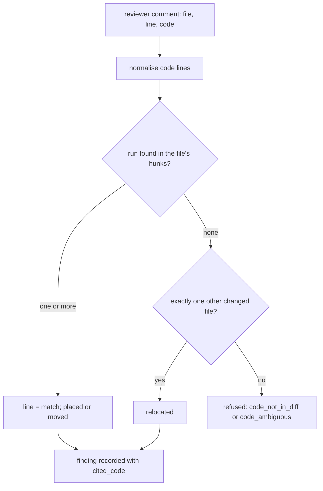

# A finding names the code it is about, and its line is derived from that code

## Intent

A reviewer's comment carries a line number the model typed. Nothing
checks that the line is in a hunk of the diff, or that it is the line
the prose is about; the only mechanical filter drops a comment whose
*file* is absent from the diff. After this spec every reviewer comment
also carries the code it is about, one to six consecutive lines copied
from the diff, and repoach derives the line from that code: a comment
whose code sits in a hunk is anchored there whatever line the model
wrote; a comment whose code is in no hunk of the diff is refused before
it becomes a finding, with the reason recorded and counted. The prompt
rule "never comment on lines outside the diff" becomes a check.

## Context

Measured on `origin/develop` `8fabb19` (2026-11-12). The design is
adapted from open-code-review (Apache-2.0, `6386895`), read, not copied.

| # | Fact | Where |
|---|---|---|
| F1 | A reviewer comment is `file, line, severity, body`; `line` is "1-based line number in the diff" and comes from the model's JSON | `src/repoach/review/reviewer.py`, class `ReviewComment` |
| F2 | `record_findings_for_outcomes` drops a comment whose `file` is not among the diff's files and logs `findings_bridge.off_diff_skipped`; the line is not compared with the hunks | `src/repoach/review/findings_bridge.py:562-603` |
| F3 | Each persona carries the rule as text: "**Never** comment on lines outside the diff" and a self-check "The `file` is touched by the diff (point to a `+` / `-` line)" | `prompts/review/sentinel_0.4.3.md`, "Hard rules", "Self-verification" |
| F4 | `make_file_excerpts` reads a 30-line window around `comment.line` for the round-2 dialogue; a wrong line yields a window about other code | `src/repoach/review/reviewer.py:366-412` |
| F5 | The refuter's evidence marks the cited lines `N:>` in the whole file; a wrong line marks the wrong code and the judge answers on it | `src/repoach/review/refuter_evidence.py`, module docstring item 1 |
| F6 | A posted finding is joined to its thread by `finding_posts`; the owner-command fallback for findings with no row is the file and the cited line range | `docs/owner_commands.md`, `docs/finding_threads.md` |
| F7 | `finding_fingerprint` identifies a finding at a head from its normalised claim | `src/repoach/review/findings_bridge.py`, `finding_fingerprint` |
| F8 | open-code-review's `code_comment` tool requires `existing_code`, "one or several consecutive lines of code most relevant to your comment", and resolves the line by matching it against the hunk lines with whitespace normalised, then the whole file, then another changed file, then an LLM relocation call | `R/internal/config/toolsconfig/tools.json:29-84`, `R/internal/diff/resolver.go:63,101,155,251`, `R/internal/diff/relocation.go` |
| F9 | open-code-review's filter removes a comment when "the code the comment describes is not in its subject file's diff" (its Ground A), by one LLM call | `R/internal/config/template/prompts/review_filter_task_system.md` |

## Decisions (author, within the owner's brief)

- D1. The reviewer JSON gains `code`: the lines the comment is about,
  copied verbatim from the diff, 1 to `cited_code_max_lines` consecutive
  lines, at least `cited_code_min_chars` characters after whitespace is
  collapsed, at most `cited_code_max_chars`. The persona files are
  re-versioned (architect 0.6.0, sentinel 0.5.0, tester 0.5.0, scribe
  0.6.0) with the field in the output contract; the dialogue and the
  Coder contracts are unchanged.
- D2. Anchoring is mechanical and happens once, in the bridge, before a
  comment becomes a finding (F2): the snippet is split into lines, each
  line trimmed and its inner whitespace collapsed, and matched as a
  consecutive run against the new-side lines (`+` and context) of the
  cited file's hunks. One match: the finding's line is the first line of
  the match; when the model's `line` lies inside the match it is kept.
  Several matches: the one containing the model's line, else the
  nearest to it. The event `finding_anchor.moved` names the file, the
  model's line and the derived line.
- D3. No match in the cited file's hunks, exactly one match in the
  hunks of another file of the diff: the finding is moved to that file
  (`finding_anchor.relocated`). A match in two or more other files, or
  none: the comment is refused with a reason from a closed set,
  `code_not_in_diff`, `code_ambiguous`, `code_too_short`,
  `code_too_long`, and is recorded in the run's `findings_refused[]`
  (file, line, severity, reason, the first 120 characters of the body).
  It is never posted and never enters `pr_findings`. No LLM relocation
  call (F8's last step) is made: a snippet found nowhere is a claim
  about code that is not in the change.
- D4. A comment without `code` (a persona older than D1, a model that
  dropped the field) is anchored as today, by its line, and marked
  `anchor = line_only`; the run's JSON counts them. Making the field
  mandatory is left to the owner (decision O1).
- D5. The snippet is kept on the finding (`pr_findings.cited_code`, a
  new nullable column added through `_migrate_missing_findings_columns`,
  owned by SP-FINDING-MODEL's table) so the refuter's evidence marks the
  cited lines from the code, not from a number (F5), and the round-2
  excerpt is read around the derived line (F4). The fingerprint (F7) is
  unchanged: an id must not move when the anchor is corrected.
- D6. The deletions of a hunk are matched too, as a second pass over
  the old side: a comment about removed code is anchored on the hunk's
  first new-side line and marked `anchor = removed_code`; the forge
  comment is posted on the new side, as today's comments are.

## Goals

- G1: every reviewer comment is anchored by its `code` against the diff's hunks (D2) before it is recorded; the derived line replaces the model's when they differ, and the event names both.
- G2: a comment whose code is in no hunk of the diff is refused with a named reason (D3), listed under `findings_refused` in the `review pr` JSON and counted on stderr (`anchors: 11 placed, 2 moved, 1 relocated, 1 refused (code_not_in_diff)`); it is never posted and never recorded.
- G3: a unique match in another changed file relocates the finding there (D3).
- G4: the cited code is stored with the finding and marks the evidence the refuter reads (D5).
- G5: a comment without `code` keeps today's path and is counted `line_only` (D4).
- G6: the personas' output contracts carry the field and an example (D1); the prompt rule of F3 stays as guidance.

## Non-Goals

- NG1: no change to `finding_fingerprint` (F7) and to the ledger ids.
- NG2: no LLM relocation call; no fuzzy or token-similarity match. Whitespace normalisation is the only tolerance.
- NG3: no anchoring of the Coder's fixes or the Developer's edits.
- NG4: no change to the owner-command fallback (F6): it still reads the finding's file and line range, which are now derived.
- NG5: the field is optional until the owner decides O1.

## Assumptions

- A1: the diff the reviewers receive is the diff the bridge anchors against, at the pinned head (SP-REVIEW-PINS-HEAD).
- A2: a 1–6 line verbatim snippet is something every supported model copies reliably; open-code-review's whole placement rests on it (F8).

## Interface

```python
# repoach.review.finding_anchor
CITED_CODE_MIN_CHARS = 8; CITED_CODE_MAX_LINES = 6; CITED_CODE_MAX_CHARS = 600
REFUSAL_REASONS = frozenset({"code_not_in_diff", "code_ambiguous", "code_too_short", "code_too_long"})
class Anchor(BaseModel):
    file: str; line: int; kind: Literal["placed", "moved", "relocated", "line_only", "removed_code"]
    model_line: int; cited_code: str | None
class Refusal(BaseModel):
    file: str; line: int; severity: str; reason: str; body_head: str
def normalise_lines(code: str) -> tuple[str, ...]: ...
def anchor_comment(comment: ReviewComment, diffs: Sequence[FileDiff]) -> Anchor | Refusal: ...
def anchor_outcome(outcome: ReviewerOutcome, diffs: Sequence[FileDiff]) -> tuple[list[tuple[ReviewComment, Anchor]], list[Refusal]]: ...
```

`ReviewComment` gains `code: str | None = None`. The `review pr` JSON
gains `anchors: {placed, moved, relocated, line_only, removed_code}` and
`findings_refused: [Refusal]`. `pr_findings` gains `cited_code TEXT NULL`.

## Behavior

### Nominal

- The Tester writes `line: 40, code: "assert total == 0"`; the line is at 44 in the hunk: the finding is recorded at 44, `finding_anchor.moved 40 -> 44`.
- The Sentinel's snippet is at the model's line: `placed`, nothing logged beyond the count.

### Edge cases

- The snippet appears twice in the hunk, at 12 and 70, the model wrote 68: anchored at 70.
- The snippet spans a hunk boundary (half context, half outside): no match in the hunk; the other files are searched; else refused `code_not_in_diff`.
- Tabs against spaces, trailing spaces: matched after normalisation.
- `code` is one character: refused `code_too_short`, counted; the body is not lost from the refusal list.

### Failure scenarios

- A model returns `code` that is a paraphrase: refused `code_not_in_diff`; the count on stderr makes a persona or model regression visible on the first run.
- Every comment of a reviewer is refused: the reviewer's verdict is derived from zero findings as today; the refusals are in the JSON, so an empty review is distinguishable from a clean one.

## Architecture Impact
- Adds dependency: SP-FINDING-CITES-ITS-CODE -> SP-FINDINGS-OFFDIFF-FILTER, SP-FINDINGS-BRIDGE-DOCFIX, SP-FINDER-OUTPUT (the bridge is the one place a comment becomes a finding; the anchor runs there, before the off-diff filter it generalises)
- Adds dependency: SP-FINDING-CITES-ITS-CODE -> SP-FINDING-MODEL (the `cited_code` column on `pr_findings`)
- Adds dependency: SP-FINDING-CITES-ITS-CODE -> SP-DIFF-SCOPER (hunks come from `FileDiff`), SP-REVIEW-PINS-HEAD (the diff is the pinned head's)
- Adds dependency: SP-FINDING-CITES-ITS-CODE -> SP-VERIFIER-LIB, SP-FINDING-THREAD-IDS, SP-OWNER-SETTLES-A-FINDING (the derived line is what the verifiers, the posted thread and the command fallback read)
- Adds dependency: SP-FINDING-CITES-ITS-CODE -> SP-ORCH-DOCSTRING (the JSON fields on `TeamOutcome`)
- `finding_anchor.py` imports `diff_scoper` and `reviewer` (the dataclasses) and nothing else of `review/`; `findings_bridge.py` imports it.

## Diagram


## Acceptance Criteria

Each test names the mutation that must turn it red.

- [ ] AC1: `pytest -q tests/unit/test_finding_anchor.py` → green.

| Test | Pins | Mutation that turns it red |
|---|---|---|
| `test_code_in_hunk_sets_the_line_from_the_code` | model line 40, snippet at 44 → line 44, kind `moved` | `anchor_comment` returns `comment.line` |
| `test_code_at_the_model_line_is_placed` | kind `placed`, no move event | the event is emitted for every comment |
| `test_code_in_no_hunk_is_refused_not_recorded` | reason `code_not_in_diff`; `record_findings_for_outcomes` inserts nothing | the refusal falls through to today's line path |
| `test_unique_match_in_another_file_relocates` | kind `relocated`, new file | the search stops at the cited file |
| `test_two_other_files_is_ambiguous` | reason `code_ambiguous` | the first other file wins |
| `test_whitespace_differences_still_match` | tabs/spaces, trailing blanks | `normalise_lines` returns the raw lines |
| `test_several_matches_prefer_the_model_line` | 12 and 70, model 68 → 70 | the first match wins |
| `test_removed_code_anchors_on_the_hunk` | kind `removed_code`, the hunk's first new line | the old side is never searched |
| `test_missing_code_keeps_the_line_only` | kind `line_only`, counted | a missing `code` is refused |
| `test_too_short_and_too_long_are_named` | `code_too_short`, `code_too_long` | the length limits are not checked |
| `test_fingerprint_unchanged_by_a_moved_anchor` | same `finding_fingerprint` before and after | the fingerprint reads the line |
| `test_cited_code_reaches_the_refuter_evidence` | the `N:>` marks follow `cited_code` | the evidence marks `line` only |

- [ ] AC2: `pytest -q tests/integration/test_finding_anchor_end_to_end.py` → green: a recorded reviewer answer whose comment cites line 10 with a snippet at line 23 of the hunk ends, through `review pr --dry-run`, as one finding at line 23 and `anchors.moved == 1`; a second answer citing a snippet outside the diff ends with `findings_refused` of length 1 and no `pr_findings` row. Mutation: skip `anchor_outcome` in the bridge.
- [ ] AC3: `pytest -q tests/unit/test_review_team.py tests/unit/test_findings_bridge.py` → green (today's behaviour for comments without `code`).
- [ ] AC4: `repoach arch check --base develop` → ok.
- [ ] AC5: the four persona files at their new versions carry `code` in the output contract and the JSON example; `tests/unit/test_prompt_versions.py`-style pin: the loaded persona contains the string `"code":`. Mutation: ship the old persona version.

## Success conditions

- C1: on the planted corpus (`bench/corpus/planted`, 10 cases) a dry run reports `anchors.line_only == 0` and `findings_refused` as a list, and the `located` count of `bench report` is not lower than the 2026-10-21 baseline (10/10).
- C2: a reviewer answer with a wrong line and a right snippet posts the comment on the snippet's line (AC2).
- C3: a snippet absent from the diff never reaches the ledger or the forge (AC1, AC2).
- C4: no finding id changes for a corpus replay (`finding_fingerprint` equal before and after, AC1).

## Owner decisions needed

- O1: make `code` mandatory (a comment without it is a parse failure, retried as today's malformed JSON) once a release has run with D4's counts, or keep it optional. Default in this spec: optional, counted.
- O2: whether a refused comment is still shown to the author somewhere (the archive comment's appendix, collapsed) or only in the JSON. Default: JSON and stderr count only.

## Open Questions
- Q1: O1 and O2.
