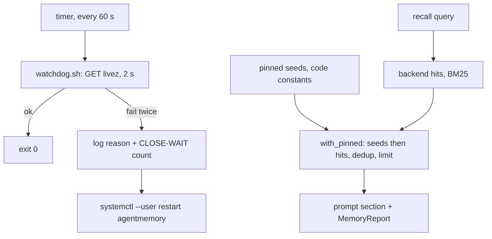

# The memory backend is watched and restarted, and the pinned seeds are recalled whatever the query words

## Intent

The agentmemory service wedged on 11-08 and nobody noticed until 11-12:
its unit restarts only on exit, and a process that no longer accepts
connections has not exited. After the restart, the six curated review
seeds come back 0 to 3 at a time depending on the words of the query,
because the backend is a BM25 word match. After this spec a timer
probes `livez` every minute and restarts a backend that fails twice in
a row, the unit stops in 20 s rather than 90 and is bounded in memory,
the pinned seeds of a scope are always part of what a reviewer or a
planner reads, and a test proves it.

## Context

Measured 2026-11-12 on the owner's host, read-only, and at the restart of 17:02.

| # | Fact | Where |
|---|---|---|
| F1 | The process had run since 11-08: 32 min of CPU, a 1.0 GB memory peak, a 914.8 MB swap peak. The accept queue of `:3111` was full with 125 sockets in `CLOSE-WAIT`; nothing was logged and `logs/agentmemory.log` had not been written since 11-08. `SIGTERM` timed out and systemd sent `SIGKILL` to the node CLI, the iii engine and the worker | `ps`, `ss`, `journalctl --user -u agentmemory` at 17:02 |
| F2 | The unit: `Type=simple`, `Restart=on-failure`, `RestartSec=10`, `TimeoutStopSec` at its 90 s default, no `WatchdogSec`, no `MemoryMax`, no `ExecStartPre`, output appended to `logs/agentmemory.log`. It is a hand-written file under `~/.config/systemd/user/`, not versioned in `deploy/systemd/` as the other units are | `systemctl --user show agentmemory -p Restart,RestartUSec,TimeoutStopUSec,MemoryMax,FragmentPath`; `deploy/systemd/README.md` |
| F3 | `Restart=on-failure` fires on a non-zero exit or a signal; a process that is alive and not accepting connections is `active (running)` to systemd and is never restarted | systemd.service(5) |
| F4 | The service exposes `GET /agentmemory/livez`; its own code calls it with 1 s and 2 s deadlines. `/agentmemory/export` (GET) and `/agentmemory/forget` (POST) exist too | `~/services/agentmemory/dist`, route strings |
| F5 | After the restart, `search` answers 200, but a search of the `repoach-review` scope returns 0 to 3 hits depending on the query, not the 6 seeds written by `seed_review_memory`; the backend ranks by BM25 word overlap and the review query is `review <pr title> <up to ten changed paths>` | `src/repoach/review/review_memory.py:20-31`, `:68-80`; `src/repoach/review/orchestrator.py:2749-2752` |
| F6 | The seeds are constants in the client code (`SEED_REVIEW_LESSONS`, six strings; `SEED_LESSONS`, seven strings); recall never reads them, only the service's answer | `src/repoach/review/review_memory.py:20-31`; `src/repoach/review/builder_memory.py:15-31` |
| F7 | `recall_review_lessons` returns the service's hits as the whole section; `review_lessons_section([])` returns `""`, so a backend that answers nothing removes the section entirely | `src/repoach/review/review_memory.py:34-66` |
| F8 | SP-MEMORY-FAIL-FAST names the state `unreachable` in the review report after one 1 s probe; it does not restart anything and does not say what to restart | `docs/specs/2026-11-12_SP-MEMORY-FAIL-FAST_*.md` D1–D3 |

## Decisions (2026-11-12)

- D1. The unit is versioned: `deploy/systemd/agentmemory.service` with
  `Restart=always`, `RestartSec=5`, `TimeoutStopSec=20`,
  `KillMode=mixed`, `MemoryHigh=1536M`, `MemoryMax=2048M` (F1: 1.0 GB
  peak plus swap; a backend past 2 GB is restarted, not swapped),
  `ExecStartPre` that rotates `logs/agentmemory.log` past 50 MB, and the
  same `ExecStart`, `WorkingDirectory` and `EnvironmentFile` as today.
  `WatchdogSec` is not used: the node process does not call
  `sd_notify`, so a systemd watchdog would restart a healthy service.
- D2. The liveness watchdog is a timer: `agentmemory-watchdog.timer`
  (`OnBootSec=2min`, `OnUnitActiveSec=60s`) runs
  `agentmemory-watchdog.sh`, which `GET`s `/agentmemory/livez` with a
  2 s deadline, twice 5 s apart on a failure, and on two failures
  writes one line to `logs/agentmemory-watchdog.log` naming the reason
  (`timeout`, `refused`, `http <code>`), the count of `CLOSE-WAIT`
  sockets on `:3111` and the unit's `ActiveEnterTimestamp`, then runs
  `systemctl --user restart agentmemory.service`. A healthy probe
  writes nothing. The script never restarts twice inside one
  `RestartSec` window of its own (a stamp file under `$XDG_RUNTIME_DIR`).
- D3. Pinned seeds: recall returns the scope's pinned seeds first, then
  the backend's hits with exact-text duplicates of a seed removed,
  capped as today. The seeds come from the code constants (F6), so the
  section never depends on BM25 or on whether `seed-review` was ever
  run against this backend; `seed-review` and `seed-builder` still
  write them so the backend's own search ranks them too. A scope with
  memory `off` still injects nothing (the switch is above the seeds).
- D4. The report of SP-MEMORY-FAIL-FAST gains, when the state is
  `unreachable` and the URL is a loopback address, the restart hint
  `; to restart: systemctl --user restart agentmemory.service`, so the
  job log says what to do on the host that runs the service.
- D5. The live behaviour of F5 is recorded by an integration test that
  runs only with `REPOACH_LIVE_MEMORY=1` against a real backend; it
  seeds a throwaway scope and reports how many seeds each query form
  returns. It is evidence for the owner, not a gate.

## Goals

- G1: `deploy/systemd/agentmemory.service`, `agentmemory-watchdog.service`, `agentmemory-watchdog.timer` and `agentmemory-watchdog.sh` exist with D1 and D2's knobs; `deploy/systemd/README.md` gains their install lines.
- G2: `tests/unit/test_agentmemory_units.py` parses the three units and asserts every knob of D1 and D2.
- G3: `tests/unit/test_agentmemory_watchdog_script.py` runs the script with a fake `curl` and a fake `systemctl` on `PATH`: one failure then success restarts nothing; two failures restart once and log the reason and the socket count; a third run inside the stamp window restarts nothing.
- G4: `recall_review_lessons` and `recall_builder_lessons` return the pinned seeds first and the hits after, deduplicated, with the kill-switch still returning `[]`; `MemoryReport.recalled` (SP-MEMORY-FAIL-FAST) shows the seeds with a `(pinned)` suffix and `recalled_total` counts both.
- G5: the stderr line and the archive line add the restart hint of D4 on a loopback URL only.
- G6: the live test of D5 exists, is skipped without `REPOACH_LIVE_MEMORY=1`, and prints per query form the number of seeds found.

## Non-Goals

- NG1: no change to the backend's code (`~/services/agentmemory` is a separate repository); no new endpoint.
- NG2: no probe from inside a review beyond SP-MEMORY-FAIL-FAST's one; the watchdog is the host's, not the job's.
- NG3: no per-repository scope or local store (SP-REVIEW-LESSONS-REACH-REVIEWERS, SP-REVIEW-MEMORY-STORE); the pinned seeds apply to whichever scope recall reads.
- NG4: no system-wide (`/etc/systemd/system`) unit: the service is a `--user` unit on the owner's host.

## Assumptions

- A1: `curl` and `ss` are on the owner's host (`iproute2` is part of the base system); the script says so and exits 3 when one is missing.
- A2: `systemctl --user` works from a timer unit of the same user (the user session's bus is available to its own timers).
- A3: the `--user` unit is reloaded by hand after the file is installed (`systemctl --user daemon-reload`); the README says it.

## Interface

```python
# src/repoach/memory/pinned.py
def with_pinned(seeds: Sequence[str], hits: Sequence[str], *, limit: int) -> list[str]:
    """Seeds first, then hits not equal to a seed, cut at limit."""
def pinned_label(text: str, seeds: Sequence[str]) -> str:
    """text + ' (pinned)' when text is a seed, else text (for the report)."""

# src/repoach/review/review_memory.py (changed)
def recall_review_lessons(query: str) -> list[str]   # with_pinned(SEED_REVIEW_LESSONS, hits, limit=…)
# src/repoach/review/builder_memory.py (changed)
def recall_builder_lessons(query: str) -> list[str]  # with_pinned(SEED_LESSONS, hits, limit=…)
```

Units (`deploy/systemd/`):

| File | Key lines |
|---|---|
| `agentmemory.service` | `Restart=always`, `RestartSec=5`, `TimeoutStopSec=20`, `KillMode=mixed`, `MemoryHigh=1536M`, `MemoryMax=2048M`, `ExecStartPre=%h/services/agentmemory/deploy/rotate-log.sh` or an inline `sh -c` that rotates past 50 MB, `StandardOutput=append:%h/services/agentmemory/logs/agentmemory.log` |
| `agentmemory-watchdog.service` | `Type=oneshot`, `ExecStart=%h/Documents/work/repoach/deploy/systemd/agentmemory-watchdog.sh` |
| `agentmemory-watchdog.timer` | `OnBootSec=2min`, `OnUnitActiveSec=60s`, `AccuracySec=5s`, `WantedBy=timers.target` |

Script `agentmemory-watchdog.sh`: env `AGENTMEMORY_URL` (default `http://127.0.0.1:3111`), `AGENTMEMORY_UNIT` (default `agentmemory.service`), `WATCHDOG_LOG` (default `%h/services/agentmemory/logs/agentmemory-watchdog.log`); exit 0 healthy or restarted, 3 a tool missing.

## Behavior

### Nominal
Every minute the script gets `livez` in under 2 s and exits 0 silently. A review's recall returns the six review seeds followed by up to the limit of backend hits.

### Edge cases
- the first probe fails, the second (5 s later) answers → nothing logged, no restart.
- the backend restarted less than 60 s ago (stamp present) and fails again → logged as `restart suppressed`, no second restart; the next timer tick may restart.
- a hit equal to a seed → listed once, in the seeds' position.
- limit smaller than the seed count → the seeds are cut first-to-last; hits are dropped.

### Failure scenarios
- `:3111` accepting but never answering (F1) → `timeout` twice → restart; the log line carries the `CLOSE-WAIT` count.
- `systemctl --user restart` fails → the script logs its exit code and exits 0 (the timer must keep ticking).
- the backend is down during a review → SP-MEMORY-FAIL-FAST: `unreachable` after 1 s, the pinned seeds are still injected (the seeds do not need the backend), the stderr line carries the restart hint.

## Tests

| Test | What it pins | Mutation that must turn it red |
|---|---|---|
| `tests/unit/test_agentmemory_units.py::test_service_unit_knobs` | every key of D1 with its value | set `Restart=on-failure` |
| `::test_timer_and_watchdog_units` | `OnUnitActiveSec=60s`, `Type=oneshot`, the script path | drop `OnUnitActiveSec` |
| `tests/unit/test_agentmemory_watchdog_script.py::test_one_failure_then_success_restarts_nothing` | fake `curl` fails once then succeeds: the fake `systemctl` records no call, the log is absent | restart on the first failure |
| `::test_two_failures_restart_once_and_log_reason_and_sockets` | fake `curl` fails twice (exit 28): one `restart agentmemory.service` call, one log line with `timeout`, the socket count from a fake `ss` | log without the reason |
| `::test_stamp_suppresses_a_second_restart` | two script runs inside the window: one restart | remove the stamp |
| `tests/unit/test_pinned_seeds_recalled.py::test_review_seeds_recalled_when_backend_returns_nothing` | fake `recall` returns `[]`: the section lists the six seeds in order | return the hits alone |
| `::test_builder_seeds_recalled_when_backend_returns_nothing` | the seven builder seeds, same rule | — |
| `::test_hit_equal_to_a_seed_is_not_duplicated` | hits `[seed[2], "other"]` → seeds then `other` | compare by prefix instead of equality |
| `::test_kill_switch_still_returns_nothing` | switch false → `[]`, no seeds | pin the seeds above the switch |
| `::test_report_marks_pinned_entries` | `MemoryReport.recalled` ends seeds with ` (pinned)` | — |
| `tests/integration/test_agentmemory_live_seeds.py` | with `REPOACH_LIVE_MEMORY=1`: seeds a throwaway scope, queries with the full seed text, its first six words, and the review query form; prints hits per form | n/a, evidence |

## Success conditions

- C1: on the owner's host, a backend that stops answering `livez` is restarted within `2 × 60 s + 5 s` without a person; verified by the timer's journal after a deliberate `kill -STOP` of the node process and `kill -CONT` after the restart line (owner's hands, once).
- C2: `systemctl --user stop agentmemory.service` completes in ≤ 20 s.
- C3: with the backend down, a review's `memory.recalled` still holds the six review seeds, each marked `(pinned)`.
- C4: `with_pinned` never returns a duplicate and never exceeds its limit; proven by the unit tests and a hypothesis property over random seed and hit lists.

## Architecture Impact
- Adds dependency: SP-MEMORY-BACKEND-LIVENESS -> SP-MEMORY-FAIL-FAST (`MemoryReport.recalled` shows the pinned mark; the restart hint joins its stderr line)
- Adds dependency: SP-MEMORY-BACKEND-LIVENESS -> SP-REVIEW-MEMORY, SP-BUILDER-MEMORY (the two recall functions call `with_pinned` with their own seed constants)
- `pinned.py` imports nothing of repoach; the units and the script are deploy artefacts with no import. No new table, no cycle.

## Diagram


## Acceptance Criteria
- [ ] AC1: `pytest -q tests/unit/test_agentmemory_units.py` → green: the three units carry every knob of D1 and D2. Today (`8fabb19`): no such files in `deploy/systemd/`.
- [ ] AC2: `pytest -q tests/unit/test_agentmemory_watchdog_script.py` → green: one failure restarts nothing, two failures restart once with the reason and the socket count logged, the stamp suppresses a second restart.
- [ ] AC3: `pytest -q tests/unit/test_pinned_seeds_recalled.py` → green: the seeds are recalled when the backend returns nothing, never duplicated, never above the switch. Today: a backend answering `[]` removes the section (F7).
- [ ] AC4: `REPOACH_LIVE_MEMORY=1 pytest -q tests/integration/test_agentmemory_live_seeds.py -s` on the owner's host → prints hits per query form; without the variable → skipped, with the reason.
- [ ] AC5: `repoach arch check --base origin/develop` → `edge-honesty: ok`; `deploy/systemd/README.md` names the four files and the `daemon-reload` / `enable --now agentmemory-watchdog.timer` lines.

## Open Questions
- Q1 (owner decision): install the versioned `agentmemory.service` over the hand-written one at `~/.config/systemd/user/agentmemory.service` (same `ExecStart`, new knobs), or keep the hand-written unit and add only the watchdog? Recommendation: install the versioned one; F2's knobs are the reason the outage lasted four days.
- Q2 (owner decision): the memory bound of D1 (`MemoryMax=2048M`): is 2 GB acceptable on the owner's host, or should the backend be allowed to grow and only be restarted by the watchdog? Recommendation: 2 GB; the measured peak was 1.0 GB and swap use is what made the stop time out.
- Q3 (owner decision): should the watchdog also restart on a `search` that answers 200 with zero hits for a pinned seed query (a semantic probe), or on `livez` alone? Recommendation: `livez` alone; D3 makes the seeds independent of the backend, so a zero-hit search is no longer a loss for the review.
