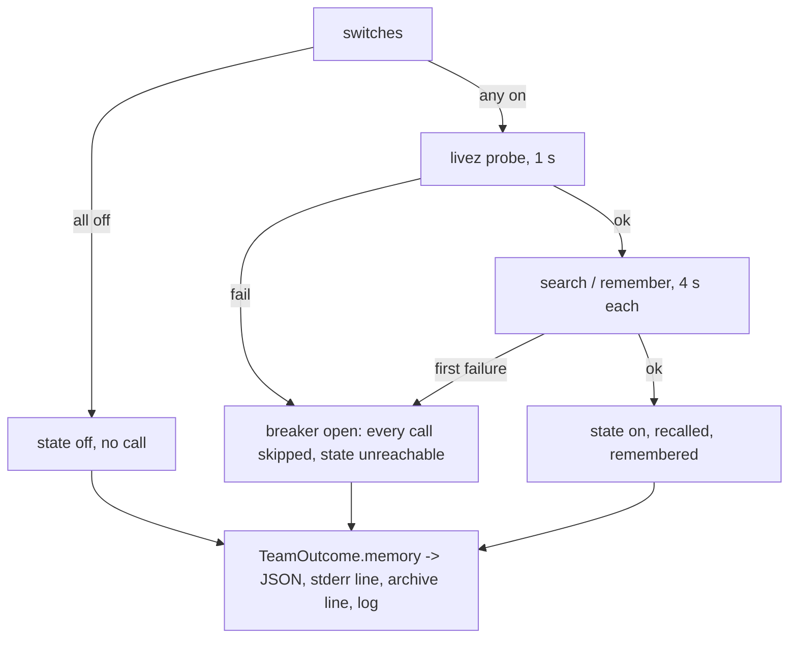

# An unreachable memory backend costs a review one probe, not twelve timeouts, and the report says so

## Intent

When the agentmemory service does not answer, every review today pays
one 4 s timeout per memory call, about 40 s per run, and nothing in
the job log, the JSON payload or the archive comment says that memory
was involved at all. After this spec a run probes the backend once,
opens a per-process breaker on the first failure, skips every later
call, and states in its report whether memory was `on`, `off` or
`unreachable`, with what was recalled and what was written.

## Context

Measured 2026-11-12, `origin/develop` `8fabb19`, and on Yoob's
`review:gate` job, which runs `repoach review pr` on the owner's host
through `yoob_2/ci/review-gate.sh`.

| # | Fact | Where |
|---|---|---|
| F1 | In the 10 latest `review:gate` traces, recall failed every time with `agentmemory_recall_failed ConnectTimeout` and `review_team.lessons_recalled n_lessons=0`, and each run logged 5 to 12 `agentmemory_remember_failed` lines. The REST port 3111 was wedged: accept queue full, 125 sockets in `CLOSE-WAIT`, nothing written to `agentmemory.log` since 11-08 | job logs of `review:gate`; `ss` on the owner's host at 17:02 |
| F2 | Each failed call waits the client's full timeout: `recall(..., timeout_s=4.0)` and `remember(..., timeout_s=4.0)`; both catch every exception, log a warning and return `[]` / `False`. Nothing remembers that the previous call failed, so the twelfth call waits as long as the first | `src/repoach/memory/agentmemory_client.py:18-25`, `:46-52`, `:65-72`, `:95-101` |
| F3 | One run makes one recall (`_build_review_lessons_block`, once per run) and one `remember` per distilled lesson at cycle end (`remember_verified_findings`); with 5 to 12 lessons that is 24 to 52 s of timeouts per review | `src/repoach/review/orchestrator.py:829`, `:1799`, `:2741-2754`; `src/repoach/review/review_lessons.py:137-141` |
| F4 | The three switches default to `True` and the URL defaults to `http://localhost:3111`, so a `repoach review pr` with no memory variable set calls the service | `src/repoach/core/config.py:406-443` |
| F5 | `repoach ci review` decides memory per job: `memory_off_note` turns the three switches off in a CI job or when a 1 s TCP connect to the URL fails, and prints the reason in its `notes`. `repoach review pr` has no such step: `review-gate.sh` calls it directly with `REPOACH_FORGE`, `REPOACH_PROVIDER`, the gateway URL and token, and no memory variable, so F4 applies | `src/repoach/ci_entry/advisory.py:439-480`, `:748-756`; `yoob_2/ci/review-gate.sh:272-281` |
| F6 | The `review pr` JSON has no memory key (`_REQUIRED_TOP_LEVEL` names seventeen fields, none about memory); the only trace is the `review_team.lessons_recalled` info line and the client's warnings. SP-MEMORY-LOOPS-EXPLICIT G2 (draft) asked for a `memory` object with `enabled`, `scope`, `recalled`, `remembered`; nothing of it is implemented | `src/repoach/cli/review_cmds.py:470-500`; `tests/unit/test_review_ci_mode.py:84-102`; `docs/specs/2026-10-19_SP-MEMORY-LOOPS-EXPLICIT_*.md` |
| F7 | The service exposes `GET /agentmemory/livez`; its own code probes it with 1 s and 2 s deadlines | `~/services/agentmemory/dist` (route table), read 2026-11-12 |
| F8 | After the restart at 17:03 the service answers `200` to search, so an outage of this kind is invisible to the next run unless the run says what it saw | `systemctl --user show agentmemory` (`ActiveEnterTimestamp=2026-11-12 17:03:54`) |

## Decisions (2026-11-12)

- D1. One breaker per process, in the memory client, not in the callers:
  `recall` and `remember` ask `MemoryBreaker` before any HTTP call. The
  breaker opens on the first transport failure (connect error, connect
  or read timeout, 5xx, malformed body) and stays open for the rest of
  the process; a review run is one process, so the cost of a dead
  backend is bounded by one failure. There is no half-open state and no
  TTL: a run never re-tests a backend that failed in that run.
- D2. The first call is preceded by one `GET /agentmemory/livez` with
  `memory_probe_timeout_s` = 1 s (F7). A probe that fails opens the
  breaker without the 4 s call timeout ever being paid. A probe that
  succeeds is remembered; it is made once per process.
- D3. The state is a value, not a log line: `MemoryState` is `off` when
  no switch is on, `unreachable` when the breaker opened, `on`
  otherwise. It is carried by `TeamOutcome`, printed as a `memory`
  object in the `review pr` JSON, as one stderr line, and as one log
  event `review_team.memory_state`; the archive comment carries the
  one-line form. `_REQUIRED_TOP_LEVEL` gains `memory`.
- D4. `review pr` keeps F4's defaults: it does not copy `ci review`'s
  CI-job rule, because on Yoob the job runs on the owner's host where
  the service lives (F5) and the probe of D2 decides in 1 s. Owner
  decision Q1 below records the alternative.
- D5. SP-MEMORY-LOOPS-EXPLICIT G2 is delivered here with `state` in
  place of `enabled` (its `loops` sub-object kept); that draft is
  amended to point here and keeps G1, G3 and G5.

## Goals

- G1: a run against a backend that does not answer makes exactly one HTTP attempt (the probe), waits at most 1 s, and makes no `search` or `remember` call; the log holds one `agentmemory_unreachable` warning naming the URL, the probe error and the elapsed time, and one `agentmemory_breaker_open` debug line per skipped call.
- G2: a backend that answers the probe then fails on a later call opens the breaker on that failure; the calls after it are skipped.
- G3: `review pr` JSON carries `memory: {state, backend, url, scope, loops: {recall, builder, lessons}, probe: {ok, ms, error}, recalled: [...], recalled_total, remembered, skipped}`; the stderr line reads `repoach: memory: on, scope <project>, 6 lessons recalled, 3 written`, `repoach: memory: off (REPOACH_REVIEW_MEMORY_ENABLED=false)` or `repoach: memory: unreachable (http://localhost:3111: livez ConnectTimeout after 1.0 s); 0 recalled, 7 not written`.
- G4: the archive comment's status block gains one line, `memory: <state>, <n> recalled, <m> written`.
- G5: the `memory_off_note` of `ci review` is unchanged and its notes still say why memory was turned off; a `review pr` child it spawns with the switches set to `false` reports `state: off` with the switch that did it.
- G6: `reset_memory_breaker()` exists for tests; the unit suite's autouse fixture resets it, so no test inherits another's open breaker.

## Non-Goals

- NG1: no change to what is recalled or remembered, to the scopes, or to the seeds (SP-REVIEW-LESSONS-REACH-REVIEWERS, SP-MEMORY-BACKEND-LIVENESS).
- NG2: no retry of a failed memory call, no background re-probe, no TTL: the backend's own health is SP-MEMORY-BACKEND-LIVENESS's business.
- NG3: no change to the three switches' defaults (SP-MEMORY-LOOPS-EXPLICIT G1 stays where it is).
- NG4: no new backend.

## Assumptions

- A1: `httpx` raises `httpx.ConnectTimeout`, `httpx.ConnectError`, `httpx.ReadTimeout` and `httpx.HTTPStatusError` for the four failures the breaker counts; a JSON decode error is the fifth.
- A2: `TeamOutcome` is the one object `review_cmds.py` serialises, so a field added there reaches the JSON, the stderr line and the archive comment through existing paths.
- A3: a review run is one process; a long-lived process that embeds the client (the threads server) resets the breaker itself per unit of work, which is out of scope here and noted in its spec.

## Interface

```python
# src/repoach/memory/breaker.py
class MemoryBreaker:
    """Per-process state of the memory backend: unknown, closed or open."""
    def allow(self) -> bool: ...
    def record_failure(self, *, stage: Literal["probe", "search", "remember"], error: str) -> None: ...
    def record_success(self) -> None: ...
    @property
    def open(self) -> bool: ...
    @property
    def first_error(self) -> str | None: ...

def memory_breaker() -> MemoryBreaker: ...
def reset_memory_breaker() -> None: ...
def probe_liveness(base_url: str, *, timeout_s: float = 1.0) -> ProbeResult: ...

class ProbeResult(BaseModel):
    ok: bool
    ms: int
    error: str | None

# src/repoach/memory/agentmemory_client.py (changed)
def recall(query, *, project, base_url, limit=5, timeout_s=4.0) -> list[str]: ...   # asks the breaker first
def remember(content, *, project, base_url, mem_type="lesson", timeout_s=4.0) -> bool: ...

# src/repoach/memory/state.py
class MemoryState(StrEnum):
    ON = "on"; OFF = "off"; UNREACHABLE = "unreachable"

class MemoryReport(BaseModel):
    state: MemoryState
    backend: Literal["agentmemory"]
    url: str
    scope: str
    loops: dict[Literal["recall", "builder", "lessons"], bool]
    probe: ProbeResult | None
    recalled: list[str]          # capped at recalled_lessons_shown_max
    recalled_total: int
    remembered: int
    skipped: int                  # calls the breaker refused
    off_reason: str | None        # the switch that turned it off

def memory_report(settings, *, scope, recalled, remembered) -> MemoryReport: ...
def render_memory_line(report: MemoryReport) -> str: ...
```

Inputs: the three `REPOACH_*_ENABLED` switches and `REPOACH_AGENTMEMORY_URL` as today.

Outputs: `TeamOutcome.memory: MemoryReport`; `review pr` JSON key `memory`; one stderr line; log events `agentmemory_unreachable`, `agentmemory_breaker_open`, `review_team.memory_state`.

Errors: none new; the client still never raises.

## Behavior

### Nominal
Switches on, service up: the probe answers in under 1 s, `recall` runs once, `remember` runs per lesson, `state: on`, `recalled` lists the injected lessons verbatim, `remembered` counts the accepted writes.

### Edge cases
- all switches off → no probe, no call, `state: off`, `off_reason` names the first switch found false, `probe: null`.
- recall switch on, lessons switch off → `loops: {recall: true, builder: false, lessons: false}`, `state` decided by the probe.
- more than 20 lessons recalled → `recalled` holds the first 20, `recalled_total` the count.
- the probe succeeds and the search then times out → breaker opens at the search, `skipped` counts the `remember` calls not made, `state: unreachable`, `probe.ok: true`.

### Failure scenarios
- port closed (`ConnectError`) → probe fails in milliseconds, `state: unreachable`, the run is otherwise unchanged.
- port open but wedged (F1) → probe `ConnectTimeout` after 1.0 s, same outcome; total memory cost of the run ≤ 1.0 s.
- a URL whose host does not resolve → probe fails with the resolver's error, same outcome.

## Tests

| Test | What it pins | Mutation that must turn it red |
|---|---|---|
| `tests/unit/test_memory_fail_fast.py::test_probe_failure_makes_no_search_or_remember_call` | a fake transport whose `livez` raises `ConnectTimeout`: one request recorded, `recall` → `[]`, seven `remember` → `False`, zero further requests, elapsed under 1.5 s with a 1 s probe | remove the `allow()` check from `remember` |
| `::test_breaker_opens_on_first_call_failure_after_a_good_probe` | probe 200, search `ReadTimeout`: the next `remember` makes no request | set `memory_failures_to_open` to 2 |
| `::test_breaker_is_per_process_and_resettable` | an open breaker survives a second `recall`; `reset_memory_breaker()` closes it and the next call probes again | make `allow()` re-probe after N seconds |
| `::test_malformed_body_opens_the_breaker` | search answers 200 with `not json` | treat a decode error as an empty result without recording a failure |
| `tests/unit/test_memory_state_in_report.py::test_payload_carries_memory_object_in_each_state` | `review pr` on a fake orchestrator in the three states; `memory` in `_REQUIRED_TOP_LEVEL`; `state`, `probe`, `recalled`, `remembered`, `skipped`, `off_reason` as specified | drop `skipped` from the model |
| `::test_stderr_line_names_url_error_and_counts_when_unreachable` | the exact line of G3 | print the state without the probe error |
| `::test_archive_comment_has_one_memory_line` | the archive body matches `^memory: (on\|off\|unreachable), \d+ recalled, \d+ written$` once | omit the line in `state: off` |
| `::test_ci_review_child_reports_off_with_the_switch` | `ci review` in a CI env spawns a child whose payload says `state: off`, `off_reason: REPOACH_REVIEW_MEMORY_ENABLED=false` | report `off` with no reason |
| `tests/unit/test_review_ci_mode.py` | the schema pin, extended | — |

## Success conditions

- C1: on a wedged port (F1 reproduced with a listening socket that never accepts: `socket.listen(0)` and a filled backlog in the test), a review's memory cost is one probe of ≤ 1.0 s; measured by the test's fake clock and by a wall-clock bound of 1.5 s.
- C2: the number of HTTP attempts a run makes against a dead backend is 1, whatever the number of lessons to write.
- C3: `jq .memory.state review-gate.json` on Yoob's job answers one of `on`, `off`, `unreachable`, and the job log holds the matching `repoach: memory:` line.
- C4: a run with memory `off` makes zero HTTP attempts and the payload says which switch turned it off.
- C5: no existing test of the review payload, the archive comment or `ci review` changes its expectation except by the addition of the `memory` key and line.

## Architecture Impact
- Adds dependency: SP-MEMORY-FAIL-FAST -> SP-DB-PATH-XDG (the three switches and the URL live in `core/config.py`, owned there; read, not changed)
- Adds dependency: SP-MEMORY-FAIL-FAST -> SP-ORCH-DOCSTRING (`TeamOutcome` gains `memory`; the orchestrator builds it at cycle end)
- Adds dependency: SP-MEMORY-FAIL-FAST -> SP-CLI-STDOUT-ONE-JSON (the payload key and the stderr line obey the one-JSON rule)
- Adds dependency: SP-MEMORY-FAIL-FAST -> SP-UNIVERSAL-CI-ENTRY (`memory_off_note` stays the CI-job rule; the child's `off_reason` names its switch)
- Adds dependency: SP-MEMORY-FAIL-FAST -> SP-REVIEW-MEMORY, SP-BUILDER-MEMORY, SP-REVIEW-LESSONS (the three callers of the client; their modules are changed only to pass counts up)
- Adds dependency: SP-MEMORY-FAIL-FAST -> SP-MEMORY-LOOPS-EXPLICIT (its G2 is delivered here, amended)
- `breaker.py` and `state.py` import `core.logging` and `httpx` only; `agentmemory_client.py` imports `breaker.py`; nothing in `memory/` imports `review/`. No cycle, no new table.

## Diagram


## Acceptance Criteria
- [ ] AC1: `pytest -q tests/unit/test_memory_fail_fast.py` → green: a failed probe makes no search or remember call; a failed search after a good probe opens the breaker; the breaker is per process and resettable; a malformed body opens it. Today (`8fabb19`): the file does not exist and every call waits 4 s.
- [ ] AC2: `pytest -q tests/unit/test_memory_state_in_report.py tests/unit/test_review_ci_mode.py` → green: `memory` is a required top-level key, the three states serialise as specified, the stderr line and the archive line match G3 and G4, a `ci review` child reports `off` with its switch. Today: `jq .memory` → `null`.
- [ ] AC3: `pytest -q tests/unit/test_agentmemory_client.py tests/unit/test_review_memory.py tests/unit/test_builder_memory.py tests/unit/test_review_lessons.py` → green with the breaker in place (the autouse reset of G6 applied).
- [ ] AC4: `repoach arch check --base origin/develop` → `edge-honesty: ok`.
- [ ] AC5: `docs/merge_gate.md` gains a section naming the three memory states, the probe and the breaker, and `docs/specs/2026-10-19_SP-MEMORY-LOOPS-EXPLICIT_*.md` carries an amendment pointing its G2 here.

## Open Questions
- Q1 (decided by owner 2026-11-12: no; keep D4, the 1 s probe decides): should `repoach review pr` adopt `ci review`'s rule and turn memory off by default in a CI job (`CI=true`, `GITLAB_CI`, `GITHUB_ACTIONS`) unless a switch is set? Recommendation: no; keep D4, since Yoob's job runs where the service lives and the 1 s probe already bounds the cost, and because SP-REVIEW-MEMORY-STORE removes the network from the review loop.
- Q2 (decided by owner 2026-11-12: counts only): should the archive comment carry the recalled lessons themselves (not only the counts), for inspection from the merge request? Recommendation: counts only in the comment, the texts in the JSON payload and `--explain-memory` (SP-MEMORY-LOOPS-EXPLICIT G3), so the comment stays one line.
