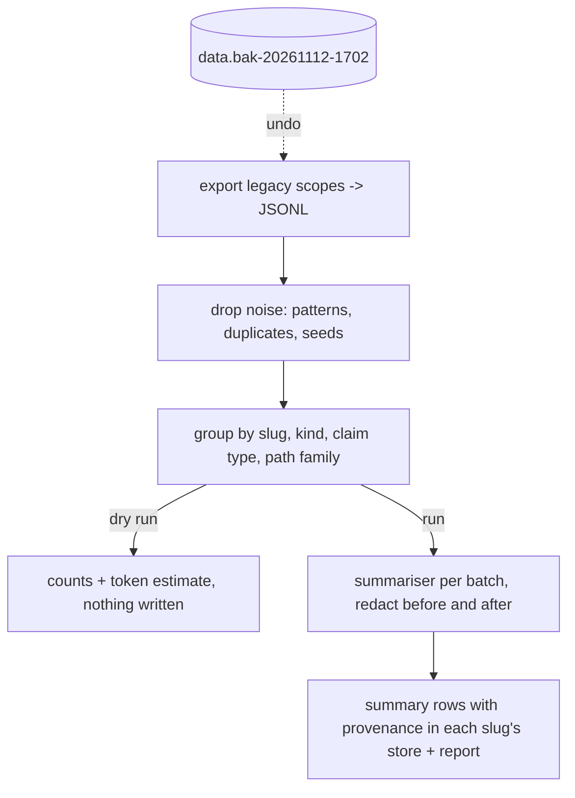

# One-shot migration of the legacy agentmemory scopes into the per-repository store

## Intent

The global `repoach-builder` scope holds about 12 871 entries written
since June: build outcomes, review lessons and the fixtures of every
test run that reached the live backend. The owner decided on
2026-11-12 that old entries are summarised to free space rather than
orphaned or deleted. This component runs once: it drops the test
noise, groups what is left by repository and claim type, writes a few
consolidated lessons per group into the store of SP-REVIEW-MEMORY-STORE
with their provenance, keeps the backend's backup as the undo, prints
counts only in its dry run, and says which model summarises and what
it costs in tokens.

## Context

Measured 2026-11-12, `origin/develop` `8fabb19`, backend read-only.

| # | Fact | Where |
|---|---|---|
| F1 | The global `repoach-builder` scope holds about 12 871 entries; among them `missing test_never_written_symbol` (from `tests/unit/test_review_team.py:631` through `remember_verified_findings`) and `Built SP-MULTI …` (from `tests/unit/test_review_dev_cli_explore_via.py:163-186` through `src/repoach/cli/review_cmds.py:1399`); the global `repoach-review` scope holds the six seeds | count read from the backend; SP-REVIEW-LESSONS-REACH-REVIEWERS F6 |
| F2 | Three writers produced the legacy texts, each with a fixed shape: `remember_build_outcome` (`Built <spec>: pushed, <n> step(s) green.`, `<spec> stalled: <reason>`, `<spec> produced no push (<n> step(s)).`), `remember_verified_findings` (`[<claim_type>] <file> — <claim[:200]>`), and the seeds | `src/repoach/review/builder_memory.py:69-99`; `src/repoach/review/review_lessons.py:87-111`, `:15-31` |
| F3 | A legacy entry carries no repository: the scopes were global. Its text does: a path under `src/repoach/`, `tests/`, `prompts/review/` or a spec id `SP-…` is repoach's; a path under `src/yoob/`, `api/`, `frontend/`, `ci/` is Yoob's (the W1 dry run of 2026-10-18 ran from the `yoob_2` checkout) | SP-MEMORY-LOOPS-EXPLICIT F6; the two repositories' layouts |
| F4 | The backend exposes `GET /agentmemory/export` and `POST /agentmemory/forget`; the export's row shape and the forget body shape are not read from any client here. A backup of the data directory taken before the restart of 17:02 exists: `~/services/agentmemory/data.bak-20261112-1702` | `~/services/agentmemory/dist` (route strings); directory listing |
| F5 | SP-REVIEW-MEMORY-STORE D8–D9 define the `summary` row (text ≤ 240 chars, `source_count`, `first_seen`, `last_seen`, `confirmed_ratio`), the summariser tier, the redaction net before and after the model, the mechanical form, and the dry run; this migration reuses them and adds nothing to the row | `docs/specs/2026-11-12_SP-REVIEW-MEMORY-STORE_*.md` |
| F6 | Token arithmetic, upper bound before noise is dropped: 12 871 entries × about 160 characters ≈ 2.06 M characters ≈ 515 k input tokens at 4 characters per token; grouped into batches of at most 8 000 tokens that is at most about 70 model calls, plus about 300 tokens of prompt each; output about 300 tokens per group. The dry run replaces this arithmetic by a count over the real export | arithmetic on F1 and F2's shapes |

## Decisions (2026-11-12)

- D1. Input is the backend's export, not its search: `repoach memory
  migrate-legacy` reads `GET /agentmemory/export` for each legacy scope
  (`repoach-builder`, `repoach-review`) into a JSONL file under the
  user data directory (`legacy-export-<scope>-<date>.jsonl`), and
  every later stage reads that file, so the backend is read once and
  the stages can be re-run from the file. A `--from <file>` flag reads
  a file instead of the backend.
- D2. Stage 1, drop the noise: an entry matching any `NOISE_PATTERNS`
  (the list of SP-REVIEW-LESSONS-REACH-REVIEWERS G5, plus a `Built
  <spec>` whose spec id is absent from `docs/specs/`, and an exact
  duplicate of an entry already kept) is counted and dropped. Seeds
  found in either scope are dropped too: the store adds them itself.
- D3. Stage 2, group: each kept entry is attributed to a repository by
  F3's table (`--slug-map` overrides it; an entry no rule matches goes
  to the repository the command runs in and is counted as
  `unattributed`), then grouped by `(slug, kind, claim_type, path
  family)` where kind is `confirmed` for a `[claim_type]` lesson,
  `build` for a build outcome (claim type `build_outcome`, path family
  the spec id), and the path family is the first two path segments.
- D4. Stage 3, summarise: each group becomes one `summary` row of the
  slug's store through `memory_compact`'s summariser (F5): texts
  redacted before, the answer scanned after, the mechanical form on a
  hit, `source_count` the group size, `first_seen` and `last_seen` from
  the entries' timestamps (the export's, or the migration day when the
  export carries none, said in the report), `confirmed_ratio` 1.0 for
  `confirmed` groups and the pushed share for `build` groups. A group of
  one or two entries is written as `confirmed` rows as they are
  (redacted), not summarised. Groups are batched by
  `summariser_batch_max_tokens`; a group larger than a batch is split
  by date and its summaries merged by a second call.
- D5. Provenance on every written row: `source_pr` null, `source_finding_key`
  `legacy:<scope>:<sha256 of the export file>[:12]`, and a line per
  group in the migration report naming the scope, the group key, the
  source count and the date range. The report is written beside the
  export as `legacy-migration-<date>.json`.
- D6. The undo is the backup (F4): the migration deletes nothing from
  the backend. The legacy scopes stay as they are after the run; whether
  to `forget` them is a later owner decision once `forget`'s body
  shape is read from the backend's source. `--purge-target` empties the
  target stores' `legacy:*` rows before writing, so a re-run after a
  bad summariser answer is the same as a first run.
- D7. `--dry-run` runs stages 1 and 2 and prints counts only: entries
  read per scope, dropped per noise pattern, kept, groups per slug and
  claim type, entries `unattributed`, the token estimate (input: kept
  characters ÷ 4 plus prompt tokens per batch; output: 300 per summarised
  group) and the number of model calls: one per batch of each summarised
  group plus one merge call per split group; a group of one or two
  entries is written as rows and costs no call (D4). It opens no store and calls no model.
- D8. The summariser is the `sonnet` tier through the configured
  provider unless `--summariser` names `haiku`, `opus` or `none` (owner
  decision Q1 of this spec records the choice; SP-REVIEW-MEMORY-STORE
  Q6 the default for ongoing compaction). On the owner's host the
  chain's `claude_code` tail serves `sonnet` under the subscription;
  the cost in tokens is F6's bound before the dry run and the dry
  run's count after; the usage rows of the calls are recorded as any
  call's (SP-USAGE-LEDGER), so `repoach usage` shows what it cost.

## Goals

- G1: `repoach memory migrate-legacy [--dry-run] [--from FILE] [--scope NAME]... [--slug-map a=b]... [--summariser TIER] [--purge-target] [--json]` runs D1–D8 and prints the report; exit 0, 2 on a refused input (no export, a slug map that names no store), 3 when the summariser is unavailable (stages 1 and 2 done, nothing written).
- G2: `tests/fixtures/memory/legacy_export_sample.jsonl` holds 60 synthetic entries in F2's shapes, with noise, duplicates, both repositories' paths, two build outcomes per spec and a planted secret, and its 37 kept entries fall into 9 groups of which 2 hold one or two entries; the unit test drives every stage from it with a fake summariser.
- G3: the dry run on the sample prints `read 60, dropped 23 (test_never_written 8, SP-MULTI 6, duplicate 7, seed 2), kept 37, groups 9 (summarised 7, rows 2), unattributed 1, tokens in ≈ …, out ≈ 2100, model calls 7` and writes no file but the report.
- G4: after a real run, `repoach memory list --kind summary` in the repoach checkout lists rows whose `source_finding_key` starts with `legacy:repoach-builder:` and whose `source_count` sums to the kept count of the report.

## Non-Goals

- NG1: no deletion on the backend; no `forget` call.
- NG2: no migration of the per-MR ledgers; only the two legacy agentmemory scopes.
- NG3: no change to the summary row or the redaction net (owned by SP-REVIEW-MEMORY-STORE).
- NG4: no scheduled or repeated run: once, by hand, by the owner; the command refuses to run twice against the same export hash unless `--purge-target`.

## Assumptions

- A1: the export answers JSON rows carrying at least `project`, the text (`observation.narrative` or `content`) and a timestamp; the reader accepts both field names and says in the report which it found; a row with no text is counted as `unreadable` and dropped.
- A2: the backend is up for the export (SP-MEMORY-BACKEND-LIVENESS); a probe failure ends the command with exit 3 before any stage.

## Interface

```python
# src/repoach/review/memory_migrate.py
NOISE_PATTERNS: tuple[re.Pattern[str], ...]      # imported from SP-REVIEW-LESSONS-REACH-REVIEWERS's audit
SLUG_RULES: tuple[tuple[str, str], ...]          # (path or id prefix, slug) — F3
class LegacyEntry(BaseModel): scope: str; text: str; seen_at: date | None
class LegacyGroup(BaseModel): slug: str; kind: Literal["confirmed", "build"]; claim_type: str; path_family: str; entries: list[LegacyEntry]
class MigrationReport(BaseModel):
    read: dict[str, int]; dropped: dict[str, int]; kept: int; unattributed: int
    groups: list[GroupLine]; tokens_in_est: int; tokens_out_est: int; model_calls: int
    written: dict[str, int]; dry_run: bool; export_sha256: str; summariser: str
def export_scope(base_url: str, scope: str, out: Path) -> Path: ...
def read_export(path: Path) -> list[LegacyEntry]: ...
def drop_noise(entries, *, spec_ids: frozenset[str]) -> tuple[list[LegacyEntry], dict[str, int]]: ...
def group(entries, *, default_slug: str, slug_map: Mapping[str, str]) -> tuple[list[LegacyGroup], int]: ...
def estimate_tokens(groups) -> tuple[int, int, int]: ...
def migrate(groups, *, stores: Callable[[str], Store], summariser, now, dry_run: bool) -> MigrationReport: ...
```

Outputs: the report on stdout (`--json` one object), the export and report files under the user data directory, `summary` and `confirmed` rows in each slug's store.

Errors: `MigrationRefusedError` (rc 2: `no export`, `unknown slug <x>`, `already migrated <sha>`), `SummariserUnavailableError` (rc 3).

## Behavior

### Nominal
`repoach memory migrate-legacy --dry-run` prints the counts and the
token estimate; the owner reads them; `repoach memory migrate-legacy`
exports once, drops the noise, groups, calls the summariser once per
batch, writes the summaries with provenance into
`~/.local/share/repoach/github.com/repoachhq/repoach/memory.db` and the
Yoob store for Yoob's groups, and writes the report. The backend is
unchanged; the backup stays.

### Edge cases
- the export carries no timestamps → `first_seen = last_seen =` the migration day, `dates: migration_day` in the report.
- a group with one or two entries → written as `confirmed` rows, redacted, not summarised.
- a `Built SP-X` whose spec exists → kept in the `build` group of `SP-X`; the ratio is the pushed share.
- `--slug-map src/vendor=github.com/acme/vendor` → entries under `src/vendor/` go to that slug's store; the store is created if absent.
- a second run with the same export → `already migrated <sha>`, rc 2; with `--purge-target` → the `legacy:*` rows are removed and rewritten.

### Failure scenarios
- the summariser fails on batch 7 of 70 → the batches written so far stay, the report says `written … , failed at batch 7: <error>`, rc 3; a re-run with `--purge-target` restarts.
- the planted secret of G2 → absent from every written row and from the report (the report carries counts and keys, never texts).
- the backend is down → rc 3 before the export, `unreachable (<probe error>)`; `--from FILE` still works.

## Tests

| Test | What it pins | Mutation that must turn it red |
|---|---|---|
| `tests/unit/test_memory_legacy_migration.py::test_noise_patterns_drop_the_measured_fixtures` | the sample's `test_never_written`, `SP-MULTI`, duplicates and seeds are dropped with the counts of G3 | remove the duplicate rule |
| `::test_entries_are_attributed_by_path_and_spec_id` | `src/repoach/…` and `SP-…` → repoach's slug; `src/yoob/…` → Yoob's; an unknown path → the default slug and `unattributed 1` | attribute everything to the default |
| `::test_groups_by_slug_kind_claim_type_and_path_family` | 9 groups on the sample, keys as D3 | group by full path |
| `::test_summary_rows_carry_provenance_counts_and_dates` | each written summary: `source_finding_key` `legacy:<scope>:<sha12>`, `source_count` the group size, `first_seen`/`last_seen` from the entries, ratio as D4 | drop the provenance key |
| `::test_small_groups_are_written_as_rows_not_summaries` | the sample's two one- and two-entry groups → `confirmed` rows, and the fake summariser is called 7 times, not 9 | summarise them |
| `::test_dry_run_prints_counts_and_writes_nothing` | no store file created, the fake summariser never called, the report has every count and the token estimate | open the store in dry run |
| `::test_planted_secret_never_reaches_a_row_or_the_report` | a 40-character `ghp_`-prefixed token and an email built at run time in two old entries: absent from every row and from the report JSON | skip redaction for legacy rows |
| `::test_second_run_refused_and_purge_target_rewrites` | same export → rc 2; `--purge-target` → the same rows, once | drop the export hash check |
| `::test_summariser_failure_keeps_written_batches_and_names_the_batch` | a fake failing on batch 2 → batch 1's rows present, rc 3, the report names batch 2 | roll back everything |
| `::test_missing_timestamps_use_migration_day` | an export without timestamps → every summary has `first_seen = last_seen =` the migration day and the report says `dates: migration_day` | take the epoch |
| `::test_slug_map_routes_entries_and_creates_the_store` | `--slug-map src/vendor=github.com/acme/vendor` → the `src/vendor/` entries land in that slug's store, created if absent; a map naming no store path is refused, rc 2 | ignore the map |
| `::test_token_estimate_is_chars_over_four_plus_prompt` | on the sample, `tokens_in_est == sum(len(text))//4 + 300*batches` | — |

## Success conditions

- C1: `repoach memory migrate-legacy --dry-run` on the owner's host prints the counts over the real export; the input-token estimate is at most F6's 515 k bound; `sha256sum` of every store is unchanged.
- C2: after the real run, the sum of `source_count` over the `legacy:*` summaries plus the `legacy:*` `confirmed` rows equals the report's `kept`; `repoach usage --since <today>` shows the calls, their tokens and the tier.
- C3: no planted or real secret reaches a store: `grep -cE "<net patterns>"` over `.dump` of every target store is 0 after the run.
- C4: the backend's export count per legacy scope is the same before and after (nothing deleted); the backup directory is untouched (`stat` mtime unchanged).
- C5: a reviewer prompt of the next repoach review shows at least one `[summary]` line with `legacy` provenance in `memory.recalled`.

## Architecture Impact
- Adds dependency: SP-MEMORY-LEGACY-MIGRATION -> SP-REVIEW-MEMORY-STORE (the target store, the `summary` row, `memory_compact`'s summariser, `memory_redact`)
- Adds dependency: SP-MEMORY-LEGACY-MIGRATION -> SP-REVIEW-LESSONS-REACH-REVIEWERS (`NOISE_PATTERNS` and the legacy scope names)
- Adds dependency: SP-MEMORY-LEGACY-MIGRATION -> SP-UNIVERSAL-INSTALL (`user_data_dir`, `project_slug` for the default slug)
- Adds dependency: SP-MEMORY-LEGACY-MIGRATION -> SP-UNIVERSAL-PROVIDERS (the summariser calls go through the configured provider and are recorded)
- Adds dependency: SP-MEMORY-LEGACY-MIGRATION -> SP-BUILDER-MEMORY, SP-REVIEW-MEMORY (F2's text shapes, parsed back; the seed constants, dropped)
- One command, run once; `memory_migrate.py` imports `memory_store.py`, `memory_compact.py`, `memory_redact.py`, `memory/scopes.py`, `core/paths.py`; nothing imports it but its CLI. No table, no cycle.

## Diagram


## Acceptance Criteria
- [ ] AC1: `pytest -q tests/unit/test_memory_legacy_migration.py` → green: the sample's noise is dropped with the counts of G3, entries are attributed and grouped as D3, summaries carry provenance, counts and dates, small groups are rows, the dry run writes nothing, a planted secret reaches neither a row nor the report, a second run is refused without `--purge-target`, a failed batch keeps the earlier ones, the token estimate is the stated arithmetic. Today (`8fabb19`): nothing of it exists.
- [ ] AC2: `repoach memory migrate-legacy --dry-run --from tests/fixtures/memory/legacy_export_sample.jsonl` → the G3 line, rc 0, no store file created under a temporary `XDG_DATA_HOME`.
- [ ] AC3: `repoach arch check --base origin/develop` → `edge-honesty: ok`; `docs/merge_gate.md`'s store section names the migration command and the backup as its undo.

## Open Questions
- Q1 (decided by owner 2026-11-12: sonnet; none only if the dry run's count surprises): the summariser for the one-shot run: `sonnet` through the owner's gateway (bounded by F6 at about 515 k input and 21 k output tokens before the dry run's count, served by the `claude_code` tail under the subscription), `haiku`, or `none` (mechanical summaries, no model, no cost)? Recommendation: `sonnet`; the dry run's count is read first, and `none` is the answer only if that count surprises.
- Q2 (decided by owner 2026-11-12: the repoach store): entries no rule attributes (`unattributed`): the repository the command runs in (repoach), or a `legacy/unknown` store nobody recalls? Recommendation: repoach's store; every legacy writer ran from the repoach checkout except the W1 dry run, whose paths F3 recognises.
- Q3 (decided by owner 2026-11-12: leave them until SP-REVIEW-MEMORY-STORE Q3 retires the agentmemory review scope; one decision for both): after a verified run, `forget` the legacy scopes on the backend (once the body shape is read) or leave them with the backup as the only copy that matters? Recommendation: leave them until SP-REVIEW-MEMORY-STORE Q3 retires the agentmemory review scope; one decision for both.
