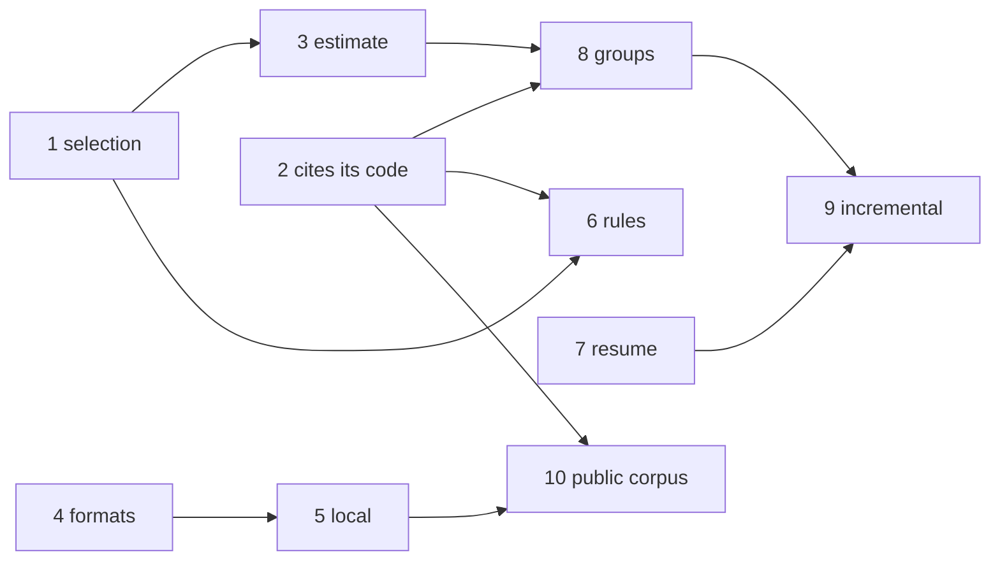

# What repoach takes from open-code-review

## Intent

Umbrella for the ten specs written after reading
alibaba/open-code-review (Apache-2.0, commit `6386895`, 2026-11-12)
against repoach `origin/develop` `8fabb19`. It holds the order the
children land in, why that order, the owner decisions each child needs,
what was read and not taken, and the gauge that says the programme
delivered. The comparison itself, with a path for every cell, is
`docs/plans/2026-11-12_open-code-review-gap-analysis.md`.

## Context

| # | Fact | Where |
|---|---|---|
| F1 | open-code-review has no AST, no index, no confidence score, no owner command, no gate and one model for every phase; it has snippet-anchored comments, per-path rules, deterministic file selection, file groups, a local CLI with IDE and agent entry points, session resume, SARIF, a pre-run estimate, cross-push checkpoints and a public benchmark | the gap analysis, "Capability table" |
| F2 | repoach's refuter, verifiers, ledger, owner commands, thread binding, merge gate, re-verification at head and provider tiers have no counterpart there | same |
| F3 | Ideas are free; code and prompt text carry Apache-2.0 with its notice; every child re-derives its design and copies nothing; one child names the copy of rule texts as an owner decision | the gap analysis, "Licence"; SP-REVIEW-RULES-BY-PATH O1 |
| F4 | The in-model read-only loop is already specified and is a draft | SP-AGENT-CONTEXT-LOOP |

## Decisions

- D1. Order, one MR-sized child each, each landing on `develop`
  through the review and the gate:

| # | Child | Size | depends_on among the children | Why here |
|---|---|---|---|---|
| 1 | SP-REVIEW-FILE-SELECTION | S–M | — | names every omission; everything after it reasons over selected files |
| 2 | SP-FINDING-CITES-ITS-CODE | S–M | — | the one mechanical check repoach lacked; changes the persona versions once |
| 3 | SP-REVIEW-TOKEN-ESTIMATE | S | 1 | a number before the first call; the gauge of 8 and 9 reads it |
| 4 | SP-REVIEW-REPORT-FORMATS | S | — | GitLab widget and code scanning; no interaction with the pipeline |
| 5 | SP-REVIEW-LOCAL-DIFF | M | 3, 4 | the entry point agents and contributors lack; the bench already has the forge |
| 6 | SP-REVIEW-RULES-BY-PATH | M | 1 | de-houses the personas in the same re-versioning as 2 (land 2 first, bump once) |
| 7 | SP-REVIEW-RESUMES-FAILED-ROLES | M | — | the cheapest cut of the retry cost; needed by 9 |
| 8 | SP-REVIEW-GROUPS-LARGE-DIFFS | L | 1, 2, 3 | lifts the silent cap; the largest change to the orchestrator |
| 9 | SP-REVIEW-INCREMENTAL-HEAD | M | 7, 8 | opt-in; soundness rests on the re-verification and on complete runs |
| 10 | SP-BENCH-PUBLIC-CORPUS | M | 2, 5 | the public number, last, so it measures the pipeline after 1–9 |

- D2. 2 and 6 bump the four personas to the same versions (architect
  0.6.0, sentinel 0.5.0, tester 0.5.0, scribe 0.6.0): 2 adds the `code`
  field, 6 removes the house text; 6 edits the files 2 created, so the
  version is bumped once and the fixtures re-recorded once.
- D3. Not taken, and why, in the gap analysis "What repoach does not
  take": excluding tests by default, one model for every phase,
  resolving outdated threads, an LLM relocation call, prompt-only dedup.
- D4. The children's owner decisions, gathered:

| Child | Decision |
|---|---|
| 2 | O1 make `code` mandatory after one release of counts; O2 where a refused comment is shown |
| 1 | O1 `max_file_chars` default 60 000; O2 snapshot files reviewed or excluded |
| 3 | O1 `max_prompt_tokens` default 0, and Yoob's value; O2 estimate in the archive comment |
| 4 | O1 `--code-quality` opt-in or default on GitLab; O2 formats on `review gate` too |
| 5 | O1 local findings never in the user's ledger; O2 Yoob's pre-push calls `--estimate` or nothing |
| 6 | O1 write nine checklists or carry OCR's under Apache notice; O2 rules for languages without a verifier; O3 `init` scaffolds a rule file |
| 7 | O1 reuse age at the same head; O2 artifact retention |
| 8 | O1 `max_groups` default 8 and refuse vs named partial; O2 round 2 per group |
| 9 | O1 default on after measurement; O2 re-read files named by older findings |
| 10 | O1 commit the imported cases; O2 sample size to pay; O3 where a matched-range number may be quoted |

## Goals

- G1: the ten children exist, each with the sections the template requires, acceptance selectors with the mutation that turns each red, success conditions and owner decisions.
- G2: `repoach arch check` is green with the eleven files added (disjoint ownership, no cycle among them).
- G3: the gap analysis cites a file path for every claim about either repository or says `not verified`.

## Non-Goals

- NG1: no code in this umbrella; no change to any child's scope from here.
- NG2: no number from open-code-review's README copied into repoach's comparison page by this programme: a cell there is read on a page and dated by SP-COMPARISON-PAGE's rule.

## Assumptions

- A1: the children's `depends_on` among existing specs name ids present in `docs/specs/` (checked by `arch check`'s dangling-edge report, which must list none of them).

## Interface

N/A: an umbrella owns no code. The gauge is a command: `repoach bench run bench/corpus/planted --dry-run` builds every case at every step, and the real run keeps `located 10/10`.

## Behavior

### Nominal
- The children land in D1's order; the gauge holds after each.

### Edge cases
- A child refused by the owner: its row stays in D1 with the refusal and the ones after it that do not depend on it proceed.

### Failure scenarios
- The gauge drops below 10/10 after a child: a red stops the line (SP-RED-STOPS-THE-LINE): refusal analysis, corrective spec, then the next child.

## Architecture Impact
- Adds dependency: SP-OCR-GAP-PROGRAMME -> each child (umbrella edges, no code).
- No new coupling: the children's edges are declared in their own frontmatter.

## Diagram

## Acceptance Criteria

- [ ] AC1: `repoach arch check --base develop` → ok with the eleven files present (G2).
- [ ] AC2: `python scripts/check_links.py docs/plans/2026-11-12_open-code-review-gap-analysis.md` → `0 dead` (the file links only repository paths and the dataset page).
- [ ] AC3: `pytest -q tests/unit/test_spec_presence.py tests/unit/test_arch_graph.py` → green.
- [ ] AC4: every child's filename id equals its frontmatter `id` and every `depends_on` entry resolves to a file in `docs/specs/` (`repoach arch graph --check` reports no dangling edge among the eleven).

## Success conditions
- C1: the owner has answered the decisions of D4 for a child before `repoach develop <id>` or a hand implementation starts on it.
- C2: after child 8, a replay of the 40-file Yoob fixture reports `files_omitted: 0`.
- C3: after child 10, the README's bench block carries an `aacr` row with a sample size, a date and the rule of each number.

## Owner decisions needed
- O1: the order of D1, in particular whether 5 (local review) moves before 3 and 4 for the agents' sake.
- O2: whether 9 is wanted at all given the opt-in and the measurement it needs, or parked as a backlog row.

## Open Questions
- Q1: O1 and O2, and the children's decisions in D4.
