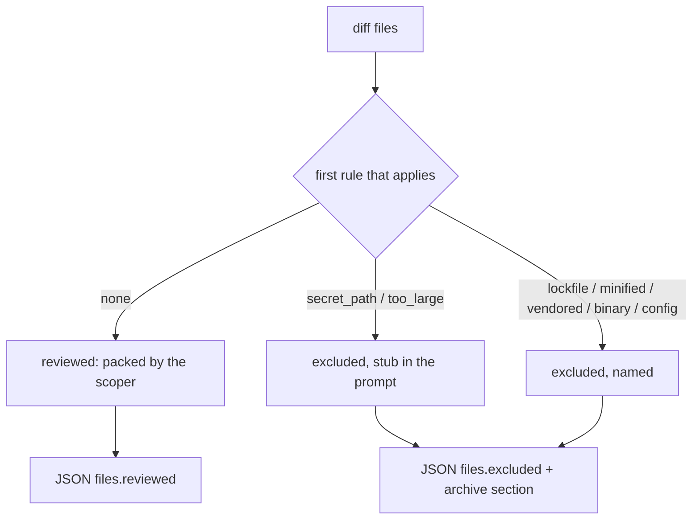

# Every file of the diff is reviewed or named with the reason it was not

## Intent

Today the reviewers receive whole files packed under one character cap;
what does not fit is omitted and logged, and nothing in the JSON, the
report or the archive comment says so. A lockfile, a minified bundle or
a vendored tree consumes the cap first and a source file behind it is
never read. After this spec every file of the diff is either reviewed,
or excluded for a reason from a closed set that the JSON, stderr and
the archive comment name. The built-in exclusions are the files no
reviewer should read (lockfiles, minified and map files, vendored
trees, binaries, a secret path) and never a test file: the Tester's
object stays reviewed. A project adds or removes exclusions in
`repoach.toml`.

## Context

Measured on `origin/develop` `8fabb19` (2026-11-12).

| # | Fact | Where |
|---|---|---|
| F1 | `scope_diff(diff, _DIFF_HARD_CAP_CHARS)` packs whole files under 140 000 characters; the omitted files are logged (`review.diff_scoped`, first 10 names) and announced in the prompt; `TeamOutcome` and the `review pr` JSON carry nothing about them | `src/repoach/review/reviewer.py:54,634-641`, `src/repoach/review/diff_scoper.py` |
| F2 | `[review]` has `bot_username`, `spec_sources`, `generated`; no include or exclude | `src/repoach/project/config.py:437-445` |
| F3 | `[[review.generated]]` declares a derived file with its check and sources; such a file is proved by its command and summarised, not read; `always_reviewed` names what a `generated` path may never reach (CI definitions, manifests, lockfiles, `repoach.toml`) | `src/repoach/project/always_reviewed.py`, `src/repoach/project/globs.py`, SP-GENERATED-FILES-ARE-VERIFIED-NOT-READ |
| F4 | The language of a file is detected by extension or shebang from `LANGUAGE_TABLE`; test files are recognised per language (`is_python_test_file`, the TypeScript family) | `src/repoach/gates/languages.py`, `src/repoach/review/finding_verifiers.py` |
| F5 | A Yoob merge request packs `poetry.lock` and `frontend/package-lock.json` changes into the same cap as its source | owner runs, 2026-10-19/21 (README Status, "Time and tokens") |
| F6 | open-code-review decides per file, in a fixed order, and carries the reason: binary, secret path, user exclude, user include, extension allow-list, default excludes, deleted, per-file ceiling at 80 % of the context; its default excludes drop every test file (`**/*_test.go`, `**/*.test.{js,...}`, `**/test/**/*_test.py`) | `R/internal/agent/selection.go:14-70`, `R/internal/config/allowlist/default_exclude_patterns.json:2-9`, `secret_path.go:67-71` |

## Decisions (author, within the owner's brief)

- D1. Selection runs once per review, after the diff is fetched and
  before any role's prompt is built, in `file_selection.select_files`.
  Each `FileDiff` receives one decision: `reviewed`, or excluded with a
  reason from the closed set `binary`, `secret_path`, `lockfile`,
  `minified`, `vendored`, `generated_declared`, `excluded_by_config`,
  `too_large`, `deleted`. The first rule that applies, in that order,
  names the reason; `include` in `repoach.toml` overrides every rule
  but `binary` and `secret_path`.
- D2. The built-in patterns live in `default_excludes.py` as a data
  table, each row with its reason and a one-line why, readable through
  `repoach config show review.excludes`. Written for repoach, not
  copied: `*.lock`, `package-lock.json`, `yarn.lock`, `pnpm-lock.yaml`,
  `poetry.lock`, `uv.lock`, `Cargo.lock`, `go.sum`, `*.min.js`,
  `*.min.css`, `*.map`, `vendor/**`, `node_modules/**`, `third_party/**`,
  `*.snap` (snapshots are reviewed by the Tester: not excluded, listed
  here so the decision is visible), fonts, images and archives by
  extension, and the secret paths `.env`, `.env.*` except `.env.example`
  / `.env.sample` / `.env.template`, `*.pem`, `*.key`, `id_rsa*`,
  `*.p12`, `*.pfx`, `*.jks`. No test pattern is in the table (F6 is not
  taken) and a pattern that would match a path `always_reviewed` names
  is refused at load.
- D3. A `secret_path` file is not withheld silently: its diff is
  replaced in every prompt by a one-line stub of at most
  `secret_stub_max_chars` characters, `<file path=".env.production"
  status="added" withheld="secret path" />`, so the Sentinel sees that a
  secret-shaped file entered the change without seeing its content.
- D4. `too_large` is per file: a file whose diff exceeds
  `[review].max_file_chars` (default 60 000, about 20 000 tokens by the
  estimator `ceil(utf8_bytes / 3)`) is excluded with its size, and a
  one-line stub names it in the prompt as D3 does. The run-wide cap of
  F1 stays until SP-REVIEW-GROUPS-LARGE-DIFFS lifts it; a file omitted
  by that cap is reported with reason `cap`, so today's silent omission
  becomes a named one by this spec alone.
- D5. `[review] include = [...]`, `exclude = [...]` are glob lists
  matched by `project.globs`; `exclude` adds reason `excluded_by_config`,
  `include` re-admits a built-in exclusion. A `generated` path (F3)
  keeps its own reason, `generated_declared`, and its own evidence path.
- D6. The JSON carries `files: {reviewed: n, excluded: [{path, reason,
  chars}]}`; stderr prints `files: 12 reviewed, 3 excluded (lockfile 2,
  too_large 1)`; the archive comment gains `## Files not reviewed` when
  the list is not empty. `reviewed + excluded == files in the diff`
  always.

## Goals

- G1: every file of the diff receives exactly one decision (D1) and the decisions sum to the diff (D6).
- G2: the built-in table excludes lockfiles, minified and map files, vendored trees, binaries and secret paths, and never a test file or an `always_reviewed` path (D2).
- G3: a secret-path file is withheld and named by a stub in the prompt (D3).
- G4: a file over `max_file_chars` is excluded by name with its size; the run-wide cap's omissions are named `cap` (D4).
- G5: `include` and `exclude` in `[review]` are honoured in the stated precedence (D5); an invalid glob or a pattern that reaches an `always_reviewed` path is one `ConfigError` line, rc 2, before any forge call.
- G6: JSON, stderr and the archive comment report the exclusions (D6).

## Non-Goals

- NG1: no change to the run-wide cap or to the number of model calls (SP-REVIEW-GROUPS-LARGE-DIFFS).
- NG2: no extension allow-list: a language repoach does not know is reviewed, not dropped (SP-UNIVERSAL-GATES: a check that cannot run says so; a file is not a check).
- NG3: no secret scanning of file contents; `secret_path` is a path rule.
- NG4: no change to `[[review.generated]]` semantics.

## Assumptions

- A1: `FileDiff` exposes the path, the old path for a rename, the status and the hunk text, enough to apply every rule without reading the tree.
- A2: a one-line stub for a withheld file costs the Sentinel no false positive: the stub says what was withheld and why.

## Interface

```python
# repoach.review.file_selection
EXCLUDE_REASONS = ("binary", "secret_path", "lockfile", "minified", "vendored", "generated_declared", "excluded_by_config", "too_large", "cap", "deleted")
class FileDecision(BaseModel):
    path: str; reason: str | None; chars: int; stub: str | None
class Selection(BaseModel):
    reviewed: tuple[FileDiff, ...]; excluded: tuple[FileDecision, ...]
    def stubs(self) -> str: ...
def select_files(diffs: Sequence[FileDiff], config: ReviewSection, generated: Sequence[GeneratedSection]) -> Selection: ...

# repoach.review.default_excludes (under review/: project/ is owned whole by SP-UNIVERSAL-PROJECT-CONFIG)
class ExcludeRule(NamedTuple): pattern: str; reason: str; why: str
DEFAULT_EXCLUDES: tuple[ExcludeRule, ...]
def refuse_rules_reaching_always_reviewed(rules) -> None: ...   # ConfigError

# repoach.project.config.ReviewSection (added)
include: list[str] = []; exclude: list[str] = []; max_file_chars: int = 60_000   # 1_000..1_000_000
```

## Behavior

### Nominal

- A merge request touching `src/a.py`, `poetry.lock`, `frontend/dist/app.min.js`: `files: 1 reviewed, 2 excluded (lockfile 1, minified 1)`; the reviewers' prompt holds `src/a.py` and two stubs.

### Edge cases

- `include = ["poetry.lock"]`: the lockfile is reviewed; the JSON lists it under `reviewed`.
- A rename of `.env.example` to `.env`: reason `secret_path`, the stub names both paths.
- A deleted file: reason `deleted`, listed; its content is not sent (nothing to review, the deletion is visible in the other files' hunks and the change list).
- A 200 000-character `schema.json` with no `generated` entry: `too_large 200000`, a stub in the prompt, and the rest of the diff fits the cap that it used to fill.

### Failure scenarios

- `exclude = ["ci/**"]` while `ci/` is `always_reviewed`: rc 2, `repoach: [review].exclude "ci/**" reaches an always-reviewed path (ci/review-gate.sh); remove it`.
- A glob that does not parse: rc 2 with the pattern named.

## Architecture Impact
- Adds dependency: SP-REVIEW-FILE-SELECTION -> SP-DIFF-SCOPER (`FileDiff` is the unit decided on; the scoper packs the `reviewed` tuple only)
- Adds dependency: SP-REVIEW-FILE-SELECTION -> SP-UNIVERSAL-PROJECT-CONFIG, SP-DB-PATH-XDG (`ReviewSection` fields, `repoach config show`)
- Adds dependency: SP-REVIEW-FILE-SELECTION -> SP-GENERATED-FILES-ARE-VERIFIED-NOT-READ (`always_reviewed`, `globs`, the `generated_declared` reason)
- Adds dependency: SP-REVIEW-FILE-SELECTION -> SP-UNIVERSAL-GATES (test-file recognition per language, so no built-in rule excludes a test)
- Adds dependency: SP-REVIEW-FILE-SELECTION -> SP-REVIEW-PINS-HEAD, SP-CLI-STDOUT-ONE-JSON, SP-ORCH-DOCSTRING (the diff is the head's; the JSON fields)
- `file_selection.py` imports `diff_scoper`, `project.globs`, `project.always_reviewed`, `review.default_excludes`, `gates.languages`; `reviewer.py` calls it once per run through the orchestrator.

## Diagram


## Acceptance Criteria

- [ ] AC1: `pytest -q tests/unit/test_file_selection.py` → green.

| Test | Pins | Mutation that turns it red |
|---|---|---|
| `test_every_file_gets_one_decision_and_they_sum` | `len(reviewed) + len(excluded) == len(diffs)` on a 7-file diff | a file matched by two rules is listed twice, or an unmatched file is dropped |
| `test_rule_order_binary_before_config` | a binary under `include` stays `binary` | `include` is applied first |
| `test_lockfiles_are_excluded_by_name` | `poetry.lock`, `package-lock.json`, `uv.lock` → `lockfile` | a pattern removed from the table |
| `test_test_files_are_never_excluded_by_builtins` | `tests/unit/test_x.py`, `src/a.test.ts`, `foo_test.go` → reviewed | a test pattern added to the table |
| `test_secret_path_is_stubbed_not_sent` | `.env.production` → `secret_path`, stub ≤ 200 chars, hunk text absent from `stubs()` | the hunk text leaks into the stub |
| `test_env_example_is_reviewed` | `.env.example` → reviewed | the secret rule matches every `.env*` |
| `test_too_large_names_the_size` | 60 001 chars → `too_large`, `chars == 60001` | the threshold is `>=` or the size is not recorded |
| `test_include_readmits_a_builtin_exclusion` | `include = ["poetry.lock"]` → reviewed | `include` is ignored |
| `test_exclude_adds_its_own_reason` | `exclude = ["docs/**"]` → `excluded_by_config` | the reason reads `vendored` |
| `test_generated_path_keeps_its_reason` | a `[[review.generated]]` path → `generated_declared` | it is decided by the built-in table |
| `test_cap_omissions_are_named_not_silent` | a run whose scoper omits 2 files reports 2 × `cap` | `scoped.omitted` is logged only |

- [ ] AC2: `pytest -q tests/unit/test_default_excludes.py` → green: every row has a reason from the closed set and a why; no row matches a path `always_reviewed` names; no row matches a recognised test file of any language in `LANGUAGE_TABLE`. Mutation: add `**/*_test.py` to the table.
- [ ] AC3: `pytest -q tests/unit/test_project_config.py -k "include or exclude or max_file_chars"` → green: the three fields parse, `max_file_chars` outside 1 000..1 000 000 is a `ConfigError`, an `exclude` reaching an always-reviewed path is a `ConfigError` naming the path. Mutation: drop the validator.
- [ ] AC4: `pytest -q tests/unit/test_review_team.py -k files` → green: the `review pr` JSON carries `files.reviewed` and `files.excluded`, stderr prints the `files:` line, the archive comment holds `## Files not reviewed` when the list is not empty and not otherwise. Mutation: omit the section when the list is non-empty.
- [ ] AC5: `repoach arch check --base develop` → ok.

## Success conditions

- C1: a replay of a recorded Yoob merge request that carries `poetry.lock` reports it under `files.excluded` with reason `lockfile` and the reviewers' prompt bytes shrink by the lockfile's size.
- C2: no planted-corpus case loses a located defect after selection (10/10 stays 10/10).
- C3: `reviewed + excluded == diff files` on every case of the corpus and on the recorded Yoob fixtures.

## Owner decisions needed

- O1: the default of `max_file_chars` (60 000 proposed) and whether `too_large` should instead window the file's hunks (that is SP-REVIEW-GROUPS-LARGE-DIFFS's object; here the file is named and skipped).
- O2: whether snapshot files (`*.snap`, `__snapshots__/**`) are reviewed (proposed: yes, by the Tester) or excluded by default.

## Open Questions
- Q1: O1 and O2.
