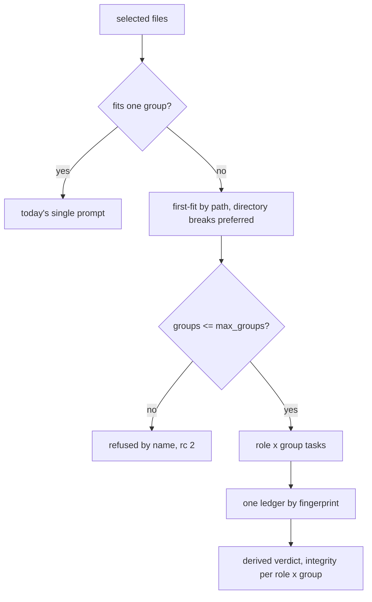

# A diff over the context cap is reviewed in file groups, and no file is omitted silently

## Intent

The reviewers receive whole files packed under 140 000 characters; a
file that does not fit is not reviewed, and until SP-REVIEW-FILE-SELECTION
nothing in the output says so. After this spec a diff larger than the
cap is split into deterministic groups of files, each role reviews each
group with the rest of the change listed by name, the findings of every
group land in the one ledger, and the verdict is derived from it as
today. A diff that would need more groups than the project allows is
refused by name, never reviewed in part and reported as reviewed.

## Context

Measured on `origin/develop` `8fabb19` (2026-11-12).

| # | Fact | Where |
|---|---|---|
| F1 | `scope_diff` packs whole files under `_DIFF_HARD_CAP_CHARS = 140_000`; omitted files are announced in the prompt and logged; the context-loop spec names them `context.truncated[]` and is a draft | `src/repoach/review/reviewer.py:54,634-641`, `src/repoach/review/diff_scoper.py`; SP-AGENT-CONTEXT-LOOP F3, G1 |
| F2 | Round 1 fans the four roles out under a `ThreadPoolExecutor` of `_max_workers`; round 2 too | SP-REVIEW-ROUND2-PARALLEL |
| F3 | At a head a finding is identified by its fingerprint; recording twice stamps the row | `src/repoach/review/findings_bridge.py` (`finding_fingerprint`) |
| F4 | The verdict is derived from the ledger's open findings, not from per-bot verdicts; review integrity requires the four roles to have parsed at the head | `src/repoach/review/merge_gate.py` (`verdict_from_facts`); `docs/merge_gate.md` |
| F5 | A Yoob merge request such as the specs train of 2026-11-12 carries over 40 files and more than 140 000 characters of Markdown alone | the owner's worktree, `git diff --stat` of `docs/industrial-readiness-specs` |
| F6 | open-code-review groups files (at most 10 per group, an LLM grouping call at 4+ files, one bundle under 200 changed lines), reviews one group per concurrent subtask with the other files listed by name, and enforces a per-group token budget | `R/internal/agent/grouping.go:22`, `R/internal/config/template/template.go:130-140`, `agent.go:665-670,1643` |

## Decisions (author, within the owner's brief)

- D1. Grouping is deterministic, no model call: the selected files,
  sorted by path, are packed first-fit in path order into groups of at
  most `group_max_chars` characters and `group_max_files` files; a
  break is preferred at a directory boundary when the next file would
  start a new top-level directory. A file alone over `group_max_chars`
  is its own group, its hunks packed in order up to the cap and the
  remaining hunks reviewed as a further group of the same file; a single
  hunk over the cap is excluded with reason `too_large` (SP-REVIEW-FILE-SELECTION).
  Considered and not taken: an LLM grouping call (F6); the gain is
  semantic grouping, the cost is a call whose output cannot be verified.
- D2. One group when the diff fits: today's prompt bytes, today's
  behaviour. Otherwise each role reviews each group: the group's diffs
  in full, a one-line list of every other file of the change with its
  status and line counts, and the same spec, rules and lessons blocks.
  The `(role, group)` tasks run under the existing executor (F2); usage
  rows carry `group_index`.
- D3. Findings are recorded per group into the one ledger by
  fingerprint (F3); the verdict derives from the ledger (F4). Review
  integrity at the head requires every `(role, group)` to have parsed;
  one failed group is `review incomplete` for that role, with the group
  named, and the transport retry and role resume apply per `(role,
  group)`.
- D4. `[review].max_groups` (default 8): a diff needing more groups is
  refused before any call, rc 2, `repoach: diff needs 11 groups >
  [review].max_groups 8 (<n> files, <chars>); split the change, exclude
  files or raise the cap`. Owner decision O1 sets the default and whether
  a refusal or a named partial review is wanted.
- D5. The JSON carries `groups: [{index, files, chars}]` and
  `files_omitted: 0` by construction; stderr `groups: 3 (12, 9, 4
  files)`; the archive comment names the groups when there is more than
  one. Round 2 runs per `(role, group)` that raised a blocker or major.

## Goals

- G1: a diff under the cap is one group and byte-identical prompts to today (D2).
- G2: a diff over the cap is split as D1 states, deterministically, and every selected file is in exactly one group (or its hunks across consecutive groups).
- G3: every role reviews every group; findings merge into one ledger; integrity is per `(role, group)` (D3).
- G4: more groups than `max_groups` is a named refusal before any call (D4).
- G5: the JSON, stderr and archive name the groups; `files_omitted` is zero (D5).

## Non-Goals

- NG1: no LLM grouping, no semantic grouping.
- NG2: no change to the per-group cap (140 000) or to the refuter.
- NG3: no cross-group dialogue: a role sees other groups' files by name only; cross-file claims it cannot see are its business to word carefully, and the refuter's evidence is the whole tree.

## Assumptions

- A1: the executor's `_max_workers` bounds `roles × groups` tasks acceptably; a 4 × 8 fan-out at the default is 32 tasks, run `_max_workers` at a time.
- A2: the findings of two groups never conflict at a fingerprint: a fingerprint is a claim at a file and head, not at a group.

## Interface

```python
# repoach.review.diff_groups
GROUP_MAX_CHARS = 140_000; GROUP_MAX_FILES = 10
class DiffGroup(BaseModel):
    index: int; files: tuple[FileDiff, ...]; chars: int; partial_of: str | None   # a file split over groups
class Grouping(BaseModel):
    groups: tuple[DiffGroup, ...]
    def others_listing(self, index: int) -> str: ...
def group_diffs(diffs: Sequence[FileDiff], *, max_chars=GROUP_MAX_CHARS, max_files=GROUP_MAX_FILES) -> Grouping: ...
class TooManyGroups(Exception): ...   # rc 2, message as D4

# repoach.project.config.ReviewSection (added)
max_groups: int = 8     # 1..64
```

`review pr` JSON gains `groups`; usage rows gain `group_index`.

## Behavior

### Nominal
- 43 files, 410 000 characters: `groups: 3`; 12 role-group tasks; one ledger; `final_verdict` derived as today.

### Edge cases
- One 300 000-character file: two groups of the same file (`partial_of` set), each with the hunks it holds; the other-files listing names the file as "continued".
- Exactly 140 000 characters: one group.
- `max_groups = 1` on a diff that needs 2: refused by name.

### Failure scenarios
- Group 2's Sentinel errors past the window: `review incomplete: sentinel group 2`, exit 3; the retry calls that task only (SP-REVIEW-RESUMES-FAILED-ROLES keyed per group).

## Architecture Impact
- Adds dependency: SP-REVIEW-GROUPS-LARGE-DIFFS -> SP-REVIEW-FILE-SELECTION (groups are built from the selected files; `too_large` is its reason), SP-REVIEW-TOKEN-ESTIMATE (the estimate is per group and summed), SP-FINDING-CITES-ITS-CODE (anchoring runs per group against that group's hunks, then the whole diff)
- Adds dependency: SP-REVIEW-GROUPS-LARGE-DIFFS -> SP-DIFF-SCOPER (the packer becomes the group packer), SP-REVIEW-ROUND2-PARALLEL (the executor), SP-FINDINGS-BRIDGE-DOCFIX, SP-VERDICT-RESOURCE-LEDGER (one ledger, one derived verdict)
- Adds dependency: SP-REVIEW-GROUPS-LARGE-DIFFS -> SP-REVIEW-PINS-HEAD, SP-USAGE-LEDGER, SP-AGENT-CONTEXT-LOOP (a group is the seed's diff item when the loop lands), SP-CLI-STDOUT-ONE-JSON, SP-ORCH-DOCSTRING
- `diff_groups.py` imports `diff_scoper` only; the orchestrator imports it and fans out per `(role, group)`.

## Diagram


## Acceptance Criteria

- [ ] AC1: `pytest -q tests/unit/test_diff_groups.py` → green.

| Test | Pins | Mutation that turns it red |
|---|---|---|
| `test_under_the_cap_is_one_group_and_same_bytes` | prompt bytes equal today's for a 50 k diff | the other-files listing is added to a single group |
| `test_every_file_in_exactly_one_group` | 43 files → union equals the set, no duplicate | a file packed twice at a boundary |
| `test_grouping_is_deterministic` | shuffled input → same groups | insertion order leaks |
| `test_directory_break_is_preferred` | `api/` files do not share a group with `frontend/` when a break is possible | pure first-fit |
| `test_huge_file_is_split_by_hunks_with_partial_of` | 300 k file → 2 groups, `partial_of` set | the file is truncated |
| `test_single_hunk_over_the_cap_is_too_large` | the hunk is excluded with the reason, the rest reviewed | the hunk is cut inside |
| `test_too_many_groups_refuses_before_any_call` | provider fake counts 0 calls | the check runs after group 1 |
| `test_others_listing_names_every_other_file` | status and +/- counts per file | the listing is capped silently |
| `test_integrity_is_per_role_and_group` | one failed `(sentinel, 2)` → incomplete names it | integrity counts roles only |
| `test_findings_of_two_groups_merge_by_fingerprint` | the same claim in two groups → one row | two rows |

- [ ] AC2: `pytest -q tests/integration/test_review_groups_end_to_end.py` → green: a recorded 3-group diff ends with 12 reviewer calls, one ledger, `files_omitted == 0`, `groups` of length 3, and the verdict derived from the merged findings; the same diff with `max_groups = 2` ends rc 2 with 0 calls. Mutation: run the four roles on group 1 only.
- [ ] AC3: `pytest -q tests/unit/test_review_team.py tests/unit/test_review_scoper.py` → green (today's behaviour under the cap).
- [ ] AC4: `repoach arch check --base develop` → ok.

## Success conditions
- C1: the Yoob merge request of F5 (replayed from a recorded fixture) is reviewed with `files_omitted: 0` and `groups ≥ 2`; before this spec the same fixture logs `review.diff_scoped` with omitted files.
- C2: the planted corpus (every case under the cap) makes the same number of reviewer calls as the 2026-10-21 baseline.
- C3: a `(role, group)` failure is named in `review incomplete` and the retry calls that task only (AC1, with SP-REVIEW-RESUMES-FAILED-ROLES).

## Owner decisions needed
- O1: `max_groups` default (8 proposed) and the policy past it: refuse by name (this spec) or review the first N groups and mark the rest `not reviewed` in the archive and the gate (the gate would then refuse the merge on `review incomplete`, which is the safer reading).
- O2: whether round 2 should run per group or once per role over the merged findings (proposed: per group, the excerpts belong to the group).

## Open Questions
- Q1: O1 and O2.
