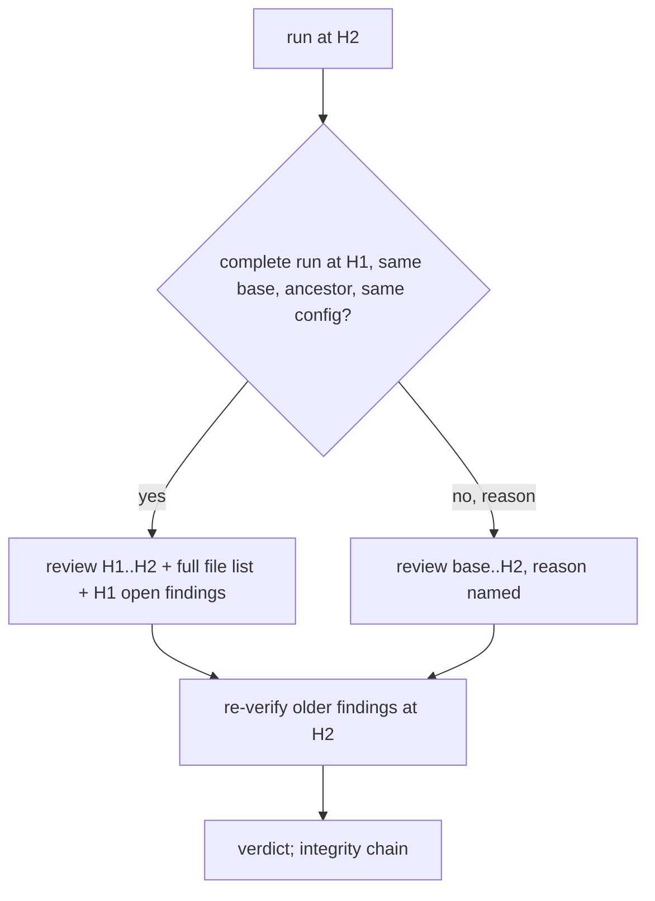

# A later head reviews what changed since the last complete review

## Intent

Every push re-reviews the whole diff of the pull request; the findings
of older heads are re-verified at the new head, and the posting replay
never re-posts, but the reviewers read again what they already judged.
After this spec, when the project opts in, a run at head H2 that
follows a complete run at H1 on the same base reviews the diff `H1..H2`
with the full change listed by name, keeps the open findings of H1
through the head re-verification, and says so in its JSON; whenever any
condition of that reading is in doubt, the full range is reviewed and
the reason is named.

## Context

Measured on `origin/develop` `8fabb19` (2026-11-12).

| # | Fact | Where |
|---|---|---|
| F1 | Every blocking finding of an older head is re-checked at the head the gate decides on; it ends `resolved_at_head`, `still_open` or `needs_judgement` | `src/repoach/review/head_reverify.py`, SP-GATE-REVERIFIES-AT-HEAD |
| F2 | A replay never re-posts what is on the PR; a completed run is replayed at the same head only | SP-POSTING-REPLAY-DEDUPES; `src/repoach/review/review_cache.py` |
| F3 | `review_runs` records diff files, diff hash, reviewers, tokens, provider kind and tiers per run | SP-UNIVERSAL-LEDGER G3 |
| F4 | Owner rule: repoach never changes what a reviewer reads without the user knowing it | SP-MEMORY-LOOPS-EXPLICIT, Intent |
| F5 | A Yoob review costs 224–300 k tokens; a merge request with ten review rounds (the 04/11 case, 16 rounds, 20 pushes) pays that per push | README Status; owner memory 2026-11-04 |
| F6 | open-code-review's `checkpoint_range` records the reviewed head in its sticky summary and reviews `checkpoint..head` next; fail-closed when the summary is missing or not the token's, the base moved, the configuration changed or ancestry cannot be proven; `full_review` forces a full pass once | `R/action.yml:203-222` |

## Decisions (author, within the owner's brief)

- D1. Opt-in: `[review].incremental = true` (default false, F4). When
  off, nothing changes.
- D2. The checkpoint is the ledger, not a comment: the last run at the
  same `pr_number` whose integrity row says every `(role, group)`
  parsed, with its `head_sha`, its `base_sha` (the merge-base recorded
  on `review_runs`, a new column), its persona versions, tiers and
  rules hash. The checkpoint is valid for H2 when `base_sha` is
  unchanged, `H1` is an ancestor of `H2` in the pinned head tree's
  history (`git merge-base --is-ancestor`), and the persona versions,
  tiers and rules hash are equal. Any other case reviews the full range
  with `range.reason` one of `no_previous_run`, `previous_incomplete`,
  `base_moved`, `not_ancestor` (a force-push), `config_changed`,
  `forced` (`--full`).
- D3. An incremental run's reviewers receive the diff `H1..H2` as the
  change, the list of every file of `base..H2` with status and counts,
  and the findings still open at H1 on the files of `H1..H2` as prior
  review context; the spec, rules and lessons blocks as today. The
  findings of H1 on files untouched since keep their rows; the head
  re-verification (F1) runs over all of them at H2 as today.
- D4. The run's integrity row at H2 names the checkpoint run it
  extends; the gate's `review complete at head` reads a chain of
  complete runs, each extending the previous, back to a full one. A
  broken chain is `review incomplete` with the missing link named.
- D5. The JSON carries `range: {kind: full|incremental, from, to,
  reason, extends_run}`; stderr `range: incremental 3f2a9c0..9f6cd85 (4
  files), extends run 118`; the archive comment states the range.

## Goals

- G1: with the option off, the prompts and the JSON are today's (D1).
- G2: a valid checkpoint yields an incremental run over `H1..H2` with the full change by name and H1's open findings on the touched files as context (D2, D3).
- G3: every invalid condition yields a full run with the reason named (D2); `--full` forces one.
- G4: the chain of runs is what the gate reads for completeness; a broken chain is named (D4).
- G5: JSON, stderr and the archive name the range (D5).

## Non-Goals

- NG1: no change to the re-verification of older findings (F1); it is what makes an incremental review sound.
- NG2: no reuse across pull requests or across bases.
- NG3: no default on (O1).

## Assumptions

- A1: a reviewer given `H1..H2` and the full file list names a cross-file regression it cannot see no more often than it does today with a file it cannot see past the cap; measured by C2 before O1 is decided.

## Interface

```python
# repoach.review.incremental_range
FULL_REASONS = ("no_previous_run", "previous_incomplete", "base_moved", "not_ancestor", "config_changed", "forced")
class ReviewRange(BaseModel):
    kind: Literal["full", "incremental"]; from_sha: str; to_sha: str; reason: str | None; extends_run: int | None
class Checkpoint(BaseModel):
    run_id: int; head_sha: str; base_sha: str; persona_versions: dict[str, str]; tiers_key: str; rules_hash: str
def last_complete_run(db_path, pr_number: int) -> Checkpoint | None: ...
def decide_range(checkpoint: Checkpoint | None, *, head_sha, base_sha, personas, tiers_key, rules_hash, is_ancestor: Callable[[str, str], bool], forced: bool) -> ReviewRange: ...
def prior_open_findings(db_path, pr_number, head_sha, files: Sequence[str]) -> list[Finding]: ...

# repoach.project.config.ReviewSection (added)
incremental: bool = False
```

CLI: `review pr --full`. `review_runs` gains `base_sha`, `extends_run`.

## Behavior

### Nominal
- H1 complete, H2 pushes two files: `range: incremental`, the reviewers read two files' diff and the 12-file listing; the Tester's H1 finding on an untouched file is re-verified at H2 and stays.

### Edge cases
- A rebase onto a moved `develop`: `base_moved`, full.
- A force-push that rewrites H1: `not_ancestor`, full.
- The Sentinel persona bumped: `config_changed`, full.
- Three incremental runs in a row: the chain is H1 ← H2 ← H3 ← H4; the gate at H4 reads it complete.

### Failure scenarios
- H3's run is incomplete (a role errored): H4 falls back to `previous_incomplete`, full, unless SP-REVIEW-RESUMES-FAILED-ROLES completed H3 first.

## Architecture Impact
- Adds dependency: SP-REVIEW-INCREMENTAL-HEAD -> SP-GATE-REVERIFIES-AT-HEAD (the soundness of keeping H1's findings), SP-REVIEW-RESUMES-FAILED-ROLES (a complete run is the checkpoint; the resume makes more runs complete), SP-REVIEW-GROUPS-LARGE-DIFFS (completeness is per `(role, group)`)
- Adds dependency: SP-REVIEW-INCREMENTAL-HEAD -> SP-REVIEW-PINS-HEAD, SP-FINDINGS-BRIDGE-DOCFIX, SP-POSTING-REPLAY-DEDUPES (the head tree for ancestry; fingerprints and posting unchanged)
- Adds dependency: SP-REVIEW-INCREMENTAL-HEAD -> SP-UNIVERSAL-LEDGER (`review_runs` columns), SP-UNIVERSAL-PROJECT-CONFIG, SP-MEMORY-LOOPS-EXPLICIT, SP-CLI-STDOUT-ONE-JSON, SP-ORCH-DOCSTRING
- `incremental_range.py` imports `findings` and `git_run`; the orchestrator imports it before the fan-out.

## Diagram


## Acceptance Criteria

- [ ] AC1: `pytest -q tests/unit/test_incremental_range.py` → green.

| Test | Pins | Mutation that turns it red |
|---|---|---|
| `test_off_by_default_changes_nothing` | prompts byte-equal to today with a valid checkpoint | the option is read as true |
| `test_valid_checkpoint_is_incremental` | `kind incremental`, `from == H1` | `from == base` |
| `test_each_invalid_condition_names_its_reason` | six cases → six reasons | one reason is reused for two cases |
| `test_force_push_is_not_ancestor` | `is_ancestor` false → full | ancestry not asked |
| `test_prior_open_findings_are_on_touched_files_only` | H1 findings on untouched files are not in the context | all H1 findings are injected |
| `test_untouched_findings_keep_their_rows_and_are_reverified` | row count unchanged, `head_reverify` called with them | they are deleted |
| `test_chain_is_read_by_the_gate` | H1 full ← H2 ← H3: complete; a missing H2 row: incomplete naming H2 | the gate reads the last run only |
| `test_json_names_the_range` | `range.kind`, `reason`, `extends_run` | `reason` absent on a full run |

- [ ] AC2: `pytest -q tests/integration/test_incremental_review_end_to_end.py` → green: two recorded heads, the second touching two of twelve files, with `incremental = true`: the second run's reviewer prompts hold two files' hunks and a twelve-line listing, the ledger keeps the first run's findings, the archive comment states the range; with a force-pushed second head: full, `not_ancestor`. Mutation: compute the range from the PR's base every time.
- [ ] AC3: `repoach arch check --base develop` → ok.

## Success conditions
- C1: on a recorded ten-push Yoob merge request, the sum of prompt tokens over the ten runs drops by at least 50 % against full runs (measured with SP-REVIEW-TOKEN-ESTIMATE's figures), with the same set of findings open at the final head.
- C2: on the planted corpus split into two heads per case (the fixture's patch halved), the located-defect count is 10/10 in incremental mode.

## Owner decisions needed
- O1: default on after C1 and C2 are measured, or opt-in for good.
- O2: whether an incremental run should also re-read files that H1's findings named but H1..H2 does not touch (proposed: no; the re-verification covers them).

## Open Questions
- Q1: O1 and O2; A1 is measured by C2.
