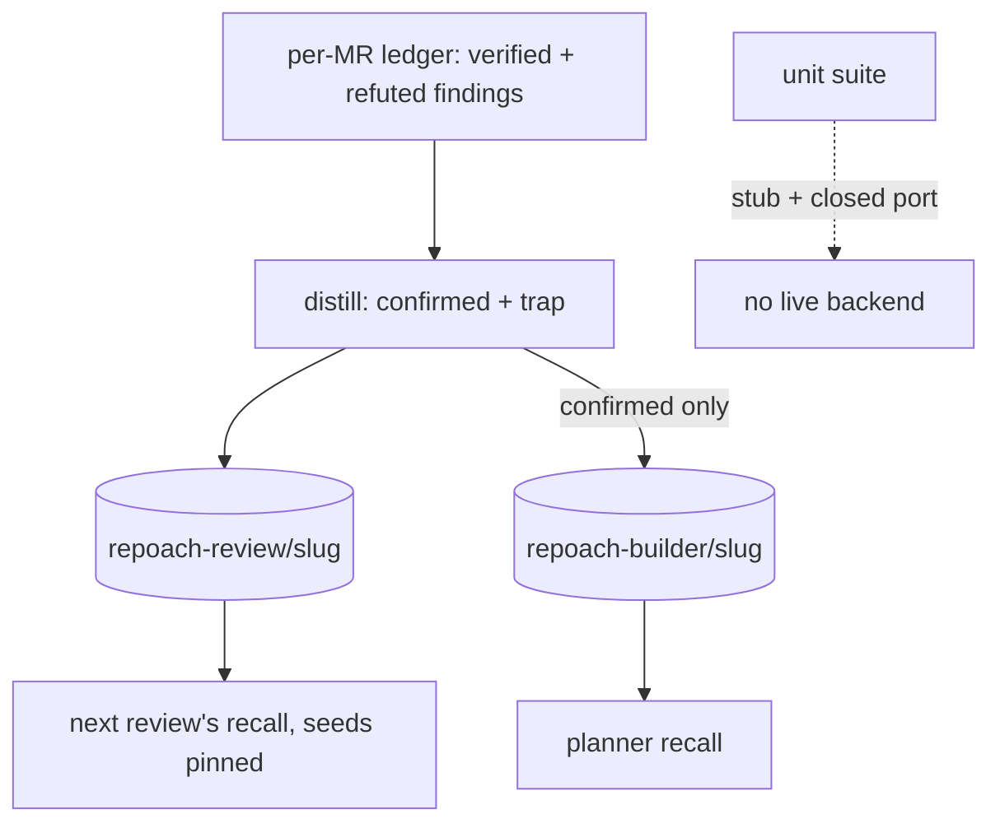

# Review lessons are written to the scope the reviewers recall, per repository, and tests never write to a live backend

## Intent

The review loop learns on one side and reads on the other: verified
findings are distilled into the `repoach-builder` scope, and the
reviewers recall from `repoach-review`, which holds six hand seeds from
2026-07-03 and nothing a review ever produced. Both scopes are global,
so one backend mixes every repository, and the unit suite writes test
fixtures into the live builder scope on any developer box where the
service is up. After this spec a review's lessons land in the review
scope of the repository they came from, the reviewers recall from that
scope, the builder keeps its own, and the suite cannot reach a live
backend.

## Context

Measured 2026-11-12, `origin/develop` `8fabb19`.

| # | Fact | Where |
|---|---|---|
| F1 | `remember_verified_findings` writes every distilled lesson with `project=BUILDER_PROJECT` (`"repoach-builder"`), imported from `builder_memory.py` | `src/repoach/review/review_lessons.py:29`, `:114-144` (`:140`) |
| F2 | `recall_review_lessons` reads `project=REVIEW_PROJECT` (`"repoach-review"`); the orchestrator injects its result into every reviewer prompt once per run. The review scope holds the six `SEED_REVIEW_LESSONS` written by `repoach memory seed-review` on 2026-07-03 and nothing else: no code path writes to it | `src/repoach/review/review_memory.py:18`, `:34-49`; `src/repoach/review/orchestrator.py:829`, `:2741-2754` |
| F3 | Both scope names are constants; a review of any repository reads and writes the same two projects. The per-repository key already exists for the ledger: `project_slug(root)` gives `github.com/owner/name` from the `origin` remote, or `local/<name>-<hash>` without one | `src/repoach/core/paths.py:277-300`, `:303-316` |
| F4 | The distillation keeps confirmed-real findings only (`CONFIRMED_REAL_STATUSES`) and renders `[claim_type] file — claim[:200]`; refuted findings are excluded on purpose, "that would teach the bench its own hallucinations" | `src/repoach/review/review_lessons.py:1-18`, `:87-111` |
| F5 | The per-lens "recent refuted claims" block the reviewer already reads is built from refuted findings of the same ledger, per MR, and injected after the lessons section | `src/repoach/review/review_lessons.py:203-262`; `src/repoach/review/reviewer.py:657-661` |
| F6 | The unit suite stubs one function, `repoach.review.orchestrator.recall_review_lessons`, and nothing else: `remember_verified_findings` (cycle end of every orchestrator test) and `remember_build_outcome` (`review develop` tests) reach the real client with the default switches (`True`) and the default URL; on a box with the service up they write. The builder scope holds about 12 871 entries, among them `missing test_never_written_symbol` (`tests/unit/test_review_team.py:631`) and `Built SP-MULTI …` (`tests/unit/test_review_dev_cli_explore_via.py:163-186` through `src/repoach/cli/review_cmds.py:1399`) | `tests/unit/conftest.py:91-95`; `src/repoach/review/builder_memory.py:69-99`; count read from the backend 2026-11-12 |
| F7 | `remember_verified_findings` binds its `remember_fn` default at import time (`remember_fn=agentmemory_client.remember`), so a later patch of `agentmemory_client.remember` does not reach it | `src/repoach/review/review_lessons.py:114-119` |
| F8 | SP-MEMORY-LOOPS-EXPLICIT G4 (draft) asked for `repoach-review/<repo-key>` and `repoach-builder/<repo-key>` with its own `repo_key` derivation; F3 shows the derivation exists under another name | `docs/specs/2026-10-19_SP-MEMORY-LOOPS-EXPLICIT_*.md` G4, Interface |
| F9 | The backend has `POST /agentmemory/forget` and `GET /agentmemory/export`; the shape of `forget`'s body is not read from a client (none exists here) and a backup of the data directory taken before the 17:02 restart exists (`data.bak-20261112-1702`) | `~/services/agentmemory/dist`; `~/services/agentmemory/` listing |

## Decisions (2026-11-12)

- D1. Two scope functions replace the two constants:
  `review_scope(root) = "repoach-review/" + project_slug(root)` and
  `builder_scope(root) = "repoach-builder/" + project_slug(root)`
  (F3; delivers SP-MEMORY-LOOPS-EXPLICIT G4 with the existing slug).
  The constants stay as the names of the legacy global scopes, read by
  `repoach memory recall-review --scope repoach-review` only.
- D2. At cycle end the review writes to the review scope of its
  repository two kinds of lesson: a `confirmed` lesson per
  confirmed-real finding (F4's text) and a `trap` lesson per refuted
  finding, `[trap:<lens>] <claim_type> <file> — <claim[:160]> — refuter: <verification_result[:160]>`.
  The trap kind is what F5 already injects per MR; writing it to the
  scope makes it outlive the MR. The builder scope receives the
  `confirmed` lessons only, as today, when `builder_memory_enabled`.
  Every write counts in `MemoryReport.remembered` (SP-MEMORY-FAIL-FAST).
- D3. Hermeticity, three layers: the autouse fixture stubs
  `agentmemory_client.recall` and `agentmemory_client.remember` at the
  client module; `remember_verified_findings` resolves its callable at
  call time (F7) so the stub reaches it; and the session's environment
  sets `REPOACH_AGENTMEMORY_URL=http://127.0.0.1:1` so an unpatched
  path meets a closed port, which SP-MEMORY-FAIL-FAST's probe turns
  into `unreachable` in milliseconds. A test that exercises the client
  itself uses its own fake transport.
- D4. The per-repository scopes of D1 are new and empty; the global
  `repoach-builder` and `repoach-review` are no longer read or written
  by any run. `repoach memory audit` measures what the legacy scopes
  hold: for each known noise phrase it searches the scope and prints
  the hit count; it writes nothing. Its `NOISE_PATTERNS` are the one
  list SP-MEMORY-LEGACY-MIGRATION drops. What the legacy scopes hold
  is not orphaned: the owner decided on 2026-11-12 (« Les entrées trop
  anciennes peuvent être résumées pour libérer de la place ») that old
  entries are summarised; SP-MEMORY-LEGACY-MIGRATION does it once for
  the legacy scopes, into the store of SP-REVIEW-MEMORY-STORE, with
  `data.bak-20261112-1702` as the undo (F9).
- D5. The new scopes are seeded on first use: a recall against an
  empty per-repository review scope writes the pinned seeds once
  (`seed_review_memory(scope)`), so `repoach memory seed-review` need
  not be run by hand on every repository; the pinned seeds are
  injected regardless (SP-MEMORY-BACKEND-LIVENESS D3).

## Goals

- G1: `recall_review_lessons` reads `review_scope(root)`; `remember_verified_findings` writes `confirmed` and `trap` lessons to it; from a checkout whose `origin` is `git@github.com:Acme/Widget.git` the project sent is `repoach-review/github.com/acme/widget`; from another remote it differs; without a remote it starts with `repoach-review/local/`.
- G2: the builder scope is `builder_scope(root)` for `recall_builder_lessons`, `remember_build_outcome` and the `confirmed` copy of the review lessons.
- G3: `MemoryReport.scope` names the review scope; `remembered` counts review and builder writes separately in `remembered_by_scope`.
- G4: the unit suite cannot write to a live backend: `tests/unit/test_tests_never_write_live_memory.py` starts a local HTTP server that records every request, points `REPOACH_AGENTMEMORY_URL` at it for a subprocess `pytest -q tests/unit/test_review_team.py tests/unit/test_review_dev_cli_explore_via.py -p no:cacheprovider`, and asserts zero requests; the session-level `conftest.py` sets the closed-port URL for every other case.
- G5: `repoach memory audit [--scope <name>]` prints one row per noise phrase (`test_never_written`, `Built SP-MULTI`, `SP-MULTI`, `src/x.py`, `produced no push`) with the hit count, and a last row `total searched`; exit 0; no write.
- G6: `repoach memory recall-review` and `recall-builder` print `scope: <project>` first; `seed-review` and `seed-builder` seed the scope of the repository they run in and print it (SP-MEMORY-LOOPS-EXPLICIT G5).

## Non-Goals

- NG1: no local store and no cross-MR precision (SP-REVIEW-MEMORY-STORE).
- NG2: no change to the three switches' defaults or to the pinned seeds' text.
- NG3: no migration of the 12 871 legacy entries in this spec (SP-MEMORY-LEGACY-MIGRATION does it once, after SP-REVIEW-MEMORY-STORE); no deletion here.
- NG4: no change to the prompt sections' shape; a `trap` lesson renders as one bullet like any other.

## Assumptions

- A1: `project_slug` is reachable from the review (`require_project_root` already runs before the orchestrator); a review started outside a repository has no scope and memory reports `off` with `off_reason: no repository`.
- A2: the backend's `search` filters by exact `project` string, so `repoach-review/github.com/acme/widget` and `repoach-review` never overlap (SP-BUILDER-MEMORY measured the project isolation on 2026-06-10).

## Interface

```python
# src/repoach/memory/scopes.py
REVIEW_SCOPE_PREFIX = "repoach-review"
BUILDER_SCOPE_PREFIX = "repoach-builder"
LEGACY_SCOPES = ("repoach-review", "repoach-builder")
def review_scope(root: Path) -> str: ...
def builder_scope(root: Path) -> str: ...

# src/repoach/review/review_lessons.py (changed)
class LessonKind(StrEnum): CONFIRMED = "confirmed"; TRAP = "trap"
def distill_lessons(db_path: Path, pr_number: int) -> list[tuple[LessonKind, str]]: ...
def remember_verified_findings(db_path, pr_number, *, root: Path, remember_fn=None) -> dict[str, int]:
    """{'review': n, 'builder': m} accepted writes; remember_fn resolved at call time."""

# src/repoach/review/review_memory.py (changed)
def recall_review_lessons(query: str, *, root: Path) -> list[str]: ...
def seed_review_memory(scope: str | None = None) -> int: ...

# src/repoach/cli/memory_cmds.py (new home of the memory sub-app)
repoach memory audit [--scope NAME] [--json]
repoach memory recall-review QUERY [--scope NAME]     # prints `scope: …` first
repoach memory seed-review [--scope NAME]
```

Outputs: `MemoryReport.scope`, `MemoryReport.remembered_by_scope: {review: int, builder: int}`.

Errors: none new.

## Behavior

### Nominal
A review of `github.com/acme/widget` with memory on recalls from
`repoach-review/github.com/acme/widget` (pinned seeds first), reviews,
and at cycle end writes `confirmed` lessons for the verified findings
and `trap` lessons for the refuted ones to that scope, plus the
`confirmed` ones to `repoach-builder/github.com/acme/widget`. The next
review of the same repository recalls them.

### Edge cases
- the same finding verified in round 1 and re-raised in round 2 → one lesson (the dedup key of F4, unchanged).
- a refuted finding with an empty `verification_result` → the trap ends `— refuter: N/A`.
- a checkout with no `origin` → scope `repoach-review/local/<name>-<hash>`; two clones of the same path hash alike only when the path is the same.
- `repoach memory audit` on a backend that is down → `unreachable` after the probe, exit 0, every row `cannot say`.

### Failure scenarios
- a write fails mid-list → the breaker opens (SP-MEMORY-FAIL-FAST), the remaining writes are skipped and counted in `skipped`; nothing is retried.

## Tests

| Test | What it pins | Mutation that must turn it red |
|---|---|---|
| `tests/unit/test_memory_scopes.py::test_review_scope_from_remote_and_local` | the three forms of G1 | return the constant prefix |
| `::test_two_repositories_never_share_a_scope` | two tmp repos with different remotes → different projects sent | drop the slug |
| `tests/unit/test_review_lessons_reach_reviewers.py::test_confirmed_and_trap_lessons_land_in_the_review_scope` | a ledger with one verified and one refuted finding: the fake `remember` sees two calls with `project == review_scope(root)`, texts as D2 | write traps to the builder scope |
| `::test_builder_scope_gets_confirmed_only` | the fake sees one builder write, the confirmed text | copy traps to the builder |
| `::test_recall_reads_the_same_scope_the_run_wrote` | write then recall through one fake store keyed by project → the lesson comes back | recall from the legacy constant |
| `::test_remember_fn_resolved_at_call_time` | patching `agentmemory_client.remember` after import is honoured | restore the import-time default |
| `tests/unit/test_tests_never_write_live_memory.py::test_orchestrator_and_develop_tests_make_no_memory_request` | G4's recording server sees zero requests from the subprocess run | remove the `remember` stub from the autouse fixture |
| `::test_session_env_points_memory_at_a_closed_port` | `os.environ["REPOACH_AGENTMEMORY_URL"] == "http://127.0.0.1:1"` inside the suite | — |
| `tests/unit/test_memory_audit_cmd.py::test_audit_prints_hit_counts_and_writes_nothing` | fake transport: one row per phrase, counts, zero `remember` | call `remember` to tag a hit |
| `::test_recall_commands_print_scope_first` | first line `scope: repoach-review/…` | — |

## Success conditions

- C1: after one review of a repository with a verified and a refuted finding, `repoach memory recall-review "<claim words>"` in that checkout prints the `confirmed` lesson and the `trap` lesson under `scope: repoach-review/<slug>`.
- C2: the next review of the same repository shows both in `memory.recalled` (when the backend ranks them; the pinned seeds are there regardless).
- C3: `pytest -q tests/unit` on a box with the backend up adds zero entries to any scope: the backend's `export` count before and after is equal (owner's measurement once, after the merge).
- C4: `repoach memory audit --scope repoach-builder` prints the counts of the five noise phrases and writes nothing.
- C5: no run reads or writes `repoach-review` or `repoach-builder` (the legacy names) unless `--scope` names them.

## Architecture Impact
- Adds dependency: SP-REVIEW-LESSONS-REACH-REVIEWERS -> SP-MEMORY-FAIL-FAST (`MemoryReport.scope` and `remembered_by_scope`; the breaker bounds the extra writes)
- Adds dependency: SP-REVIEW-LESSONS-REACH-REVIEWERS -> SP-DEDUP-CLASSIFICATION-CONSTANTS (`review_lessons.py` is owned there; `distill_lessons` and the trap kind change it)
- Adds dependency: SP-REVIEW-LESSONS-REACH-REVIEWERS -> SP-UNIVERSAL-INSTALL (`core/paths.py` `project_slug`, read)
- Adds dependency: SP-REVIEW-LESSONS-REACH-REVIEWERS -> SP-ORCH-DOCSTRING (the orchestrator passes `root` to recall and remember)
- Adds dependency: SP-REVIEW-LESSONS-REACH-REVIEWERS -> SP-REVIEW-LESSONS, SP-REVIEW-MEMORY, SP-BUILDER-MEMORY (the three modules whose constants become functions)
- Adds dependency: SP-REVIEW-LESSONS-REACH-REVIEWERS -> SP-MEMORY-LOOPS-EXPLICIT (its G4 and G5 are delivered here with `project_slug`; amended)
- `memory/scopes.py` imports `core/paths.py` only; `cli/memory_cmds.py` takes the `memory` sub-app out of `cli/main.py` unchanged in behaviour. No new table, no cycle.

## Diagram


## Acceptance Criteria
- [ ] AC1: `pytest -q tests/unit/test_memory_scopes.py tests/unit/test_review_lessons_reach_reviewers.py` → green: the scope is per repository, the review scope receives confirmed and trap lessons, the builder scope confirmed only, recall reads what the run wrote, the write callable is resolved at call time. Today (`8fabb19`): lessons go to `repoach-builder`, the reviewers read `repoach-review`.
- [ ] AC2: `pytest -q tests/unit/test_tests_never_write_live_memory.py` → green: the recording server sees zero requests from the orchestrator and `develop` tests. Today: F6, writes on a box with the service up.
- [ ] AC3: `pytest -q tests/unit/test_memory_audit_cmd.py tests/unit/test_review_lessons.py tests/unit/test_review_memory.py tests/unit/test_builder_memory.py tests/integration/test_review_memory_integration.py` → green.
- [ ] AC4: `repoach memory recall-review "docstring" 2>&1 | head -1` in the repoach checkout → `scope: repoach-review/github.com/repoachhq/repoach`. Today: no scope line.
- [ ] AC5: `repoach arch check --base origin/develop` → `edge-honesty: ok`; `docs/specs/2026-10-19_SP-MEMORY-LOOPS-EXPLICIT_*.md` carries the amendment for G4 and G5.

## Open Questions
- Q1 (decided by the owner, 2026-11-12): the 12 871 legacy builder entries are not orphaned; entries too old are summarised to free space. Delivered by SP-MEMORY-LEGACY-MIGRATION (noise dropped, the rest grouped by repository and claim type, summarised into the per-repository store with provenance, the backup as the undo, a dry run that prints counts only). Closed.
- Q2 (decided by owner 2026-11-12: yes, review scope only): write `trap` lessons for the reviewers (D2), against SP-REVIEW-LESSONS's rule that refuted findings are never learned from? Recommendation: yes for the review scope only; a trap tells a lens what it was wrong about, which is what the per-MR track record already does, and the builder scope keeps the original rule.
- Q3 (decided by owner 2026-11-12: automatically on first recall): seed a new per-repository scope automatically on first recall (D5), or only through `repoach memory seed-review`? Recommendation: automatically; the pinned seeds are injected anyway, and the write only lets the backend rank them.
