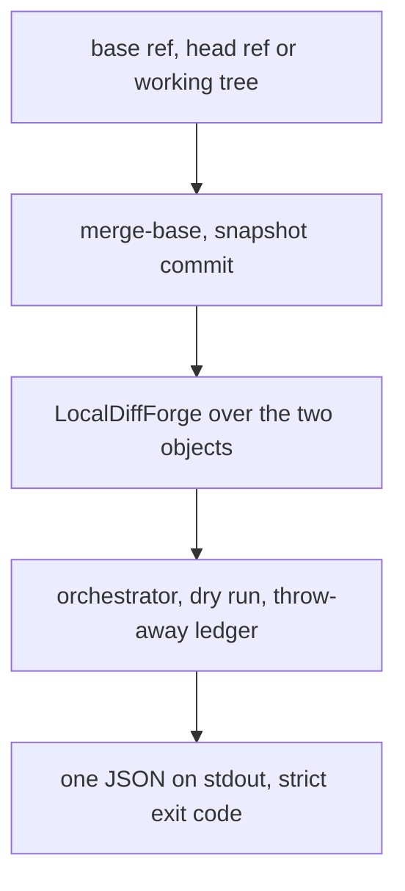

# The review bench reviews a local range before anything is pushed

## Intent

`repoach review pr <N>` needs a pull request. A contributor who wants
the bench's opinion before opening one, an agent that should review its
branch before it pushes, a maintainer trying repoach on a repository
with no forge token: none of them can run it. The bench already knows
how to review a local base-and-head pair through a read-only forge on a
throw-away ledger, for its corpus. After this spec `repoach review local`
reviews the current branch against the integration branch, a commit
range, or the working tree, through the same orchestrator and the same
dry run, prints the same JSON, writes the user's ledger never, and posts
nothing because there is nothing to post to.

## Context

Measured on `origin/develop` `8fabb19` (2026-11-12).

| # | Fact | Where |
|---|---|---|
| F1 | `review pr` takes a PR number; the forge is selected from the repository's remote | `src/repoach/cli/review_cmds.py:262`, `src/repoach/forge/select.py` |
| F2 | `LocalDiffForge` serves a committed diff, a head SHA and an open PR with no comment; every write raises `ForgeError` | `src/repoach/bench/local_forge.py` |
| F3 | The bench runner reviews a `local` case by copying the fixture, committing base and head, and running `BenchOrchestrator` in dry run on a fresh SQLite ledger in a temporary directory; usage rows still reach the usage ledger | `src/repoach/bench/runner.py`, module docstring |
| F4 | The dry run posts nothing by construction (one forge write barrier) | SP-DRY-RUN-NEVER-POSTS |
| F5 | `ci review --strict` exit codes: 0 reviewed or already merged, 1 internal, 2 input or config, 3 no model or timeout, 4 changes requested | README "Run repoach in CI" |
| F6 | The marketplace listings spec plans Claude Code and MCP channels; a skill that reviews before a push has today no command to call | SP-MARKETPLACE-LISTINGS |
| F7 | open-code-review reviews the workspace, a commit or `--from/--to` with no forge, and ships skills and plugin manifests that call that CLI from Claude Code, Codex, Cursor and Kimi; its delegate mode hands the host agent the file selection and rules only | `R/cmd/opencodereview/shared_flags.go`, `R/plugins/open-code-review/`, `R/skills/open-code-review-delegate/SKILL.md` |

## Decisions (author, within the owner's brief)

- D1. `repoach review local [--base <ref>] [--head <ref>] [--working-tree]
  [--provider] [--spec] [--strict] [--format] [--output] [--estimate]`.
  Default base: `[repoach].integration_branch` (`develop`), as
  `merge-base(base, head)`; default head: `HEAD`. `--working-tree`
  snapshots the index plus unstaged changes (untracked files included
  unless ignored) into a commit object through a temporary
  `GIT_INDEX_FILE`, `git write-tree` and `git commit-tree`; no ref, no
  stash, no change to the user's index. A head that is not an ancestor
  relation of base (`merge-base` empty) is refused, rc 2.
- D2. The review runs through `LocalDiffForge` (F2) and the bench's
  throw-away ledger (F3): a fresh SQLite file in a temporary directory,
  deleted after the run unless `--keep-ledger <path>`. The user's
  review ledger is never opened. Usage rows go to the usage ledger as
  every review's do, with `pr_number = NULL` and `command = review
  local`, so `repoach usage --by command` counts them.
- D3. The output is `review pr --dry-run`'s JSON with `pr_number:
  null`, `local: {base, head, working_tree, files}`; stderr the same
  lines. `--strict` applies F5's exit codes (4 on `REQUEST_CHANGES`),
  so a pre-push hook or an agent can read the verdict. Owner commands,
  threads and the archive comment do not exist here and are absent
  from the JSON, not empty.
- D4. The spec is resolved as `review pr` resolves it (the branch name,
  `--spec`, `[review].spec_sources`), so the Tester's spec coverage runs
  locally too.
- D5. A `repoach-review` skill for Claude Code is one file,
  `skills/repoach-review/SKILL.md`, owned by SP-MARKETPLACE-LISTINGS; this
  spec gives it the command and names it in Non-Goals.

## Goals

- G1: `review local` reviews `merge-base(base, head)..head` through the orchestrator in dry run on a throw-away ledger, and prints the one JSON (D1–D3).
- G2: `--working-tree` reviews uncommitted changes without writing a ref, a stash or the user's index (D1).
- G3: nothing is posted and the user's review ledger is not opened; the usage ledger gets the rows (D2).
- G4: `--strict` exits 4 on `REQUEST_CHANGES`, 3 when a reviewer reached no model, 2 on a bad ref or config (D3, F5).
- G5: `--format`, `--output` and `--estimate` work as on `review pr` (SP-REVIEW-REPORT-FORMATS, SP-REVIEW-TOKEN-ESTIMATE).

## Non-Goals

- NG1: no posting, no owner commands, no gate: a local review decides nothing.
- NG2: no delegate mode (F7): the bench reviews; a host agent that wants only the file selection and the rules has `review rules` (SP-REVIEW-RULES-BY-PATH) and `files` in the JSON of a dry run.
- NG3: the skill file and the marketplace entries (SP-MARKETPLACE-LISTINGS).
- NG4: no persistence of local findings in the user's ledger; `--keep-ledger` keeps the file for inspection only.

## Assumptions

- A1: `LocalDiffForge` can be built from any two commit objects of the repository, not only from the bench's fixture copy (if not, `local_review.py` builds the pair the way the runner does, in a temporary clone).
- A2: a working-tree snapshot through a temporary index is safe under a concurrent `git` command of the user (it writes objects only).

## Interface

```python
# repoach.review.local_review
class LocalRange(BaseModel):
    base_sha: str; head_sha: str; working_tree: bool; files: tuple[str, ...]
def resolve_range(repo_root: Path, base: str | None, head: str | None, *, working_tree: bool, integration_branch: str) -> LocalRange: ...
def snapshot_working_tree(repo_root: Path) -> str: ...      # commit object sha, no ref
def review_local(repo_root: Path, rng: LocalRange, *, provider, spec, strict, estimate, keep_ledger) -> TeamOutcome: ...
```

CLI (`repoach.cli.local_cmds`, mounted as `review local`): flags as D1; stderr `repoach: review local: base <sha7> head <sha7> (<n> files)`.

## Behavior

### Nominal
- On branch `feat/x` with three commits over `develop`: `repoach review local` reviews the three commits' diff; `final_verdict` in the JSON; rc 0.

### Edge cases
- `--working-tree` with a clean tree and `HEAD == develop`: `repoach: review local: nothing to review (base == head)`, rc 0, JSON with `files: []`.
- Untracked `tmp/notes.md` ignored by `.gitignore`: not in the snapshot; an untracked `src/new.py`: in it.
- `--base origin/main --head v1.2.0`: a tag and a remote ref both resolve.

### Failure scenarios
- `--head` not related to `--base`: rc 2, `repoach: review local: no merge base between <base> and <head>`.
- No provider configured: today's rc 2 line, before any git write.

## Architecture Impact
- Adds dependency: SP-REVIEW-LOCAL-DIFF -> SP-PRECISION-MEASUREMENT (`LocalDiffForge`, the throw-away ledger, `BenchOrchestrator`)
- Adds dependency: SP-REVIEW-LOCAL-DIFF -> SP-DRY-RUN-NEVER-POSTS, SP-REVIEW-PINS-HEAD (the write barrier, the head tree)
- Adds dependency: SP-REVIEW-LOCAL-DIFF -> SP-UNIVERSAL-CI-ENTRY (the strict exit codes), SP-UNIVERSAL-PROVIDERS, SP-UNIVERSAL-PROJECT-CONFIG, SP-CLI-STDOUT-ONE-JSON, SP-USAGE-LEDGER
- Adds dependency: SP-REVIEW-LOCAL-DIFF -> SP-REVIEW-TOKEN-ESTIMATE, SP-REVIEW-REPORT-FORMATS (the shared flags)
- Adds dependency: SP-REVIEW-LOCAL-DIFF -> SP-MARKETPLACE-LISTINGS (the skill that will call it)
- `local_review.py` imports `bench.local_forge`, `bench.runner`'s ledger helper, `review.git_run`; `cli/local_cmds.py` imports it and the shared flag helpers of `review_cmds.py`. The bench package gains no import of the CLI.

## Diagram


## Acceptance Criteria

- [ ] AC1: `pytest -q tests/unit/test_local_review.py` → green.

| Test | Pins | Mutation that turns it red |
|---|---|---|
| `test_default_base_is_the_integration_branch_merge_base` | `base_sha == merge-base(develop, HEAD)` | `base_sha` is `develop`'s tip |
| `test_working_tree_snapshot_writes_no_ref_no_stash` | `git for-each-ref` and `git stash list` unchanged, the index file unchanged byte for byte | `git stash create` or `git add` on the real index |
| `test_snapshot_includes_untracked_not_ignored` | `src/new.py` in, `tmp/x` out | `--others` without `--exclude-standard` |
| `test_user_ledger_is_never_opened` | the configured `db_path` does not exist after the run | the orchestrator receives the user's path |
| `test_usage_rows_name_the_command` | `usage_ledger.command == "review local"`, `pr_number IS NULL` | rows carry `review pr` |
| `test_strict_exit_codes` | 4 on REQUEST_CHANGES, 3 on no model, 0 otherwise | 4 and 0 swapped |
| `test_unrelated_refs_are_rc_2` | the message names both refs | a traceback |
| `test_nothing_to_review_is_rc_0_with_empty_files` | base == head | rc 2 |
| `test_json_has_no_forge_only_fields` | no `review_threads`, `finding_posts`, `threads_closed` keys | they are present as zeros |

- [ ] AC2: `pytest -q tests/integration/test_review_local_end_to_end.py` → green: in a temporary repository with two commits over `develop`, with the recorded reviewer answers, `repoach review local --strict` prints one JSON, exits 4 on a recorded REQUEST_CHANGES and 0 on a recorded APPROVE, and `git status --porcelain` is unchanged. Mutation: skip the dry-run flag.
- [ ] AC3: `repoach arch check --base develop` → ok.

## Success conditions
- C1: `repoach review local` on repoach's own worktree, branch of this spec, exits 0 and names `pr_number: null`.
- C2: on a Yoob worktree with a Python and a Verilog change, the JSON lists the files and the review completes with the same provider configuration as `review pr`.
- C3: no ref, stash or index change on the user's repository, measured by AC1.

## Owner decisions needed
- O1: whether `review local` findings may be kept in the user's ledger under a synthetic key for `repoach stats` (proposed: no, NG4) .
- O2: whether Yoob's `scripts/hooks/pre-push` should call `repoach review local --strict --estimate` (an estimate only) or nothing; a full local review re-opens the local-gate question settled on 2026-10-20.

## Open Questions
- Q1: O1 and O2; A1 is measured in the first implementation step.
