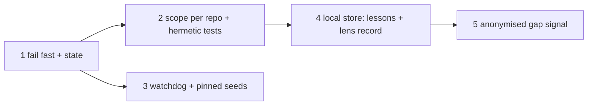

# Umbrella — the review memory loop closes locally per project, fails fast, is watched, and feeds repoach's development anonymously

## Intent

Five pull-request-sized specs, in one order, turn a memory loop that
never closed (lessons written where no reviewer reads, a backend that
wedged for four days while every review paid 40 s of timeouts and said
nothing) into two layers the owner asked for on 2026-11-12: a local,
per-project memory the project's reviewers use and the project can see
and delete, and an anonymised signal of the gap between what repoach
proposed and what the project needed, for repoach's own development.
This spec owns no code; it fixes the order, the shared vocabulary and
the owner decisions the five specs leave open.

## Context

| # | Fact | Where |
|---|---|---|
| F1 | Yoob's `review:gate` ran 10 reviews with `n_lessons=0`, `agentmemory_recall_failed ConnectTimeout` and 5–12 `agentmemory_remember_failed` each, about 40 s per review; the backend's port was wedged (accept queue full, 125 `CLOSE-WAIT`), unlogged since 11-08, restarted by hand at 17:02 on 11-12 with a `SIGKILL` | SP-MEMORY-FAIL-FAST F1–F3; SP-MEMORY-BACKEND-LIVENESS F1 |
| F2 | Lessons are written to `repoach-builder`; the reviewers recall `repoach-review`, which holds six seeds from 2026-07-03; both scopes are global across repositories; the test suite writes fixtures into the live builder scope (about 12 871 entries, with `missing test_never_written_symbol` and `Built SP-MULTI …`) | SP-REVIEW-LESSONS-REACH-REVIEWERS F1–F6 |
| F3 | After the restart, recall of the six seeds returns 0 to 3 of them depending on the query words (BM25) | SP-MEMORY-BACKEND-LIVENESS F5 |
| F4 | The lens track record and the lessons come from the per-MR ledger; on Yoob the ledger is cached per merge request, so no review remembers another merge request | SP-REVIEW-MEMORY-STORE F1–F3 |
| F5 | Two drafts of 2026-10-19 already asked for parts of this: SP-MEMORY-LOOPS-EXPLICIT (opt-in, visible, per repository) and SP-UNIVERSAL-LEDGER (fate, stats, `--share`). They are extended, not duplicated: each carries an amendment naming which goal moved where | `docs/specs/2026-10-19_SP-MEMORY-LOOPS-EXPLICIT_*.md`; `docs/specs/2026-10-19_SP-UNIVERSAL-LEDGER_*.md` |
| F6 | Owner principle, verbatim intent: « repoach ne doit pas être intrusif : on a de la mémoire dans le projet qu'il va utiliser en local, mais pour poursuivre son développement par le calcul des écarts entre ce qu'il propose et les besoins des projets où il est installé, il faut que ce soit anonymisé quelque part » | brief, 2026-11-12 |

## Goals

- G1 (order): the five specs land in this order, each its own pull request, each green on its own tests and on `repoach arch check` before the next starts:

| # | Spec | Closes | Size (code + tests, estimate) | depends_on (within the family) |
|---|---|---|---|---|
| 1 | SP-MEMORY-FAIL-FAST | 40 s of timeouts per review; the report silent on memory | ~180 + 220 lines | — |
| 2 | SP-REVIEW-LESSONS-REACH-REVIEWERS | lessons written where nobody reads; global scopes; test noise into a live backend | ~160 + 260 lines | 1 |
| 3 | SP-MEMORY-BACKEND-LIVENESS | a wedged backend nobody restarts; seeds lost to BM25 | 4 deploy files + ~60 + 200 lines | 1 |
| 4 | SP-REVIEW-MEMORY-STORE | one-MR memory on Yoob; no inspectable, deletable local memory | ~420 + 380 lines | 1, 2 |
| 5 | SP-ANONYMISED-GAP-SIGNAL | no gap signal; the `--share` draft had an identifier and no receiver | ~360 + 320 lines | 4 |

- G2 (layer A, local): after 2 and 4, every repository repoach reviews has a per-repository memory (`repoach-review/<slug>` on the backend when `[learning].memory = true`; `memory.db` under the project's data directory always, unless `[learning].store = false`), recalled deterministically with the pinned seeds, written at cycle end from verified and refuted findings, announced on every run, listed, added to, forgotten and purged by `repoach memory …`; nothing in it leaves the machine.
- G3 (layer B, anonymised): after 5, a project can send, by hand, with consent, after a preview and with a local log, a payload of buckets and closed-vocabulary categories; the payload has no string field by construction and a planted-secret test proves no path, text, identifier or name reaches it.
- G4 (fail fast and honest): after 1, a dead backend costs a review one 1 s probe and the review's JSON, stderr line, archive comment and log say `on`, `off` or `unreachable` with the counts; after 3, the backend is restarted by a timer within about two minutes of wedging.
- G5 (hygiene): after 2, `pytest -q tests/unit` cannot write to a live backend; the legacy global scopes are read by nobody and measured by `repoach memory audit`.

## Non-Goals

- NG1: no fate collection from the forge after merge, no `repoach stats`, no `repoach adapt` (SP-UNIVERSAL-LEDGER keeps those).
- NG2: no change to the builder loop beyond its scope becoming per repository.
- NG3: no receiver code in this repository (SP-ANONYMISED-GAP-SIGNAL D7 names it as the owner's deliverable).
- NG4: no retirement of agentmemory in this family; the store makes the review loop independent of it, the retirement is SP-REVIEW-MEMORY-STORE Q3.

## Assumptions

- A1: Yoob's `review:gate` keeps running on the owner's host; a move to a hosted runner needs the relative `store_path` and the cache key of SP-REVIEW-MEMORY-STORE G6 first.
- A2: the coordinator's measurements of 2026-11-12 (F1, F3) stand as the baseline; each spec's success conditions re-measure the same quantities after it lands.

## Interface

Shared vocabulary, defined once and reused by the five specs:

| Term | Meaning | Defined in |
|---|---|---|
| `MemoryState` | `on`, `off`, `unreachable` | SP-MEMORY-FAIL-FAST |
| `MemoryReport` | the `memory` object of the `review pr` JSON | SP-MEMORY-FAIL-FAST, extended by 2 and 4 |
| scope | `repoach-review/<slug>`, `repoach-builder/<slug>`, `slug = project_slug(root)` | SP-REVIEW-LESSONS-REACH-REVIEWERS |
| `LessonKind` | `seed`, `confirmed`, `trap`, `user` | SP-REVIEW-LESSONS-REACH-REVIEWERS (2 kinds), SP-REVIEW-MEMORY-STORE (4) |
| pinned seeds | the code constants, always first in a recall | SP-MEMORY-BACKEND-LIVENESS |
| `lens_record` | per lens × claim type: confirmed, refuted, owner_resolved, resolved_at_head, not_applicable, merge_requests | SP-REVIEW-MEMORY-STORE |
| `GapSignalV1` | the allow-list payload, `format:gap-signal-v1` | SP-ANONYMISED-GAP-SIGNAL |
| `[learning]` | `store`, `store_path`, `memory`, `recalled_lessons_max` | SP-REVIEW-MEMORY-STORE |
| `[telemetry]` | `gap_signal`, `endpoint` | SP-ANONYMISED-GAP-SIGNAL |

## Behavior

### Nominal
The order of G1. A spec that is refused by its gate stops the line
(SP-RED-STOPS-THE-LINE): the next one is not started until the
refusal has a corrective spec and the gate is green.

### Edge cases
- 3 may land before 2 (both depend on 1 only); the order above puts 2 first because it changes what the reviewers read, 3 what the host does.
- the owner answers a decision differently from the recommendation → the spec is amended before its pull request opens, never after.

### Failure scenarios
- the backend wedges again before 3 lands → 1 bounds the cost to one probe and the report says `unreachable`; the owner restarts by hand, as on 11-12.

## Architecture Impact
- Adds dependency: SP-REVIEW-MEMORY-LOOP -> SP-MEMORY-FAIL-FAST, SP-MEMORY-BACKEND-LIVENESS, SP-REVIEW-LESSONS-REACH-REVIEWERS, SP-REVIEW-MEMORY-STORE, SP-ANONYMISED-GAP-SIGNAL (the umbrella orders them; it owns nothing and imports nothing)
- No code, no table, no cycle.

## Diagram

## Acceptance Criteria
- [ ] AC1: the five specs exist under `docs/specs/2026-11-12_SP-*.md` with the ids of G1, each with facts cited `file:line`, decisions, goals, non-goals, tests with their red mutation, success conditions, and owner decisions under Open Questions; `repoach arch check --base origin/develop` → `edge-honesty: ok` with all six present.
- [ ] AC2: `pytest -q tests/unit/test_spec_presence.py tests/unit/test_arch_graph.py tests/unit/test_governed_spec.py` → green with the six files added.
- [ ] AC3: the two drafts of F5 carry an amendment naming which of their goals moved to which spec of this family, and their `updated` date is 2026-11-12.
- [ ] AC4: after spec 1 lands: `jq .memory.state` on a Yoob `review-gate.json` answers a state and the job log carries the `repoach: memory:` line; after 3: the watchdog timer is `active (waiting)` on the owner's host; after 4: `repoach memory record` in the Yoob checkout shows `merge_requests >= 2`; after 5: `repoach gap preview --period <closed month>` on Yoob's ledger passes the vocabulary walk.

## Open Questions

Owner decisions, gathered from the five specs, each with the recommendation:

| # | Decision | Spec | Recommendation |
|---|---|---|---|
| O1 | Where the anonymised signal is stored: owner receiver on hel1 (`https://gap.repoach.dev/v1/gap`, JSONL per month), a public PR-based repository, or preview-only for now | SP-ANONYMISED-GAP-SIGNAL Q1 | the owner receiver, preview-only until it is up; the PR repository is refused (it attaches a login) |
| O2 | The opt-in wording in `repoach.toml` and `preview` | SP-ANONYMISED-GAP-SIGNAL Q2 | the proposed English sentence |
| O3 | No identifier (k-anonymity by payload count, one send per period) versus a rotatable install id | SP-ANONYMISED-GAP-SIGNAL Q3 | none |
| O4 | Retention on the receiver | SP-ANONYMISED-GAP-SIGNAL Q4 | raw 24 months, aggregates kept, k = 3, stated in `docs/privacy.md` |
| O5 | Minimum reviews in a month before a payload exists | SP-ANONYMISED-GAP-SIGNAL Q5 | 10 |
| O6 | Local store on by default and announced, or opt-in | SP-REVIEW-MEMORY-STORE Q1 | on and announced |
| O7 | Default `store_path`: user data dir or `.repoach/memory.db` with a cache key | SP-REVIEW-MEMORY-STORE Q2 | user data dir; `repoach init` writes the relative form on a hosted runner |
| O8 | Retire the agentmemory review scope after the store | SP-REVIEW-MEMORY-STORE Q3 | retire, in a follow-up, once C2 is measured on Yoob |
| O9 | The 12 871 legacy builder entries: orphan, delete through `forget`, or restore the backup | SP-REVIEW-LESSONS-REACH-REVIEWERS Q1 | orphan and re-seed the per-repository scopes |
| O10 | Trap lessons from refuted findings for the reviewers | SP-REVIEW-LESSONS-REACH-REVIEWERS Q2 | yes, review scope only |
| O11 | Seed a new per-repository scope on first recall | SP-REVIEW-LESSONS-REACH-REVIEWERS Q3 | yes |
| O12 | `review pr` turns memory off in a CI job by default, as `ci review` does | SP-MEMORY-FAIL-FAST Q1 | no; the 1 s probe decides |
| O13 | Recalled lesson texts in the archive comment | SP-MEMORY-FAIL-FAST Q2 | counts only |
| O14 | Install the versioned `agentmemory.service` over the hand-written one | SP-MEMORY-BACKEND-LIVENESS Q1 | yes |
| O15 | `MemoryMax=2048M` on the backend | SP-MEMORY-BACKEND-LIVENESS Q2 | yes |
| O16 | Watchdog on `livez` alone, or also on a zero-hit seed search | SP-MEMORY-BACKEND-LIVENESS Q3 | `livez` alone |
