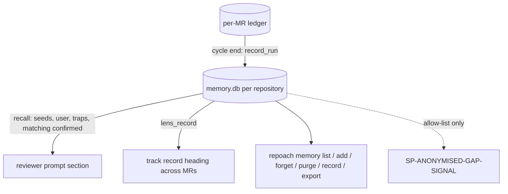

# A local, per-repository store holds review lessons and lens precision across merge requests

## Intent

A reviewer's track record and the lessons it recalls come from the
per-MR ledger, so on Yoob, where the ledger is cached per merge
request, each review starts with a one-MR memory, and the only
cross-MR memory is an HTTP service on the owner's host that a foreign
repository does not run. After this spec every repository repoach
reviews has one local SQLite store beside its ledger, holding the
lessons distilled from its own reviews and the per-lens, per-claim-type
record of what was confirmed, refuted or settled by a person across
every merge request. The reviewers recall from it deterministically,
the project can list, add, forget and purge its content, every run
announces what it read, and nothing in it leaves the machine.

## Context

Measured 2026-11-12, `origin/develop` `8fabb19`, Yoob `develop` `60a1faa3`.

| # | Fact | Where |
|---|---|---|
| F1 | `render_lens_track_record(db_path, role)` computes the lens's precision over `fetch_all_findings(db_path)` and lists its last three refuted findings; `db_path` is the run's ledger | `src/repoach/review/review_lessons.py:203-262`; `src/repoach/review/reviewer.py:657-661` |
| F2 | On Yoob the ledger is `[state].db_path = ".repoach/repoach.db"`, restored from a GitLab cache keyed per merge request and sealed per `(project, iid)`; so F1's "full ledger" is one merge request's | `yoob_2/repoach.toml:92-95`; `yoob_2/.gitlab-ci.yml:1604-1623` (`review:gate`, `cache.key`); `yoob_2/ci/review-gate.sh:109-119` |
| F3 | The Yoob job runs on the owner's host (`tags: [$YOOB_REVIEW_RUNNER_TAG]`, shared gateway at `http://127.0.0.1:8084`), so a path under `user_data_dir()/<project_slug>/` persists across its jobs; on a hosted runner it would not | `yoob_2/.gitlab-ci.yml:1604-1613`; `src/repoach/core/paths.py:173-180`, `:277-300` |
| F4 | The only cross-MR memory is the agentmemory HTTP service at `localhost:3111`, recalled by BM25 word match, and unavailable to a repository that does not run it; its review scope held six seeds and nothing else until SP-REVIEW-LESSONS-REACH-REVIEWERS | `src/repoach/review/review_memory.py:18-49`; SP-MEMORY-BACKEND-LIVENESS F5 |
| F5 | `compute_lens_precision` counts `CONFIRMED_REAL_STATUSES` as confirmed and `REFUTED` as refuted; `owner_resolved` (a maintainer settled it), `resolved_at_head` (a person's fix settled it) and `not_applicable` are neither, so a human decision never enters the precision | `src/repoach/review/review_lessons.py:147-178`; `src/repoach/review/findings.py:97-137` |
| F6 | The reviewer prompt takes an `extra_prompt_section` appended after substitution, which is where the lessons section goes today; the track record is appended after it | `src/repoach/review/reviewer.py:620-661` |
| F7 | `[learning]` is reserved in `repoach.toml` by SP-UNIVERSAL-LEDGER G9 and SP-MEMORY-LOOPS-EXPLICIT F7 for the memory opt-in; `ProjectConfig` has no such section yet | `src/repoach/project/config.py:189-564` (sections); `repoach.toml` |
| F8 | SP-CI-LEDGER-PERSISTS (draft) generates the cache stanza for the per-PR ledger; a second, per-project cache is one more key in the same stanza | `docs/specs/2026-10-25_SP-CI-LEDGER-PERSISTS_*.md` G1, G2 |
| F9 | Owner principle (2026-11-12): memory lives with the project where repoach is installed, local, used by its reviewers, visible, inspectable, deletable, opt-in or announced; nothing identifying leaves it | brief of this spec family |

## Decisions (2026-11-12)

- D1. One SQLite file per repository, `[learning].store_path`, default
  `user_data_dir()/<project_slug>/memory.db` (beside the default ledger,
  F3), never inside the per-MR ledger. A project on an ephemeral runner
  sets `store_path = ".repoach/memory.db"` and caches it under a
  per-project key; the generated CI stanzas (F8) add that key when the
  setting is relative.
- D2. Three tables, created through the shared race-proof schema
  helper: `review_lessons` (one row per lesson, with its kind, lens,
  claim type, path prefix, source MR and finding, and the time it was
  last recalled), `lens_record` (one row per lens × claim type with
  confirmed, refuted, owner_resolved, resolved_at_head, not_applicable
  counts and the number of MRs that contributed) and
  `lens_record_sources` (one row per counted finding, unique on
  `(repo, pr_number, finding_key)`, so a replayed run or a re-run at the
  same head counts nothing twice).
- D3. The store is written at cycle end from the run's ledger: a row
  per `(lens, claim_type)` increment for every finding whose status
  reached a terminal or judged state in this run, and a `confirmed` or
  `trap` lesson per finding as SP-REVIEW-LESSONS-REACH-REVIEWERS
  distils them. A finding settled by a maintainer counts as
  `owner_resolved`, one resolved at head as `resolved_at_head`: the
  human decisions F5 leaves out are columns, not folded into precision.
  Precision stays `confirmed / (confirmed + refuted)`; the report prints
  the human columns beside it.
- D4. Recall is deterministic: the pinned seeds, then the lens's
  `trap` lessons newest first, then `confirmed` lessons whose
  `path_prefix` (first two path segments) matches a changed path or
  whose `claim_type` is one the lens emits, newest first; `user`
  lessons always; cut at `recalled_lessons_max` and
  `recalled_section_max_chars`. No word matching, no backend, no luck:
  the same ledger and diff give the same section. The track record of
  F1 reads its precision from `lens_record` (across MRs) and its three
  refuted examples from the run's ledger as today.
- D5. The store is on by default and announced on every run: a stderr
  line `repoach: memory: store <path>, <n> lessons recalled (<s> pinned, <t> traps), lens record over <p> merge requests`
  and `MemoryReport.backend = "store"` with `store_path`; `[learning].store = false`
  turns it off and the line says `store off ([learning].store = false)`.
  The agentmemory loops stay opt-in (SP-MEMORY-LOOPS-EXPLICIT G1) and
  recall through them is appended after the store's section when on.
  Owner decision Q1 records the opt-in alternative.
- D6. Inspection and deletion are commands, not a UI:
  `repoach memory list [--lens L] [--kind K] [--json]`,
  `repoach memory add "<text>" --lens L [--claim-type C] [--path P]`
  (kind `user`), `repoach memory forget <id>...`, `repoach memory purge --yes`,
  `repoach memory record [--json]` (the lens table), `repoach memory export --json`
  (everything, for the project's own eyes). The `memory` sub-app keeps
  the agentmemory commands under `repoach memory backend …`.
- D7. Nothing in the store crosses a repository: the file is per slug,
  the rows carry no slug of another project, and no command reads a
  store other than the current repository's. The anonymised signal
  (SP-ANONYMISED-GAP-SIGNAL) reads this store and the ledger through
  an allow-list; the store itself never leaves.

## Goals

- G1: `memory_store.py` creates the three tables idempotently at `store_path`; `record_run(store, ledger, pr_number, run_id)` increments `lens_record` once per finding (idempotent on replay) and inserts the run's lessons; `recall(store, lens, changed_paths)` returns D4's list.
- G2: `render_lens_track_record` reads precision and the human columns from `lens_record`; its heading line reads `precision 14/19 (0.74) over 7 merge requests; owner-resolved 2, resolved at head 3`; the per-MR refuted examples follow as today.
- G3: the reviewer's `extra_prompt_section` is the store's section (`## Review lessons (local store)`) followed, when on, by the agentmemory section; `MemoryReport.recalled` lists both with their source.
- G4: `[learning]` joins `ProjectConfig`: `store: bool = true`, `store_path: str = ""`, `memory: bool = false` (the agentmemory loops; delivers SP-MEMORY-LOOPS-EXPLICIT G1's toml key), `recalled_lessons_max: int = 20`; `repoach config show` prints them with their source.
- G5: the six commands of D6 exist, print the store path first, and `purge` without `--yes` prints what it would delete and exits 2.
- G6: the generated CI stanzas of SP-CI-LEDGER-PERSISTS add a per-project cache (`repoach-memory-$CI_PROJECT_ID` / `repoach-memory-<repo>`) when `[learning].store_path` is relative; absolute or default paths add nothing.
- G7: `tests/integration/test_memory_store_two_merge_requests.py` runs two reviews of two merge requests with two per-MR ledgers and one store: the second review's track record counts the first's findings and its recall holds the first's lessons.

## Non-Goals

- NG1: no change to the finding lifecycle or to `pr_findings`; the store reads the ledger, never writes it.
- NG2: no removal of the agentmemory loops; they remain for the builder and for projects that opt in.
- NG3: no fate collection from the forge after merge (SP-UNIVERSAL-LEDGER's `finding_fate`); a `fixed` versus `reverted` column waits for it.
- NG4: no hosted or shared store; no synchronisation between machines.
- NG5: no change to the prompts' text; the section is appended as the agentmemory one is.

## Assumptions

- A1: the per-MR ledger of the current run holds every finding of that MR at cycle end (`fetch_findings(db_path, pr_number)`), including the statuses set by the refuter, the owner commands and the head re-verification of this run.
- A2: `SP-SCHEMA-INIT-RACE-GENERALIZE`'s helper accepts a second database file; two concurrent reviews of two MRs on the same host write the store under SQLite's file lock with `busy_timeout` set.
- A3: the changed paths of the diff are available where the section is built (`_build_review_lessons_block` already extracts them from the diff).

## Interface

```python
# src/repoach/review/memory_store.py
class LessonRow(BaseModel):
    id: int | None; kind: Literal["seed", "confirmed", "trap", "user"]; lens: str | None
    claim_type: str | None; path_prefix: str | None; text: str
    source_pr: int | None; source_finding_key: str | None
    created_at: datetime; last_recalled_at: datetime | None; recalls: int

class LensRecordRow(BaseModel):
    lens: str; claim_type: str
    confirmed: int; refuted: int; owner_resolved: int; resolved_at_head: int; not_applicable: int
    merge_requests: int; updated_at: datetime

def open_store(path: Path) -> Store: ...
def record_run(store: Store, *, ledger: Path, pr_number: int, run_id: str, lessons: Sequence[tuple[LessonKind, str, Finding]]) -> RecordSummary: ...
def recall(store: Store, *, lens: str, changed_paths: Sequence[str], limit: int, max_chars: int) -> list[LessonRow]: ...
def lens_record(store: Store, lens: str | None = None) -> list[LensRecordRow]: ...
def add_lesson(store, text, *, lens, claim_type, path_prefix) -> int: ...
def forget(store, ids: Sequence[int]) -> int: ...
def purge(store) -> int: ...

# src/repoach/review/memory_recall.py
def store_section(rows: Sequence[LessonRow]) -> str: ...       # "## Review lessons (local store)"
def track_record_heading(record: Sequence[LensRecordRow], lens: str) -> str: ...

# src/repoach/project/config.py (added)
class LearningSection(_Section):
    store: bool = True
    store_path: str = ""
    memory: bool = False
    recalled_lessons_max: int = 20
```

Tables:

| Table | Columns | Unique |
|---|---|---|
| `review_lessons` | id, kind, lens, claim_type, path_prefix, text, source_pr, source_finding_key, created_at, last_recalled_at, recalls | (kind, lens, claim_type, path_prefix, text) |
| `lens_record` | lens, claim_type, confirmed, refuted, owner_resolved, resolved_at_head, not_applicable, merge_requests, updated_at | (lens, claim_type) |
| `lens_record_sources` | pr_number, finding_key, lens, claim_type, status, recorded_at | (pr_number, finding_key) |

`finding_key` is the content hash of SP-ORDER-INDEPENDENT-DEBT-IDS where present, else `sha256(finder, claim_type, file, line_start, claim[:80])[:16]`.

Errors: `StoreLockedError` after `busy_timeout` (5 s) — logged `memory_store.locked`, the run continues without recording; never raised to the caller.

## Behavior

### Nominal
Review of MR 2 of a repository whose MR 1 was reviewed yesterday: the
store holds MR 1's lessons and record. Each reviewer receives the
store section (seeds, its traps, matching confirmed lessons) and a
track record whose precision spans both MRs. At cycle end MR 2's
findings increment the record once each and add their lessons; the
stderr line names the path and the counts.

### Edge cases
- the same head reviewed twice (replay) → `lens_record_sources` refuses the duplicates; `record_run` reports `0 new`.
- a finding `proposed` at cycle end (deferred judge) → not counted, no lesson; it is counted by the run in which it reaches a state.
- a `user` lesson → always recalled, listed first after the seeds, never aged out.
- more rows than the cap → the newest within each kind win; `recalled_total` tells the truth.
- `[learning].store = false` → no file touched, the line says so, the track record falls back to the per-MR precision of today.

### Failure scenarios
- the store path is unwritable → `memory_store.unwritable` once, run unchanged, `backend: "store"`, `state: unreachable`, the line names the path.
- the store is locked past 5 s → recording skipped, `memory_store.locked`, recall still served from the read connection.
- a corrupt file → renamed to `memory.db.corrupt-<ts>`, a fresh one created, one warning; nothing else lost since the ledger stays the source.

## Tests

| Test | What it pins | Mutation that must turn it red |
|---|---|---|
| `tests/unit/test_memory_store.py::test_tables_created_idempotently_and_schema_pinned` | three tables, the unique keys, a second `open_store` changes nothing | drop a unique key |
| `::test_record_run_counts_each_finding_once_across_replays` | the same ledger recorded twice → counts unchanged the second time | remove `lens_record_sources` |
| `::test_human_decisions_are_columns_not_precision` | `owner_resolved` and `resolved_at_head` findings → their columns, precision unchanged | count `owner_resolved` as confirmed |
| `::test_user_lesson_add_forget_purge` | `add` → listed; `forget` → gone; `purge` → empty | — |
| `tests/unit/test_memory_recall_deterministic.py::test_same_inputs_same_section` | two calls, same rows and paths → byte-identical section | sort by a random tiebreak |
| `::test_order_seeds_user_traps_then_matching_confirmed` | the order of D4 | put confirmed before traps |
| `::test_path_prefix_and_claim_type_select_confirmed_lessons` | `src/a/b.py` matches prefix `src/a`, not `src/b` | match on the whole path |
| `::test_caps_by_count_and_chars` | 30 rows → 20; long texts → ≤ 2400 chars | drop the char cap |
| `tests/unit/test_lens_record_cross_mr.py::test_track_record_spans_merge_requests` | two ledgers, one store: the heading reads `over 2 merge requests` and sums both | read precision from the ledger |
| `::test_store_off_falls_back_to_per_mr_precision` | `[learning].store = false` → today's heading | — |
| `tests/unit/test_memory_store_cli.py::test_commands_print_path_first_and_purge_needs_yes` | the six commands; `purge` without `--yes` exits 2 | — |
| `::test_ci_stanza_adds_project_cache_only_for_a_relative_store_path` | relative → key present; default → absent | always add it |
| `tests/integration/test_memory_store_two_merge_requests.py` | G7 end to end with fake reviewers | — |

## Success conditions

- C1: on Yoob's runner, after two merge requests are reviewed, `repoach memory record` in the Yoob checkout prints a `merge_requests` column ≥ 2 for at least one lens, read from `~/.local/share/repoach/gitlab.com/<group>/<project>/memory.db`.
- C2: a reviewer prompt of the second review contains the first review's `trap` lessons for that lens; measured by `--explain-memory` (SP-MEMORY-LOOPS-EXPLICIT G3) or the JSON `memory.recalled`.
- C3: recall is a pure function of (store rows, lens, changed paths): the deterministic test and a hypothesis property over random rows hold.
- C4: the store never leaves the repository's slug directory and no command opens another repository's store; `grep -rn "user_data_dir()" src/repoach/review/memory_store.py` shows the slug in every path.
- C5: `pytest -q tests/unit` adds no file outside `tmp_path` (the suite points `store_path` at `tmp_path` through the session env).

## Architecture Impact
- Adds dependency: SP-REVIEW-MEMORY-STORE -> SP-REVIEW-LESSONS-REACH-REVIEWERS (the lesson kinds and the distillation it writes)
- Adds dependency: SP-REVIEW-MEMORY-STORE -> SP-MEMORY-FAIL-FAST (`MemoryReport.backend = "store"`, the stderr line, the state)
- Adds dependency: SP-REVIEW-MEMORY-STORE -> SP-UNIVERSAL-PROJECT-CONFIG (`[learning]` section, `repoach config show`)
- Adds dependency: SP-REVIEW-MEMORY-STORE -> SP-UNIVERSAL-INSTALL (`user_data_dir`, `project_slug`)
- Adds dependency: SP-REVIEW-MEMORY-STORE -> SP-FINDINGS-INIT-RACE (reads `pr_findings` through `fetch_findings`; never writes it)
- Adds dependency: SP-REVIEW-MEMORY-STORE -> SP-SCHEMA-INIT-RACE-GENERALIZE (the schema helper creates the three tables)
- Adds dependency: SP-REVIEW-MEMORY-STORE -> SP-RETRY-BACKOFF-DEDUP (`reviewer.py` is owned there; the track record call changes)
- Adds dependency: SP-REVIEW-MEMORY-STORE -> SP-ORCH-DOCSTRING (the orchestrator records the run and builds the section)
- Adds dependency: SP-REVIEW-MEMORY-STORE -> SP-DEDUP-CLASSIFICATION-CONSTANTS (`render_lens_track_record` in `review_lessons.py` reads the store)
- Adds dependency: SP-REVIEW-MEMORY-STORE -> SP-OWNER-SETTLES-A-FINDING, SP-GATE-REVERIFIES-AT-HEAD (the `owner_resolved` and `resolved_at_head` statuses become columns)
- Adds dependency: SP-REVIEW-MEMORY-STORE -> SP-CI-LEDGER-PERSISTS (the generated cache stanza gains the per-project key)
- New shared state: `db:table:review_lessons`, `db:table:lens_record`, `db:table:lens_record_sources`, in a file of their own, owned here; `pr_findings` read only. `memory_store.py` imports `findings.py`, `core/paths.py`, `core/sqlite_schema_init.py`; nothing imports it but the orchestrator, `review_lessons.py` and the CLI. No cycle.

## Diagram


## Acceptance Criteria
- [ ] AC1: `pytest -q tests/unit/test_memory_store.py tests/unit/test_memory_recall_deterministic.py` → green: tables and keys, idempotent recording, human columns, user lessons, deterministic ordered capped recall. Today (`8fabb19`): no store exists.
- [ ] AC2: `pytest -q tests/unit/test_lens_record_cross_mr.py` → green: the heading spans two ledgers; store off falls back. Today: F1, one ledger.
- [ ] AC3: `pytest -q tests/unit/test_memory_store_cli.py tests/unit/test_project_config.py` → green: the six commands, `purge --yes`, the `[learning]` section with sources, the conditional cache key.
- [ ] AC4: `pytest -q tests/integration/test_memory_store_two_merge_requests.py` → green.
- [ ] AC5: `repoach memory list` in a fresh clone → `store: <user_data_dir>/<slug>/memory.db` then `no lessons`, exit 0; `repoach arch check --base origin/develop` → `edge-honesty: ok`; `docs/merge_gate.md` names the store, its path, the commands and the line a run prints.

## Open Questions
- Q1 (owner decision): the store on by default and announced (D5), or off until `[learning].store = true`? Recommendation: on and announced; it is local, visible on every run, deletable with one command, and the reviewers are blind across merge requests without it. The agentmemory loops stay off by default.
- Q2 (owner decision): default `store_path` under `user_data_dir()` (persists on a self-hosted runner, lost on a hosted one) or inside the repository (`.repoach/memory.db`, needs the cache key)? Recommendation: `user_data_dir()`, with `repoach init` writing the relative form and the cache key when it detects a hosted runner configuration.
- Q3 (owner decision): after this spec, retire the agentmemory review scope (keep agentmemory for the builder only), or keep both review sources? Recommendation: retire it in a follow-up once C2 is measured on Yoob; one source per loop.
