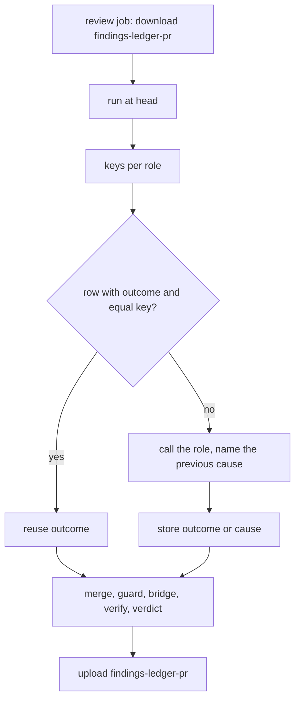

# A retry calls only the roles that did not answer

## Amendment (0.4, 2026-11-17): the generated jobs persist nothing today; the edges say what is read

Re-measured on `origin/develop` `92cd241` after the verifier's read. F9
of 0.3 said the generated CI jobs keep the ledger per pull request "by
design": `src/repoach/ci_entry/snippets.py` has no `cache:` and no
ledger path (`render_gitlab_job`, `:93-119`), and SP-CI-LEDGER-PERSISTS,
which adds them, was a draft. What persists on Yoob is the hand-written
`review:gate` job's cache. This spec needs neither: D4 is repoach's own
`auto-review.yml`, and the edge to SP-CI-LEDGER-PERSISTS is withdrawn
(that spec now sits in the umbrella's order before 8c, which is its
first dependant). AC1's `test_table_is_not_a_gate_table` and AC5 import
`ledger_format`, so SP-LEDGER-FORMAT-IS-VERSIONED is declared; F12's
lines are those of its branch today.

## Amendment (0.3, 2026-11-17): approved; every role is recorded, the ledger comes back on every run, the format is not bumped

Re-measured on `origin/develop` `92cd241`. Three things changed against
0.2. (1) D1 records every role at a head, a parsed answer with its
outcome and a failed one with its named cause, so the retry's report
says why a role is called, as the umbrella's order requires (SP-REVIEW-
CONVERGES G1, row 2: "records the named cause"). (2) D4 no longer keys
the ledger's return on the retry run alone: repoach's own review job
starts from an empty ledger on every run (F5), so an owner's comment
re-run, the automatic retry and the `/resolve` comment of SP-OWNER-
SETTLES-A-FINDING all began from nothing and renumbered every finding
(F8); the job now downloads the pull request's last ledger before
`review pr`, the way `merge-on-ci.yml` already does. (3) D6 states the
`LEDGER_FORMAT` impact under SP-LEDGER-FORMAT-IS-VERSIONED: none, since
the gate never reads the new table. The two owner questions of 0.2 are
closed by facts (D7).

## Intent

When one reviewer errors, the run is not stored and the next attempt at
the same head calls all four again; #288 paid three full reviews for
one Sentinel failure. After this spec every reviewer outcome that
parsed is kept at its head, keyed by the role, the round, the persona
version, the tiers and the diff hash, every reviewer that failed is
kept with its named cause, and a later run at the same head reuses the
parsed outcomes and calls only the roles that have none. The JSON says
which roles were reused, which were called, and why each called role
had nothing to reuse. In repoach's own CI the ledger a run writes is
the ledger the next run of the same pull request starts from.

## Context

Measured on `origin/develop` `92cd241` (2026-11-17).

| # | Fact | Where |
|---|---|---|
| F1 | A run stores itself as completed only when no role errored: `if not errored_roles and recorded is not None and self._pinned_head: self._store_completed_run(...)`; `errored_roles` is every outcome whose verdict is `ERROR`. A second attempt at the same head therefore finds no completed run and reviews afresh: no `review_team.replayed` | `src/repoach/review/orchestrator.py:962`, `:1165-1168`; SP-REVIEW-SURVIVES-TRANSPORT-FAILURES F10 |
| F2 | The replay cache answers a completed run at `(pr_number, head_sha)`, the latest `pr_review_runs` row; its key holds no role, persona or tier. Its payload already serialises every `ReviewerOutcome` and back: `outcome_to_json` / `outcome_from_json` | `src/repoach/review/findings.py:306-316`, `:578-600`; `src/repoach/review/review_cache.py:22-50`, `:92-130` |
| F3 | The automatic retry reviews the head afresh 300 s after a transport failure; the `retry` job waits `review_retry_delay_s` and dispatches a `workflow_dispatch` carrying `retry_of`, which the `review` job admits from `github-actions[bot]` | SP-REVIEW-SURVIVES-TRANSPORT-FAILURES D3, D4; `.github/workflows/auto-review.yml:37-38`, `:152-156`, `:635-700` |
| F4 | #288: attempts 1 and 2 failed on the Sentinel; the Architect, Tester and Scribe answered each time; 163 s and $2.16 for one Sentinel try | SP-REVIEW-SURVIVES-TRANSPORT-FAILURES F1, F12 |
| F5 | repoach's own review job writes to `REPOACH_DB_PATH: ${{ runner.temp }}/repoach_review.db` and downloads no earlier ledger; it uploads the file as `findings-ledger-<pr>` with `if: always()` and `overwrite: true`. Only `auto_fix` (SP-AUTOFIX-LEDGER-HYDRATE) and `auto_merge` download it, both within the same run (`needs.review`) | `.github/workflows/auto-review.yml:547`, `:599-606`, `:782-790`, `:1347-1351` |
| F6 | `merge-on-ci.yml` fetches the ledger across runs: `gh api …/actions/artifacts?name=findings-ledger-<pr>`, the newest non-expired artifact of the head branch, refused unless its run's `path` is `.github/workflows/auto-review.yml` in this repository, unzipped to `runner.temp` | `.github/workflows/merge-on-ci.yml:173-212` |
| F7 | Every usage row names `reviewer`, `provider`, `model` and `error` | `src/repoach/providers/usage.py:73-91` |
| F8 | `pr_findings.id` is an autoincrement; the report names findings by it (`Verdict basis: #12, #14`; `#<id>` per judged finding) and `/resolve #<id>` parses an integer and looks it up among every finding of the pull request. In repoach's own CI (F5) the ids restart at 1 on every run, so the id an owner read on one run names another finding, or none, on the run their comment triggers (`issue_comment` → the `review` job) | `src/repoach/review/findings.py:272`; `src/repoach/review/report.py:193`, `:501-505`; `src/repoach/review/owner_commands.py:73`, `:471`; `.github/workflows/auto-review.yml:17-18`, `:149-152` |
| F9 (0.4) | On Yoob the ledger under `.repoach/` is a GitLab cache per merge request on the hand-written `review:gate` job (`cache: {key: repoach-ledger-mr-$CI_MERGE_REQUEST_IID, paths: [.repoach/], when: always}`), so ids persist there between pipelines when the cache is hit; the jobs `repoach init --ci` generates declare no cache and no ledger path on `92cd241`, and the draft that adds them, SP-CI-LEDGER-PERSISTS, is ordered by SP-REVIEW-CONVERGES before its first dependant, 8c | Yoob `.gitlab-ci.yml:1645-1669` (`origin/develop` `6ee04ab`); `src/repoach/ci_entry/snippets.py:93-119` |
| F10 | The chain has three tiers, `opus`, `sonnet`, `haiku`, each a `chains.env` key (`MODEL_OPUS`, …); each lens names its persona file with its version in the name (`architect_0.5.1.md`, `sentinel_0.4.3.md`, `tester_0.4.1.md`, `scribe_0.5.1.md`) and its chain (`model_chain`); SP-REVIEW-FABLE-TIER adds a fourth tier later | `src/repoach/review/chain_health.py:34`; `src/repoach/review/chain_rewrite.py:111`; `src/repoach/review/reviewer.py:447-448`, `:920`, `:939`, `:947`, `:955` |
| F11 | `review pr` prints `incomplete_cause` (`transport` or `other`) in its JSON; the workflow reads it into a job output | `src/repoach/review/review_retry.py:92-120`; `src/repoach/cli/review_cmds.py:483`; `.github/workflows/auto-review.yml:185`, `:573` |
| F12 | The gate reads five ledger tables, `pr_findings`, `pr_review_integrity`, `pr_spec_coverage`, `pr_merges`, `generated_checks`, listed in `GATE_TABLES` and snapshotted in `tests/fixtures/ledger_format/1.json`; a table outside the list is never read by the gate | SP-LEDGER-FORMAT-IS-VERSIONED D1, D9, F6; `src/repoach/review/ledger_format.py:72` (`LEDGER_FORMAT`), `:85` (`GATE_TABLES`) on `fix/ledger-format-is-versioned` |
| F13 | open-code-review's `--resume <id>` replays a session and reuses every file whose diff fingerprint completed; the manifest is sealed before the review starts | `R/internal/session/resume.go:50-111`, `R/internal/session/manifest.go` |

## Decisions (author, within the owner's brief; 0.3 items 2026-11-17)

- D1. A new table `pr_reviewer_outcomes`: `pr_number`, `head_sha`,
  `role`, `round`, `persona_version` (the version in the persona file
  name, F10), `tiers_key` (every tier's model name in `CHAIN_TIERS`
  order, joined by `,`, so a fourth tier extends the key instead of
  breaking it), `diff_hash` (`_compute_diff_hash` of the pinned head's
  diff), `outcome_json` (F2's `outcome_to_json`, `NULL` for a role that
  did not answer), `error_cause` (`''` when parsed, else one of
  `transport`, `subscription_exhausted`, `unparsed`, `other`, the
  classification SP-REVIEW-SURVIVES-TRANSPORT-FAILURES and
  SP-SUBSCRIPTION-LIMIT-IS-NAMED give the failure), `model_used`,
  `recorded_at`; unique on the first seven, `INSERT OR REPLACE` on that
  key. Written by the orchestrator for **every** role, in the same step
  that records the findings, before the team verdict and whether or not
  another role errored. Only a row with an `outcome_json` is ever
  reused; a failed row says why the role will be called.
- D2. At the start of a run at `(pr, head)`, before the fan-out, for
  each role: a row with the same round, persona version, tiers key and
  diff hash and a non-null outcome is reused and the role is not
  called. The reused outcome goes through the same downstream steps as
  a fresh one (guard, bridge, verification), which are idempotent at a
  head by fingerprint (SP-FINDINGS-BRIDGE-DOCFIX); its dialogue row is
  not rewritten (the attempt that produced it wrote one). The JSON
  carries `roles_reused: [...]`, `roles_called: [...]` and
  `roles_previous_cause: {role: cause}` for every called role that has
  a failed row; stderr prints `roles: reused architect, tester, scribe;
  called sentinel (previous attempt: transport)`.
- D3. `--force` ignores the rows (as it ignores the replay cache) and
  rewrites them. A change of round, persona version, tiers key or diff
  hash misses the key and the role is called; the stale row is kept (it
  is evidence of what was reviewed) and never read.
- D4 (0.3). In repoach's own `auto-review.yml`, the `review` job
  downloads the pull request's newest `findings-ledger-<pr>` artifact
  into `REPOACH_DB_PATH` before `review pr`, on every run, with F6's
  mechanism and F6's producer check (`.github/workflows/auto-review.yml`
  in this repository, else refused); the upload of F5 is unchanged and
  already unconditional. A missing, expired or refused artifact starts
  an empty ledger and logs `role_resume.ledger_unavailable: <why>`. The
  artifact carries findings, outcomes and causes, no secret. On Yoob
  the hand-written `review:gate` job already persists the ledger per
  merge request (F9) and needs nothing from this spec; the generated
  jobs persist nothing until SP-CI-LEDGER-PERSISTS lands, which is that
  spec's object, not this one's.
- D5. The round-2 dialogue and the refuter run as today over the merged
  set; a reused role's round-2 outcome, when it existed, is stored and
  reused under the same key with `round = 2`.
- D6 (0.3, SP-LEDGER-FORMAT-IS-VERSIONED). `pr_reviewer_outcomes` is
  read by `review pr` alone, never by `review gate`, `run_auto_merge`
  or `gather_merge_facts` (F12). It is therefore not a gate table: it
  joins neither `GATE_TABLES` nor `tests/fixtures/ledger_format/N.json`,
  and `LEDGER_FORMAT` is not bumped by this spec. Its only readers run
  the base ref's code that wrote it (the `review` job installs the base
  ref, F3), so the one skew possible is a base ref that moved between
  two runs; a row whose `outcome_json` does not parse or whose columns
  are not this reader's is treated as absent and the role is called,
  logged `role_resume.row_unreadable`. A fresh call is always a correct
  answer, so a skew here costs one call, never a verdict, and no
  `SKIP_LEDGER_SKEW` is needed for it.
- D7 (0.3). The two questions 0.2 left to the owner are closed by the
  code. O1, an age limit on a reused outcome: none (`outcome_age_limit:
  none`); the replay cache of F2 has none, and a head is a head. O2,
  the artifact's retention: there is no second artifact; D4 reuses
  `findings-ledger-<pr>`, whose retention is the repository's default
  (no `retention-days` in `auto-review.yml`).

## End state

Attempt 1 at head H errors on the Sentinel: the three answers are rows,
the Sentinel's row says `transport`, the job exits 3 with
`incomplete_cause: transport` and uploads the ledger. The retry run
downloads it, prints `roles: reused architect, tester, scribe; called
sentinel (previous attempt: transport)`, makes one reviewer call, stores
the completed run, exits 0. An owner who then writes `/resolve #12 …`
triggers a run that downloads the same ledger, replays the completed
run and finds `#12` the finding they read. `repoach usage --run <retry>`
lists one reviewer row.

## Easy solution rejected

Store the run even when a role errored and replay it. Rejected: a
replay never calls the missing role, so the review would end `ERROR`
at every attempt until `--force`. Also rejected: retrying the whole
team four times (cost ×4 for the three roles that answered, F4) and
caching outcomes in memory for the retry (the retry is another job on
another runner; only the ledger crosses it, F5). Also rejected: keying
the ledger's return on `retry_of` alone, as 0.2 did: the owner's
comment run and the `/resolve` run are the runs that need the ledger
most (F8), and they carry no `retry_of`.

## Hard part

The key and the hand-over. The key must name everything that changes
what a role would have said: a persona bump (SP-FINDING-CITES-ITS-CODE
and SP-REVIEW-REMEMBERS-EVERY-ROUND each bump the four files), a tier
change, a diff change at the same head (a rebased base), the round. One
field too few reuses an answer to a question that was not asked; the
test table pins each field. The hand-over is the artifact: the review
job's ledger is the only state that survives the job, it is written
with `if: always()` and read back by a run that may have been started
by anyone the allowlist admits; the producer check of F6 is what keeps
a ledger forged by pull-request code out, and it is kept verbatim. The
reused outcomes re-enter the bridge, which must stamp the rows they
already recorded and insert nothing: the fingerprint idempotency of
SP-FINDINGS-BRIDGE-DOCFIX is what this spec leans on, and AC1 checks
the row count does not grow.

## Goals

- G1: every role's outcome or cause is stored at its head (D1), whether or not another role errored.
- G2: a later run at the same head reuses stored outcomes and calls the missing roles only (D2); the JSON and stderr name both sets and the previous cause.
- G3: a round, persona, tier or diff change misses the key (D3); `--force` calls every role.
- G4: repoach's own `review` job starts from the pull request's last ledger on every run (D4), so finding ids and completed runs survive between runs.
- G5: the usage ledger shows one call for the retried role and none for the reused ones (F7).
- G6: `LEDGER_FORMAT` is unchanged; the gate never reads the new table (D6).

## Non-Goals

- NG1: no partial reuse within a role (a role's outcome is one answer).
- NG2: no reuse across heads (SP-REVIEW-DELTA-FIRST reviews the delta instead).
- NG3: no change to the transport window or the retry dispatch rules.
- NG4: no finding identifier other than the row id; the cross-head key is SP-REVIEW-SETTLED-STAYS-SETTLED D11.
- NG5: no `SKIP_LEDGER_SKEW` for the new table (D6).

## Assumptions

- A1: `outcome_to_json` / `outcome_from_json` (F2) round-trip every `ReviewerOutcome` field the downstream steps read; a test pins it on a recorded outcome.
- A2: the `review` job's `GITHUB_TOKEN` may list and download the repository's artifacts, as `merge-on-ci.yml`'s does (F6).

## Interface

```python
# repoach.review.role_resume
ERROR_CAUSES = ("transport", "subscription_exhausted", "unparsed", "other")
class OutcomeKey(BaseModel):
    pr_number: int; head_sha: str; role: str; round: int; persona_version: str; tiers_key: str; diff_hash: str
class StoredRole(BaseModel):
    key: OutcomeKey; outcome: ReviewerOutcome | None; error_cause: str; model_used: str; recorded_at: str
def tiers_key(chains: Mapping[str, str]) -> str: ...                       # CHAIN_TIERS order, joined by ","
def persona_version(persona_filename: str) -> str: ...                     # "architect_0.5.1.md" -> "0.5.1"
def init_reviewer_outcomes_schema(db_path: Path) -> None: ...
def store_role(db_path, key: OutcomeKey, outcome: ReviewerOutcome | None, *, error_cause: str, model_used: str, now) -> None: ...
def load_roles(db_path, keys: Sequence[OutcomeKey]) -> dict[str, StoredRole]: ...   # unreadable rows absent, logged
def split_roles(stored: Mapping[str, StoredRole], roles: Sequence[str], *, force: bool) -> tuple[list[str], list[str], dict[str, str]]: ...   # reused, called, previous cause
```

`review pr` JSON gains `roles_reused: [...]`, `roles_called: [...]`,
`roles_previous_cause: {...}`. Table `pr_reviewer_outcomes` as D1.
`.github/workflows/auto-review.yml`: one step `Download findings ledger
(previous run)` before `Run review-bot team`.

## Behavior

### Nominal
- Attempt 1: Sentinel errors, three roles parse; four rows (one with `error_cause = transport`); exit 3. Attempt 2 at the same head: `roles: reused architect, tester, scribe; called sentinel (previous attempt: transport)`; one Sentinel call; the Sentinel's row is replaced by its outcome; the run completes and is stored.

### Edge cases
- The persona of the Tester was bumped between the attempts: the Tester is called too; its old row stays.
- `--force`: four calls, four rows rewritten.
- A completed run exists at the head: the replay of F2 answers first, as today; this spec is not reached.
- The Sentinel failed on `subscription_exhausted`: the row says so; the retry that SP-SUBSCRIPTION-LIMIT-IS-NAMED allows after the reset calls the Sentinel alone.

### Failure scenarios
- The artifact download fails or is refused in CI: the run reviews afresh on an empty ledger and logs `role_resume.ledger_unavailable: <why>`; never an error.
- A stored row's JSON does not parse, or lacks a column this reader expects: logged `role_resume.row_unreadable`, treated as absent, the role called (D6).
- The store of a row fails: logged, the run continues; the next attempt calls that role.

## Architecture Impact
- Adds dependency: SP-REVIEW-RESUMES-FAILED-ROLES -> SP-REVIEW-SURVIVES-TRANSPORT-FAILURES (the retry run that benefits; `incomplete_cause` and the transport classification behind `error_cause`)
- Adds dependency: SP-REVIEW-RESUMES-FAILED-ROLES -> SP-FINDINGS-BRIDGE-DOCFIX (idempotent recording at a head; `outcome_to_json` in `review_cache.py`), SP-FINDING-MODEL (the ledger file), SP-FINDINGS-INIT-RACE (`role_resume.py` imports the engine helpers of `findings.py` and creates its table in that ledger)
- Adds dependency: SP-REVIEW-RESUMES-FAILED-ROLES -> SP-AUTOFIX-LEDGER-HYDRATE (the download step D4 generalises to the `review` job), SP-REVIEW-PINS-HEAD (`diff_hash` of the pinned head)
- Adds dependency (0.4): SP-REVIEW-RESUMES-FAILED-ROLES -> SP-LEDGER-FORMAT-IS-VERSIONED (`ledger_format.snapshot()` and `LEDGER_FORMAT` are imported by AC1's `test_table_is_not_a_gate_table` and read by AC5; this spec changes neither, D6)
- Removes dependency (0.4): SP-REVIEW-RESUMES-FAILED-ROLES -> SP-CI-LEDGER-PERSISTS (nothing of it is read or edited; F9 corrected)
- Adds dependency: SP-REVIEW-RESUMES-FAILED-ROLES -> SP-USAGE-LEDGER, SP-REVIEW-TRANSPORT-ERROR-VERDICT, SP-CLI-STDOUT-ONE-JSON, SP-ORCH-DOCSTRING
- Adds dependency (0.2, the owner's unified order): SP-REVIEW-RESUMES-FAILED-ROLES -> SP-SUBSCRIPTION-LIMIT-IS-NAMED (`subscription_exhausted` is one of the causes D1 records; the resume lands after the reason exists)
- `role_resume.py` imports `findings` (engine helpers), `review_cache` (the serialiser) and `reviewer` (the outcome dataclass, frontier); the orchestrator imports it. No gate table (D6), no cycle: `findings.py` and `review_cache.py` import nothing from the new module.

## Diagram


## Acceptance Criteria

- [ ] AC1: `pytest -q tests/unit/test_role_resume.py` → green. Today (`92cd241`): no such file; `_store_completed_run` is the only store and runs only when `errored_roles` is empty (F1).

| Test | Pins | Mutation that turns it red |
|---|---|---|
| `test_every_role_is_stored_when_one_errors` | 4 rows after a run with one errored role: 3 outcomes, 1 `error_cause = transport` | storage happens in `_store_completed_run` only |
| `test_second_run_calls_the_missing_role_only` | provider fake counts 1 call, role sentinel; `pr_findings` row count unchanged | the cache is consulted after the fan-out; the bridge inserts for reused roles |
| `test_key_misses_on_round_persona_tiers_or_diff` | each field changed → the role is called | `diff_hash` dropped from the key |
| `test_tiers_key_follows_chain_tiers_order` | `opus,sonnet,haiku` names; a fourth tier appends | the key is a set |
| `test_force_calls_every_role_and_rewrites` | 4 calls, 4 rows replaced | `--force` skips the cache only |
| `test_json_and_stderr_name_both_sets_and_the_cause` | `roles_reused`, `roles_called`, `roles_previous_cause == {"sentinel": "transport"}` | one list is missing |
| `test_unreadable_row_is_treated_as_absent` | a row with `outcome_json = "{"` and a row lacking `tiers_key`: logged, role called | the exception escapes |
| `test_round_two_outcome_reused_under_round_2` | `round == 2` row | round-2 outcomes overwrite round-1 rows |
| `test_usage_rows_show_one_call` | one `usage_ledger` reviewer row for the retry | reused roles record a zero-token row |
| `test_outcome_round_trips_through_review_cache` | A1 on a recorded outcome with comments and trace | drop `trace` |
| `test_table_is_not_a_gate_table` | `pr_reviewer_outcomes` absent from `ledger_format.snapshot()["tables"]`; `LEDGER_FORMAT` unchanged | add it to `GATE_TABLES` |

- [ ] AC2: `pytest -q tests/integration/test_role_resume_end_to_end.py` → green: #288's shape on the provider fakes, a Sentinel that errors past the window on attempt 1 and answers on attempt 2, two `review pr` runs on the same ledger file, attempt 2 makes one reviewer call, prints the `roles:` line and exits 0; a third run replays (`review_team.replayed`, zero calls). The test prints `calls: 4 1 0`. Mutation: do not store on an errored run.
- [ ] AC3: `pytest -q tests/unit/test_auto_review_workflow_wiring.py -k ledger_previous_run` → green: the `review` job has a step before `Run review-bot team` that lists `findings-ledger-<pr>` artifacts, checks the producing run's `path` is `.github/workflows/auto-review.yml` and this repository, and unzips to `REPOACH_DB_PATH`'s directory; the upload step keeps `if: always()`. Mutation: remove the producer check.
- [ ] AC4: `repoach arch check --base origin/develop` → `edge-honesty: ok`; `repoach arch graph --check` lists 27 cycles, as `92cd241` does.
- [ ] AC5: `pytest -q tests/unit/test_ledger_format_skew.py::test_live_snapshot_matches_the_committed_format` → green with no new `tests/fixtures/ledger_format/N.json` (D6).

## Success conditions

- C1 (oracle: AC2's integration test on the provider fakes): the replay of #288's three attempts makes 4 + 1 + 0 reviewer calls instead of 4 + 4 + 4; `pytest -q tests/integration/test_role_resume_end_to_end.py -s` prints `calls: 4 1 0`.
- C2 (oracle: repoach's own CI, the first pull request after this lands whose review job exits 3 with `incomplete_cause: transport`): `gh run view <retry-run-id> --log | grep "roles:"` prints `roles: reused <three roles>; called <one role> (previous attempt: transport)`, and `repoach usage --run <retry-run-id>` lists exactly one reviewer row. Written beside this line with both ids by the verifier.
- C3 (oracle: two consecutive review JSON artifacts of one pull request at one head, `review-pr-<n>-json`): `jq -c .verdict_basis` is equal on both, where before this spec the second run's ids restarted at 1 (F8).
- C4 (oracle: the ledger format): `python -m repoach.review.ledger_format snapshot | jq -r '.tables | keys[]'` lists no `pr_reviewer_outcomes`; `ls tests/fixtures/ledger_format/` is unchanged by this pull request.
- C5: `roles_reused` is empty on every first run of the planted corpus (`repoach bench run --corpus bench/corpus/planted …`, 10 cases): no false reuse.

## Open Questions

- None. O1 and O2 of 0.2 are closed by D7 from the code: no age limit, no second artifact.
