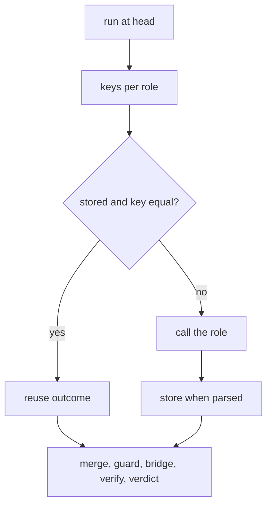

# A retry calls only the roles that did not answer

## Intent

When one reviewer errors, the run is not stored and the next attempt at
the same head calls all four again; #288 paid three full reviews for
one Sentinel failure. After this spec every reviewer outcome that
parsed is kept at its head, keyed by the role, the persona version and
the provider tiers, and a later run at the same head reuses it and
calls only the roles that have no stored outcome. The JSON says which
roles were reused and which were called.

## Context

Measured on `origin/develop` `8fabb19` (2026-11-12).

| # | Fact | Where |
|---|---|---|
| F1 | A run with an errored reviewer is never stored as a completed run (`_store_completed_run`), so a second attempt at the same head reviews afresh: no `review_team.replayed` | SP-REVIEW-SURVIVES-TRANSPORT-FAILURES F10; `src/repoach/review/orchestrator.py` |
| F2 | The replay cache answers a completed run at `(pr_number, head_sha)`; its key does not include the reviewer configuration | SP-AGENT-CONTEXT-LOOP F14; `src/repoach/review/review_cache.py`, `src/repoach/review/findings.py:239-249` |
| F3 | The automatic retry reviews the head afresh (NG3) 300 s after a transport failure | SP-REVIEW-SURVIVES-TRANSPORT-FAILURES D3, NG3 |
| F4 | #288: attempts 1 and 2 failed on the Sentinel; the Architect, Tester and Scribe answered each time; 163 s and $2.16 for one Sentinel try | SP-REVIEW-SURVIVES-TRANSPORT-FAILURES F1, F12 |
| F5 | The CI review job writes its ledger to a fresh `runner.temp` database; the generated CI jobs keep the ledger per PR across runs | SP-REVIEW-SURVIVES-TRANSPORT-FAILURES F10; SP-CI-LEDGER-PERSISTS |
| F6 | Every usage row names the reviewer, the model and the error | `src/repoach/providers/usage.py` |
| F7 | open-code-review's `--resume <id>` replays a session and reuses every file whose diff fingerprint completed; the manifest is sealed before the review starts | `R/internal/session/resume.go:50-111`, `R/internal/session/manifest.go` |

## Decisions (author, within the owner's brief)

- D1. A new table `pr_reviewer_outcomes`: `pr_number`, `head_sha`,
  `role`, `persona_version`, `tiers_key` (the three tier model names
  joined), `diff_hash`, `outcome_json`, `recorded_at`, unique on the
  first six. Written by the orchestrator for every role whose answer
  parsed, in the same step that records the findings, before the team
  verdict and whether or not another role errored.
- D2. At the start of a run at `(pr, head)`, for each role: a row with
  the same persona version, tiers and diff hash is reused; the role is
  not called. The reused outcome goes through the same downstream steps
  as a fresh one (guard, bridge, verification), which are idempotent at a
  head by fingerprint (SP-FINDINGS-BRIDGE-DOCFIX). The JSON carries
  `roles_reused` and `roles_called`; stderr `roles: reused architect,
  tester, scribe; called sentinel`.
- D3. `--force` ignores the rows (as it ignores the replay cache). A
  change of persona version, tiers or diff hash misses the key and the
  role is called; the stale row is kept (it is evidence of what was
  reviewed) and never read.
- D4. In repoach's own `auto-review.yml`, the review job uploads its
  `runner.temp` ledger as an artifact keyed by PR and head when any role
  errored, and the retry run (`retry_of`) downloads it before `review
  pr`; the generated CI jobs already persist it (F5). The artifact
  carries findings and outcomes, no secret.
- D5. The round-2 dialogue and the refuter run as today over the merged
  set; a reused role's round-2 outcome, when it existed, is stored and
  reused under the same key with `round = 2`.

## Goals

- G1: a parsed reviewer outcome is stored at its head (D1) even when another role errored.
- G2: a later run at the same head reuses stored outcomes and calls the missing roles only (D2); the JSON and stderr name both sets.
- G3: a persona, tier or diff change misses the key (D3); `--force` calls every role.
- G4: repoach's own retry run downloads the failed run's ledger (D4).
- G5: the usage ledger shows one call for the retried role and none for the reused ones (F6).

## Non-Goals

- NG1: no partial reuse within a role (a role's outcome is one answer).
- NG2: no reuse across heads (that is SP-REVIEW-INCREMENTAL-HEAD's object).
- NG3: no change to the transport window or the retry dispatch rules.

## Assumptions

- A1: a reviewer outcome serialises to JSON and back without loss (`ReviewerOutcome` is a dataclass of plain fields).
- A2: a GitHub artifact of a few megabytes between two runs of the same workflow is within the plan's limits.

## Interface

```python
# repoach.review.role_resume
class OutcomeKey(BaseModel):
    pr_number: int; head_sha: str; role: str; persona_version: str; tiers_key: str; diff_hash: str; round: int = 1
def init_reviewer_outcomes_schema(db_path: Path) -> None: ...
def store_outcome(db_path, key: OutcomeKey, outcome: ReviewerOutcome, *, now) -> None: ...
def load_outcomes(db_path, keys: Sequence[OutcomeKey]) -> dict[str, ReviewerOutcome]: ...
def split_roles(stored: Mapping[str, ReviewerOutcome], roles: Sequence[str], *, force: bool) -> tuple[list[str], list[str]]: ...   # reused, called
```

`review pr` JSON gains `roles_reused: [...]`, `roles_called: [...]`.

## Behavior

### Nominal
- Attempt 1: Sentinel errors, three roles parse and are stored; exit 3. Attempt 2 at the same head: `roles: reused architect, tester, scribe; called sentinel`; one Sentinel call; the review completes.

### Edge cases
- The persona of the Tester was bumped between the attempts: the Tester is called too.
- `--force`: four calls, four rows rewritten.

### Failure scenarios
- The artifact download fails in CI: the run reviews afresh and logs `role_resume.ledger_unavailable`; never an error.
- A stored row's JSON does not parse: logged, treated as absent, the role called.

## Architecture Impact
- Adds dependency: SP-REVIEW-RESUMES-FAILED-ROLES -> SP-REVIEW-SURVIVES-TRANSPORT-FAILURES (the retry run that benefits; the `incomplete_cause` the artifact upload keys on)
- Adds dependency: SP-REVIEW-RESUMES-FAILED-ROLES -> SP-FINDINGS-BRIDGE-DOCFIX, SP-FINDING-MODEL (idempotent recording at a head; the ledger file)
- Adds dependency: SP-REVIEW-RESUMES-FAILED-ROLES -> SP-CI-LEDGER-PERSISTS (the generated jobs' persistence this reuses), SP-REVIEW-PINS-HEAD (`diff_hash` of the pinned head)
- Adds dependency: SP-REVIEW-RESUMES-FAILED-ROLES -> SP-USAGE-LEDGER, SP-REVIEW-TRANSPORT-ERROR-VERDICT, SP-CLI-STDOUT-ONE-JSON, SP-ORCH-DOCSTRING
- `role_resume.py` imports `findings` (engine helpers) and `reviewer` (the outcome dataclass); the orchestrator imports it.

## Diagram


## Acceptance Criteria

- [ ] AC1: `pytest -q tests/unit/test_role_resume.py` → green.

| Test | Pins | Mutation that turns it red |
|---|---|---|
| `test_parsed_roles_are_stored_when_another_errors` | 3 rows after a run with one errored role | storage happens in `_store_completed_run` only |
| `test_second_run_calls_the_missing_role_only` | provider fake counts 1 call, role sentinel | the cache is consulted after the fan-out |
| `test_key_misses_on_persona_tiers_or_diff` | each field changed → the role is called | `diff_hash` dropped from the key |
| `test_force_calls_every_role` | 4 calls | `--force` skips the cache only |
| `test_json_and_stderr_name_both_sets` | `roles_reused`, `roles_called` | one list is missing |
| `test_unparseable_row_is_treated_as_absent` | logged, role called | the exception escapes |
| `test_round_two_outcome_reused_under_round_2` | `round == 2` row | round-2 outcomes overwrite round-1 rows |
| `test_usage_rows_show_one_call` | one `usage_ledger` row for the retry | reused roles record a zero-token row |

- [ ] AC2: `pytest -q tests/integration/test_role_resume_end_to_end.py` → green: #288's shape, a Sentinel that errors past the window on attempt 1 and answers on attempt 2, two `review pr` runs on the same ledger, attempt 2 makes one reviewer call and exits 0. Mutation: do not store on an errored run.
- [ ] AC3: `pytest -q tests/unit/test_auto_review_workflow_wiring.py -k ledger_artifact` → green: the review job uploads the ledger when `incomplete_cause != null`, the retry run downloads it before `review pr`. Mutation: remove the download step.
- [ ] AC4: `repoach arch check --base develop` → ok.

## Success conditions
- C1: the replay of #288's three attempts on the recorded fixtures makes 4 + 1 + 0 reviewer calls instead of 4 + 4 + 4.
- C2: `roles_reused` is empty on every first run of the planted corpus (no false reuse).

## Owner decisions needed
- O1: whether a reused outcome older than N hours at the same head should be called again anyway (proposed: no; a head is a head).
- O2: artifact retention for the ledger upload in repoach's own workflow (proposed: 3 days).

## Open Questions
- Q1: O1 and O2.
