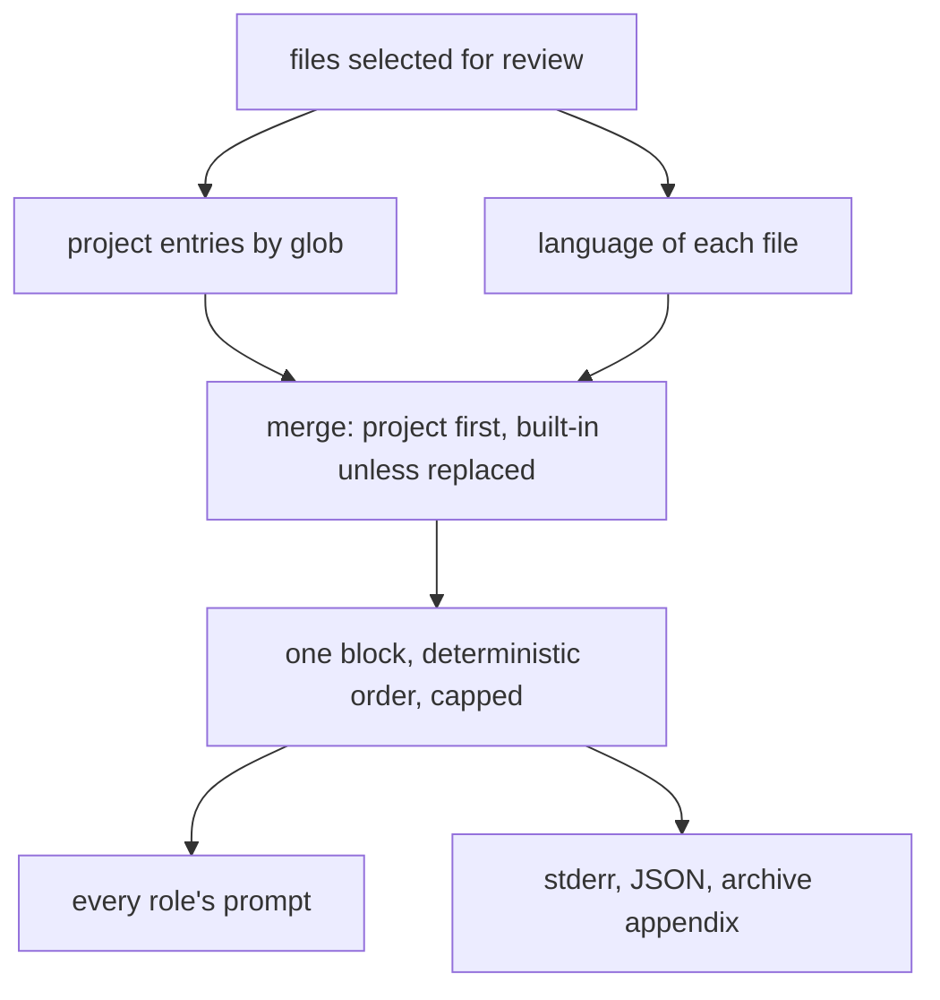

# Per-path review rules, layered over personas that carry no house rule

## Intent

The four personas are repoach's: the Sentinel looks for `MCP_*_ENABLED`
flags, `mcp_tool_calls` rows and FastAPI `require_api_key`; a Verilog
file in a Yoob merge request gets the same text. After this spec a
reviewer's prompt is a persona that knows no house, plus a block of
rules chosen by the paths of the change: repoach's built-in checklist
per language, and the project's own rule files under `.repoach/rules/`,
each mapped to globs in `repoach.toml`. What was injected is printed,
every run. Repoach's own house rules move out of the personas into its
own `.repoach/rules/repoach.md`, so repoach is the first project
configured this way, not a special case.

## Context

Measured on `origin/develop` `8fabb19` (2026-11-12).

| # | Fact | Where |
|---|---|---|
| F1 | The Sentinel's scope names `MCP_*_ENABLED`, `approval_token`, `mcp_tool_calls`, `caller_agent`, `proposals/<id>/`, `enforce-branch-policy.py`, `require_api_key`: repoach's and Yoob's house, in a persona every project loads | `prompts/review/sentinel_0.4.3.md`, "You look for" |
| F2 | Personas are loaded from the package's `prompts/review/` by `prompts_dir()`; `[project].prompts_dir` exists in the config and is validated, and nothing in `reviewer.py` reads it | `src/repoach/core/resources.py:19`, `src/repoach/review/reviewer.py:41,52`, `src/repoach/project/config.py:251-255` |
| F3 | The language of each file is known from `LANGUAGE_TABLE` (Python, TypeScript, Go, Rust, Verilog, Shell, YAML, Markdown) | `src/repoach/gates/languages.py:58-86` |
| F4 | Owner rule: repoach never changes what a reviewer reads without the user knowing it; what is injected is printed on every run | SP-MEMORY-LOOPS-EXPLICIT, Intent |
| F5 | The context-loop spec orders the user seed `diff > spec > arch edges > prior review > lessons`; rules are not in the order | SP-AGENT-CONTEXT-LOOP G1 |
| F6 | open-code-review maps 64 checklists to globs (`"**/*.{v,sv,vh}": "verilog.md"`), resolves a file's rule through four layers, first match wins (`--rule`, `<repo>/.opencodereview/rule.json`, `~/.opencodereview/rule.json`, built-in), and `merge_system_rule` keeps the built-in text under a project rule; its checklists are precision-first ("report only defects likely to change synthesized hardware behavior") | `R/internal/config/rules/system_rules.json:59-60`, `system_rules.go:206-216,299`, `rule_docs/verilog.md:1-2` |

## Decisions (author, within the owner's brief)

- D1. A rule is a Markdown file of at most `rule_file_max_chars`
  characters: a title, then bullet points a reviewer can check, each
  naming what to report and, where it matters, what not to report.
  Format `format:review-rule-file`: plain Markdown, no front matter, no
  placeholder. Repoach ships nine built-in rule files (`owns.code`),
  written for this spec and not copied from any other project, each
  mapped to the globs of its language or file kind (Python, the
  TypeScript family, Verilog and SystemVerilog, Shell, YAML, Markdown,
  GitHub workflows, GitLab CI, Dockerfiles).
- D2. `[[review.rules]]` entries in `repoach.toml`: `paths` (globs),
  `rule` (a path under the repository, `.repoach/rules/<name>.md` by
  convention), `replace_builtin = false`. Resolution per changed file,
  in order: the project entries whose glob matches, then the built-in
  rule of the file's language unless a matching project entry says
  `replace_builtin = true`. No user-level layer (`~/...`): a review
  must read the same rules on every machine and in CI.
- D3. The block is one per review, shared by the four roles: `## Rules
  for this change`, one subsection per rule file in a deterministic
  order (project rules by entry order, then built-ins by language
  name), each listing the files of the diff it applies to. Rendered
  once, so the prompt prefix is stable across roles and runs. The block
  is capped at `rules_max_chars` and `rules_max_per_review` files; a
  rule that does not fit is named in `rules.truncated[]` and never
  silently cut inside.
- D4. The block is printed (F4): stderr `rules: 3 applied
  (python.md, verilog.md, .repoach/rules/repoach.md), 0 truncated`, the
  JSON `rules: [{source, files}]` and `rules.truncated`, the archive
  comment's appendix `## Rules applied`. `repoach review rules --base
  <ref>` prints the block for a local diff without calling a model.
- D5. The personas lose their house text (F1): the new versions
  (architect 0.6.0, sentinel 0.5.0, tester 0.5.0, scribe 0.6.0, the
  same versions SP-FINDING-CITES-ITS-CODE names, one re-versioning for
  both) describe the role's concern in general terms and defer the
  specifics to the rules block. The removed text becomes
  `.repoach/rules/repoach.md`, mapped to `src/**`, `scripts/**`,
  `.github/**` in repoach's own `repoach.toml`. The `repoach` benchmark
  and the recorded fixtures are re-run so the change is measured, not
  assumed (C1).
- D6. In the context-loop seed (F5) the block ranks after the spec and
  before the arch edges: a rule is what the reviewer must check, a
  lesson is what it once got wrong.

## Goals

- G1: a changed file's rules resolve as D2 states; the resolution is a pure function of the file list and the config, with a unit test per layer.
- G2: the block is rendered once per review, deterministic, capped, with truncation named (D3).
- G3: what was injected is printed on stderr, in the JSON and in the archive appendix; `repoach review rules --base <ref>` prints it with no model call (D4).
- G4: the nine built-in rule files exist, each under `rule_file_max_chars`, each mapped to the globs of its language in a table in `review_rules.py` read from `LANGUAGE_TABLE`'s extensions where a language exists there (D1).
- G5: the four personas carry no path, flag or table name of repoach's; repoach's house rules live in `.repoach/rules/repoach.md` and its `repoach.toml` maps them (D5).
- G6: a `[[review.rules]]` entry whose `rule` file is missing, over the size cap, outside the repository or unreadable is one `ConfigError` line, rc 2, before any forge call.

## Non-Goals

- NG1: no per-role rules: a rule file speaks to the change, the role decides what is its concern.
- NG2: no user-level or `--rule` layer (D2).
- NG3: no learning or automatic edition of rule files; `SP-UNIVERSAL-LEDGER` G6 appends lessons to specs, not to rules.
- NG4: no copy of open-code-review's rule texts (O1).

## Assumptions

- A1: a rule block of about 12 000 characters (4 000 tokens) is affordable in the one-shot prompt and in the context-loop seed.
- A2: the recorded fixtures under `tests/fixtures/` replay with the new persona versions without re-recording (the fixtures are forge answers, not model answers).

## Interface

```python
# repoach.review.review_rules
RULES_MAX_CHARS = 12_000; RULE_FILE_MAX_CHARS = 6_000; RULES_MAX_PER_REVIEW = 12
class RuleSource(BaseModel):
    source: str              # "builtin:python" or ".repoach/rules/repoach.md"
    files: tuple[str, ...]
class RulesBlock(BaseModel):
    text: str; applied: tuple[RuleSource, ...]; truncated: tuple[str, ...]
BUILTIN_RULES: Mapping[str, tuple[str, ...]]   # rule name -> globs
def resolve_rules(files: Sequence[str], entries: Sequence[RuleEntry], repo_root: Path) -> RulesBlock: ...
def render_block(block: RulesBlock) -> str: ...

# repoach.project.config (added)
class RuleEntry(_Section):
    paths: Annotated[list[str], Field(min_length=1)]
    rule: str
    replace_builtin: bool = False
class ReviewSection: rules: list[RuleEntry] = []
```

CLI: `repoach review rules [--base <ref>] [--json]`, exit 0; 2 on a
config error. `review pr` JSON gains `rules` and `rules_truncated`.

## Behavior

### Nominal

- A Yoob merge request touching `src/yoob/hw/soc/x.py` and `ci/review-gate.sh`: `rules: 2 applied (python.md, shell.md)`; the block lists the Python file under Python and the shell script under Shell.
- Repoach's own PR touching `src/repoach/review/x.py`: `builtin:python` and `.repoach/rules/repoach.md`.

### Edge cases

- A project entry with `replace_builtin = true` on `frontend/**/*.ts`: the TypeScript built-in is not applied to those files but still applies to `tools/*.ts`.
- Fourteen rule files match: the first twelve by D3's order are rendered, two named truncated.
- A diff with only Markdown: `builtin:markdown` alone.

### Failure scenarios

- `rule = "../shared/rules.md"`: rc 2, `repoach: [[review.rules]] rule "../shared/rules.md" is outside the repository`.
- A rule file of 9 000 characters: rc 2 naming the cap.

## Architecture Impact
- Adds dependency: SP-REVIEW-RULES-BY-PATH -> SP-UNIVERSAL-PROJECT-CONFIG, SP-DB-PATH-XDG (`[[review.rules]]`, `repoach config show`)
- Adds dependency: SP-REVIEW-RULES-BY-PATH -> SP-UNIVERSAL-GATES (`LANGUAGE_TABLE` extensions give the built-in globs)
- Adds dependency: SP-REVIEW-RULES-BY-PATH -> SP-REVIEW-FILE-SELECTION (rules resolve over the files selected for review, stubs included by path)
- Adds dependency: SP-REVIEW-RULES-BY-PATH -> SP-MEMORY-LOOPS-EXPLICIT (the printing rule), SP-AGENT-CONTEXT-LOOP (the seed order, when it lands)
- Adds dependency: SP-REVIEW-RULES-BY-PATH -> SP-CLI-STDOUT-ONE-JSON, SP-ORCH-DOCSTRING (the JSON fields)
- `review_rules.py` imports `project.config`, `project.globs`, `gates.languages`; `reviewer.py` renders the block into a new `{REVIEW_RULES}` placeholder of the re-versioned personas.

## Diagram


## Acceptance Criteria

- [ ] AC1: `pytest -q tests/unit/test_review_rules.py` → green.

| Test | Pins | Mutation that turns it red |
|---|---|---|
| `test_builtin_rule_follows_the_language_table` | `.v`, `.sv` → `builtin:verilog`; `.py` → `builtin:python` | a glob typed by hand diverges from `LANGUAGE_TABLE` |
| `test_project_rule_comes_before_builtin` | both applied, project first in `applied` | the order is alphabetical |
| `test_replace_builtin_drops_it_for_matching_files_only` | `tools/a.ts` keeps `builtin:typescript`, `frontend/b.ts` loses it | `replace_builtin` is global |
| `test_block_is_deterministic` | same input twice → byte-equal text | a set iteration leaks into the order |
| `test_block_is_capped_and_names_the_truncated` | 14 rules → 12 rendered, 2 in `truncated` | the 13th is rendered cut |
| `test_rule_file_size_cap_is_a_config_error` | 6 001 chars → `ConfigError` naming the cap | the cap is not checked |
| `test_rule_outside_the_repository_is_refused` | `../x.md`, an absolute path, a symlink out → `ConfigError` | only the lexical check runs |
| `test_each_builtin_file_is_under_the_cap_and_has_bullets` | the nine shipped files | a file grows past 6 000 characters |
| `test_personas_carry_no_house_names` | the four new personas contain none of `MCP_`, `mcp_tool_calls`, `require_api_key`, `enforce-branch-policy`, `proposals/` | the old text is left in a persona |
| `test_repoach_rules_file_maps_in_its_own_toml` | `repoach.toml` has an entry whose `rule` is `.repoach/rules/repoach.md` | the entry is removed |
| `test_review_rules_command_calls_no_model` | `review rules --base` with a provider fake that raises on any call | the command builds an `AgentLoop` |

- [ ] AC2: `pytest -q tests/unit/test_review_team.py -k rules` → green: the `review pr` JSON carries `rules`, stderr prints `rules: N applied (...)`, the archive appendix holds `## Rules applied`. Mutation: print nothing when `applied` is empty and nothing otherwise.
- [ ] AC3: `pytest -q tests/unit/test_project_config.py -k rules` → green: `[[review.rules]]` parses; a missing `paths` is a `ConfigError`. Mutation: make `paths` optional.
- [ ] AC4: `repoach arch check --base develop` → ok.

## Success conditions

- C1: `repoach bench run bench/corpus/planted --dry-run` builds every case and the real run locates 10/10 planted defects with the new personas plus the built-in rules (the baseline is 10/10 at `813105285fc7`).
- C2: on a Yoob merge request replay, `rules:` names `builtin:python` and `builtin:verilog` where the diff has both, and the Sentinel's prompt contains no `MCP_*_ENABLED`.
- C3: `grep -rn "MCP_\|mcp_tool_calls\|require_api_key" prompts/review/*_0.5.0.md prompts/review/*_0.6.0.md` is empty, and `.repoach/rules/repoach.md` holds the text.

## Owner decisions needed

- O1: write the nine built-in checklists (proposed) or carry open-code-review's `rule_docs` for the same languages under their Apache-2.0 notice in `licenses/` and a NOTICE line. The second is cheaper by a day and binds repoach's prompt text to a third party's licence.
- O2: whether a project may ship a rule for a language repoach has no built-in for (yes in this spec: any glob) and whether that should also register the language in `LANGUAGE_TABLE` (no: a rule is text, a language is a verifier).
- O3: whether `repoach init` scaffolds `.repoach/rules/<project>.md` with an empty template and the entry.

## Open Questions
- Q1: O1 to O3.
