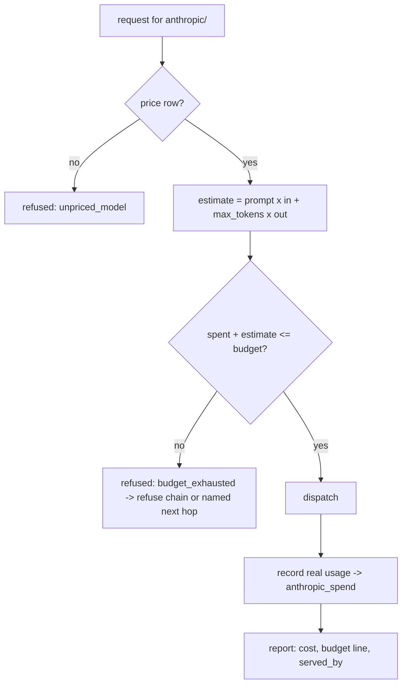

# Every metered Anthropic call is priced, summed against a budget, and refused by name when the budget is reached

## Intent

The owner is putting an Anthropic API key, backed by 100 € of credits,
behind the reviews so they stop draining his Claude Max five-hour quota.
A key with credits is a key that can be emptied in an afternoon by a
runaway review loop, and today nothing in repoach would notice: the
usage ledger prices a call after the fact and the gateway fails over
to the next hop in silence. After this spec every metered call is
priced before it is dispatched, the running total since the budget's
start is kept where the key lives, a call that would cross the budget
is refused with a reason that names the total and the budget, and the
review that loses its model ends `ERROR` with that reason, never
`APPROVE` and never a quiet switch to another provider.

## Context

Measured 2026-11-15 on `origin/develop` `5354767`, on the owner's
gateway `.env` and on the usage ledgers of the owner's machine.

| # | Fact | Where |
|---|---|---|
| F1 | The owner's gateway `.env` now carries `REPOACH_ANTHROPIC_API_KEY` (a workspace-scoped `sk-ant-api…` key; `GET /v1/models` answers 200) and the proxy was restarted. No chain names an `anthropic/…` hop yet: `MODEL_OPUS`, `MODEL_SONNET` and `MODEL_HAIKU` end with `claude_code/*`, so nothing is spent today | `chains.env:88,98,107`; coordinator, 2026-11-15 |
| F2 | An earlier user-level key (`sk-ant-usr…`) was refused by the API with 400 `must include the anthropic-workspace-id header`; nothing in repoach knows that header (`grep -rn workspace-id src/` → 0) | coordinator, 2026-11-15; `src/repoach/` |
| F3 | The settings field exists and is read from `REPOACH_ANTHROPIC_API_KEY`, else `ANTHROPIC_API_KEY` | `src/repoach/llm_proxy/config/settings.py:253`; `README.md:51` |
| F4 | The usage ledger writes one row per call with `cost_usd` from `price_call` after the call returned; a model with no price row is `unpriced` (cost None). It lives in the review database of the process that runs the review: for Yoob's `review:gate`, in the job's cached `.repoach/` directory, not on the gateway that holds the key | `src/repoach/providers/usage.py:1-20`, `:73`, `:349`; `src/repoach/providers/prices.py:165-215`; `yoob_2/ci/review-gate.sh:109` |
| F5 | The price table was read on 2026-10-21 and is not stale by its own 90-day rule, but it has no row for `claude-opus-5-5`, `claude-sonnet-5-5`, `claude-haiku-5-5` or `claude-fable-5-1`: a call to any of them is unpriced today | `src/repoach/providers/prices.py:33-36`, `:132-135` |
| F6 | List prices on the vendor page, as the `claude-api` skill's table caches them (2026-10-06), USD per million tokens — input / output / cache read / cache write: Sonnet 5.5 2 / 10 / 0.20 / 2.50; Opus 5.5 4 / 20 / 0.20 / 5.00; Fable 5.1 10 / 50 / 0.25 / 12.50; Haiku 5.5 0.10 / 0.50 (prompts up to 100 k) | `platform.claude.com/docs/en/about-claude/pricing`, re-read before the row is written |
| F7 | Measured review size, repoach's own ledger, 53 gateway runs 2026-10-21 → 11-09: 7 calls per review (4 lenses, about 3 refuter calls), 699 k prompt tokens per review (32 k uncached + 24 k cache read + 57 k cache write per call on the `claude_code` route), 6.7 k output tokens, maximum 1.57 M prompt tokens in one review. Yoob's local ledger, 6 runs: 8–14 calls, 290–600 k cache-write tokens | `~/.local/share/repoach/github.com/repoachhq/repoach/repoach.db`, `usage_ledger`; `yoob_2/.repoach/repoach.db` |
| F8 | The direct `anthropic` provider sets no `cache_control` (`grep -rn cache_control src/repoach/providers` → 0): on the API every prompt token is billed as uncached input until SP-REVIEW-DELTA-FIRST G5 lands | `src/repoach/providers/direct.py` |
| F9 | The gateway already skips a candidate before dispatch for a named reason (`rate_limited`, SP-FAILOVER-SKIPS-BLOCKED-PROVIDER) and reports a provider-scoped account fault (`provider_402`, SP-BREAKER-PROVIDER-SCOPE); a credits floor exists for OpenRouter only and is displayed, not enforced | `src/repoach/llm_proxy/routing/breaker.py:52-75`; `src/repoach/health/credits.py` |
| F10 | A review whose model cannot be reached is `ERROR`, never `APPROVE` | SP-REVIEW-TRANSPORT-ERROR-VERDICT |

Cost of one review at F6 prices and F7 size, every prompt token uncached (F8):

| Tiering | Per review | Reviews per 100 € (≈ 108 USD) |
|---|---|---|
| all lenses and the refuter on Sonnet 5.5 | 1.40 + 0.07 = **1.47 USD** | 73 |
| all on Opus 5.5 | 2.80 + 0.13 = **2.93 USD** | 36 |
| Sentinel on Fable 5.1, the rest on Opus 5.5 | 1.05 + 3 × 0.42 + 3 × 0.42 = **3.57 USD** | 30 |
| Architect and Sentinel on Fable 5.1, Tester, Scribe and refuter on Opus 5.5 (SP-REVIEW-FABLE-TIER D1, round 1) | 2 × 1.05 + 2 × 0.42 + 3 × 0.42 = **4.20 USD** | 25 |
| all on Fable 5.1 | 6.99 + 0.34 = **7.33 USD** | 14 |

Per call: about 100 k prompt and 1 k output tokens; Sonnet 0.21, Opus
0.42, Fable 1.05 USD. The 1.57 M maximum review (F7) costs 2.25 × the
median. Yoob MR !366 ran 12 rounds: at 4.20 USD a round, 50 USD for one
merge request, two such merge requests per 100 €; at three rounds, the
target SP-REVIEW-CONVERGES sets, 12.6 USD and eight merge requests, before
delta review (SP-REVIEW-DELTA-FIRST) shrinks rounds 2 and later. The
EUR/USD rate is assumed at 1.08; Anthropic bills in USD and the guard is
configured in USD.

## Decisions (2026-11-15)

- D1. The running total lives where the key lives. The gateway keeps a
  table `anthropic_spend` in its state database (the one SP-PROXY-STATE-
  PERSIST writes): one row per metered call with the host, the model,
  the four token counts from the response `usage`, the priced cost and
  the day. The in-process direct provider (`REPOACH_PROVIDER=anthropic`,
  no gateway) keeps the same table beside its `usage_ledger`. One
  module, `providers/budget.py`, serves both; the two never add up to
  one total, because one key is used by one of them at a time (A2).
- D2. A call is judged before dispatch, not after. The estimate is the
  prompt's token count times the model's input price plus
  `max_tokens` times its output price, an upper bound; the prompt count
  is the request's own `count_tokens` answer when the route offers it,
  else `len(prompt) / 3.2` rounded up. When
  `spent_usd + estimate_usd > budget_usd` the call is refused with
  reason `budget_exhausted`; the gateway's pre-dispatch check skips
  every `anthropic/*` candidate for that reason (F9's mechanism), and
  the direct provider raises `BudgetExhaustedError` (not retryable).
- D3. Never a silent fallback. A chain whose `anthropic/*` hop is
  skipped for `budget_exhausted` continues to its `claude_code` tail,
  the owner's Max plan (owner decision 2026-11-15: « de toute façon on a
  le plan en fallback »), and says so everywhere the review can be read:
  one log line `budget_exhausted_fallback` with the figures, the review
  JSON (`provider.refusal = budget_exhausted`, `provider.served_by =
  claude_code/opus`), the stderr line and the archive comment, all
  carrying `budget exhausted: 103.21 of 108.00 USD since 2026-11-15;
  reviewed on the subscription (claude_code/opus)`. The budget total
  keeps counting the metered calls that did run. `[budget].on_exhausted
  = "refuse"` is the explicit alternative: the chain is exhausted at that
  point and the review ends `ERROR` with the same figures and `next hop
  not taken`.
- D4. The budget is configuration, read once per process: `[budget]`
  in `repoach.toml` or `REPOACH_BUDGET_USD`, `REPOACH_BUDGET_SINCE`
  (a date; default the day the key was first seen), `REPOACH_BUDGET_WARN_RATIO`
  (0.8), `REPOACH_BUDGET_ON_EXHAUSTED` (`next_hop`, the default |
  `refuse`). A
  budget of 0 (the default) means every metered call is refused: the
  owner states a budget before the key spends. `repoach doctor` says
  which it is.
- D5. Price rows for the four current ids (F6) are added to
  `prices.py` with `read_on` set to the day they are read from the
  vendor page; `PRICES_READ_ON` moves to that day. A metered model with
  no row is refused before dispatch with `unpriced_model`, since a
  guard cannot sum what it cannot price (F5 makes this the state of
  every current model today).
- D6. Key kind. A key beginning with `sk-ant-usr` is a user-level key
  (F2) and needs `anthropic-workspace-id`. When
  `REPOACH_ANTHROPIC_WORKSPACE_ID` is set, every direct and gateway
  call carries the header; when it is not, the gateway refuses to boot
  the `anthropic` provider and `repoach doctor` prints
  `anthropic key is user-level: set REPOACH_ANTHROPIC_WORKSPACE_ID or use
  a workspace key`. No key value, prefix included, ever reaches a log or
  an error (the kind is named, the characters are not).
- D7. The total is visible without a failure: `repoach budget` prints
  spent, budget, since, the ratio, the last ten calls and the day's
  total; the gateway's `/health` and `chain-status` carry a `budget`
  line (`spent 41.20 / 108.00 USD, 38 %, since 2026-11-15`); the review
  report and the archive comment carry `cost: 4.17 USD (budget 41.20 /
  108.00)`. At `warn_ratio` the line is prefixed `WARN` once per
  process.
- D8. This spec lands before, or in the same pull request as, the first
  chain that names an `anthropic/…` hop (SP-REVIEW-CHAINS-ANTHROPIC-
  FIRST depends on it). Nothing here edits `chains.env`.

## End state

The owner's key is behind the reviews; `repoach budget` answers what
it has spent since the date he chose and what is left; a review that
would cross the line finishes on the subscription and says so, with the
figures, in the comment on the merge request and in `review-gate.json`;
no review ever ran on a provider the report does not name; and the
gateway's `/health` shows the ratio before anyone has to ask.

## Easy solution rejected

Price after the call and alert when the month's `repoach usage` total
looks high. Rejected: the ledger is written in the job's cached
`.repoach/` on Yoob (F4), so no process that holds the key ever sees the
total, and an alert after the fact is a bill, not a guard. Also
rejected: a hard cap on the Anthropic console alone, because repoach
would then see a 4xx it classifies as an account fault, quarantine the
provider for six hours and fall to `claude_code` in silence, the very
chain of events this family exists to end.

## Hard part

The estimate before dispatch has to be an upper bound without a second
round-trip on every call. `count_tokens` is free of charge but costs
latency; the `len / 3.2` fallback over-counts code by about 20 % (the
Opus 4.7 tokenizer family, measured on the Yoob diff prompts in the
test fixture) and never under-counts on the fixtures, which is the
property the guard needs. The second hard part is the two homes of the
table (D1): the module must be identical for both routes and the tests
must prove that a budget reached through the gateway refuses a direct
call too when both read the same database file.

## Goals

- G1: `anthropic_spend` exists in the gateway state database and beside the direct provider's ledger; every metered call writes one row with `host`, `model`, `input`, `output`, `cache_read`, `cache_write`, `cost_usd`, `price_source`, `day`, `run_id`.
- G2: a call whose estimate would cross the budget is refused before dispatch with `budget_exhausted`, the total and the budget in the message; a metered model with no price row is refused with `unpriced_model`.
- G3: on `budget_exhausted` the chain continues to its `claude_code` tail by default and the fallback is named in the log, the review JSON (`provider.served_by`, `provider.refusal`), the stderr line and the archive comment with the sentence of D3; `[budget].on_exhausted = refuse` ends the review `ERROR` with the same figures instead. Neither outcome is ever silent.
- G4: the four current Anthropic ids are priced at the vendor's list price, each row citing its page and day; `PRICES_READ_ON` is that day; the stale rule is unchanged.
- G5: `repoach budget`, `/health` and `chain-status` print the budget line of D7; the review report prints the review's cost and the running total.
- G6: a user-level key is refused by name unless `REPOACH_ANTHROPIC_WORKSPACE_ID` is set, in which case the header travels on every call; no log or error carries a key character.
- G7: a budget of 0 refuses every metered call; `repoach doctor` names the setting.

## Non-Goals

- NG1: no change to `chains.env` (SP-REVIEW-CHAINS-ANTHROPIC-FIRST).
- NG2: no new tier (SP-REVIEW-FABLE-TIER) and no prompt caching (SP-REVIEW-DELTA-FIRST G5).
- NG3: no reading of the Anthropic console's balance: the budget is the owner's number, the spend is what repoach sent.
- NG4: no budget for subscription or self-hosted providers (`claude_code`, `ollama`), which the price table already treats as unpriced by design.

## Assumptions

- A1: the Messages API response carries `usage.input_tokens`, `output_tokens`, `cache_read_input_tokens`, `cache_creation_input_tokens` on every route the direct provider and the gateway translate (SP-PROVIDER-DIRECT-ANTHROPIC).
- A2: one Anthropic key is used by the gateway or by the direct provider, not both at once on the same machine; when both exist they are configured on the same `budget_db_path`, which the tests pin.
- A3: Yoob's `review:gate` keeps reaching the owner's shared gateway (`REPOACH_LLM_PROXY_BASE_URL`), so the gateway's table is the one that matters for the 100 €.

## Interface

```python
# src/repoach/providers/budget.py
class BudgetConfig(BaseModel):
    budget_usd: Decimal            # default 0
    since: date
    warn_ratio: float = 0.8
    on_exhausted: Literal["next_hop", "refuse"] = "next_hop"
    db_path: Path

class SpendRow(BaseModel):
    host: str; model: str; input: int; output: int
    cache_read: int; cache_write: int
    cost_usd: Decimal; price_source: str; day: date; run_id: str | None

class BudgetState(BaseModel):
    spent_usd: Decimal; budget_usd: Decimal; since: date; ratio: float

class BudgetExhaustedError(GatewayError):
    retryable = False

class UnpricedModelError(GatewayError):
    retryable = False

def estimate_call_usd(*, host, model, prompt_tokens: int, max_tokens: int, on: date) -> Decimal: ...
def admit(config: BudgetConfig, *, host, model, prompt_tokens, max_tokens, on) -> BudgetState: ...   # raises the two errors
def record_spend(config: BudgetConfig, row: SpendRow) -> BudgetState: ...
def budget_state(config: BudgetConfig) -> BudgetState: ...
def render_budget_line(state: BudgetState) -> str: ...    # format:budget-refusal-line

# src/repoach/llm_proxy/routing/budget_gate.py
def skip_for_budget(candidate: ModelRef, config: BudgetConfig, request) -> str | None: ...  # "budget_exhausted" | "unpriced_model" | None

# src/repoach/providers/direct.py (changed): admit() before every anthropic call, record_spend() after
# src/repoach/providers/select.py (changed): key_kind(key) -> Literal["workspace", "user", "unknown"]; the header
# src/repoach/cli/budget_cmds.py: `repoach budget [--json]`
```

Inputs: `REPOACH_BUDGET_USD`, `REPOACH_BUDGET_SINCE`, `REPOACH_BUDGET_WARN_RATIO`, `REPOACH_BUDGET_ON_EXHAUSTED`, `REPOACH_ANTHROPIC_WORKSPACE_ID`, `[budget]` in `repoach.toml`.

Outputs: table `anthropic_spend`; review JSON keys `cost.review_usd`, `cost.budget` (`BudgetState`), `provider.served_by`, `provider.refusal`; log events `budget_refused`, `budget_warn`, `budget_recorded`.

Errors: `BudgetExhaustedError`, `UnpricedModelError`, `GatewayConfigError("anthropic key is user-level …")`.

## Behavior

### Nominal
Budget 108 USD since 2026-11-15, 41.20 spent: a review of 7 calls is
estimated call by call, each admitted, each recorded from the real
`usage`; the report says `cost: 4.17 USD (budget 45.37 / 108.00, 42 %)`.

### Edge cases
- the estimate admits and the real usage crosses the budget → the call is recorded in full, the next call is refused; the total may overshoot by at most one call's real cost, which the report states.
- `warn_ratio` crossed during a review → one `WARN` line, the review continues.
- a model with no row at the day of the call (F5, or a `valid_until` passed) → `unpriced_model`, refused before dispatch, named.
- budget reached mid-review (default `next_hop`) → the remaining calls run on `claude_code/<tier>`, `served_by` names it per lens, the archive comment carries `budget exhausted: … reviewed on the subscription`, the metered calls already made stay counted.
- `on_exhausted = refuse` → chain exhausted, review `ERROR` with the figures and `next hop not taken`.
- the key is `sk-ant-usr…` and the workspace id is set → header sent, no refusal; unset → `GatewayConfigError` at boot and from `doctor`.

### Failure scenarios
- the spend table is unwritable → the call is refused (`budget_ledger_unwritable`): a guard that cannot count does not admit.
- the API answers 400 `must include the anthropic-workspace-id header` although the key was classified `workspace` → `ProviderRequestError` with the API's sentence and the hint to set the id; no retry.

## Tests

| Test | What it pins | Mutation that must turn it red |
|---|---|---|
| `tests/unit/test_budget_guard.py::test_call_over_budget_is_refused_before_dispatch_with_the_figures` | a fake transport records zero requests; the error message holds spent, budget, since | admit when `spent + estimate == budget + 0.01` |
| `::test_estimate_is_an_upper_bound_on_the_fixture_prompts` | `len/3.2` ≥ the recorded `input_tokens` on the five fixture prompts | change 3.2 to 4 |
| `::test_real_usage_is_recorded_not_the_estimate` | the row carries the response `usage` | record the estimate |
| `::test_budget_zero_refuses_every_metered_call` | D4 | default 1 |
| `::test_warn_once_at_ratio` | one `budget_warn` event per process | warn per call |
| `tests/unit/test_budget_gate_dispatch.py::test_gateway_skips_anthropic_candidate_for_budget_exhausted_and_falls_to_the_subscription_named` | default: reason recorded, `claude_code/<tier>` dispatched, log line `budget_exhausted_fallback`, `served_by` names it | serve without naming |
| `::test_refuse_setting_exhausts_the_chain_with_the_figures` | `on_exhausted=refuse` → chain exhausted, `claude_code` not dispatched | fall through |
| `::test_metered_total_keeps_counting_after_the_fallback` | the next metered call after a fallback is still judged against the same total | reset the total |
| `tests/unit/test_prices_current_models.py::test_four_current_anthropic_ids_are_priced_and_dated` | the rows of F6 exist, `read_on == PRICES_READ_ON`, `price_row` answers | drop the `claude-fable-5-1` row |
| `::test_unpriced_model_is_refused_not_dispatched` | D5 | dispatch and record cost None |
| `tests/unit/test_anthropic_key_kind.py::test_user_level_key_without_workspace_id_is_refused_by_name_without_the_key` | the message holds `user-level` and no key character | print the prefix |
| `::test_workspace_header_travels_when_the_id_is_set` | the fake transport sees `anthropic-workspace-id` | send it only on the first call |
| `tests/integration/test_budget_exhausted_names_the_refusal.py::test_review_pr_completes_on_the_subscription_and_names_it_in_json_and_comment` | end to end on fakes, default setting: the review completes, `provider.refusal == budget_exhausted`, `provider.served_by == claude_code/…`, archive comment matches `^budget exhausted: \d+\.\d\d of \d+\.\d\d USD since \d{4}-\d{2}-\d{2}; reviewed on the subscription` | complete without the line |
| `::test_review_pr_ends_error_under_refuse` | `on_exhausted=refuse` → `final_verdict == ERROR`, same figures, `next hop not taken` | approve |

## Success conditions

- C1: with `REPOACH_BUDGET_USD=1`, a fake Anthropic transport and a fake `claude_code` tail, `repoach review pr <n> --dry-run` makes on the metered transport exactly the calls whose cumulative estimate fits in 1 USD, finishes the rest on the tail, and prints the fallback line; oracle: the metered fake's request count equals the number of rows in `anthropic_spend`, and the tail's count equals the remaining lens and judge calls.
- C2: on the owner's gateway after SP-REVIEW-CHAINS-ANTHROPIC-FIRST, `repoach budget` after one Yoob review shows `spent` grown by the review's `cost.review_usd` ± one cent; oracle: the Anthropic console's usage for the same day agrees within 5 %.
- C3: a `sk-ant-usr…` key in `.env` without a workspace id makes `repoach doctor` print the D6 sentence and the gateway refuse to boot the provider; the printed text contains none of the key's characters past `sk-ant-usr`; oracle: `grep -c <the key's 8th to 20th characters> <log>` → 0.
- C4: `pytest -q tests/unit/test_prices_current_models.py` is green on the day the rows are written and `python -c "from repoach.providers.prices import prices_stale; from datetime import date; print(prices_stale(date.today()))"` prints `False`.
- C5: no review on fakes carries `provider.refusal` without the fallback (or refusal) sentence in its archive comment and JSON; oracle: the integration test, and `pytest -q tests/unit/test_review_transport_error_verdict.py` stays green under `refuse`.

## Architecture Impact
- Adds dependency: SP-ANTHROPIC-BUDGET-GUARD -> SP-USAGE-LEDGER (prices and the per-call row shape are reused; the ledger stays the after-the-fact record)
- Adds dependency: SP-ANTHROPIC-BUDGET-GUARD -> SP-PROVIDER-DIRECT-ANTHROPIC, SP-UNIVERSAL-PROVIDERS (the direct provider calls `admit` and `record_spend`; `select.py` learns the key kind and the header)
- Adds dependency: SP-ANTHROPIC-BUDGET-GUARD -> SP-FAILOVER-SKIPS-BLOCKED-PROVIDER, SP-BREAKER-PROVIDER-SCOPE (the pre-dispatch skip and the provider-wide reason reuse their hooks)
- Adds dependency: SP-ANTHROPIC-BUDGET-GUARD -> SP-CREDITS-CHECK, SP-CHAIN-STATUS-DIGEST (`/health` and `chain-status` gain the budget line next to the credits line)
- Adds dependency: SP-ANTHROPIC-BUDGET-GUARD -> SP-REVIEW-TRANSPORT-ERROR-VERDICT (a refused model is `ERROR`)
- Adds dependency: SP-ANTHROPIC-BUDGET-GUARD -> SP-PROXY-STATE-PERSIST (the table lives in the gateway's state database)
- New table `anthropic_spend`; `budget.py` imports `prices.py` and `core.config` only; no cycle.

## Diagram


## Acceptance Criteria
- [ ] AC1: `pytest -q tests/unit/test_budget_guard.py tests/unit/test_budget_gate_dispatch.py` → green: refusal before dispatch with the figures, upper-bound estimate, real usage recorded, budget 0 refuses, warn once, gateway skip and named next hop. Today (`5354767`): the files do not exist and `grep -rn budget_exhausted src/` → 0.
- [ ] AC2: `pytest -q tests/unit/test_prices_current_models.py tests/unit/test_anthropic_key_kind.py` → green: four priced ids, unpriced refused, user-level key refused by name, header sent when the id is set. Today: `price_row("api.anthropic.com", "claude-opus-5-5", on=date.today())` → `None`.
- [ ] AC3: `pytest -q tests/integration/test_budget_exhausted_names_the_refusal.py` → green: `ERROR` with the line in JSON and archive comment.
- [ ] AC4: `repoach arch check --base origin/develop` → `edge-honesty: ok`.
- [ ] AC5: `docs/merge_gate.md` gains a `budget exhausted` row in its refusal table and `README.md:51` names the budget variables next to the key.

## Open Questions
- None. Decided by the owner on 2026-11-15:
  - Q1 (user-level keys): accepted with `REPOACH_ANTHROPIC_WORKSPACE_ID`, the header sent on every call; refused by name without it (D6).
  - Q2 (`on_exhausted` default): `next_hop` — « de toute façon on a le plan en fallback »; the fallback to the `claude_code` tail is named in the log and in the review output, never silent, and the total keeps counting (D3). The recommendation (`refuse`) was not taken; `refuse` stays as the explicit setting.
  - Q3 (budget figure): `REPOACH_BUDGET_USD=108` once, `REPOACH_BUDGET_SINCE=` the top-up day, reset by hand at the next top-up.
