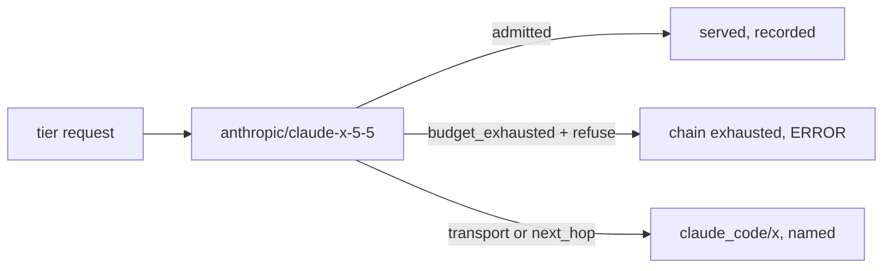

# The reviewer chains lead with the metered Anthropic API

## Intent

The owner bought credits so the reviews run on the API, not on his
Claude Max quota. Today no chain names an `anthropic/…` hop, and the
three chains walk NIM and OpenRouter hops that are dead or unfunded
before reaching `claude_code`. After this spec each tier's chain is two
hops, the metered model first and the subscription second, the order
and the model ids are written in `chains.env` and the README, and the
budget guard is already in place when the first metered request goes out.

## Context

Measured 2026-11-15 on `origin/develop` `5354767` and the owner's gateway.

| # | Fact | Where |
|---|---|---|
| F1 | `MODEL_OPUS=nvidia_nim/z-ai/glm-5.2,open_router/z-ai/glm-5.2,claude_code/opus`; `MODEL_SONNET` has nine hops before `claude_code/sonnet`; `MODEL_HAIKU` five before `claude_code/haiku`. No hop is `anthropic/…` | `chains.env:88,98,107` |
| F2 | OpenRouter has sat at 402 since 2026-07-10 and NIM heads flap; the chain comments record a 9 s failover tax per request on dead hops | `chains.env:68-82`; SP-BREAKER-PROVIDER-SCOPE Context |
| F3 | `chains.env` is authoritative: the proxy reads it last; `set -a; source chains.env` in CI gives the same values | `chains.env:10-17`; SP-CHAINS-SINGLE-SOURCE |
| F4 | The README's provider table names `claude-opus-5`, `claude-sonnet-5`, `claude-haiku-4-5` as the `anthropic` tier models, and `ANTHROPIC_MODELS` in code says the same; the current ids are `claude-opus-5-5`, `claude-sonnet-5-5`, `claude-haiku-5-5` (and `claude-fable-5-1`, SP-REVIEW-FABLE-TIER) | `README.md:51`; `src/repoach/providers/select.py:243-245`; the `claude-api` skill's model table |
| F5 | The owner's key is in the gateway's `.env` and valid; nothing is spent until a chain names the hop | coordinator, 2026-11-15 |
| F6 | The `claude_code` tail cannot run an exact model id: `_cli_model_for` reduces any name to `opus`, `sonnet` or `haiku` | `src/repoach/llm_proxy/providers/claude_code/client.py:495-504`; `docs/tech_debt.md` row 47 |

## Decisions (2026-11-15)

- D1. Chains after this spec, the single edit of `chains.env`:

  ```
  MODEL_OPUS=anthropic/claude-opus-5-5,claude_code/opus
  MODEL_SONNET=anthropic/claude-sonnet-5-5,claude_code/sonnet
  MODEL_HAIKU=anthropic/claude-haiku-5-5,claude_code/haiku
  ```
  `MODEL_FABLE` is added by SP-REVIEW-FABLE-TIER. The NIM and OpenRouter
  hops leave the reviewer chains; their chain comments are replaced by a
  dated paragraph that names this spec and the measured reasons (F2).
- D2. The second hop is the subscription, taken only when the first is
  skipped or fails for a reason the budget guard allows to continue
  (`[budget].on_exhausted = next_hop`) or for a transport reason; every
  hop served is named in the report (SP-ANTHROPIC-BUDGET-GUARD G3). A
  `budget_exhausted` under `refuse` exhausts the chain by design.
- D3. `ANTHROPIC_MODELS` and the README table move to the current ids;
  `CAPABILITY_TO_ALIAS` moves to the same ids so the gateway's tier
  classifier (`opus` / `sonnet` / `haiku` substrings) still routes them.
- D4. This spec lands only after SP-ANTHROPIC-BUDGET-GUARD is on
  `develop` and the owner has set `REPOACH_BUDGET_USD` on the gateway; the
  pull request's description states both, and its test refuses an
  `anthropic/…` hop in `chains.env` when `providers/budget.py` is absent
  from the tree.

## End state

A Yoob review runs on `claude-opus-5-5` and `claude-sonnet-5-5` through
the owner's gateway, costs what SP-ANTHROPIC-BUDGET-GUARD's table says,
and reaches the subscription only when the report says so.

## Easy solution rejected

Insert `anthropic/…` at the head of each chain and keep the NIM and
OpenRouter hops behind it. Rejected: the chain would still pay the
failover tax when the API hop is skipped, and a review served by a NIM
model after a budget refusal is the silent downgrade the owner refused.

## Hard part

Order. The first metered request must not leave before the guard
exists on the gateway, and the two repositories (repoach, Yoob) move at
different times: Yoob's `review-gate.sh` pins `REPOACH_REF`, so the
gateway's chains and Yoob's pinned client can disagree for a day. The
chains live on the gateway, which is the owner's machine; the test of
D4 guards the repository, the pull request description guards the host.

## Goals

- G1: `chains.env` holds exactly the three lines of D1; the `set -a; source chains.env` contract is unchanged.
- G2: README and `ANTHROPIC_MODELS` name the current ids; `docs/tech_debt.md` row 48 ("direct `anthropic` never run against the real API") is closed with the measured run of C2.
- G3: a test refuses `anthropic/…` in `chains.env` without the budget module in the tree.

## Non-Goals

- NG1: no new tier (SP-REVIEW-FABLE-TIER).
- NG2: no change to the coder or planner chains beyond the three tiers above.

## Assumptions

- A1: the gateway's `anthropic` transport (SP-PROVIDER-DIRECT-ANTHROPIC) speaks to `api.anthropic.com` with the key of F5; its first live call is C2.

## Interface

`chains.env` lines of D1; `README.md:51` table; `select.py` tables. No
new code beyond the test.

## Behavior

### Nominal
A sonnet-tier request → `anthropic/claude-sonnet-5-5`, admitted by the
budget guard, served, recorded.

### Edge cases
- the API hop is tripped for a transport reason → `claude_code/sonnet` serves, `served_by` names it.
- `budget_exhausted` under `refuse` → chain exhausted, review `ERROR` with the budget line.

### Failure scenarios
- the gateway boots without a key → the `anthropic` provider is absent, the chain's first hop is skipped at boot with `provider_unconfigured`, named in `/health`; the subscription serves and is named.

## Tests

| Test | What it pins | Mutation that must turn it red |
|---|---|---|
| `tests/unit/test_review_chains_anthropic_first.py::test_three_chains_are_anthropic_then_claude_code` | D1 verbatim | add a NIM hop |
| `::test_anthropic_hop_requires_the_budget_module` | D4 | remove the check |
| `::test_readme_and_select_name_the_current_ids` | F4 corrected | leave `claude-opus-5` |

## Success conditions

- C1: `repoach chain-status` on the owner's gateway after the restart lists the three chains of D1 and `anthropic` as configured; oracle: the command's output.
- C2: one Yoob `review:gate` run after the change shows `served_by: anthropic/claude-sonnet-5-5` for the three sonnet lenses and `anthropic/claude-opus-5-5` for the Sentinel and the refuter in `review-gate.json`, and `repoach budget` on the gateway grew by the review's cost; oracle: the JSON and the budget line.
- C3: `pytest -q tests/unit/test_review_chains_anthropic_first.py tests/unit/test_chains_single_source.py` → green.

## Architecture Impact
- Adds dependency: SP-REVIEW-CHAINS-ANTHROPIC-FIRST -> SP-ANTHROPIC-BUDGET-GUARD, SP-SUBSCRIPTION-LIMIT-IS-NAMED (both must be in the tree before a metered hop exists)
- Adds dependency: SP-REVIEW-CHAINS-ANTHROPIC-FIRST -> SP-CHAINS-SINGLE-SOURCE (the one file edited)
- Adds dependency: SP-REVIEW-CHAINS-ANTHROPIC-FIRST -> SP-BREAKER-PROVIDER-SCOPE, SP-PROVIDER-DIRECT-ANTHROPIC, SP-REVIEWER-CHAIN-RENAME (hop skipping, the transport, the chain names)
- No table, no cycle.

## Diagram


## Acceptance Criteria
- [ ] AC1: `pytest -q tests/unit/test_review_chains_anthropic_first.py` → green. Today (`5354767`): `grep -c "^MODEL_.*=anthropic/" chains.env` → 0.
- [ ] AC2: `repoach arch check --base origin/develop` → `edge-honesty: ok`.
- [ ] AC3: `README.md:51` and `docs/tech_debt.md` rows 47 and 48 updated as G2 says.

## Open Questions
- Q1: keep one NIM hop at the very end of each chain as a free last resort? Recommendation: no; a review served by `glm-5.2` after two Anthropic refusals is a different product, and SP-REVIEW-TRANSPORT-ERROR-VERDICT already makes "no model" a named `ERROR`.
