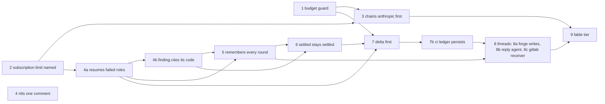

# Umbrella — a review converges

## Amendment (0.7, 2026-11-17): every row of the order is a row of this table

After the verifier's read of 0.6. (1) SP-REVIEW-RESUMES-FAILED-ROLES
and SP-FINDING-CITES-ITS-CODE were named in row 5's text as landing
before it and sat in no row and in no edge; they are rows 4a and 4b
and declared. (2) SP-CI-LEDGER-PERSISTS was a draft that SP-GITLAB-
NOTE-RECEIVER (8c) and SP-REVIEW-RESUMES-FAILED-ROLES cited for a cache
no code writes (`src/repoach/ci_entry/snippets.py:93-119` has no
`cache:`); it is approved (0.3) and is row 7b, before its first and only
dependant, 8c; RESUMES no longer depends on it. (3) SP-REVIEW-FABLE-TIER
declares its edge to SP-THREAD-REPLY-AGENT (it places 8b's replies on
Sonnet); the diagram's `8 → 9` is that edge. (4) Three other drafts the
children cited are withdrawn by the children, not scheduled: SP-JUDGE-
FAILURE-IS-RETRIED (8b states its own rule), SP-REVIEW-GROUPS-LARGE-
DIFFS and SP-REVIEW-TOKEN-ESTIMATE (DELTA 0.5 reads nothing of them).
No row of this order depends on a draft. (5) F1 and F2 carry their
`92cd241` lines; AC1's glob, AC3's row number and the "eight" counts
are those of this version; F10 says what `pull_request_review` runs.

## Intent

Yoob MR !366 took twelve review rounds. Measured, the rounds did not
converge because the reviewer forgets: it reads the whole diff every
time, learns of the previous round through two hundred characters,
honours only its own bot's refutations, treats each head as a new
world for de-duplication, and turns every nit into a thread the owner
must close. The pull-request-sized specs of G1, in one order, turn that
into a reviewer that remembers every round, never re-raises a settled
point on unchanged code, reviews what changed since it last looked,
blocks only on minor and worse, reads deeper the first time, and spends
the owner's API credits under a guard that refuses by name. This spec
owns no code; it fixes the order, the shared vocabulary, the evidence
and the owner decisions.

## Context

Measured 2026-11-15 on `origin/develop` `5354767` and Yoob MR !366;
each fact is re-cited with its lines in the child that acts on it.

| # | Fact | Where |
|---|---|---|
| F1 | Each round reviews the full MR diff: `diff = self._forge.diff(pr_number).text`; GitLab's `diff` reads `raw_diffs` for the whole MR | `src/repoach/review/orchestrator.py:725` on `92cd241` (`:699` on `5354767`); `src/repoach/forge/gitlab.py:645-658` |
| F2 | Prior rounds reach the prompt only as `{PRIOR_REVIEW}`: the last verdict of the same role, `summary[:200]`, `n_comments`, `diff_changed`, from `pr_review_dialogue` | `orchestrator.py:850` on `92cd241` (`:825` on `5354767`), `:2611-2643`; `persistence.py:100-110` |
| F3 | `{RESOLVED_DISAGREEMENTS}` takes only threads whose reply is by the trusted bot login and carries the evidence sentinel, eight per role at most; the owner's and the agents' refutations are never fed back | `src/repoach/review/thread_context.py:96`, `:182-215` |
| F4 | De-duplication is per head: the same fingerprint at the same head stamps the row; a fingerprint refuted at another head is re-opened to `proposed` | `src/repoach/review/findings_bridge.py:6-9`, `:168-186` |
| F5 | `nit` and `minor` are `ADVISORY`; a nit-only verdict is auto-promoted to `APPROVE`; but every posted comment is a resolvable discussion and every open discussion blocks the merge | `findings_bridge.py:59-64`; `orchestrator.py:918-928`; `docs/merge_gate.md:12-31` |
| F6 | There is no round cap, no delta review and no accepted-memory: `grep -n "max_round\|delta\|accepted" orchestrator.py` → 0 | `src/repoach/review/orchestrator.py` |
| F7 | !366: twelve rounds, threads per round 11, 4, 6, 6, 5, 3, 5, 5, 4, 6, 8, 8; rounds 9–11: 15 of 18 remarks on code the previous fix added; round 12: 2 of 8 re-raised points settled with a measurement, 3 of 8 asked to confirm tests a reply had already cited | Yoob `.claude/worktrees/agent-a207d792b5083352e/tmp/REVIEW-SPEC.md` §4–§6 |
| F8 | When the owner's Claude Max five-hour quota ran out, the `claude` CLI's usage-limit answer was classified `provider_error` and three strikes quarantined `claude_code/*` for 21 600 s; the review gate was red several times for it | `src/repoach/llm_proxy/api/services.py:120`; `routing/breaker.py:122-147`; `config/settings.py:343-348` |
| F9 | The owner installed a workspace-scoped Anthropic key (`REPOACH_ANTHROPIC_API_KEY`, `settings.py:253`), valid (`GET /v1/models` → 200), backed by 100 € of credits; no chain names an `anthropic/…` hop yet, so nothing is spent; a user-level key was refused for lack of `anthropic-workspace-id` | coordinator, 2026-11-15; `chains.env:88,98,107` |
| F10 | Price table read 2026-10-21, no row for `claude-opus-5-5`, `claude-sonnet-5-5`, `claude-haiku-5-5`, `claude-fable-5-1`; README names `claude-opus-5`, `claude-sonnet-5`, `claude-haiku-4-5` | `src/repoach/providers/prices.py:33,132-135`; `README.md:51`; `select.py:243-245` |
| F12 (0.7) | GitHub runs `review pr` on `pull_request`, `issue_comment` and `pull_request_review_comment` (`created`); `pull_request_review` runs the `rearm` job only (`github.event_name != 'pull_request_review'` in the `review` job's `if`) | `.github/workflows/auto-review.yml:17-30`, `:141-156` |
| F11 | Review size, 53 gateway runs on the repoach repository: 7 calls, 699 k prompt tokens, 6.7 k output tokens per review; nothing cached on the API route | `~/.local/share/repoach/github.com/repoachhq/repoach/repoach.db`; SP-ANTHROPIC-BUDGET-GUARD F7–F8 |

## Decisions (owner, 2026-11-15)

- (a) The reviewer remembers every round: all prior threads, every reply and refutation whoever wrote it (owner, agents, bot), with their resolution state → SP-REVIEW-REMEMBERS-EVERY-ROUND.
- (b) A resolved or refuted point is not re-raised across heads unless the code it cites changed; "changed" = a hunk within three lines of the cited range, or the enclosing Python symbol's body → SP-REVIEW-SETTLED-STAYS-SETTLED.
- (c) Delta-first review: the diff since the last reviewed head as the target, the full MR as cached context → SP-REVIEW-DELTA-FIRST.
- (d) Nits in one non-blocking comment; minor or worse opens a resolvable, blocking thread; amends the 2026-10-25 "everything validated before merge" rule for nits only → SP-REVIEW-NITS-ONE-COMMENT.
- (e) Deeper first rounds: a FABLE tier (`claude-fable-5-1`) for the Architect and the Sentinel in full rounds; Opus 5.5 for the other lenses, the refuter and every delta round; Sonnet 5.5 for replies; the README's ids refreshed → SP-REVIEW-FABLE-TIER.
- (f) Cost: metered API ahead of the subscription in every reviewer chain; a budget guard with a named refusal and never a silent fallback; the CLI usage limit named as its own reason → SP-ANTHROPIC-BUDGET-GUARD, SP-REVIEW-CHAINS-ANTHROPIC-FIRST, SP-SUBSCRIPTION-LIMIT-IS-NAMED. The guard lands before, or with, the first `anthropic/…` hop.

## End state

A Yoob merge request is reviewed in about three rounds: the first on
Fable and Opus over the whole diff, the next over what the fix changed,
each remembering the threads and the owner's replies, posting no thread
on a settled point and no thread for a nit; `repoach budget` says what
the month's reviews cost against the 100 €; a review that outruns the
budget finishes on the Max plan and says `reviewed on the subscription`
with the figures; and a red gate caused by the subscription names its
window, never a `provider_error`.

## Easy solution rejected

A round cap (stop reviewing after N rounds) and a longer summary of the
previous round. Rejected: a cap ends the review without ending the
disagreement, and the summary is the lens's view of itself, not the
thread; neither feeds the owner's replies back, which F7 shows is what
was missing.

## Hard part

The order and the money. Seven rows (4a to 8) touch the prompt or
the ledger and each changes what the next one measures; the three cost
specs must land before a single metered token leaves, in the order
budget guard → subscription limit → chains, and the Fable tier last,
when the delta rounds exist to make it affordable. The replay of !366
(F7) is the one oracle that every behavioural child must pass, from a
recorded fixture, so that "fewer rounds" is measured and not hoped.

## Goals

- G1 (order): twelve rows (0.7: 4a, 4b and 7b added; row 8 is a composite of three pull requests), each pull request green on its tests and on `repoach arch check` before the next, in this order:

| # | Spec | Closes | Size (code + tests, estimate) | depends_on (family) |
|---|---|---|---|---|
| 1 | SP-ANTHROPIC-BUDGET-GUARD | no guard on the key; unpriced current models; the user-level key; silent fallback | ~320 + 300 lines | — |
| 2 | SP-SUBSCRIPTION-LIMIT-IS-NAMED | the CLI usage limit as `provider_error` and six hours of quarantine | ~90 + 140 lines, one fixture | — (4a lands after it and records the named cause) |
| 3 | SP-REVIEW-CHAINS-ANTHROPIC-FIRST | no metered hop; dead NIM/OpenRouter hops; stale ids in README and code | 3 lines of `chains.env`, README, ~60 test lines | 1, 2 |
| 4 | SP-REVIEW-NITS-ONE-COMMENT | eight nits = a round | ~140 + 180 lines | — |
| 4a (0.7) | SP-REVIEW-RESUMES-FAILED-ROLES (OCR 7; 0.4) | a retry calls the four roles again; repoach's own review job starts from an empty ledger and renumbers every finding | ~260 + 300 lines | 2 (`subscription_exhausted` is a recorded cause); SP-LEDGER-FORMAT-IS-VERSIONED (read, not bumped); no table a gate reads |
| 4b (0.7) | SP-FINDING-CITES-ITS-CODE (OCR 2; 0.3) | a line the model typed is trusted; a comment on code outside the diff becomes a finding | ~300 + 320 lines | 4a (the first persona bump the reuse key sees); SP-LEDGER-FORMAT-IS-VERSIONED (bump to 2) |
| 5 | SP-REVIEW-REMEMBERS-EVERY-ROUND (0.5) | the 200-character memory; owner replies never fed back | ~300 + 300 lines | 4a then 4b: the persona bumps run 4a → 4b (0.6.0 / 0.5.0 / 0.5.0 / 0.6.0) → this spec (0.7.0 / 0.6.0 / 0.6.0 / 0.7.0) |
| 6 | SP-REVIEW-SETTLED-STAYS-SETTLED | re-raises across heads; the 5-line bucket | ~240 + 280 lines, the !366 fixture | 5; 4b (the ranges it maps are anchored ones) |
| 7 | SP-REVIEW-DELTA-FIRST (0.3 folds SP-REVIEW-INCREMENTAL-HEAD of the OCR programme, superseded 2026-11-16; 0.5) | the whole diff every round; nothing cached; two specs for one decision | ~320 + 300 lines | 5, 6, 1, 4a; SP-LEDGER-FORMAT-IS-VERSIONED (bump to 3); no draft (GROUPS-LARGE-DIFFS and TOKEN-ESTIMATE withdrawn in 0.5) |
| 7b (0.7) | SP-CI-LEDGER-PERSISTS (0.3) | the generated CI jobs start every run from an empty ledger; `REPOACH_REVIEW_FORCE` inert on GitHub | ~160 + 260 lines | — in the family (SP-UNIVERSAL-CI-ENTRY, SP-FINDINGS-BRIDGE-DOCFIX, SP-UNIVERSAL-PROJECT-CONFIG, landed); before 8c, its only dependant |
| 8 (0.6) | SP-PR-THREADS-REMEMBER-AND-CLOSE, a composite of three pull requests in this order: 8a SP-FORGE-RESOLVES-THREADS, 8b SP-THREAD-REPLY-AGENT, 8c SP-GITLAB-NOTE-RECEIVER (owner decision 2026-11-17: scheduled after 7, before 9) | a thread is answered by a human or by nobody; the bot cannot resolve a thread; a GitLab note starts nothing | 8a ~140 + 180; 8b ~720 + 760; 8c ~320 + 280 lines | 6 (`finding_key`, `finding_events`); 5 (8b edits the history block's trust rule); 4 (a nit never threads); 7b (8c's job caches the ledger); SP-OWNER-SETTLES-A-FINDING and SP-OPEN-THREADS-BLOCK-THE-MERGE (approved, landed); 8b after 8a, 8c after 8b |
| 9 (was 8) | SP-REVIEW-FABLE-TIER (0.4) | shallow first rounds; three tiers | ~180 + 200 lines | 1, 3, 7, 8b (its replies take `REPLY_TIER`) |

Ledger format (0.4–0.5, 2026-11-17, SP-LEDGER-FORMAT-IS-VERSIONED): a
child that adds a column to a gate table, an enum value or a gate table
bumps `LEDGER_FORMAT` with its `tests/fixtures/ledger_format/N.json` in
the same pull request and names `scripts/skew_replay.sh` in the release
notes; `main`'s gate refuses its ledgers by name until the release. The
numbers, in landing order: 1 is `origin/develop` as the format spec
found it; **2** is FINDING-CITES-ITS-CODE (`pr_findings.cited_code`, its
D7); **3** is 7, SP-REVIEW-DELTA-FIRST (`pr_review_integrity.base_sha`,
`extends_run`, `config_key` and `FindingStatus.OUT_OF_DELTA`, its D10).
4 landed `note` before the format existed, the crash that spec closes;
4a, 5, 6, 7b and 8 add no gate column, value or table (6 derives
`finding_key` and owns `finding_events`, a table no gate reads, its
D13–D14; 4a's `pr_reviewer_outcomes` is read by `review pr` alone, its
D6; 7b moves and caches the file, its D4). `2.json` is owned by 4b and
`3.json` by 7 (0.7). A bump is one release gate held per bump, so 7
lands in the release after 4b or with it, never between a release and
its skew replay. 8 (0.6) bumps **none**: its two tables are read by no gate
entry point (the closer rule reads the forge), and it adds no gate
column and no enum value (`ledger_format_after: none` in the composite
and in 8b; oracle `python -m repoach.review.ledger_format snapshot | jq
-r '.tables|keys[]'` unchanged, `tests/fixtures/ledger_format/` gaining
no file).

Tables (0.6): every table a child of this order reads or writes exists
on `92cd241` or is built by a spec of the order — `finding_events` by 6,
`pr_reviewer_outcomes` by 4a, `finding_threads` and
`finding_thread_events` by 8b (SP-THREAD-REPLY-AGENT, which owns them;
one is the per-thread state across heads, the other the exchange log,
beside `finding_events` and copying nothing from it). 8b reads
`finding_posts`, `owner_commands` and `finding_events`; no spec of the
order reads 8b's tables, and the gate reads none of the three; the
closer rule of 8b reads the forge (`ReviewThread.opened_by`, 8a), not a
table (0.7). `review_runs` (SP-UNIVERSAL-LEDGER, draft) exists nowhere
and is cited by no child; that draft stays outside this order, as do
SP-JUDGE-FAILURE-IS-RETRIED, SP-REVIEW-GROUPS-LARGE-DIFFS and
SP-REVIEW-TOKEN-ESTIMATE (0.7: cited by no row).

- G2 (convergence): after 4–8, replaying !366's recorded rounds yields, at round 12, six threads instead of eight (two re-raises suppressed, named), the three "confirm the test" threads impossible (the test file is in the delta target), and one nit digest for the merge request; on live Yoob merge requests, the median rounds to merge over the next twenty, measured by `repoach usage` and the ledger's heads, is at most three.
- G3 (cost): after 1–3, every metered call is priced before dispatch; `repoach budget` matches the Anthropic console within 5 %; a full round costs about 4.20 USD and a delta round under 1.5 USD at F11's size; 100 € (≈ 108 USD) buys about 25 full rounds, or about 15 three-round merge requests once delta rounds exist — against 2 twelve-round merge requests at today's full-diff behaviour.
- G4 (named fallbacks and reds): after 1 and 2, a review that reaches the budget finishes on the `claude_code` tail and says `budget exhausted: <spent> of <budget> USD since <date>; reviewed on the subscription` in the log, the JSON and the merge request (owner decision 2026-11-15, O2), the total still counting; a red gate caused by the subscription says `subscription exhausted on claude_code until <time>`; `provider_error` never names either.

## Non-Goals

- NG1: no cross-merge-request memory (SP-REVIEW-MEMORY-STORE, its own family).
- NG2: no change to the coder, planner or developer loops.
- NG3: no round cap.
- NG4: no change to the owner's `/resolve` and `/reopen` (SP-OWNER-SETTLES-A-FINDING).

## Assumptions

- A1: the owner records the two fixtures the family needs: the CLI usage-limit answer (spec 2, by 2026-11-30) and !366's rounds 9–12 (spec 6: findings, statuses, replies, per-head diffs of the cited files, redacted of tokens, every login replaced by its class, `maintainer` / `author` / `bot`, and every host and absolute path by a placeholder, so the committed fixture names no person and no machine — owner principle 2026-11-17); the second can be assembled by an agent from the MR's API and the Yoob `REVIEW-SPEC.md`.
- A2: Yoob's `review:gate` keeps reaching the owner's shared gateway, so the gateway's budget table is the one that counts.

## Interface

Shared vocabulary, defined once:

| Term | Meaning | Defined in |
|---|---|---|
| settled finding | status in `refuted`, `resolved`, `resolved_at_head`, `owner_resolved`, `not_applicable`, `noted` | SP-REVIEW-SETTLED-STAYS-SETTLED D1 |
| `cited_region_changed` | a hunk within 3 lines of the cited range, or the enclosing Python symbol's body differs, or the file was deleted / is binary | SP-REVIEW-SETTLED-STAYS-SETTLED D3 |
| suppressed re-raise | a comment matching a settled finding on an unchanged region: recorded, named, not posted | SP-REVIEW-SETTLED-STAYS-SETTLED D4 |
| `finding_key`, `F-<7 hex>` | the cross-head name of a finding, SHA-256 of claim type, file and normalised claim, derived and never stored; printed beside the row id, accepted by `/resolve` and `/reopen` | SP-REVIEW-SETTLED-STAYS-SETTLED D11–D12 |
| `{REVIEW_HISTORY}` | the one block with every prior finding, reply (labelled maintainer / author / bot / agent / other) and thread state | SP-REVIEW-REMEMBERS-EVERY-ROUND D1–D4 |
| full round / delta round | no complete prior review at an ancestor head / the compare `last_reviewed_head..head` as target with the MR diff as cached context | SP-REVIEW-DELTA-FIRST D1–D3 |
| `out_of_delta` | a finding on context lines that names no target line | SP-REVIEW-DELTA-FIRST D4 |
| `NOTE`, `noted`, nit digest | the nit severity, its terminal status, the one edited comment | SP-REVIEW-NITS-ONE-COMMENT D1–D2 |
| `FABLE` tier, `tier_for(role, round_kind)` | the fourth tier and the placement table | SP-REVIEW-FABLE-TIER D1–D2 |
| `budget_exhausted`, `unpriced_model`, `[budget]` | the two refusals and the configuration | SP-ANTHROPIC-BUDGET-GUARD D2–D4 |
| `subscription_exhausted` | the CLI usage limit as a provider-scoped reason with the reset time as TTL | SP-SUBSCRIPTION-LIMIT-IS-NAMED D2 |
| `served_by` | the hop that answered, per lens, in the JSON and the archive comment | SP-ANTHROPIC-BUDGET-GUARD G3 |

## Behavior

### Nominal
The order of G1. A red gate on any pull request stops the line
(SP-RED-STOPS-THE-LINE) until a corrective spec exists and the gate is
green again.

### Edge cases
- 4 and 7b depend on nothing in the family and may land in parallel with 1–3 (4a needs 2, 5 needs 4a and 4b); the order above puts the cost specs first because the key is live now (F9) and a review on it without a guard is the one thing the family must never allow.
- the owner answers a decision against the recommendation → the child is amended before its pull request opens.

### Failure scenarios
- the fixtures of A1 are late → specs 2 and 6 carry a named red (`test_fixture_present_by_the_named_date`) rather than a skip; the rest of the family is unaffected.

## Architecture Impact
- Adds dependency: SP-REVIEW-CONVERGES -> every spec of a row of G1 (the umbrella orders them; it owns nothing and imports nothing)
- Adds dependency (0.6): SP-REVIEW-CONVERGES -> SP-PR-THREADS-REMEMBER-AND-CLOSE, SP-FORGE-RESOLVES-THREADS, SP-THREAD-REPLY-AGENT, SP-GITLAB-NOTE-RECEIVER (row 8; the composite declares no edge of its own because two approved specs already point at it, so its children declare it)
- Adds dependency (0.7): SP-REVIEW-CONVERGES -> SP-REVIEW-RESUMES-FAILED-ROLES, SP-FINDING-CITES-ITS-CODE (rows 4a, 4b), SP-CI-LEDGER-PERSISTS (row 7b)
- No code, no table, no cycle.

## Diagram

## Acceptance Criteria
- [ ] AC1 (0.7): every id of G1 has a file under `docs/specs/`: `2026-11-15_SP-*.md` for rows 1–7 and 9, `2026-11-12_SP-REVIEW-RESUMES-FAILED-ROLES_*.md` and `2026-11-12_SP-FINDING-CITES-ITS-CODE_*.md` for 4a and 4b, `2026-10-25_SP-CI-LEDGER-PERSISTS_*.md` for 7b, the composite and its children per AC5; each `approved`, with facts cited `file:line`, decisions, end state, easy solution rejected, hard part, tests with their red mutation, success conditions with an external oracle, and owner questions with a recommendation; no row depends on a draft: `grep -l '^depends_on:.*\(SP-JUDGE-FAILURE-IS-RETRIED\|SP-REVIEW-GROUPS-LARGE-DIFFS\|SP-REVIEW-TOKEN-ESTIMATE\|SP-UNIVERSAL-LEDGER\|SP-AGENT-CONTEXT-LOOP\)' docs/specs/2026-11-15_SP-*.md docs/specs/2026-11-17_SP-{FORGE-RESOLVES-THREADS,THREAD-REPLY-AGENT,GITLAB-NOTE-RECEIVER}_*.md docs/specs/2026-10-25_SP-CI-LEDGER-PERSISTS_*.md docs/specs/2026-10-26_SP-PR-THREADS-REMEMBER-AND-CLOSE_*.md docs/specs/2026-11-12_SP-REVIEW-RESUMES-FAILED-ROLES_*.md docs/specs/2026-11-12_SP-FINDING-CITES-ITS-CODE_*.md` → no output (measured so on this branch, 2026-11-17); `repoach arch check --base origin/develop` → `edge-honesty: ok`.
- [ ] AC2: `pytest -q tests/unit/test_spec_presence.py tests/unit/test_arch_graph.py tests/unit/test_governed_spec.py tests/unit/test_spec_template.py` → green with the files of AC1.
- [ ] AC5 (0.6): row 8's composite and its three children exist under `docs/specs/2026-10-26_SP-PR-THREADS-REMEMBER-AND-CLOSE_*.md` and `docs/specs/2026-11-17_SP-{FORGE-RESOLVES-THREADS,THREAD-REPLY-AGENT,GITLAB-NOTE-RECEIVER}_*.md`, all `approved`, declared in this spec's `depends_on`; `repoach arch graph --check 2>&1 | grep -c 'dependency cycle'` → `27`.
- [ ] AC3: after spec 3 lands: `repoach chain-status` on the owner's gateway shows `anthropic/…` first in three chains and `repoach budget` prints a line; after 6 and 7: the !366 replay test is green; after 9: a Yoob full round's `review-gate.json` names `claude-fable-5-1` for two lenses.
- [ ] AC4: SP-REFUTER-INJECTION-HARDEN and `docs/merge_gate.md` carry the amendments the children name (re-open rule narrowed; nits never block; budget and subscription rows), dated 2026-11-15 or the day the child lands.

## Open Questions

- None. The owner approved the family on 2026-11-15, taking every recommendation except O2 (« de toute façon on a le plan en fallback »). The decisions, as taken:

| # | Decision | Spec | Decided by owner 2026-11-15 |
|---|---|---|---|
| O1 | User-level Anthropic keys: accept with `REPOACH_ANTHROPIC_WORKSPACE_ID` (header sent on every call) or refuse by name | SP-ANTHROPIC-BUDGET-GUARD Q1 | accept with the header |
| O2 | `[budget].on_exhausted` default: `refuse` (named `ERROR`) or `next_hop` (named switch to the subscription) | SP-ANTHROPIC-BUDGET-GUARD Q2 | `next_hop`: the chain falls to the `claude_code` tail, named by a log line and a visible note in the review output (`budget exhausted: … reviewed on the subscription`), never silent, the total still counting; the recommendation (`refuse`) was not taken |
| O3 | Budget figure and period: 108 USD once from the top-up day, reset by hand, or monthly | SP-ANTHROPIC-BUDGET-GUARD Q3 | as recommended: once, from the top-up day |
| O4 | Default hold when the CLI names no reset time: 1800 s or the full window | SP-SUBSCRIPTION-LIMIT-IS-NAMED Q1 | as recommended: 1800 s |
| O5 | Who records the usage-limit fixture: the owner at the next limit via `chain-status --capture-last-error`, or an invented string | SP-SUBSCRIPTION-LIMIT-IS-NAMED Q2 | as recommended: the owner, real answer |
| O6 | Keep one NIM hop at the end of each reviewer chain as a free last resort | SP-REVIEW-CHAINS-ANTHROPIC-FIRST Q1 | as recommended: no |
| O7 | Send `minor` to the nit digest too | SP-REVIEW-NITS-ONE-COMMENT Q1 | as recommended: no, as decided |
| O8 | Who is an `agent` in the history block: `[review].agent_logins` | SP-REVIEW-REMEMBERS-EVERY-ROUND Q1 | as recommended: the setting; on Yoob the agents post as the maintainer |
| O9 | History block cap: fixed 12 000 tokens or scaled with the model's context | SP-REVIEW-REMEMBERS-EVERY-ROUND Q2 | as recommended: fixed, named |
| O10 | Region margin: 3 lines or the hunk's own context | SP-REVIEW-SETTLED-STAYS-SETTLED Q1 | as recommended: 3, named |
| O11 | An `owner_resolved` finding re-raisable when its region changed | SP-REVIEW-SETTLED-STAYS-SETTLED Q2 | as recommended: no; `/reopen` exists |
| O12 | Delta round also when the target branch moved | SP-REVIEW-DELTA-FIRST Q1 | as recommended: no |
| O13 | Context cache TTL 1 h or 5 min | SP-REVIEW-DELTA-FIRST Q2 | as recommended: 1 h |
| O14 | Fable placement: Architect + Sentinel in full rounds (4.20 USD, ≈ 25 full rounds per 100 €), Sentinel alone (3.57 USD, ≈ 30), every lens (7.33 USD, ≈ 14) | SP-REVIEW-FABLE-TIER Q1 | as recommended: Architect + Sentinel |
| O15 | Fable effort `high` or `xhigh` | SP-REVIEW-FABLE-TIER Q2 | as recommended: `high`, measured by the (lens, model) record |
| O16 | `claude_code/opus` as the named tail of `MODEL_FABLE`, or no tail | SP-REVIEW-FABLE-TIER Q3 | as recommended: the named tail |
