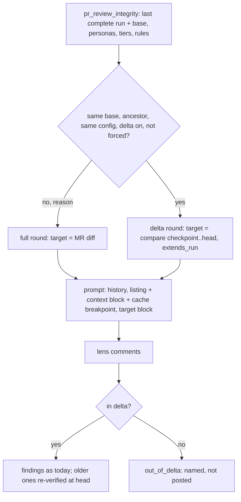

# Delta-first review: the diff since the last reviewed head, the merge request as context

## Amendment (0.6, 2026-11-18): the live conditions are any project's, the ten-push fixture is named and anonymised

Owner principle 2026-11-17, repoach is for everyone. C3 named one
project and one gateway, the owner's; it names a delta round of any
project through a gateway configured per `docs/getting_started.md`, with
the owner's as a labelled reference measurement. C4 replayed "a recorded
ten-push Yoob merge request" that no spec owned; the fixture is
`tests/fixtures/review/ten_push_mr.json`, owned here, recorded from one
of the owner's merge requests and anonymised by the family's rule
(tokens redacted, logins replaced by their class, hosts and paths by
placeholders), so C4 runs on the provider fakes on a fresh machine. The
Context header labels the measurement of F3.

## Amendment (0.5, 2026-11-17): no draft in the path, the snapshot is owned, the oracle is the usage ledger

Re-measured on `origin/develop` `92cd241` after the verifier's read.
(1) D1 made completeness depend on `(role, group)` from
SP-REVIEW-GROUPS-LARGE-DIFFS, a draft whose `diff_groups.py` is absent
and which no row of the order builds; completeness is now "every role
parsed" (`n_unparsed == 0 and n_reviewers == 4`), what
`pr_review_integrity` records today, and the edge is withdrawn. When
that draft is scheduled, it amends D1 to per `(role, group)` as its own
change. (2) C4 named SP-REVIEW-TOKEN-ESTIMATE's estimate as its oracle;
`token_estimate.py` and `providers/budget.py` are absent. The oracle is
the usage ledger's measured prompt tokens, which exist (`repoach usage
--run <id>`, `usage_ledger` rows, SP-USAGE-LEDGER), summed over the ten
runs; the edge moves from the draft to SP-USAGE-LEDGER. (3)
`tests/fixtures/ledger_format/3.json` is this spec's file (D10) and is
now in `owns.code`, as `2.json` is SP-FINDING-CITES-ITS-CODE's. (4) F2
cited `findings.py:270-278` for `pr_review_integrity`; that range is
`pr_findings`, the table is at `:295-303`; F1's orchestrator line is
`:725` on `92cd241`.

## Amendment (0.4, 2026-11-17): the checkpoint lives on a table that exists, and the shape change is a format bump

Re-measured on `origin/develop` `92cd241`. 0.3 put the checkpoint's
`base_sha` and `extends_run` on `review_runs`, a table of
SP-UNIVERSAL-LEDGER (draft 0.2, `src/repoach/ledger/` absent, `grep -rn
'"review_runs"' src` → 0): no spec of the order builds it, and F8 stated
it as existing. What exists is `pr_review_integrity` (`id, pr_number,
head_sha, n_reviewers, n_unparsed`, `src/repoach/review/findings.py:295-303`),
the row D1 already reads, and `pr_review_runs` (the completed-run
payload, `:306-316`). The checkpoint columns therefore go on
`pr_review_integrity`: `base_sha`, `extends_run` and `config_key` (the
persona versions, tiers key and rules hash, one string), each an entry
of `_ADDED_FINDINGS_COLUMNS` (healed on open). `pr_review_integrity` is a
gate table and `pr_findings.status` an enum column of the format
(SP-LEDGER-FORMAT-IS-VERSIONED D1, D9), so this spec is a `LEDGER_FORMAT`
bump (D10): the three columns and `FindingStatus.OUT_OF_DELTA`. The
SP-UNIVERSAL-LEDGER edge is withdrawn (nothing of it is touched);
SP-FINDINGS-INIT-RACE (the file and both tables) and
SP-LEDGER-FORMAT-IS-VERSIONED (the bump) are added. AC3's cycle count is
corrected to the 27 of `92cd241`.

## Amendment (0.3, 2026-11-16): SP-REVIEW-INCREMENTAL-HEAD is folded in

The open-code-review programme wrote SP-REVIEW-INCREMENTAL-HEAD (opt-in,
anchored on the last *complete* run) three days before this spec
(default-on, anchored on `last_reviewed_head`). They decide the same
thing and would have fought over it. This spec is the one spec:
INCREMENTAL-HEAD is marked superseded and owns nothing; what it had and
this spec lacked is taken over here, each item marked (IH): the checkpoint
validity conditions beyond ancestry (same base, same persona versions,
tiers and rules hash), the enumerated fall-back reasons, `--full`, the
file listing of the whole change, the chain of runs the gate reads for
completeness, the checkpoint columns (on `pr_review_integrity` since 0.4), and its two success conditions
(a ≥ 50 % prompt-token drop on a ten-push merge request; 10/10 on the
planted corpus split in two heads). The opt-in is not taken: the owner
decided default-on on 2026-11-15 (decision c); SP-MEMORY-LOOPS-EXPLICIT's
rule that repoach never changes what a reviewer reads without the user
knowing is kept by naming the range in every output and by an explicit
opt-out, `[review].delta = false`. The JSON key is `range`, as
INCREMENTAL-HEAD named it, with `kind: full | delta`.

## Intent

Every round reviews the whole merge request diff, so round twelve reads
the same four thousand lines as round one and finds, in them, remarks on
lines no fix touched. After this spec the lenses' target from the second
round on is the diff between the last head the four lenses reviewed and
the current head; the full merge request diff travels as a context block
the lens may read and may cite only to explain a delta finding, and that
block carries a cache breakpoint so the four lenses pay for it once.
Whenever any condition of that reading is in doubt, the full range is
reviewed and the reason is named.

## Context

Measured 2026-11-15 on `origin/develop` `5354767`; F3 is a reference measurement (owner's dogfood) on one of the owner's merge requests, !366;
(IH) facts re-measured by SP-REVIEW-INCREMENTAL-HEAD on `8fabb19`.

| # | Fact | Where |
|---|---|---|
| F1 | Each round fetches the whole merge request diff (`raw_diffs`, else rebuilt) and hashes it; the scoper then cuts complete file units for the prompt | `src/repoach/review/orchestrator.py:725` (`diff = self._forge.diff(pr_number).text` on `92cd241`; `:699-712` on `5354767`); `src/repoach/forge/gitlab.py:645-658`; SP-DIFF-SCOPER |
| F2 | The head reviewed is pinned per run and recorded with the four lenses' parse state in `pr_review_integrity` (`id, pr_number, head_sha, n_reviewers, n_unparsed`) | SP-REVIEW-PINS-HEAD; `src/repoach/review/findings.py:295-303` (0.5; `:269-291` is `pr_findings`) |
| F12 (0.5) | Every provider call writes one `usage_ledger` row with its prompt and completion tokens; `repoach usage --run <id>` sums them per run | `src/repoach/providers/usage.py:73-91`; `src/repoach/cli/usage_cmds.py`; SP-USAGE-LEDGER |
| F3 | On !366, rounds 9–11: 15 of 18 remarks were on code the previous fix added — the delta — and the other 3 on pre-existing code; threads a round: 11, 4, 6, 6, 5, 3, 5, 5, 4, 6, 8, 8 | Yoob `tmp/REVIEW-SPEC.md` §6 |
| F4 | A review costs about 699 k prompt tokens, every one uncached on the API: the direct provider sets no `cache_control` | SP-ANTHROPIC-BUDGET-GUARD F7, F8 |
| F5 | Owner decision 2026-11-15 (c): delta-first review — the diff since the last reviewed head, with the full MR as context | brief, 2026-11-15 |
| F6 | Prompt caching on the Messages API is a prefix match: a block cached with `cache_control` at the end of the stable prefix is read at 0.20–0.25 USD per million instead of 2–10; a one-hour TTL exists | the `claude-api` skill, prompt caching; `platform.claude.com` pricing |
| F7 (IH) | Every blocking finding of an older head is re-checked at the head the gate decides on; it ends `resolved_at_head`, `still_open` or `needs_judgement`, which is what makes keeping older findings sound | `src/repoach/review/head_reverify.py`; SP-GATE-REVERIFIES-AT-HEAD |
| F8 (IH, corrected 0.4) | `pr_review_integrity` records one row per run at a head (`pr_number, head_sha, n_reviewers, n_unparsed`) and `pr_review_runs` one row per completed run with its payload; `review_runs` (SP-UNIVERSAL-LEDGER G3, draft) does not exist on `92cd241`; a replay never re-posts | `src/repoach/review/findings.py:295-316`; SP-POSTING-REPLAY-DEDUPES |
| F9 (IH) | Owner rule: repoach never changes what a reviewer reads without the user knowing it | SP-MEMORY-LOOPS-EXPLICIT, Intent |
| F10 (IH) | open-code-review's `checkpoint_range` reviews `checkpoint..head` and fails closed when the summary is missing or not the token's, the base moved, the configuration changed or ancestry cannot be proven; `full_review` forces a full pass once | `R/action.yml:203-222` (Apache-2.0; design re-derived, nothing copied) |
| F11 (IH) | A persona bump between two heads changes what a lens looks for; a reuse keyed by persona version already exists for the role resume | SP-REVIEW-RESUMES-FAILED-ROLES D1 |

## Decisions (2026-11-15; (IH) items 2026-11-16)

- D1. The *checkpoint* is the ledger, not a comment: `last_reviewed_head(pr)`
  is the `head_sha` of the latest `pr_review_integrity` row of the merge
  request with `n_unparsed == 0` and `n_reviewers == 4` (0.5: every
  role parsed, what the row records today; a per-`(role, group)`
  completeness is SP-REVIEW-GROUPS-LARGE-DIFFS's amendment to this
  sentence when that draft is scheduled), together with (IH, 0.4) its
  `base_sha` (the merge-base) and
  its `config_key` (persona versions, tiers key and rules hash), both
  new columns of that same `pr_review_integrity` row. When none exists,
  the round is a *full round*: target = the merge request diff, as today.
- D2. The checkpoint is valid for `head` when (IH) `base_sha` is
  unchanged, the checkpoint head is an ancestor of `head` (the forge's
  compare says so, or the local `merge-base --is-ancestor` does), and the
  persona versions, tiers key and rules hash are equal. Then the round is
  a *delta round*: target = the forge's compare of the checkpoint head to
  `head` (SP-REVIEW-SETTLED-STAYS-SETTLED A1's `compare`), restricted to
  the files of the merge request diff; context = the merge request diff at
  `head`, scoped as today. Any other case reviews the full range with
  `range.reason` one of (IH) `no_previous_run`, `previous_incomplete`,
  `base_moved`, `not_ancestor` (a force-push), `config_changed`,
  `forced` (`review pr --full`), or `compare_failed` (this spec), or
  `delta_off` (`[review].delta = false`).
- D3. Prompt layout, after SP-PROMPT-PLACEHOLDER-ORDER's rules: system
  prompt, review history block, **context block** (`## Merge request
  diff (context)`: (IH) first the list of every file of `base..head` with
  its status and line counts, then the full scoped diff) ending with a
  `cache_control` breakpoint of TTL 1 h, then the **target block**
  (`## Changes since the last review (<sha7>..<sha7>)`), then the
  instructions. The four lenses share the same context block bytes, so
  the first lens writes the cache and three read it; a delta round at
  the same context pays the write once an hour.
- D4. Rule given to the lens: a finding must cite a line of the target
  block, or cite a line of the context block **and** name the target
  line whose change makes it a defect now. A finding on the context
  alone is recorded `out_of_delta` (a terminal non-blocking status),
  listed in the archive comment, not posted; a settled one among them is
  handled by SP-REVIEW-SETTLED-STAYS-SETTLED first. (IH) The findings of
  the checkpoint head on files the delta does not touch keep their rows
  and are re-verified at `head` as today (F7); they reach the lens through
  the review history block, not as a separate context.
- D5. An empty delta (a re-run at the same head) is the existing replay
  (`_completed_run`), unchanged. A delta that is only renames or
  whitespace is still reviewed (the lens sees it; a finding on it is
  legitimate).
- D6. The refuter judges findings against the full file at `head` as
  today; nothing changes in its window.
- D7. (IH) The run's integrity row at `head` names the checkpoint run it
  extends (`extends_run`); the gate's `review complete at head` reads a
  chain of complete runs, each extending the previous, back to a full
  one. A broken chain is `review incomplete` with the missing link named.
- D10 (0.4, SP-LEDGER-FORMAT-IS-VERSIONED). This spec changes the shape
  the gate reads twice: `pr_review_integrity` gains `base_sha`,
  `extends_run` and `config_key` (three `_ADDED_FINDINGS_COLUMNS`
  entries, healed on an older ledger), and `FindingStatus` gains
  `OUT_OF_DELTA`, a value of the enum column `pr_findings.status`.
  `LEDGER_FORMAT` is therefore bumped by one in the same pull request,
  with `tests/fixtures/ledger_format/<new>.json` written by `python -m
  repoach.review.ledger_format snapshot` and committed; the format
  spec's T1 is red otherwise. Written for 2 → 3 (`ledger_format_after:
  3`), the number after SP-FINDING-CITES-ITS-CODE's 2; when the order
  changes, the next free number is taken and the constraint updated in
  the same commit. No JSON column is added. Until the release that ships
  it, `main`'s gate refuses this code's ledgers with `SKIP_LEDGER_SKEW —
  ledger skew: format 3 is newer than this reader's 2 …`, exit 5, the
  refusal that spec designed; the release notes name the bump and
  `scripts/skew_replay.sh origin/main origin/develop`.
- D8. The report says which kind of round ran, in the JSON (`range:
  {kind: full | delta, from, to, reason, extends_run, target_lines,
  context_lines}`), on stderr (`range: delta 3f2a9c0..9f6cd85, 212 lines
  of 4 118, extends run 118` or `range: full (not_ancestor)`) and in the
  archive comment.
- D9. Default on (F5). `[review].delta = false` turns it off for a
  repository (`range.reason = delta_off`); `review pr --full` forces one
  full round. F9 is kept by D8: the user reads the range on every run.

## End state

Round 12 of !366 reads the 200 lines round 11's fix changed, with the
merge request beside it, and its remarks are about those lines or
explain why an old line became wrong; the three "not visible, confirm"
threads of F3's round 12 cannot occur, since the test file the fix
added is in the target; and a force-push, a rebase or a persona bump
produces a full round that says why.

## Easy solution rejected

Send only the delta. Rejected: a fix that changes a callee makes a
caller wrong, and the lens must be able to see the caller; the context
block is the whole merge request for that reason, and D4 is what keeps
remarks anchored to the change. Also rejected: filtering comments by
line after a full review, which pays the full prompt and throws away
what the lens read. (IH) Also rejected: an opt-in default, which would
have left the twelve-round pattern of F3 in place until someone turned
it on; the owner decided default-on and the range is named on every run.

## Hard part

Choosing the checkpoint so that nothing is skipped. A round whose
Sentinel did not parse must not advance the mark (D1's `n_unparsed ==
0`), or the next round's delta would start past code no Sentinel read;
a force-push, a moved base or a persona bump makes the mark meaningless
(D2), and (IH) a chain of delta rounds is only as complete as its weakest
link (D7). The cache breakpoint is the second hard part: the context
block must be byte-identical across the four lenses and across rounds at
the same head, so the scoper's output must be deterministic (sorted
files, stable truncation) and the system prompt must precede it
unchanged; `usage.cache_read_input_tokens` in the ledger is the only
proof, and C3 reads it.

## Goals

- G1: the checkpoint as D1; full round when none, delta round when D2 holds, full round with the named reason otherwise; `--full` and `[review].delta = false` named.
- G2: the prompt layout of D3 with a deterministic context block, the file listing at its head, and the 1 h breakpoint on the `anthropic` route (and through the gateway, which forwards `cache_control`).
- G3: the lens rule of D4, with `out_of_delta` recorded and named, never posted; the checkpoint's findings on untouched files keep their rows and are re-verified.
- G4: (IH, 0.4) `pr_review_integrity` gains `base_sha`, `extends_run` and `config_key`; the integrity chain of D7 is what the gate reads; a broken chain is named.
- G7 (0.4): `LEDGER_FORMAT` is bumped with its snapshot in the same pull request (D10).
- G5: D8 in the JSON, stderr and archive comment.
- G6: on a delta round the usage ledger shows `cache_read_tokens > 0` for lenses two to four; on a full round the context block is cached too (the same bytes for the four lenses).

## Non-Goals

- NG1: no change to the refuter's evidence window (D6).
- NG2: no change to the gate's re-verification at head (SP-GATE-REVERIFIES-AT-HEAD); it is what makes a delta round sound.
- NG3: no incremental fingerprinting beyond SP-REVIEW-SETTLED-STAYS-SETTLED.
- NG4: (IH) no reuse across pull requests or across bases.

## Assumptions

- A1: the forge compare returns the same unified format as the merge request diff (`render_diff_entry` reused).
- A2: the gateway forwards `cache_control` blocks to the Anthropic transport untouched (SP-PROVIDER-DIRECT-ANTHROPIC translates content blocks; a test pins the field).
- A3: (IH) a reviewer given the delta, the full file listing and the merge request diff as context names a cross-file regression it cannot see no more often than today's full round names one past the scoper's cap; measured by C5.

## Interface

```python
# src/repoach/review/delta_scope.py
FULL_REASONS = ("no_previous_run", "previous_incomplete", "base_moved", "not_ancestor", "config_changed", "forced", "compare_failed", "delta_off")

class Checkpoint(BaseModel):
    run_id: int; head_sha: str; base_sha: str
    persona_versions: dict[str, str]; tiers_key: str; rules_hash: str

class ReviewRange(BaseModel):
    kind: Literal["full", "delta"]
    from_sha: str | None; to_sha: str
    reason: str | None                    # one of FULL_REASONS, None on a delta round
    extends_run: int | None
    target_diff: str; context_diff: str; file_listing: str
    target_lines: int; context_lines: int

def last_complete_run(pr_number: int, *, db_path: Path) -> Checkpoint | None: ...
def decide_range(checkpoint: Checkpoint | None, *, head_sha, base_sha, personas, tiers_key, rules_hash, is_ancestor: Callable[[str, str], bool], forced: bool, enabled: bool) -> ReviewRange: ...
def round_scope(forge: Forge, pr_number: int, *, head_sha: str, db_path: Path, repo_root: Path | None, forced: bool) -> ReviewRange: ...
def render_context_block(listing: str, diff: str) -> str: ...     # deterministic; format:delta-review-block
def render_target_block(scope: ReviewRange) -> str: ...
def in_delta(comment, scope: ReviewRange) -> bool: ...   # D4

# reviewer.py (changed): two blocks, cache_control on the context block
# findings.py (changed): FindingStatus.OUT_OF_DELTA; pr_review_integrity gains base_sha, extends_run, config_key (three _ADDED_FINDINGS_COLUMNS entries)
# ledger_format.py (changed): LEDGER_FORMAT = 3; tests/fixtures/ledger_format/3.json committed and owned here (D10)
# repoach.project.config.ReviewSection (added): delta: bool = True
# CLI: review pr --full
```

Outputs: JSON `range` (D8); `findings.out_of_delta`; log event `review_round_scope`; stderr line of D8.

## Behavior

### Nominal
Round 3 at H3, checkpoint H2 (same base, ancestor, same personas):
compare H2..H3 is 180 lines in 4 files; the listing names the merge
request's 12 files; context 4 118 lines; four lens calls, the first
writes the context cache (57 k tokens), three read it; the report says
`range: delta`, `extends_run` the H2 run.

### Edge cases
- first round → `range: full (no_previous_run)`; the context block is the target too (one block, labelled as both).
- `n_unparsed > 0` or `n_reviewers < 4` on the latest integrity row → `previous_incomplete`, unless SP-REVIEW-RESUMES-FAILED-ROLES completed that run first.
- a rebase onto a moved `develop` → `base_moved`, full; a force-push → `not_ancestor`, full; the Sentinel persona bumped → `config_changed`, full.
- three delta rounds in a row → the chain H1 ← H2 ← H3 ← H4; the gate at H4 reads it complete; a missing H3 row → `review incomplete: run at H3 missing from the chain`.
- a lens cites a context line and names the target line → in delta; cites a context line alone → `out_of_delta`, named.

### Failure scenarios
- the compare call fails → full round with reason `compare_failed (<why>)`; the review proceeds.

## Tests

| Test | What it pins | Mutation that must turn it red |
|---|---|---|
| `tests/unit/test_delta_scope.py::test_checkpoint_requires_every_role_parsed` | D1: `n_unparsed == 0 and n_reviewers == 4` | ignore `n_unparsed`, or accept three reviewers |
| `::test_valid_checkpoint_is_a_delta_round_over_the_compare_restricted_to_mr_files` | D2 | use the full diff |
| `::test_each_invalid_condition_names_its_reason` | the eight reasons of `FULL_REASONS`, one case each | one reason reused for two cases |
| `::test_force_push_is_not_ancestor` | `is_ancestor` false → full | ancestry not asked |
| `::test_full_flag_and_delta_off_are_named` | `forced`, `delta_off` | silent full |
| `::test_in_delta_rule` | D4's three cases | accept context-only |
| `::test_untouched_findings_keep_their_rows_and_are_reverified` | row count unchanged, `head_reverify` called with them | delete them |
| `::test_chain_is_read_by_the_gate` | H1 full ← H2 ← H3: complete; a missing H2 row: incomplete naming H2 | read the last run only |
| `tests/unit/test_delta_prompt_blocks.py::test_context_block_is_byte_identical_across_lenses_and_carries_the_breakpoint` | D3 | per-lens ordering |
| `::test_listing_heads_the_context_block` | D3 (IH) | omit it |
| `::test_blocks_follow_placeholder_order` | SP-PROMPT-PLACEHOLDER-ORDER | swap |
| `::test_gateway_forwards_cache_control` | A2 | strip it |
| `tests/integration/test_delta_review_end_to_end.py::test_second_round_reviews_only_the_delta_and_reports_it` | two heads on fakes; `range.kind == delta`, `target_lines` equals the compare's, `extends_run` set, archive comment states the range | — |
| `::test_force_pushed_second_head_is_full_not_ancestor` | (IH) | — |

## Success conditions

- C1: replaying !366's rounds 9–12 with their recorded heads and diffs, the target of each delta round contains every line the round's fix added and the report's `target_lines` equals the recorded compare size; oracle: the integration test on the fixture of SP-REVIEW-SETTLED-STAYS-SETTLED.
- C2: on the same replay, the 15 remarks of rounds 9–11 on fix-added code are in delta; the 3 on pre-existing code are `out_of_delta` unless their comment names a target line; oracle: `findings.out_of_delta` count.
- C3: on a live delta round of any project running this, through a gateway configured per `docs/getting_started.md`, the usage ledger shows `cache_read_tokens ≥ 0.9 × cache_write_tokens` of the first lens for lenses two to four, and the review's `cost.review_usd` is below the previous full round's by at least 40 %; oracle: `repoach usage --run <id>`; `test_gateway_forwards_cache_control` proves the forwarding on the fakes before any live round. Reference measurement (owner's dogfood): the owner's first delta round through the owner's gateway, written beside this line as an instance.
- C4 (IH; 0.5, 0.6): on the recorded, anonymised ten-push merge request `tests/fixtures/review/ten_push_mr.json` replayed twice on the provider fakes, once with `[review].delta = false` and once with the default, the sum of `prompt_tokens` over the ten runs' `usage_ledger` rows drops by at least 50 % with the delta on, with the same set of findings open at the final head; oracle: `repoach usage --run <id>` for each of the twenty runs (F12), the twenty figures and the two sums written beside this line by the verifier; `grep -c -i "yoob\|hel1\|jofaye\|@[a-z]" tests/fixtures/review/ten_push_mr.json` → `0`.
- C5: (IH) on the planted corpus with each case split into two heads (the fixture's patch halved), the located-defect count is 10/10 with the second head reviewed as a delta round; oracle: `repoach bench report`.
- C6: `pytest -q tests/unit/test_diff_scoper*.py tests/unit/test_review_pins_head.py tests/unit/test_gate_reverifies_at_head.py` → green.
- C7 (0.4; oracle: `scripts/skew_replay.sh`): on this spec's branch, `scripts/skew_replay.sh origin/develop HEAD` → `ledger: format 3 is newer than this reader's 2 …`, exit 5; `scripts/skew_replay.sh HEAD HEAD` → `ledger: ok (format 3, …)`, exit 0; after the release that ships it, `scripts/skew_replay.sh origin/main origin/develop` → `ledger: ok`. The three command lines and outputs are written beside this line by the verifier.

## Architecture Impact
- Adds dependency: SP-REVIEW-DELTA-FIRST -> SP-DIFF-SCOPER, SP-REVIEW-PINS-HEAD (the scoper's output becomes the context block; the checkpoint comes from the pinned-head integrity rows)
- Adds dependency: SP-REVIEW-DELTA-FIRST -> SP-FINDING-MODEL (a new status), SP-FINDINGS-INIT-RACE (0.4: `findings.py`, `pr_findings` and `pr_review_integrity` are its; the status value and the three columns are edits to that file), SP-REVIEW-SETTLED-STAYS-SETTLED (the compare method and the ordering: settled first, then delta)
- Adds dependency (0.4): SP-REVIEW-DELTA-FIRST -> SP-LEDGER-FORMAT-IS-VERSIONED (`LEDGER_FORMAT` and `tests/fixtures/ledger_format/` are its; this spec bumps the one and adds to the other, D10)
- Adds dependency: SP-REVIEW-DELTA-FIRST -> SP-REVIEW-REMEMBERS-EVERY-ROUND, SP-PROMPT-PLACEHOLDER-ORDER (block order; the checkpoint's findings reach the lens through the history block)
- Adds dependency: SP-REVIEW-DELTA-FIRST -> SP-UNIVERSAL-FORGE, SP-ORCH-DOCSTRING (compare through the protocol; the orchestrator's steps)
- Adds dependency: SP-REVIEW-DELTA-FIRST -> SP-ANTHROPIC-BUDGET-GUARD (the estimate of a delta round uses the cached context at the cache-read price once the first lens wrote it)
- Adds dependency (IH): SP-REVIEW-DELTA-FIRST -> SP-GATE-REVERIFIES-AT-HEAD (the soundness of keeping the checkpoint's findings), SP-REVIEW-RESUMES-FAILED-ROLES (a complete run is the checkpoint; the resume makes more runs complete)
- Adds dependency (IH): SP-REVIEW-DELTA-FIRST -> SP-POSTING-REPLAY-DEDUPES (posting unchanged on replay), SP-UNIVERSAL-PROJECT-CONFIG (`[review].delta`), SP-MEMORY-LOOPS-EXPLICIT (F9, kept by D8 and D9), SP-CLI-STDOUT-ONE-JSON (`range` in the one JSON); 0.4: the edge to SP-UNIVERSAL-LEDGER is withdrawn, `review_runs` is not touched because it does not exist
- Adds dependency (0.5): SP-REVIEW-DELTA-FIRST -> SP-USAGE-LEDGER (C4 and G6 read `usage_ledger` rows: `prompt_tokens`, `cache_read_tokens`)
- Removes dependency (0.5): SP-REVIEW-DELTA-FIRST -> SP-REVIEW-GROUPS-LARGE-DIFFS and SP-REVIEW-TOKEN-ESTIMATE (drafts with no code; D1 and C4 no longer read anything of them)
- Supersedes SP-REVIEW-INCREMENTAL-HEAD, which owns nothing from 0.2 on. No new table; three gate-table columns and one enum value, format bumped (D10); no cycle.

## Diagram


## Acceptance Criteria
- [ ] AC1: `pytest -q tests/unit/test_delta_scope.py tests/unit/test_delta_prompt_blocks.py` → green. Today (`92cd241`): every round reviews `self._forge.diff(pr_number).text` (`orchestrator.py:725`) and no `cache_control` exists in `src/repoach/providers`.
- [ ] AC2: `pytest -q tests/integration/test_delta_review_end_to_end.py` → green, the force-push case included.
- [ ] AC3: `repoach arch check --base origin/develop` → `edge-honesty: ok`; `repoach arch graph --check` lists 27 cycles, as `92cd241` does (0.4; 0.3 said six, measured on an older tree).
- [ ] AC5 (0.4): `pytest -q tests/unit/test_ledger_format_skew.py` → green with `LEDGER_FORMAT = 3` and `tests/fixtures/ledger_format/3.json` (owned by this spec, 0.5); `python -m repoach.review.ledger_format snapshot` equals that file and lists the three new `pr_review_integrity` columns and `out_of_delta` under `pr_findings.status`; `1.json` and `2.json` unchanged. Mutation: add the status without the bump → `test_live_snapshot_matches_the_committed_format` red.
- [ ] AC4: `docs/review_redesign_architecture.md` describes full and delta rounds, the two blocks, the eight reasons and the chain of runs; SP-REVIEW-INCREMENTAL-HEAD carries `status: superseded` and points here.

## Open Questions
- None. Decided by the owner on 2026-11-15: Q1 (a delta round when the target branch moved) — no; a moved base is `base_moved`, a full round; Q2 (context cache TTL) — 1 h, the `context_cache_ttl` constraint. INCREMENTAL-HEAD's O1 (default on) is decided by the owner's decision (c) of 2026-11-15; its O2 (re-read files named by older findings but untouched by the delta) — no, as it proposed: the re-verification at head covers them and the history block names them.
