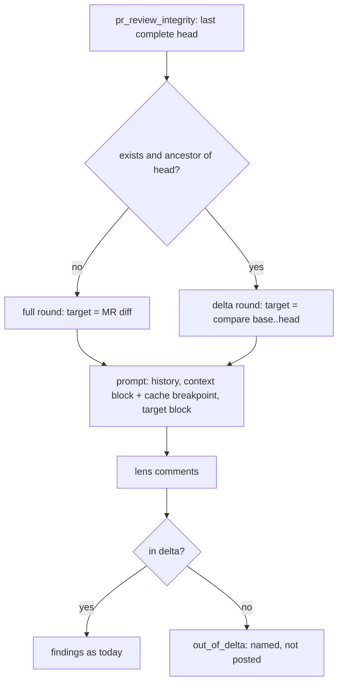

# Delta-first review: the diff since the last reviewed head, the merge request as context

## Intent

Every round reviews the whole merge request diff, so round twelve reads
the same four thousand lines as round one and finds, in them, remarks on
lines no fix touched. After this spec the lenses' target from the second
round on is the diff between the last head the four lenses reviewed and
the current head; the full merge request diff travels as a context block
the lens may read and may cite only to explain a delta finding, and that
block carries a cache breakpoint so the four lenses pay for it once.

## Context

Measured 2026-11-15 on `origin/develop` `5354767` and Yoob MR !366.

| # | Fact | Where |
|---|---|---|
| F1 | Each round fetches the whole merge request diff (`raw_diffs`, else rebuilt) and hashes it; the scoper then cuts complete file units for the prompt | `src/repoach/review/orchestrator.py:699-712`; `src/repoach/forge/gitlab.py:645-658`; SP-DIFF-SCOPER |
| F2 | The head reviewed is pinned per run and recorded with the four lenses' parse state in `pr_review_integrity` (`head_sha`, `n_reviewers`, `n_unparsed`) | SP-REVIEW-PINS-HEAD; `src/repoach/review/findings.py:270-278` |
| F3 | On !366, rounds 9–11: 15 of 18 remarks were on code the previous fix added — the delta — and the other 3 on pre-existing code; threads a round: 11, 4, 6, 6, 5, 3, 5, 5, 4, 6, 8, 8 | Yoob `tmp/REVIEW-SPEC.md` §6 |
| F4 | A review costs about 699 k prompt tokens, every one uncached on the API: the direct provider sets no `cache_control` | SP-ANTHROPIC-BUDGET-GUARD F7, F8 |
| F5 | Owner decision 2026-11-15 (c): delta-first review — the diff since the last reviewed head, with the full MR as context | brief, 2026-11-15 |
| F6 | Prompt caching on the Messages API is a prefix match: a block cached with `cache_control` at the end of the stable prefix is read at 0.20–0.25 USD per million instead of 2–10; a one-hour TTL exists | the `claude-api` skill, prompt caching; `platform.claude.com` pricing |

## Decisions (2026-11-15)

- D1. `last_reviewed_head(pr)` is the `head_sha` of the latest
  `pr_review_integrity` row of the merge request with `n_unparsed == 0`
  and `n_reviewers == 4`. When none exists, the round is a *full
  round*: target = the merge request diff, as today.
- D2. Otherwise the round is a *delta round*: target = the forge's
  compare of `last_reviewed_head` to `head` (SP-REVIEW-SETTLED-STAYS-
  SETTLED A1's `compare`), restricted to the files of the merge request
  diff; context = the merge request diff at `head`, scoped as today. If
  `last_reviewed_head` is not an ancestor of `head` (force-push,
  rebase; the forge's compare says so or the local `merge-base` does),
  the round is a full round and the report says `delta: unavailable
  (history rewritten since <sha7>)`.
- D3. Prompt layout, after SP-PROMPT-PLACEHOLDER-ORDER's rules: system
  prompt, review history block, **context block** (`## Merge request
  diff (context)` with the full scoped diff) ending with a
  `cache_control` breakpoint of TTL 1 h, then the **target block**
  (`## Changes since the last review (<sha7>..<sha7>)`), then the
  instructions. The four lenses share the same context block bytes, so
  the first lens writes the cache and three read it; a delta round at
  the same context pays the write once an hour.
- D4. Rule given to the lens: a finding must cite a line of the target
  block, or cite a line of the context block **and** name the target
  line whose change makes it a defect now. A finding on the context
  alone is recorded `out_of_delta` (a terminal non-blocking status),
  listed in the archive comment, not posted; a settled one among them is
  handled by SP-REVIEW-SETTLED-STAYS-SETTLED first.
- D5. An empty delta (a re-run at the same head) is the existing replay
  (`_completed_run`), unchanged. A delta that is only renames or
  whitespace is still reviewed (the lens sees it; a finding on it is
  legitimate).
- D6. The refuter judges findings against the full file at `head` as
  today; nothing changes in its window.
- D7. The report says which kind of round ran: `round: full` or
  `round: delta <sha7>..<sha7>, 212 lines of 4 118`, in the JSON, the
  stderr line and the archive comment.

## End state

Round 12 of !366 reads the 200 lines round 11's fix changed, with the
merge request beside it, and its remarks are about those lines or
explain why an old line became wrong; the three "not visible, confirm"
threads of F3's round 12 cannot occur, since the test file the fix
added is in the target.

## Easy solution rejected

Send only the delta. Rejected: a fix that changes a callee makes a
caller wrong, and the lens must be able to see the caller; the context
block is the whole merge request for that reason, and D4 is what keeps
remarks anchored to the change. Also rejected: filtering comments by
line after a full review, which pays the full prompt and throws away
what the lens read.

## Hard part

Choosing `last_reviewed_head` so that nothing is skipped. A round whose
Sentinel did not parse must not advance the mark (D1's `n_unparsed ==
0`), or the next round's delta would start past code no Sentinel read;
a force-push makes the mark meaningless (D2). The cache breakpoint is
the second hard part: the context block must be byte-identical across
the four lenses and across rounds at the same head, so the scoper's
output must be deterministic (sorted files, stable truncation) and the
system prompt must precede it unchanged; `usage.cache_read_input_tokens`
in the ledger is the only proof, and C3 reads it.

## Goals

- G1: `last_reviewed_head` as D1; full round when none, delta round otherwise, full round with the named reason on a rewritten history.
- G2: the prompt layout of D3 with a deterministic context block and the 1 h breakpoint on the `anthropic` route (and through the gateway, which forwards `cache_control`).
- G3: the lens rule of D4, with `out_of_delta` recorded and named, never posted.
- G4: D7 in the JSON, stderr and archive comment.
- G5: on a delta round the usage ledger shows `cache_read_tokens > 0` for lenses two to four; on a full round the context block is cached too (the same bytes for the four lenses).

## Non-Goals

- NG1: no change to the refuter's evidence window (D6).
- NG2: no change to the gate's re-verification at head (SP-GATE-REVERIFIES-AT-HEAD).
- NG3: no incremental fingerprinting beyond SP-REVIEW-SETTLED-STAYS-SETTLED.

## Assumptions

- A1: the forge compare returns the same unified format as the merge request diff (`render_diff_entry` reused).
- A2: the gateway forwards `cache_control` blocks to the Anthropic transport untouched (SP-PROVIDER-DIRECT-ANTHROPIC translates content blocks; a test pins the field).

## Interface

```python
# src/repoach/review/delta_scope.py
class RoundScope(BaseModel):
    kind: Literal["full", "delta"]
    base_sha: str | None; head_sha: str
    target_diff: str; context_diff: str
    target_lines: int; context_lines: int
    reason: str | None                    # "history rewritten since <sha7>" | None

def last_reviewed_head(pr_number: int, *, db_path: Path) -> str | None: ...
def round_scope(forge: Forge, pr_number: int, *, head_sha: str, db_path: Path, repo_root: Path | None) -> RoundScope: ...
def render_context_block(diff: str) -> str: ...     # deterministic; format:delta-review-block
def render_target_block(scope: RoundScope) -> str: ...
def in_delta(comment, scope: RoundScope) -> bool: ...   # D4

# reviewer.py (changed): two blocks, cache_control on the context block
# findings.py (changed): FindingStatus.OUT_OF_DELTA
```

Outputs: JSON `round: {kind, base_sha, head_sha, target_lines, context_lines, reason}`; `findings.out_of_delta`; log event `review_round_scope`.

## Behavior

### Nominal
Round 3 at H3, last reviewed H2: compare H2..H3 is 180 lines in 4
files; context 4 118 lines; four lens calls, the first writes the
context cache (57 k tokens), three read it; the report says
`round: delta`.

### Edge cases
- first round → `round: full`, the context block is the target too (one block, labelled as both).
- `n_unparsed > 0` on the latest integrity row → the mark is the previous complete row; the report names it.
- force-push → full round, reason named.
- a lens cites a context line and names the target line → in delta; cites a context line alone → `out_of_delta`, named.

### Failure scenarios
- the compare call fails → full round with reason `delta: compare failed (<why>)`; the review proceeds.

## Tests

| Test | What it pins | Mutation that must turn it red |
|---|---|---|
| `tests/unit/test_delta_scope.py::test_last_reviewed_head_requires_four_parsed_lenses` | D1 | ignore `n_unparsed` |
| `::test_delta_round_targets_the_compare_restricted_to_mr_files` | D2 | use the full diff |
| `::test_rewritten_history_falls_back_to_full_with_the_reason` | D2 | silent full |
| `::test_in_delta_rule` | D4's three cases | accept context-only |
| `tests/unit/test_delta_prompt_blocks.py::test_context_block_is_byte_identical_across_lenses_and_carries_the_breakpoint` | D3 | per-lens ordering |
| `::test_blocks_follow_placeholder_order` | SP-PROMPT-PLACEHOLDER-ORDER | swap |
| `::test_gateway_forwards_cache_control` | A2 | strip it |
| `tests/integration/test_delta_review_end_to_end.py::test_second_round_reviews_only_the_delta_and_reports_it` | two heads on fakes; `round.kind == delta`, `target_lines` equals the compare's | — |

## Success conditions

- C1: replaying !366's rounds 9–12 with their recorded heads and diffs, the target of each delta round contains every line the round's fix added and the report's `target_lines` equals the recorded compare size; oracle: the integration test on the fixture of SP-REVIEW-SETTLED-STAYS-SETTLED.
- C2: on the same replay, the 15 remarks of rounds 9–11 on fix-added code are in delta; the 3 on pre-existing code are `out_of_delta` unless their comment names a target line; oracle: `findings.out_of_delta` count.
- C3: on a live Yoob delta round through the owner's gateway, the usage ledger shows `cache_read_tokens ≥ 0.9 × cache_write_tokens` of the first lens for lenses two to four, and the review's `cost.review_usd` is below the previous full round's by at least 40 %; oracle: `repoach usage --run <id>`.
- C4: `pytest -q tests/unit/test_diff_scoper*.py tests/unit/test_review_pins_head.py` → green.

## Architecture Impact
- Adds dependency: SP-REVIEW-DELTA-FIRST -> SP-DIFF-SCOPER, SP-REVIEW-PINS-HEAD (the scoper's output becomes the context block; the mark comes from the pinned-head integrity rows)
- Adds dependency: SP-REVIEW-DELTA-FIRST -> SP-FINDING-MODEL (a new status), SP-REVIEW-SETTLED-STAYS-SETTLED (the compare method and the ordering: settled first, then delta)
- Adds dependency: SP-REVIEW-DELTA-FIRST -> SP-REVIEW-REMEMBERS-EVERY-ROUND, SP-PROMPT-PLACEHOLDER-ORDER (block order in the prompt)
- Adds dependency: SP-REVIEW-DELTA-FIRST -> SP-UNIVERSAL-FORGE, SP-ORCH-DOCSTRING (compare through the protocol; the orchestrator's steps)
- Adds dependency: SP-REVIEW-DELTA-FIRST -> SP-ANTHROPIC-BUDGET-GUARD (the estimate of a delta round uses the cached context at the cache-read price once the first lens wrote it)
- No new table, no cycle.

## Diagram


## Acceptance Criteria
- [ ] AC1: `pytest -q tests/unit/test_delta_scope.py tests/unit/test_delta_prompt_blocks.py` → green. Today (`5354767`): every round reviews `self._forge.diff(pr_number).text` (`orchestrator.py:699`) and no `cache_control` exists in `src/repoach/providers`.
- [ ] AC2: `pytest -q tests/integration/test_delta_review_end_to_end.py` → green.
- [ ] AC3: `repoach arch check --base origin/develop` → `edge-honesty: ok`.
- [ ] AC4: `docs/review_redesign_architecture.md` describes full and delta rounds and the two blocks.

## Open Questions
- Q1: should a delta round also run when the merge request's target branch moved (develop advanced), reviewing the merge-base shift? Recommendation: no; the target is the author's changes, and the gate's CI covers the integration.
- Q2: 1 h cache TTL (5 minutes is the default, cheaper to write) — recommendation: 1 h, since the four lenses run within minutes but the refuter and a round-2 confirm can run later in the same job; the write premium is 2× the base price on a 57 k block, about 0.11 USD on Sonnet.
