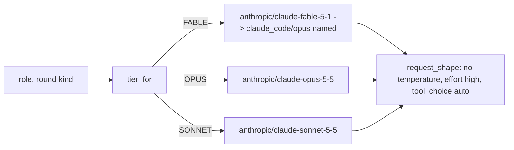

# A FABLE tier: deeper first rounds so fewer rounds follow

## Intent

Twelve rounds on !366 came from first rounds that found what the fix
of the previous round had added, round after round. The owner decided
on 2026-11-15 to add Anthropic's most capable model as a reviewer tier
so the first round reads deeper and later rounds are fewer. After this
spec repoach has a fourth tier, `FABLE`, bound to `claude-fable-5-1`;
the Architect and the Sentinel run on it in a full round, every lens
runs on Opus 5.5 in a delta round, the refuter runs on Opus 5.5, the
thread replies and the nit digest on Sonnet 5.5; the README names the
four current ids instead of the stale ones.

## Context

Measured 2026-11-15 on `origin/develop` `5354767`.

| # | Fact | Where |
|---|---|---|
| F1 | Three tiers exist: `CapabilityTier.OPUS / SONNET / HAIKU`; the gateway classifies an incoming name by the substrings `opus`, `haiku`, `sonnet` in that order; `CAPABILITY_TO_ALIAS` still names `claude-opus-4-7` and `claude-sonnet-4-6` | `src/repoach/llm/capability.py:50-78`; `src/repoach/llm_proxy/routing/tier.py:14-60` |
| F2 | Lens tiers today: Architect, Tester, Scribe on `PROXY_SONNET_CHAIN`; Sentinel on `PROXY_OPUS_CHAIN`; the refuter judge on `CapabilityTier.OPUS`, `temperature=0.0`, `JUDGE_THINKING` | `src/repoach/review/reviewer.py:915-956`; `src/repoach/review/refuter.py:353-365` |
| F3 | `ANTHROPIC_MODELS` and `README.md:51` name `claude-opus-5`, `claude-sonnet-5`, `claude-haiku-4-5`; the current ids are `claude-fable-5-1`, `claude-opus-5-5`, `claude-sonnet-5-5`, `claude-haiku-5-5` | `src/repoach/providers/select.py:243-245`; the `claude-api` skill's model table |
| F4 | The `claude_code` CLI route reduces any model id to `opus`, `sonnet` or `haiku`; it cannot run Fable | `src/repoach/llm_proxy/providers/claude_code/client.py:495-504`; `docs/tech_debt.md` row 47 |
| F5 | Fable 5.1 API shape: thinking always on (`thinking: {type: disabled}` and `budget_tokens` → 400; omit the parameter or send `adaptive`); `temperature`, `top_p`, `top_k` → 400; forced `tool_choice` `any`/`tool` → 400; depth is `output_config.effort`; a `refusal` stop reason with `stop_details` can come back and `fallbacks` is opt-in. Opus 5.5 and Sonnet 5.5 share the first three rules; Opus 5.5's default effort is `medium` | the `claude-api` skill, "Claude Fable 5.1", "Claude Opus 5.5", "Claude Sonnet 5.5" |
| F6 | The direct provider sends `temperature` on every request | `src/repoach/providers/direct.py:221`, `:241` |
| F7 | Cost per call at the measured review size (about 100 k prompt, 1 k output tokens, uncached): Sonnet 5.5 0.21, Opus 5.5 0.42, Fable 5.1 1.05 USD | SP-ANTHROPIC-BUDGET-GUARD Context |
| F8 | Owner decision 2026-11-15 (e): deeper first-round reviews so fewer rounds follow; add Fable (`claude-fable-5-1`) as a reviewer tier; specify which lenses run on Fable against Opus `claude-opus-5-5` and Sonnet `claude-sonnet-5-5`; the README's `claude-opus-5` etc. are stale | brief, 2026-11-15 |

## Decisions (2026-11-15)

- D1. Lens placement, by round kind (SP-REVIEW-DELTA-FIRST D1–D2):

  | Role | Full round | Delta round |
  |---|---|---|
  | Architect | FABLE | OPUS |
  | Sentinel | FABLE | OPUS |
  | Tester | OPUS | OPUS |
  | Scribe | OPUS | OPUS |
  | Refuter judge | OPUS | OPUS |
  | Thread reply, nit digest, summaries | SONNET | SONNET |

  Rationale: the Architect and the Sentinel are the lenses whose misses
  cost rounds (coupling, layering, injection: 11 of the first round's
  threads on !366 were theirs); the Tester and the Scribe check
  presence and wording, where Opus 5.5 already outperforms the Sonnet
  they run on today; a delta round reads two hundred lines and does not
  need Fable's depth. Cost at F7: full round 2 × 1.05 + 2 × 0.42 + 3 ×
  0.42 = 4.20 USD, delta round about 7 × 0.42 × (delta share) with the
  context cached, under 1.5 USD.
- D2. `CapabilityTier.FABLE = "fable"`; `Tier.FABLE` in the gateway
  classifier, matched **first** (`fable` before `opus`, since no other
  id contains it); `MODEL_FABLE=anthropic/claude-fable-5-1,claude_code/opus`
  in `chains.env` (the subscription tail is a named downgrade: the
  report's `served_by` says `claude_code/opus` and the lens's output
  carries `[served by opus, fable unavailable]`); `[provider].fable` /
  `REPOACH_MODEL_FABLE`; `ANTHROPIC_MODELS[FABLE]`; `PROXY_FABLE_CHAIN`.
- D3. The four tables (`ANTHROPIC_MODELS`, `CAPABILITY_TO_ALIAS`,
  `CLAUDE_CODE_MODELS`, the README table) name the current ids of F3;
  `CLAUDE_CODE_MODELS[FABLE] = "opus"` with the downgrade of D2.
- D4. Request shape per F5: the direct provider and the gateway's
  Anthropic transport omit `temperature` for the three current models,
  send no `thinking` parameter (adaptive by default) unless a caller asks
  for `display`, set `output_config.effort` (`high` for the lenses and
  the judge on every tier, named as a constant), and never send
  `tool_choice` other than `auto`. The refuter's `temperature=0.0` is
  removed; its determinism is asserted by the fixture tests, not by the
  parameter. A `refusal` stop reason is a named `ERROR` for that lens
  (`refusal: <category>`), never an `APPROVE`.
- D5. The lens-precision record (SP-REFUTED-FEEDBACK, SP-REVIEW-MEMORY-
  STORE) is keyed by lens **and** model from now on, so the owner can
  read, after twenty reviews, whether Fable's Architect is refuted less
  often than Opus's; the review JSON names the model per lens.

## End state

A first review on Yoob runs the Architect and the Sentinel on
`claude-fable-5-1` and costs about 4.20 USD; the second round runs on
Opus 5.5 over the delta for under 1.5 USD; the README and the code agree
on four model ids; `repoach usage` shows, per lens, the model that
served it.

## Easy solution rejected

Route the `opus` tier to Fable by configuration (`[provider].opus =
"claude-fable-5-1"`). Rejected: every Opus caller (the refuter's three
calls, the planner) would pay 2.5× for no measured gain, the gateway's
substring classifier would still call it `opus`, and the per-round
placement of D1 would be impossible. Also rejected: Fable everywhere in
round 1, at 7.33 USD a review (SP-ANTHROPIC-BUDGET-GUARD's table), which
halves the reviews 100 € buys for lenses whose misses are not what costs
rounds.

## Hard part

The request shape (F5, F6). Three parameters that every current call
sends or could send are 400s on the new models, and the failure would
surface as `provider_400` → `QUARANTINE_REASONS` → six hours of
quarantine of the metered provider at the first review. The shape must
be pinned per model family by a test against the recorded request body,
and `tests/fixtures/anthropic/` gains one recorded 200 and one recorded
refusal for Fable. The second hard part is the `claude_code` tail of
`MODEL_FABLE`: a downgrade that is named everywhere it can be read,
never one that looks like Fable.

## Goals

- G1: `CapabilityTier.FABLE`, `Tier.FABLE` (matched first), `MODEL_FABLE`, `[provider].fable`, `PROXY_FABLE_CHAIN` exist and route to `claude-fable-5-1` through the `anthropic` provider.
- G2: the placement of D1 is a function of (role, round kind), named in code and tested; the JSON carries `lenses[].model` and `lenses[].served_by`.
- G3: the request shape of D4 for the three current families; the refuter no longer sends `temperature`.
- G4: the four tables of D3 name the current ids; `README.md:51` is correct; `docs/tech_debt.md` row 47 records the named downgrade.
- G5: a Fable refusal is a named lens `ERROR`; a `claude_code/opus` tail is a named downgrade.
- G6: the lens-precision record is keyed by lens and model.

## Non-Goals

- NG1: no Fable for the coder, the planner or the developer loops.
- NG2: no per-repository placement table yet: one placement, in code, until SP-REVIEW-MEMORY-STORE's record says otherwise.
- NG3: no `fallbacks` parameter on refusal (a refused review lens is a named error; the owner decides later from the record).

## Assumptions

- A1: `claude-fable-5-1` is available to the owner's workspace key (the key's `GET /v1/models` lists it; checked in C1).
- A2: SP-REVIEW-DELTA-FIRST has landed, so the round kind exists; before it, every round is a full round and D1's first column applies.

## Interface

```python
# llm/capability.py (changed)
class CapabilityTier(StrEnum):
    FABLE = "fable"; OPUS = "opus"; SONNET = "sonnet"; HAIKU = "haiku"

# review/lens_tiers.py (new, owned by this spec's tests through reviewer.py)
def tier_for(role: BotRole, *, round_kind: Literal["full", "delta"]) -> CapabilityTier: ...
JUDGE_TIER = CapabilityTier.OPUS
REPLY_TIER = CapabilityTier.SONNET
LENS_EFFORT = "high"

# providers/direct.py and the gateway transport (changed)
def request_shape(model: str) -> RequestShape: ...   # omit temperature, no thinking param, effort, tool_choice auto

# routing/tier.py (changed): Tier.FABLE, classify_tier matches "fable" first
# chains.env (changed): MODEL_FABLE=anthropic/claude-fable-5-1,claude_code/opus
```

Outputs: JSON `lenses: [{role, tier, model, served_by, effort}]`; log event `lens_model_selected`.

## Behavior

### Nominal
Full round: Architect and Sentinel → `anthropic/claude-fable-5-1`,
effort high; Tester, Scribe, refuter → `anthropic/claude-opus-5-5`; the
report lists five models served; `repoach budget` grows by about 4.20 USD.

### Edge cases
- the Fable hop is skipped for `budget_exhausted` (default `next_hop`, SP-ANTHROPIC-BUDGET-GUARD D3) → `claude_code/opus` serves; `served_by`, the lens output and the archive comment say `reviewed on the subscription`.
- a Fable answer is a `refusal` → that lens is `ERROR: refusal (<category>)`, the three others complete, the team verdict is `ERROR` (an incomplete review), never `APPROVE`.
- before SP-REVIEW-DELTA-FIRST → every round is full; the first column applies.

### Failure scenarios
- the API returns 400 for a parameter → `ProviderRequestError` with the API's sentence; the test of G3 is the guard that it does not happen on the three current families.

## Tests

| Test | What it pins | Mutation that must turn it red |
|---|---|---|
| `tests/unit/test_fable_tier.py::test_tier_exists_and_classifier_matches_fable_first` | D2 | match `opus` first |
| `::test_model_fable_chain_and_tables_name_the_current_ids` | D2, D3 | leave `claude-opus-5` |
| `::test_claude_code_tail_is_a_named_downgrade` | D2 | serve silently |
| `tests/unit/test_lens_tier_by_round.py::test_placement_table` | D1's twelve cells | swap Tester to FABLE |
| `::test_refusal_is_a_named_lens_error_and_team_error` | edge case | approve |
| `::test_precision_record_is_keyed_by_lens_and_model` | D5 | key by lens only |
| `tests/unit/test_fable_request_shape.py::test_no_temperature_no_thinking_param_effort_high_tool_choice_auto_for_the_three_families` | D4 against the recorded request bodies | send `temperature` |
| `::test_refuter_sends_no_temperature_and_fixtures_still_deterministic` | D4 | — |

## Success conditions

- C1: `REPOACH_PROVIDER=anthropic repoach review pr <n> --dry-run` on the repoach repository with the owner's key completes with `lenses[].served_by` = `anthropic/claude-fable-5-1` for Architect and Sentinel and `anthropic/claude-opus-5-5` for the rest, no 400 in the log; oracle: the JSON and `repoach budget`'s growth within 20 % of 4.20 USD.
- C2: on Yoob, the first full round after this lands posts, for the Architect and the Sentinel, comments whose `lenses[].model` is `claude-fable-5-1`; oracle: `review-gate.json`.
- C3: after twenty Yoob reviews, `repoach memory record` (SP-REVIEW-MEMORY-STORE) prints the refuted ratio per (lens, model), so the owner can compare Fable's Architect with the Opus delta rounds; oracle: the command's rows exist with both models.
- C4: `pytest -q tests/unit/test_review_chains_anthropic_first.py tests/unit/test_chains_single_source.py tests/unit/test_models_endpoint_truthful.py` → green with four chains.

## Architecture Impact
- Adds dependency: SP-REVIEW-FABLE-TIER -> SP-ANTHROPIC-BUDGET-GUARD, SP-REVIEW-CHAINS-ANTHROPIC-FIRST (a fourth metered chain, priced and guarded before it exists)
- Adds dependency: SP-REVIEW-FABLE-TIER -> SP-REVIEW-DELTA-FIRST (placement by round kind)
- Adds dependency: SP-REVIEW-FABLE-TIER -> SP-CODER-TIER-RETIRE-AGENT, SP-CODER-TIER-RETIRE-PROXY (the tier enums and classifier they own gain a value)
- Adds dependency: SP-REVIEW-FABLE-TIER -> SP-UNIVERSAL-PROVIDERS, SP-PROVIDER-DIRECT-ANTHROPIC, SP-CLAUDE-CODE-FIRST-CLASS (model tables, request shape, the CLI tail)
- Adds dependency: SP-REVIEW-FABLE-TIER -> SP-REVIEWER-CHAIN-RENAME (a fourth proxy chain constant), SP-REFUTED-FEEDBACK (record keyed by model)
- No table, no cycle.

## Diagram


## Acceptance Criteria
- [ ] AC1: `pytest -q tests/unit/test_fable_tier.py tests/unit/test_lens_tier_by_round.py tests/unit/test_fable_request_shape.py` → green. Today (`5354767`): `CapabilityTier` has three values; `grep -c fable src/repoach/llm/capability.py` → 0; `direct.py:241` sends `temperature`.
- [ ] AC2: `repoach arch check --base origin/develop` → `edge-honesty: ok`.
- [ ] AC3: `README.md:51`, `docs/tech_debt.md` row 47 and `docs/review_redesign_architecture.md` name the four tiers and their models.

## Open Questions
- None. Decided by the owner on 2026-11-15: Q1 (placement) — Architect and Sentinel on Fable in full rounds, the table of D1 (4.20 USD a full review, about 25 per 100 € before delta savings); Q2 (effort) — `high`, re-judged from the (lens, model) record after twenty reviews; Q3 (`MODEL_FABLE` tail) — the named `claude_code/opus` tail is kept.
