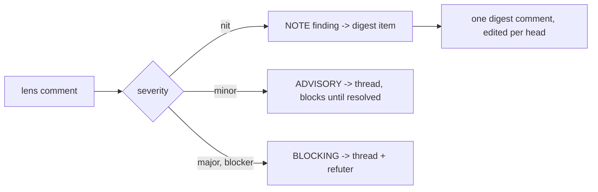

# Nits in one non-blocking comment; minor and worse open a thread

## Intent

Every comment a lens posts becomes a resolvable thread, and every open
thread blocks the merge; a nit therefore costs the author a reply and a
click, and a round of eight nits is a round. The owner decided on
2026-11-15 that nits are read, not resolved: they go into one comment
per merge request that blocks nothing, and only minor or worse opens a
thread. This amends the owner's 2026-10-25 rule "everything validated
before merge" for the `nit` severity alone, by the owner's decision.

## Context

Measured 2026-11-15 on `origin/develop` `5354767` and Yoob MR !366.

| # | Fact | Where |
|---|---|---|
| F1 | `SEVERITY_MAP` sends `minor` and `nit` to `Severity.ADVISORY`; `blocker` and `major` to `BLOCKING`. The ledger's `Severity` has two values | `src/repoach/review/findings_bridge.py:59-64`; `src/repoach/review/findings.py:90-94` |
| F2 | A reviewer whose comments are all `nit` or `minor` is auto-promoted to `APPROVE` (`[auto-promoted: nit-only]`) | `src/repoach/review/orchestrator.py:918-928` |
| F3 | Every posted comment is a positioned discussion on GitLab (`post_comment` with `path`/`line`), hence `resolvable`; the gate refuses the merge while any resolvable discussion is unresolved | `src/repoach/forge/gitlab.py:807-823`, `:352-384`; `docs/merge_gate.md:12-31` |
| F4 | On !366 the owner answered and resolved threads of every severity by hand across twelve rounds, 11, 4, 6, 6, 5, 3, 5, 5, 4, 6, 8, 8 threads a round | Yoob `tmp/REVIEW-SPEC.md` §6 |
| F5 | Owner decision 2026-11-15: nits in one non-blocking summary comment; minor or worse opens a resolvable thread; the 2026-10-25 "everything validated before merge" policy is amended for nits | brief, 2026-11-15 |

## Decisions (2026-11-15)

- D1. `Severity` gains `NOTE`; `SEVERITY_MAP["nit"] = NOTE`. A `NOTE`
  finding is recorded in the ledger like any other (fingerprint, head,
  lens, status `proposed` → `noted`, a terminal non-blocking status
  that no gate counts), never posted as its own comment, never judged
  by the refuter, never re-verified at head.
- D2. One digest comment per merge request, `format:nit-digest-comment`:
  a general (non-positioned) note on GitLab, an issue comment on
  GitHub, so neither is resolvable. It carries a marker
  `<!-- repoach:nit-digest -->`, is created at the first head that has
  a nit and edited in place at every later head: items of the current
  head under `## At <sha7>`, items of earlier heads under `## Earlier`
  with their head, each item `path:line — lens — text`, at most 40
  items (the rest counted). A nit whose cited lines changed since
  (SP-REVIEW-SETTLED-STAYS-SETTLED's `cited_region_changed`) is dropped
  from the digest at the next edit.
- D3. `minor` stays `ADVISORY`: it opens a thread, the thread blocks
  until resolved (SP-OPEN-THREADS-BLOCK-THE-MERGE unchanged), and the
  gate's advisory handling is unchanged.
- D4. The auto-promotion of F2 keeps its rule, worded `[auto-promoted:
  no blocking comment]`; the review JSON gains `nits: {count, digest_url}`.
- D5. `docs/merge_gate.md` gains a section "A nit never blocks", dated,
  naming the owner decision and the one comment.

## End state

A merge request carries at most one repoach comment that is not a
thread; it lists every nit of every round with its head; the merge
gate never counts it; an author reads it and closes nothing.

## Easy solution rejected

Post nits as threads and auto-resolve them at posting time. Rejected:
GitLab shows a resolved thread as a settled discussion, the author
cannot tell a nit from a remark the bot settled, and the forge counts a
discussion the author never read as resolved by the bot.

## Hard part

The digest is edited, not re-posted, across heads and across replays
(SP-POSTING-REPLAY-DEDUPES): the marker must be found again under a
GitLab note id or a GitHub comment id the ledger remembers
(`finding_posts` gets a `digest` provenance row), and an edit that fails
must leave the previous digest intact and say so in the report.

## Goals

- G1: a `nit` comment becomes a `NOTE` finding, recorded, never posted alone, never blocking.
- G2: one digest comment per merge request, edited in place per head, with the layout of D2 and the 40-item cap.
- G3: `minor`, `major`, `blocker` behaviour unchanged; `pytest -q tests/unit/test_gate_open_threads.py tests/unit/test_findings_bridge*.py` green with the new value.
- G4: the review JSON and the archive comment carry the nit count and the digest's URL.

## Non-Goals

- NG1: no change to the gate's thread rule for `minor` and above.
- NG2: no change to what the lenses may call a nit (the prompts' severity rubric stays).

## Assumptions

- A1: GitLab's `PUT /merge_requests/:iid/notes/:note_id` and GitHub's `PATCH /issues/comments/:id` are allowed to the bot's token (the posting barrier of SP-DRY-RUN-NEVER-POSTS treats an edit as a write).

## Interface

```python
# src/repoach/review/nit_digest.py
class NitItem(BaseModel):
    head_sha: str; path: str; line: int; lens: str; text: str

class NitDigest(BaseModel):
    pr_number: int; items: list[NitItem]; truncated: int; comment_id: str | None

def collect_nits(findings: Sequence[Finding], *, head_sha: str) -> list[NitItem]: ...
def render_digest(digest: NitDigest, *, head_sha: str) -> str: ...        # format:nit-digest-comment
def post_or_edit_digest(forge: Forge, digest: NitDigest, *, db_path: Path) -> NitDigest: ...

# findings.py (changed): Severity.NOTE; FindingStatus.NOTED
# findings_bridge.py (changed): SEVERITY_MAP["nit"] = Severity.NOTE
```

Outputs: one forge comment with the marker; review JSON key `nits`; log events `nit_digest_posted`, `nit_digest_edited`, `nit_digest_edit_failed`.

## Behavior

### Nominal
Round 1 has 3 nits and 2 minors: 2 threads open, 1 digest with 3 items
is posted. Round 2 at a new head has 1 nit: the digest is edited to
`## At <sha7>` (1 item) and `## Earlier` (3 items, their head).

### Edge cases
- 0 nits at every head → no digest, `nits.count = 0`, `digest_url = null`.
- more than 40 items → the first 40 by head then path, `… and 7 more`.
- a replay at the same head → no edit (the digest is identical), per SP-POSTING-REPLAY-DEDUPES.
- dry run → the digest is rendered in the JSON, nothing is posted.

### Failure scenarios
- the edit is refused by the forge → the previous digest stays, `nit_digest_edit_failed` is logged, the report says `nit digest not updated: <why>`; the verdict is unaffected.

## Tests

| Test | What it pins | Mutation that must turn it red |
|---|---|---|
| `tests/unit/test_nit_digest.py::test_nit_is_recorded_as_note_and_never_posted_alone` | zero positioned posts for nits | map nit to ADVISORY |
| `::test_one_digest_per_pr_edited_in_place_across_heads` | the fake forge holds one comment with the marker after two heads, two sections | post a second digest |
| `::test_cap_forty_and_count_the_rest` | D2 cap | drop the count |
| `::test_minor_still_opens_a_resolvable_thread` | D3 | map minor to NOTE |
| `::test_digest_edit_failure_keeps_the_old_comment_and_names_it` | failure scenario | raise |
| `tests/integration/test_nits_never_block_the_merge.py::test_gate_is_green_with_eight_nits_and_no_thread` | `decide_at_head` on fakes with 8 nits → no `unresolved review thread(s)` line | — |

## Success conditions

- C1: replaying !366's twelve rounds through the new bridge on the recorded comment bodies (the Yoob `REVIEW-SPEC.md` corpus) yields exactly one digest comment and N threads where N equals the count of comments with severity ≥ minor; oracle: the fake forge's comment list.
- C2: on Yoob, the first merge request reviewed after this lands shows one `repoach:nit-digest` comment and the gate's refusal lines never cite it; oracle: `repoach review gate <n>` output and the MR page.
- C3: `pytest -q tests/unit/test_gate_open_threads.py tests/unit/test_findings_bridge.py tests/unit/test_findings_bridge_docfix.py` → green.

## Architecture Impact
- Adds dependency: SP-REVIEW-NITS-ONE-COMMENT -> SP-FINDING-MODEL, SP-FINDINGS-BRIDGE-DOCFIX (a new severity value and status; the map changes)
- Adds dependency: SP-REVIEW-NITS-ONE-COMMENT -> SP-FINDING-THREAD-IDS, SP-PR-THREADS-REMEMBER-AND-CLOSE (the digest's comment id is a `finding_posts` row with its own provenance; nits open no thread)
- Adds dependency: SP-REVIEW-NITS-ONE-COMMENT -> SP-OPEN-THREADS-BLOCK-THE-MERGE (unchanged for minor and above; documented)
- Adds dependency: SP-REVIEW-NITS-ONE-COMMENT -> SP-REVIEW-POST-BATCH, SP-UNIVERSAL-FORGE, SP-POSTING-REPLAY-DEDUPES (one more post in the batch, an edit on both forges, idempotent on replay)
- No new table; `finding_posts` gains a provenance value.

## Diagram


## Acceptance Criteria
- [ ] AC1: `pytest -q tests/unit/test_nit_digest.py tests/integration/test_nits_never_block_the_merge.py` → green. Today (`5354767`): `grep -n NOTE src/repoach/review/findings.py` → 0 and every nit is a positioned discussion.
- [ ] AC2: `repoach arch check --base origin/develop` → `edge-honesty: ok`.
- [ ] AC3: `docs/merge_gate.md` carries the D5 section.

## Open Questions
- None. Decided by the owner on 2026-11-15: Q1 (`minor` in the digest) — no; `minor` opens a thread, only `nit` goes to the digest.
