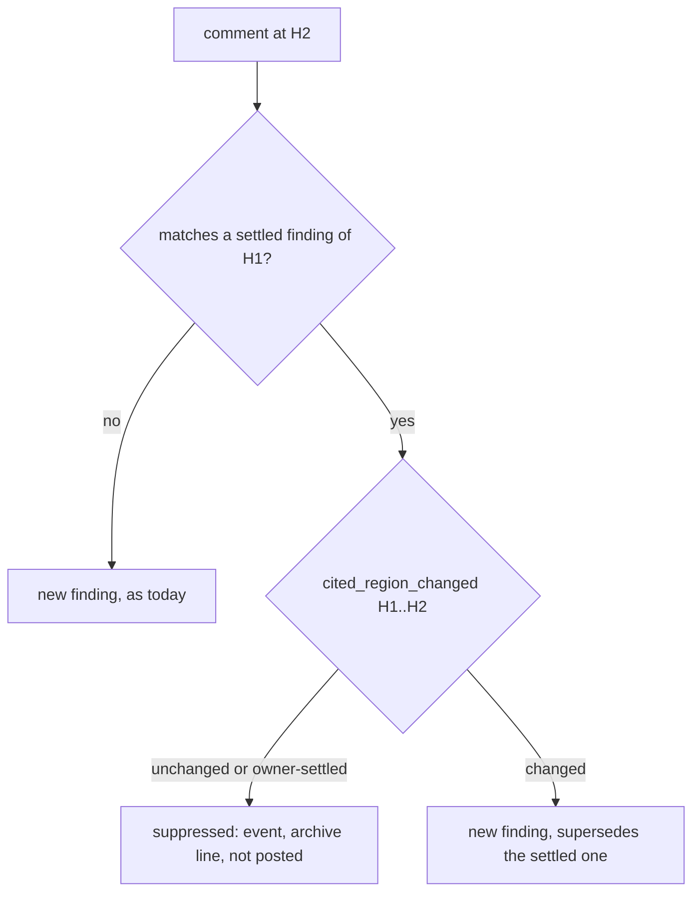

# A settled finding stays settled across heads unless the cited code changed

## Intent

The ledger de-duplicates a finding at one head: the same fingerprint at
the same head stamps the row and a refuted one is not re-opened there.
At the next head the same claim on the same unchanged lines is a new
row, and a finding refuted with a measurement in round 11 is a thread
again in round 12. After this spec a finding that was resolved, refuted
or settled by a maintainer is matched across heads, and a lens's comment
that re-raises it is recorded as a suppressed re-raise and not posted,
unless the code the finding cites changed between the two heads, where
"changed" is defined by lines and symbols, not by the diff hash of the
whole merge request.

## Context

Measured 2026-11-15 on `origin/develop` `5354767` and Yoob MR !366.

| # | Fact | Where |
|---|---|---|
| F1 | A finding's fingerprint is the SHA-256 of claim type, file, `line_start // 5` and the normalised claim; the bridge stamps an existing row at the same head and never re-opens one refuted at that head; a fingerprint refuted at **another** head is re-opened to `proposed` (`RecordedFindings.reopened`) | `src/repoach/review/findings_bridge.py:6-9`, `:47`, `:145-165`, `:168-186` |
| F2 | REFUTED is deliberately re-openable by a later re-raise, as a defence against an injected refutation | SP-REFUTER-INJECTION-HARDEN |
| F3 | `resolved_at_head` and `owner_resolved` exist as settled, non-blocking statuses; `owner_resolved` is left only by a maintainer's `/reopen` | `src/repoach/review/findings.py:97-117`; SP-GATE-REVERIFIES-AT-HEAD; SP-OWNER-SETTLES-A-FINDING |
| F4 | On !366, rounds 9–11: 15 of 18 remarks targeted code the previous fix had added; round 12: 2 of 8 re-raised points settled with a measurement in round 11 (`9a68bfc6` = `c56ed3f7`, `e3555287` settled in round 10) | Yoob `tmp/REVIEW-SPEC.md` §4, §6 |
| F5 | A fix above the cited lines shifts them; the 5-line bucket of F1 then changes the fingerprint and the same claim on the same code is a different finding | `findings_bridge.py:161` |
| F6 | Owner decision 2026-11-15 (b): a point that is resolved or refuted cannot be re-raised across heads unless the code it cites changed; define "changed" precisely | brief, 2026-11-15 |

## Decisions (2026-11-15)

- D1. Settled statuses: `refuted`, `resolved`, `resolved_at_head`,
  `owner_resolved`, `not_applicable`, `noted`. A finding in one of them
  at head H1 is a *settled finding* of the merge request.
- D2. Cross-head identity. At head H2 a new comment matches a settled
  finding when claim type, file (after following renames in
  `git diff H1..H2`) and `normalised_claim` are equal and the comment's
  `line` — the line SP-FINDING-CITES-ITS-CODE derived from the comment's
  `code` snippet, never the model's own number (0.3, 2026-11-16: that
  spec lands first in the owner's unified order, so every range this
  spec maps is an anchored one) — lies within the settled finding's
  cited range **mapped**
  through the hunks of `git diff H1..H2 -- <file>` (each hunk shifts the
  lines below it by `new_len − old_len`), with a margin of
  `cited_region_margin_lines` on each side. The 5-line bucket of F1 is
  not used across heads (F5).
- D3. Changed. `cited_region_changed(H1, H2, finding)` is true when any
  hunk of `git diff H1..H2 -- <file>` intersects
  `[line_start − 3, line_end + 3]` in H1's numbering, or the file was
  deleted or is binary, or, for a Python file, the body of the smallest
  `def` or `class` enclosing `line_start` in H1 differs textually from
  the body of the same qualified name in H2 (an `ast`-based comparison,
  so a change anywhere in the symbol counts, a change elsewhere in the
  file does not). For a non-Python file the hunk rule alone decides.
- D4. A matching comment on an unchanged region is a *re-raise*: no row
  is inserted or re-opened, a `reraise_suppressed` event is written to
  `finding_thread_events` on the settled finding, `RecordedFindings`
  gains `suppressed`, the comment is not posted, and the archive comment
  lists `n re-raises suppressed (settled at <sha7>: <claim[:80]>)`. The
  lens's own round is unaffected otherwise.
- D5. A matching comment on a changed region is a new finding at H2 as
  today, linked to the settled one (`supersedes` = its id) so the history
  block shows the lineage.
- D6. F2's defence is kept in a narrower form: a refuted finding is
  re-openable at a later head only by a comment that cites a line the
  region change of D3 covers, or by a maintainer's `/reopen`. An
  injected refutation therefore buries a claim only until the author
  touches the code it is about, which is when a reviewer should look
  again anyway; SP-REFUTER-INJECTION-HARDEN is amended to point here.
- D7. The lens is told (SP-REVIEW-REMEMBERS-EVERY-ROUND D4) that a
  settled point may be re-raised only with a new fact; the suppression
  applies regardless, so a lens cannot talk its way past it.

## End state

Round 12 of !366 would have posted 6 threads, not 8: the two re-raises
appear in the archive comment as suppressed, with the head where they
were settled and nothing for the owner to answer.

## Easy solution rejected

Use the whole-MR `diff_hash` (already in the dialogue row) and suppress
every repeat while the hash is unchanged. Rejected: the hash changes at
every head, which is exactly when re-raises happen; a per-file hash is
no better, since the fix that changes a file is what triggers the next
round's remarks on the same file's other lines. Also rejected: matching
on claim text alone, which lets a lens re-raise the same claim on code
that did change.

## Hard part

The line mapping. A fix above the cited lines shifts them, a fix inside
them changes them, a rename moves the file; the mapping through unified
hunks is the only thing that tells the first from the second, and it
must be computed from the two blobs the forge has (the merge request's
head at H1 may no longer exist locally after a force-push, so the diff is
read through the forge's compare API when the local repository lacks
H1). The Python symbol rule needs both blobs parsed; a blob that does
not parse falls back to the hunk rule and says so.

## Goals

- G1: a settled finding is matched across heads by D2, never by the 5-line bucket.
- G2: `cited_region_changed` implements D3 on both local git and the forge compare API, with the Python symbol rule.
- G3: a re-raise on an unchanged region is suppressed, recorded, named in the archive comment, and never posted; on a changed region it is a new finding with `supersedes`.
- G4: `RecordedFindings.summary_line` reports `suppressed`; the review JSON carries `findings.suppressed: [{settled_id, settled_head, claim}]`.
- G5: SP-REFUTER-INJECTION-HARDEN's "re-openable by a later re-raise" is narrowed to D6, in its spec and in the code.

## Non-Goals

- NG1: no suppression at the same head (F1's rule stands).
- NG2: no suppression of `proposed`, `verified` or `deferred` findings: an open point may be repeated, and the gate already counts it once.
- NG3: no change to what a maintainer's `/reopen` does.

## Assumptions

- A1: the forge compare endpoint is available on both forges (GitLab `repository/compare?from=H1&to=H2`, GitHub `compare/H1...H2`) and returns unified hunks per file; `SP-UNIVERSAL-FORGE` gains the method.
- A2: the Python `ast` of both blobs parses for the files the rule is applied to; otherwise the hunk rule applies and the log says `symbol rule skipped: <SyntaxError>`.

## Interface

```python
# src/repoach/review/cited_region.py
class LineMap(BaseModel):
    renamed_to: str | None; deleted: bool
    def map(self, line: int) -> int | None: ...        # None when the line was removed

def line_map(diff_text: str, path: str) -> LineMap: ...
def cited_region_changed(*, diff_text: str, blob_before: str | None, blob_after: str | None, finding: Finding, margin: int = 3) -> tuple[bool, str]: ...   # (changed, rule: "hunk" | "symbol" | "deleted" | "binary" | "unchanged")

# src/repoach/review/settled.py
SETTLED_STATUSES: frozenset[FindingStatus]
class ReraiseVerdict(BaseModel):
    settled: Finding; changed: bool; rule: str; mapped_line: int | None

def match_settled(comment, *, settled: Sequence[Finding], line_maps: Mapping[str, LineMap]) -> Finding | None: ...
def judge_reraise(comment, settled: Finding, *, diff_text, blobs) -> ReraiseVerdict: ...

# findings_bridge.py (changed): before inserting at H2, match_settled → suppressed or supersedes
# forge/protocol.py (changed): compare(base_sha, head_sha) -> Diff
```

Outputs: `finding_thread_events` rows of kind `reraise_suppressed`; `RecordedFindings.suppressed`; archive comment lines; JSON `findings.suppressed`.

## Behavior

### Nominal
Round 11 refutes `clearCredentials` at `client.ts:118-121` (H1). Round
12 at H2 raises the same claim at `client.ts:120`; `git diff H1..H2 --
client.ts` has one hunk at lines 40–52: the mapped range is unchanged,
`changed = False`, the comment is suppressed and named.

### Edge cases
- the fix touched `client.ts:119` → hunk intersects, `changed = True`, new finding with `supersedes`.
- the fix changed another method of the same class → hunk outside the range and the enclosing `def` body equal → unchanged; the enclosing `class` is not consulted when a `def` encloses the line.
- the file was renamed → followed; deleted → `changed = True (deleted)` and the claim is a new finding only if the lens cites the new location.
- the settled finding is `owner_resolved` → suppressed even on a changed region unless the maintainer `/reopen`s (the owner settled the point, not the lines); the archive line says `owner-settled`.

### Failure scenarios
- H1 is not in the local repository and the forge compare fails → no suppression at this head (fail open to posting, since suppressing on no evidence hides a finding), the log and the archive comment say `settled-matching unavailable at <sha7>: <why>`.

## Tests

| Test | What it pins | Mutation that must turn it red |
|---|---|---|
| `tests/unit/test_cited_region_changed.py::test_hunk_above_shifts_the_range_and_is_unchanged` | D2 mapping | ignore the shift |
| `::test_hunk_inside_the_margin_is_changed` | margin 3 | margin 0 |
| `::test_python_symbol_body_change_without_hunk_in_range_is_changed` | the symbol rule | drop the rule |
| `::test_other_method_change_is_unchanged` | edge case | compare the class body |
| `::test_rename_followed_delete_changed_binary_changed` | D3 | treat deleted as unchanged |
| `tests/unit/test_settled_not_reraised.py::test_reraise_on_unchanged_region_is_suppressed_recorded_and_not_posted` | D4 | post it |
| `::test_reraise_on_changed_region_is_new_with_supersedes` | D5 | suppress it |
| `::test_owner_resolved_is_suppressed_even_when_changed` | edge case | re-open |
| `::test_bucket_is_not_used_across_heads` | F5 | use the fingerprint |
| `::test_matching_unavailable_fails_open_and_names_it` | failure scenario | suppress silently |
| `tests/integration/test_366_reraises_are_suppressed.py::test_round_12_posts_six_threads_and_names_two_suppressed` | the recorded rounds 9–12 of !366 (`tests/fixtures/review/mr366_rounds.json`: findings, statuses, per-head diffs of the cited files, redacted) | — |

## Success conditions

- C1: replaying !366's rounds 9–12 through the new bridge posts, at round 12, 6 threads and names 2 suppressed re-raises whose `settled_head` is round 11's head for `9a68bfc6` and round 10's for `e3555287`; oracle: the integration test on the recorded fixture.
- C2: on the same replay, every finding of rounds 9–11 that cites code the previous fix added is **not** suppressed (15 of 18 remain findings), since the region changed; oracle: the same test's `suppressed` count equals 2 and `new` equals the recorded count.
- C3: on a live Yoob merge request, the first round that follows a maintainer's `/resolve` with a measured reply posts no thread with the same normalised claim on an unchanged region; oracle: `jq .findings.suppressed review-gate.json` lists it.
- C4: `pytest -q tests/unit/test_findings_bridge.py tests/unit/test_findings_bridge_docfix.py tests/unit/test_refuter_injection_harden.py` → green after D6.

## Architecture Impact
- Adds dependency (0.3): SP-REVIEW-SETTLED-STAYS-SETTLED -> SP-FINDING-CITES-ITS-CODE (the cited range of D2 and D3 is the anchored one, derived from the `code` snippet; a region mapped from a line the model invented would suppress or re-raise the wrong thing, so the anchor lands first)
- Adds dependency: SP-REVIEW-SETTLED-STAYS-SETTLED -> SP-FINDING-MODEL, SP-FINDINGS-BRIDGE-DOCFIX, SP-DEDUP-CLASSIFICATION-CONSTANTS (the bridge's insert path and the dedup taxonomy gain `suppressed`)
- Adds dependency: SP-REVIEW-SETTLED-STAYS-SETTLED -> SP-GATE-REVERIFIES-AT-HEAD, SP-OWNER-SETTLES-A-FINDING (the settled statuses and their owners)
- Adds dependency: SP-REVIEW-SETTLED-STAYS-SETTLED -> SP-REFUTER-INJECTION-HARDEN (its re-open rule is narrowed here, amended)
- Adds dependency: SP-REVIEW-SETTLED-STAYS-SETTLED -> SP-REVIEW-REMEMBERS-EVERY-ROUND (the lens is told the rule; the lineage shows in the history block)
- Adds dependency: SP-REVIEW-SETTLED-STAYS-SETTLED -> SP-REVIEW-PINS-HEAD, SP-POSTING-REPLAY-DEDUPES (heads are exact; a suppressed comment is never posted on replay either)
- New forge method `compare`; new event kind; no new table.

## Diagram


## Acceptance Criteria
- [ ] AC1: `pytest -q tests/unit/test_cited_region_changed.py tests/unit/test_settled_not_reraised.py` → green. Today (`5354767`): `RecordedFindings` has `reopened` and no `suppressed`; `findings_bridge.py:6-9` re-opens a fingerprint refuted at another head.
- [ ] AC2: `pytest -q tests/integration/test_366_reraises_are_suppressed.py` → green on the recorded fixture.
- [ ] AC3: `repoach arch check --base origin/develop` → `edge-honesty: ok`.
- [ ] AC4: `docs/finding_threads.md` and `docs/merge_gate.md` describe the suppression and the archive line; SP-REFUTER-INJECTION-HARDEN carries the D6 amendment.

## Open Questions
- None. Decided by the owner on 2026-11-15: Q1 (region margin) — 3 lines, the `cited_region_margin_lines` constraint; Q2 (`owner_resolved` on a changed region) — stays suppressed; only `/reopen` reopens it.
