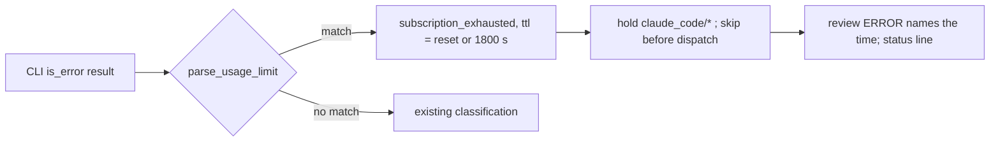

# A Claude Code usage limit is `subscription_exhausted`, not `provider_error`

## Intent

When the owner's Claude Max five-hour window ran out, the `claude` CLI
answered every request with a usage-limit result. The gateway read it
as a generic `provider_error`, struck the ref three times, quarantined
`claude_code/*` for six hours and left the review gate red, hours after
the window had reset. After this spec that answer is its own reason,
`subscription_exhausted`, it holds the whole `claude_code` provider for
the time the CLI says is left (or a short default), and the review that
loses its last hop says so in words a person can act on.

## Context

Measured 2026-11-15 on `origin/develop` `5354767`.

| # | Fact | Where |
|---|---|---|
| F1 | A non-zero CLI exit whose JSON carries `is_error` becomes `cli_result_error`, which returns `OutputCapExceededError` for `api_error == max_output_tokens` and a plain `ProviderError` for everything else, the usage-limit text included | `src/repoach/llm_proxy/providers/claude_code/client.py:86-133` |
| F2 | The failover reason of a `ProviderError` that is not an `UpstreamStatusError` is `provider_error`; a real HTTP 429 would be `rate_limited` | `src/repoach/llm_proxy/api/services.py:85-120` |
| F3 | `provider_error` is neither terminal nor quarantine-class; three consecutive strikes escalate the TTL to `breaker_ttl_quarantine_s`, 21 600 s | `src/repoach/llm_proxy/routing/breaker.py:38-75`, `:122-147`; `src/repoach/llm_proxy/config/settings.py:339-348` |
| F4 | Account-class reasons (`provider_402` …) apply to every ref of the provider at once; `provider_error` is per ref, so `claude_code/opus`, `/sonnet` and `/haiku` each pay their own three strikes | `src/repoach/llm_proxy/routing/breaker.py:66-75`; SP-BREAKER-PROVIDER-SCOPE |
| F5 | The reviewers' chains end with `claude_code/<tier>` and, while OpenRouter sits at 402 and NIM hops are tripped, it is the only hop that answers; a quarantined `claude_code` means `GatewayChainExhausted` and a review `ERROR` | `chains.env:88,98,107`; SP-REVIEW-TRANSPORT-ERROR-VERDICT |
| F6 | No fixture of the usage-limit answer exists; `tests/fixtures/claude_code/` holds `max_output_tokens.json` only | `tests/fixtures/claude_code/` |
| F7 | The transport window of SP-REVIEW-SURVIVES-TRANSPORT-FAILURES retries a short outage once at the same head; a quota that resets in two hours is not a short outage | SP-REVIEW-SURVIVES-TRANSPORT-FAILURES D6 |

## Decisions (2026-11-15)

- D1. The CLI's usage-limit answer is recognised by its `api_error`
  field when the CLI sets one, else by the result text, both pinned by
  a recorded fixture (`tests/fixtures/claude_code/usage_limit.json`,
  captured by the owner at the next limit, redacted of ids). Until the
  fixture exists the module ships with the text patterns the CLI prints
  today and the test is marked as awaiting the fixture by name, red
  on the fixture's absence past 2026-11-30 (a named condition, not a
  skip).
- D2. New failover reason `subscription_exhausted`, in
  `ACCOUNT_FAULT_REASONS` (provider-scoped: one strike holds every
  `claude_code/*` ref) and in a new `SUBSCRIPTION_REASONS` set with its
  own TTL: the reset time parsed from the answer when it carries one
  (`resets at 15:00`, `try again in 2h`), else
  `breaker_ttl_subscription_s` = 1800 s, capped at 18 000 s (the window
  is five hours). Never the six-hour quarantine, never three strikes.
- D3. The direct in-process `claude_code` provider classifies the same
  answer as `ProviderAuthError`'s sibling `SubscriptionExhaustedError`
  (`retryable = False`) with the same text, so SP-REVIEW-SURVIVES-
  TRANSPORT-FAILURES does not retry it (F7).
- D4. The review that loses its last hop to this reason ends `ERROR`
  with `subscription exhausted on claude_code until 15:00 CET (the
  CLI's own answer); no metered hop configured` and the archive comment
  carries the sentence; `chain-status` and `/health` show
  `claude_code: subscription_exhausted until 15:00`.

## End state

The owner reads `review:gate` red and sees, in the job log and on the
merge request, that his subscription window is the cause and when it
ends; the gateway lets the first request through at that time, not six
hours later; and once SP-REVIEW-CHAINS-ANTHROPIC-FIRST lands, the
metered hop runs ahead of the subscription so the case stops occurring
in the gate at all.

## Easy solution rejected

Lower `breaker_quarantine_threshold` or shorten `breaker_ttl_quarantine_s`.
Rejected: both change every provider's behaviour to fix one answer that
has its own meaning and its own reset time; the quarantine thresholds
exist for dead NIM functions and bad model ids, which do heal in six
hours or never.

## Hard part

The CLI's answer is text, not a status code, and its wording has
changed across CLI releases (#288 was the same lesson for the output
cap). The classifier must be pinned to a recorded fixture, with the
patterns kept in one module and a test that fails loudly when a fixture
is missing instead of passing on an invented string.

## Goals

- G1: the usage-limit answer produces reason `subscription_exhausted`, holds every `claude_code/*` ref at once, for the parsed reset time else 1800 s, never longer than 18 000 s.
- G2: it never counts toward the three-strike quarantine escalation.
- G3: the review verdict, the archive comment, `chain-status` and `/health` name it with the time.
- G4: the in-process `claude_code` provider raises `SubscriptionExhaustedError`, not retried.

## Non-Goals

- NG1: no change to the chains (SP-REVIEW-CHAINS-ANTHROPIC-FIRST).
- NG2: no polling of the subscription's remaining quota; the CLI's answer is the only source.
- NG3: no change to how a real HTTP 429 (`rate_limited`) is treated.

## Assumptions

- A1: the CLI keeps answering the limit as a JSON result with `is_error` and a sentence that names a reset time or a wait; the fixture pins the current form.

## Interface

```python
# src/repoach/llm_proxy/providers/claude_code/usage_limit.py
class UsageLimit(BaseModel):
    reason: Literal["subscription_exhausted"]
    resets_at: datetime | None
    ttl_s: float                 # parsed or default, capped
    message: str

def parse_usage_limit(payload: Mapping[str, Any], *, now: datetime) -> UsageLimit | None: ...

# client.py (changed): cli_result_error returns SubscriptionExhaustedError(message, resets_at=...) when parse_usage_limit matches
# breaker.py (changed): SUBSCRIPTION_REASONS = {"subscription_exhausted"}; ACCOUNT_FAULT_REASONS gains it; ttl_for() reads the error's ttl_s
# providers/errors.py (changed): class SubscriptionExhaustedError(GatewayError): retryable = False; resets_at
```

Outputs: failover reason `subscription_exhausted`; log event `claude_code_subscription_exhausted` with `resets_at`; health and status lines of D4.

## Behavior

### Nominal
The CLI answers the limit at 13:02 with `resets at 15:00`: the breaker
holds `claude_code/*` until 15:00; a request at 14:59 is skipped before
dispatch with the reason; at 15:00 the first request is dispatched.

### Edge cases
- the answer names no time → TTL 1800 s; the review line says `until about 13:32 (default; the CLI named no time)`.
- a parsed time more than five hours away → capped at 18 000 s, the cap named in the log.
- a metered hop exists ahead in the chain → the chain was served by it and this answer is never seen; nothing changes.

### Failure scenarios
- the fixture is absent past 2026-11-30 → `test_fixture_present_by_the_named_date` is red, naming the owner task.

## Tests

| Test | What it pins | Mutation that must turn it red |
|---|---|---|
| `tests/unit/test_claude_code_usage_limit.py::test_fixture_answer_is_subscription_exhausted_with_the_parsed_reset` | the recorded fixture → reason, `resets_at` | return `provider_error` |
| `::test_holds_every_claude_code_ref_at_once` | one strike on `/opus` skips `/sonnet` and `/haiku` | keep it per ref |
| `::test_never_escalates_to_the_six_hour_quarantine` | three strikes → TTL still the parsed one | count it in `escalated_ttl` |
| `::test_default_and_cap` | 1800 s without a time; 18 000 s cap | drop the cap |
| `::test_review_error_line_and_status_line_name_the_time` | D4 wording on fakes | print `provider_error` |
| `::test_direct_provider_raises_not_retryable` | D3 | `retryable = True` |
| `::test_fixture_present_by_the_named_date` | D1 | — |

## Success conditions

- C1: replaying the recorded fixture through the gateway's failover path yields reason `subscription_exhausted` and a breaker TTL equal to the fixture's reset time minus the fake clock; oracle: `chain-status` output on the fake state matches `claude_code: subscription_exhausted until <time>`.
- C2: with the fixture answered three times in a row, no `claude_code` ref is held longer than the parsed time; oracle: `breaker.until(ref)` for the three refs equals the parsed time ± 1 s.
- C3: `pytest -q tests/unit/test_breaker_provider_scope.py tests/unit/test_chain_dead_hop_quarantine.py` stay green with the new reason set.

## Architecture Impact
- Adds dependency: SP-SUBSCRIPTION-LIMIT-IS-NAMED -> SP-CLAUDE-CODE-FIRST-CLASS (the CLI client's error builders are changed)
- Adds dependency: SP-SUBSCRIPTION-LIMIT-IS-NAMED -> SP-BREAKER-PROVIDER-SCOPE, SP-CHAIN-DEAD-HOP-QUARANTINE, SP-FAILOVER-SKIPS-BLOCKED-PROVIDER (a new provider-scoped reason with its own TTL, skipped before dispatch)
- Adds dependency: SP-SUBSCRIPTION-LIMIT-IS-NAMED -> SP-REVIEW-TRANSPORT-ERROR-VERDICT, SP-REVIEW-SURVIVES-TRANSPORT-FAILURES (named `ERROR`, not retried)
- Adds dependency: SP-SUBSCRIPTION-LIMIT-IS-NAMED -> SP-CHAIN-STATUS-DIGEST (the status line)
- No table, no cycle.

## Diagram


## Acceptance Criteria
- [ ] AC1: `pytest -q tests/unit/test_claude_code_usage_limit.py` → green. Today (`5354767`): the file and the fixture do not exist; `grep -rn subscription_exhausted src/` → 0.
- [ ] AC2: `repoach arch check --base origin/develop` → `edge-honesty: ok`.
- [ ] AC3: `docs/merge_gate.md` names the reason and its TTL rule next to the transport-failure section.

## Open Questions
- None. Decided by the owner on 2026-11-15: Q1 (default hold when the CLI names no time) — 1800 s, capped at 18 000 s; Q2 (the fixture) — recorded by the owner at the next limit with `repoach chain-status --capture-last-error`, never invented.
