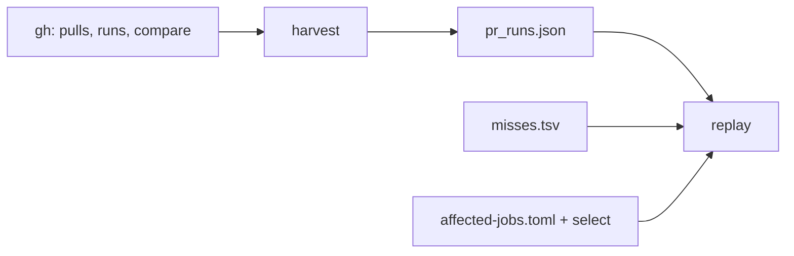

# A failed job the table would have skipped becomes a row

## Intent

A narrowed pull request is only as safe as the table that narrows it,
and the table is only as good as the misses it has been confronted
with. This spec gives the table a harvest: `repoach ci affected harvest`
reads the merged pull requests from GitHub, pairs each `CI` head's
changed paths with the jobs that failed at it, rewrites the corpus the
replay test reads, and names every pair the table would not have
selected. A miss found later, on `develop`, on `main` or on the release pull request,
enters a committed table with a verdict before anything else is fixed,
and the replay is red until the table selects it.

## Context

Measured 2026-11-16 on `origin/develop` `f16702b`.

| # | Fact | Where |
|---|---|---|
| F1 | The corpus of SP-AFFECTED-JOBS-TABLE F7 was harvested by a session script: `gh pr list --state all --base develop --limit 30 --json number,files`, then per head branch `gh run list --event pull_request --json databaseId,conclusion,headSha` and `gh run view <id> --json jobs`; the paths were the pull request's files at harvest time, not per head | this spec's ancestor; `tests/fixtures/affected_jobs/pr_runs.json` (SP-AFFECTED-JOBS-TABLE) |
| F2 | Per-head paths exist on the forge: `gh api repos/{owner}/{repo}/compare/{base}...{head}` lists `files[].filename` (and `previous_filename` on a rename) against the merge base of `base` and `head`, so a head's diff is read even after the base moved | GitHub REST, `compare two commits` |
| F3 | 15 failed `CI` jobs on 167 heads; `jobs[].conclusion == "failure"` with `steps[].conclusion` naming `Pytest`, `Pytest — integration` or the smoke's `pipx install`; a cancelled job (`cancelled`, 7 runs) is a cancelled run, never a judgement | `gh run view --json jobs` over the corpus |
| F4 | `ci.yml` runs on `push` to `main` and on the release pull request with the full set; `develop` runs no `CI` on push today. Owner decision 2026-11-16 (SP-PR-RUNS-AFFECTED-JOBS O2): SP-CI-JOBS-NO-OP-WHEN-NOT-AFFECTED re-enables `push: develop` with the full set, so a miss is seen at the merge | `.github/workflows/ci.yml:4-11` |
| F5 | SP-RED-STOPS-THE-LINE: a red gate stops every other worksite until a corrective spec exists; `repoach release gate` is the release pull request's gate | `docs/specs/2026-10-25_SP-RED-STOPS-THE-LINE_*.md`; `src/repoach/cli/release_cmds.py` |

## Decisions (2026-11-16)

- D1. A miss is a `(head_sha, job name)` pair where the job concluded
  `failure` on a `pull_request` run of `CI` and `select(paths of the
  head)` of SP-AFFECTED-JOBS-TABLE does not hold the job's id. A
  `cancelled` job is never a miss. `gate` is never a miss (it always
  runs).
- D2. `harvest --merged N` rewrites `tests/fixtures/affected_jobs/pr_runs.json`
  from the forge: for the last `N` pull requests merged into the
  integration branch, every completed `pull_request` run of `CI` with
  its head, the head's paths read through `compare` (F2), and each
  job's name, conclusion and failed steps; scrubbed of every URL and
  token (only `repoachhq/repoach`, numbers, shas, paths and job names
  remain). It prints `misses: <new>/<failed jobs>` and exits 1 on a
  new miss, naming each `MISS #<pr> run <id> <job> paths <first three>…`;
  exit 2 when `gh` fails, the file untouched.
- D3. `tests/fixtures/affected_jobs/misses.tsv`, `format:affected-jobs-misses`,
  tab-separated, header `pr	run	head_sha	job	verdict	paths	note`,
  one row per `(run, job)`, sorted by `pr`, `run`, `job`; `verdict` in
  `{miss, conflict, external}`; `paths` is `;`-joined. `record --pr
  --run --job --verdict --note` appends a row (exit 1 on a duplicate
  key); `replay` prints every `miss` row whose job `select(paths)` does
  not hold and every row of `pr_runs.json` whose failed job is not
  selected, exit 1 if any, else `misses: 0/<failed jobs>`. `conflict`
  and `external` rows are printed with their verdict and never fail
  the replay. The table is append-only.
- D4. The procedure, written in `docs/merge_gate.md` under "A red
  after a narrowed green": (1) the line stops (F5); (2) `repoach ci
  affected record` with the verdict — `miss` when the job the table
  skipped would have failed on the pull request's own diff, `conflict`
  when two green pull requests fail together on `main`, `external`
  when the input is outside the diff (a feed, a registry, a flaky
  suite); (3) a `miss` widens a row of `.github/affected-jobs.toml` in
  its own pull request, with `replay` red before and green after,
  merged before any code fix; (4) the code fix on its own branch.
- D5. The harvest runs by hand and from `repoach release gate` as a
  report line (`affected-jobs misses: <new>/<failed>` over the last 30
  merged pull requests), never as a refusal of the release.

## End state

`repoach ci affected harvest --merged 30` regenerates the corpus from
the forge in one command and says `misses: 0/15` today; `repoach ci
affected replay` is what `tests/unit/test_affected_misses.py` calls;
`misses.tsv` holds its header and no row, and the procedure that fills
it is written where the merge gate's other rules are.

## Easy solution rejected

Treat a red on `main` after a narrowed green as an ordinary
regression: fix the code, re-run, move on. Rejected: the code was green
on the pull request for the jobs that ran; the defect that let it merge
is in the table, and fixing only the code leaves the next pull request
the same hole. The miss has to change the table, and the only way to
know the table changed is a replayed row.

Also rejected: a harvest that reads the pull request's final file list
(what F1 did). It was good enough to measure, since every failed job of
the corpus sat on a pull request whose every head touched `src/` or
`tests/`, but a head that failed before a later push added the tree the
table selects on would be hidden by it; the harvest reads per head (F2).

## Hard part

Attribution. On `main` and on the release pull request the full set
judges the merge of many pull requests at once, so a red there may be a
miss of one table row, a semantic conflict between two green pull
requests, or an input outside every diff; no table selects for the
last two. The row's author writes which it was, the replay judges `miss`
rows only, and the rate of each verdict stays readable. The harvest
also has to tell a judgement from a death: `failure` on a `Pytest` step
is a judgement, `cancelled` is a cancelled run, and a job skipped by the
actor allowlist (a fork's pull request) is neither — it is excluded with
its reason in the report.

## Goals

- G1: the corpus is regenerable from the forge in one command, per head, scrubbed; today's harvest prints `misses: 0/15`.
- G2: the replay is a test and a command, and a `miss` row is red until the table selects it.
- G3: a red after a narrowed green has one written procedure, ending in a row.

## Non-Goals

- NG1: no automatic edit of the table; the harvest names, a human or an agent widens, the replay proves.
- NG2: no scheduled harvest; the release gate reports, the procedure records.
- NG3: no change to `autofix`, `notify` or the merge gate's refusals.

## Assumptions

- A1: `gh` is authenticated on the machine that harvests (the owner's, or the release gate's runner).
- A2: GitHub keeps `pull_request` runs of `CI` for the harvest window (90 days of logs; the run and job metadata longer).

## Interface

```python
# src/repoach/affected/harvest.py
class HeadRun(BaseModel):
    pr: int; run: int; head_sha: str; paths: list[str]; jobs: list[JobOutcome]   # JobOutcome: name, conclusion, failed_steps
def harvest(repo: str, *, merged: int, base: str, gh: Callable[..., str]) -> list[HeadRun]: ...   # F2 per head; raises HarvestError naming the gh command on failure
def write_corpus(runs: Sequence[HeadRun], path: Path) -> None: ...   # atomic: temp file then replace, never a truncated corpus

# src/repoach/affected/misses.py
class MissRow(BaseModel):
    pr: int; run: int; head_sha: str; job: str; verdict: Literal["miss", "conflict", "external"]; paths: list[str]; note: str
def load_misses(path: Path) -> list[MissRow]: ...        # refuses an unknown verdict, a duplicate key, an unsorted file
def replay(corpus: Sequence[HeadRun], misses: Sequence[MissRow], table: AffectedTable, needs: Mapping[str, frozenset[str]]) -> ReplayReport: ...

# repoach ci affected harvest --merged 30 [--repo repoachhq/repoach] [--out tests/fixtures/affected_jobs/pr_runs.json]
# repoach ci affected record --pr N --run ID --job NAME --verdict miss|conflict|external --note TEXT [--paths a;b]
# repoach ci affected replay [--corpus …] [--misses …]
```

Stdout: one JSON object per command (`SP-CLI-STDOUT-ONE-JSON`); the
`MISS` lines and `misses: n/m` on stderr. Exit codes: 0; 1 a miss
(harvest, replay) or a duplicate (record); 2 the forge or a file refused,
nothing written.

## Behavior

### Nominal
`harvest --merged 30` walks the merged pull requests newest first,
reads each head's paths and jobs, writes the corpus, replays it against
the table and prints `misses: 0/15`. `replay` on the committed corpus
and the empty misses table exits 0.

### Edge cases
- a job failed then passed on a re-run at the same head → the failure counts: a job the table would have skipped is still a job it would have skipped.
- a run skipped by the actor allowlist (every job `skipped`) → excluded, counted as `not admitted` in the report.
- the same head on two pull requests (a stacked branch) → one `HeadRun` per `(pr, run)`.
- a `conflict` or `external` row whose job the table now selects → kept, printed with its verdict; nothing to prove.

### Failure scenarios
- `gh` unauthenticated or rate-limited → exit 2 with the first line of its stderr, corpus untouched.
- `misses.tsv` names a job `ci.yml` no longer defines → `test_the_misses_table_is_well_formed` red with the name; the row is kept and its `note` says what the job became.
- a `compare` answer truncated (`files` at the 300-file cap) → that head is recorded with `paths_truncated: true` and the replay treats it as full class (every job selected), printed as such, so a truncated head can never be a false miss nor a false pass.

## Tests

| # | File | Test | Mutation that turns it red |
|---|---|---|---|
| T1 | `tests/unit/test_affected_misses.py` | `replay` over the committed corpus and table → `misses: 0/15` | remove `tests/` from the python row |
| T2 | same | `harvest` on a recorded `gh` fixture under `tests/fixtures/affected_jobs/harvest/` (two pull requests, three heads: one miss, one cancelled job, one not-admitted run) writes exactly the heads admitted, exit 1, one `MISS` line | count the cancelled job |
| T3 | same | `write_corpus` on a failing `gh` leaves the previous file byte-identical | write before the fetch completes |
| T4 | same | the misses table is well formed: header, sort, unique keys, verdict vocabulary, jobs defined in `ci.yml` | shuffle two rows; invent a verdict |
| T5 | same | a `conflict` or `external` row never fails the replay; a `miss` row whose job is unselected does | treat `external` as `miss` |
| T6 | same | `record` refuses a duplicate `(run, job)` with exit 1; appends otherwise, sorted | append anyway |
| T7 | same | a head with `paths_truncated` is replayed as the full class and printed | replay it as its listed paths |

## Success conditions

- C1 (external oracle: the forge): `repoach ci affected harvest --merged 30` on the branch exits 0, prints `misses: 0/<n>`, and `git diff --stat tests/fixtures/affected_jobs/pr_runs.json` after it shows only per-head path differences against the session corpus (the verifier reads the diff and names two heads whose paths changed and why).
- C2: `repoach ci affected replay` exits 0; after `repoach ci affected record --pr 0 --run 0 --job "Test suite (Python 3.11)" --verdict miss --paths docs/x.md --note probe` it exits 1 naming the row, and `git checkout tests/fixtures/affected_jobs/misses.tsv` restores it.
- C3: `docs/merge_gate.md` has the four-step section of D4; `pytest -q tests/unit/test_affected_misses.py` green with T1–T7 in `-v`; `repoach arch check --base origin/develop` → `edge-honesty: ok`.

## Architecture Impact
- Adds dependency: SP-AFFECTED-JOBS-MISSES-ARE-TEST-CASES -> SP-AFFECTED-JOBS-TABLE (`select`, `load_table`, the corpus format)
- Adds dependency: SP-AFFECTED-JOBS-MISSES-ARE-TEST-CASES -> SP-CLI-STDOUT-ONE-JSON
- New resource: `format:affected-jobs-misses`. `gh` is called through `subprocess`, as the lint scripts do; no import from `forge`. No cycle.

## Diagram


## Acceptance Criteria
- [ ] AC1: `pytest -q tests/unit/test_affected_misses.py` → green. Today (`f16702b`): no such file.
- [ ] AC2: `repoach ci affected replay` → exit 0, `misses: 0/15` on stderr.
- [ ] AC3: `docs/merge_gate.md` carries the section of D4, dated.
- [ ] AC4: `repoach arch check --base origin/develop` → `edge-honesty: ok`.

## Open Questions
- None. The harvest window is 30 pull requests and the release gate reports, never refuses (D5), from the Yoob precedent (SP-MATRIX-MISSES-ARE-TEST-CASES Q1); the owner approved the family on 2026-11-16 with the umbrella's four decisions and raised nothing against it.
