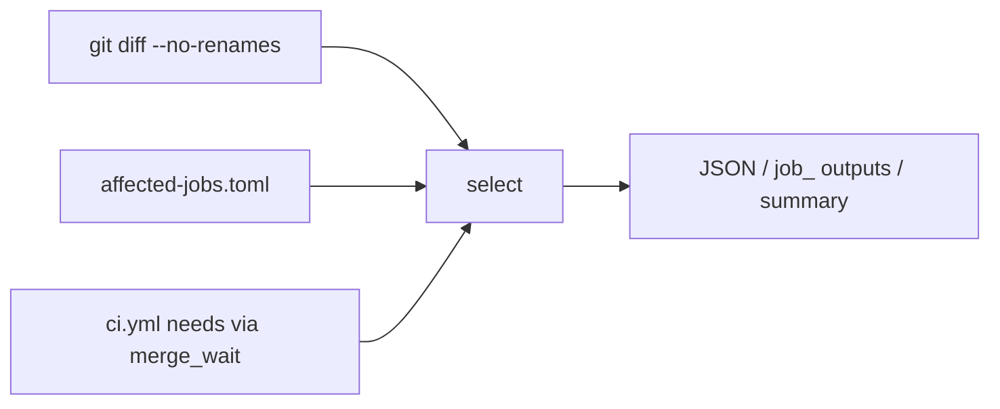

# One path-to-job table, read by `repoach ci affected`

## Intent

The jobs a diff affects are decided in one place, a TOML table under
`.github/`, by one reader, `repoach ci affected select`, which the
workflow, the local mirror and the replay all call. The table matches
paths with two primitives and no glob dialect, names a job only by the
id `ci.yml` gives it, is closed under the workflow's `needs`, and
treats a path it does not know as affecting everything. Nothing in this
spec changes what a pull request runs: the workflow reads the selection
only when SP-CI-JOBS-NO-OP-WHEN-NOT-AFFECTED lands.

## Context

Measured 2026-11-16 on `origin/develop` `f16702b`.

| # | Fact | Where |
|---|---|---|
| F1 | `ci.yml` has three jobs, `test` (matrix `python-version: ["3.11", "3.13"]`, name `Test suite (Python ${{ matrix.python-version }})`), `wheel-build`, `wheel-smoke` (same matrix, `needs: wheel-build`); the only `needs` edge is the smoke's | `.github/workflows/ci.yml:27-40,118-123,151-158` |
| F2 | The check names repoach requires are derived from that file, matrix expanded, by `_expand_job_names` and `workflow_checks`, which read the YAML with PyYAML. In 0.3 this spec extracts that read into `merge_wait.load_workflow(path)`, which `workflow_checks` now calls, and renames `_expand_job_names` to the public `expand_job_names`. `select.workflow_jobs` and `select.check_name_jobs` call both, so job ids, `needs` and check names come from one loader | `src/repoach/review/merge_wait.py:240-296` |
| F3 | The wheel packages `src/repoach`, `prompts` (as `repoach/prompts`) and `docs/specs/_TEMPLATE.md` (as `repoach/project/spec_template.md`); its metadata reads `README.md` and `LICENSE`; `wheel-build` runs `twine check` | `pyproject.toml:6-9,88-93`; `.github/workflows/ci.yml:136-140` |
| F4 | 59 test modules resolve the repository root; after it they read `.github/workflows` (15), `src` (8), `scripts/*` (10), `pyproject.toml` (4), `docs/specs` (4: `test_arch_graph.py` and the governance suites), `prompts/review` (2), `chains.env` (2), `.env.example`, `docs/PR_TEMPLATE.md`, `.github/pull_request_template.md`, `.claude/hooks/dream_check.py`, `.claude/commands/dream.md`; `tests/unit/test_claude_md_integration_flag.py:6` reads `Path("CLAUDE.md")` from the working directory | `grep -o 'parents\[2\] */ *"[^"]*"' tests/unit/*.py tests/integration/*.py` |
| F5 | Tracked entries outside `src/`, `tests/`, `docs/`, `scripts/`, `prompts/`, `deploy/`, `bench/`, `licenses/`, `assets/`: `.claude/` (commands, hooks, scripts, skills, settings), `.githooks/` (three hooks), `.github/` (issue templates, the pull request template, seven workflows), `.env.example`, `.gitignore`, `CLAUDE.md`, `CODE_OF_CONDUCT.md`, `CONTRIBUTING.md`, `LICENSE`, `README.md`, `SECURITY.md`, `chains.env`, `pyproject.toml`, `repoach.toml`, `tmp/.gitkeep` | `git ls-files` |
| F6 | Shell scripts live under `scripts/` (4) and `.claude/scripts/` (2); `ShellCheck` lints `git ls-files '*.sh'` in its own workflow | `git ls-files '*.sh'`; `.github/workflows/shellcheck.yml:49-61` |
| F7 | The last 30 pull requests into `develop` (#260–#296): 8 docs-only, 2 one-test-file, 15 `src/` + `tests/`, 5 touching `.github/`; 167 `CI` heads; 15 failed `CI` jobs, all on pull requests touching `src/` or `tests/`: 13 `Test suite` legs (`Pytest` or `Pytest — integration`) and `wheel-smoke (3.11)` once (#275, head `7a7a048`). Against the table of D2 (paths read with `gh pr list --json files`): 0 misses. The 167/15 counts came from `gh run list` at its default limit of 20 runs per head branch. The committed corpus (0.3) was harvested with `gh run list --event pull_request --workflow CI --limit 200` per head branch, keeping every completed run: 190 heads, 45 failed `CI` jobs (42 `Test suite` legs, `wheel-smoke (3.13)` twice on #275, `wheel-smoke (3.11)` once on #275 at `7a7a048`), 0 misses | `tests/fixtures/affected_jobs/pr_runs.json`, harvested 2026-11-16 |
| F8 | `[repoach].integration_branch` and `release_branch` are project settings (`develop`, `main` by default); `load_project_config` refuses an unknown key | `src/repoach/project/config.py:190-192,231-232` |
| F9 | `scripts/ci_local.sh` mirrors `ci.yml` with `--fast`, `--tests`, `--integration`, `--wheel`; it has no notion of a diff | `scripts/ci_local.sh:1-49` |
| F10 | Yoob's matrix spec spent four review rounds on glob dialects (`gitlab_globs.py`, `GlobSyntaxError`) and on facts declared twice; its lessons: no hand-rolled parser for a foreign syntax, one declared value for every environment fact, every guard judges the invariant | Yoob `docs/specs/2026-11-15_SP-JOB-MATRIX-ONE-SOURCE-RENDERED-TO-CI_*.md`, "Interface" 0.2–0.5 |

## Decisions (2026-11-16)

- D1. A row is `{prefixes, suffixes, jobs, reason}`. A path matches a
  prefix that ends in `/` when it starts with it, any other prefix when
  it equals it, and a suffix when it ends with it. There is no other
  matching rule and no glob. `jobs` names job ids of `ci.yml`
  (`test`, `wheel-build`, `wheel-smoke`); `reason` is one sentence.
- D2. The table, `.github/affected-jobs.toml`, `format:affected-jobs`,
  as committed by this spec:

```toml
version = 1

[gate]
pytest = [
  "tests/unit/test_arch_graph.py",
  "tests/unit/test_claude_md_integration_flag.py",
  "tests/unit/test_edge_honesty.py",
  "tests/unit/test_pr_template_measured.py",
  "tests/unit/test_spec_supersede.py",
  "tests/unit/test_spec_template.py",
]

[rows.docs]
prefixes = ["docs/", "assets/", "licenses/", "LICENSE", "README.md", "CONTRIBUTING.md", "CODE_OF_CONDUCT.md", "SECURITY.md", "CLAUDE.md", "tmp/"]
jobs = []
reason = "pages, specs and licences are judged by the gate: arch check, the CONTRIBUTING and attribution lints, and the tree suites above"

[rows.python]
prefixes = ["src/", "tests/", "scripts/", "prompts/", "bench/", "deploy/", ".claude/", ".githooks/", "chains.env", ".env.example", "repoach.toml"]
jobs = ["test"]
reason = "the suite imports src, runs the scripts, reads the prompts, chains.env, .env.example, repoach.toml and the .claude hooks"

[rows.wheel]
prefixes = ["src/", "prompts/", "docs/specs/_TEMPLATE.md", "pyproject.toml", "README.md", "LICENSE", "scripts/wheel_smoke.sh"]
jobs = ["wheel-build", "wheel-smoke"]
reason = "what the wheel packages and its metadata, and the smoke script"

[full]
prefixes = [".github/", "pyproject.toml", ".gitignore"]
reason = "the workflows, this table, the build and test configuration: everything runs"
```

  The `[gate].pytest` list above is the one the guard of D5 computes
  (0.3, measured on `c9f61dd`). Version 0.2 proposed nine entries. Five of
  them are not tree judges, and two judges were missing:
  - `test_arch_foreign_frontmatter.py`, `test_spec_presence.py`,
    `test_governed_spec.py`: removed. They build their specs under
    `tmp_path` and read no repository path from the root.
  - `test_affected_table.py`, `test_affected_tree_judges.py`: removed.
    They read `.github/affected-jobs.toml` (`[full]`) and `tests/`
    (python row). Both select `test`, so the guard refuses them as
    `[gate].pytest` entries.
  - `test_edge_honesty.py`: added. It reads `docs/specs` from the root
    (`load_registry(_REPO_ROOT / "docs" / "specs")`).
  - `test_spec_supersede.py`: added. It has `Path("README.md")`, a
    root-file literal under D5. It joins that literal onto a temporary
    repository, so this is a conservative inclusion of a cheap module.
  - Kept: `test_arch_graph.py` (`docs/specs`), `test_spec_template.py`
    (`docs/specs/_TEMPLATE.md`), `test_pr_template_measured.py`
    (`docs/PR_TEMPLATE.md`), `test_claude_md_integration_flag.py`
    (`Path("CLAUDE.md")`).
- D3. The selection of a list of paths: a path matching `[full]`, or
  matching no row, selects every job of `ci.yml`; otherwise the union
  of its rows' jobs; then the closure under every `needs`
  edges of `ci.yml`, read with PyYAML through the same loader as F2
  (a selected `wheel-smoke` selects `wheel-build`); `gate` is always
  selected. An empty list selects `gate` alone.
- D4. The mode: `narrowed` when the event is a `pull_request` whose
  base is `[repoach].integration_branch`; `full` otherwise (`push`,
  `workflow_dispatch`, a pull request to the release branch), with the
  reason `full: <event> on <base or ref>`. The event and the base come
  from the caller (`--event`, `--base-ref`), never from `GITHUB_*`
  read inside the module. The paths are
  `git diff --name-only --no-renames <merge-base of base and head> <head>`:
  both names of a rename, deletions included.
- D5. Tree judges. A test module under `tests/` that reads a repository
  path from the root (an expression chain `Path(__file__).resolve().parents[2] / "…"`
  or a name bound to it, found with `ast`, or `Path("<root file>")`)
  is a tree judge for the paths it reads. A name binding is resolved
  in its own scope, and a local rebinding shadows it.
  The guard `test_affected_tree_judges.py` works as follows:
  - For every judge, it takes each tracked file under each path the
    judge reads and runs `select([file])` on it.
  - It checks that selection against the jobs whose `pytest` step in
    `ci.yml` names the judge's test directory. A file whose selection
    holds none of those jobs is seen only by `gate`. That file's
    readers form the gate class. The docs row is in it, and so is
    `README.md`, which selects only the wheel jobs.
  - It refuses three things:
    - a judge of the gate class that `[gate].pytest` does not name;
    - a judge path with no tracked file under it, or with a tracked
      file that matches no row (an unclassified tree);
    - a `[gate].pytest` entry that is not a judge of the gate class.
  - It reads test sources with `ast`, never with a regular expression
    over Python.
- D6. Every tracked path (`git ls-files`) matches a row or `[full]`;
  `test_every_tracked_path_is_classified` names the first that does
  not. A new top-level tree is therefore a red test, not a silent
  full-set run.
- D7. `scripts/ci_local.sh --affected [<base>]` runs the mirror for the
  selection `repoach ci affected select --base <base>` returns, and
  prints the selection first.
  - `gate` always runs the arch check, the two lints and `[gate].pytest`.
  - `test` adds the lint, pytest and smoke blocks.
  - `wheel-*` adds the `--wheel` block.
  - Without `<base>`, the script reads it from
    `repoach ci affected base` (`origin/<[repoach].integration_branch>`).
    The attribution lint of the other modes reads its range base from
    there too, so the script carries no branch name.
  - The wheel block refuses by name, as a failed gate, when `build` or
    `twine` is not importable or `pipx` is not on `PATH`. `ci.yml`
    installs those three in its own jobs. Every other flag is unchanged.

## End state

`.github/affected-jobs.toml` is the one place that says which paths
affect which jobs. `repoach ci affected select --base origin/develop`
prints the selection of the working tree as one JSON object;
`--github-output <file>` writes one `job_<id>=true|false` line per job
of `ci.yml` and `mode=…`; `--summary <file>` appends a markdown table
(rows hit, jobs selected, the reason) for a step summary. The replay
over the last 30 pull requests selects every job that failed. The
workflow still runs everything until the third child.

## Easy solution rejected

Globs in the table (`docs/**`, `**/*.sh`). Rejected on F10: a glob
needs a dialect, a dialect needs a matcher and a syntax error, and the
matcher is a parser we would write for a syntax that is not ours.
Prefix and suffix cover every row of D2 (F5–F6), a suffix row exists
for the day shell scripts need one, and the two primitives are twelve
lines with a table test.

Also rejected: the table as a `[ci.affected]` section of `repoach.toml`.
`repoach.toml` is read by every installed repoach, and an older one
refuses an unknown key (F8; `repoach.toml:80-81` keeps `[auto_merge]`
commented for that reason); a file of its own under `.github/` is read
by nothing older than this spec.

## Hard part

Knowing what a test reads. The suite judges the tree from the outside
in 59 modules (F4): a documentation diff can redden `test_arch_graph.py`
through `docs/specs`, and a `prompts/` diff can redden a fixture test.
The docs class is honest only if the `gate` runs exactly the suites
that read the docs class, and the python class is honest only if every
tree a test reads is in a row that selects `test`. The guard of D5
derives both from the test sources with `ast`; the table does not
guess. The second hard part is the wheel (F3): `prompts/` and the spec
template ship inside it, so a prompt edit must run `wheel-build` and
the smokes, which is a row no one would write from the directory
names.

## Goals

- G1: one file, one reader, two primitives; the table of D2 committed and classified to the last tracked path (D6).
- G2: the selection is closed under `needs` and never narrower than the rows say (D3); an unknown path is every job.
- G3: the replay of F7 selects every failed job of every head; the fixture is committed, scrubbed of tokens and URLs beyond `repoachhq/repoach`.
- G4: the tree-judge guard holds (D5); `[gate].pytest` is derived, not written.
- G5: the mirror has `--affected` (D7) and `repoach ci affected select` works from any checkout with `git` on `PATH`.

## Non-Goals

- NG1: no change to `.github/workflows/*` (SP-CI-JOBS-NO-OP-WHEN-NOT-AFFECTED).
- NG2: no harvest from the forge, no misses table (SP-AFFECTED-JOBS-MISSES-ARE-TEST-CASES); this spec ships the first corpus as recorded by the session that wrote it.
- NG3: no change to which tests exist or where they read; a tree judge that the guard names is classified, not moved.

## Assumptions

- A1: `ci.yml` keeps naming its jobs `test`, `wheel-build`, `wheel-smoke`; the third child adds `gate` and the table names no other id.
- A2: PyYAML stays a dependency (it is, for `merge_wait.workflow_checks`).

## Interface

```python
# src/repoach/affected/table.py
TABLE_VERSION = 1; DEFAULT_TABLE_PATH = ".github/affected-jobs.toml"; FULL_ROW = "full"; UNKNOWN_ROW = "unknown"
class TableError(ValueError): path: Path; key: str; reason: str   # str(): "<file name>: <key> <reason>"
class Row(BaseModel):
    name: str; prefixes: tuple[str, ...] = (); suffixes: tuple[str, ...] = (); jobs: frozenset[str] = frozenset(); reason: str
class AffectedTable(BaseModel):
    version: int; gate_pytest: tuple[str, ...]; rows: tuple[Row, ...]; full: Row
def load_table(path: Path, job_ids: Collection[str], *, workflow: str) -> AffectedTable: ...
    # tomllib; job_ids are the workflow's (a row naming another is refused, T2); workflow is its file name, named in the error;
    # TableError names the key on any defect: unknown key, missing key, version != 1, a row named full/unknown, an unknown job
def matching_entry(row: Row, path: str) -> str | None: ...  # D1, the only matching rule: the prefix or suffix that matched
def matches(row: Row, path: str) -> bool: ...              # matching_entry(row, path) is not None

# src/repoach/affected/select.py
DEFAULT_WORKFLOW_PATH = ".github/workflows/ci.yml"; GATE_JOB = "gate"; NARROWED_EVENT = "pull_request"; BASE_REMOTE = "origin"
class WorkflowError(ValueError): path: Path; key: str; reason: str
class GitError(RuntimeError): command: str; detail: str      # detail: first stderr line
class Selection(BaseModel):
    mode: Literal["narrowed", "full"]; reason: str; paths: int
    jobs: frozenset[str]; rows_hit: dict[str, list[str]]  # row name (or full / unknown) -> first three paths; jobs serialize sorted
def workflow_jobs(ci_yml: Path) -> dict[str, frozenset[str]]: ...   # job id -> every needs edge, via merge_wait.load_workflow
def check_name_jobs(ci_yml: Path) -> dict[str, str]: ...            # check name (merge_wait.expand_job_names) -> job id; the replay's mapping
def default_base(integration_branch: str) -> str: ...               # f"{BASE_REMOTE}/{integration_branch}"
def decide_mode(*, event: str, base_ref: str, ref: str, integration_branch: str) -> tuple[Mode, str]: ...  # D4
def select(paths: Sequence[str], table: AffectedTable, needs: Mapping[str, frozenset[str]], *, mode: Mode, reason: str) -> Selection: ...
def changed_paths(repo_root: Path, *, base: str, head: str = "HEAD") -> list[str]: ...  # git diff --name-only --no-renames -z <merge-base> <head>
def github_output_lines(selection: Selection, job_ids: Sequence[str]) -> list[str]: ...  # job_<id>=true|false, hyphens to underscores, then mode=
def summary_markdown(selection: Selection) -> str: ...              # the --summary section

# src/repoach/review/merge_wait.py (extracted in 0.3, owner SP-AUTO-MERGE-WAITS-FOR-CHECKS-NOT-ITSELF)
def load_workflow(path: Path) -> Any: ...                  # yaml.safe_load of the file; OSError / yaml.YAMLError propagate; workflow_checks calls it
def expand_job_names(job_id: str, job: Mapping[str, Any]) -> list[str]: ...  # formerly _expand_job_names, made public

# src/repoach/affected/cli.py, attached to the `ci` typer from src/repoach/cli/main.py
# repoach ci affected select [--base <ref>] [--head HEAD] [--event pull_request|push|workflow_dispatch] [--base-ref <name>]
#                            [--table .github/affected-jobs.toml] [--workflow .github/workflows/ci.yml]
#                            [--github-output <file>] [--summary <file>]
#     --base defaults to default_base([repoach].integration_branch); --base-ref to [repoach].integration_branch
# repoach ci affected gate-pytest              # the [gate].pytest selectors, one per line
# repoach ci affected base                     # default_base([repoach].integration_branch): the one place a shell reads the branch
```

Outputs: one JSON object on stdout (`SP-CLI-STDOUT-ONE-JSON`), logs on
stderr. Exit 0 on a selection; 2 on a table or workflow the module
cannot read, naming the file and the key; 3 when `git` fails, naming
the command. An exit other than 0 prints no selection: the caller
(the `gate` job) goes red rather than full or narrow.

`.github/affected-jobs.toml`: D2. `scripts/ci_local.sh --affected`: D7.
`src/repoach/cli/main.py` registers the commands on `ci_app`; the module
imports `merge_wait` (the workflow loader), `project.config` (the
branches) and `core.paths` (the project root), and nothing from
`ci_entry`.

## Behavior

### Nominal
A pull request to `develop` changes `docs/specs/x.md` and
`src/repoach/review/a.py`. `select` matches `docs` and `python` and
`wheel`; the closure adds nothing new; the selection is `gate`, `test`,
`wheel-build`, `wheel-smoke`, mode `narrowed`. Another changes
`docs/getting_started.md` only: `gate`, mode `narrowed`, rows hit
`docs`.

### Edge cases
- `.github/workflows/ci.yml` changed → every job, reason `full class: .github/`.
- `Makefile` added at the root → matches no row → every job, reason `unknown path: Makefile`; `test_every_tracked_path_is_classified` is red until it is classified.
- a rename `docs/a.md` → `docs/b.md` → both paths listed, both docs.
- `--event push` → mode `full`, reason `full: push on main`, every job; the paths are still listed in the JSON.
- `--event pull_request --base-ref main` → mode `full`, reason `full: pull_request on main`.
- an empty diff → `gate` only, `paths: 0`.

### Failure scenarios
- the table names a job id `ci.yml` does not define → exit 2 `affected-jobs.toml: rows.wheel.jobs names 'wheel-smok', not a job of ci.yml`.
- `[full]` and a row share no path but a tracked path matches nothing → the test of D6 is red; `select` on that path returns every job.
- `git diff` fails (unknown base) → exit 3 naming the command and its first stderr line.

## Tests

| # | File | Test | Mutation that turns it red |
|---|---|---|---|
| T1 | `tests/unit/test_affected_table.py` | `matches` on a table of (prefix or suffix, path, expected): `docs/` vs `docs/a.md` true, `docs` vs `docs/a.md` false, `LICENSE` vs `LICENSE` true, `LICENSE` vs `LICENSES` false, `.sh` suffix vs `scripts/x.sh` true, `src/` vs `tests/src/x.py` false | let a prefix match anywhere in the path |
| T2 | same | `load_table` on the committed file; a copy with a job id `ci.yml` lacks, a missing `reason`, a version other than 1 → `TableError` naming the key | accept an unknown job |
| T3 | `tests/unit/test_affected_select.py` | every tracked path (`git ls-files`) matches a row or `[full]` (D6) | add an unclassified root file to the fixture tree |
| T4 | same | unknown path → every job; `[full]` path → every job; empty → `gate` only | return the rows' union for an unknown path |
| T5 | same | closure: a selection holding `wheel-smoke` holds `wheel-build`; `needs` read from the real `ci.yml` | drop the closure |
| T6 | same | replay: for every head of `tests/fixtures/affected_jobs/pr_runs.json`, every failed job is in `select(paths)`; prints `misses: 0/<failed jobs>` (0/45 on the committed corpus) | remove `tests/` from the python row (every `Test suite` failure becomes a miss) |
| T7 | same | `github_output_lines` for the three ids: `job_test`, `job_wheel_build`, `job_wheel_smoke`, then `mode` | keep the hyphen |
| T8 | `tests/unit/test_affected_tree_judges.py` | D5: every tree judge of the docs class is in `[gate].pytest`, every `[gate].pytest` entry is one, every tree judge's paths are classified; the `ast` walk finds `test_pr_template_measured.py` (two paths) and `test_claude_md_integration_flag.py` (`Path("CLAUDE.md")`) | remove `test_arch_graph.py` from `[gate].pytest` |
| T9 | `tests/unit/test_affected_cli.py` | `select` on a temporary repository with two commits prints one JSON object, exit 0; `--github-output` writes the four lines; `--summary` appends a table; an unknown `--base` exits 3 with the command named; a table with a bad key exits 2 | print the JSON on exit 2 |
| T10 | same | `--event push` and `--event pull_request --base-ref main` → `mode: full` with the reasons of D4 | narrow a push |
| T11 | `tests/unit/test_affected_cli.py` | `scripts/ci_local.sh --affected` on a fixture checkout prints the selection and runs only the blocks it names (the script is run with a stub `repoach` on `PATH`) | run the wheel block for a docs selection |

## Success conditions

- C1 (external oracle: the forge): `repoach ci affected select` replayed over the fixture of the 30 pull requests prints `misses: 0/<failed jobs>` (0/45 on the committed corpus); the verifier picks two failed runs from the fixture (one `Test suite`, the `wheel-smoke` of #275 at `7a7a048`), opens them on github.com and finds the failed job and a head whose paths the table selects it for.
- C2 (external oracle: the tree): a check by hand, without running the guard of D5 — the verifier lists `grep -l 'parents\[2\]' tests/unit/*.py`, picks three modules that read `docs/`, and finds each in `[gate].pytest`; picks one that reads `prompts/` and finds `prompts/` in the python row.
- C3: `pytest -q tests/unit/test_affected_table.py tests/unit/test_affected_select.py tests/unit/test_affected_cli.py tests/unit/test_affected_tree_judges.py` green with T1–T11 in `-v`; `repoach arch check --base origin/develop` → `edge-honesty: ok`; `ruff check src tests scripts` and the two lint scripts green.

## Architecture Impact
- Adds dependency: SP-AFFECTED-JOBS-TABLE -> SP-AUTO-MERGE-WAITS-FOR-CHECKS-NOT-ITSELF (the workflow is read through `merge_wait`'s loader: one derivation of job ids and names)
- Adds dependency: SP-AFFECTED-JOBS-TABLE -> SP-UNIVERSAL-PROJECT-CONFIG (the integration and release branches come from `[repoach]`)
- Adds dependency: SP-AFFECTED-JOBS-TABLE -> SP-UNIVERSAL-INSTALL (`core.paths` resolves the project root)
- Adds dependency: SP-AFFECTED-JOBS-TABLE -> SP-UNIVERSAL-CI-ENTRY (the commands live under `repoach ci`; the registration is in the un-owned `cli/main.py`, no import from `ci_entry`)
- Adds dependency: SP-AFFECTED-JOBS-TABLE -> SP-CLI-STDOUT-ONE-JSON (one JSON on stdout)
- New resource: `format:affected-jobs`. No table, no cycle.

## Diagram


## Acceptance Criteria
- [ ] AC1: `pytest -q tests/unit/test_affected_table.py tests/unit/test_affected_select.py tests/unit/test_affected_cli.py tests/unit/test_affected_tree_judges.py` → green. Today (`f16702b`): `ls src/repoach/affected` → no such directory.
- [ ] AC2: `repoach ci affected select --base origin/develop` on the branch prints a JSON object whose `jobs` lists `gate` and `test` and `wheel-build` and `wheel-smoke` (the branch adds `src/`), mode `narrowed`.
- [ ] AC3: `repoach arch check --base origin/develop` → `edge-honesty: ok`.
- [ ] AC4: `bash scripts/ci_local.sh --affected origin/develop` prints the selection, then runs the blocks it names, exit 0. The oracle runs in the environment `ci.yml` builds: `pip install -e ".[dev]"` plus `build`, `twine` and `pipx`. Without those three, the wheel block refuses by name and the run exits 1 (D7).

## Open Questions
- None. The table's location (`.github/affected-jobs.toml`) and the unknown-path rule (every job) were decided by the owner on 2026-11-16 (SP-PR-RUNS-AFFECTED-JOBS O1, O4); D2 and D3 are written to them.
