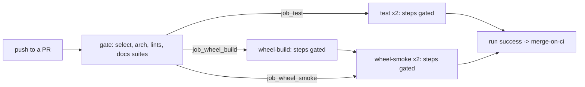

# The CI workflow always runs; an unaffected job is a named no-op

## Intent

`ci.yml` keeps every trigger it has and gains a `gate` job that runs on
every pull request: it computes the selection once with `repoach ci
affected select`, runs the arch check, the attribution and CONTRIBUTING
lints and the tree suites of the docs class, and publishes one output
per job. The three existing jobs keep their names and their matrices
and read those outputs: every step of theirs carries the selection as a
condition, so an unaffected job runs no step but a notice and concludes
`success` in seconds. Every check name repoach requires therefore exists
and is green at every head, under `main`'s list as under `develop`'s;
`push`, `workflow_dispatch` and the release pull request run every step.

## Context

Measured 2026-11-16 on `origin/develop` `f16702b`.

| # | Fact | Where |
|---|---|---|
| F1 | `required_checks(root)` is `[auto_merge].required_checks`, else every job of the `CI` workflow with its matrix expanded; a name with no run at the head is `missing`; `evaluate_ci_gate` refuses `missing` as `required_check_missing`; `{SUCCESS, NEUTRAL, SKIPPED}` are green | `src/repoach/review/merge_wait.py:85,162-237,299-312`; `src/repoach/review/auto_merge.py:360-366` |
| F2 | `merge-on-ci.yml` admits a `CI` or review run that concluded `success` (`workflow_run.conclusion == 'success'`); it checks out `main` and runs `main`'s code and `main`'s `ci.yml`; a run whose jobs are all skipped concludes `skipped` and is not admitted | `.github/workflows/merge-on-ci.yml:36-38,72-77,93-96`; `docs/merge_gate.md:95-98` |
| F3 | A matrix job that never expands reports one check under its template name: at heads `19b8f29` and `bd62aa7` the cancelled `wheel-smoke` is `wheel-smoke (${{ matrix.python-version }})`, and `wheel-smoke (3.11)` / `(3.13)` do not exist | `gh run list --workflow CI --commit 19b8f29`; `gh run view <id> --json jobs` |
| F4 | A step whose `if` is false is `skipped` and the job concludes `success`: the `Smoke — llm_proxy boots` step (`if: matrix.python-version == '3.13'`) is `skipped` on every green 3.11 leg of the last 30 runs | `.github/workflows/ci.yml:96-97`; `gh run view --json jobs` |
| F5 | `DEFAULT_REQUIRED_CHECK_NAMES` holds five names; `tests/unit/test_ci_checkname_sync.py` derives the names from `ci.yml` and asserts equality and `len == 5` | `src/repoach/forge/github.py:76-82`; `tests/unit/test_ci_checkname_sync.py:40-44` |
| F6 | The `test` legs run seven lint steps before `Pytest`, three of which judge the tree, not the Python version: `Lint — CONTRIBUTING cites real paths`, `Lint — no AI attribution`, `Lint — edge honesty`; together under 0.15 min, run twice | `.github/workflows/ci.yml:59-88`; the step medians of SP-PR-RUNS-AFFECTED-JOBS F2 |
| F7 | A `Test suite` leg: `Set up Python` 0.5 min, `Install package + dev deps` 0.2, `Pytest` 14.7 / 15.2, `Pytest — integration` 1.5; `wheel-build` 0.4; a smoke 0.4 but started 19.6 / 20.1 min after the run was created; the review job started 10.9 min after its run, on two self-hosted runners | SP-PR-RUNS-AFFECTED-JOBS F1–F4 |
| F8 | `ci.yml` triggers: `push` to `main`, `pull_request` to `main` and `develop`, `workflow_dispatch`; `concurrency: ci-${{ github.ref }}`, cancel in progress; the `if:` actor allowlist on `test` and `wheel-build` (`REPOACH_ALLOWED_ACTORS`); `env.REPOACH_LLM_PROXY_BASE_URL` for the whole workflow | `.github/workflows/ci.yml:3-24,33-35,120-122` |
| F9 | The bots' path whitelist never touches `.github/workflows/*`; the file is hand-edited and guarded by tests that parse it with PyYAML (`test_auto_review_workflow_wiring.py`, `test_job_proxy_workflow_wiring.py`, `test_wheel_smoke_ci.py`) | `CLAUDE.md`, "Path whitelist"; `tests/unit/test_auto_review_workflow_wiring.py:1-30` |
| F10 | `scripts/ci_local.sh` mirrors the workflow; SP-AFFECTED-JOBS-TABLE D7 gives it `--affected` | `scripts/ci_local.sh:1-49` |

## Decisions (2026-11-16)

- D1. A job `gate` (name `gate`), first in the file, with the actor
  allowlist of F8, `runs-on` the self-hosted runner, `fetch-depth: 0`,
  Python 3.13 with the pip cache, `pip install -e ".[dev]"`, then:
  `repoach ci affected select --base "origin/${{ github.base_ref || github.ref_name }}" --event "${{ github.event_name }}" --base-ref "${{ github.base_ref }}" --github-output "$GITHUB_OUTPUT" --summary "$GITHUB_STEP_SUMMARY"`
  (the base is fetched first, as the edge-honesty step does today);
  `repoach arch check --base origin/<base>` on a `pull_request`;
  `python scripts/lint_no_ai_attribution.py --range …` on a `pull_request`
  with the title and body, as today; `python scripts/check_contributing.py CONTRIBUTING.md`;
  `pytest -q $(repoach ci affected gate-pytest)`. Its outputs are the
  `job_<id>` lines, `mode` and `reason`, declared under `outputs:` from the
  `select` step. The table path is declared once, `env.REPOACH_AFFECTED_JOBS_TABLE: .github/affected-jobs.toml`,
  and passed as `--table`. As built (0.3): the base branch is declared
  once, as the job's `env.CI_BASE_BRANCH: ${{ github.base_ref || github.ref_name }}`,
  and every `run` reads it, `$GITHUB_EVENT_NAME` and `$GITHUB_BASE_REF`
  from the environment rather than from an expression; the gate suites
  run as `pytest -q <selectors> -n auto --dist worksteal` and an empty
  `[gate].pytest` prints a notice instead of running the whole suite.
  `reason` is the one amendment of SP-AFFECTED-JOBS-TABLE's code:
  `github_output_lines` appends `reason=<one_line(reason)>`, so a path
  the author chose cannot start an output line of its own.
- D2. `test`, `wheel-build`, `wheel-smoke` keep their ids, names,
  matrices, `runs-on`, allowlist and `needs` (`wheel-smoke` gains
  `gate` beside `wheel-build`; the other two gain `needs: gate`). Every
  step of theirs carries `if: needs.gate.outputs.job_<id> == 'true'`
  (combined with its existing condition where one exists, as the
  smoke's `matrix.python-version == '3.13'`), except one new first
  step, `Selection`, unconditional, which prints
  `::notice::<job>: <affected|not affected> by this diff (<mode>, <reason>); selection in the gate job summary`
  and appends the same line to its `$GITHUB_STEP_SUMMARY`; `<job>` is
  `$GITHUB_JOB`, so the three `Selection` steps are one text, and an
  output that is neither `true` nor `false` is refused by name
  (`::error::<job>: the gate output for this job is '<value>', neither
  true nor false`, exit 1). A job whose
  every other step is skipped is a no-op job: it concludes `success`
  (F4) under its expanded name (it ran, so its matrix expanded; F3 is
  what a job-level `if` would have done).
- D3. The three tree lints of F6 leave the `test` legs for `gate`
  (one run instead of two); ruff, the no-inline-comments and the
  no-silent-except lints stay in the legs, gated like every step, since
  they judge the Python the legs test.
- D4. `DEFAULT_REQUIRED_CHECK_NAMES` gains `gate` (six names);
  `test_ci_checkname_sync.py` asserts `len == 6`; `repoach.toml`'s
  commented `required_checks` line lists six. Nothing else about the
  required list changes: it is still derived from `ci.yml`.
- D5. Guards, `tests/unit/test_affected_workflow_wiring.py`, over the
  parsed YAML: every job but `gate` has `needs` holding `gate`; every
  step of those jobs but `Selection` has an `if` containing
  `needs.gate.outputs.job_<id> == 'true'` with its own id; `Selection`
  is first and unconditional; `gate` has no `needs`; the `select` step
  passes the five flags of D1 (`--base`, `--event`, `--base-ref`,
  `--github-output`, `--summary`) and
  `--table "$REPOACH_AFFECTED_JOBS_TABLE"`; the three tree lints exist
  in `gate` and in no leg; the trigger block and `concurrency` equal
  today's except `push: branches: [main, develop]` (D7); no workflow under
  `.github/workflows/` carries `on.pull_request.paths` or
  `paths-ignore`; the job ids of `ci.yml` equal the ids the table names
  plus `gate`.
- D6. `docs/merge_gate.md` gains a section "A job the diff does not
  affect is a green no-op", dated, saying: the selection, where it is
  read (the `gate` summary, the `Selection` notice of each job), that
  the gate's `CI not green at head` reads the same six names as before,
  and the procedure of SP-AFFECTED-JOBS-MISSES-ARE-TEST-CASES D4.
  `CLAUDE.md` "Local CI mirror" names `--affected`.
- D7. Owner decision 2026-11-16 (SP-PR-RUNS-AFFECTED-JOBS O2):
  `on.push.branches` becomes `[main, develop]`. A push to `develop` is
  `mode: full` (`full: push on origin/develop`) and runs every step; the
  existing `concurrency: ci-${{ github.ref }}` keeps only the latest
  `develop` head when merges follow one another; `merge-on-ci.yml`
  admits `pull_request` and `pull_request_review` completions only, so
  a `develop` run never re-judges a merge. The comment of `ci.yml:5-8`
  that excluded `develop` is replaced by the sentence of this decision.

## End state

A pull request on `docs/` shows six green checks: `gate` after about
1.2 min, the five legs a few seconds each with a notice saying they
were not affected; the review job starts as soon as a runner is free,
within two minutes; `auto_merge` runs after the review, and
`merge-on-ci.yml`, running `main`'s code, finds the five names it
requires green too. A pull request on `src/` runs every step of every
job, with the tree lints run once. A `push` to `main` and the release
pull request run every step. `repoach review gate <n>` prints the same
`CI green at head` line as before.

## Easy solution rejected

A job-level `if: needs.gate.outputs.job_test == 'true'` on `test` and
`wheel-smoke`. Rejected on F3: a matrix job that does not run does not
expand, GitHub reports one check under the template name, and the two
names repoach requires are `missing` — the refusal of F1. Also rejected:
`on.pull_request.paths` (no check run at all, `missing` everywhere, and
no `success` completion for `merge-on-ci.yml`, F2), and an aggregate
required check (F1 derives every job of the workflow, so it would not
replace the five names unless `[auto_merge].required_checks` were set,
the section an older client refuses).

## Hard part

The step condition is the mechanism, and it has to be on every step.
One step left unconditional in a leg (a `pip install`, a checkout of
`fetch-depth: 0`) is a minute of runner on every documentation pull
request and, worse, a step that can fail on a diff that did not affect
it. The guard of D5 reads the file the way `merge_wait` does, with
PyYAML, and names the step. The second hard part is the two lists
(SP-PR-RUNS-AFFECTED-JOBS, "Hard part"): until the next release,
`merge-on-ci.yml` requires `main`'s five names and the head's own
`auto_merge` requires six; both are satisfied because no name changes
and every job concludes `success`. The third is the `gate` as a
single point: a defect in the selection is a red `gate`, which stops
every pull request; the module's exit codes never print a selection on
an error, so the red is named and never a silently full or narrow run.

## Goals

- G1: `gate` exists, runs once per run, publishes `job_<id>` and `mode`, runs the tree lints and the docs-class suites; the legs read it.
- G2: every step of the three jobs but `Selection` is gated; a no-op leg takes under 0.3 min.
- G3: the six names are green at every head of a narrowed pull request; `merge-on-ci.yml` on `main`'s list admits the same heads.
- G4: a `push` to `develop` or `main`, a `workflow_dispatch` and the release pull request run every step (`mode: full`).
- G5: the file is guarded (D5) and documented (D6).

## Non-Goals

- NG1: no change to the review workflow, `shellcheck.yml`, `publish.yml`, `release-verify.yml`, `comparison-check.yml`.
- NG2: no change to the merge gate's code beyond the constant of D4; the selection is not a fact of the gate (SP-PR-RUNS-AFFECTED-JOBS NG2).
- NG3: no new runner, no change to the allowlist, no change to `concurrency`.

## Assumptions

- A1: SP-AFFECTED-JOBS-TABLE and SP-AFFECTED-JOBS-MISSES-ARE-TEST-CASES are merged (the `gate` calls their commands and the replay is green).
- A2: a job whose every conditional step is skipped concludes `success` (F4).

## Interface

The workflow, in outline (the file is the contract; the guard of D5 pins it):

```yaml
env:
  REPOACH_LLM_PROXY_BASE_URL: http://127.0.0.1:8082
  REPOACH_AFFECTED_JOBS_TABLE: .github/affected-jobs.toml
jobs:
  gate:
    name: gate
    if: <the allowlist of F8>
    runs-on: ${{ vars.REPOACH_RUNNER || 'self-hosted' }}
    outputs:
      job_test: ${{ steps.select.outputs.job_test }}
      job_wheel_build: ${{ steps.select.outputs.job_wheel_build }}
      job_wheel_smoke: ${{ steps.select.outputs.job_wheel_smoke }}
      mode: ${{ steps.select.outputs.mode }}
      reason: ${{ steps.select.outputs.reason }}
    steps: [checkout fetch-depth 0, setup-python 3.13, install, fetch base, select (id: select), arch check, attribution lint, CONTRIBUTING lint, pytest gate-pytest]
  test:
    needs: gate
    steps:
      - name: Selection            # unconditional notice
      - <every existing step>, if: needs.gate.outputs.job_test == 'true' [&& <its own condition>]
  wheel-build:
    needs: gate
    steps: [Selection, then every step gated on job_wheel_build]
  wheel-smoke:
    needs: [gate, wheel-build]
    steps: [Selection, then every step gated on job_wheel_smoke]
```

`tests/unit/test_affected_workflow_wiring.py`: D5. `src/repoach/forge/github.py`:
D4 (an amendment of SP-UNIVERSAL-FORGE's file, named here and in the
pull request). `tests/unit/test_ci_checkname_sync.py`: `len == 6`
(an amendment of SP-CI-CHECKNAME-SYNC's test). `docs/merge_gate.md`,
`CLAUDE.md`: D6. Further amendments, as built (0.3):
`src/repoach/affected/select.py` (`reason` output, D1) with
`tests/unit/test_affected_select.py` and `tests/unit/test_affected_cli.py`;
`tests/unit/test_lint_no_ai_attribution.py` and
`tests/unit/test_wheel_smoke_ci.py`, which now find the attribution lint
in `gate` and the checkout after `Selection`; `repoach.toml`'s commented
`required_checks` (D4). The merge-gate fakes: `tests/merge_wait_fakes.py`'s
synthetic `CI_CHECKS` gain `gate`, and the replays of check runs measured
on 2026-10-26 are judged under the five-job `ci.yml` they ran
(`tests/fixtures/merge_wait/ci.before-gate.yml`, `measured_era_root`),
never with a `gate` run added to the recording; `tests/unit/test_merge_wait_stranded.py`
then reads no tree path and leaves `[gate].pytest`.

## Behavior

### Nominal
A pull request to `develop` changes `docs/x.md`. `gate` selects
`gate` alone, mode `narrowed`, and runs the arch check, the two lints
and the docs suites (about 1.2 min). The five legs start, print their
notice, skip every other step and conclude `success` within seconds.
The run concludes `success`; `merge-on-ci.yml` re-judges and finds the
five names of `main`'s list green.

### Edge cases
- a pull request changing `src/` → every leg runs every step; the tree lints run once, in `gate`.
- a pull request changing `.github/workflows/ci.yml` → full class, every step; this spec's own pull request is one.
- `push` to `main` → `gate` says `full: push on origin/main`; every step runs.
- a merge to `develop` → a `push` run, `full: push on origin/develop`; every step runs; a red there is the procedure of SP-AFFECTED-JOBS-MISSES-ARE-TEST-CASES D4.
- the release pull request `develop` → `main` → `full: pull_request on main`; every step runs.
- `workflow_dispatch` → `full: workflow_dispatch on origin/<branch>`.
- a fork's pull request → the allowlist skips `gate` and every leg as today; nothing changes for it.
- a `gate` red for a reason of the module (exit 2 or 3) → the legs are skipped by `needs` and the run is `failure`; the pull request is red with the named reason, never merged on a guess.

### Failure scenarios
- a step added to a leg without the condition → `test_every_leg_step_is_gated` red naming the job and step.
- a `job_<id>` output renamed on one side → the guard's id check is red; at run time the leg's steps would be skipped on every diff (the output is empty, never `'true'`), which the first `src/` pull request after it would show as a green run with no `Pytest`; the guard is what prevents the file from being committed.
- `repoach ci affected select` exits non-zero → red `gate`, see edge cases.

## Tests

| # | File | Test | Mutation that turns it red |
|---|---|---|---|
| T1 | `tests/unit/test_affected_workflow_wiring.py` | every job but `gate` has `needs` holding `gate`; `gate` has none | drop `needs` on `wheel-build` |
| T2 | same | every step of `test`, `wheel-build`, `wheel-smoke` but the first (`Selection`) has an `if` containing `needs.gate.outputs.job_<own id> == 'true'` | leave `Install package + dev deps` unconditional |
| T3 | same | `Selection` is first, unconditional, and its `run` names the job and `gate job summary` | reorder |
| T4 | same | the `select` step passes the five flags of D1 (`--base`, `--event`, `--base-ref`, `--github-output`, `--summary`) and `--table "$REPOACH_AFFECTED_JOBS_TABLE"`; `env.REPOACH_AFFECTED_JOBS_TABLE` is `.github/affected-jobs.toml` | hard-code the path in the step |
| T5 | same | the three tree lints are steps of `gate` and of no leg; ruff and the two Python lints are steps of `test` | leave the edge-honesty step in `test` |
| T6 | same | the job ids of `ci.yml` equal `{gate} ∪ ids named by the table`; no workflow under `.github/workflows/` has `on.pull_request.paths` or `paths-ignore` | add a `paths:` to `shellcheck.yml` |
| T7 | same | the trigger block equals today's with `push: branches: [main, develop]` (D7), `concurrency` unchanged | drop `develop` from `push` |
| T8 | `tests/unit/test_ci_checkname_sync.py` | the derived names equal the constant and `len == 6` | leave the constant at five |
| T9 | `tests/unit/test_affected_workflow_wiring.py` | the committed `Selection` text, run under bash, prints one notice and one summary line for `true` and `false`, refuses `''`, `True`, `yes` by name, and keeps a reason naming `::error::` or `$(id)` inside the notice | replace the `*)` case |
| T10 | same | dry run: `select` on a docs-only diff writes `job_<id>=false` for every leg; every gated step's condition is false; each `Selection` exits 0 with `not affected`; the expanded names are `DEFAULT_REQUIRED_CHECK_NAMES` | give the `docs` row `jobs = ["test"]` |
| T11 | `tests/unit/test_affected_select.py` | `reason=` is the last output line and an authored line break stays written out | drop `one_line` from it |

## Success conditions

- C1 (external oracle: `gh api .../check-runs`): at the head of the first docs-only pull request after this lands, the six names are listed with conclusion `success`; `gh run view <id> --json jobs` shows each leg with every step but `Selection` `skipped` and a `completedAt - startedAt` under 0.3 min; the `CI` run's `createdAt → updatedAt` is written beside 22.9 min in SP-PR-RUNS-AFFECTED-JOBS C2.
- C2 (external oracle: the pull request's merge-attempts comment and `repoach review gate <n>`): no attempt records `required_check_missing` or `SKIP_CI_MISSING`; the gate prints `CI green at head`; the pull request merges by `auto_merge` or `merge-on-ci.yml`.
- C3 (external oracle: `gh run view --json jobs`): the first merge to `develop` after this lands, the first `push` to `main` and the first release pull request show the `Pytest` step `success` in both legs and the `gate` summary line `full: …`.
- C4: `pytest -q tests/unit/test_affected_workflow_wiring.py tests/unit/test_ci_checkname_sync.py tests/unit/test_wheel_smoke_ci.py tests/unit/test_job_proxy_workflow_wiring.py` green with T1–T8 in `-v`; `repoach arch check --base origin/develop` → `edge-honesty: ok`; `bash scripts/ci_local.sh --affected origin/develop` green on the branch.

## Architecture Impact
- Adds dependency: SP-CI-JOBS-NO-OP-WHEN-NOT-AFFECTED -> SP-AFFECTED-JOBS-TABLE, SP-AFFECTED-JOBS-MISSES-ARE-TEST-CASES (the `gate` runs their commands; the replay must be green before the switch)
- Adds dependency: SP-CI-JOBS-NO-OP-WHEN-NOT-AFFECTED -> SP-AUTO-MERGE-WAITS-FOR-CHECKS-NOT-ITSELF, SP-CI-RED-IS-EVIDENCE (the required-check derivation and vocabulary the design must satisfy: no `missing`, `SKIPPED` is green)
- Adds dependency: SP-CI-JOBS-NO-OP-WHEN-NOT-AFFECTED -> SP-CI-CHECKNAME-SYNC, SP-UNIVERSAL-FORGE (the constant gains a name; the sync test counts six)
- Adds dependency: SP-CI-JOBS-NO-OP-WHEN-NOT-AFFECTED -> SP-AUTOMERGE-EVENT-DRIVEN (`merge-on-ci.yml` must keep receiving `success` completions)
- Adds dependency: SP-CI-JOBS-NO-OP-WHEN-NOT-AFFECTED -> SP-ARCH-EDGE-GATE, SP-CONVENTIONS-GATE, SP-CONTRIBUTING (their CI steps move into `gate`)
- No code module, no table; one YAML file and its guard. No cycle.

## Diagram


## Acceptance Criteria
- [ ] AC1: `pytest -q tests/unit/test_affected_workflow_wiring.py tests/unit/test_ci_checkname_sync.py` → green. Today (`f16702b`): the first file does not exist and the second asserts five names.
- [ ] AC2: `python -c "import yaml,sys; w=yaml.safe_load(open('.github/workflows/ci.yml')); print(sorted(w['jobs']))"` prints `['gate', 'test', 'wheel-build', 'wheel-smoke']`.
- [ ] AC3: `docs/merge_gate.md` carries the section of D6; `CLAUDE.md` names `--affected`.
- [ ] AC4: `repoach arch check --base origin/develop` → `edge-honesty: ok`.

## Open Questions
- None. `push: branches` gains `develop` by owner decision 2026-11-16 (SP-PR-RUNS-AFFECTED-JOBS O2), written in D7 and pinned by T7.
