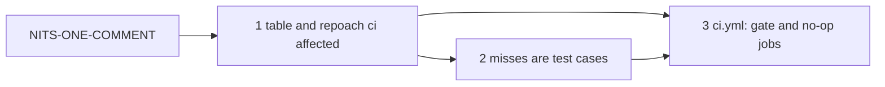

# Umbrella — a pull request runs the jobs its diff affects

## Intent

A review round on this repository costs about twenty minutes of
`CI` whatever the pull request changes: the two `Test suite` legs run
the whole `tests/` tree for seventeen minutes each, hold both
self-hosted runners, and the review job, the wheel smokes and the
auto-merge queue behind them. Eight of the last thirty pull requests
changed only `docs/`; their `CI` runs took 22.9 minutes at the median.
Three pull-request-sized specs, in one order, make a pull request run
the jobs its diff affects, selected from one declared path-to-job
table, while every check repoach's merge gate requires keeps reporting
at every head and the integration and release branches keep the full
set. This spec owns no code; it fixes the order, the shared vocabulary,
the evidence, the design decision on required checks, and the owner
decisions.

## Context

Measured 2026-11-16 on `origin/develop` `f16702b` with `gh run list`,
`gh run view --json jobs`, `gh pr list --json files` and `gh api`; each
fact is re-cited with its lines in the child that acts on it.

| # | Fact | Where |
|---|---|---|
| F1 | `CI`, last 30 successful `pull_request` runs: run 21.1 min at the median (14.9–51.5); `Test suite (Python 3.11)` 17.1 min (12.0–25.6), `Test suite (Python 3.13)` 17.3 (13.5–26.2); `wheel-build` 0.4; `wheel-smoke (3.11)` and `(3.13)` 0.4 each, started 19.6 and 20.1 min after the run was created (they need `wheel-build`, then wait for a runner the test legs hold) | `gh run list --workflow CI --event pull_request --status success --limit 30`; `gh run view <id> --json jobs` |
| F2 | Inside a `Test suite` leg, 30 completed runs: `Pytest` 14.7 / 15.2 min (max 21.0 / 21.8), `Pytest — integration` 1.5, `Set up Python` 0.57 / 0.48, `Install package + dev deps` 0.23 / 0.18, the seven lint steps together under 0.15, the proxy smoke 0.03; `wheel-build`'s build step 0.18; a smoke's `pipx install` 0.2 | same, `steps[]` |
| F3 | `Auto Review (review bots)`, last 30 successful `pull_request` runs: run 18.9 min at the median (3.4–47.5); the review job itself 2.8 min (0.7–8.7) but started 10.9 min after the run was created (0.1–41.6); `Auto-merge to develop` 1.0 min, started after 17.8. The review waits for a runner, not for a model | same, `--workflow "Auto Review (review bots)"` |
| F4 | Two self-hosted runners, `repoach-runner` and `repoach-runner-2`, both online; `coalesce`, `rearm` and `retry` run on `ubuntu-latest` (the repository is public) | `gh api repos/repoachhq/repoach/actions/runners`; `.github/workflows/auto-review.yml:83,108,662` |
| F5 | `ShellCheck`: 30 of 30 runs green, the job 0.1 min at the median, the run 0.6 | `gh run list --workflow ShellCheck` |
| F6 | The last 30 pull requests into `develop` (#260–#296): 8 changed `docs/` only, 2 changed one test file (one with specs beside it), 15 changed `src/` and `tests/`, 5 changed `.github/`; 167 `CI` heads; 15 failed `CI` jobs (13 `Test suite` legs in failing pairs, 1 `wheel-smoke (3.11)` on #275), every one on a pull request touching `src/` or `tests/`; the 16 `CI` runs of the docs-only pull requests took 22.9 min at the median (15.8–88.9) | `gh pr list --state all --base develop --limit 30 --json number,files`; `gh run list --branch <head> --event pull_request`; the replay fixture of SP-AFFECTED-JOBS-TABLE |
| F7 | No forge-side required check exists. The two rulesets (`develop: pull requests only, never rewritten`, 25641051; `main: releases land as merge commits`, 25641050) carry `deletion`, `non_fast_forward` and a `pull_request` rule (`required_review_thread_resolution: true`, methods `squash`/`merge` on develop, `merge` on main) and no `required_status_checks` rule; `branches/<b>/protection` answers 404 `Branch not protected` for both | `gh api repos/repoachhq/repoach/rules/branches/develop`, `.../main`; `gh api repos/repoachhq/repoach/branches/develop/protection` |
| F8 | What requires checks is repoach's own gate: `required_checks(root)` is `[auto_merge].required_checks`, else every job of the `CI` workflow with its matrix expanded (`_expand_job_names`); `judge_required_checks` puts a name with no run at the head in `missing`; `evaluate_ci_gate` refuses `missing` as `required_check_missing`; a conclusion in `{SUCCESS, NEUTRAL, SKIPPED}` is green | `src/repoach/review/merge_wait.py:85,162-237,240-268,299-312`; `src/repoach/review/auto_merge.py:360-366`; `src/repoach/forge/github.py:96` |
| F9 | `merge-on-ci.yml` re-judges the merge when a `CI` or review run concludes `success`; a run whose jobs are all skipped concludes `skipped`, which it does not admit; it runs `main`'s code and reads `main`'s `ci.yml` for the required names | `.github/workflows/merge-on-ci.yml:36-38,72-77,93-96`; `docs/merge_gate.md:95-98` |
| F10 | A matrix job that never expands reports one check under its template name: at heads `19b8f29` and `bd62aa7`, the cancelled `wheel-smoke` reports as `wheel-smoke (${{ matrix.python-version }})` while `wheel-smoke (3.11)` and `(3.13)` do not exist | `gh run list --workflow CI --commit 19b8f29`; `gh run view <id> --json jobs` |
| F11 | `DEFAULT_REQUIRED_CHECK_NAMES` holds the five names; `test_ci_checkname_sync.py` holds it equal to `ci.yml` and asserts `len == 5` | `src/repoach/forge/github.py:76-82`; `tests/unit/test_ci_checkname_sync.py` |
| F12 | The wheel packages more than `src/`: hatch force-includes `prompts` and `docs/specs/_TEMPLATE.md`, `readme = "README.md"`, `license-files = ["LICENSE"]`; `twine check` runs in `wheel-build` | `pyproject.toml:6-9,91-93`; `.github/workflows/ci.yml:140` |
| F13 | 59 modules under `tests/` resolve the repository root (`parents[2]`) and read, after it, `.github/workflows` (15 modules), `src` (8), `scripts/*` (10), `pyproject.toml` (4), `docs/specs` (4), `prompts/review` (2), `chains.env` (2), `.env.example`, `docs/PR_TEMPLATE.md`, `.github/pull_request_template.md`, `.claude/hooks`, `.claude/commands`; `test_claude_md_integration_flag.py` reads `CLAUDE.md` from the working directory | `grep -o 'parents\[2\] */ *"[^"]*"' tests/unit/*.py` |
| F14 | `repoach.toml` keeps `[auto_merge]` commented because an older installed repoach refuses an unknown key; every section is `extra="forbid"` | `repoach.toml:80-81`; `src/repoach/project/config.py:190-192` |
| F15 | `ci.yml` runs on `push` to `main` only — `develop` is excluded on purpose, "always reached through a PR that already ran CI" — and on `pull_request` to `main` and `develop`; the lint steps run in both legs; the bots' path whitelist never touches `.github/workflows/*` | `.github/workflows/ci.yml:4-11,59-88`; `CLAUDE.md`, "Path whitelist" |
| F16 | SP-REVIEW-CONVERGES and SP-OCR-GAP-PROGRAMME (as merged by PR #296, develop `4a253ae`) name no CI job, no `paths` filter and no workflow file: no overlap with this family | `grep -i 'ci.yml\|.github\|paths\|affected' <the two specs>` → 0 |

## Decisions (2026-11-16)

- (a) One table, one reader. The path-to-job table is a TOML file,
  `.github/affected-jobs.toml`, read by `repoach ci affected`; the
  workflow reads the selection from that command's outputs and never
  carries a glob → SP-AFFECTED-JOBS-TABLE.
- (b) Required checks always report, as named no-ops. The `CI` workflow
  keeps running on every pull request; a `gate` job computes the
  selection once; every other job keeps its name and runs, and each of
  its steps carries the selection as a condition, so an unaffected job
  concludes `success` in seconds with a notice naming why. Chosen over
  `on.pull_request.paths` and over a job-level `if`, for the reasons in
  "Easy solution rejected" and "Hard part" → SP-CI-JOBS-NO-OP-WHEN-NOT-AFFECTED.
- (c) Never fewer jobs than needed: a path no row names selects every
  job; the selection is closed under the workflow's `needs`; an error
  in the selection is a red `gate`, never a narrower set.
- (d) Misses are test cases: the last 30 pull requests are a committed
  replay fixture, every failed job of every head must be selected for
  that head's paths, and a later miss enters the same table before any
  other fix → SP-AFFECTED-JOBS-MISSES-ARE-TEST-CASES.
- (e) `develop`, `main`, a `push`, a `workflow_dispatch` and the release
  pull request `develop` → `main` run the full set; only a
  `pull_request` whose base is `[repoach].integration_branch` is
  narrowed.
- (f) What always runs: the review workflow (unchanged), the `gate` job
  (selection, `repoach arch check`, the AI-attribution and CONTRIBUTING
  lints, the tree-judging suites of the docs class) and `ShellCheck`
  (its own workflow, unchanged, 0.1 min).
- (g) Owner, 2026-11-16, taking the four recommendations of the Open
  Questions below: the table is a file of its own,
  `.github/affected-jobs.toml` (O1); `ci.yml` regains
  `push: branches: [main, develop]` and a push to `develop` runs the
  full set, so a red after a narrowed green is seen at the merge, not
  at the release (O2); `ShellCheck` stays its own always-on workflow
  (O3); an unknown path selects every job (O4).

## End state

A pull request that changes only `docs/` runs `gate` in about a minute
and five no-op legs in a few seconds each; the review job starts within
two minutes of the push instead of eleven, and the merge follows the
review, not the test suite. A pull request on `src/` runs what it runs
today, once, with the lints run once instead of twice. The six check
names repoach requires are present and green at every head, under
`main`'s list as under `develop`'s. A push to `develop` or `main` and
the release pull request run every step. A failed job that the table would have
skipped is a row of a committed table and a red test until the table
selects it.

## Easy solution rejected

`on.pull_request.paths` on `ci.yml`, or a `paths-ignore` for
documentation. Rejected on F8–F9: a workflow the filter skips creates
no check run, so every required name is `missing`, `evaluate_ci_gate`
refuses with `required_check_missing`, `merge-on-ci.yml` never receives
a `success` completion to re-arm on, and the pull request stays
unmerged until someone pushes code. The same holds for a job-level
`if:` on the matrix jobs, on F10: the job that does not expand reports
one check under its template name and the two expanded names are
`missing`.

Also rejected: a third-party paths-filter action with the globs in the
YAML (a second copy of the table in a dialect no test of ours reads),
and a single aggregate check (`needs: [every job]`, `if: always()`):
`required_checks` derives every job of the `CI` workflow (F8), so the
five names would stay required unless `[auto_merge].required_checks`
is set in `repoach.toml`, the section an older client refuses (F14);
and the aggregate repeats the `needs` graph in YAML.

## Hard part

Two lists judge the same heads. `merge-on-ci.yml` runs `main`'s code
and derives the required names from `main`'s `ci.yml` (F9), while the
run's own `auto_merge` derives them from the head's. Between the switch
landing on `develop` and the next release, a head must satisfy both:
the five names of today, green, and the six names of the new file. The
no-op design does that by construction — every job keeps its name and
concludes `success` — which is the reason the names are never touched,
only the steps inside them.

And the gain is bounded by what always runs: the review job (2.8 min),
the `gate` (about 1.2 min of setup and tree suites) and the no-op legs
(a checkout each). The docs class goes from 22.9 min to about five; the
`src/` class keeps its seventeen-minute legs, since the suite is the
suite. The tree-judging suites (F13) are what makes a narrowed
documentation run honest: a test that reads `docs/specs` from the root
must run on a documentation diff, and the `gate` runs exactly those,
held by a guard over the test sources.

## Goals

- G1 (order): three specs, each its own pull request, in this order, each green on its tests and on `repoach arch check` before the next:

| # | Spec | Closes | Size (code + tests, estimate) | depends_on (family) | Implementer |
|---|---|---|---|---|---|
| 1 | SP-AFFECTED-JOBS-TABLE | no table; a matrix nobody can read; the lints run twice | ~260 + 320 lines, one fixture | — | agent |
| 2 | SP-AFFECTED-JOBS-MISSES-ARE-TEST-CASES | no harvest; a miss found on `main` has no procedure | ~180 + 200 lines | 1 | agent |
| 3 | SP-CI-JOBS-NO-OP-WHEN-NOT-AFFECTED | every job on every diff | `ci.yml` rewrite, ~40 lines of constant and test amendments, ~150 lines of YAML guards | 1, 2 | hand (F15) |

- G2 (duration): the first ten docs-only pull requests after 3 land have a `CI` run (`createdAt` → `updatedAt`) under 5 min at the median, each `Test suite` leg under 0.3 min, and a review job started under 2 min after its run was created; today 22.9, 17.1 and 10.9.
- G3 (every check reports): at each of those heads, `gh api repos/repoachhq/repoach/commits/<sha>/check-runs` lists `gate`, `Test suite (Python 3.11)`, `Test suite (Python 3.13)`, `wheel-build`, `wheel-smoke (3.11)`, `wheel-smoke (3.13)` with conclusion `success`, and no merge attempt records `required_check_missing`.
- G4 (no wrong green): the replay of the last 30 pull requests (167 heads, 15 failed jobs) selects every failed job for its head's paths; over the first twenty narrowed pull requests, every run of the full set on `develop`, on `main` or on the release pull request is green, or its red is a row of the misses table with a verdict, recorded before any other merge.
- G5 (full set where it must be): a `push` to `develop` or `main`, a `workflow_dispatch` and the release pull request run every step of every job (`gh run view --json jobs`: no `Pytest` step `skipped`).

## Non-Goals

- NG1: no change to the review workflow, its triggers or what it reviews.
- NG2: no change to the merge gate's facts: a no-op job is a green check like any other; the selection is readable in the `gate` job's summary and in the no-op notices, and the table is what the replay judges.
- NG3: no change to `ShellCheck`, `publish.yml`, `release-verify.yml`, `comparison-check.yml`.
- NG4: no new runner, no change to the actor allowlist.

## Assumptions

- A1: the two self-hosted runners stay online (F4); the expected durations are computed for two.
- A2: GitHub keeps reporting a job whose every step is skipped as `success`, which is how the no-op legs conclude today when the actor allowlist admits them and a step condition is false (the `Smoke — llm_proxy boots` step on the 3.11 leg is `skipped` in every green run of F2).

## Interface

Shared vocabulary, defined once:

| Term | Meaning | Defined in |
|---|---|---|
| row | a named set of path prefixes and suffixes with the workflow jobs it selects and the sentence that says why | SP-AFFECTED-JOBS-TABLE D1 |
| docs class, python class, wheel class, full class | the rows of the table as committed at 1 | SP-AFFECTED-JOBS-TABLE D2 |
| selection | the jobs a diff affects: the union of its rows, closed under `needs`, plus `gate`; every job when a path is unknown or in the full class | SP-AFFECTED-JOBS-TABLE D3 |
| mode | `narrowed` (a pull request to the integration branch) or `full` with its reason | SP-AFFECTED-JOBS-TABLE D4 |
| tree judge | a test module that reads the repository outside `src/` from the root | SP-AFFECTED-JOBS-TABLE D5 |
| miss | a failed job at a head whose paths did not select it | SP-AFFECTED-JOBS-MISSES-ARE-TEST-CASES D1 |
| no-op job | a job every step of which was skipped by the selection, concluding `success` with a notice | SP-CI-JOBS-NO-OP-WHEN-NOT-AFFECTED D2 |
| `job_<id>` output | the `gate` job's boolean per workflow job id, hyphens as underscores | SP-CI-JOBS-NO-OP-WHEN-NOT-AFFECTED D1 |

## Behavior

### Nominal
The order of G1. A red gate on any pull request stops the line
(SP-RED-STOPS-THE-LINE) until a corrective spec exists and the gate is
green again. The family lands after SP-REVIEW-NITS-ONE-COMMENT in the
unified order the owner fixed on 2026-11-16; that edge is in
`depends_on`.

### Edge cases
- 1 and 2 change no workflow: a pull request keeps running every job until 3 lands, and `repoach ci affected select` is a probe anyone can run.
- 3 touches `.github/workflows/ci.yml`, so its own pull request is in the full class and runs everything; the first narrowed run is the next pull request's.
- The `depends_on` edge to SP-REVIEW-NITS-ONE-COMMENT is an ordering edge: that spec is on `develop` since #296 (`06202c2`), its implementation is not, and this family's pull requests open after that implementation merges, the order the owner asked for.
- the owner answers a decision against the recommendation → the child is amended before its pull request opens.

### Failure scenarios
- a red on `develop` (the full set runs on every push to it, decision g), on `main` or on the release pull request after a narrowed green → the procedure of SP-AFFECTED-JOBS-MISSES-ARE-TEST-CASES: the line stops, the pair is recorded, the table is widened and merged before the code fix.

## Architecture Impact
- Adds dependency: SP-PR-RUNS-AFFECTED-JOBS -> SP-AFFECTED-JOBS-TABLE, SP-AFFECTED-JOBS-MISSES-ARE-TEST-CASES, SP-CI-JOBS-NO-OP-WHEN-NOT-AFFECTED (the umbrella orders them; it owns nothing and imports nothing)
- Adds dependency: SP-PR-RUNS-AFFECTED-JOBS -> SP-REVIEW-NITS-ONE-COMMENT (the owner's place in the unified order: after it; no import)
- No code, no table, no cycle.

## Diagram

## Acceptance Criteria
- [ ] AC1: the four specs exist under `docs/specs/2026-11-16_SP-*.md` with the ids of G1, each with facts cited `file:line`, decisions, end state, easy solution rejected, hard part, tests with their red mutation, success conditions with an external oracle, and owner questions with a recommendation; `repoach arch check --base origin/develop` → `edge-honesty: ok`; `repoach arch graph` reports no cycle that `origin/develop` does not.
- [ ] AC2: `pytest -q tests/unit/test_spec_presence.py tests/unit/test_arch_graph.py tests/unit/test_governed_spec.py tests/unit/test_spec_template.py` → green with the four files added.
- [ ] AC3: after 1: `repoach ci affected select --base origin/develop` prints the selection for the working tree and `pytest -q tests/unit/test_affected_select.py` replays the fixture with zero misses; after 2: `repoach ci affected replay` exits 0; after 3: G2–G5 are read from the forge as written.
- [ ] AC4: `docs/merge_gate.md` carries the section SP-CI-JOBS-NO-OP-WHEN-NOT-AFFECTED names, dated the day it lands.

## Success conditions

- C1 (replay, external oracle: the forge's own history): `repoach ci affected replay` over `tests/fixtures/affected_jobs/pr_runs.json`, the 30 pull requests #260–#296 harvested with `gh` (167 `CI` heads, 15 failed jobs), prints `misses: 0/15`; the verifier opens two failed runs named in the fixture on github.com and finds the failed job under a head whose paths the table selects it for.
- C2 (docs-only duration, external oracle: `gh run list --json createdAt,updatedAt`): the first ten docs-only pull requests after 3 land have a `CI` run under 5 min at the median; the number is written beside 22.9 in this spec, whatever it is.
- C3 (every check reports, external oracle: `gh api .../check-runs`): the six names, conclusion `success`, at each of those ten heads.
- C4 (the full set holds, external oracle: `gh run view --json jobs`): the first merge to `develop` after 3, the first `push` to `main` and the first release pull request show no `Pytest` step skipped.

## Open Questions

- None. The owner approved the family on 2026-11-16, taking every recommendation (decision g). The questions, as asked and decided:

| # | Decision | Decided by owner 2026-11-16 |
|---|---|---|
| O1 | Table in `.github/affected-jobs.toml` or a `[ci.affected]` section of `repoach.toml` | as recommended: the dedicated file |
| O2 | Re-enable `push: branches: [develop]` for the full set, or keep the release pull request as the one oracle | as recommended: `[main, develop]`, full set on every push to `develop` |
| O3 | `ShellCheck` unchanged, or folded into `ci.yml` behind a `shell` row | as recommended: unchanged |
| O4 | An unknown path selects every job, or the python class only | as recommended: every job |

The questions as they were asked, kept for the record:

- Q1: Where the table lives. `.github/affected-jobs.toml`, a file of its own (recommended: `repoach.toml` is read by every installed repoach and an older one refuses an unknown key, F14; `.github/` is already the full class, so a table edit runs everything), or a `[ci.affected]` section of `repoach.toml` once the loader learns it.
- Q2: Judging `develop` itself. Re-enable `push: branches: [develop]` on `ci.yml` for the full set (recommended: a narrowed green can land a red on `develop` that nothing runs until the release pull request, and attributing it then, after several merges, is the hard part SP-AFFECTED-JOBS-MISSES-ARE-TEST-CASES names; one full run per merge costs two seventeen-minute legs on runners the narrowing frees, and `concurrency: ci-refs/heads/develop` keeps only the latest head), or keep the release pull request as the one oracle.
- Q3: `ShellCheck`. Leave it as its own always-on workflow (recommended: 0.1 min at the median, F5; it is not a required check, and folding it into `ci.yml` would make it one and add a hand edit), or fold it into `ci.yml` behind a `shell` row.
- Q4: An unknown path. Every job (recommended, the Yoob decision of 2026-11-15: an unknown path is judged by everything, and a tracked path is also refused by a test until it is classified), or the python class only.
