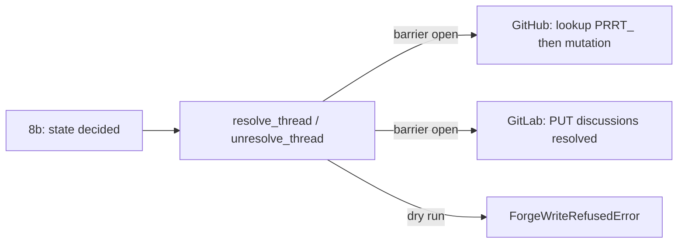

# The forge resolves and unresolves a review thread

## Intent

Child 8a of SP-PR-THREADS-REMEMBER-AND-CLOSE. repoach reads whether a
thread is resolved and by whom, and replies in it, but cannot resolve
or unresolve one: the only closure today is a human click. The reply
agent (8b) needs the write to close a thread its role settled, to mirror
a maintainer's `/resolve`, and to undo an author's click. This spec adds
the two writes to the protocol and to both forges, behind the one write
barrier, and proves them with recorded fixtures.

## Context

Measured on `origin/develop` `92cd241` (2026-11-17).

| # | Fact | Where |
|---|---|---|
| F1 | `Forge` reads threads (`review_threads`, `unresolved_threads`) and writes replies (`reply`), comments (`post_comment`) and reviews; `git grep -n "def resolve_thread\|def unresolve_thread" origin/develop -- src` → 0 | `src/repoach/forge/protocol.py:736`, `:749`, `:764`, `:780` |
| F2 | `ReviewThread` carries `root_id` (the REST comment id / note id `reply` takes), `thread_id` (GitLab discussion id; `None` on GitHub), `resolved`, `resolved_by`, `path`, `line` | `protocol.py:567-590` |
| F3 | GitHub: `review_threads` reads GraphQL `reviewThreads` nodes with `isResolved` and `resolvedBy`; the node id (`PRRT_…`) is what `resolveReviewThread` / `unresolveReviewThread` take, and it is not kept on the model | `github.py:356-395`, `:1464` |
| F4 | GitLab: `_discussions` pages `GET …/merge_requests/<n>/discussions?per_page=100`; `review_threads_from_discussions` reads `resolved` from the first note; `reply` finds the discussion holding a note and posts to it | `gitlab.py:315-346`, `:662-676`, `:877` |
| F5 | Every forge write is a method decorated `@write_barrier`; a closed barrier raises `ForgeWriteRefusedError(head, refusal)`; a dry run closes it | `protocol.py:164`, `:366-373`, `:399`; SP-DRY-RUN-NEVER-POSTS |
| F6 | `finding_posts.thread_id` is the GitHub root comment id or the GitLab discussion id; `finding_post_threads._match` pairs a post with a `ReviewThread` by `root_id` / `thread_id` | `finding_posts.py:83`, `:306-318`; `finding_post_threads.py:243` |
| F7 | Both forges require resolved threads before a merge (parent F11, 2026-11-17), so a thread the bot cannot resolve holds the merge until a human clicks | `glab api projects/67827362`; `gh api repos/repoachhq/repoach/rulesets/<id>` |

## Decisions (2026-11-17)

- D1. Two protocol methods, `resolve_thread(number, thread)` and
  `unresolve_thread(number, thread)`, take a `ReviewThread`, not a bare
  id: the GitHub write needs the GraphQL node id, which 8b never
  stores, so the method resolves it from the thread's `root_id` at
  call time; GitLab uses `thread.thread_id`.
- D2. GitHub: one GraphQL query maps the root comment id to the thread
  node id (`pullRequest.reviewThreads(first: 100) { nodes { id
  comments(first: 1) { nodes { databaseId } } } }`, paged while
  `hasNextPage`), then the mutation `resolveReviewThread(input:
  {threadId})` or `unresolveReviewThread`. A root id found on no page
  is `ForgeError("thread of comment <id> not found")`. GitLab: `PUT
  …/merge_requests/<n>/discussions/<thread_id>` with `resolved=true` /
  `false`; a `404` is the same `ForgeError`.
- D3. Both are `@write_barrier` methods (F5): a dry run raises
  `ForgeWriteRefusedError` before any call leaves.
- D4. `ReviewThread` gains `node_id: str = ""` (GitHub's `PRRT_` id when
  the listing read it, else `""`), so a caller holding a fresh listing
  spares the lookup of D2; the lookup runs only when `node_id` is empty.
  The two recorded fixtures of SP-FINDING-THREAD-IDS keep their
  exchanges and their expected results gain `"node_id": ""` or the id
  the exchange carries (NG4 of SP-OPEN-THREADS-BLOCK-THE-MERGE is the
  precedent).
- D5. Idempotent on the forge's side: resolving a resolved thread or
  unresolving an open one is a no-op the forge accepts (`200`) and the
  method returns normally; 8b decides before calling, this layer does
  not re-read.
- D6. The bench `LocalDiffForge` raises `NotImplementedError` naming
  the method, as it does for every write it does not model.

## End state

`forge.resolve_thread(12, thread)` on GitHub sends one GraphQL
mutation on a `PRRT_` id and the thread shows "resolved by
repoach-bot"; on GitLab one `PUT …/discussions/<id>` with
`resolved=true` and the discussion shows the same. A dry run sends
nothing and raises `ForgeWriteRefusedError`. Both are recorded in
conformance fixtures that replay without the network.

## Easy solution rejected

Resolve a GitHub thread by posting a reply whose body says "resolved":
GitHub has no REST endpoint to resolve a thread, and a reply is not a
resolution, the ruleset still counts the thread. Also rejected:
storing the `PRRT_` id in `finding_posts` at posting time: the REST
review-comment endpoint repoach posts through does not return it, so
it would need the same GraphQL lookup, moved to the writer.

## Hard part

GitHub names the thread by a GraphQL node id that no REST read
returns, while the ledger names it by the REST id of its root comment
(F6). The join is a paged GraphQL read on every write without a
cached `node_id`; the method pages honestly (`hasNextPage`), refuses on
a truncated listing, and the lookup is itself recorded in the
fixtures so the replay proves the paging.

## Goals

- G1: `Forge.resolve_thread` and `Forge.unresolve_thread` exist on the protocol and on both forges, `@write_barrier` (D1–D3).
- G2: `ReviewThread.node_id` (D4), filled by GitHub's listing.
- G3: recorded conformance fixtures per forge and per write, replayed by `tests/unit/test_forge_review_threads.py`, including the GitHub lookup paging.

## Non-Goals

- NG1: No change to what `review_threads` and `unresolved_threads` request (SP-OPEN-THREADS-BLOCK-THE-MERGE NG4) beyond the one added key.
- NG2: No decision of who may resolve: the caller decides (8b).
- NG3: No read of the forge's "threads must be resolved" setting: it is on (F7) and switched outside the code.

## Assumptions

- A1: The posting token may resolve threads: GitHub `pull requests: write`; GitLab Developer on the project. The fixtures are recorded with the bot's token, which proves it.
- A2: GitHub's `reviewThreads` connection lists at most 100 nodes per page and the paging assumption of SP-OPEN-THREADS-BLOCK-THE-MERGE A1 holds.

## Interface

```python
# src/repoach/forge/protocol.py (SP-UNIVERSAL-FORGE's file, edited under the edge)
class ReviewThread(_Model):
    node_id: str = ""            # D4: GitHub PRRT_ id when read, "" otherwise

class Forge(Protocol):
    @write_barrier
    def resolve_thread(self, number: int, thread: ReviewThread) -> None: ...
    @write_barrier
    def unresolve_thread(self, number: int, thread: ReviewThread) -> None: ...

# src/repoach/forge/github.py
def thread_node_id(pages: object, root_id: int) -> str: ...   # pure: the PRRT_ id whose first comment has databaseId == root_id; raises ForgeError when absent or the listing is truncated

# src/repoach/forge/gitlab.py: PUT …/discussions/<thread_id> resolved=true|false
```

Inputs: `number`, the pull / merge request; `thread`, a `ReviewThread`
from `review_threads` or built from a `finding_posts` row (`root_id`,
`thread_id`).

Errors: `ForgeWriteRefusedError` (barrier closed); `ForgeError` (thread
not found, truncated lookup, forge refusal with its status and body
redacted of tokens).

## Behavior

### Nominal
8b calls `resolve_thread(n, thread)` after a `state: resolved (...)`
reply. GitHub: `thread.node_id` empty → the lookup of D2 → the
mutation; GitLab: one `PUT`. The method returns; the next
`review_threads` read shows `resolved=True`, `resolved_by=<bot>`.

### Edge cases
- `thread.node_id` set → no lookup, one mutation.
- the thread is already in the asked state → the forge answers `200`, the method returns (D5).
- a GitLab discussion that is not `resolvable` (a non-diff note) → the forge answers `400`; `ForgeError` naming the discussion.

### Failure scenarios
- dry run → `ForgeWriteRefusedError`, nothing sent.
- lookup page announces `hasNextPage: true` and the next page fails → `ForgeError("review threads listing truncated at page <n>")`, no mutation.
- `404` on either forge → `ForgeError`, named.

## Tests

| Test | What it pins | Mutation that must turn it red |
|---|---|---|
| `tests/unit/test_forge_review_threads.py::test_github_resolve_looks_up_node_id_then_mutates` | D1, D2: the recorded exchange is one paged `reviewThreads` query (the root sits on page 2) then one `resolveReviewThread` on the `PRRT_` id | mutate on the root id |
| `::test_github_resolve_with_node_id_skips_the_lookup` | D4 | always look up |
| `::test_github_unresolve_mutates_unresolveReviewThread` | D1 | call the resolve mutation |
| `::test_gitlab_resolve_and_unresolve_put_resolved_flag` | D2: `PUT …/discussions/<id>` with `resolved=true`, then `false` | `POST` a note instead |
| `::test_thread_writes_refused_in_dry_run` | D3: both methods raise `ForgeWriteRefusedError` on both forges and the recorder sees no call | drop the decorator |
| `::test_missing_thread_is_a_named_forge_error` | D2 last sentence; a `404` | swallow the error |
| `::test_review_threads_fixtures_carry_node_id` | D4: the two existing `review_threads*.json` fixtures replay with `node_id` in every expected thread | drop the key |

## Success conditions

- C1 (external oracle: the live forges, once each, by the implementer with the bot's token on a thread of a closed pull request): the recording run of the fixtures is the live exchange, `pytest -q tests/unit/test_forge_review_threads.py --record` writing the four `review_threads_{resolve,unresolve}.json` files; then, read back outside repoach, `gh api graphql -f query='{ node(id:"<PRRT_>") { ... on PullRequestReviewThread { isResolved resolvedBy { login } } } }'` → `"isResolved": true` with the bot's login after the resolve and `false` after the unresolve; on GitLab `glab api projects/<id>/merge_requests/<n>/discussions/<did> | jq '.notes[0].resolved'` → `true` then `false`. The four command lines and outputs are written beside this line by the implementer and re-run by the verifier.
- C2 (oracle: the conformance suite): `pytest -q tests/unit/test_forge_conformance.py tests/unit/test_forge_unresolved_threads.py tests/unit/test_forge_review_threads.py` → green; `repoach arch check --base origin/develop` → `edge-honesty: ok`; `repoach arch graph --check 2>&1 | grep -c 'dependency cycle'` → `27`.

## Architecture Impact
- Adds dependency: SP-FORGE-RESOLVES-THREADS -> SP-PR-THREADS-REMEMBER-AND-CLOSE (design source: D3 of the composite names the write this spec adds)
- Adds dependency: SP-FORGE-RESOLVES-THREADS -> SP-UNIVERSAL-FORGE (`protocol.py`, `github.py`, `gitlab.py` and `tests/fixtures/forge/` are its; the methods, the model key and the fixtures' new keys are edits to them)
- Adds dependency: SP-FORGE-RESOLVES-THREADS -> SP-FINDING-THREAD-IDS (`ReviewThread` is its; the two existing `review_threads*.json` fixtures gain a key)
- Adds dependency: SP-FORGE-RESOLVES-THREADS -> SP-DRY-RUN-NEVER-POSTS (both writes go through its barrier; its test suite proves the refusal)
- No new table, no new resource, no cycle: `forge/` imports nothing of `review/`.

## Diagram


## Acceptance Criteria
- [ ] AC1: `pytest -q tests/unit/test_forge_review_threads.py` → green (the seven tests of Tests). Today (`92cd241`): the file does not exist and `git grep -n "def resolve_thread" origin/develop -- src` → 0.
- [ ] AC2: `pytest -q tests/unit/test_forge_conformance.py tests/unit/test_forge_unresolved_threads.py tests/unit/test_dry_run_never_posts.py tests/unit/test_forge_write_barrier.py` → green with the two new methods in the barrier's inventory.
- [ ] AC3: `repoach arch check --base origin/develop` → `edge-honesty: ok`.

## Open Questions
- None.
