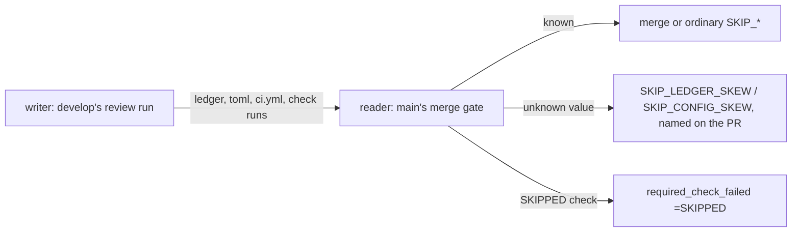

# Umbrella — the released gate names what a newer develop wrote

## Intent

`merge-on-ci.yml` runs `main`'s code, the released version, against
data that `develop`'s code produced: the findings ledger a review run
uploads, the `repoach.toml` and `ci.yml` of the pull request head, the
check runs GitHub reports for that head. Between a merge into `develop`
and the next release, the reader is older than the writer. Today an
unknown value from the newer side is a traceback (`'note' is not a
valid Severity`, run 43995248874), and a check that never ran is read
as green (`SKIPPED` is a success conclusion). Four pull-request-sized
specs, in one order, make every such value either a **named refusal**
written on the pull request, or a **defined, documented degradation**;
never a crash, never a silent green. The skew itself becomes testable:
a develop-shaped payload is fed to main-shaped code by a test and by a
script the release procedure runs. This spec owns no code; it fixes the
facts, the vocabulary, the order, the end state and the owner decisions.

## Context

Measured 2026-11-17 on `origin/develop` `5cea5a7` and `origin/main`
`f329bf3` (release 12, PR #307). Each fact is re-cited with its lines in
the child that acts on it.

| # | Fact | Where |
|---|---|---|
| F1 | `merge-on-ci.yml` checks out `main` ("Trusted ref only: a merge-capable token must never execute PR-authored code"), installs it, materialises the PR head as a worktree under `$RUNNER_TEMP/head-tree` and runs `python -m repoach.cli.main review merge <n>` with `working-directory` set to that worktree. Exit 0 and 5 are green for the job; any other exit is a red job | `.github/workflows/merge-on-ci.yml:11-16,68-77,88-96,214-240` |
| F2 | The gate resolves its roots from the working directory: `resolve_required_checks(forge, required_names, repo_root or Path.cwd(), read_forge=False)`, `checkout = repo_root or Path.cwd()`, `load_gates_config(checkout)`. So `main`'s **code** reads the **head**'s `repoach.toml` and `.github/workflows/ci.yml` | `src/repoach/review/auto_merge.py:976-977,991,1013`; `src/repoach/review/merge_wait.py:329-339` |
| F3 | Probe: `main`'s `required_checks()` (`repoach 0.1.0`, `f329bf3`) applied to the develop tree lists the five names; applied to the SP-CI-JOBS-NO-OP-WHEN-NOT-AFFECTED tree (`b9a4bcf`, PR #310) lists six, `gate` first. The names a head is judged on are the head's; `DEFAULT_REQUIRED_CHECK_NAMES` is the fallback for a tree with no `CI` workflow. SP-PR-RUNS-AFFECTED-JOBS F9 ("reads `main`'s `ci.yml` for the required names") is refuted by this probe | `tmp/probe_names.sh` of this worktree; `src/repoach/review/merge_wait.py:329-339`; `src/repoach/forge/github.py:78-84` |
| F4 | The ledger is a SQLite file, `repoach_review.db`, uploaded by the review run as artifact `findings-ledger-<pr>` and downloaded by the gate; `_rows_to_findings` materialises each row with `ClaimType(row["claim_type"])`, `Severity(row["severity"])`, `FindingStatus(row["status"])`; a value outside the enum raises `ValueError`; the `review merge` command catches `ForgeError` only | `.github/workflows/auto-review.yml:601-604`; `.github/workflows/merge-on-ci.yml:183-210`; `src/repoach/review/findings.py:781-806`; `src/repoach/cli/review_cmds.py:834-838` |
| F5 | The incident: PR #302 (`3c0ba97`, 2026-11-16) added `Severity.NOTE`; at 2026-11-17 01:24 the gate of PR #303 (run 43995248874, `main` at `74cf2be`) crashed with `ValueError: 'note' is not a valid Severity`, exit 1, a red `merge-on-ci` run that no pull request check shows; #303 was admin-merged; release #304 (`b963130`, the same day) carried the enum and the next run read 8 findings | `gh run view 43995248874 --log-failed`; `docs/releasing.md`; the delivery state of 2026-11-16 |
| F6 | The ledger already versions one table: `pr_spec_coverage.rule_version` (`SPEC_COVERAGE_RULE_VERSION = 2`), re-graded when stale (`refresh_stale_coverage`, `StaleCoverageRecomputeError`). `pr_findings` has no format version; columns added since creation are back-filled by four `ALTER TABLE` migrations, each named with its spec | `src/repoach/review/spec_gate.py:63,92,103`; `src/repoach/review/auto_merge.py:118,860`; `src/repoach/review/findings.py:450-493` |
| F7 | `SKIPPED` is a success conclusion in both GitHub readers (`_SUCCESS_CONCLUSIONS = {SUCCESS, NEUTRAL, SKIPPED}`), so a required check whose job never ran is green; the GitLab forge reads `skipped` as a failure (`_PIPELINE_FAILURE = {failed, canceled, skipped}`) | `src/repoach/review/merge_wait.py:83-85,162-237`; `src/repoach/forge/github.py:95-98,223-263`; `src/repoach/forge/gitlab.py:96-97` |
| F8 | R1, measured on the release PR #307's head `79b9321`: the `CI` run 44071742332 (`pull_request`, 11:11Z) concluded `skipped` because its actor was `github-actions[bot]` (the merge of #308 by `merge-on-ci.yml`), outside `ci.yml`'s allowlist. Its check runs: `Test suite (Python ${{ matrix.python-version }})` `skipped`, `wheel-build` `skipped` (twice), `wheel-smoke (${{ matrix.python-version }})` `skipped`. Under the five names, `wheel-build` reads green and the four matrix names are `missing`: the gate fails closed only because a job that never expands reports one check under its template name. After the owner's close/reopen (actor `jwfaye`), run 44081266335 (12:14Z) ran and the six check runs are `success` | `gh api repos/repoachhq/repoach/commits/79b9321/check-runs`; `gh run list --commit 79b9321`; `.github/workflows/ci.yml:33-35,120-122`; `.github/workflows/shellcheck.yml:30-32` |
| F9 | `repoach.toml` is read by `load_project_config` with `extra="forbid"` on every section; the file keeps `[auto_merge]` commented "because an older installed repoach refuses an unknown key" (SP-PR-RUNS-AFFECTED-JOBS F14). In the gate, a `ConfigError` from the head's file reaches no handler (F4) | `src/repoach/project/config.py:168,192,559-560`; `repoach.toml:87` |
| F10 | Precedents of a defined degradation: the release gate's `affected-jobs misses: cannot say: <why>` on a `ConfigError` or a harvest refusal; the attempts comment, whose read and write are inside `upsert_attempt`'s `try`, "logged as `merge_attempts.comment_failed` and never changes the outcome"; `TableError` names an unknown key of `.github/affected-jobs.toml` | `src/repoach/cli/release_cmds.py:75-105`; `src/repoach/review/merge_wait.py:496-520`; `src/repoach/affected/table.py:231-233` |
| F11 | The skew window is short and frequent: six releases between 2026-11-02 and 2026-11-17 (#285, #287, #289, #291, #304, #307); `main..develop` is one commit (#309) today. Every merge into `develop` that touches an enum, a column, a config key or a workflow shape opens a window until the next release | `git log --first-parent origin/main`; `git log origin/main..origin/develop` |
| F12 | The release pull request `develop` → `main` is never judged by `merge-on-ci.yml` (it resolves `--base develop` only) and the release gate runs from a fresh clone with the operator's install; so a skew refusal on a `develop`-based pull request never blocks the release that clears it | `.github/workflows/merge-on-ci.yml:124-128`; `docs/releasing.md` |

## Decisions (2026-11-17)

- (a) `main`'s code keeps judging. The trusted-ref rationale of F1
  stands; the fix is a contract on what the older reader does with a
  newer payload, not a younger reader.
- (b) One shape for every refusal: a `SKIP_*` outcome of
  SP-MERGE-EXIT-CONTRACT, exit 5, written in the merge attempts comment
  of the pull request with the three facts a person needs — what was
  read, from which writer version, by which reader version — so the
  pull request itself says "release needed", not an Actions log.
- (c) Fail closed by name, never degrade silently: an unknown enum
  value, a format newer than the reader, an unknown config key refuse
  the merge. A degradation is defined only where the value cannot
  change the decision (F10's precedents), and it is named in the output.
- (d) A non-judgement is never green: a required check `SKIPPED` is a
  failed check, as the GitLab forge already reads it (F7); the release
  pull request gets real runs instead of skipped ones (F8).
- (e) The skew is testable on one checkout: each child's test feeds a
  newer-shaped payload to the current reader; a release-time script
  feeds a payload written by `develop`'s code to `main`'s code.
- (f) Implementation order (owner, 2026-11-17):
  SP-SKIPPED-REQUIRED-CHECK-IS-NOT-GREEN first, a live defect (F7, F8);
  then SP-LEDGER-FORMAT-IS-VERSIONED; then SP-HEAD-CONFIG-SKEW-IS-NAMED;
  then SP-RELEASE-PR-CI-RUNS-FOR-THE-BOT-ACTOR, after PR #310
  (SP-CI-JOBS-NO-OP-WHEN-NOT-AFFECTED) has merged, since both edit the
  job conditions of `ci.yml`. The table of G1 is in that order.
- (g) Owner, 2026-11-17, taking the five recommendations of the
  questions recorded below: `main`'s code keeps judging in
  `merge-on-ci.yml` and the skew is a tested contract (O1); an unknown
  key in the head's `repoach.toml` is a named refusal (O2); one
  `LEDGER_FORMAT` integer over every ledger table the gate reads (O3);
  `github-actions[bot]` is admitted by an `if` clause only for the
  same-repo `develop` → `main` pull request (O4); `scripts/skew_replay.sh`
  is a manual step of `docs/releasing.md` (O5).

## End state

A pull request whose ledger carries a value this release does not know
shows, in its merge attempts comment, `SKIP_LEDGER_SKEW — ledger format
3 written by repoach 0.2.0.dev14; this gate is repoach 0.1.0 (format 2):
a release is needed before this lane can judge it`, and merges by the
run's own `auto_merge` or after the release, never by an admin merge.
A head whose `repoach.toml` declares a key the release does not know
shows `SKIP_CONFIG_SKEW` naming the key. A required check that never
ran shows `required_check_failed: wheel-build=SKIPPED`, never green. The
release pull request's `CI` runs on the bot-merged head without a
close/reopen. `scripts/skew_replay.sh <main-ref> <develop-ref>` prints
one line per payload kind with `ok` or the named refusal, and the
release procedure runs it. No path in `review merge` ends in a
traceback for a value of the four kinds.

## Easy solution rejected

Run `develop`'s code in `merge-on-ci.yml` (checkout `develop` instead
of `main`): no window, no skew. Rejected: the lane merges with a
`contents: write` token, so the code it runs is what the release
procedure (`repoach release gate`, `release-verify.yml`) exists to
judge before it holds that token; a gate defect merged into `develop`
would then merge pull requests wrongly until noticed, where today it
is caught at the release. The owner wrote the trusted-ref rule into the
workflow (F1); this family keeps it and makes the window safe instead.

Also rejected: a per-release manual step ("after an enum change, admin
merge until the release", what #303 did), since it is exactly the
unnamed path this family removes; and catching `Exception` around the
gate to turn every crash into exit 5, since an unnamed skip is the
silent-green class with a different exit code.

## Hard part

Bootstrapping across the very window it closes. The ledger stamp
(SP-LEDGER-FORMAT-IS-VERSIONED) lands on `develop` first; until the
release that carries it, `main`'s reader has no stamp reader and no
refusal, so the first release after that child is the last one that
can crash on a newer value, and the child's own pull request must add
no enum value or column. After it, both sides carry the contract and a
newer writer is refused by name.

And two lists judge the same head by different code. The names are the
head's (F3), but the **expander** is `main`'s: a `ci.yml` shape the
released `expand_job_names` does not know (a new matrix form, a `name`
expression beyond `${{ matrix.<key> }}`) yields a name that no check
run carries, read as `missing`. That is already a named refusal
(`required_check_missing`), so the family leaves the expander alone and
only adds, in SP-SKIPPED-REQUIRED-CHECK-IS-NOT-GREEN, the note that
tells a template name present in the rollup from a name GitHub never
produced.

## Goals

- G1 (order): four specs, each its own pull request, in this order, each green on its tests and on `repoach arch check` before the next:

| # | Spec | Closes | Size (estimate) | depends_on (family) | Implementer |
|---|---|---|---|---|---|
| 1 | SP-SKIPPED-REQUIRED-CHECK-IS-NOT-GREEN | F7, F8 (R1): a skipped required check is green; one constant in two copies | ~30 + 150 lines, one recorded fixture | — | agent |
| 2 | SP-LEDGER-FORMAT-IS-VERSIONED | F4–F6: an unknown ledger value is a traceback; no format version on the ledger | ~220 + 260 lines, one SQL fixture, one script | — | agent |
| 3 | SP-HEAD-CONFIG-SKEW-IS-NAMED | F9: an unknown key in the head's `repoach.toml` is a traceback | ~40 + 120 lines | — | agent |
| 4 | SP-RELEASE-PR-CI-RUNS-FOR-THE-BOT-ACTOR | F8 (R3): the release pull request's `CI` is skipped for the bot actor | ~12 lines of YAML + 80 lines of test | SP-CI-JOBS-NO-OP-WHEN-NOT-AFFECTED (same file, lands after #310) | hand (`ci.yml` is on no bot's path) |

- G2 (no traceback): over the first twenty `merge-on-ci.yml` runs after 3 lands, no run concludes `failure` with a Python traceback in "Run the merge gate at head"; every non-merge ends in exit 5 with a `SKIP_*` outcome in the attempts comment.
- G3 (named on the pull request): every skew refusal is one line of the merge attempts comment carrying the reader version, the writer version or head, and the value refused.
- G4 (no silent green): a required check with conclusion `SKIPPED` is never counted green by either GitHub reader; the skipped release-PR head of F8 replays as `required_check_failed`, not as `wheel-build` green.
- G5 (testable skew): `pytest -q tests/unit/test_skipped_required_check.py tests/unit/test_ledger_format_skew.py tests/unit/test_head_config_skew.py tests/unit/test_ci_admits_the_release_head.py` is green, and `scripts/skew_replay.sh origin/main origin/develop` exits 0 with one `ok` line per payload kind when `develop` adds nothing `main` cannot read.

## Non-Goals

- NG1: no change to which ref `merge-on-ci.yml` installs (decision a).
- NG2: no change to the review workflow, the reviewers or the findings they raise.
- NG3: no change to the exit-code contract (0 merged, 5 named skip, 1 failed) beyond new `SKIP_*` tags.
- NG4: no automatic release; a skew refusal says a release is needed, a person releases.
- NG5: the GitLab forge is not changed: it already reads `skipped` as a failure (F7).

## Assumptions

- A1: GitHub keeps reporting a job whose `if` is false, or whose `needs` failed, as a check run with conclusion `skipped` and, for a matrix job, under its unexpanded template name (F8; SP-PR-RUNS-AFFECTED-JOBS F10).
- A2: the review workflow and `merge-on-ci.yml` keep sharing the ledger through the `findings-ledger-<pr>` artifact (SP-LEDGER-TRANSPORT).
- A3: releases keep their cadence (F11); the family shortens nothing, it makes the window safe.

## Interface

Shared vocabulary, defined once:

| Term | Meaning | Defined in |
|---|---|---|
| reader | the code that judges: `main`'s install in `merge-on-ci.yml`, or the operator's in `repoach review gate` | this spec |
| writer | the code that produced the payload: the review run at the head (`develop`'s code after the merge, the branch's before) | this spec |
| payload | one of: the ledger (`repoach_review.db`), the head's `repoach.toml`, the head's `ci.yml`, the head's check runs | this spec |
| skew | a payload carrying a value, key, column or format the reader does not define | this spec |
| skew refusal | a `SKIP_*` outcome (exit 5) whose reason names the payload, the value, the writer version and the reader version | SP-MERGE-EXIT-CONTRACT; children D-sections |
| ledger format | the integer `LEDGER_FORMAT` and its committed snapshot of tables, columns and enum values | SP-LEDGER-FORMAT-IS-VERSIONED D1 |
| non-judgement | a required check whose run never produced a verdict: `SKIPPED`, or a template name in the rollup | SP-SKIPPED-REQUIRED-CHECK-IS-NOT-GREEN D1 |

## Behavior

### Nominal
The order of G1. A red gate on any pull request stops the line
(SP-RED-STOPS-THE-LINE). Children 1–3 touch no workflow and land on
their own; child 4 edits `ci.yml` and lands after PR #310
(SP-CI-JOBS-NO-OP-WHEN-NOT-AFFECTED), whose rewrite it would otherwise
conflict with.

### Edge cases
- the owner answers a question against the recommendation → the child is amended before its pull request opens.
- child 2's own pull request changes an enum or a column → refused by its own test (T1 of that spec) until the format is bumped; the bootstrap note in Hard part says why that pull request must not.

### Failure scenarios
- a skew refusal on a `develop`-based pull request → the pull request waits for the release pull request, which `merge-on-ci.yml` never judges (F12); after the release the next CI or review completion re-arms and the same head merges.
- `scripts/skew_replay.sh` refuses at release time → the release pull request's description names the refused payload; the release is what clears it, and the line is the evidence that the window was safe.

## Architecture Impact
- Adds dependency: SP-GATE-NAMES-FORMAT-SKEW -> SP-SKIPPED-REQUIRED-CHECK-IS-NOT-GREEN, SP-LEDGER-FORMAT-IS-VERSIONED, SP-HEAD-CONFIG-SKEW-IS-NAMED, SP-RELEASE-PR-CI-RUNS-FOR-THE-BOT-ACTOR (the umbrella orders them; it owns nothing and imports nothing)
- No code, no table, no cycle.

## Diagram

## Acceptance Criteria
- [ ] AC1: the five specs exist under `docs/specs/2026-11-17_SP-*.md` with the ids of G1 and this one, each with facts cited `file:line`, decisions, end state, easy solution rejected, hard part, tests with their red mutation, success conditions with an external oracle, and owner questions with a recommendation; `repoach arch check --base origin/develop` → `edge-honesty: ok`.
- [ ] AC2: `pytest -q tests/unit/test_spec_presence.py tests/unit/test_arch_graph.py tests/unit/test_governed_spec.py tests/unit/test_spec_template.py` → green with the five files added.
- [ ] AC3: after 1–4: G5's pytest line is green and `scripts/skew_replay.sh origin/main origin/develop` exits 0.
- [ ] AC4: `docs/merge_gate.md` carries one dated section per child and `docs/releasing.md` the skew-replay step.

## Success conditions

- C1 (external oracle: the forge): over the first twenty `merge-on-ci.yml` runs after 3 lands, `gh run list --workflow "Merge on CI (event-driven gate)" --json conclusion,databaseId` shows no `failure` whose `--log-failed` holds `Traceback`; the count and the run ids are written beside this line.
- C2 (external oracle: `repoach review merge-attempts <n>`): the first pull request held by a skew after 2 lands shows one `SKIP_LEDGER_SKEW` or `SKIP_CONFIG_SKEW` attempt naming the value, the writer version and the reader version; the pull request merges after the release without an admin merge (`gh pr view <n> --json mergedBy` is `app/github-actions` or the owner through `gh pr merge`, never "admin").
- C3 (external oracle: `gh api .../commits/<sha>/check-runs` and `repoach review gate <n>`): on a head whose `CI` run concluded `skipped` (a bot-actored push before 4 lands, or the fixture head `79b9321` replayed), the gate prints `required_check_failed: … =SKIPPED`, never `CI green at head`.
- C4 (external oracle: `gh run list --commit <release head>`): the first release pull request after 4 lands has a `CI` run with conclusion `success` created by the `pull_request` event on its bot-merged head, with no close/reopen in `gh pr view --json timelineItems` (or the issue events) of that pull request.

## Open Questions

- None. The owner approved the family on 2026-11-17, taking every
  recommendation (decision g). The questions, as asked and decided:

| # | Decision | Decided by owner 2026-11-17 |
|---|---|---|
| O1 | `main`'s code in `merge-on-ci.yml` with the skew as a tested contract, or `develop`'s code there | as recommended: `main`'s code, the contract |
| O2 | An unknown head `repoach.toml` key refused by name, or ignored with a named line | as recommended: refused by name |
| O3 | One `LEDGER_FORMAT` integer, or one per table | as recommended: one integer |
| O4 | Admit `github-actions[bot]` by an `if` clause for the same-repo `develop` → `main` pull request only, or keep the close/reopen procedure | as recommended: the `if` clause |
| O5 | `scripts/skew_replay.sh` as a manual step of `docs/releasing.md`, or a `repoach release gate` report line | as recommended: the manual step |

The questions as they were asked, kept for the record:

- Q1 (decision a): keep `main`'s code in `merge-on-ci.yml` and make the skew a contract (recommended: the lane holds the merge token, F1's rationale, and the release gate is where gate code is judged), or check out `develop` there and remove the window (no skew, but a gate defect merged into `develop` merges pull requests wrongly until noticed).
- Q2 (decision c): an unknown `repoach.toml` key at the head is a named refusal (recommended: the key may be a gate rule such as `[auto_merge].required_checks`, and judging under rules the repository no longer declares is the silent-green class), or is ignored with a named line so merges continue under the older rules until the release.
- Q3 (SP-LEDGER-FORMAT-IS-VERSIONED D1): the format is one integer over all the ledger tables the gate reads (recommended: one number to bump, one snapshot to commit, one refusal line), or one per table like `pr_spec_coverage.rule_version` today.
- Q4 (SP-RELEASE-PR-CI-RUNS-FOR-THE-BOT-ACTOR D1): admit `github-actions[bot]` on `pull_request` events whose head is the same-repo `develop` and whose base is `main` (recommended: that code already runs on the self-hosted runner on every push to `develop`, so no new code is exposed; one `if` clause, judged by a tree test), or keep the close/reopen in `docs/releasing.md` as the written procedure.
- Q5 (release procedure): `scripts/skew_replay.sh` is a step of `docs/releasing.md` run by hand (recommended: the release gate runs on the operator's machine and the script needs two worktrees), or a report line of `repoach release gate` like `affected-jobs misses`.
