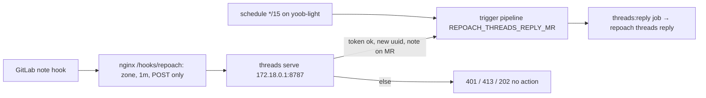

# A GitLab note starts one thread-reply pipeline

## Intent

Child 8c of SP-PR-THREADS-REMEMBER-AND-CLOSE. On GitHub, a reply in a
thread already starts `review pr` (`pull_request_review_comment`); on
Yoob's GitLab, a note starts nothing, so the reply agent (8b) would run
only at the next push. This spec adds `repoach threads serve`, a small
HTTP receiver on hel1 behind the existing nginx, that authenticates a
GitLab note hook in constant time, refuses replays and oversized
bodies, and starts exactly one `threads:reply` pipeline for the merge
request; a 15-minute schedule is the fallback for a lost delivery. Its
secrets are systemd encrypted credentials: never a file in clear, never
argv, never the environment.

## Context

### repoach, measured on `origin/develop` `92cd241` (2026-11-17)

| # | Fact | Where |
|---|---|---|
| F1 | GitHub runs `review pr` on `pull_request_review_comment` (`created`), `issue_comment` and `pull_request_review`; nothing to add there | `.github/workflows/auto-review.yml:17-30`, `:566` |
| F2 | `repoach init --ci gitlab` writes the GitLab review job into `.repoach/ci/gitlab-review.yml`, pulled by `include:`; `.gitlab-ci.yml` itself is never edited | `src/repoach/ci_entry/snippets.py:1-7`, `:36` |
| F3 | The findings ledger of a merge request lives in that merge request's CI cache, not on a host | SP-CI-LEDGER-PERSISTS; Yoob `ci/review-gate.sh:10-14` |
| F4 | `git grep -n "X-Gitlab" origin/develop -- src` → 0: repoach receives no webhook today | `git grep` |

### Yoob, measured on `origin/develop` (2026-11-17)

| # | Fact | Where |
|---|---|---|
| Y1 | `workflow:rules`: `schedule` first, then `$CI_COMMIT_BRANCH && $CI_OPEN_MERGE_REQUESTS → never`, then `merge_request_event`, `main`/`develop`, `tp/`, tags | Yoob `.gitlab-ci.yml:12-29` |
| Y2 | nginx vhosts: `listen 443 ssl http2; server_name yoob.dev;` block; zones `api_limit` 10 r/s and `upload_limit` 1 r/s only | Yoob `nginx/conf.d/yoob.conf:92-93`; `nginx/nginx.conf:45-46` |
| Y3 | `docker-compose.prod.yml` names `yoob_network` on four services and pins no subnet | Yoob `docker-compose.prod.yml:17`, `:68`, `:89`, `:149` |
| Y4 | B-174 (threads block the merge) names the composite as its decision | Yoob `docs/BACKLOG.md:205` |

### hel1, measured over `ssh hel1` (2026-11-17)

| # | Fact | Consequence |
|---|---|---|
| H1 | nginx is the container `yoob_nginx` (`nginx:1.25-alpine`) on `yoob_2_yoob_network`, subnet `172.18.0.0/16`, gateway `172.18.0.1`; `/etc/nginx` absent on the host | a unit bound to `127.0.0.1` is unreachable from the container; the receiver binds the bridge gateway `172.18.0.1:8787` (constraints), and Y3's compose file pins the subnet so the address cannot move |
| H2 | `ufw` active, six rules, all `ALLOW IN` from `Anywhere`: 22, 80, 443 (v4 and v6); public listeners are 22, 80, 443 only; a `tailscale0` interface holds two more | 8787 is never published; one rule admits the bridge only: `ufw allow in on br-<id> from 172.18.0.0/16 to 172.18.0.1 port 8787 proto tcp` |
| H3 | `yoob.dev` → `65.108.199.28` directly (no proxy in front); `hooks.yoob.dev` does not resolve; the certificate's SANs are `yoob.dev`, `www.yoob.dev`, `studio.yoob.dev` | the path `location = /hooks/repoach` in the existing `yoob.dev` 443 block (Y2): no DNS record, no certificate change |
| H4 | `systemd 255 (255.4-1ubuntu8.18)`; `/usr/bin/systemd-creds` present; `systemd-creds has-tpm2` → `partial -firmware` | `LoadCredentialEncrypted=` is available; without a usable TPM the credentials are encrypted with the host key (`systemd-creds encrypt --with-key=host`), readable by this host only |
| H5 | No repoach installed (`which repoach` empty, `/opt/repoach*` and `/etc/repoach*` absent); runners are `gitlab-runner-{light,heavy,deploy}.service` | the unit runs its own virtualenv `/opt/repoach-threads/venv` as the system user `repoach-threads` |

Not measured: the project's existing webhooks and trigger tokens (their
read returns credentials; the owner reads them).

## Decisions (2026-11-17; composite D10, D14, D15 applied)

- D1. **Authentication.** A delivery is accepted only when
  `hmac.compare_digest(request_token, secret)` is true for
  `X-Gitlab-Token` (GitLab sends the secret verbatim, it does not sign
  the body). A missing or wrong token is `401` with an empty body, one
  log line `rejected: bad token from <peer>` that never echoes the
  token, and no other work; the comparison runs before the body is
  read.
- D2. **Where the secrets live.** Two systemd encrypted credentials,
  `webhook_secret` and `trigger_token`, created once by the owner with
  `systemd-creds encrypt --name=<name> - /etc/credstore.encrypted/<name>.cred`
  (read from the terminal, `--with-key=host` when H4 names no TPM), and
  handed to the service by `LoadCredentialEncrypted=` in the unit.
  The process reads them from `$CREDENTIALS_DIRECTORY/<name>` at
  startup, keeps them in memory, and refuses to start (exit 2, the
  credential named) when either is absent or empty. **No secret is in
  argv, in the environment, in a plain file, or in a log line.** The
  `.cred` files are ciphertext bound to this host.
- D3. **Replay protection.** Each delivery carries
  `X-Gitlab-Event-UUID`; the receiver keeps the last
  `replay_cache_entries` UUIDs in memory and answers `202` without
  acting on a seen one. Independently, note ids are coalesced per
  merge request: one pending trigger per MR within
  `coalesce_window_seconds`, so a burst of notes or a redelivered hook
  costs one pipeline. The triggered run is itself idempotent (8b
  markers), so a replay that slips through posts nothing twice. A
  delivery with no UUID is accepted and coalesced only.
- D4. **Size and shape limits.** `Content-Length` above
  `body_max_bytes` is `413` before any read; a body is read up to that
  bound and not past it; a non-JSON body or one whose `object_kind` is
  not `note` or `merge_request` is `202` with no action and one log
  line; a `project.id` that is not the configured project is `202`,
  no action, logged as `foreign project <id>`. nginx adds
  `client_max_body_size 1m`, `limit_except POST`, and a zone
  `hooks_limit` (`5r/s`, `burst=10`).
- D5. **What is accepted.** `X-Gitlab-Event: Note Hook` whose note is
  on a merge request (`merge_request.iid` present), and `Merge Request
  Hook` whose action is `open`, `reopen` or `update`. Anything else is
  `202`, no action. An accepted event starts one pipeline (D6).
- D6. **The run executes in CI, not in-process** (F3): the receiver
  `POST`s `https://gitlab.com/api/v4/projects/<id>/trigger/pipeline`
  with `token=<trigger_token>`, `ref=<source branch>`,
  `variables[REPOACH_THREADS_REPLY_MR]=<iid>`. The `threads:reply` job
  restores the MR's ledger cache, runs `repoach threads reply <iid>
  --json` and saves the cache. A trigger call that fails is logged and
  answered `202` all the same (GitLab retries nothing on a non-2xx
  except by hand; the schedule is the fallback, D7).
- D7. **Fallback.** A pipeline schedule every
  `scheduled_fallback_minutes` runs one job that lists the open merge
  requests and starts one triggered run per MR with a note newer than
  the MR's last `threads reply` (the job reads the last reply marker's
  timestamp from the ledger cache; with no cache, every open MR). On the
  self-hosted light runner only (`tags: [yoob-light]` written
  literally, not `$YOOB_LIGHT_RUNNER_TAG`, which may name the metered
  shared runner), so the fallback costs no shared minutes.
- D8. **Generated job.** `repoach init --ci gitlab` writes the
  `threads:reply` job and the schedule job into
  `.repoach/ci/gitlab-review.yml` (F2) with the rule
  `$CI_PIPELINE_SOURCE == "trigger" && $REPOACH_THREADS_REPLY_MR`;
  Yoob's `.gitlab-ci.yml` gains that rule in `workflow:rules` **before**
  the `never` rule of Y1, as the schedule rule already sits, by a Yoob
  MR. Every other job excludes trigger pipelines.
- D9. **The server.** Python's `http.server` on one thread with a
  request timeout of 10 s, `--host`/`--port` defaulting to the
  constraints, `GET /healthz` → `200 ok` (nginx does not proxy it); no
  TLS (nginx terminates); no other route. One log line per request on
  stderr: method, path, event, MR, outcome; stdout prints nothing
  (SP-CLI-STDOUT-ONE-JSON).
- D10. **The unit** (`format:threads-serve-unit`), shipped as
  `deploy/systemd/repoach-threads-serve.service`:

  ```ini
  [Unit]
  Description=repoach GitLab note receiver (SP-GITLAB-NOTE-RECEIVER)
  After=network-online.target docker.service
  Wants=network-online.target

  [Service]
  User=repoach-threads
  LoadCredentialEncrypted=webhook_secret:/etc/credstore.encrypted/webhook_secret.cred
  LoadCredentialEncrypted=trigger_token:/etc/credstore.encrypted/trigger_token.cred
  Environment=REPOACH_GITLAB_PROJECT_ID=67827362
  ExecStart=/opt/repoach-threads/venv/bin/repoach threads serve --host 172.18.0.1 --port 8787
  Restart=on-failure
  NoNewPrivileges=yes
  ProtectSystem=strict
  ProtectHome=yes
  PrivateTmp=yes
  IPAddressAllow=172.18.0.0/16 gitlab.com
  IPAddressDeny=any

  [Install]
  WantedBy=multi-user.target
  ```

  `threads serve` takes no secret option; `--secret-dir` defaults to
  `$CREDENTIALS_DIRECTORY` and is for tests.

## End state

The owner replies in a thread on a Yoob MR; within a few seconds nginx
logs one `POST /hooks/repoach 202`, `journalctl -u
repoach-threads-serve` shows `accepted: note on !371 → pipeline
<id>`, and the pipeline runs one job, `threads:reply`, whose log ends
with 8b's JSON and whose reply appears in the thread. A `curl -X POST
https://yoob.dev/hooks/repoach -H 'X-Gitlab-Token: wrong'` gets `401`;
a `GET` gets `403` from nginx; `65.108.199.28:8787` does not connect;
`ps -o args= -C repoach` and `/proc/<pid>/environ` show no secret.

## Easy solution rejected

Run `repoach threads reply` in-process on hel1 at each note. Rejected:
the ledger of a merge request lives in its CI cache (F3), not on hel1,
and running the agent on the host would need the model gateway's
credentials and the repository checkout there, a second deployment
of the review runner for one command. Also rejected: a subdomain
`hooks.yoob.dev`, which needs a DNS record and a certificate re-issue
under HSTS (H3); and an `EnvironmentFile` with the secrets in clear,
`root:root 0600`, which is a file in clear on disk the owner ruled out.

## Hard part

The receiver is the one piece of repoach that listens to the Internet,
so every refusal must happen before any work and leak nothing: the
token is compared before the body is read, the body is bounded before
it is parsed, and a bad request is answered in constant shape. And the
delivery is unreliable in both directions (a lost hook, a duplicate
hook, a trigger call that fails), so correctness never rests on the
receiver: the schedule re-runs what was lost, and the triggered run
posts nothing twice.

## Goals

- G1: `repoach threads serve` authenticates in constant time, bounds the body, refuses replays, accepts note and MR hooks only, and starts one triggered pipeline per accepted event (D1–D6).
- G2: the two secrets are systemd encrypted credentials; none reaches argv, environment, a plain file or a log (D2).
- G3: the `threads:reply` job and the schedule job are generated (D8) and the schedule runs on the self-hosted runner (D7).
- G4: the unit is shipped and pinned by a test; the live rollout is measured (AC4).

## Non-Goals

- NG1: no GitHub receiver (F1).
- NG2: no in-process run of the reply agent on hel1 (Easy solution rejected).
- NG3: no public port, no TLS in repoach, no other route.
- NG4: the Yoob-side files (nginx, compose, `.gitlab-ci.yml`, the webhook, the trigger token, the ufw rule) are changed by a Yoob MR and by the owner, named in Behavior; this spec ships the unit, the generated job and the server.

## Assumptions

- A1: GitLab sends `X-Gitlab-Token`, `X-Gitlab-Event` and `X-Gitlab-Event-UUID` on every delivery (GitLab 15.x and later; gitlab.com).
- A2: The trigger token may start a pipeline on any branch of the project (a project trigger token).
- A3: hel1 keeps systemd ≥ 250 (H4).

## Interface

```python
# src/repoach/review/thread_webhook.py (pure core + a thin server)
class HookDecision(BaseModel):
    status: int                       # 401 | 413 | 202
    action: Literal["trigger", "ignore", "replay", "reject"]
    mr_iid: int | None = None
    source_branch: str = ""
    reason: str = ""                  # never carries the token

def decide(headers: Mapping[str, str], body: bytes, *, secret: bytes, project_id: int, seen: ReplayCache) -> HookDecision: ...   # D1, D3–D5, pure
class ReplayCache:                   # bounded LRU of X-Gitlab-Event-UUID, replay_cache_entries
class Coalescer:                     # one pending trigger per MR per coalesce_window_seconds
def trigger_pipeline(*, project_id: int, token: bytes, ref: str, mr_iid: int, post: Callable) -> int | None: ...   # D6, returns the pipeline id or None (logged)
def load_credentials(secret_dir: Path) -> tuple[bytes, bytes]: ...   # D2; raises CredentialMissing(name)
def serve(host: str, port: int, *, secret_dir: Path, project_id: int) -> None: ...   # D9

# src/repoach/cli/threads_cmds.py (8b's file, edited under the edge): `repoach threads serve [--host H] [--port P] [--secret-dir D]`; exit 2 on CredentialMissing, naming the credential
# src/repoach/ci_entry/snippets.py (SP-UNIVERSAL-CI-ENTRY's file): the `threads:reply` and `threads:schedule` jobs (D7, D8)
```

Inputs: the HTTP request (headers, body ≤ `body_max_bytes`);
`$CREDENTIALS_DIRECTORY/webhook_secret`, `.../trigger_token`;
`REPOACH_GITLAB_PROJECT_ID`.

Outputs: `401` / `413` / `202`; one trigger call per accepted event;
one stderr line per request; `GET /healthz` → `200`.

Errors: `CredentialMissing` at startup → exit 2; a trigger failure →
logged, `202`; everything else → `202` with a reason, never a 5xx that
would make GitLab retry a malformed body.

## Behavior

### Nominal
1. GitLab `POST`s a `Note Hook` for a reply on !371. nginx matches
   `location = /hooks/repoach`, applies the zone and the size cap,
   proxies to `172.18.0.1:8787/hooks/gitlab` with the two headers.
2. `decide`: token compared (D1) → UUID unseen (D3) → size and JSON
   (D4) → `object_kind == "note"`, `merge_request.iid == 371`,
   `project.id == 67827362` (D5) → `trigger`.
3. The coalescer has no pending trigger for 371 → `trigger_pipeline`
   with `ref=<source branch>`, `REPOACH_THREADS_REPLY_MR=371`; `202`.
4. The pipeline runs `threads:reply` (D8), which runs 8b.

### Edge cases
- the same delivery twice (same UUID) → `202`, `replay`, no call.
- three notes in 20 s on !371 → one trigger call.
- a `Merge Request Hook` with action `approved` → `202`, `ignore`.
- a note on an issue (`merge_request` absent) → `202`, `ignore`.
- `GET /hooks/gitlab` → nginx `403` (`limit_except POST`); the server itself answers `405`.

### Failure scenarios
- wrong token → `401`, no read, one line without the token.
- `Content-Length: 5000000` → `413`, no read.
- the trigger call fails (network, `403` token revoked) → logged `trigger failed: <status>`, `202`; the schedule starts the run within `scheduled_fallback_minutes`.
- a credential absent at startup → `repoach threads serve` exits 2 with `credential webhook_secret missing in <dir>`; systemd `Restart=on-failure` retries and the owner reads `journalctl`.

### Rollout (owner and Yoob MR; the oracle is AC4)
1. hel1: `useradd --system repoach-threads`; `/opt/repoach-threads/venv` with repoach installed; `systemd-creds encrypt --name=webhook_secret - /etc/credstore.encrypted/webhook_secret.cred` (secret typed in the terminal, `read -rs`), the same for `trigger_token` (created once with `glab api --method POST projects/67827362/triggers -f description=repoach-threads-serve`, its token pasted the same way and never stored elsewhere); install the unit; `ufw` rule of H2.
2. Yoob MR: `nginx/conf.d/yoob.conf` gains `location = /hooks/repoach { limit_req zone=hooks_limit burst=10 nodelay; client_max_body_size 1m; limit_except POST { deny all; } proxy_pass http://172.18.0.1:8787/hooks/gitlab; proxy_set_header X-Gitlab-Token $http_x_gitlab_token; proxy_set_header X-Gitlab-Event $http_x_gitlab_event; proxy_set_header X-Gitlab-Event-UUID $http_x_gitlab_event_uuid; }` in the `yoob.dev` 443 block (Y2); `nginx/nginx.conf` the zone; `docker-compose.prod.yml` pins the subnet (Y3); `.gitlab-ci.yml` the trigger rule before the `never` rule (Y1), the `include:` of the generated job, and the schedule.
3. The webhook, created by the owner with the secret read from the terminal: `read -rs S; printf '{"url":"https://yoob.dev/hooks/repoach","note_events":true,"merge_requests_events":true,"push_events":false,"enable_ssl_verification":true,"token":"%s"}' "$S" | glab api --method POST projects/67827362/hooks -H 'Content-Type: application/json' --input -; unset S`.

## Tests

| Test | What it pins | Mutation that must turn it red |
|---|---|---|
| `tests/unit/test_thread_webhook.py::test_bad_or_missing_token_is_401_before_the_body_is_read` | D1: a body-reading spy sees no read; the log line holds no token | compare with `==` on a read body |
| `::test_valid_note_triggers_one_pipeline_with_the_mr_variable` | D5, D6 | drop the variable |
| `::test_same_uuid_twice_is_a_replay_and_three_notes_coalesce_to_one_trigger` | D3 | drop the cache |
| `::test_oversized_body_is_413_and_foreign_project_is_ignored` | D4 | read past the bound |
| `::test_non_note_events_are_202_without_action` | D5 | trigger on `approved` |
| `::test_trigger_failure_is_logged_and_still_202` | failure scenario | return 500 |
| `::test_missing_credential_exits_2_naming_it` | D2 | start anyway |
| `tests/unit/test_threads_serve_unit.py::test_unit_binds_bridge_loads_encrypted_credentials_and_passes_no_secret` | D10: `ExecStart` binds `172.18.0.1:8787`, two `LoadCredentialEncrypted=` lines, no `EnvironmentFile=`, no `Environment=` holding a token, `ProtectSystem=strict`, `IPAddressDeny=any` | add `EnvironmentFile=` |
| `tests/unit/test_threads_triggers.py::test_generated_gitlab_jobs_hold_threads_reply_and_the_schedule_on_the_self_hosted_runner` | D7, D8: the snippet carries both jobs, the trigger rule, `tags: [yoob-light]` literal, `*/15 * * * *` documented | use `$YOOB_LIGHT_RUNNER_TAG` |
| `::test_github_workflow_already_runs_review_pr_on_review_comments` | F1 pinned: `auto-review.yml` lists `pull_request_review_comment` with `created` | remove the trigger |

## Success conditions

- C1 (external oracle: the live receiver, after rollout): from outside hel1, `curl -s -o /dev/null -w '%{http_code}\n' -X POST https://yoob.dev/hooks/repoach -H 'X-Gitlab-Token: wrong' -d '{}'` → `401`; `curl -s -o /dev/null -w '%{http_code}\n' https://yoob.dev/hooks/repoach` → `403`; `nc -z -w 3 65.108.199.28 8787; echo $?` → `1`. On hel1: `systemctl is-active repoach-threads-serve` → `active`; `ss -ltn | grep 8787` → `172.18.0.1:8787` only; `sudo cat /proc/$(systemctl show -p MainPID --value repoach-threads-serve)/environ | tr '\0' '\n' | grep -ci token` → `0`; `ps -o args= -C repoach` shows no secret. Written beside this line by the implementer, re-run by the verifier.
- C2 (external oracle: GitLab): the project's hook list (`glab api projects/67827362/hooks | jq '.[]|{url,note_events,merge_requests_events,push_events,enable_ssl_verification}'`) shows one hook on `https://yoob.dev/hooks/repoach` with `note_events: true`, `merge_requests_events: true`, `push_events: false`, `enable_ssl_verification: true`; its "Test → Note events" delivery is `202` in the hook's recent deliveries and `glab api 'projects/67827362/pipelines?source=trigger&per_page=1' | jq '.[0].status'` names a pipeline started within a minute.
- C3 (oracle: the suites): `pytest -q tests/unit/test_thread_webhook.py tests/unit/test_threads_serve_unit.py tests/unit/test_threads_triggers.py tests/unit/test_ci_ledger_persists.py` → green; `repoach arch check --base origin/develop` → `edge-honesty: ok`; `repoach arch graph --check 2>&1 | grep -c 'dependency cycle'` → `27`; `shellcheck` is not involved (no shell shipped); `systemd-analyze verify deploy/systemd/repoach-threads-serve.service` → no output, on a host with systemd ≥ 250.

## Architecture Impact
- Adds dependency: SP-GITLAB-NOTE-RECEIVER -> SP-PR-THREADS-REMEMBER-AND-CLOSE (design source: D10, D14)
- Adds dependency: -> SP-THREAD-REPLY-AGENT (the command the pipeline runs; `threads serve` registers in its `threads_cmds.py`)
- Adds dependency: -> SP-UNIVERSAL-CI-ENTRY (`ci_entry/snippets.py` is its; the two jobs are an edit to it)
- Adds dependency: -> SP-CI-LEDGER-PERSISTS (the ledger is in the MR's cache, the reason the run executes in CI, D6)
- Adds dependency: -> SP-CLI-STDOUT-ONE-JSON (the server logs on stderr, prints nothing on stdout)
- New resources: `format:gitlab-note-webhook` (the headers and body shape `decide` accepts), `format:threads-serve-unit` (the unit file). No table. No cycle: `thread_webhook.py` imports nothing of `review/` beyond its own module and the standard library plus `pydantic`.

## Diagram


## Acceptance Criteria
- [ ] AC1: `pytest -q tests/unit/test_thread_webhook.py tests/unit/test_threads_serve_unit.py tests/unit/test_threads_triggers.py` → green. Today (`92cd241`): the files do not exist and `git grep -n "X-Gitlab" origin/develop -- src` → 0.
- [ ] AC2: `pytest -q tests/unit/test_ci_ledger_persists.py tests/unit/test_ci_entry*.py` → green with the two generated jobs.
- [ ] AC3: `repoach arch check --base origin/develop` → `edge-honesty: ok`.
- [ ] AC4 (live, after rollout): the commands of C1 and C2 with their outputs, written beside them.

## Open Questions
- None.
