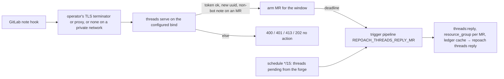

# A GitLab note starts one thread-reply pipeline

Amendment (0.7, 2026-11-18): personal strings replaced by placeholders (SP-SCRUB-PERSONAL-DATA-AT-HEAD D2); the fixture oracle is the class lint (D6).

## Amendment (0.6, 2026-11-18): the pipeline write is `create_pipeline`, not `dispatch_workflow`

After the verifier's fourth read. 0.5 reused the protocol's
`dispatch_workflow` for the pipeline creation. Its meaning on the
protocol and on GitHub is a workflow file (`gh workflow run <file>`,
`github.py:2028`), and `merge_wait.py:720` and `review_retry.py:214`
call it with `MERGE_WORKFLOW_FILE` and `{"pr": …}`: on GitLab those
calls would have started a pipeline on a ref named after a file, where
today they refuse cleanly (`gitlab.py:1169`). And `@write_barrier`
guards numbered writes, reading `pr_state(<first argument>)`
(`protocol.py:399-422`). D7 now calls a `GitLabForge`-only
`create_pipeline(ref, variables)` under `@unnumbered_write`
(`protocol.py:427`), and `dispatch_workflow` keeps refusing on GitLab.

## Amendment (0.5, 2026-11-18): one GitLab client, the pipeline write behind the barrier

After the verifier's third read. (1) D7 opened a second GitLab
client for its pipelines listing and its `POST /pipeline`; both now
go through the one `GitLabForge` the run holds. The write is a
pipeline creation on a ref with variables behind the write barrier
(0.6 names the method); the reads are `GitLabForge`
methods, not protocol ones, since GitHub has no equivalent and a
GitHub project's fallback is `review pr`. (2) The fork filter has a
data source, `merge_request_projects(iid)`, since `PullRequest`
carries no project ids (`protocol.py:462-471`). (3) The pipelines
listing pages by number until a short page. (4) D6's trigger call
stays outside the forge, and says why. (5) The 0.3 amendment named
the owner's host outside the example section; it no longer does.

## Amendment (0.4, 2026-11-18): the deadline has a clock, the fallback is bounded, the proxy hop is configured, the socket is checked, a fork is named

After the verifier's second read. (1) 0.3 never said how a
single-threaded `http.server` wakes at a coalescing deadline when no
further request arrives; D9 names the mechanism, `serve_forever`'s
`service_actions()` hook called every `coalesce_poll_seconds` (Python's
`socketserver.BaseServer.serve_forever(poll_interval)` calls it on every
loop, measured on 3.14.0: `Lib/socketserver.py`, `serve_forever`,
`self.service_actions()`), and a test with no second request pins it.
(2) The schedule of D7 would have re-triggered an MR every
`scheduled_fallback_minutes` for ever on a thread 8b never answers (an
escalated one, a deferral past its cap, a classification that keeps
failing); D7 now excludes a thread whose last bot reply ends `state:
escalated to owner` (8b D4 and step 7 make every never-answered thread
end so) and, for the rest, counts a comment as handled once a threads
pipeline newer than it exists on the MR's source branch, which bounds
the schedule to one pipeline per comment per MR, with the test of G5.
(3) D1 logged the first `X-Forwarded-For` address, which the client
writes; it logs the address `proxy_hops` from the right, the one the
operator's proxy appended, default `proxy_hops_default`. (4) The
non-loopback refusal of D9 applied to `--bind` only; it applies to the
`--listen-fd` socket's own address as well. (5) A note on a merge request
from a fork names a source project that is not the configured one and a
ref the trigger token cannot start; D5 refuses it with a named reason,
and D7 skips it the same way.

## Amendment (0.3, 2026-11-17): the receiver is for everyone; the owner's host is an example

Owner principle, 2026-11-17: repoach is for every user, host, reverse
proxy and GitLab, not for one machine. 0.2 made one host's facts (a
Docker bridge address, an nginx container, a firewall, one project's
CI file) the design, the defaults and the End state. This version keeps
0.2's corrections (the verified unit pair, the byte comparison on the
headers, the author filter, the bounded coalescer, the forge-read
fallback, the shared cache key) and makes them generic: the bind
address, the GitLab URL, the project and the bot login are
configuration; the secrets come from a credentials directory with four
documented ways to fill it; the unit pair is a sample that verifies on
any systemd ≥ 250 host; the generated jobs carry no runner tag; `doctor
--ci` names the jobs of a project's own CI file that a threads pipeline
would also run. The owner's deployment is one
labelled section at the end, with its measured facts, and is a
condition of nothing above it.

## Amendment (0.2, 2026-11-17): the unit verifies, the egress is honest, the flood is bounded, the fallback reads the forge

Re-measured on `origin/develop` `92cd241` and systemd `255.4` after the
verifier's read. (1) `IPAddressAllow=… <hostname>` is refused by
`systemd-analyze verify` ("Invalid address prefix is specified in
[Service] IPAddressAllow=, ignoring assignment", measured) and
`IPAddressDeny=any` then cut the trigger call and the resolver; D10 is a
socket-activated unit pair with no IP allow-list and a named reason.
(2) The token is compared on the headers alone, as bytes against bytes,
before any body is read; a missing or duplicated header is defined (D1).
(3) Only a `Note Hook` by someone other than the bot starts anything:
the bot's own replies, system notes and `Merge Request Hook` deliveries
start nothing (D5), since the MR pipeline already runs `review pr` on
every push. (4) One trigger per merge request per window, armed on the
first note and fired at the end of the window so the run reads every
note before it; bounded state; the job is single-flight per merge
request through `resource_group` (D3, D8). (5) The scheduled fallback
reads the forge, not N ledger caches (D7). (6) The generated
`threads:reply` job carries the per-merge-request ledger cache of
SP-CI-LEDGER-PERSISTS, which lands before this spec; the cache key of a
trigger pipeline is spelled with the variable the trigger carries and
resolves to the same key the review job writes (D8). (7) The trigger
token is piped into the credential store, never printed; the 401 line
never names the token (D1).

## Intent

Child 8c of SP-PR-THREADS-REMEMBER-AND-CLOSE. On GitHub, a reply in a
thread already starts `review pr` (`pull_request_review_comment`); on
GitLab, a note starts nothing, so the reply agent (8b) would run only at
the next push. This spec adds `repoach threads serve`, a small HTTP
receiver any project operator can run on any host, that authenticates a
GitLab note hook in constant time on its headers, refuses replays and
oversized bodies, and starts at most one `threads:reply` pipeline per
merge request per window on the project's GitLab, gitlab.com or
self-managed; a 15-minute schedule in the project's own CI is the
fallback for a lost delivery. Its two secrets are read from a
credentials directory, never from argv, the environment or a log line.

## Context

### repoach, measured on `origin/develop` `92cd241` (2026-11-17)

| # | Fact | Where |
|---|---|---|
| F1 | GitHub runs `review pr` on `pull_request_review_comment` (`created`) and `issue_comment`; `pull_request_review` runs the `rearm` job only (`github.event_name != 'pull_request_review'` in the `review` job's `if`); nothing to add there | `.github/workflows/auto-review.yml:17-30`, `:141-156`, `:566` |
| F2 | `repoach init --ci gitlab` writes the GitLab review job into `.repoach/ci/gitlab-review.yml`, pulled by `include:`; `.gitlab-ci.yml` itself is never edited; the generated job has no `cache:` on `92cd241` (SP-CI-LEDGER-PERSISTS adds it and lands before this spec) and tells the operator to set `REPOACH_GITLAB_TOKEN` as a masked CI/CD variable | `src/repoach/ci_entry/snippets.py:36`, `:93-119` (`:99`) |
| F3 | The findings ledger of a merge request lives in the merge request's CI cache when the project caches it (SP-CI-LEDGER-PERSISTS G1, key `repoach-ledger-mr-<iid>`), not on a host | SP-CI-LEDGER-PERSISTS D1, G1, F5 |
| F4 | `git grep -n "X-Gitlab" origin/develop -- src` → 0: repoach receives no webhook today | `git grep` |
| F5 | `Comment` carries `author`, `body`, `created_at`, `in_reply_to`, `thread_id`; `Forge.comments(number)` reads every inline comment and `review_threads(number)` every thread with `resolved`, `resolved_by` and, from 8a, `opened_by`; the forge's base URL is the project's (`[forge].url`, gitlab.com by default) | `src/repoach/forge/protocol.py:486-512`, `:724-747`; SP-FORGE-RESOLVES-THREADS D4 |
| F6 | `ci_doctor_lines(env, root)` reads the project's `.gitlab-ci.yml` jobs from 7b on (SP-CI-LEDGER-PERSISTS D3, G6) | SP-CI-LEDGER-PERSISTS Interface |

### GitLab (docs.gitlab.com, read 2026-11-17)

| # | Fact | Where |
|---|---|---|
| G1 | A pipeline started through `POST /projects/:id/trigger/pipeline` with a trigger token has `CI_PIPELINE_SOURCE = trigger`; one started with `POST /projects/:id/pipeline` (a token with `api` scope) has `api`; `variables[KEY]=value` passed either way are pipeline variables of the highest precedence; a trigger pipeline carries no `CI_MERGE_REQUEST_IID` | `docs.gitlab.com/ci/triggers/`; `docs.gitlab.com/api/pipelines/` |
| G2 | A `Note Hook` payload carries `user.username` (the note's author), `object_attributes.system` (true for a system note), `object_attributes.noteable_type`, and `merge_request.iid` / `merge_request.source_branch` / `merge_request.source_project_id` / `merge_request.target_project_id` when the note is on a merge request; `X-Gitlab-Event-UUID` names the delivery, `X-Gitlab-Token` carries the secret verbatim; GitLab emits no hook when a discussion is resolved | `docs.gitlab.com/user/project/integrations/webhook_events/` |
| G4 (0.4) | `GET /projects/:id/pipelines` takes `ref`, `source`, `updated_after` and returns `id`, `source`, `created_at`, `status` per pipeline | `docs.gitlab.com/api/pipelines/` |
| G3 | `workflow:rules` decides whether a pipeline exists; each job's `rules` decide whether it runs in it; a job with no `rules` runs in every pipeline the workflow admits; `resource_group` serialises the jobs that share its value and takes CI/CD variables | `docs.gitlab.com/ci/yaml/` |

### systemd, measured on `255.4-1ubuntu8.18` (2026-11-17)

| # | Fact | Consequence |
|---|---|---|
| S1 | `systemd-analyze verify` prints `Invalid address prefix is specified in [Service] IPAddressAllow=, ignoring assignment: <hostname>` on a hostname, and `Command <path> is not executable: No such file or directory` when `ExecStart`'s binary is absent on the verifying host; the unit pair of D10 with its binary present prints nothing, exit 0 | the directive takes addresses and prefixes only; the oracle of C3 runs where the binary exists, or with it stubbed |
| S2 | `LoadCredentialEncrypted=` / `LoadCredential=` hand a service files under `$CREDENTIALS_DIRECTORY`, readable by the service user only; `systemd-creds encrypt --with-key=host` binds a credential to the host without a TPM | the credentials directory of D2 is what systemd gives, and the same layout is what Docker secrets give under `/run/secrets` |
| S3 | A `.socket` unit with `FreeBind=yes` binds an address before the interface that carries it exists (Linux `IP_FREEBIND`) | a receiver bound to a bridge or VPN address needs no ordering on the service that creates the interface |

### Python, measured on 3.14.0 (2026-11-18)

| # | Fact | Consequence |
|---|---|---|
| P1 | `socketserver.BaseServer.serve_forever(poll_interval=0.5)` loops on a selector with that timeout and calls `self.service_actions()` on every iteration, request or none; `service_actions` is documented as the hook "called by the serve_forever() loop" | the coalescing deadline needs no thread and no timer: an override of `service_actions` runs `Coalescer.due(now)` once per poll (D9) |

## Decisions (2026-11-17; composite D10, D14, D15 applied; 0.2 and 0.3 items marked)

- D1. **Authentication, on the headers, before the body.** The request
  line and headers are read (`http.server` reads them before the
  handler runs; the body is not touched until the handler reads
  `rfile`). Exactly one `X-Gitlab-Token` header must be present
  (`headers.get_all("X-Gitlab-Token")` of length 1); its value, encoded
  back to the bytes the parser decoded (`latin-1`), is compared with the
  secret bytes by `hmac.compare_digest(bytes, bytes)` (the credential
  file's content with one trailing newline stripped). A missing header,
  two headers, a non-`latin-1` value or a mismatch is `401` with
  `Content-Length: 0` and `Connection: close` (the unread body is
  discarded with the connection), one log line `rejected: bad token
  from <address>` that never echoes the token, and no other work; the
  address is the peer's, or, with `--behind-proxy` (0.4), the address
  `proxy_hops` places from the right of the concatenated
  `X-Forwarded-For` values (default `proxy_hops_default`, 1: the address
  the operator's own proxy appended; a client can prepend values, never
  append after the trusting proxy), and when the header holds fewer
  values than `proxy_hops` the peer address is logged with ` (xff
  short)`. `compare_digest` on two byte strings of
  different lengths may reveal the lengths, never the bytes; a GitLab
  secret is one line, so the length is not a secret here.
- D2. **Where the secrets live** (0.3). Two files, `webhook_secret` and
  `trigger_token`, in one *credentials directory*, read once at startup
  into memory; the process refuses to start (exit 2, the credential
  named) when either is absent, empty or world-readable. The directory
  is `--secret-dir`, defaulting to `$CREDENTIALS_DIRECTORY` when set.
  Four documented ways fill it, none of them argv, the environment or a
  log: systemd `LoadCredentialEncrypted=` (ciphertext bound to the
  host, S2; the sample unit), systemd `LoadCredential=` (a root-only
  file systemd copies), Docker or Compose secrets (`/run/secrets/<name>`,
  the same layout), or any directory the operator owns with two files
  mode `0400`/`0600`. **No secret is in argv, in the environment, in a
  log line, or in a world-readable file.**
- D3. **Replay protection and coalescing** (0.2). Each delivery carries
  `X-Gitlab-Event-UUID` (exactly one; two is `202`, `ignore`, logged);
  the receiver keeps the last `replay_cache_entries` UUIDs in an LRU
  and answers `202`, `replay`, without acting on a seen one. A delivery
  with no UUID is coalesced only. Coalescing is per merge request with
  a bounded state machine: an accepted note on an idle MR *arms* it with
  a deadline `now + coalesce_window_seconds`; notes accepted while armed
  change nothing (the run that starts at the deadline reads the forge
  after them, so none is lost); at the deadline one trigger is sent and
  the MR is idle again; a note after the deadline arms anew. The
  deadline is observed by the server's clock, not by the next request:
  D9's `service_actions()` runs `Coalescer.due(now)` every
  `coalesce_poll_seconds`, so a trigger fires at most one poll after its
  deadline whether or not another request ever arrives (0.4). The armed
  set holds at most `coalesce_max_mrs` MRs; arming a further one fires
  the oldest armed MR at once. So a burst of notes, a redelivered hook
  and a flood each cost at most one pipeline per MR per window, the
  state is bounded by two constants, and the latest note is never
  dropped. The triggered run is itself idempotent (8b markers) and
  single-flight per MR (D8), so a trigger that slips through (a
  receiver restart loses its state) posts nothing twice.
- D4. **Size and shape limits.** `Content-Length` absent or not an
  integer is `400`, `Connection: close`; above `body_max_bytes` is
  `413`, `Connection: close`, nothing read; otherwise exactly
  `Content-Length` bytes are read and not one more; a non-JSON body or
  one whose `object_kind` is not `note` is `202` with no action and one
  log line; a `project.id` that is not the configured project is `202`,
  no action, logged as `foreign project <id>`. A reverse proxy in front
  may add its own body cap, method filter and rate limit; the receiver
  does not rely on them.
- D5. **What is accepted** (0.2). A `Note Hook` whose note is on a
  merge request (`merge_request.iid` present), is not a system note
  (`object_attributes.system` false) and whose author is not the bot
  (`user.username != <bot username>`, G2): the bot's own replies, the
  system notes a push or a resolve leaves, and every other event kind
  (`Merge Request Hook` included: a push already starts the MR
  pipeline, which runs `review pr` and 8b's handler) are `202`,
  `ignore`, one log line naming the reason. (0.4) A note on a merge
  request from a fork, `merge_request.source_project_id !=
  merge_request.target_project_id` (G2), is `202`, `ignore`, logged
  `fork merge request !<iid>: source project <id> is not the project;
  the reply agent runs in the merge request pipeline`: the trigger token
  starts pipelines on the configured project's refs (G1), and a fork's
  branch is not one; `ref=<source branch>` would start a pipeline on a
  same-named branch of the project, or fail. The fork's threads are
  handled by `review pr` in its merge request pipeline at the next push,
  as today. An accepted note arms its merge request (D3).
- D6. **The run executes in CI, not in-process** (F3): at the deadline
  the receiver `POST`s `<gitlab url>/api/v4/projects/<id>/trigger/pipeline`
  with `token=<trigger_token>`, `ref=<source branch of the last accepted
  note's payload>`, `variables[REPOACH_THREADS_REPLY_MR]=<iid>`
  (`CI_PIPELINE_SOURCE = trigger`, G1). The `threads:reply` job restores
  the MR's ledger cache, runs `repoach threads reply <iid> --json` and
  saves the cache. A trigger call that fails is logged `trigger failed
  for !<iid>: <status or exception type>` and the MR goes idle (GitLab
  retries nothing on a non-2xx except by hand; the schedule is the
  fallback, D7). The call leaves the host over HTTPS to the configured
  GitLab through the host's resolver; D10 says why no IP allow-list
  bounds it. (0.5) This trigger call stays outside the forge on
  purpose: it authenticates with the trigger token, a separate
  credential the forge never holds (D2).
- D7. **Fallback from the forge, not from the caches** (0.2). A pipeline
  schedule every `scheduled_fallback_minutes` with the variable
  `REPOACH_THREADS_SCHEDULE=1` runs one job, `threads:schedule`, which
  runs `repoach threads pending --json`: for every open merge request
  whose source project is the project (a fork, one whose
  `GitLabForge.merge_request_projects(iid)` names another source
  project, is skipped and listed with `skipped: fork`, 0.4, 0.5), through the forge alone (F5, no ledger),
  a comment is *unanswered* when it is on a thread whose `opened_by` is
  the bot and is that thread's last comment by someone other than the
  bot, or when its body starts with `/resolve` or `/reopen` and it is
  newer than the bot's newest comment on the MR. (0.4) Two exclusions
  bound the fallback. A thread whose last bot reply ends `state:
  escalated to owner` (8b `STATE_LINE_RE`) is never pending: 8b replies
  in it no more, by its step 7, and makes every thread it will never
  answer end so (a classification that fails three times, 8b D4). And
  an unanswered comment counts only while no *threads pipeline* is
  newer than it: `GitLabForge.pipelines_after(ref, since)` (0.5: `GET
  /projects/<id>/pipelines?ref=<source branch>&updated_after=<comment
  created_at>&per_page=100&page=<n>`, paged by number until a short
  page, as `unresolved_threads` pages its discussions,
  `gitlab.py:676-693`, since a long-lived merge request can hold more
  than one page of pipelines) filtered to `source` in `trigger`, `api`
  and to `created_at` later than the comment's (`updated_after` is a
  pre-filter on `updated_at`, the creation time is compared
  client-side), read with `REPOACH_GITLAB_TOKEN` through the one
  client the run already holds; a
  pipeline created after the comment ran a `threads reply` that read it
  (8b reads the forge at run time), whatever that run decided, a
  deferral past its cap included. A failed threads pipeline is the
  operator's to read in GitLab; the schedule does not re-run it, since
  that would loop. The MR is *pending* when one unanswered comment
  remains after both exclusions, so the schedule costs at most one
  pipeline per comment per MR, ever. For each pending MR the job
  calls `GitLabForge.create_pipeline(<source branch>,
  {"REPOACH_THREADS_REPLY_MR": "<iid>"})` (0.6): `POST
  /projects/<id>/pipeline` with `ref` and `variables[][key]` /
  `variables[][value]` through `_api`, under `@unnumbered_write`, the
  guard of a write that targets no existing change (`protocol.py:427`),
  so a read-only run refuses it like every write. It is a `GitLabForge`
  method, not a protocol one: the protocol's `dispatch_workflow` means
  a workflow file (`gh workflow run <file>`, `github.py:2028`;
  `merge_wait.py:720` and `review_retry.py:214` pass
  `MERGE_WORKFLOW_FILE`) and keeps refusing on GitLab (`gitlab.py:1169`),
  so those callers never start a pipeline on a ref named after a file.
  A GitHub project's fallback is `review pr`. The token is `REPOACH_GITLAB_TOKEN`, the
  one the generated review job already requires (F2;
  `CI_PIPELINE_SOURCE = api`, G1). No second secret exists for it, and
  no second client: the two reads this needs, `pipelines_after` and
  `merge_request_projects(iid) -> (source_project_id,
  target_project_id)` (the fork filter's data, absent from
  `PullRequest`, `protocol.py:462-471`), live on `GitLabForge` only,
  not on the protocol. The generated job writes no `tags:`; an operator who
  wants it on a given runner adds them in the project's CI file (0.3).
- D8. **Generated jobs and the pipeline kind** (0.2, 0.3). `repoach init
  --ci gitlab` writes two jobs into `.repoach/ci/gitlab-review.yml`
  (F2): `threads:reply`, rule `if: $REPOACH_THREADS_REPLY_MR` (the
  variable, whatever the source: `trigger` from the receiver, `api` from
  the schedule), `resource_group: threads-reply-$REPOACH_THREADS_REPLY_MR`
  (one run per MR at a time, G3; a second trigger waits, then finds the
  markers), and the ledger cache of SP-CI-LEDGER-PERSISTS with its key
  spelled `repoach-ledger-mr-$REPOACH_THREADS_REPLY_MR`, which resolves
  to the same string as the review job's `repoach-ledger-mr-
  $CI_MERGE_REQUEST_IID` for that MR (G1), so the two jobs share one
  cache; and `threads:schedule`, rule `if: $CI_PIPELINE_SOURCE ==
  "schedule" && $REPOACH_THREADS_SCHEDULE`, no cache. Both are
  `render_gitlab_threads_jobs(target, ledger: LedgerPlan)` in
  `snippets.py`. The project's own CI must admit the pipeline and keep
  its other jobs out of it (G3): `workflow:rules` gains `- if:
  $REPOACH_THREADS_REPLY_MR` before any rule that would refuse a branch
  pipeline, and every job without a rule that excludes it gains `- if:
  $REPOACH_THREADS_REPLY_MR` / `when: never`. Because that edit is the
  project's, `repoach doctor --ci` (F6) prints, from the checkout's
  `.gitlab-ci.yml`, one line `threads_pipeline=<job> would also run` for
  every job whose `rules` neither exclude `$REPOACH_THREADS_REPLY_MR`
  nor restrict the job to `merge_request_event`, and
  `threads_pipeline=ok` when there is none; `init --ci gitlab` prints the
  same lines after writing the file. A project that includes the
  generated file and whose jobs are all `merge_request_event` jobs
  needs the workflow rule only.
- D9. **The server.** Python's `http.server` on one thread, HTTP/1.1
  with `Connection: close` on every refusal, a request timeout of 10 s,
  the listening socket taken from systemd (`LISTEN_FDS=1`, fd 3,
  `--listen-fd`) or bound by `--bind HOST:PORT` (default
  `default_bind`, the loopback), `GET /healthz` → `200 ok`; no TLS (a
  reverse proxy, a tunnel or a TLS terminator in front of a non-loopback
  bind is the operator's; a plain-HTTP public bind would carry the token
  in clear and the receiver refuses to start on a non-loopback address
  unless `--behind-proxy` or `--allow-plain-http` is given, each named
  in the log; (0.4) the address judged is the one the server will
  answer on, `--bind`'s or the `--listen-fd` socket's own
  `getsockname()`, so a systemd socket on a public address is refused by
  the same rule with the same line); no other route. (0.4) The
  coalescing clock: the server is `Receiver(http.server.HTTPServer)`
  running `serve_forever(poll_interval=coalesce_poll_seconds)`, whose
  loop calls `service_actions()` once per poll whether or not a request
  arrived; the override calls `Coalescer.due(now)` and sends one trigger
  per MR returned, so a deadline is met within one poll of the server's
  own clock (`time.monotonic`, injectable for the tests). No thread, no
  timer: one thread owns the coalescer and the socket. One log line per
  request on stderr: method, path, event, MR, outcome, address; stdout
  prints nothing (SP-CLI-STDOUT-ONE-JSON). Non-secret settings
  (`--gitlab-url`, `--project-id`, `--bot-username`, `--bind`,
  `--behind-proxy`, `--proxy-hops`) are options, or the same names
  upper-cased with `REPOACH_THREADS_` in the environment, which an
  `EnvironmentFile=` may hold since none is a secret.
- D10. **The sample unit pair** (0.2, 0.3; `format:threads-receiver-unit`),
  shipped as `deploy/systemd/repoach-threads-receiver.socket`,
  `deploy/systemd/repoach-threads-receiver.service` and
  `deploy/systemd/threads-receiver.env.example`. Socket activation with
  `FreeBind=yes` binds the configured address at boot even when the
  interface that carries it (a bridge, a VPN) does not exist yet (S3),
  so no ordering on another service is needed; the sample binds the
  loopback and says where to change it. No `IPAddressAllow` /
  `IPAddressDeny`: the directive takes addresses and prefixes only
  (S1), the trigger call goes to a GitLab host whose addresses the
  operator does not control (gitlab.com answers from anycast
  addresses), and name resolution needs the host's resolver; an
  allow-list would either cut the call or be wide enough to mean
  nothing. The isolation is the bind address, an empty capability set, a
  strict filesystem, no device, no namespace, a system-call filter and
  the address families the server needs. The `ExecStart` path is the
  install's; the sample names `/usr/local/bin/repoach` and the comment
  says to edit it.

  ```ini
  # deploy/systemd/repoach-threads-receiver.socket
  # Edit ListenStream= to the address your reverse proxy or GitLab reaches.
  [Unit]
  Description=repoach GitLab note receiver socket (SP-GITLAB-NOTE-RECEIVER)

  [Socket]
  ListenStream=127.0.0.1:8787
  FreeBind=yes
  Backlog=64
  NoDelay=yes

  [Install]
  WantedBy=sockets.target
  ```

  ```ini
  # deploy/systemd/repoach-threads-receiver.service
  # Edit ExecStart= to your install path; put the non-secret settings in
  # /etc/repoach/threads-receiver.env (see threads-receiver.env.example);
  # create the two credentials with systemd-creds (D2).
  [Unit]
  Description=repoach GitLab note receiver (SP-GITLAB-NOTE-RECEIVER)
  Requires=repoach-threads-receiver.socket
  After=network-online.target repoach-threads-receiver.socket
  Wants=network-online.target

  [Service]
  Type=exec
  User=repoach-threads
  Group=repoach-threads
  EnvironmentFile=/etc/repoach/threads-receiver.env
  LoadCredentialEncrypted=webhook_secret:/etc/credstore.encrypted/webhook_secret.cred
  LoadCredentialEncrypted=trigger_token:/etc/credstore.encrypted/trigger_token.cred
  ExecStart=/usr/local/bin/repoach threads serve --listen-fd
  Restart=on-failure
  RestartSec=5s
  TimeoutStopSec=15s
  UMask=0077
  NoNewPrivileges=yes
  CapabilityBoundingSet=
  AmbientCapabilities=
  ProtectSystem=strict
  ProtectHome=yes
  PrivateTmp=yes
  PrivateDevices=yes
  ProtectKernelTunables=yes
  ProtectKernelModules=yes
  ProtectKernelLogs=yes
  ProtectControlGroups=yes
  ProtectClock=yes
  ProtectHostname=yes
  ProtectProc=invisible
  ProcSubset=pid
  RestrictAddressFamilies=AF_INET AF_INET6 AF_UNIX
  RestrictNamespaces=yes
  RestrictRealtime=yes
  RestrictSUIDSGID=yes
  LockPersonality=yes
  MemoryDenyWriteExecute=yes
  SystemCallArchitectures=native
  SystemCallFilter=@system-service
  SystemCallFilter=~@privileged @resources
  SystemCallErrorNumber=EPERM

  [Install]
  WantedBy=multi-user.target
  ```

  ```ini
  # deploy/systemd/threads-receiver.env.example (no secret belongs here)
  REPOACH_THREADS_GITLAB_URL=https://gitlab.com
  REPOACH_THREADS_PROJECT_ID=<project id>
  REPOACH_THREADS_BOT_USERNAME=<the login the review token posts as>
  REPOACH_THREADS_BEHIND_PROXY=1
  ```

  `threads serve` takes no secret option; `--secret-dir` defaults to
  `$CREDENTIALS_DIRECTORY` (D2).

## End state

An operator of any GitLab project has run `repoach init --ci gitlab`,
started `repoach threads serve` on a host their GitLab can reach (behind
their reverse proxy, a tunnel or a TLS terminator), and created the
webhook with `note_events` only. An author replies in a finding's
thread; within `coalesce_window_seconds` the receiver logs `accepted:
note on !<iid> by <login>` then `triggered: !<iid> → pipeline <id>`, and
the pipeline runs one job, `threads:reply`, whose log ends with 8b's
JSON and whose reply appears in the thread; the bot's own reply arrives
as a note and is logged `ignored: note by the bot`. A `POST` with a
wrong token gets `401` with no body read; `ps -o args= -C repoach` and
the process environment show no secret; `systemd-analyze verify`
prints nothing for the sample unit pair on a host where repoach is
installed at the path the unit names. Reference measurement (owner's
dogfood): one recorded run on the owner's deployment is in the example section, additional evidence and a condition of nothing.

## Easy solution rejected

Run `repoach threads reply` in-process on the receiver's host at each
note. Rejected: the ledger of a merge request lives in its CI cache
(F3), and running the agent on the host would need the model
gateway's credentials and the repository checkout there, a second
deployment of the review runner for one command. Also rejected: an
`EnvironmentFile` holding the secrets (a file in clear that every
`systemctl show-environment` and child process sees); `IPAddressAllow`
with the GitLab host's addresses, refused for a hostname and stale for
an anycast address (S1); `After=<the service that creates the
interface>` with a plain bind, which fails until the interface exists
and exhausts the start limit (socket activation with `FreeBind` removes
the ordering, S3); and a runner tag or a host address written into the
generated job or the sample unit, which would make one operator's
setup every operator's default.

## Hard part

The receiver is the one piece of repoach that listens to the Internet,
so every refusal must happen before any work and leak nothing: the
token is compared on the headers before the body is read, the body is
bounded before it is parsed, and a bad request is answered in constant
shape. And the delivery is unreliable in both directions (a lost hook,
a duplicate hook, a trigger call that fails, a receiver restart that
forgets what was armed), so correctness never rests on the receiver:
the window makes the run read every note before it, the job is
single-flight per merge request, the schedule re-runs what was lost
from what the forge shows, and the triggered run posts nothing twice.
The third hard part is the project's own CI file, which repoach never
edits: a threads pipeline admitted by the workflow runs every job
without a rule, so `doctor --ci` must say which, from the file as it is.

## Goals

- G1: `repoach threads serve` authenticates in constant time on the headers, bounds the body, refuses replays, accepts non-bot, non-system notes on merge requests only, and starts at most one triggered pipeline per merge request per window (D1–D6).
- G2: the two secrets come from a credentials directory with the four documented fillings; none reaches argv, environment, a log or a world-readable file (D2).
- G3: the `threads:reply` and `threads:schedule` jobs are generated with the ledger cache, the variable rule and the resource group, no runner tag (D8); the schedule reads the forge (D7).
- G4: the sample unit pair verifies clean on any systemd ≥ 250 host where the binary exists, is pinned by a test, and carries no operator-specific value (D10).
- G5: `repoach threads pending --json` names the pending merge requests from the forge alone, bounded to one pipeline per comment per MR, never a fork and never an escalated thread (D7); `doctor --ci` names the jobs a threads pipeline would also run (D8).
- G6 (0.4): a coalescing deadline fires within `coalesce_poll_seconds` of the server's clock with no further request (D3, D9); the non-loopback refusal judges the socket the server answers on, `--bind` or `--listen-fd` alike (D9); the logged client address is the configured proxy hop (D1); a fork merge request is refused by name (D5).

## Non-Goals

- NG1: no GitHub receiver (F1).
- NG2: no in-process run of the reply agent on the receiver's host (Easy solution rejected).
- NG3: no TLS in repoach, no reverse-proxy configuration shipped, no other route, no reaction to a `Merge Request Hook` (D5).
- NG4: the project's own files (its CI file, its proxy, its firewall, its webhook, its trigger token, its schedule) are the operator's; this spec ships the server, the generated jobs, the sample units and the `doctor --ci` lines that tell the operator what to change.
- NG5: no egress allow-list by IP (D10).
- NG6 (0.3): no default bound to one host, one project, one login or one runner.

## Assumptions

- A1: GitLab sends `X-Gitlab-Token`, `X-Gitlab-Event` and `X-Gitlab-Event-UUID` on every delivery and `user.username`, `object_attributes.system`, `merge_request.iid` and `merge_request.source_branch` in a merge-request note payload (G2; GitLab 15.x and later, gitlab.com and self-managed).
- A2: The trigger token may start a pipeline on any branch of the project (a project trigger token); `REPOACH_GITLAB_TOKEN` has `api` scope (it posts reviews today, F2).
- A3: The host runs systemd ≥ 250 when the sample unit pair is used; another supervisor fills the credentials directory its own way (D2).
- A4: When a reverse proxy sits in front, it forwards `X-Gitlab-Token`, `X-Gitlab-Event`, `X-Gitlab-Event-UUID` and appends the peer it saw to `X-Forwarded-For`; the operator sets `--behind-proxy` only then, and `--proxy-hops` to the number of proxies they trust in the chain (0.4; one by default). The address is for the log line only; nothing authenticates by it.
- A5 (0.4): `GET /projects/:id/pipelines` accepts `ref`, `updated_after` and returns `source` and `created_at` per pipeline (GitLab 14.3 and later, `docs.gitlab.com/api/pipelines/`); `merge_request.source_project_id` and `target_project_id` are in every merge-request note payload and in `GET /projects/:id/merge_requests`.

## Interface

```python
# src/repoach/review/thread_webhook.py (pure core + a thin server)
class HookDecision(BaseModel):
    status: int                       # 400 | 401 | 413 | 202
    action: Literal["arm", "ignore", "replay", "reject"]
    mr_iid: int | None = None
    source_branch: str = ""
    reason: str = ""                  # never carries the token

class ReceiverConfig(BaseModel):      # D9: options or REPOACH_THREADS_* environment, no secret
    gitlab_url: str = "https://gitlab.com"; project_id: int; bot_username: str
    bind: str = "127.0.0.1:8787"; listen_fd: bool = False; behind_proxy: bool = False; allow_plain_http: bool = False
    proxy_hops: int = 1               # D1 (0.4): which X-Forwarded-For value is the client, counted from the right
    secret_dir: Path                  # $CREDENTIALS_DIRECTORY when set

def client_address(peer: str, headers: Mapping[str, list[str]], *, behind_proxy: bool, proxy_hops: int) -> str: ...   # D1 (0.4), pure
def refuse_plain_public(address: tuple[str, int], *, behind_proxy: bool, allow_plain_http: bool) -> str | None: ...   # D9 (0.4): the refusal line, or None; applied to --bind and to the --listen-fd socket's getsockname()
def authenticate(headers: Mapping[str, list[str]], *, secret: bytes) -> HookDecision | None: ...   # D1, pure, headers only; None when accepted
def body_bound(headers: Mapping[str, list[str]], *, max_bytes: int) -> int | HookDecision: ...   # D4: the length to read, or 400 / 413
def classify(headers: Mapping[str, list[str]], body: bytes, *, project_id: int, bot_username: str, seen: ReplayCache) -> HookDecision: ...   # D3–D5, pure
class ReplayCache:                   # bounded LRU of X-Gitlab-Event-UUID, replay_cache_entries
class Coalescer:                     # D3: arm(iid, branch, now) -> None; due(now) -> list[tuple[int, str]]; at most coalesce_max_mrs armed
class Receiver(http.server.HTTPServer):   # D9 (0.4): service_actions() -> runs Coalescer.due(clock()) and trigger_pipeline per MR; serve_forever(poll_interval=coalesce_poll_seconds); clock injectable
def trigger_pipeline(*, gitlab_url: str, project_id: int, token: bytes, ref: str, mr_iid: int, post: Callable) -> int | None: ...   # D6
def load_credentials(secret_dir: Path) -> tuple[bytes, bytes]: ...   # D2; raises CredentialMissing(name) on absent, empty or world-readable
def serve(config: ReceiverConfig) -> None: ...   # D9
class PendingMR(BaseModel): iid: int; source_branch: str; unanswered: list[int]; skipped: Literal["", "fork", "escalated", "pipeline newer"]   # D7 (0.4)
def pending_merge_requests(forge: GitLabForge, *, bot_username: str) -> list[PendingMR]: ...   # D7 (0.5): forge reads (comments, review_threads, merge_request_projects) plus one paged pipelines_after listing per candidate comment; no ledger, no second client

# src/repoach/forge/gitlab.py (SP-UNIVERSAL-FORGE's file, edited under the edge, 0.5):
#   GitLabForge.create_pipeline(ref: str, variables: dict[str, str]) -> int   # POST /projects/<id>/pipeline, ref, one variables[][key]/[value] pair per entry, through _api under @unnumbered_write (protocol.py:427); returns the pipeline id; GitLabForge only. dispatch_workflow keeps refusing on GitLab (gitlab.py:1169)
#   GitLabForge.pipelines_after(ref: str, since: str) -> list[dict]   # GET /projects/<id>/pipelines?ref&updated_after&per_page=100&page=<n>, paged until a short page; GitLabForge only, not the protocol
#   GitLabForge.merge_request_projects(iid: int) -> tuple[int, int]   # (source_project_id, target_project_id) from GET /projects/<id>/merge_requests/<iid>; GitLabForge only

# src/repoach/cli/threads_cmds.py (8b's file, edited under the edge):
#   repoach threads serve [--listen-fd | --bind H:P] [--gitlab-url U] --project-id N --bot-username L [--behind-proxy [--proxy-hops N]] [--allow-plain-http] [--secret-dir D]
#       exit 2 on CredentialMissing (naming it) and on a non-loopback address, --bind's or the --listen-fd socket's, without --behind-proxy / --allow-plain-http (naming the rule)
#   repoach threads pending [--forge F] [--json]       (one JSON list, SP-CLI-STDOUT-ONE-JSON)
# src/repoach/ci_entry/snippets.py (SP-UNIVERSAL-CI-ENTRY's file): render_gitlab_threads_jobs(target, ledger: LedgerPlan) -> str, appended by render_gitlab_job (D7, D8); LedgerPlan is SP-CI-LEDGER-PERSISTS's
# src/repoach/ci_entry/cli.py (same owner): ci_doctor_lines gains the threads_pipeline= lines (D8); init --ci gitlab prints them
```

Inputs: the HTTP request (headers, body ≤ `body_max_bytes`);
`<secret dir>/webhook_secret`, `<secret dir>/trigger_token`; the
`ReceiverConfig` values.

Outputs: `400` / `401` / `413` / `202`; at most one trigger call per
armed merge request per window; one stderr line per request and per
trigger; `GET /healthz` → `200`.

Errors: `CredentialMissing` at startup → exit 2; a trigger failure →
logged, the MR idle; everything else about a body → `202` with a
reason, never a 5xx that would make GitLab retry a malformed body.

## Behavior

### Nominal
1. GitLab `POST`s a `Note Hook` for an author's reply on !371 to the
   URL the operator registered; the operator's proxy, if any, forwards
   the three GitLab headers and `X-Forwarded-For`.
2. `authenticate` on the headers (D1) → `body_bound` (D4) → the body
   is read → `classify`: UUID unseen (D3), `object_kind == "note"`,
   `system` false, `user.username` not the bot, `merge_request.iid ==
   371`, `project.id` the configured one (D5) → `arm`; `202`.
3. The coalescer arms !371 for `coalesce_window_seconds`; two more
   notes in the window are `202`, `arm`, and change nothing.
4. At the deadline, observed by `service_actions()` on the next poll
   with no request needed (D9), `trigger_pipeline` with `ref=<source
   branch>`, `REPOACH_THREADS_REPLY_MR=371`; the MR is idle.
5. The pipeline runs `threads:reply` (D8), which restores the MR's
   ledger cache and runs 8b, which reads the three notes.

### Edge cases
- the same delivery twice (same UUID) → `202`, `replay`, no state change.
- the bot's own reply → `202`, `ignore` (`note by the bot`); a system note (`added 1 commit`, `resolved all threads`) → `202`, `ignore`.
- a `Merge Request Hook` of any action → `202`, `ignore`; the push already runs the MR pipeline.
- a note on an issue (`merge_request` absent) → `202`, `ignore`.
- a note on a merge request from a fork (`source_project_id != target_project_id`) → `202`, `ignore`, `fork merge request !<iid>: …` (D5); the schedule lists it `skipped: fork` and triggers nothing (D7).
- a note arrives and the connection is the last one for an hour → the trigger still fires at the deadline, on the poll after it (D9); no request is needed.
- an escalated thread gets a third author comment → the receiver arms and triggers once (it reads no thread); 8b posts nothing; the schedule never lists it (`skipped: escalated`), and the comment's threads pipeline makes it `pipeline newer` for ever after (D7).
- `X-Forwarded-For: 203.0.113.9, 10.0.0.2` behind one trusted proxy → the log names `10.0.0.2`; `--proxy-hops 2` → `203.0.113.9`; a header with one value and `--proxy-hops 2` → the peer address with ` (xff short)`.
- `coalesce_max_mrs` MRs armed and a new one arrives → the oldest armed MR is triggered now, the new one armed.
- the receiver restarts while MRs are armed → the armed set is lost; the schedule (D7) finds the pending MRs within `scheduled_fallback_minutes`; a double trigger meets `resource_group` and the markers.
- `GET /hooks/gitlab` → `405` from the server (a proxy may refuse earlier).
- a thread resolved by hand on GitLab → no hook (G2); 8b's closer rule runs at the next note, push or scheduled run.
- the project's CI file has jobs without rules → `doctor --ci` names each as `threads_pipeline=<job> would also run`; the operator adds the exclusion; the generated jobs themselves never run outside their variable.

### Failure scenarios
- wrong, missing or duplicated token → `401`, `Connection: close`, no body read, one line without the token.
- `Content-Length: 5000000` → `413`, no read; no `Content-Length` → `400`.
- the trigger call fails (network, `403` token revoked) → logged `trigger failed for !371: <status>`, the MR idle; the schedule starts the run within `scheduled_fallback_minutes`.
- a credential absent, empty or world-readable at startup → `repoach threads serve` exits 2 with `credential webhook_secret missing in <dir>` (or `… readable by others`); systemd `Restart=on-failure` retries every `RestartSec` and the operator reads the journal.
- `--bind 0.0.0.0:8787` without `--behind-proxy` or `--allow-plain-http`, or `--listen-fd` on a systemd socket whose `getsockname()` is not a loopback address, without either → exit 2, `plain HTTP on a non-loopback address <addr> carries the token in clear; put a TLS terminator in front and pass --behind-proxy, or pass --allow-plain-http on a private network` (0.4: the same rule and line for both).
- the interface of the configured bind address does not exist yet at boot → the socket is bound anyway (`FreeBind`); the first connection arrives when it exists.

### Operator steps (any project; the project's files are the operator's, NG4)
1. Install repoach on the host; create the system user; fill the
   credentials directory (D2): with systemd, `read -rs S; printf '%s'
   "$S" | sudo systemd-creds encrypt --name=webhook_secret --with-key=host -
   /etc/credstore.encrypted/webhook_secret.cred` (the same `S` is used
   once more in step 3, then `unset S`), and the trigger token, created
   and stored in one pipe so it is never printed: `glab api --method
   POST projects/<id>/triggers -f description=repoach-threads-receiver |
   jq -r .token | sudo systemd-creds encrypt --name=trigger_token
   --with-key=host - /etc/credstore.encrypted/trigger_token.cred`; write
   `/etc/repoach/threads-receiver.env` from the example; install the two
   units, edit `ListenStream=` and `ExecStart=`, `systemctl enable --now
   repoach-threads-receiver.socket`; `systemd-analyze verify
   /etc/systemd/system/repoach-threads-receiver.{socket,service}` → no
   output.
2. Put the operator's TLS terminator or proxy in front when the bind is
   not the loopback; forward the three GitLab headers and
   `X-Forwarded-For`.
3. In the project: `repoach init --ci gitlab` (writes the two jobs and
   prints the `threads_pipeline=` lines); add the workflow rule and the
   exclusions `doctor --ci` names; create the webhook with the secret of
   step 1: `printf '{"url":"<public url>","note_events":true,"merge_requests_events":false,"push_events":false,"enable_ssl_verification":true,"token":"%s"}' "$S" | glab api --method POST projects/<id>/hooks -H 'Content-Type: application/json' --input - >/dev/null; unset S`;
   create the schedule, `glab api --method POST projects/<id>/pipeline_schedules -f description=repoach-threads-fallback -f ref=<default branch> -f cron='*/15 * * * *'`,
   and its variable `REPOACH_THREADS_SCHEDULE=1` through
   `pipeline_schedules/<sid>/variables`.

## Tests

| Test | What it pins | Mutation that must turn it red |
|---|---|---|
| `tests/unit/test_thread_webhook.py::test_bad_missing_or_duplicated_token_is_401_before_the_body_is_read` | D1: a wrong value, no header and two headers each give `401` with `Connection: close`; a body-reading spy sees no read; the log line holds no token | compare with `==`, read the body first, or accept the first of two headers |
| `::test_token_is_compared_as_bytes` | D1: a secret with a non-ASCII byte and the matching `latin-1` header value are accepted; the comparison is `hmac.compare_digest` on two `bytes` | compare `str` with `bytes` (a `TypeError`, a 5xx) |
| `::test_valid_note_arms_the_mr_and_one_trigger_fires_at_the_deadline_with_the_variable` | D3, D5, D6: three notes in the window → one trigger after the window, to the configured GitLab URL, with `REPOACH_THREADS_REPLY_MR` and the source branch; a note after the deadline arms again | trigger on the first note, drop the variable, or hard-code gitlab.com |
| `::test_deadline_fires_with_no_further_request` | D3, D9 (0.4): a `Receiver` on the loopback with `coalesce_window_seconds` 0.2 and a fake `post`, started on its own thread with `serve_forever(poll_interval=0.05)`; one valid note is sent, then nothing; within 1 s the fake `post` has been called once with the MR's iid, and `shutdown()` ends the thread; a second variant with an injected clock advances it past the deadline and calls `service_actions()` once directly → one trigger, a second call → none | fire only from the request handler, or drop the `service_actions` override |
| `::test_client_address_is_the_configured_proxy_hop` | D1 (0.4): peer `10.0.0.2`, `X-Forwarded-For: 203.0.113.9, 198.51.100.4`, `--behind-proxy` → `198.51.100.4`; `--proxy-hops 2` → `203.0.113.9`; `--proxy-hops 3` → `10.0.0.2 (xff short)`; without `--behind-proxy` the header is ignored and the peer logged | take the first value, or trust the header without the flag |
| `::test_fork_merge_request_note_is_ignored_by_name` | D5 (0.4): a note whose `merge_request.source_project_id` differs from `target_project_id` → `202`, `ignore`, reason starts `fork merge request !`; nothing armed | arm it, or trigger on the fork's branch name |
| `::test_listen_fd_on_a_non_loopback_socket_is_refused_like_bind` | D9 (0.4): a socket bound to `0.0.0.0:0` handed as fd 3 with `LISTEN_FDS=1` and neither flag → exit 2 with the rule naming the address; the same socket with `--behind-proxy` → starts; a socket on `127.0.0.1:0` → starts with neither flag | check `--bind` only |
| `::test_bot_system_and_merge_request_hook_are_ignored` | D5: a note by the bot, a system note, a `Merge Request Hook` `update` → `202`, `ignore`, nothing armed | arm on any of the three |
| `::test_same_uuid_twice_is_a_replay_and_the_armed_set_is_bounded` | D3: a seen UUID changes nothing; `coalesce_max_mrs + 1` MRs → the oldest fires at once, the set never exceeds the bound | drop the cache, or let the set grow |
| `::test_oversized_or_unsized_body_and_foreign_project` | D4: `413` and `400` before any read; a foreign `project.id` → `202`, `ignore` | read past the bound |
| `::test_trigger_failure_is_logged_and_the_mr_goes_idle` | failure scenario | return 500, or keep the MR armed forever |
| `::test_credentials_dir_is_the_only_source_and_refuses_bad_files` | D2: `webhook_secret` / `trigger_token` read from a temp directory; an absent, an empty and a `0644` file each exit 2 naming the credential; `$CREDENTIALS_DIRECTORY` is the default; nothing is read from the environment or argv | read `REPOACH_WEBHOOK_SECRET` from the environment, or accept a `0644` file |
| `::test_non_loopback_plain_bind_is_refused_unless_named` | D9: `--bind 0.0.0.0:8787` alone → exit 2 with the rule; with `--behind-proxy` or `--allow-plain-http` → starts | bind silently |
| `::test_pending_merge_requests_from_the_forge_alone` | D7: on a fake `GitLabForge`, an MR whose bot thread's last comment is the author's is pending; one whose last comment is the bot's is not; a `/resolve` comment newer than the bot's newest makes it pending; no ledger path is opened | read the ledger, or key on any comment |
| `::test_never_answerable_thread_stops_triggering` | D7 (0.4), G5: a bot thread whose last bot reply ends `state: escalated to owner` followed by two author comments → `skipped: escalated`, not pending, with an empty pipelines listing; a bot thread with an author comment and a `pipelines_after(branch, created_at)` answer holding one `source: api` pipeline created after it → `skipped: pipeline newer`, not pending; the same with the listing empty → pending; run twice with the listing recording the first run's trigger → the second run triggers nothing; a fork MR → `skipped: fork` | list an escalated thread, ignore the pipelines, or trigger a fork |
| `::test_gitlab_create_pipeline_pages_and_obeys_the_barrier` | D7 (0.6): on a `GitLabForge` whose `_api` is faked, `create_pipeline("feat/x", {"REPOACH_THREADS_REPLY_MR": "371"})` POSTs `/projects/<id>/pipeline` once with `ref=feat/x` and that one variable and returns the id; the same forge built read-only raises `ForgeWriteRefusedError` and POSTs nothing; `dispatch_workflow("merge.yml", {"pr": "371"})` still raises `ForgeError` and POSTs nothing; `pipelines_after("feat/x", t)` with a first page of 100 entries asks `page=2`, stops at the short page and returns all 130; `merge_request_projects(371)` returns the two ids of the recorded merge request | POST in read-only mode, read only the first page, or guess the project ids |
| `tests/unit/test_threads_receiver_unit.py::test_unit_pair_is_socket_activated_hardened_and_passes_no_secret` | D10: the socket has `ListenStream=` and `FreeBind=yes`; the service has `Requires=` the socket, two `LoadCredentialEncrypted=` lines, an `EnvironmentFile=` and no `Environment=` holding a token, `ProtectSystem=strict`, `CapabilityBoundingSet=` empty, no `IPAddressAllow`/`IPAddressDeny`, `RestrictAddressFamilies` naming `AF_INET AF_INET6 AF_UNIX`; no file under `deploy/systemd/` holds a hostname, an IP other than `127.0.0.1`, a login or a project id | add `IPAddressAllow=…`, or write a project id in the unit |
| `::test_systemd_analyze_verify_is_silent_on_the_sample_pair` | D10, S1: the two files copied to a temp directory with `ExecStart=`'s binary rewritten to `/bin/true` (the unit names an install path CI does not have), `systemd-analyze verify <socket> <service>` → empty output, exit 0; the test fails naming `systemd-analyze` when the binary is absent (CI runs on a systemd host) | add `IPAddressAllow=172.18.0.0/16 gitlab.com` |
| `tests/unit/test_threads_triggers.py::test_generated_gitlab_jobs_hold_threads_reply_with_cache_resource_group_and_the_schedule_without_tags` | D7, D8: the snippet carries both jobs, `rules` on `$REPOACH_THREADS_REPLY_MR`, `resource_group: threads-reply-$REPOACH_THREADS_REPLY_MR`, `cache.key: repoach-ledger-mr-$REPOACH_THREADS_REPLY_MR` on the `LedgerPlan` path, no `tags:`, the schedule rule on `$REPOACH_THREADS_SCHEDULE` | key the cache on `$CI_MERGE_REQUEST_IID`, drop the resource group, or write a runner tag |
| `::test_doctor_names_the_jobs_a_threads_pipeline_would_also_run` | D8: a `.gitlab-ci.yml` fixture with one job without rules, one `merge_request_event` job and one job excluding the variable → one `threads_pipeline=<job> would also run` line; all excluded → `threads_pipeline=ok` | list every job, or none |
| `::test_github_workflow_already_runs_review_pr_on_review_comments` | F1 pinned: `auto-review.yml` lists `pull_request_review_comment` with `created` and the `review` job excludes `pull_request_review` | remove the trigger |

## Success conditions

- C1 (external oracle, any deployment, by the operator): `curl -s -o /dev/null -w '%{http_code}\n' -X POST <public url> -H 'X-Gitlab-Token: wrong' -d '{}'` → `401`; on the host, `systemctl is-active repoach-threads-receiver.socket repoach-threads-receiver.service` → `active` twice; `ss -ltn | grep <port>` → the configured address only; `sudo cat /proc/$(systemctl show -p MainPID --value repoach-threads-receiver)/environ | tr '\0' '\n' | grep -ci token` → `0`; `ps -o args= -C repoach` shows no secret; `journalctl -u repoach-threads-receiver --since -1h | grep -c 'bad token from'` ≥ 1 after the `curl` and the line carries no token.
- C2 (external oracle, any project, by the operator): `glab api projects/<id>/hooks | jq '.[]|{url,note_events,merge_requests_events,push_events,enable_ssl_verification}'` shows one hook on the public URL with `note_events: true`, `merge_requests_events: false`, `push_events: false`, `enable_ssl_verification: true`; after one real author note on an open MR, `glab api 'projects/<id>/pipelines?source=trigger&per_page=1' | jq '.[0].status'` names a pipeline started within `coalesce_window_seconds + 60` s whose only job is `threads:reply` (`glab api projects/<id>/pipelines/<pid>/jobs | jq -r '.[].name'` → one line); `glab api 'projects/<id>/pipelines?source=api&per_page=1'` names the schedule's trigger after the hook is disabled for one window; `repoach doctor --ci` in the project's checkout prints `threads_pipeline=ok`.
- C3 (oracle: the suites and systemd, on a fresh machine or in CI): `pytest -q tests/unit/test_thread_webhook.py tests/unit/test_threads_receiver_unit.py tests/unit/test_threads_triggers.py tests/unit/test_ci_ledger_persists.py tests/unit/test_ci_entry.py` → green (the `systemd-analyze verify` test included); `repoach arch check --base origin/develop` → `edge-honesty: ok`; `repoach arch graph --check 2>&1 | grep -c 'dependency cycle'` → `27`; on a host where repoach is installed at the unit's `ExecStart` path, `systemd-analyze verify deploy/systemd/repoach-threads-receiver.socket deploy/systemd/repoach-threads-receiver.service` → no output, exit 0.

## Architecture Impact
- Adds dependency: SP-GITLAB-NOTE-RECEIVER -> SP-PR-THREADS-REMEMBER-AND-CLOSE (design source: D10, D14)
- Adds dependency: -> SP-THREAD-REPLY-AGENT (the command the pipeline runs; `threads serve` and `threads pending` register in its `threads_cmds.py`)
- Adds dependency (0.2, 0.5): -> SP-UNIVERSAL-FORGE (`pending_merge_requests` reads `comments` and `review_threads` through the protocol, D7; `forge/gitlab.py` is its, and the `create_pipeline`, `pipelines_after` and `merge_request_projects` of D7 are edits to that file, designed here and owned by no new spec; no cycle, since SP-UNIVERSAL-FORGE depends on nothing of this family)
- Adds dependency (0.5): -> SP-DRY-RUN-NEVER-POSTS (the pipeline creation passes its write barrier; a read-only run refuses it)
- Adds dependency: -> SP-UNIVERSAL-CI-ENTRY (`ci_entry/snippets.py` and `cli.py` are its; the two jobs and the `threads_pipeline=` lines are edits to them)
- Adds dependency: -> SP-CI-LEDGER-PERSISTS (`LedgerPlan`, the per-merge-request ledger cache the `threads:reply` job restores and saves, and the `.gitlab-ci.yml` reader of its D3 that the `threads_pipeline=` lines reuse, D8; it lands before this spec in the umbrella's order)
- Adds dependency: -> SP-CLI-STDOUT-ONE-JSON (the server logs on stderr, prints nothing on stdout; `threads pending --json` prints one document)
- New resources: `format:gitlab-note-webhook` (the headers and body shape `authenticate` and `classify` accept), `format:threads-receiver-unit` (the sample unit pair and the environment example). No table. No cycle: `thread_webhook.py` imports `repoach.forge` (the protocol and `GitLabForge`, for `pending_merge_requests`), the standard library and `pydantic`, nothing of `review/` beyond its own module.

## Diagram


## Acceptance Criteria
- [ ] AC1: `pytest -q tests/unit/test_thread_webhook.py tests/unit/test_threads_receiver_unit.py tests/unit/test_threads_triggers.py` → green. Today (`92cd241`): the files do not exist and `git grep -n "X-Gitlab" origin/develop -- src` → 0.
- [ ] AC2: `pytest -q tests/unit/test_ci_ledger_persists.py tests/unit/test_ci_entry.py` → green with the two generated jobs and the `threads_pipeline=` lines (`test_ci_ledger_persists.py` is SP-CI-LEDGER-PERSISTS's, landed before this spec).
- [ ] AC3: `repoach arch check --base origin/develop` → `edge-honesty: ok`; `scripts/lint_no_personal_data.py --tree deploy/systemd` and `--tree src/repoach/review` → `personal-data: ok` (judged when SP-NO-PERSONAL-DATA-GATE lands), and `grep -rn "172\.18\.\|67827362" deploy/systemd src/repoach/review/thread_webhook.py` → 0 (NG6).
- [ ] AC4 (live, by the operator of a deployment): the commands of C1 and C2 with their outputs, written beside them; the owner's run is the example below.

## Open Questions
- None.

## Example deployment: an operator's host, values replaced by placeholders, measured 2026-11-17

This section is an example of D1–D10 applied to one deployment. It is
not the design, not a default, and not a condition of the End state;
every value here is one operator's, its host, address and domains replaced by placeholders. Measured over `ssh <host>` and on Yoob
`origin/develop` `6ee04ab`.

| # | Fact | How the design applies |
|---|---|---|
| E1 | nginx is the container `yoob_nginx` (`nginx:1.25-alpine`) on `yoob_2_yoob_network`, subnet `172.18.0.0/16`, gateway `172.18.0.1`; `/etc/nginx` absent on the host; the bridge is `br-<12 hex>`, a name Docker assigns; `docker-compose.prod.yml` names `yoob_network` on nine services and pins no subnet (`:17`, `:68`, `:89`, `:149`, `:195`, `:228`, `:256`, `:281`, `:320`, `:325`) | the socket's `ListenStream=172.18.0.1:8787` (the bridge gateway, reachable from the container and the host only); `FreeBind` covers Docker starting after the socket; the Yoob MR pins `ipam: {config: [{subnet: 172.18.0.0/16, gateway: 172.18.0.1}]}` so the address cannot move; `REPOACH_THREADS_BEHIND_PROXY=1` |
| E2 | `ufw` active, six rules, all `ALLOW IN` from `Anywhere`: 22, 80, 443 (v4 and v6); a `tailscale0` interface holds two more | one rule by address, not interface: `ufw allow in proto tcp from 172.18.0.0/16 to 172.18.0.1 port 8787`; 8787 is never public |
| E3 | `product.example.com` → `203.0.113.10` directly; the certificate's SANs are `product.example.com`, `www.product.example.com`, `studio.product.example.com`; the `product.example.com` block is `listen 443 ssl http2; server_name product.example.com;` (`nginx/conf.d/yoob.conf:105-106`), its API locations already set `X-Real-IP` and `X-Forwarded-For` (`:131-132`); zones `api_limit`, `upload_limit` (`nginx/nginx.conf:45-46`) | public URL `https://product.example.com/hooks/repoach`: `location = /hooks/repoach { limit_req zone=hooks_limit burst=10 nodelay; client_max_body_size 1m; limit_except POST { deny all; } proxy_pass http://172.18.0.1:8787/hooks/gitlab; proxy_set_header X-Gitlab-Token $http_x_gitlab_token; proxy_set_header X-Gitlab-Event $http_x_gitlab_event; proxy_set_header X-Gitlab-Event-UUID $http_x_gitlab_event_uuid; proxy_set_header X-Forwarded-For $proxy_add_x_forwarded_for; }` in that block, a `hooks_limit` zone (`5r/s`); no new DNS record or certificate |
| E4 | `systemd 255 (255.4-1ubuntu8.18)`, `systemd-creds` present, `has-tpm2` → `partial -firmware`, resolver `systemd-resolved` at `127.0.0.53`; no repoach installed; runners `gitlab-runner-{light,heavy,deploy}.service` | D2's first filling, `--with-key=host`; a venv at `/opt/repoach-threads/venv`, `ExecStart=/opt/repoach-threads/venv/bin/repoach threads serve --listen-fd`; `systemd-analyze verify` on the desk (same build) printed nothing for the pair with the binary stubbed, and only `Command /opt/repoach-threads/venv/bin/repoach is not executable` with the real path, 2026-11-17 |
| E5 | Yoob's `workflow:rules`: `schedule` first, then `$CI_COMMIT_BRANCH && $CI_OPEN_MERGE_REQUESTS → never`, then `merge_request_event`, `main`/`develop`, `tp/`, tags (`.gitlab-ci.yml:12-29`); every job excludes pipeline kinds through the anchors `.never_on_schedule` (15 uses, `:312-314`) and `.never_on_a_tp_push` (`:326-328`); a schedule pipeline must hold `release:nightly` and nothing else, and the nightly needs its schedule variable; the shapes are pinned by `test_a_schedule_pipeline_contains_exactly_the_nightly_release_job`, `test_the_nightly_release_job_needs_the_schedule_variable`, `test_a_tp_push_pipeline_contains_exactly_the_tp_jobs` (`tests/scripts/test_gitlab_ci_invariants.py:3566`, `:3575`, `:3612`) | the Yoob MR adds `- if: $REPOACH_THREADS_REPLY_MR` before the `never` rule, a third anchor `.never_on_a_threads_run` on every job's rules, and two invariants tests recomputed from the YAML, `test_a_threads_run_pipeline_contains_exactly_the_threads_reply_job` and `test_a_threads_schedule_contains_exactly_the_threads_schedule_job`; `repoach doctor --ci` prints `threads_pipeline=ok` afterwards |
| E6 | Yoob does not `include:` the generated file (`grep -n "^include" .gitlab-ci.yml` → 0); its hand-written `review:gate` (`:1645-1669`) runs in `environment: review-gate` with `REPOACH_GITLAB_TOKEN` (`ci/review-gate.sh:143`), on `tags: [$YOOB_REVIEW_RUNNER_TAG]` (`"yoob-light"`, `:259`), with `cache: {key: repoach-ledger-mr-$CI_MERGE_REQUEST_IID, paths: [.repoach/], when: always}`; `repoach.toml` sets `[state] db_path = ".repoach/repoach.db"` (`:92-95`); B-174 sits at `docs/BACKLOG.md:212` | the Yoob MR writes the two jobs by hand, text equal to `render_gitlab_threads_jobs`, in `environment: review-gate`, with `tags: [yoob-light]` written literally (not `$YOOB_LIGHT_RUNNER_TAG`, which may name the metered shared runner) so the fallback costs no shared minutes; the cache key resolves to `review:gate`'s |
| E7 | Project `67827362`; the review bot's login is Yoob's `REPOACH_REVIEW_BOT_LOGIN` | `REPOACH_THREADS_PROJECT_ID=67827362`, `REPOACH_THREADS_BOT_USERNAME=<that login>` in `/etc/repoach/threads-receiver.env`; the webhook and the schedule created with the commands of Operator steps 3 on that project |

The owner's live run of C1 and C2 on this deployment is written here
after the rollout, as the example AC4 names.
